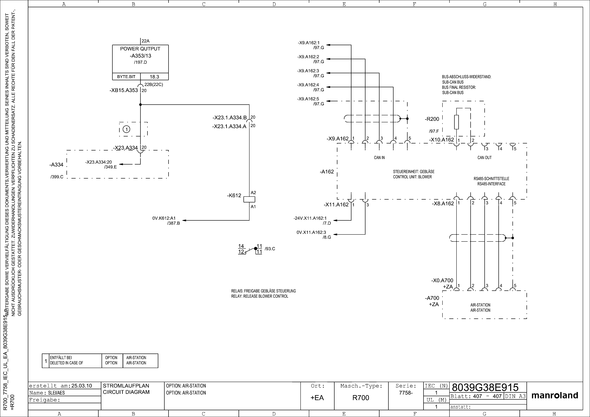

# +EA — Sheet 407 of 407 — OPTION: AIR STATION

**OPTION: AIR STATION**

> Part of the manroland **R700** printing press IEC/UL circuit diagrams.
> Drawing class: **Stromlaufplan / Circuit diagram** (DIN A3).
> Document `+EA` covers the **Printing unit** machine section.

## At a glance

| Field | Value |
|---|---|
| Document | `+EA`  (8039G38E915) |
| Sheet | **407** of 407 |
| Section (DE) | OPTION: AIR STATION |
| Section (EN) | OPTION: AIR STATION |
| Section type | CIRCUIT — Circuit diagram |
| Machine type | `R700` |
| Series | `7758` |
| Created | 25.03.10 |
| Replaces | — |
| Columns used | A, B, C, D, E, F, G |
| Path numbers | — |
| Labels on sheet | 97 |
| Cross-refs out | 12 |
| Cross-refs in | 36 |

**Previous:** [+EA sheet 406](SHEET_0406.md) · **Next:** [+FA sheet 1](../FA/SHEET_0001.md) · **Document TOC:** [_TOC.md](_TOC.md)  (+EA) · **Master TOC:** [all sheets](../_MASTER_TOC.md)

## Sheet image (300 DPI, exact vector render)



_Rendered directly from the PDF vector layer at 300 DPI (1-bit), no OCR and no resampling. Use it to confirm anything ambiguous in the text below._

## Cross-references on this sheet

Each entry is a wire leaving this sheet. The printed token is `/sheet.column`; the link resolves to that sheet inside the same document.

| Ref | Target sheet | Col | Path | Destination on target | Target section | From col |
|---|---|---|---|---|---|---|
| `/97.G` | [+EA sheet 97](SHEET_0097.md) | G | — | X9.A162:1 | BLASRAHMEN | E |
| `/97.G` | [+EA sheet 97](SHEET_0097.md) | G | — | X9.A162:2 | BLASRAHMEN | E |
| `/197.D` | [+EA sheet 197](SHEET_0197.md) | D | — | — | REFERENZMODUL | B |
| `/97.G` | [+EA sheet 97](SHEET_0097.md) | G | — | X9.A162:3 | BLASRAHMEN | E |
| `/97.G` | [+EA sheet 97](SHEET_0097.md) | G | — | X9.A162:4 | BLASRAHMEN | E |
| `/97.G` | [+EA sheet 97](SHEET_0097.md) | G | — | X9.A162:5 | BLASRAHMEN | E |
| `/97.F` | [+EA sheet 97](SHEET_0097.md) | F | — | — | BLASRAHMEN | F |
| `/349.E` | [+EA sheet 349](SHEET_0349.md) | E | — | X23.A334:20 | OPTION: VORBEREITUNG IONISATIONSANLAGE | B |
| `/399.C` | [+EA sheet 399](SHEET_0399.md) | C | — | — | OPTION: DÜNNDRUCKEINRICHTUNG | A |
| `/387.B` | [+EA sheet 387](SHEET_0387.md) | B | — | 0V.K612:A1 | OPTION: ZWISCHENTROCKNER VORBEREITUNG; | B |
| `/7.D` | [+EA sheet 7](SHEET_0007.md) | D | — | 24V.X11.A162:1 | SPANNUNGSVERSORGUNG: 400V, 24V | E |
| `/8.G` | [+EA sheet 8](SHEET_0008.md) | G | — | 0V.X11.A162:3 | SPANNUNGSVERSORGUNG: 400V, 24V | E |

### Incoming references (sheets that point here)

Every other sheet that sends a wire to this one. `Back-ref` is the token printed on *that* sheet; `Path` is its line number.

| From sheet | Cols | Back-ref | Path | Refs | What continues there |
|---|---|---|---|---|---|
| [+EA#7](SHEET_0007.md) | D | `/7.D` | — | 1 | 24V.X11.A162:1 |
| [+EA#8](SHEET_0008.md) | G | `/8.G` | — | 1 | 0V.X11.A162:3 |
| [+EA#93](SHEET_0093.md) | C | `/93.C` | — | 1 | — |
| [+EA#97](SHEET_0097.md) | E, F, G | `/97.E`, `/97.F`, `/97.G` | — | 6 | X9.A158:1 X9.A162:1 X9.A162:2; X9.A162:3; X9.A162:4; X9.A162:5 |
| [+EA#197](SHEET_0197.md) | D | `/197.D` | — | 1 | — |
| [+EA#206](SHEET_0206.md) | A | `/206.A` | — | 5 | — |
| [+EA#248](SHEET_0248.md) | B | `/248.B` | — | 5 | — |
| [+EA#251](SHEET_0251.md) | B | `/251.B` | — | 5 | — |
| [+EA#253](SHEET_0253.md) | F | `/253.F` | — | 2 | — |
| [+EA#255](SHEET_0255.md) | D | `/255.D` | — | 2 | — |
| [+EA#260](SHEET_0260.md) | F | `/260.F` | — | 1 | — |
| [+EA#265](SHEET_0265.md) | A, B, C | `/265.A`, `/265.B`, `/265.C` | — | 3 | — |
| [+EA#349](SHEET_0349.md) | E | `/349.E` | — | 1 | — |
| [+EA#387](SHEET_0387.md) | B | `/387.B` | — | 1 | — |
| [+EA#399](SHEET_0399.md) | B | `/399.B` | — | 1 | — |


## Devices on this sheet

| Tag | Class | Class meaning (IEC) | Col | Sub | Terminal | Sign |
|---|---|---|---|---|---|---|
| `A353/13` | A | Baugruppe / assembly, module, PC board | B | 13 | — | — |
| `A2` | A | Baugruppe / assembly, module, PC board | D | — | — | — |
| `A1` | A | Baugruppe / assembly, module, PC board | D | — | — | — |
| `K612` | K | Relais / relay, contactor | C | — | — | — |
| `A334` | A | Baugruppe / assembly, module, PC board | A | — | — | — |
| `A162` | A | Baugruppe / assembly, module, PC board | E | — | — | — |
| `R200` | R | Widerstand / resistor | F | — | — | — |
| `A700` | A | Baugruppe / assembly, module, PC board | F | — | — | — |
| `18.3` | — | cross-device reference | B | — | — | — |
| `XB15.A353` | — | cross-device reference | B | — | — | — |
| `X23.A334` | — | cross-device reference | B | — | — | — |
| `X23.1.A334.B` | — | cross-device reference | C | — | — | — |
| `X9.A162` | — | cross-device reference | E | — | — | — |
| `X10.A162` | — | cross-device reference | F | — | — | — |
| `X11.A162` | — | cross-device reference | E | — | — | — |
| `X8.A162` | — | cross-device reference | F | — | — | — |
| `X0.A700` | — | cross-device reference | F | — | — | — |
| `X23.1.A334.A` | — | cross-device reference | C | — | — | — |
| `X9.A162:5` | — | cross-device reference | D | — | 5 | — |
| `X9.A162:4` | — | cross-device reference | D | — | 4 | — |
| `X9.A162:3` | — | cross-device reference | D | — | 3 | — |
| `X9.A162:2` | — | cross-device reference | D | — | 2 | — |
| `X9.A162:1` | — | cross-device reference | D | — | 1 | — |
| `X23.A334:20` | — | cross-device reference | A | — | 20 | — |

## Potentials / nets

| Potential | Count | Columns | Attached devices | Terminals |
|---|---|---|---|---|
| `0V` | 2 | B, E | `A162`, `K612`, `X11` | `3`, `A1` |
| `24V` | 1 | E | `A162`, `X11` | `1` |


A potential such as `L24+/4` or `M24+` is a named supply/return rail; every place it appears on this sheet is electrically common.

## Wire-end annotations (grouped as printed)

A wire that continues elsewhere is annotated with a small cluster: the destination description, the path/line number `#NN`, and the `/sheet.column` cross reference. Each row below is one such cluster exactly as it is grouped on the drawing.

| Col | Y | Path | Cross-ref | Text on the wire |
|---|---|---|---|---|
| B | 79.0 | — | — | `22A` |
| E | 82.5 | — | `/97.G` | `X9.A162:1` |
| B | 94.1 | — | — | `POWER QUTPUT` |
| B | 108.0 | — | — | `A353/13` |
| E | 110.8 | — | `/97.G` | `X9.A162:2` |
| B | 121.8 | — | `/197.D` | — |
| E | 139.2 | — | `/97.G` | `X9.A162:3` |
| B | 150.9 | — | — | `BYTE.BIT 18.3` |
| G | 152.3 | — | — | `BUS ABSCHLUSS WIDERSTAND:` |
| G | 162.9 | — | — | `BUS FINAL RESISTOR: SUB CAN BUS` |
| B | 166.9 | — | — | `22B(22C)` |
| E | 167.5 | — | `/97.G` | `X9.A162:4` |
| B | 177.5 | — | — | `XB15.A353 20` |
| G | 184.2 | — | — | `SUB CAN BUS` |
| E | 195.9 | — | `/97.G` | `X9.A162:5` |
| C | 232.8 | — | — | `X23.1.A334.B 20` |
| F | 235.6 | — | — | `R200` |
| C | 249.8 | — | — | `X23.1.A334.A 20` |
| B | 257.7 | — | — | `1` |
| F | 261.1 | — | `/97.F` | — |
| E | 275.3 | — | — | `X9.A162 1 2 3 4` |
| F | 275.3 | — | — | `5 X10.A162 1 2` |
| B | 293.7 | — | — | `X23.A334 20` |
| G | 296.5 | — | — | `3 4 5` |
| F | 315.2 | — | — | `CAN IN CAN OUT` |
| B | 323.4 | — | `/349.E` | `X23.A334:20` |
| A | 327.7 | — | — | `A334` |
| E | 341.9 | — | — | `A162 STEUEREINHEIT: GEBLÄSE CONTROL UNIT: BLOWER` |
| A | 353.2 | — | `/399.C` | — |
| G | 357.8 | — | — | `RS485 SCHNITTSTELLE` |
| G | 368.4 | — | — | `RS485 INTERFACE` |
| D | 385.1 | — | — | `A2` |
| C | 390.1 | — | — | `K612` |
| F | 405.7 | — | — | `X11.A162 1 3 X8.A162 1 2 3 4 5` |
| D | 413.4 | — | — | `A1` |
| B | 436.8 | — | `/387.B` | `0V.K612:A1` |
| E | 436.8 | — | `/7.D` | `24V.X11.A162:1` |
| E | 465.1 | — | `/8.G` | `0V.X11.A162:3` |
| D | 492.1 | — | — | `14 12 11 11 /93.C` |
| F | 561.6 | — | — | `X0.A700 1` |
| G | 572.9 | — | — | `+ZA 2 3 4 5` |
| D | 584.5 | — | — | `RELAIS: FREIGABE GEBLÄSE STEUERUNG RELAY: RELEASE BLOWER CONTROL` |
| F | 597.0 | — | — | `A700` |
| G | 609.7 | — | — | `+ZA AIR STATION AIR STATION` |
| A | 719.2 | — | — | `1 ENTFÄLLT BEI DELETED IN CASE OF OPTION OPTION` |
| B | 719.2 | — | — | `AIR STATION AIR STATION` |


## Reconstructed tables

This sheet carries tabular content (pin map / terminal assignment / index). The grid below was rebuilt from the drawing's own rule lines, so each row is exactly one physical row of the table.

### Table 1 — 2 data rows × 2 columns (at x=226.8, y=90.7)

| POWER | QUTPUT A353/13 /197.D |
|---|---|
| `BYTE.BIT` | `18.3` |
| `XB15.A353` | `22B(22C) 20` |


### Table 2 — 0 data rows × 5 columns (at x=708.7, y=119.1) — **SUB CAN BUS FINAL SUB CAN R200**

_none_


### Table 3 — 0 data rows × 4 columns (at x=925.5, y=119.1) — **BUS ABSCHLUSS WIDERSTAND: BUS RESISTOR: BUS**

_none_


## Notes and free text on this sheet

| Text | Col | Y (pt) |
|---|---|---|
| `22A` | B | 78.95 |
| `22B(22C)` | B | 166.86 |
| `POWER QUTPUT` | B | 94.1 |
| `BYTE.BIT` | B | 151.43 |
| `11 /93.C` | D | 498.47 |
| `RELAIS: FREIGABE GEBLÄSE STEUERUNG` | D | 584.55 |
| `RELAY: RELEASE BLOWER CONTROL` | D | 595.18 |
| `STEUEREINHEIT: GEBLÄSE` | F | 343.6 |
| `CONTROL UNIT: BLOWER` | F | 354.25 |
| `BUS ABSCHLUSS WIDERSTAND:` | G | 152.26 |
| `SUB CAN BUS` | G | 162.91 |
| `BUS FINAL RESISTOR:` | G | 173.52 |
| `+ZA` | F | 574.24 |
| `AIR STATION` | G | 612.9 |
| `ENTFÄLLT BEI` | A | 719.17 |
| `DELETED IN CASE OF` | A | 729.83 |
| `OPTION` | B | 719.18 |
| `AIR STATION` | B | 719.2 |
| `CAN IN` | F | 315.24 |
| `CAN OUT` | G | 315.28 |
| `RS485 SCHNITTSTELLE` | G | 357.8 |
| `RS485 INTERFACE` | G | 368.43 |

## Complete label inventory (exact text from the drawing)

Every text object inside the drawing area of this sheet, in DIN reading order (column A→H, then top→bottom). This is the authoritative list: if a string is not here it is not printed on this sheet.

| Col | Y | X | Dir | Type | Text |
|---|---|---|---|---|---|
| A | 323.4 | 172.1 | → | device ref | `X23.A334:20` |
| A | 327.7 | 99.8 | → | device tag | `A334` |
| A | 353.2 | 102.0 | → | cross-reference | `/399.C` |
| A | 719.2 | 101.2 | → | text | `ENTFÄLLT BEI` |
| A | 724.5 | 89.6 | → | number | `1` |
| A | 729.8 | 101.2 | → | text | `DELETED IN CASE OF` |
| B | 78.9 | 286.0 | → | text | `22A` |
| B | 94.1 | 242.6 | → | text | `POWER QUTPUT` |
| B | 108.0 | 262.1 | → | device tag | `A353/13` |
| B | 121.8 | 270.7 | → | cross-reference | `/197.D` |
| B | 150.9 | 302.0 | → | device ref | `18.3` |
| B | 151.4 | 236.7 | → | text | `BYTE.BIT` |
| B | 166.9 | 291.7 | → | text | `22B(22C)` |
| B | 177.5 | 221.1 | → | device ref | `XB15.A353` |
| B | 178.9 | 286.0 | → | number | `20` |
| B | 257.7 | 253.4 | → | number | `1` |
| B | 293.7 | 228.2 | → | device ref | `X23.A334` |
| B | 293.7 | 286.0 | → | number | `20` |
| B | 333.3 | 210.3 | → | cross-reference | `/349.E` |
| B | 436.8 | 307.6 | → | potential | `0V.K612:A1` |
| B | 719.2 | 212.3 | → | text | `OPTION` |
| B | 719.2 | 255.1 | → | text | `AIR STATION` |
| B | 729.8 | 212.3 | → | text | `OPTION` |
| B | 729.8 | 255.1 | → | text | `AIR STATION` |
| C | 232.8 | 429.2 | → | device ref | `X23.1.A334.B` |
| C | 250.5 | 428.3 | → | device ref | `X23.1.A334.A` |
| C | 390.1 | 458.4 | → | device tag | `K612` |
| C | 446.7 | 337.6 | → | cross-reference | `/387.B` |
| D | 82.5 | 601.2 | → | device ref | `X9.A162:1` |
| D | 110.8 | 600.1 | → | device ref | `X9.A162:2` |
| D | 139.2 | 599.8 | → | device ref | `X9.A162:3` |
| D | 167.5 | 599.8 | → | device ref | `X9.A162:4` |
| D | 195.9 | 599.8 | → | device ref | `X9.A162:5` |
| D | 232.8 | 505.7 | → | number | `20` |
| D | 249.8 | 505.7 | → | number | `20` |
| D | 385.1 | 506.0 | → | device tag | `A2` |
| D | 413.4 | 506.0 | → | device tag | `A1` |
| D | 492.1 | 480.5 | → | number | `14` |
| D | 492.1 | 517.6 | → | number | `11` |
| D | 498.5 | 517.6 | → | text | `11 /93.C` |
| D | 503.4 | 480.5 | → | number | `12` |
| D | 584.5 | 466.9 | → | text | `RELAIS: FREIGABE GEBLÄSE STEUERUNG` |
| D | 595.2 | 466.9 | → | text | `RELAY: RELEASE BLOWER CONTROL` |
| E | 92.4 | 632.4 | → | cross-reference | `/97.G` |
| E | 120.7 | 632.4 | → | cross-reference | `/97.G` |
| E | 149.1 | 632.4 | → | cross-reference | `/97.G` |
| E | 177.4 | 632.4 | → | cross-reference | `/97.G` |
| E | 205.8 | 632.4 | → | cross-reference | `/97.G` |
| E | 275.3 | 659.3 | → | device ref | `X9.A162` |
| E | 275.3 | 710.6 | → | number | `1` |
| E | 275.3 | 739.6 | → | number | `2` |
| E | 341.9 | 645.4 | → | device tag | `A162` |
| E | 408.5 | 653.4 | → | device ref | `X11.A162` |
| E | 409.9 | 710.6 | → | number | `1` |
| E | 409.9 | 739.6 | → | number | `3` |
| E | 436.8 | 592.4 | → | potential | `24V.X11.A162:1` |
| E | 446.7 | 651.7 | → | cross-reference | `/7.D` |
| E | 465.2 | 598.7 | → | potential | `0V.X11.A162:3` |
| E | 475.1 | 651.4 | → | cross-reference | `/8.G` |
| F | 235.6 | 857.5 | → | device tag | `R200` |
| F | 261.0 | 866.0 | → | cross-reference | `/97.F` |
| F | 275.3 | 767.9 | → | number | `3` |
| F | 275.3 | 796.3 | → | number | `4` |
| F | 275.3 | 824.6 | → | number | `5` |
| F | 277.4 | 866.0 | → | device ref | `X10.A162` |
| F | 315.2 | 754.9 | → | text | `CAN IN` |
| F | 343.6 | 793.4 | → | text | `STEUEREINHEIT: GEBLÄSE` |
| F | 354.2 | 793.4 | → | text | `CONTROL UNIT: BLOWER` |
| F | 406.4 | 871.9 | → | device ref | `X8.A162` |
| F | 561.6 | 870.5 | → | device ref | `X0.A700` |
| F | 574.2 | 894.0 | → | text | `+ZA` |
| F | 597.0 | 858.0 | → | device tag | `A700` |
| F | 609.7 | 865.7 | → | text | `+ZA` |
| G | 152.3 | 892.1 | → | text | `BUS ABSCHLUSS WIDERSTAND:` |
| G | 162.9 | 892.6 | → | text | `SUB CAN BUS` |
| G | 173.5 | 892.1 | → | text | `BUS FINAL RESISTOR:` |
| G | 184.2 | 892.6 | → | text | `SUB CAN BUS` |
| G | 279.5 | 923.2 | → | number | `1` |
| G | 279.5 | 952.2 | → | number | `2` |
| G | 296.5 | 980.5 | → | number | `3` |
| G | 296.5 | 1008.9 | → | number | `4` |
| G | 296.5 | 1037.2 | → | number | `5` |
| G | 315.3 | 963.9 | → | text | `CAN OUT` |
| G | 357.8 | 956.2 | → | text | `RS485 SCHNITTSTELLE` |
| G | 368.4 | 963.6 | → | text | `RS485 INTERFACE` |
| G | 405.7 | 923.2 | → | number | `1` |
| G | 405.7 | 952.2 | → | number | `2` |
| G | 405.7 | 980.5 | → | number | `3` |
| G | 405.7 | 1008.9 | → | number | `4` |
| G | 405.7 | 1037.2 | → | number | `5` |
| G | 572.9 | 923.2 | → | number | `1` |
| G | 572.9 | 952.2 | → | number | `2` |
| G | 572.9 | 980.5 | → | number | `3` |
| G | 572.9 | 1008.9 | → | number | `4` |
| G | 572.9 | 1037.2 | → | number | `5` |
| G | 612.9 | 949.6 | → | text | `AIR STATION` |
| G | 623.5 | 949.6 | → | text | `AIR STATION` |

## Reading-order text block

The same content as a plain block, grouped by DIN column — convenient to paste or to match against a visual description.

```text
=== Column A ===
 323.4  172.1  devref       X23.A334:20
 327.7   99.8  devtag       A334
 353.2  102.0  xref         /399.C
 719.2  101.2  text         ENTFÄLLT BEI
 724.5   89.6  numeric      1
 729.8  101.2  text         DELETED IN CASE OF
=== Column B ===
  78.9  286.0  text         22A
  94.1  242.6  text         POWER QUTPUT
 108.0  262.1  devtag       A353/13
 121.8  270.7  xref         /197.D
 150.9  302.0  devref       18.3
 151.4  236.7  text         BYTE.BIT
 166.9  291.7  text         22B(22C)
 177.5  221.1  devref       XB15.A353
 178.9  286.0  numeric      20
 257.7  253.4  numeric      1
 293.7  228.2  devref       X23.A334
 293.7  286.0  numeric      20
 333.3  210.3  xref         /349.E
 436.8  307.6  net          0V.K612:A1
 719.2  212.3  text         OPTION
 719.2  255.1  text         AIR STATION
 729.8  212.3  text         OPTION
 729.8  255.1  text         AIR STATION
=== Column C ===
 232.8  429.2  devref       X23.1.A334.B
 250.5  428.3  devref       X23.1.A334.A
 390.1  458.4  devtag       K612
 446.7  337.6  xref         /387.B
=== Column D ===
  82.5  601.2  devref       X9.A162:1
 110.8  600.1  devref       X9.A162:2
 139.2  599.8  devref       X9.A162:3
 167.5  599.8  devref       X9.A162:4
 195.9  599.8  devref       X9.A162:5
 232.8  505.7  numeric      20
 249.8  505.7  numeric      20
 385.1  506.0  devtag       A2
 413.4  506.0  devtag       A1
 492.1  480.5  numeric      14
 492.1  517.6  numeric      11
 498.5  517.6  text         11 /93.C
 503.4  480.5  numeric      12
 584.5  466.9  text         RELAIS: FREIGABE GEBLÄSE STEUERUNG
 595.2  466.9  text         RELAY: RELEASE BLOWER CONTROL
=== Column E ===
  92.4  632.4  xref         /97.G
 120.7  632.4  xref         /97.G
 149.1  632.4  xref         /97.G
 177.4  632.4  xref         /97.G
 205.8  632.4  xref         /97.G
 275.3  659.3  devref       X9.A162
 275.3  710.6  numeric      1
 275.3  739.6  numeric      2
 341.9  645.4  devtag       A162
 408.5  653.4  devref       X11.A162
 409.9  710.6  numeric      1
 409.9  739.6  numeric      3
 436.8  592.4  net          24V.X11.A162:1
 446.7  651.7  xref         /7.D
 465.2  598.7  net          0V.X11.A162:3
 475.1  651.4  xref         /8.G
=== Column F ===
 235.6  857.5  devtag       R200
 261.0  866.0  xref         /97.F
 275.3  767.9  numeric      3
 275.3  796.3  numeric      4
 275.3  824.6  numeric      5
 277.4  866.0  devref       X10.A162
 315.2  754.9  text         CAN IN
 343.6  793.4  text         STEUEREINHEIT: GEBLÄSE
 354.2  793.4  text         CONTROL UNIT: BLOWER
 406.4  871.9  devref       X8.A162
 561.6  870.5  devref       X0.A700
 574.2  894.0  text         +ZA
 597.0  858.0  devtag       A700
 609.7  865.7  text         +ZA
=== Column G ===
 152.3  892.1  text         BUS ABSCHLUSS WIDERSTAND:
 162.9  892.6  text         SUB CAN BUS
 173.5  892.1  text         BUS FINAL RESISTOR:
 184.2  892.6  text         SUB CAN BUS
 279.5  923.2  numeric      1
 279.5  952.2  numeric      2
 296.5  980.5  numeric      3
 296.5 1008.9  numeric      4
 296.5 1037.2  numeric      5
 315.3  963.9  text         CAN OUT
 357.8  956.2  text         RS485 SCHNITTSTELLE
 368.4  963.6  text         RS485 INTERFACE
 405.7  923.2  numeric      1
 405.7  952.2  numeric      2
 405.7  980.5  numeric      3
 405.7 1008.9  numeric      4
 405.7 1037.2  numeric      5
 572.9  923.2  numeric      1
 572.9  952.2  numeric      2
 572.9  980.5  numeric      3
 572.9 1008.9  numeric      4
 572.9 1037.2  numeric      5
 612.9  949.6  text         AIR STATION
 623.5  949.6  text         AIR STATION
```

---
_Generated from the PDF vector text layer; no OCR. Source: `R700_7758_IEC_UL_EA_8039G38E915_p`, sheet 407._
