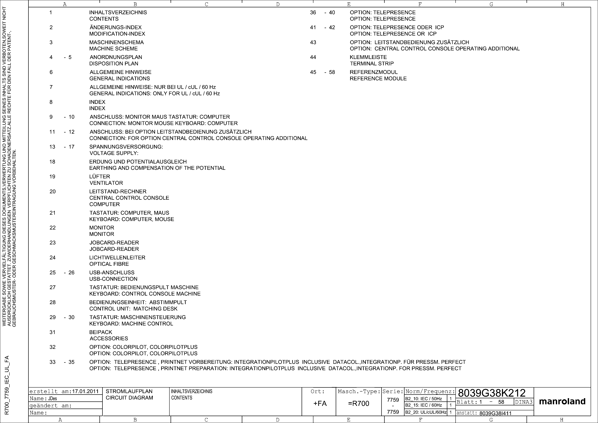

# +FA — Sheet 1 of 58 — INHALTSVERZEICHNIS

**CONTENTS**

> Part of the manroland **R700** printing press IEC/UL circuit diagrams.
> Drawing class: **Stromlaufplan / Circuit diagram** (DIN A3).
> Document `+FA` covers the **Delivery** machine section.

## At a glance

| Field | Value |
|---|---|
| Document | `+FA`  (8039G38K212) |
| Sheet | **1** of 58 |
| Section (DE) | INHALTSVERZEICHNIS |
| Section (EN) | CONTENTS |
| Section type | TOC — Contents |
| Machine type | `=R700` |
| Series | `7759` |
| Created | 17.01.2011 |
| Replaces | `8039G38I411` |
| Columns used | A, B, C, D, E, F |
| Path numbers | — |
| Labels on sheet | 98 |
| Cross-refs out | 0 |
| Cross-refs in | 0 |

**Previous:** [+EA sheet 407](../EA/SHEET_0407.md) · **Next:** [+FA sheet 2](SHEET_0002.md) · **Document TOC:** [_TOC.md](_TOC.md)  (+FA) · **Master TOC:** [all sheets](../_MASTER_TOC.md)

## Sheet image (300 DPI, exact vector render)



_Rendered directly from the PDF vector layer at 300 DPI (1-bit), no OCR and no resampling. Use it to confirm anything ambiguous in the text below._

## Cross-references on this sheet

Each entry is a wire leaving this sheet. The printed token is `/sheet.column`; the link resolves to that sheet inside the same document.

_No outgoing cross-references on this sheet._

## Devices on this sheet

_No device designators on this sheet._

## Potentials / nets

_No named potentials on this sheet._

## Wire-end annotations (grouped as printed)

A wire that continues elsewhere is annotated with a small cluster: the destination description, the path/line number `#NN`, and the `/sheet.column` cross reference. Each row below is one such cluster exactly as it is grouped on the drawing.

| Col | Y | Path | Cross-ref | Text on the wire |
|---|---|---|---|---|
| A | 20.1 | — | — | `1 INHALTSVERZEICHNIS CONTENTS` |
| E | 20.1 | — | — | `36 40 OPTION: TELEPRESENCE OPTION: TELEPRESENCE` |
| A | 49.8 | — | — | `2 MODIFICATION INDEX ÄNDERUNGS INDEX` |
| E | 49.8 | — | — | `41 42 OPTION: TELEPRESENCE ODER ICP OPTION: TELEPRESENCE OR ICP` |
| A | 79.5 | — | — | `3 MASCHINENSCHEMA MACHINE SCHEME` |
| F | 79.5 | — | — | `43 OPTION: LEITSTANDBEDIENUNG ZUSÄTZLICH OPTION: CENTRAL CONTROL CONSOLE OPERATING ADDITIONAL` |
| A | 109.2 | — | — | `4 5 DISPOSITION PLAN ANORDNUNGSPLAN` |
| E | 109.2 | — | — | `44 KLEMMLEISTE` |
| E | 122.0 | — | — | `TERMINAL STRIP` |
| B | 138.9 | — | — | `6 GENERAL INDICATIONS ALLGEMEINE HINWEISE` |
| E | 138.9 | — | — | `45 58 REFERENZMODUL REFERENCE MODULE` |
| B | 168.6 | — | — | `7 GENERAL INDICATIONS: ONLY FOR UL / cUL / 60 Hz ALLGEMEINE HINWEISE: NUR BEI UL / cUL / 60 Hz` |
| A | 198.3 | — | — | `8 INDEX INDEX` |
| B | 228.0 | — | — | `9 10 CONNECTION: MONITOR MOUSE KEYBOARD: COMPUTER ANSCHLUSS: MONITOR MAUS TASTATUR: COMPUTER` |
| C | 257.7 | — | — | `11 12 CONNECTION: FOR OPTION CENTRAL CONTROL CONSOLE OPERATING ADDITIONAL ANSCHLUSS: BEI OPTION LEITSTANDBEDIENUNG ZUSÄTZLICH` |
| B | 287.4 | — | — | `13 17 SPANNUNGSVERSORGUNG:` |
| B | 300.2 | — | — | `VOLTAGE SUPPLY:` |
| B | 317.1 | — | — | `18 ERDUNG UND POTENTIALAUSGLEICH EARTHING AND COMPENSATION OF THE POTENTIAL` |
| A | 346.8 | — | — | `19 LÜFTER` |
| B | 359.6 | — | — | `VENTILATOR` |
| B | 376.5 | — | — | `20 LEITSTAND RECHNER CENTRAL CONTROL CONSOLE COMPUTER` |
| B | 418.9 | — | — | `21 KEYBOARD: COMPUTER, MOUSE TASTATUR: COMPUTER, MAUS` |
| A | 448.6 | — | — | `22 MONITOR MONITOR` |
| A | 478.3 | — | — | `23 JOBCARD READER JOBCARD READER` |
| A | 508.0 | — | — | `24 LICHTWELLENLEITER OPTICAL FIBRE` |
| A | 537.7 | — | — | `25 26 USB ANSCHLUSS USB CONNECTION` |
| B | 567.4 | — | — | `27 KEYBOARD: CONTROL CONSOLE MACHINE TASTATUR: BEDIENUNGSPULT MASCHINE` |
| B | 597.1 | — | — | `28 BEDIENUNGSEINHEIT: ABSTIMMPULT CONTROL UNIT: MATCHING DESK` |
| B | 626.8 | — | — | `29 30 KEYBOARD: MACHINE CONTROL TASTATUR: MASCHINENSTEUERUNG` |
| A | 656.5 | — | — | `31 BEIPACK` |
| B | 669.2 | — | — | `ACCESSORIES` |
| B | 686.2 | — | — | `32 OPTION: COLORPILOT, COLORPILOTPLUS OPTION: COLORPILOT, COLORPILOTPLUS` |
| D | 715.9 | — | — | `33 35 OPTION: TELEPRESENCE , PRINTNET VORBEREITUNG: INTEGRATIONPILOTPLUS INCLUSIVE DATACOL.,INTEGRATIONP. FÜR PRESSM. PERFECT OPTION: TELEPRESENCE , PRINTNET PREPARATION: INTEGRATIONPILOTPLUS INCLUSIVE DATACOL.,INTEGRATIONP. FOR PRESSM. PERFECT` |


## Notes and free text on this sheet

| Text | Col | Y (pt) |
|---|---|---|
| `INHALTSVERZEICHNIS` | B | 20.19 |
| `CONTENTS` | B | 32.85 |
| `ÄNDERUNGS INDEX` | B | 49.87 |
| `MODIFICATION INDEX` | B | 62.61 |
| `MASCHINENSCHEMA` | B | 79.57 |
| `MACHINE SCHEME` | B | 92.27 |
| `ANORDNUNGSPLAN` | B | 109.25 |
| `DISPOSITION PLAN` | B | 121.99 |
| `ALLGEMEINE HINWEISE` | B | 138.96 |
| `GENERAL INDICATIONS` | B | 151.68 |
| `ALLGEMEINE HINWEISE: NUR BEI UL / cUL / 60 Hz` | B | 168.68 |
| `GENERAL INDICATIONS: ONLY FOR UL / cUL / 60 Hz` | B | 181.38 |
| `INDEX` | A | 198.39 |
| `ANSCHLUSS: MONITOR MAUS TASTATUR: COMPUTER` | B | 228.06 |
| `CONNECTION: MONITOR MOUSE KEYBOARD: COMPUTER` | B | 240.76 |
| `ANSCHLUSS: BEI OPTION LEITSTANDBEDIENUNG ZUSÄTZLICH` | B | 257.77 |
| `CONNECTION: FOR OPTION CENTRAL CONTROL CONSOLE OPERATING ADDITIONAL` | C | 270.46 |
| `SPANNUNGSVERSORGUNG:` | B | 287.44 |
| `VOLTAGE SUPPLY:` | B | 300.16 |
| `ERDUNG UND POTENTIALAUSGLEICH` | B | 317.16 |
| `EARTHING AND COMPENSATION OF THE POTENTIAL` | B | 329.85 |
| `LÜFTER` | A | 346.82 |
| `VENTILATOR` | B | 359.55 |
| `LEITSTAND RECHNER` | B | 376.55 |
| `CENTRAL CONTROL CONSOLE` | B | 389.23 |
| `COMPUTER` | B | 401.93 |
| `TASTATUR: COMPUTER, MAUS` | B | 418.93 |
| `KEYBOARD: COMPUTER, MOUSE` | B | 431.64 |
| `MONITOR` | B | 448.66 |
| `JOBCARD READER` | B | 478.32 |
| `LICHTWELLENLEITER` | B | 508.01 |
| `OPTICAL FIBRE` | B | 520.75 |
| `USB ANSCHLUSS` | B | 537.72 |
| `USB CONNECTION` | B | 550.44 |
| `TASTATUR: BEDIENUNGSPULT MASCHINE` | B | 567.43 |
| `KEYBOARD: CONTROL CONSOLE MACHINE` | B | 580.14 |
| `BEDIENUNGSEINHEIT: ABSTIMMPULT` | B | 597.15 |
| `CONTROL UNIT: MATCHING DESK` | B | 609.84 |
| `TASTATUR: MASCHINENSTEUERUNG` | B | 626.82 |
| `KEYBOARD: MACHINE CONTROL` | B | 639.54 |
| `BEIPACK` | B | 656.54 |
| `ACCESSORIES` | B | 669.23 |
| `OPTION: COLORPILOT, COLORPILOTPLUS` | B | 686.24 |
| `OPTION: TELEPRESENCE , PRINTNET VORBEREITUNG: INTEGRATIONPILOTPLUS INCLUSIVE DATACOL.,INTEGRATIONP. FÜR PRESSM. PERFECT` | D | 715.94 |
| `OPTION: TELEPRESENCE , PRINTNET PREPARATION: INTEGRATIONPILOTPLUS INCLUSIVE DATACOL.,INTEGRATIONP. FOR PRESSM. PERFECT` | D | 728.63 |
| `OPTION: TELEPRESENCE` | E | 20.17 |
| `OPTION: TELEPRESENCE ODER ICP` | F | 49.88 |
| `OPTION: TELEPRESENCE OR ICP` | F | 62.57 |
| `OPTION: LEITSTANDBEDIENUNG ZUSÄTZLICH` | F | 79.58 |
| `OPTION: CENTRAL CONTROL CONSOLE OPERATING ADDITIONAL` | F | 92.27 |
| `KLEMMLEISTE` | E | 109.26 |
| `TERMINAL STRIP` | E | 121.98 |
| `REFERENZMODUL` | E | 138.94 |
| `REFERENCE MODULE` | E | 151.64 |

## Complete label inventory (exact text from the drawing)

Every text object inside the drawing area of this sheet, in DIN reading order (column A→H, then top→bottom). This is the authoritative list: if a string is not here it is not printed on this sheet.

| Col | Y | X | Dir | Type | Text |
|---|---|---|---|---|---|
| A | 20.1 | 98.1 | → | number | `1` |
| A | 49.8 | 98.9 | → | number | `2` |
| A | 79.5 | 98.6 | → | number | `3` |
| A | 109.2 | 98.9 | → | number | `4` |
| A | 109.3 | 127.3 | → | number | `5` |
| A | 138.9 | 98.9 | → | number | `6` |
| A | 168.6 | 98.9 | → | number | `7` |
| A | 198.3 | 98.6 | → | number | `8` |
| A | 198.4 | 177.7 | → | text | `INDEX` |
| A | 211.1 | 177.7 | → | text | `INDEX` |
| A | 228.0 | 98.6 | → | number | `9` |
| A | 228.1 | 127.3 | → | number | `10` |
| A | 257.7 | 98.1 | → | number | `11` |
| A | 257.8 | 127.3 | → | number | `12` |
| A | 287.4 | 98.1 | → | number | `13` |
| A | 287.5 | 127.3 | → | number | `17` |
| A | 317.1 | 98.1 | → | number | `18` |
| A | 346.8 | 98.1 | → | number | `19` |
| A | 346.8 | 177.7 | → | text | `LÜFTER` |
| A | 376.5 | 98.9 | → | number | `20` |
| A | 418.9 | 98.9 | → | number | `21` |
| A | 448.6 | 98.9 | → | number | `22` |
| A | 478.3 | 98.9 | → | number | `23` |
| A | 508.0 | 98.9 | → | number | `24` |
| A | 537.7 | 98.9 | → | number | `25` |
| A | 537.8 | 127.3 | → | number | `26` |
| A | 567.4 | 98.9 | → | number | `27` |
| A | 597.1 | 98.9 | → | number | `28` |
| A | 626.8 | 98.9 | → | number | `29` |
| A | 626.9 | 127.3 | → | number | `30` |
| A | 656.5 | 98.6 | → | number | `31` |
| A | 686.2 | 98.6 | → | number | `32` |
| A | 715.9 | 98.6 | → | number | `33` |
| A | 716.0 | 127.3 | → | number | `35` |
| B | 20.2 | 177.7 | → | text | `INHALTSVERZEICHNIS` |
| B | 32.8 | 178.0 | → | text | `CONTENTS` |
| B | 49.9 | 178.9 | → | text | `ÄNDERUNGS INDEX` |
| B | 62.6 | 177.7 | → | text | `MODIFICATION INDEX` |
| B | 79.6 | 177.7 | → | text | `MASCHINENSCHEMA` |
| B | 92.3 | 177.7 | → | text | `MACHINE SCHEME` |
| B | 109.2 | 178.9 | → | text | `ANORDNUNGSPLAN` |
| B | 122.0 | 177.7 | → | text | `DISPOSITION PLAN` |
| B | 139.0 | 178.9 | → | text | `ALLGEMEINE HINWEISE` |
| B | 151.7 | 178.0 | → | text | `GENERAL INDICATIONS` |
| B | 168.7 | 178.9 | → | text | `ALLGEMEINE HINWEISE: NUR BEI UL / cUL / 60 Hz` |
| B | 181.4 | 178.0 | → | text | `GENERAL INDICATIONS: ONLY FOR UL / cUL / 60 Hz` |
| B | 228.1 | 178.9 | → | text | `ANSCHLUSS: MONITOR MAUS TASTATUR: COMPUTER` |
| B | 240.8 | 178.0 | → | text | `CONNECTION: MONITOR MOUSE KEYBOARD: COMPUTER` |
| B | 257.8 | 178.9 | → | text | `ANSCHLUSS: BEI OPTION LEITSTANDBEDIENUNG ZUSÄTZLICH` |
| B | 287.4 | 178.0 | → | text | `SPANNUNGSVERSORGUNG:` |
| B | 300.2 | 178.6 | → | text | `VOLTAGE SUPPLY:` |
| B | 317.2 | 177.7 | → | text | `ERDUNG UND POTENTIALAUSGLEICH` |
| B | 329.9 | 177.7 | → | text | `EARTHING AND COMPENSATION OF THE POTENTIAL` |
| B | 359.5 | 178.6 | → | text | `VENTILATOR` |
| B | 376.5 | 177.7 | → | text | `LEITSTAND RECHNER` |
| B | 389.2 | 178.0 | → | text | `CENTRAL CONTROL CONSOLE` |
| B | 401.9 | 178.0 | → | text | `COMPUTER` |
| B | 418.9 | 178.3 | → | text | `TASTATUR: COMPUTER, MAUS` |
| B | 431.6 | 177.7 | → | text | `KEYBOARD: COMPUTER, MOUSE` |
| B | 448.7 | 177.7 | → | text | `MONITOR` |
| B | 461.4 | 177.7 | → | text | `MONITOR` |
| B | 478.3 | 178.3 | → | text | `JOBCARD READER` |
| B | 491.0 | 178.3 | → | text | `JOBCARD READER` |
| B | 508.0 | 177.7 | → | text | `LICHTWELLENLEITER` |
| B | 520.8 | 178.0 | → | text | `OPTICAL FIBRE` |
| B | 537.7 | 177.7 | → | text | `USB ANSCHLUSS` |
| B | 550.4 | 177.7 | → | text | `USB CONNECTION` |
| B | 567.4 | 178.3 | → | text | `TASTATUR: BEDIENUNGSPULT MASCHINE` |
| B | 580.1 | 177.7 | → | text | `KEYBOARD: CONTROL CONSOLE MACHINE` |
| B | 597.2 | 177.7 | → | text | `BEDIENUNGSEINHEIT: ABSTIMMPULT` |
| B | 609.8 | 178.0 | → | text | `CONTROL UNIT: MATCHING DESK` |
| B | 626.8 | 178.3 | → | text | `TASTATUR: MASCHINENSTEUERUNG` |
| B | 639.5 | 177.7 | → | text | `KEYBOARD: MACHINE CONTROL` |
| B | 656.5 | 177.7 | → | text | `BEIPACK` |
| B | 669.2 | 178.9 | → | text | `ACCESSORIES` |
| B | 686.2 | 178.0 | → | text | `OPTION: COLORPILOT, COLORPILOTPLUS` |
| B | 698.9 | 178.0 | → | text | `OPTION: COLORPILOT, COLORPILOTPLUS` |
| C | 270.5 | 178.0 | → | text | `CONNECTION: FOR OPTION CENTRAL CONTROL CONSOLE OPERATING ADDITIONAL` |
| D | 20.1 | 617.4 | → | number | `36` |
| D | 49.8 | 617.7 | → | number | `41` |
| D | 79.5 | 617.7 | → | number | `43` |
| D | 109.2 | 617.7 | → | number | `44` |
| D | 138.9 | 617.7 | → | number | `45` |
| D | 715.9 | 178.0 | → | text | `OPTION: TELEPRESENCE , PRINTNET VORBEREITUNG: INTEGRATIONPILOTPLUS INCLUSIVE DATACOL.,INTEGRATIONP. FÜR PRESSM. PERFECT` |
| D | 728.6 | 178.0 | → | text | `OPTION: TELEPRESENCE , PRINTNET PREPARATION: INTEGRATIONPILOTPLUS INCLUSIVE DATACOL.,INTEGRATIONP. FOR PRESSM. PERFECT` |
| E | 20.2 | 646.0 | → | number | `40` |
| E | 20.2 | 696.8 | → | text | `OPTION: TELEPRESENCE` |
| E | 32.9 | 696.8 | → | text | `OPTION: TELEPRESENCE` |
| E | 49.9 | 646.0 | → | number | `42` |
| E | 109.3 | 696.5 | → | text | `KLEMMLEISTE` |
| E | 122.0 | 697.0 | → | text | `TERMINAL STRIP` |
| E | 138.9 | 696.5 | → | text | `REFERENZMODUL` |
| E | 139.0 | 646.0 | → | number | `58` |
| E | 151.6 | 696.5 | → | text | `REFERENCE MODULE` |
| F | 49.9 | 696.8 | → | text | `OPTION: TELEPRESENCE ODER ICP` |
| F | 62.6 | 696.8 | → | text | `OPTION: TELEPRESENCE OR ICP` |
| F | 79.6 | 696.8 | → | text | `OPTION: LEITSTANDBEDIENUNG ZUSÄTZLICH` |
| F | 92.3 | 696.8 | → | text | `OPTION: CENTRAL CONTROL CONSOLE OPERATING ADDITIONAL` |

## Reading-order text block

The same content as a plain block, grouped by DIN column — convenient to paste or to match against a visual description.

```text
=== Column A ===
  20.1   98.1  numeric      1
  49.8   98.9  numeric      2
  79.5   98.6  numeric      3
 109.2   98.9  numeric      4
 109.3  127.3  numeric      5
 138.9   98.9  numeric      6
 168.6   98.9  numeric      7
 198.3   98.6  numeric      8
 198.4  177.7  text         INDEX
 211.1  177.7  text         INDEX
 228.0   98.6  numeric      9
 228.1  127.3  numeric      10
 257.7   98.1  numeric      11
 257.8  127.3  numeric      12
 287.4   98.1  numeric      13
 287.5  127.3  numeric      17
 317.1   98.1  numeric      18
 346.8   98.1  numeric      19
 346.8  177.7  text         LÜFTER
 376.5   98.9  numeric      20
 418.9   98.9  numeric      21
 448.6   98.9  numeric      22
 478.3   98.9  numeric      23
 508.0   98.9  numeric      24
 537.7   98.9  numeric      25
 537.8  127.3  numeric      26
 567.4   98.9  numeric      27
 597.1   98.9  numeric      28
 626.8   98.9  numeric      29
 626.9  127.3  numeric      30
 656.5   98.6  numeric      31
 686.2   98.6  numeric      32
 715.9   98.6  numeric      33
 716.0  127.3  numeric      35
=== Column B ===
  20.2  177.7  text         INHALTSVERZEICHNIS
  32.8  178.0  text         CONTENTS
  49.9  178.9  text         ÄNDERUNGS INDEX
  62.6  177.7  text         MODIFICATION INDEX
  79.6  177.7  text         MASCHINENSCHEMA
  92.3  177.7  text         MACHINE SCHEME
 109.2  178.9  text         ANORDNUNGSPLAN
 122.0  177.7  text         DISPOSITION PLAN
 139.0  178.9  text         ALLGEMEINE HINWEISE
 151.7  178.0  text         GENERAL INDICATIONS
 168.7  178.9  text         ALLGEMEINE HINWEISE: NUR BEI UL / cUL / 60 Hz
 181.4  178.0  text         GENERAL INDICATIONS: ONLY FOR UL / cUL / 60 Hz
 228.1  178.9  text         ANSCHLUSS: MONITOR MAUS TASTATUR: COMPUTER
 240.8  178.0  text         CONNECTION: MONITOR MOUSE KEYBOARD: COMPUTER
 257.8  178.9  text         ANSCHLUSS: BEI OPTION LEITSTANDBEDIENUNG ZUSÄTZLICH
 287.4  178.0  text         SPANNUNGSVERSORGUNG:
 300.2  178.6  text         VOLTAGE SUPPLY:
 317.2  177.7  text         ERDUNG UND POTENTIALAUSGLEICH
 329.9  177.7  text         EARTHING AND COMPENSATION OF THE POTENTIAL
 359.5  178.6  text         VENTILATOR
 376.5  177.7  text         LEITSTAND RECHNER
 389.2  178.0  text         CENTRAL CONTROL CONSOLE
 401.9  178.0  text         COMPUTER
 418.9  178.3  text         TASTATUR: COMPUTER, MAUS
 431.6  177.7  text         KEYBOARD: COMPUTER, MOUSE
 448.7  177.7  text         MONITOR
 461.4  177.7  text         MONITOR
 478.3  178.3  text         JOBCARD READER
 491.0  178.3  text         JOBCARD READER
 508.0  177.7  text         LICHTWELLENLEITER
 520.8  178.0  text         OPTICAL FIBRE
 537.7  177.7  text         USB ANSCHLUSS
 550.4  177.7  text         USB CONNECTION
 567.4  178.3  text         TASTATUR: BEDIENUNGSPULT MASCHINE
 580.1  177.7  text         KEYBOARD: CONTROL CONSOLE MACHINE
 597.2  177.7  text         BEDIENUNGSEINHEIT: ABSTIMMPULT
 609.8  178.0  text         CONTROL UNIT: MATCHING DESK
 626.8  178.3  text         TASTATUR: MASCHINENSTEUERUNG
 639.5  177.7  text         KEYBOARD: MACHINE CONTROL
 656.5  177.7  text         BEIPACK
 669.2  178.9  text         ACCESSORIES
 686.2  178.0  text         OPTION: COLORPILOT, COLORPILOTPLUS
 698.9  178.0  text         OPTION: COLORPILOT, COLORPILOTPLUS
=== Column C ===
 270.5  178.0  text         CONNECTION: FOR OPTION CENTRAL CONTROL CONSOLE OPERATING ADDITIONAL
=== Column D ===
  20.1  617.4  numeric      36
  49.8  617.7  numeric      41
  79.5  617.7  numeric      43
 109.2  617.7  numeric      44
 138.9  617.7  numeric      45
 715.9  178.0  text         OPTION: TELEPRESENCE , PRINTNET VORBEREITUNG: INTEGRATIONPILOTPLUS INCLUSIVE DATACOL.,INTEGRATIONP. FÜR PRESSM. PERFECT
 728.6  178.0  text         OPTION: TELEPRESENCE , PRINTNET PREPARATION: INTEGRATIONPILOTPLUS INCLUSIVE DATACOL.,INTEGRATIONP. FOR PRESSM. PERFECT
=== Column E ===
  20.2  646.0  numeric      40
  20.2  696.8  text         OPTION: TELEPRESENCE
  32.9  696.8  text         OPTION: TELEPRESENCE
  49.9  646.0  numeric      42
 109.3  696.5  text         KLEMMLEISTE
 122.0  697.0  text         TERMINAL STRIP
 138.9  696.5  text         REFERENZMODUL
 139.0  646.0  numeric      58
 151.6  696.5  text         REFERENCE MODULE
=== Column F ===
  49.9  696.8  text         OPTION: TELEPRESENCE ODER ICP
  62.6  696.8  text         OPTION: TELEPRESENCE OR ICP
  79.6  696.8  text         OPTION: LEITSTANDBEDIENUNG ZUSÄTZLICH
  92.3  696.8  text         OPTION: CENTRAL CONTROL CONSOLE OPERATING ADDITIONAL
```

---
_Generated from the PDF vector text layer; no OCR. Source: `R700_7759_IEC_UL_FA`, sheet 1._
