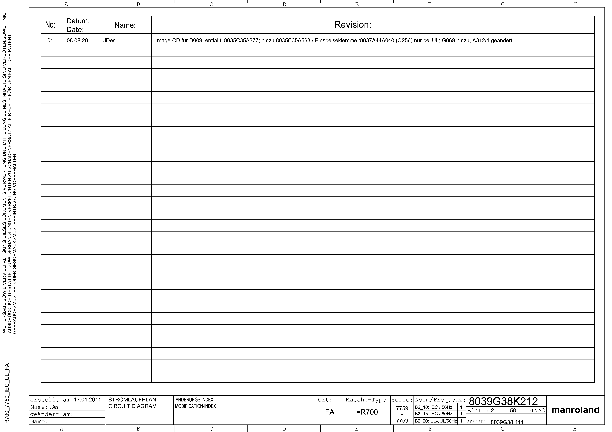

# +FA — Sheet 2 of 58 — ÄNDERUNGS INDEX

**MODIFICATION INDEX**

> Part of the manroland **R700** printing press IEC/UL circuit diagrams.
> Drawing class: **Stromlaufplan / Circuit diagram** (DIN A3).
> Document `+FA` covers the **Delivery** machine section.

## At a glance

| Field | Value |
|---|---|
| Document | `+FA`  (8039G38K212) |
| Sheet | **2** of 58 |
| Section (DE) | ÄNDERUNGS INDEX |
| Section (EN) | MODIFICATION INDEX |
| Section type | REVISION — Modification index |
| Machine type | `=R700` |
| Series | `7759` |
| Created | 17.01.2011 |
| Replaces | `8039G38I411` |
| Columns used | A, B, E |
| Path numbers | — |
| Labels on sheet | 9 |
| Cross-refs out | 0 |
| Cross-refs in | 0 |

**Previous:** [+FA sheet 1](SHEET_0001.md) · **Next:** [+FA sheet 3](SHEET_0003.md) · **Document TOC:** [_TOC.md](_TOC.md)  (+FA) · **Master TOC:** [all sheets](../_MASTER_TOC.md)

## Sheet image (300 DPI, exact vector render)



_Rendered directly from the PDF vector layer at 300 DPI (1-bit), no OCR and no resampling. Use it to confirm anything ambiguous in the text below._

## Cross-references on this sheet

Each entry is a wire leaving this sheet. The printed token is `/sheet.column`; the link resolves to that sheet inside the same document.

_No outgoing cross-references on this sheet._

## Devices on this sheet

| Tag | Class | Class meaning (IEC) | Col | Sub | Terminal | Sign |
|---|---|---|---|---|---|---|
| `08.08.2011` | — | cross-device reference | A | — | — | — |

## Potentials / nets

_No named potentials on this sheet._

## Wire-end annotations (grouped as printed)

A wire that continues elsewhere is annotated with a small cluster: the destination description, the path/line number `#NN`, and the `/sheet.column` cross reference. Each row below is one such cluster exactly as it is grouped on the drawing.

| Col | Y | Path | Cross-ref | Text on the wire |
|---|---|---|---|---|
| C | 34.5 | — | — | `No: Datum: Date: Name: Revision:` |
| D | 74.0 | — | — | `01 08.08.2011 JDes Image CD für D009: entfällt: 8035C35A377; hinzu 8035C35A563 / Einspeiseklemme :8037A44A040 (Q256) nur bei UL; G069 hinzu, A312/1 geändert` |


## Notes and free text on this sheet

| Text | Col | Y (pt) |
|---|---|---|
| `No:` | A | 42.17 |
| `Revision:` | E | 40.26 |
| `Datum:` | A | 34.45 |
| `Date:` | A | 51.54 |
| `Name:` | B | 42.97 |
| `JDes` | B | 74.07 |
| `Image CD für D009: entfällt: 8035C35A377; hinzu 8035C35A563 / Einspeiseklemme :8037A44A040 (Q256) nur bei UL; G069 hinzu, A312/1 geändert` | E | 74.06 |

## Complete label inventory (exact text from the drawing)

Every text object inside the drawing area of this sheet, in DIN reading order (column A→H, then top→bottom). This is the authoritative list: if a string is not here it is not printed on this sheet.

| Col | Y | X | Dir | Type | Text |
|---|---|---|---|---|---|
| A | 34.5 | 129.3 | → | text | `Datum:` |
| A | 42.2 | 87.7 | → | text | `No:` |
| A | 51.5 | 129.3 | → | text | `Date:` |
| A | 74.0 | 92.1 | → | number | `01` |
| A | 74.0 | 129.8 | → | device ref | `08.08.2011` |
| B | 43.0 | 222.8 | → | text | `Name:` |
| B | 74.1 | 201.0 | → | text | `JDes` |
| E | 40.3 | 650.6 | → | text | `Revision:` |
| E | 74.1 | 302.5 | → | text | `Image CD für D009: entfällt: 8035C35A377; hinzu 8035C35A563 / Einspeiseklemme :8037A44A040 (Q256) nur bei UL; G069 hinzu, A312/1 geändert` |

## Reading-order text block

The same content as a plain block, grouped by DIN column — convenient to paste or to match against a visual description.

```text
=== Column A ===
  34.5  129.3  text         Datum:
  42.2   87.7  text         No:
  51.5  129.3  text         Date:
  74.0   92.1  numeric      01
  74.0  129.8  devref       08.08.2011
=== Column B ===
  43.0  222.8  text         Name:
  74.1  201.0  text         JDes
=== Column E ===
  40.3  650.6  text         Revision:
  74.1  302.5  text         Image CD für D009: entfällt: 8035C35A377; hinzu 8035C35A563 / Einspeiseklemme :8037A44A040 (Q256) nur bei UL; G069 hinzu, A312/1 geändert
```

---
_Generated from the PDF vector text layer; no OCR. Source: `R700_7759_IEC_UL_FA`, sheet 2._
