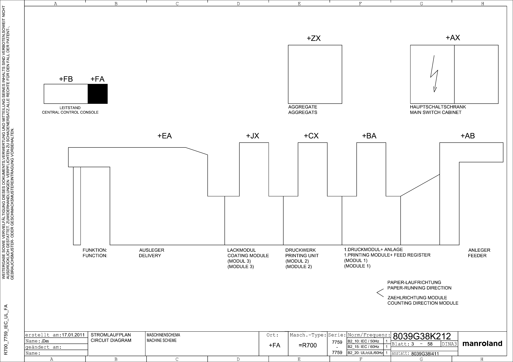

# +FA — Sheet 3 of 58 — MASCHINENSCHEMA

**MACHINE SCHEME**

> Part of the manroland **R700** printing press IEC/UL circuit diagrams.
> Drawing class: **Stromlaufplan / Circuit diagram** (DIN A3).
> Document `+FA` covers the **Delivery** machine section.

## At a glance

| Field | Value |
|---|---|
| Document | `+FA`  (8039G38K212) |
| Sheet | **3** of 58 |
| Section (DE) | MASCHINENSCHEMA |
| Section (EN) | MACHINE SCHEME |
| Section type | MACHINE_LAYOUT — Machine diagram |
| Machine type | `=R700` |
| Series | `7759` |
| Created | 17.01.2011 |
| Replaces | `8039G38I411` |
| Columns used | A, B, C, D, E, F, G, H |
| Path numbers | — |
| Labels on sheet | 37 |
| Cross-refs out | 0 |
| Cross-refs in | 0 |

**Previous:** [+FA sheet 2](SHEET_0002.md) · **Next:** [+FA sheet 4](SHEET_0004.md) · **Document TOC:** [_TOC.md](_TOC.md)  (+FA) · **Master TOC:** [all sheets](../_MASTER_TOC.md)

## Sheet image (300 DPI, exact vector render)



_Rendered directly from the PDF vector layer at 300 DPI (1-bit), no OCR and no resampling. Use it to confirm anything ambiguous in the text below._

## Cross-references on this sheet

Each entry is a wire leaving this sheet. The printed token is `/sheet.column`; the link resolves to that sheet inside the same document.

_No outgoing cross-references on this sheet._

## Devices on this sheet

_No device designators on this sheet._

## Potentials / nets

_No named potentials on this sheet._

## Wire-end annotations (grouped as printed)

A wire that continues elsewhere is annotated with a small cluster: the destination description, the path/line number `#NN`, and the `/sheet.column` cross reference. Each row below is one such cluster exactly as it is grouped on the drawing.

| Col | Y | Path | Cross-ref | Text on the wire |
|---|---|---|---|---|
| F | 80.0 | — | — | `+ZX +AX` |
| A | 176.3 | — | — | `+FB +FA` |
| E | 244.1 | — | — | `AGGREGATE AGGREGATS` |
| G | 244.1 | — | — | `HAUPTSCHALTSCHRANK MAIN SWITCH CABINET` |
| A | 246.9 | — | — | `CENTRAL CONTROL CONSOLE LEITSTAND` |
| E | 308.1 | — | — | `+EA +JX +CX +BA +AB` |
| F | 575.8 | — | — | `1.DRUCKMODUL+ ANLAGE 1.PRINTING MODULE+ FEED REGISTER (MODUL 1) (MODULE 1)` |
| C | 577.1 | — | — | `DELIVERY AUSLEGER` |
| E | 577.1 | — | — | `DRUCKWERK PRINTING UNIT (MODUL 2) (MODULE 2)` |
| B | 577.2 | — | — | `FUNKTION: FUNCTION:` |
| D | 577.2 | — | — | `LACKMODUL COATING MODULE (MODUL 3) (MODULE 3)` |
| H | 577.2 | — | — | `FEEDER ANLEGER` |
| G | 652.3 | — | — | `PAPIER LAUFRICHTUNG PAPER RUNNING DIRECTION` |
| G | 687.7 | — | — | `COUNTING DIRECTION MODULE ZAEHLRICHTUNG MODULE` |


## Notes and free text on this sheet

| Text | Col | Y (pt) |
|---|---|---|
| `+FB` | A | 176.33 |
| `+FA` | B | 176.33 |
| `FUNKTION:` | B | 577.19 |
| `FUNCTION:` | B | 589.88 |
| `AUSLEGER` | C | 577.15 |
| `DELIVERY` | C | 589.92 |
| `LACKMODUL` | D | 577.16 |
| `COATING MODULE` | D | 589.87 |
| `(MODUL 3)` | D | 602.57 |
| `(MODULE 3)` | D | 615.25 |
| `DRUCKWERK` | E | 577.11 |
| `PRINTING UNIT` | E | 589.92 |
| `(MODUL 2)` | E | 602.57 |
| `(MODULE 2)` | E | 615.25 |
| `1.DRUCKMODUL+ ANLAGE` | F | 575.75 |
| `1.PRINTING MODULE+ FEED REGISTER` | F | 588.46 |
| `(MODUL 1)` | F | 601.15 |
| `(MODULE 1)` | F | 613.84 |
| `ANLEGER` | H | 577.16 |
| `FEEDER` | H | 589.84 |
| `PAPIER LAUFRICHTUNG` | G | 652.3 |
| `PAPER RUNNING DIRECTION` | G | 665.01 |
| `ZAEHLRICHTUNG MODULE` | G | 687.72 |
| `COUNTING DIRECTION MODULE` | G | 700.44 |
| `LEITSTAND` | A | 246.88 |
| `CENTRAL CONTROL CONSOLE` | A | 257.54 |
| `+ZX` | E | 81.37 |
| `+AX` | H | 79.98 |
| `+EA` | C | 308.17 |
| `+JX` | D | 308.15 |
| `+CX` | E | 308.13 |
| `+BA` | F | 308.17 |
| `+AB` | H | 308.17 |
| `AGGREGATE` | E | 244.09 |
| `AGGREGATS` | E | 256.78 |
| `HAUPTSCHALTSCHRANK` | G | 244.08 |
| `MAIN SWITCH CABINET` | G | 256.8 |

## Complete label inventory (exact text from the drawing)

Every text object inside the drawing area of this sheet, in DIN reading order (column A→H, then top→bottom). This is the authoritative list: if a string is not here it is not printed on this sheet.

| Col | Y | X | Dir | Type | Text |
|---|---|---|---|---|---|
| A | 176.3 | 136.8 | → | text | `+FB` |
| A | 246.9 | 138.5 | → | text | `LEITSTAND` |
| A | 257.5 | 97.5 | → | text | `CENTRAL CONTROL CONSOLE` |
| B | 176.3 | 209.9 | → | text | `+FA` |
| B | 577.2 | 191.9 | → | text | `FUNKTION:` |
| B | 589.9 | 191.9 | → | text | `FUNCTION:` |
| C | 308.2 | 365.4 | → | text | `+EA` |
| C | 577.2 | 323.4 | → | text | `AUSLEGER` |
| C | 589.9 | 322.3 | → | text | `DELIVERY` |
| D | 308.1 | 571.0 | → | text | `+JX` |
| D | 577.2 | 527.8 | → | text | `LACKMODUL` |
| D | 589.9 | 528.1 | → | text | `COATING MODULE` |
| D | 602.6 | 528.1 | → | text | `(MODUL 3)` |
| D | 615.3 | 528.1 | → | text | `(MODULE 3)` |
| E | 81.4 | 711.8 | → | text | `+ZX` |
| E | 244.1 | 669.3 | → | text | `AGGREGATE` |
| E | 256.8 | 669.3 | → | text | `AGGREGATS` |
| E | 308.1 | 705.1 | → | text | `+CX` |
| E | 577.1 | 662.5 | → | text | `DRUCKWERK` |
| E | 589.9 | 662.5 | → | text | `PRINTING UNIT` |
| E | 602.6 | 662.7 | → | text | `(MODUL 2)` |
| E | 615.3 | 662.7 | → | text | `(MODULE 2)` |
| F | 308.2 | 840.2 | → | text | `+BA` |
| F | 575.7 | 798.2 | → | text | `1.DRUCKMODUL+ ANLAGE` |
| F | 588.5 | 798.2 | → | text | `1.PRINTING MODULE+ FEED REGISTER` |
| F | 601.2 | 798.8 | → | text | `(MODUL 1)` |
| F | 613.8 | 798.8 | → | text | `(MODULE 1)` |
| G | 244.1 | 951.6 | → | text | `HAUPTSCHALTSCHRANK` |
| G | 256.8 | 951.6 | → | text | `MAIN SWITCH CABINET` |
| G | 652.3 | 899.1 | → | text | `PAPIER LAUFRICHTUNG` |
| G | 665.0 | 899.1 | → | text | `PAPER RUNNING DIRECTION` |
| G | 687.7 | 899.7 | → | text | `ZAEHLRICHTUNG MODULE` |
| G | 700.4 | 899.4 | → | text | `COUNTING DIRECTION MODULE` |
| H | 80.0 | 1034.5 | → | text | `+AX` |
| H | 308.2 | 1068.9 | → | text | `+AB` |
| H | 577.2 | 1087.4 | → | text | `ANLEGER` |
| H | 589.8 | 1086.2 | → | text | `FEEDER` |

## Reading-order text block

The same content as a plain block, grouped by DIN column — convenient to paste or to match against a visual description.

```text
=== Column A ===
 176.3  136.8  text         +FB
 246.9  138.5  text         LEITSTAND
 257.5   97.5  text         CENTRAL CONTROL CONSOLE
=== Column B ===
 176.3  209.9  text         +FA
 577.2  191.9  text         FUNKTION:
 589.9  191.9  text         FUNCTION:
=== Column C ===
 308.2  365.4  text         +EA
 577.2  323.4  text         AUSLEGER
 589.9  322.3  text         DELIVERY
=== Column D ===
 308.1  571.0  text         +JX
 577.2  527.8  text         LACKMODUL
 589.9  528.1  text         COATING MODULE
 602.6  528.1  text         (MODUL 3)
 615.3  528.1  text         (MODULE 3)
=== Column E ===
  81.4  711.8  text         +ZX
 244.1  669.3  text         AGGREGATE
 256.8  669.3  text         AGGREGATS
 308.1  705.1  text         +CX
 577.1  662.5  text         DRUCKWERK
 589.9  662.5  text         PRINTING UNIT
 602.6  662.7  text         (MODUL 2)
 615.3  662.7  text         (MODULE 2)
=== Column F ===
 308.2  840.2  text         +BA
 575.7  798.2  text         1.DRUCKMODUL+ ANLAGE
 588.5  798.2  text         1.PRINTING MODULE+ FEED REGISTER
 601.2  798.8  text         (MODUL 1)
 613.8  798.8  text         (MODULE 1)
=== Column G ===
 244.1  951.6  text         HAUPTSCHALTSCHRANK
 256.8  951.6  text         MAIN SWITCH CABINET
 652.3  899.1  text         PAPIER LAUFRICHTUNG
 665.0  899.1  text         PAPER RUNNING DIRECTION
 687.7  899.7  text         ZAEHLRICHTUNG MODULE
 700.4  899.4  text         COUNTING DIRECTION MODULE
=== Column H ===
  80.0 1034.5  text         +AX
 308.2 1068.9  text         +AB
 577.2 1087.4  text         ANLEGER
 589.8 1086.2  text         FEEDER
```

---
_Generated from the PDF vector text layer; no OCR. Source: `R700_7759_IEC_UL_FA`, sheet 3._
