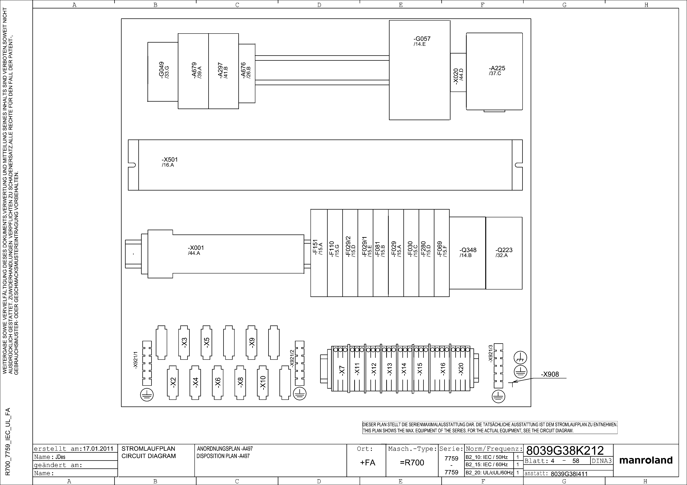

# +FA — Sheet 4 of 58 — ANORDNUNGSPLAN A497

**DISPOSITION PLAN A497**

> Part of the manroland **R700** printing press IEC/UL circuit diagrams.
> Drawing class: **Stromlaufplan / Circuit diagram** (DIN A3).
> Document `+FA` covers the **Delivery** machine section.

## At a glance

| Field | Value |
|---|---|
| Document | `+FA`  (8039G38K212) |
| Sheet | **4** of 58 |
| Section (DE) | ANORDNUNGSPLAN A497 |
| Section (EN) | DISPOSITION PLAN A497 |
| Section type | ARRANGEMENT — Disposition plan |
| Machine type | `=R700` |
| Series | `7759` |
| Created | 17.01.2011 |
| Replaces | `8039G38I411` |
| Columns used | B, C, D, E, F, G |
| Path numbers | — |
| Labels on sheet | 62 |
| Cross-refs out | 20 |
| Cross-refs in | 13 |

**Previous:** [+FA sheet 3](SHEET_0003.md) · **Next:** [+FA sheet 5](SHEET_0005.md) · **Document TOC:** [_TOC.md](_TOC.md)  (+FA) · **Master TOC:** [all sheets](../_MASTER_TOC.md)

## Sheet image (300 DPI, exact vector render)



_Rendered directly from the PDF vector layer at 300 DPI (1-bit), no OCR and no resampling. Use it to confirm anything ambiguous in the text below._

## Cross-references on this sheet

Each entry is a wire leaving this sheet. The printed token is `/sheet.column`; the link resolves to that sheet inside the same document.

| Ref | Target sheet | Col | Path | Destination on target | Target section | From col |
|---|---|---|---|---|---|---|
| `/14.E` | [+FA sheet 14](SHEET_0014.md) | E | — | G057 | SPANNUNGSVERSORGUNG: | E |
| `/37.C` | [+FA sheet 37](SHEET_0037.md) | C | — | A225 | OPTION: TELEPRESENCE | F |
| `/33.G` | [+FA sheet 33](SHEET_0033.md) | G | — | — | OPTION: TELEPRESENCE , PRINTNET VORBEREITUNG: INTEGRATIONPILOTPLUS INCLUSIVE DATACOL.,INTEGRATIONP. FÜR PRESSM. PERFECT | B |
| `/39.A` | [+FA sheet 39](SHEET_0039.md) | A | — | — | OPTION: TELEPRESENCE | C |
| `/41.B` | [+FA sheet 41](SHEET_0041.md) | B | — | — | OPTION: TELEPRESENCE ODER ICP | C |
| `/26.B` | [+FA sheet 26](SHEET_0026.md) | B | — | — | USB ANSCHLUSS | C |
| `/44.D` | [+FA sheet 44](SHEET_0044.md) | D | — | — | KLEMMLEISTE | F |
| `/16.A` | [+FA sheet 16](SHEET_0016.md) | A | — | X501 | SPANNUNGSVERSORGUNG: | B |
| `/15.A` | [+FA sheet 15](SHEET_0015.md) | A | — | — | SPANNUNGSVERSORGUNG: | D |
| `/15.G` | [+FA sheet 15](SHEET_0015.md) | G | — | — | SPANNUNGSVERSORGUNG: | D |
| `/15.D` | [+FA sheet 15](SHEET_0015.md) | D | — | — | SPANNUNGSVERSORGUNG: | D |
| `/15.C` | [+FA sheet 15](SHEET_0015.md) | C | — | — | SPANNUNGSVERSORGUNG: | E |
| `/15.D` | [+FA sheet 15](SHEET_0015.md) | D | — | — | SPANNUNGSVERSORGUNG: | E |
| `/15.E` | [+FA sheet 15](SHEET_0015.md) | E | — | — | SPANNUNGSVERSORGUNG: | E |
| `/15.B` | [+FA sheet 15](SHEET_0015.md) | B | — | — | SPANNUNGSVERSORGUNG: | E |
| `/15.A` | [+FA sheet 15](SHEET_0015.md) | A | — | — | SPANNUNGSVERSORGUNG: | E |
| `/44.A` | [+FA sheet 44](SHEET_0044.md) | A | — | X001 | KLEMMLEISTE | B |
| `/15.F` | [+FA sheet 15](SHEET_0015.md) | F | — | — | SPANNUNGSVERSORGUNG: | F |
| `/14.B` | [+FA sheet 14](SHEET_0014.md) | B | — | Q348 | SPANNUNGSVERSORGUNG: | F |
| `/32.A` | [+FA sheet 32](SHEET_0032.md) | A | — | Q223 | OPTION: COLORPILOT, COLORPILOTPLUS | F |

### Incoming references (sheets that point here)

Every other sheet that sends a wire to this one. `Back-ref` is the token printed on *that* sheet; `Path` is its line number.

| From sheet | Cols | Back-ref | Path | Refs | What continues there |
|---|---|---|---|---|---|
| [+FA#14](SHEET_0014.md) | E | `/14.E` | — | 1 | — |
| [+FA#15](SHEET_0015.md) | A, B, C, D, E, F, G | `/15.A`, `/15.B`, `/15.C`, `/15.D`, `/15.E`, `/15.F`, `/15.G` | — | 9 | 2 |
| [+FA#37](SHEET_0037.md) | C | `/37.C` | — | 1 | — |
| [+FA#39](SHEET_0039.md) | A | `/39.A` | — | 1 | — |
| [+FA#41](SHEET_0041.md) | B | `/41.B` | — | 1 | — |


## Devices on this sheet

| Tag | Class | Class meaning (IEC) | Col | Sub | Terminal | Sign |
|---|---|---|---|---|---|---|
| `G057` | G | Stromversorgung / power supply | E | — | — | — |
| `F029` | F | Schutz / protection device (fuse, circuit breaker) | E | — | — | — |
| `F110` | F | Schutz / protection device (fuse, circuit breaker) | D | — | — | — |
| `F029/2` | F | Schutz / protection device (fuse, circuit breaker) | D | 2 | — | — |
| `F029/1` | F | Schutz / protection device (fuse, circuit breaker) | E | 1 | — | — |
| `F081` | F | Schutz / protection device (fuse, circuit breaker) | E | — | — | — |
| `F030` | F | Schutz / protection device (fuse, circuit breaker) | E | — | — | — |
| `F280` | F | Schutz / protection device (fuse, circuit breaker) | E | — | — | — |
| `F069` | F | Schutz / protection device (fuse, circuit breaker) | E | — | — | — |
| `Q348` | Q | Leistungsschalter / power switching device | F | — | — | — |
| `Q223` | Q | Leistungsschalter / power switching device | F | — | — | — |
| `A225` | A | Baugruppe / assembly, module, PC board | F | — | — | — |
| `X501` | X | Klemme / terminal, plug connector | B | — | — | — |
| `X001` | X | Klemme / terminal, plug connector | B | — | — | — |
| `X020` | X | Klemme / terminal, plug connector | F | — | — | — |
| `F151` | F | Schutz / protection device (fuse, circuit breaker) | D | — | — | — |
| `A679` | A | Baugruppe / assembly, module, PC board | B | — | — | — |
| `A297` | A | Baugruppe / assembly, module, PC board | C | — | — | — |
| `G049` | G | Stromversorgung / power supply | B | — | — | — |
| `A676` | A | Baugruppe / assembly, module, PC board | C | — | — | — |
| `X921/3` | X | Klemme / terminal, plug connector | F | 3 | — | — |
| `X10` | X | Klemme / terminal, plug connector | C | — | — | — |
| `X921/2` | X | Klemme / terminal, plug connector | D | 2 | — | — |
| `X9` | X | Klemme / terminal, plug connector | C | — | — | — |
| `X8` | X | Klemme / terminal, plug connector | C | — | — | — |
| `X6` | X | Klemme / terminal, plug connector | C | — | — | — |
| `X2` | X | Klemme / terminal, plug connector | B | — | — | — |
| `X921/1` | X | Klemme / terminal, plug connector | B | 1 | — | — |
| `X5` | X | Klemme / terminal, plug connector | C | — | — | — |
| `X3` | X | Klemme / terminal, plug connector | B | — | — | — |
| `X4` | X | Klemme / terminal, plug connector | B | — | — | — |
| `X908` | X | Klemme / terminal, plug connector | G | — | — | — |
| `X7` | X | Klemme / terminal, plug connector | D | — | — | — |
| `X11` | X | Klemme / terminal, plug connector | D | — | — | — |
| `X12` | X | Klemme / terminal, plug connector | E | — | — | — |
| `X13` | X | Klemme / terminal, plug connector | E | — | — | — |
| `X14` | X | Klemme / terminal, plug connector | E | — | — | — |
| `X16` | X | Klemme / terminal, plug connector | F | — | — | — |
| `X20` | X | Klemme / terminal, plug connector | F | — | — | — |
| `X15` | X | Klemme / terminal, plug connector | E | — | — | — |

## Potentials / nets

_No named potentials on this sheet._

## Wire-end annotations (grouped as printed)

A wire that continues elsewhere is annotated with a small cluster: the destination description, the path/line number `#NN`, and the `/sheet.column` cross reference. Each row below is one such cluster exactly as it is grouped on the drawing.

| Col | Y | Path | Cross-ref | Text on the wire |
|---|---|---|---|---|
| E | 62.7 | — | `/14.E` | `G057` |
| B | 106.9 | — | — | `G049` |
| B | 108.0 | — | — | `A679` |
| C | 108.0 | — | — | `A297` |
| C | 108.0 | — | — | `A676` |
| F | 113.7 | — | `/37.C` | `A225` |
| B | 114.5 | — | `/33.G` | — |
| C | 115.4 | — | `/39.A` | — |
| C | 115.4 | — | `/41.B` | — |
| C | 115.4 | — | `/26.B` | — |
| F | 118.5 | — | — | `X020` |
| F | 118.8 | — | `/44.D` | — |
| B | 272.4 | — | `/16.A` | `X501` |
| D | 409.8 | — | — | `F029/2` |
| E | 409.8 | — | — | `F029/1` |
| D | 414.7 | — | — | `F151` |
| D | 418.6 | — | — | `F110` |
| E | 418.6 | — | — | `F081` |
| E | 418.6 | — | — | `F029` |
| E | 418.6 | — | — | `F030` |
| E | 418.6 | — | — | `F280` |
| E | 418.6 | — | — | `F069` |
| D | 421.5 | — | `/15.A` | — |
| D | 424.5 | — | `/15.G` | — |
| D | 425.1 | — | `/15.D` | — |
| E | 425.1 | — | `/15.C` | — |
| E | 425.1 | — | `/15.D` | — |
| E | 425.4 | — | `/15.E` | — |
| E | 425.4 | — | `/15.B` | — |
| E | 425.4 | — | `/15.A` | — |
| B | 425.5 | — | `/44.A` | `X001` |
| F | 425.9 | — | `/15.F` | — |
| F | 429.3 | — | `/14.B` | `Q348` |
| F | 429.3 | — | `/32.A` | `Q223` |
| B | 585.8 | — | — | `X3` |
| C | 585.8 | — | — | `X5` |
| C | 586.0 | — | — | `X9` |
| F | 598.7 | — | — | `X921/3` |
| D | 607.3 | — | — | `X921/2` |
| B | 609.8 | — | — | `X921/1` |
| D | 629.2 | — | — | `X11` |
| F | 629.7 | — | — | `X16` |
| F | 629.7 | — | — | `X20` |
| E | 629.8 | — | — | `X15` |
| E | 629.9 | — | — | `X12` |
| E | 629.9 | — | — | `X13` |
| E | 629.9 | — | — | `X14` |
| D | 634.4 | — | — | `X7` |
| G | 644.5 | — | — | `X908` |
| C | 652.2 | — | — | `X10` |
| C | 654.8 | — | — | `X8` |
| B | 655.0 | — | — | `X2` |
| B | 655.0 | — | — | `X4` |
| C | 655.3 | — | — | `X6` |
| F | 734.1 | — | — | `DIESER PLAN STELLT DIE SERIENMAXIMALAUSSTATTUNG DAR. DIE TATSÄCHLICHE AUSSTATTUNG IST DEM STROMLAUFPLAN ZU ENTNEHMEN.` |
| F | 744.7 | — | — | `THIS PLAN SHOWS THE MAX. EQUIPMENT OF THE SERIES. FOR THE ACTUAL EQUIPMENT, SEE THE CIRCUIT DIAGRAM.` |


## Reconstructed tables

This sheet carries tabular content (pin map / terminal assignment / index). The grid below was rebuilt from the drawing's own rule lines, so each row is exactly one physical row of the table.

### Table 1 — 3 data rows × 5 columns (at x=270.5, y=35.4)

| G049 | /33.G |  | A679 /39.A |  |
|---|---|---|---|---|
|  | `X501 /16.A` |  |  |  |
|  |  |  | `X001 /44.A` |  |
|  | `X2` | `X3` | `X4` | `X5` |


### Table 2 — 1 data rows × 2 columns (at x=367.3, y=35.4)

| A297 | /41.B |
|---|---|
| `X6` |  |


### Table 3 — 1 data rows × 3 columns (at x=413.6, y=35.4)

| A676 | /26.B |  |
|---|---|---|
| `X8` | `X9` | `X10` |


### Table 4 — 2 data rows × 2 columns (at x=577.4, y=35.4)

| C1 | C2 |
|---|---|
| `/15.G` |  |
|  | `X7` |


### Table 5 — 2 data rows × 2 columns (at x=606.2, y=35.4)

| C1 | C2 |
|---|---|
| `/15.D` |  |
|  | `X11` |


### Table 6 — 2 data rows × 1 columns (at x=634.1, y=35.4)

| C1 |
|---|
| `/15.E` |
| `DIESER THIS` |


### Table 7 — 2 data rows × 10 columns (at x=646.6, y=35.4) — **G057 /14.E**

|  | F081 | /15.B | F029 | /15.A |  | F030 | /15.C |  | F280 |
|---|---|---|---|---|---|---|---|---|---|
| `X12` |  |  |  |  | `X14` |  |  | `X15` |  |
|  | `PLAN` |  | `STELLT` | `THE` | `DIE` | `MAX.` |  |  | `EQUIPMENT` |


### Table 8 — 2 data rows × 3 columns (at x=752.4, y=35.4)

|  | F069 | /15.F |
|---|---|---|
|  | `X16` |  |
| `SERIENMAXIMALAUSSTATTUNG` | `OF` | `THE` |


### Table 9 — 3 data rows × 4 columns (at x=789.7, y=35.4)

| X020 | /44.D |  |  |
|---|---|---|---|
|  |  | `Q348` |  |
|  | `X20` |  |  |
| `SERIES.` |  |  | `DAR. FOR` |


### Table 10 — 0 data rows × 2 columns (at x=829.5, y=35.4) — **A225 /37.C Q223 /32.A X921/3**

_none_


## Notes and free text on this sheet

| Text | Col | Y (pt) |
|---|---|---|
| `DIESER PLAN STELLT DIE SERIENMAXIMALAUSSTATTUNG DAR. DIE TATSÄCHLICHE AUSSTATTUNG IST DEM STROMLAUFPLAN ZU ENTNEHMEN.` | F | 734.1 |
| `THIS PLAN SHOWS THE MAX. EQUIPMENT OF THE SERIES. FOR THE ACTUAL EQUIPMENT, SEE THE CIRCUIT DIAGRAM.` | F | 744.72 |

## Complete label inventory (exact text from the drawing)

Every text object inside the drawing area of this sheet, in DIN reading order (column A→H, then top→bottom). This is the authoritative list: if a string is not here it is not printed on this sheet.

| Col | Y | X | Dir | Type | Text |
|---|---|---|---|---|---|
| B | 106.9 | 275.3 | ↕ | device tag | `G049` |
| B | 108.0 | 332.0 | ↕ | device tag | `A679` |
| B | 114.5 | 285.2 | ↕ | cross-reference | `/33.G` |
| B | 272.4 | 280.3 | → | device tag | `X501` |
| B | 282.3 | 280.6 | → | cross-reference | `/16.A` |
| B | 425.5 | 325.7 | → | device tag | `X001` |
| B | 435.4 | 326.0 | → | cross-reference | `/44.A` |
| B | 585.8 | 314.5 | ↕ | device tag | `X3` |
| B | 609.8 | 231.0 | ↕ | device tag | `X921/1` |
| B | 655.0 | 295.1 | ↕ | device tag | `X2` |
| B | 655.0 | 334.1 | ↕ | device tag | `X4` |
| C | 108.0 | 377.3 | ↕ | device tag | `A297` |
| C | 108.0 | 417.0 | ↕ | device tag | `A676` |
| C | 115.4 | 341.8 | ↕ | cross-reference | `/39.A` |
| C | 115.4 | 387.2 | ↕ | cross-reference | `/41.B` |
| C | 115.4 | 426.9 | ↕ | cross-reference | `/26.B` |
| C | 585.8 | 353.2 | ↕ | device tag | `X5` |
| C | 586.0 | 431.7 | ↕ | device tag | `X9` |
| C | 652.2 | 450.6 | ↕ | device tag | `X10` |
| C | 654.8 | 411.6 | ↕ | device tag | `X8` |
| C | 655.3 | 372.6 | ↕ | device tag | `X6` |
| D | 409.8 | 598.6 | ↕ | device tag | `F029/2` |
| D | 414.7 | 541.7 | ↕ | device tag | `F151` |
| D | 418.5 | 570.3 | ↕ | device tag | `F110` |
| D | 421.5 | 551.6 | ↕ | cross-reference | `/15.A` |
| D | 424.5 | 580.2 | ↕ | cross-reference | `/15.G` |
| D | 425.1 | 608.5 | ↕ | cross-reference | `/15.D` |
| D | 607.3 | 502.4 | ↕ | device tag | `X921/2` |
| D | 629.2 | 614.3 | ↕ | device tag | `X11` |
| D | 634.3 | 587.7 | ↕ | device tag | `X7` |
| E | 62.7 | 716.9 | → | device tag | `G057` |
| E | 72.5 | 717.2 | → | cross-reference | `/14.E` |
| E | 409.8 | 627.0 | ↕ | device tag | `F029/1` |
| E | 418.5 | 649.7 | ↕ | device tag | `F081` |
| E | 418.5 | 678.0 | ↕ | device tag | `F029` |
| E | 418.5 | 706.4 | ↕ | device tag | `F030` |
| E | 418.5 | 729.0 | ↕ | device tag | `F280` |
| E | 418.5 | 757.4 | ↕ | device tag | `F069` |
| E | 425.1 | 716.3 | ↕ | cross-reference | `/15.C` |
| E | 425.1 | 738.9 | ↕ | cross-reference | `/15.D` |
| E | 425.4 | 636.9 | ↕ | cross-reference | `/15.E` |
| E | 425.4 | 659.5 | ↕ | cross-reference | `/15.B` |
| E | 425.4 | 687.9 | ↕ | cross-reference | `/15.A` |
| E | 629.8 | 723.1 | ↕ | device tag | `X15` |
| E | 629.9 | 643.5 | ↕ | device tag | `X12` |
| E | 629.9 | 670.8 | ↕ | device tag | `X13` |
| E | 629.9 | 695.4 | ↕ | device tag | `X14` |
| F | 113.7 | 847.3 | → | device tag | `A225` |
| F | 118.5 | 785.5 | ↕ | device tag | `X020` |
| F | 118.8 | 795.4 | ↕ | cross-reference | `/44.D` |
| F | 123.6 | 847.6 | → | cross-reference | `/37.C` |
| F | 425.9 | 767.3 | ↕ | cross-reference | `/15.F` |
| F | 429.3 | 796.5 | → | device tag | `Q348` |
| F | 429.3 | 858.8 | → | device tag | `Q223` |
| F | 439.2 | 796.8 | → | cross-reference | `/14.B` |
| F | 439.2 | 859.1 | → | cross-reference | `/32.A` |
| F | 598.7 | 846.5 | ↕ | device tag | `X921/3` |
| F | 629.7 | 763.2 | ↕ | device tag | `X16` |
| F | 629.7 | 794.4 | ↕ | device tag | `X20` |
| F | 734.1 | 628.4 | → | text | `DIESER PLAN STELLT DIE SERIENMAXIMALAUSSTATTUNG DAR. DIE TATSÄCHLICHE AUSSTATTUNG IST DEM STROMLAUFPLAN ZU ENTNEHMEN.` |
| F | 744.7 | 629.0 | → | text | `THIS PLAN SHOWS THE MAX. EQUIPMENT OF THE SERIES. FOR THE ACTUAL EQUIPMENT, SEE THE CIRCUIT DIAGRAM.` |
| G | 644.5 | 937.6 | → | device tag | `X908` |

## Reading-order text block

The same content as a plain block, grouped by DIN column — convenient to paste or to match against a visual description.

```text
=== Column B ===
 106.9  275.3  devtag       G049
 108.0  332.0  devtag       A679
 114.5  285.2  xref         /33.G
 272.4  280.3  devtag       X501
 282.3  280.6  xref         /16.A
 425.5  325.7  devtag       X001
 435.4  326.0  xref         /44.A
 585.8  314.5  devtag       X3
 609.8  231.0  devtag       X921/1
 655.0  295.1  devtag       X2
 655.0  334.1  devtag       X4
=== Column C ===
 108.0  377.3  devtag       A297
 108.0  417.0  devtag       A676
 115.4  341.8  xref         /39.A
 115.4  387.2  xref         /41.B
 115.4  426.9  xref         /26.B
 585.8  353.2  devtag       X5
 586.0  431.7  devtag       X9
 652.2  450.6  devtag       X10
 654.8  411.6  devtag       X8
 655.3  372.6  devtag       X6
=== Column D ===
 409.8  598.6  devtag       F029/2
 414.7  541.7  devtag       F151
 418.5  570.3  devtag       F110
 421.5  551.6  xref         /15.A
 424.5  580.2  xref         /15.G
 425.1  608.5  xref         /15.D
 607.3  502.4  devtag       X921/2
 629.2  614.3  devtag       X11
 634.3  587.7  devtag       X7
=== Column E ===
  62.7  716.9  devtag       G057
  72.5  717.2  xref         /14.E
 409.8  627.0  devtag       F029/1
 418.5  649.7  devtag       F081
 418.5  678.0  devtag       F029
 418.5  706.4  devtag       F030
 418.5  729.0  devtag       F280
 418.5  757.4  devtag       F069
 425.1  716.3  xref         /15.C
 425.1  738.9  xref         /15.D
 425.4  636.9  xref         /15.E
 425.4  659.5  xref         /15.B
 425.4  687.9  xref         /15.A
 629.8  723.1  devtag       X15
 629.9  643.5  devtag       X12
 629.9  670.8  devtag       X13
 629.9  695.4  devtag       X14
=== Column F ===
 113.7  847.3  devtag       A225
 118.5  785.5  devtag       X020
 118.8  795.4  xref         /44.D
 123.6  847.6  xref         /37.C
 425.9  767.3  xref         /15.F
 429.3  796.5  devtag       Q348
 429.3  858.8  devtag       Q223
 439.2  796.8  xref         /14.B
 439.2  859.1  xref         /32.A
 598.7  846.5  devtag       X921/3
 629.7  763.2  devtag       X16
 629.7  794.4  devtag       X20
 734.1  628.4  text         DIESER PLAN STELLT DIE SERIENMAXIMALAUSSTATTUNG DAR. DIE TATSÄCHLICHE AUSSTATTUNG IST DEM STROMLAUFPLAN ZU ENTNEHMEN.
 744.7  629.0  text         THIS PLAN SHOWS THE MAX. EQUIPMENT OF THE SERIES. FOR THE ACTUAL EQUIPMENT, SEE THE CIRCUIT DIAGRAM.
=== Column G ===
 644.5  937.6  devtag       X908
```

---
_Generated from the PDF vector text layer; no OCR. Source: `R700_7759_IEC_UL_FA`, sheet 4._
