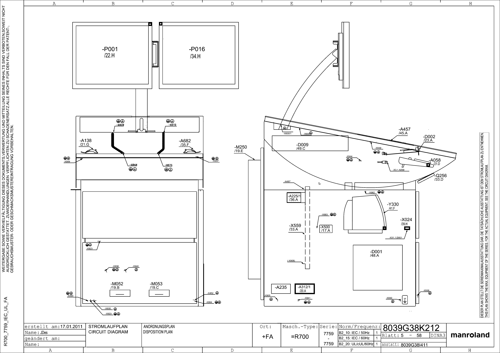

# +FA — Sheet 5 of 58 — ANORDNUNGSPLAN

**DISPOSITION PLAN**

> Part of the manroland **R700** printing press IEC/UL circuit diagrams.
> Drawing class: **Stromlaufplan / Circuit diagram** (DIN A3).
> Document `+FA` covers the **Delivery** machine section.

## At a glance

| Field | Value |
|---|---|
| Document | `+FA`  (8039G38K212) |
| Sheet | **5** of 58 |
| Section (DE) | ANORDNUNGSPLAN |
| Section (EN) | DISPOSITION PLAN |
| Section type | ARRANGEMENT — Disposition plan |
| Machine type | `=R700` |
| Series | `7759` |
| Created | 17.01.2011 |
| Replaces | `8039G38I411` |
| Columns used | A, B, C, D, E, F, G, H |
| Path numbers | — |
| Labels on sheet | 70 |
| Cross-refs out | 19 |
| Cross-refs in | 8 |

**Previous:** [+FA sheet 4](SHEET_0004.md) · **Next:** [+FA sheet 6](SHEET_0006.md) · **Document TOC:** [_TOC.md](_TOC.md)  (+FA) · **Master TOC:** [all sheets](../_MASTER_TOC.md)

## Sheet image (300 DPI, exact vector render)



_Rendered directly from the PDF vector layer at 300 DPI (1-bit), no OCR and no resampling. Use it to confirm anything ambiguous in the text below._

## Cross-references on this sheet

Each entry is a wire leaving this sheet. The printed token is `/sheet.column`; the link resolves to that sheet inside the same document.

| Ref | Target sheet | Col | Path | Destination on target | Target section | From col |
|---|---|---|---|---|---|---|
| `/22.H` | [+FA sheet 22](SHEET_0022.md) | H | — | — | MONITOR | B |
| `/34.H` | [+FA sheet 34](SHEET_0034.md) | H | — | — | OPTION: TELEPRESENCE , PRINTNET VORBEREITUNG: INTEGRATIONPILOTPLUS INCLUSIVE DATACOL.,INTEGRATIONP. FÜR PRESSM. PERFECT | C |
| `/45.A` | [+FA sheet 45](SHEET_0045.md) | A | — | A457 | REFERENZMODUL | G |
| `/23.A` | [+FA sheet 23](SHEET_0023.md) | A | — | — | JOBCARD READER | G |
| `/21.G` | [+FA sheet 21](SHEET_0021.md) | G | — | A682 | TASTATUR: COMPUTER, MAUS | B |
| `/49.C` | [+FA sheet 49](SHEET_0049.md) | C | — | D009 | REFERENZMODUL | E |
| `/35.F` | [+FA sheet 35](SHEET_0035.md) | F | — | — | — | C |
| `/19.E` | [+FA sheet 19](SHEET_0019.md) | E | — | M250 | LÜFTER | D |
| `/21.D` | [+FA sheet 21](SHEET_0021.md) | D | — | — | TASTATUR: COMPUTER, MAUS | G |
| `/33.D` | [+FA sheet 33](SHEET_0033.md) | D | — | Q256 | OPTION: TELEPRESENCE , PRINTNET VORBEREITUNG: INTEGRATIONPILOTPLUS INCLUSIVE DATACOL.,INTEGRATIONP. FÜR PRESSM. PERFECT | H |
| `/36.A` | [+FA sheet 36](SHEET_0036.md) | A | — | — | OPTION: TELEPRESENCE | E |
| `/41.F` | [+FA sheet 41](SHEET_0041.md) | F | — | — | OPTION: TELEPRESENCE ODER ICP | G |
| `/39.H` | [+FA sheet 39](SHEET_0039.md) | H | — | — | OPTION: TELEPRESENCE | G |
| `/33.A` | [+FA sheet 33](SHEET_0033.md) | A | — | X559 | OPTION: TELEPRESENCE , PRINTNET VORBEREITUNG: INTEGRATIONPILOTPLUS INCLUSIVE DATACOL.,INTEGRATIONP. FÜR PRESSM. PERFECT | E |
| `/17.A` | [+FA sheet 17](SHEET_0017.md) | A | — | — | SPANNUNGSVERSORGUNG: | F |
| `/48.A` | [+FA sheet 48](SHEET_0048.md) | A | — | D001 | REFERENZMODUL | F |
| `/19.B` | [+FA sheet 19](SHEET_0019.md) | B | — | M052 | LÜFTER | B |
| `/19.C` | [+FA sheet 19](SHEET_0019.md) | C | — | M053 | LÜFTER | C |
| `/20.A` | [+FA sheet 20](SHEET_0020.md) | A | — | — | LEITSTAND RECHNER | E |

### Incoming references (sheets that point here)

Every other sheet that sends a wire to this one. `Back-ref` is the token printed on *that* sheet; `Path` is its line number.

| From sheet | Cols | Back-ref | Path | Refs | What continues there |
|---|---|---|---|---|---|
| [+FA#20](SHEET_0020.md) | A | `/20.A` | — | 1 | — |
| [+FA#21](SHEET_0021.md) | D | `/21.D` | — | 1 | — |
| [+FA#22](SHEET_0022.md) | G | `/22.G` | — | 1 | — |
| [+FA#23](SHEET_0023.md) | A | `/23.A` | — | 1 | — |
| [+FA#34](SHEET_0034.md) | H | `/34.H` | — | 1 | — |
| [+FA#36](SHEET_0036.md) | A | `/36.A` | — | 1 | — |
| [+FA#39](SHEET_0039.md) | G | `/39.G` | — | 1 | — |
| [+FA#41](SHEET_0041.md) | E | `/41.E` | — | 1 | — |


## Devices on this sheet

| Tag | Class | Class meaning (IEC) | Col | Sub | Terminal | Sign |
|---|---|---|---|---|---|---|
| `A225/1` | A | Baugruppe / assembly, module, PC board | E | 1 | — | — |
| `Q256` | Q | Leistungsschalter / power switching device | H | — | — | — |
| `X500` | X | Klemme / terminal, plug connector | F | — | — | — |
| `X559` | X | Klemme / terminal, plug connector | E | — | — | — |
| `D001` | D | Digital / binary element | F | — | — | — |
| `A235` | A | Baugruppe / assembly, module, PC board | E | — | — | — |
| `D002` | D | Digital / binary element | G | — | — | — |
| `P001` | P | Messgeraet / measuring instrument, meter | B | — | — | — |
| `P016` | P | Messgeraet / measuring instrument, meter | C | — | — | — |
| `A138` | A | Baugruppe / assembly, module, PC board | B | — | — | — |
| `A682` | A | Baugruppe / assembly, module, PC board | C | — | — | — |
| `Y330` | Y | Magnetventil / solenoid valve, actuator | G | — | — | — |
| `X024` | X | Klemme / terminal, plug connector | G | — | — | — |
| `A058` | A | Baugruppe / assembly, module, PC board | G | — | — | — |
| `A457` | A | Baugruppe / assembly, module, PC board | G | — | — | — |
| `A312/1` | A | Baugruppe / assembly, module, PC board | E | 1 | — | — |
| `D009` | D | Digital / binary element | E | — | — | — |
| `X937` | X | Klemme / terminal, plug connector | D | — | — | — |
| `X494` | X | Klemme / terminal, plug connector | A | — | — | — |
| `X994` | X | Klemme / terminal, plug connector | D | — | — | — |
| `X909` | X | Klemme / terminal, plug connector | A | — | — | — |
| `X938` | X | Klemme / terminal, plug connector | B | — | — | — |
| `X940` | X | Klemme / terminal, plug connector | B | — | — | — |
| `X923` | X | Klemme / terminal, plug connector | B | — | — | — |
| `X935` | X | Klemme / terminal, plug connector | B | — | — | — |
| `X923` | X | Klemme / terminal, plug connector | B | — | — | — |
| `X452` | X | Klemme / terminal, plug connector | D | — | — | — |
| `A497` | A | Baugruppe / assembly, module, PC board | E | — | — | — |
| `X982` | X | Klemme / terminal, plug connector | F | — | — | — |
| `X983` | X | Klemme / terminal, plug connector | F | — | — | — |
| `X939` | X | Klemme / terminal, plug connector | F | — | — | — |
| `X944` | X | Klemme / terminal, plug connector | F | — | — | — |
| `X936` | X | Klemme / terminal, plug connector | G | — | — | — |
| `X930` | X | Klemme / terminal, plug connector | G | — | — | — |
| `X905` | X | Klemme / terminal, plug connector | E | — | — | — |
| `X941` | X | Klemme / terminal, plug connector | E | — | — | — |
| `X600` | X | Klemme / terminal, plug connector | E | — | — | — |
| `X600/1` | X | Klemme / terminal, plug connector | E | 1 | — | — |
| `X939` | X | Klemme / terminal, plug connector | B | — | — | — |
| `X944` | X | Klemme / terminal, plug connector | B | — | — | — |
| `X572` | X | Klemme / terminal, plug connector | C | — | — | — |
| `X571` | X | Klemme / terminal, plug connector | C | — | — | — |
| `X3.1.A058` | — | cross-device reference | G | — | — | — |
| `X31.1.D001` | — | cross-device reference | G | — | — | — |

## Potentials / nets

| Potential | Count | Columns | Attached devices | Terminals |
|---|---|---|---|---|
| `M052` | 1 | B | — | — |
| `M053` | 1 | C | — | — |
| `M250` | 1 | D | — | — |


A potential such as `L24+/4` or `M24+` is a named supply/return rail; every place it appears on this sheet is electrically common.

## Wire-end annotations (grouped as printed)

A wire that continues elsewhere is annotated with a small cluster: the destination description, the path/line number `#NN`, and the `/sheet.column` cross reference. Each row below is one such cluster exactly as it is grouped on the drawing.

| Col | Y | Path | Cross-ref | Text on the wire |
|---|---|---|---|---|
| B | 110.9 | — | — | `P001` |
| C | 110.9 | — | — | `P016` |
| B | 127.4 | — | `/22.H` | — |
| C | 129.6 | — | `/34.H` | — |
| C | 294.9 | — | — | `X572` |
| B | 295.0 | — | — | `X939` |
| G | 303.6 | — | `/45.A` | `A457` |
| E | 316.1 | — | — | `X600/1 X600` |
| H | 316.1 | — | — | `DIESER PLAN STELLT DIE SERIENMAXIMALAUSSTATTUNG DAR. DIE TATSÄCHLICHE AUSSTATTUNG IST DEM STROMLAUFPLAN ZU ENTNEHMEN.` |
| G | 321.3 | — | — | `D002` |
| G | 330.5 | — | `/23.A` | — |
| B | 330.6 | — | — | `A138` |
| B | 331.1 | — | `/21.G` | `A682` |
| E | 340.5 | — | `/49.C` | `D009` |
| C | 341.5 | — | `/35.F` | — |
| D | 346.1 | — | `/19.E` | `M250` |
| F | 350.5 | — | — | `X939` |
| F | 370.7 | — | — | `X944` |
| G | 377.3 | — | — | `A058` |
| D | 381.6 | — | — | `X937` |
| A | 383.0 | — | — | `X909` |
| G | 387.8 | — | `/21.D` | — |
| B | 390.0 | — | — | `X944` |
| C | 390.7 | — | — | `X571` |
| H | 392.1 | — | — | `THIS PLAN SHOWS THE MAX. EQUIPMENT OF THE SERIES. FOR THE ACTUAL EQUIPMENT, SEE THE CIRCUIT DIAGRAM.` |
| G | 402.9 | — | — | `X3.1.A058` |
| H | 414.2 | — | `/33.D` | `Q256` |
| E | 430.4 | — | — | `A497` |
| F | 456.8 | — | — | `X982` |
| E | 463.8 | — | — | `A225/1` |
| E | 472.2 | — | `/36.A` | — |
| G | 482.8 | — | — | `Y330` |
| G | 494.2 | — | `/41.F` | — |
| F | 509.5 | — | — | `X983` |
| G | 519.0 | — | — | `X024` |
| G | 531.4 | — | `/39.H` | — |
| E | 533.2 | — | `/33.A` | `X559` |
| F | 537.5 | — | — | `X500` |
| F | 545.9 | — | `/17.A` | — |
| G | 564.4 | — | — | `X31.1.D001` |
| B | 590.5 | — | — | `X923` |
| F | 595.6 | — | `/48.A` | `D001` |
| E | 619.5 | — | — | `( X908)` |
| B | 632.5 | — | — | `X938 X940` |
| B | 672.1 | — | `/19.B` | `M052` |
| C | 672.1 | — | `/19.C` | `M053` |
| E | 680.6 | — | — | `A235` |
| E | 680.7 | — | — | `A312/1` |
| G | 690.4 | — | — | `X936` |
| E | 691.1 | — | `/20.A` | — |
| D | 696.8 | — | — | `X452` |
| E | 702.4 | — | — | `X905` |
| A | 703.3 | — | — | `X494` |
| E | 708.4 | — | — | `X941` |
| G | 708.4 | — | — | `X930` |
| G | 710.8 | — | — | `EBP` |
| D | 718.4 | — | — | `X994` |
| B | 733.4 | — | — | `X935` |
| B | 745.8 | — | — | `X923` |


## Reconstructed tables

This sheet carries tabular content (pin map / terminal assignment / index). The grid below was rebuilt from the drawing's own rule lines, so each row is exactly one physical row of the table.

### Table 1 — 5 data rows × 3 columns (at x=196.6, y=53.1)

| /22.H | P001 |  |
|---|---|---|
|  | `X939` |  |
| `A138 /21.G` |  |  |
|  |  | `X944` |
| `X923` | `X938 M052` | `X940` |
|  | `/19.B` |  |


### Table 2 — 4 data rows × 2 columns (at x=387.3, y=53.1)

| C1 | C2 |
|---|---|
|  | `/34.H` |
|  | `X572` |
|  | `A682 /35.F` |
| `X571` |  |


### Table 3 — 3 data rows × 1 columns (at x=484.8, y=53.1)

| C1 |
|---|
| `X937` |
| `X452` |
| `X994` |


### Table 4 — 2 data rows × 1 columns (at x=568.1, y=53.1)

| C1 |
|---|
| `M250` |
| `/19.E` |


### Table 5 — 9 data rows × 6 columns (at x=628.0, y=53.1)

|  |  | X600/1 |  |  | X600 |
|---|---|---|---|---|---|
|  |  |  | `/49.C` | `D009` |  |
|  |  | `A497` |  |  |  |
|  |  | `A225/1 /36.A` |  |  |  |
|  |  | `X559 /33.A` |  |  |  |
|  |  | `( X908)` |  |  |  |
|  | `A235` |  |  | `A312/1` |  |
|  |  |  |  | `/20.A` |  |
| `X905` |  |  |  |  |  |
|  |  |  |  |  | `X941` |


### Table 6 — 2 data rows × 1 columns (at x=761.0, y=53.1)

| C1 |
|---|
| `X983 X500` |
| `/17.A` |


### Table 7 — 2 data rows × 1 columns (at x=960.5, y=408.3)

| C1 |
|---|
| `X024 /39.H` |
| `EBP` |


## Notes and free text on this sheet

| Text | Col | Y (pt) |
|---|---|---|
| `DIESER PLAN STELLT DIE SERIENMAXIMALAUSSTATTUNG DAR. DIE TATSÄCHLICHE AUSSTATTUNG IST DEM STROMLAUFPLAN ZU ENTNEHMEN.` | H | 316.05 |
| `THIS PLAN SHOWS THE MAX. EQUIPMENT OF THE SERIES. FOR THE ACTUAL EQUIPMENT, SEE THE CIRCUIT DIAGRAM.` | H | 392.11 |
| `EBP` | G | 710.83 |
| `( X908)` | E | 619.45 |

## Complete label inventory (exact text from the drawing)

Every text object inside the drawing area of this sheet, in DIN reading order (column A→H, then top→bottom). This is the authoritative list: if a string is not here it is not printed on this sheet.

| Col | Y | X | Dir | Type | Text |
|---|---|---|---|---|---|
| A | 383.0 | 151.9 | → | device tag | `X909` |
| A | 703.3 | 160.0 | → | device tag | `X494` |
| B | 110.9 | 243.2 | → | device tag | `P001` |
| B | 127.4 | 248.3 | → | cross-reference | `/22.H` |
| B | 295.0 | 277.1 | → | device tag | `X939` |
| B | 330.5 | 189.7 | → | device tag | `A138` |
| B | 340.7 | 190.7 | → | cross-reference | `/21.G` |
| B | 390.0 | 308.5 | → | device tag | `X944` |
| B | 590.5 | 205.4 | → | device tag | `X923` |
| B | 632.5 | 267.8 | → | device tag | `X938` |
| B | 632.5 | 315.3 | → | device tag | `X940` |
| B | 672.1 | 263.3 | → | potential | `M052` |
| B | 682.0 | 263.6 | → | cross-reference | `/19.B` |
| B | 733.4 | 249.1 | → | device tag | `X935` |
| B | 745.8 | 250.8 | → | device tag | `X923` |
| C | 110.9 | 450.1 | → | device tag | `P016` |
| C | 129.6 | 452.9 | → | cross-reference | `/34.H` |
| C | 294.9 | 401.3 | → | device tag | `X572` |
| C | 331.1 | 426.0 | → | device tag | `A682` |
| C | 341.5 | 430.0 | → | cross-reference | `/35.F` |
| C | 390.7 | 392.4 | → | device tag | `X571` |
| C | 672.1 | 356.9 | → | potential | `M053` |
| C | 682.0 | 357.2 | → | cross-reference | `/19.C` |
| D | 346.1 | 558.1 | → | potential | `M250` |
| D | 356.0 | 558.4 | → | cross-reference | `/19.E` |
| D | 381.6 | 505.8 | → | device tag | `X937` |
| D | 696.8 | 493.4 | → | device tag | `X452` |
| D | 718.4 | 490.3 | → | device tag | `X994` |
| E | 316.1 | 674.6 | → | device tag | `X600/1` |
| E | 317.0 | 722.8 | → | device tag | `X600` |
| E | 340.5 | 705.5 | → | device tag | `D009` |
| E | 350.4 | 705.8 | → | cross-reference | `/49.C` |
| E | 430.4 | 676.9 | → | device tag | `A497` |
| E | 463.8 | 685.7 | → | device tag | `A225/1` |
| E | 472.2 | 688.8 | → | cross-reference | `/36.A` |
| E | 533.2 | 688.5 | → | device tag | `X559` |
| E | 543.1 | 688.8 | → | cross-reference | `/33.A` |
| E | 619.4 | 684.2 | → | text | `( X908)` |
| E | 680.6 | 654.5 | → | device tag | `A235` |
| E | 680.7 | 708.9 | → | device tag | `A312/1` |
| E | 691.1 | 713.8 | → | cross-reference | `/20.A` |
| E | 702.4 | 629.0 | → | device tag | `X905` |
| E | 708.4 | 724.6 | → | device tag | `X941` |
| F | 350.5 | 893.1 | → | device tag | `X939` |
| F | 370.7 | 824.3 | → | device tag | `X944` |
| F | 456.8 | 877.6 | → | device tag | `X982` |
| F | 509.5 | 765.5 | → | device tag | `X983` |
| F | 537.5 | 762.2 | → | device tag | `X500` |
| F | 545.9 | 765.4 | → | cross-reference | `/17.A` |
| F | 595.6 | 881.3 | → | device tag | `D001` |
| F | 605.4 | 881.6 | → | cross-reference | `/48.A` |
| G | 303.6 | 949.3 | → | device tag | `A457` |
| G | 313.5 | 949.6 | → | cross-reference | `/45.A` |
| G | 321.3 | 1007.5 | → | device tag | `D002` |
| G | 330.5 | 1009.1 | → | cross-reference | `/23.A` |
| G | 377.3 | 1021.0 | → | device tag | `A058` |
| G | 387.8 | 1032.7 | → | cross-reference | `/21.D` |
| G | 402.9 | 935.5 | → | device ref | `X3.1.A058` |
| G | 424.1 | 1034.6 | → | cross-reference | `/33.D` |
| G | 482.8 | 921.7 | → | device tag | `Y330` |
| G | 494.2 | 926.0 | → | cross-reference | `/41.F` |
| G | 519.0 | 953.0 | → | device tag | `X024` |
| G | 531.4 | 955.2 | → | cross-reference | `/39.H` |
| G | 564.4 | 926.8 | → | device ref | `X31.1.D001` |
| G | 690.4 | 1007.6 | → | device tag | `X936` |
| G | 708.4 | 919.2 | → | device tag | `X930` |
| G | 710.8 | 961.4 | → | text | `EBP` |
| H | 316.0 | 1145.1 | ↕ | text | `DIESER PLAN STELLT DIE SERIENMAXIMALAUSSTATTUNG DAR. DIE TATSÄCHLICHE AUSSTATTUNG IST DEM STROMLAUFPLAN ZU ENTNEHMEN.` |
| H | 392.1 | 1155.7 | ↕ | text | `THIS PLAN SHOWS THE MAX. EQUIPMENT OF THE SERIES. FOR THE ACTUAL EQUIPMENT, SEE THE CIRCUIT DIAGRAM.` |
| H | 414.2 | 1034.4 | → | device tag | `Q256` |

## Reading-order text block

The same content as a plain block, grouped by DIN column — convenient to paste or to match against a visual description.

```text
=== Column A ===
 383.0  151.9  devtag       X909
 703.3  160.0  devtag       X494
=== Column B ===
 110.9  243.2  devtag       P001
 127.4  248.3  xref         /22.H
 295.0  277.1  devtag       X939
 330.5  189.7  devtag       A138
 340.7  190.7  xref         /21.G
 390.0  308.5  devtag       X944
 590.5  205.4  devtag       X923
 632.5  267.8  devtag       X938
 632.5  315.3  devtag       X940
 672.1  263.3  net          M052
 682.0  263.6  xref         /19.B
 733.4  249.1  devtag       X935
 745.8  250.8  devtag       X923
=== Column C ===
 110.9  450.1  devtag       P016
 129.6  452.9  xref         /34.H
 294.9  401.3  devtag       X572
 331.1  426.0  devtag       A682
 341.5  430.0  xref         /35.F
 390.7  392.4  devtag       X571
 672.1  356.9  net          M053
 682.0  357.2  xref         /19.C
=== Column D ===
 346.1  558.1  net          M250
 356.0  558.4  xref         /19.E
 381.6  505.8  devtag       X937
 696.8  493.4  devtag       X452
 718.4  490.3  devtag       X994
=== Column E ===
 316.1  674.6  devtag       X600/1
 317.0  722.8  devtag       X600
 340.5  705.5  devtag       D009
 350.4  705.8  xref         /49.C
 430.4  676.9  devtag       A497
 463.8  685.7  devtag       A225/1
 472.2  688.8  xref         /36.A
 533.2  688.5  devtag       X559
 543.1  688.8  xref         /33.A
 619.4  684.2  text         ( X908)
 680.6  654.5  devtag       A235
 680.7  708.9  devtag       A312/1
 691.1  713.8  xref         /20.A
 702.4  629.0  devtag       X905
 708.4  724.6  devtag       X941
=== Column F ===
 350.5  893.1  devtag       X939
 370.7  824.3  devtag       X944
 456.8  877.6  devtag       X982
 509.5  765.5  devtag       X983
 537.5  762.2  devtag       X500
 545.9  765.4  xref         /17.A
 595.6  881.3  devtag       D001
 605.4  881.6  xref         /48.A
=== Column G ===
 303.6  949.3  devtag       A457
 313.5  949.6  xref         /45.A
 321.3 1007.5  devtag       D002
 330.5 1009.1  xref         /23.A
 377.3 1021.0  devtag       A058
 387.8 1032.7  xref         /21.D
 402.9  935.5  devref       X3.1.A058
 424.1 1034.6  xref         /33.D
 482.8  921.7  devtag       Y330
 494.2  926.0  xref         /41.F
 519.0  953.0  devtag       X024
 531.4  955.2  xref         /39.H
 564.4  926.8  devref       X31.1.D001
 690.4 1007.6  devtag       X936
 708.4  919.2  devtag       X930
 710.8  961.4  text         EBP
=== Column H ===
 316.0 1145.1  text         DIESER PLAN STELLT DIE SERIENMAXIMALAUSSTATTUNG DAR. DIE TATSÄCHLICHE AUSSTATTUNG IST DEM STROMLAUFPLAN ZU ENTNEHMEN.
 392.1 1155.7  text         THIS PLAN SHOWS THE MAX. EQUIPMENT OF THE SERIES. FOR THE ACTUAL EQUIPMENT, SEE THE CIRCUIT DIAGRAM.
 414.2 1034.4  devtag       Q256
```

---
_Generated from the PDF vector text layer; no OCR. Source: `R700_7759_IEC_UL_FA`, sheet 5._
