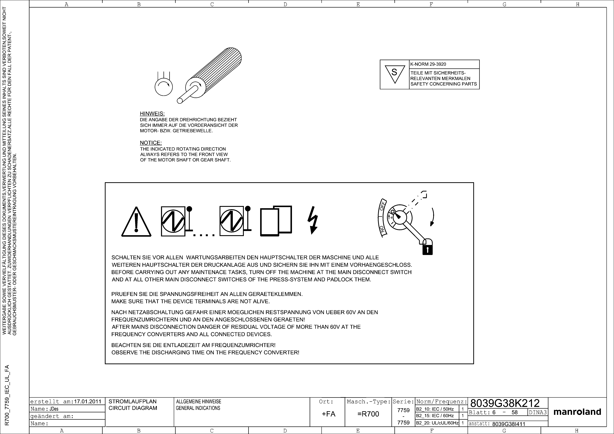

# +FA — Sheet 6 of 58 — ALLGEMEINE HINWEISE

**GENERAL INDICATIONS**

> Part of the manroland **R700** printing press IEC/UL circuit diagrams.
> Drawing class: **Stromlaufplan / Circuit diagram** (DIN A3).
> Document `+FA` covers the **Delivery** machine section.

## At a glance

| Field | Value |
|---|---|
| Document | `+FA`  (8039G38K212) |
| Sheet | **6** of 58 |
| Section (DE) | ALLGEMEINE HINWEISE |
| Section (EN) | GENERAL INDICATIONS |
| Section type | LEGEND — General indications |
| Machine type | `=R700` |
| Series | `7759` |
| Created | 17.01.2011 |
| Replaces | `8039G38I411` |
| Columns used | B, C, D, E, F |
| Path numbers | — |
| Labels on sheet | 29 |
| Cross-refs out | 0 |
| Cross-refs in | 0 |

**Previous:** [+FA sheet 5](SHEET_0005.md) · **Next:** [+FA sheet 7](SHEET_0007.md) · **Document TOC:** [_TOC.md](_TOC.md)  (+FA) · **Master TOC:** [all sheets](../_MASTER_TOC.md)

## Sheet image (300 DPI, exact vector render)



_Rendered directly from the PDF vector layer at 300 DPI (1-bit), no OCR and no resampling. Use it to confirm anything ambiguous in the text below._

## Cross-references on this sheet

Each entry is a wire leaving this sheet. The printed token is `/sheet.column`; the link resolves to that sheet inside the same document.

_No outgoing cross-references on this sheet._

## Devices on this sheet

_No device designators on this sheet._

## Potentials / nets

_No named potentials on this sheet._

## Wire-end annotations (grouped as printed)

A wire that continues elsewhere is annotated with a small cluster: the destination description, the path/line number `#NN`, and the `/sheet.column` cross reference. Each row below is one such cluster exactly as it is grouped on the drawing.

| Col | Y | Path | Cross-ref | Text on the wire |
|---|---|---|---|---|
| F | 120.8 | — | — | `K NORM 29 3920` |
| E | 132.4 | — | — | `S` |
| F | 137.7 | — | — | `RELEVANTEN MERKMALEN TEILE MIT SICHERHEITS` |
| F | 159.0 | — | — | `SAFETY CONCERNING PARTS` |
| C | 215.8 | — | — | `HINWEIS: DIE ANGABE DER DREHRICHTUNG BEZIEHT` |
| C | 239.1 | — | — | `MOTOR BZW. GETRIEBEWELLE. SICH IMMER AUF DIE VORDERANSICHT DER` |
| B | 272.5 | — | — | `NOTICE:` |
| C | 285.2 | — | — | `THE INDICATED ROTATING DIRECTION OF THE MOTOR SHAFT OR GEAR SHAFT. ALWAYS REFERS TO THE FRONT VIEW` |
| E | 390.6 | — | — | `OFF` |
| E | 418.8 | — | — | `I` |
| E | 418.8 | — | — | `+` |
| E | 437.2 | — | — | `ON` |
| C | 495.0 | — | — | `SCHALTEN SIE VOR ALLEN WARTUNGSARBEITEN DEN HAUPTSCHALTER DER MASCHINE UND ALLE` |
| D | 509.1 | — | — | `WEITEREN HAUPTSCHALTER DER DRUCKANLAGE AUS UND SICHERN SIE IHN MIT EINEM VORHAENGESCHLOSS.` |
| D | 523.3 | — | — | `BEFORE CARRYING OUT ANY MAINTENACE TASKS, TURN OFF THE MACHINE AT THE MAIN DISCONNECT SWITCH` |
| C | 537.5 | — | — | `AND AT ALL OTHER MAIN DISCONNECT SWITCHES OF THE PRESS SYSTEM AND PADLOCK THEM.` |
| C | 565.8 | — | — | `PRUEFEN SIE DIE SPANNUNGSFREIHEIT AN ALLEN GERAETEKLEMMEN. MAKE SURE THAT THE DEVICE TERMINALS ARE NOT ALIVE.` |
| C | 601.3 | — | — | `NACH NETZABSCHALTUNG GEFAHR EINER MOEGLICHEN RESTSPANNUNG VON UEBER 60V AN DEN FREQUENZUMRICHTERN UND AN DEN ANGESCHLOSSENEN GERAETEN!` |
| C | 629.6 | — | — | `FREQUENCY CONVERTERS AND ALL CONNECTED DEVICES. AFTER MAINS DISCONNECTION DANGER OF RESIDUAL VOLTAGE OF MORE THAN 60V AT THE` |
| C | 665.0 | — | — | `BEACHTEN SIE DIE ENTLADEZEIT AM FREQUENZUMRICHTER! OBSERVE THE DISCHARGING TIME ON THE FREQUENCY CONVERTER!` |


## Notes and free text on this sheet

| Text | Col | Y (pt) |
|---|---|---|
| `HINWEIS:` | B | 215.75 |
| `DIE ANGABE DER DREHRICHTUNG BEZIEHT` | C | 228.46 |
| `SICH IMMER AUF DIE VORDERANSICHT DER` | C | 239.1 |
| `MOTOR BZW. GETRIEBEWELLE.` | C | 249.68 |
| `NOTICE:` | B | 272.48 |
| `THE INDICATED ROTATING DIRECTION` | C | 285.16 |
| `ALWAYS REFERS TO THE FRONT VIEW` | C | 295.74 |
| `OF THE MOTOR SHAFT OR GEAR SHAFT.` | C | 306.42 |
| `S` | E | 132.42 |
| `K NORM 29 3920` | F | 120.79 |
| `TEILE MIT SICHERHEITS` | F | 137.74 |
| `RELEVANTEN MERKMALEN` | F | 148.4 |
| `SAFETY CONCERNING PARTS` | F | 159.02 |
| `SCHALTEN SIE VOR ALLEN WARTUNGSARBEITEN DEN HAUPTSCHALTER DER MASCHINE UND ALLE` | C | 494.96 |
| `BEFORE CARRYING OUT ANY MAINTENACE TASKS, TURN OFF THE MACHINE AT THE MAIN DISCONNECT SWITCH` | D | 523.33 |
| `BEACHTEN SIE DIE ENTLADEZEIT AM FREQUENZUMRICHTER!` | C | 665.05 |
| `OBSERVE THE DISCHARGING TIME ON THE FREQUENCY CONVERTER!` | C | 679.23 |
| `PRUEFEN SIE DIE SPANNUNGSFREIHEIT AN ALLEN GERAETEKLEMMEN.` | C | 565.84 |
| `MAKE SURE THAT THE DEVICE TERMINALS ARE NOT ALIVE.` | C | 580.02 |
| `WEITEREN HAUPTSCHALTER DER DRUCKANLAGE AUS UND SICHERN SIE IHN MIT EINEM VORHAENGESCHLOSS.` | D | 509.15 |
| `AND AT ALL OTHER MAIN DISCONNECT SWITCHES OF THE PRESS SYSTEM AND PADLOCK THEM.` | C | 537.49 |
| `ON` | E | 437.2 |
| `OFF` | E | 390.57 |
| `I` | E | 418.78 |
| `NACH NETZABSCHALTUNG GEFAHR EINER MOEGLICHEN RESTSPANNUNG VON UEBER 60V AN DEN` | C | 601.27 |
| `FREQUENZUMRICHTERN UND AN DEN ANGESCHLOSSENEN GERAETEN!` | C | 615.43 |
| `AFTER MAINS DISCONNECTION DANGER OF RESIDUAL VOLTAGE OF MORE THAN 60V AT THE` | C | 629.62 |
| `FREQUENCY CONVERTERS AND ALL CONNECTED DEVICES.` | C | 643.79 |

## Complete label inventory (exact text from the drawing)

Every text object inside the drawing area of this sheet, in DIN reading order (column A→H, then top→bottom). This is the authoritative list: if a string is not here it is not printed on this sheet.

| Col | Y | X | Dir | Type | Text |
|---|---|---|---|---|---|
| B | 215.8 | 271.3 | → | text | `HINWEIS:` |
| B | 272.5 | 271.3 | → | text | `NOTICE:` |
| C | 228.5 | 271.3 | → | text | `DIE ANGABE DER DREHRICHTUNG BEZIEHT` |
| C | 239.1 | 271.8 | → | text | `SICH IMMER AUF DIE VORDERANSICHT DER` |
| C | 249.7 | 271.6 | → | text | `MOTOR BZW. GETRIEBEWELLE.` |
| C | 285.2 | 271.8 | → | text | `THE INDICATED ROTATING DIRECTION` |
| C | 295.7 | 272.1 | → | text | `ALWAYS REFERS TO THE FRONT VIEW` |
| C | 306.4 | 271.8 | → | text | `OF THE MOTOR SHAFT OR GEAR SHAFT.` |
| C | 495.0 | 216.3 | → | text | `SCHALTEN SIE VOR ALLEN WARTUNGSARBEITEN DEN HAUPTSCHALTER DER MASCHINE UND ALLE` |
| C | 537.5 | 217.1 | → | text | `AND AT ALL OTHER MAIN DISCONNECT SWITCHES OF THE PRESS SYSTEM AND PADLOCK THEM.` |
| C | 565.8 | 216.0 | → | text | `PRUEFEN SIE DIE SPANNUNGSFREIHEIT AN ALLEN GERAETEKLEMMEN.` |
| C | 580.0 | 216.0 | → | text | `MAKE SURE THAT THE DEVICE TERMINALS ARE NOT ALIVE.` |
| C | 601.3 | 216.0 | → | text | `NACH NETZABSCHALTUNG GEFAHR EINER MOEGLICHEN RESTSPANNUNG VON UEBER 60V AN DEN` |
| C | 615.4 | 216.0 | → | text | `FREQUENZUMRICHTERN UND AN DEN ANGESCHLOSSENEN GERAETEN!` |
| C | 629.6 | 217.1 | → | text | `AFTER MAINS DISCONNECTION DANGER OF RESIDUAL VOLTAGE OF MORE THAN 60V AT THE` |
| C | 643.8 | 216.0 | → | text | `FREQUENCY CONVERTERS AND ALL CONNECTED DEVICES.` |
| C | 665.1 | 216.0 | → | text | `BEACHTEN SIE DIE ENTLADEZEIT AM FREQUENZUMRICHTER!` |
| C | 679.2 | 216.3 | → | text | `OBSERVE THE DISCHARGING TIME ON THE FREQUENCY CONVERTER!` |
| D | 509.1 | 216.9 | → | text | `WEITEREN HAUPTSCHALTER DER DRUCKANLAGE AUS UND SICHERN SIE IHN MIT EINEM VORHAENGESCHLOSS.` |
| D | 523.3 | 216.0 | → | text | `BEFORE CARRYING OUT ANY MAINTENACE TASKS, TURN OFF THE MACHINE AT THE MAIN DISCONNECT SWITCH` |
| E | 132.4 | 758.8 | → | text | `S` |
| E | 390.6 | 735.3 | ↕ | text | `OFF` |
| E | 418.8 | 733.6 | ↕ | text | `I` |
| E | 418.8 | 756.6 | → | number | `+` |
| E | 437.2 | 734.0 | ↕ | text | `ON` |
| F | 120.8 | 795.7 | → | text | `K NORM 29 3920` |
| F | 137.7 | 796.3 | → | text | `TEILE MIT SICHERHEITS` |
| F | 148.4 | 795.7 | → | text | `RELEVANTEN MERKMALEN` |
| F | 159.0 | 796.3 | → | text | `SAFETY CONCERNING PARTS` |

## Reading-order text block

The same content as a plain block, grouped by DIN column — convenient to paste or to match against a visual description.

```text
=== Column B ===
 215.8  271.3  text         HINWEIS:
 272.5  271.3  text         NOTICE:
=== Column C ===
 228.5  271.3  text         DIE ANGABE DER DREHRICHTUNG BEZIEHT
 239.1  271.8  text         SICH IMMER AUF DIE VORDERANSICHT DER
 249.7  271.6  text         MOTOR BZW. GETRIEBEWELLE.
 285.2  271.8  text         THE INDICATED ROTATING DIRECTION
 295.7  272.1  text         ALWAYS REFERS TO THE FRONT VIEW
 306.4  271.8  text         OF THE MOTOR SHAFT OR GEAR SHAFT.
 495.0  216.3  text         SCHALTEN SIE VOR ALLEN WARTUNGSARBEITEN DEN HAUPTSCHALTER DER MASCHINE UND ALLE
 537.5  217.1  text         AND AT ALL OTHER MAIN DISCONNECT SWITCHES OF THE PRESS SYSTEM AND PADLOCK THEM.
 565.8  216.0  text         PRUEFEN SIE DIE SPANNUNGSFREIHEIT AN ALLEN GERAETEKLEMMEN.
 580.0  216.0  text         MAKE SURE THAT THE DEVICE TERMINALS ARE NOT ALIVE.
 601.3  216.0  text         NACH NETZABSCHALTUNG GEFAHR EINER MOEGLICHEN RESTSPANNUNG VON UEBER 60V AN DEN
 615.4  216.0  text         FREQUENZUMRICHTERN UND AN DEN ANGESCHLOSSENEN GERAETEN!
 629.6  217.1  text         AFTER MAINS DISCONNECTION DANGER OF RESIDUAL VOLTAGE OF MORE THAN 60V AT THE
 643.8  216.0  text         FREQUENCY CONVERTERS AND ALL CONNECTED DEVICES.
 665.1  216.0  text         BEACHTEN SIE DIE ENTLADEZEIT AM FREQUENZUMRICHTER!
 679.2  216.3  text         OBSERVE THE DISCHARGING TIME ON THE FREQUENCY CONVERTER!
=== Column D ===
 509.1  216.9  text         WEITEREN HAUPTSCHALTER DER DRUCKANLAGE AUS UND SICHERN SIE IHN MIT EINEM VORHAENGESCHLOSS.
 523.3  216.0  text         BEFORE CARRYING OUT ANY MAINTENACE TASKS, TURN OFF THE MACHINE AT THE MAIN DISCONNECT SWITCH
=== Column E ===
 132.4  758.8  text         S
 390.6  735.3  text         OFF
 418.8  733.6  text         I
 418.8  756.6  numeric      +
 437.2  734.0  text         ON
=== Column F ===
 120.8  795.7  text         K NORM 29 3920
 137.7  796.3  text         TEILE MIT SICHERHEITS
 148.4  795.7  text         RELEVANTEN MERKMALEN
 159.0  796.3  text         SAFETY CONCERNING PARTS
```

---
_Generated from the PDF vector text layer; no OCR. Source: `R700_7759_IEC_UL_FA`, sheet 6._
