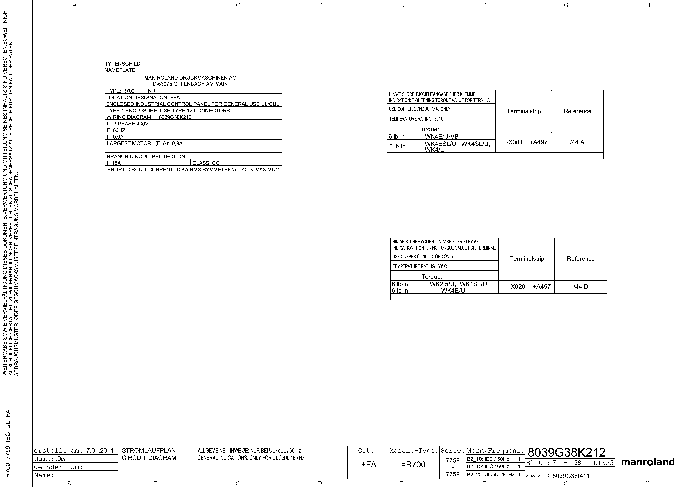

# +FA — Sheet 7 of 58 — ALLGEMEINE HINWEISE: NUR BEI UL / cUL / 60 Hz

**GENERAL INDICATIONS: ONLY FOR UL / cUL / 60 Hz**

> Part of the manroland **R700** printing press IEC/UL circuit diagrams.
> Drawing class: **Stromlaufplan / Circuit diagram** (DIN A3).
> Document `+FA` covers the **Delivery** machine section.

## At a glance

| Field | Value |
|---|---|
| Document | `+FA`  (8039G38K212) |
| Sheet | **7** of 58 |
| Section (DE) | ALLGEMEINE HINWEISE: NUR BEI UL / cUL / 60 Hz |
| Section (EN) | GENERAL INDICATIONS: ONLY FOR UL / cUL / 60 Hz |
| Section type | LEGEND — General indications |
| Machine type | `=R700` |
| Series | `7759` |
| Created | 17.01.2011 |
| Replaces | `8039G38I411` |
| Columns used | A, B, C, E, F, G |
| Path numbers | — |
| Labels on sheet | 53 |
| Cross-refs out | 2 |
| Cross-refs in | 0 |

**Previous:** [+FA sheet 6](SHEET_0006.md) · **Next:** [+FA sheet 8](SHEET_0008.md) · **Document TOC:** [_TOC.md](_TOC.md)  (+FA) · **Master TOC:** [all sheets](../_MASTER_TOC.md)

## Sheet image (300 DPI, exact vector render)



_Rendered directly from the PDF vector layer at 300 DPI (1-bit), no OCR and no resampling. Use it to confirm anything ambiguous in the text below._

## Cross-references on this sheet

Each entry is a wire leaving this sheet. The printed token is `/sheet.column`; the link resolves to that sheet inside the same document.

| Ref | Target sheet | Col | Path | Destination on target | Target section | From col |
|---|---|---|---|---|---|---|
| `/44.A` | [+FA sheet 44](SHEET_0044.md) | A | — | +A497 X001 | KLEMMLEISTE | G |
| `/44.D` | [+FA sheet 44](SHEET_0044.md) | D | — | +A497 X020 WK4E/U | KLEMMLEISTE | F |

## Devices on this sheet

| Tag | Class | Class meaning (IEC) | Col | Sub | Terminal | Sign |
|---|---|---|---|---|---|---|
| `R700` | R | Widerstand / resistor | B | — | — | — |
| `X001` | X | Klemme / terminal, plug connector | F | — | — | — |
| `+A497` | A | Baugruppe / assembly, module, PC board | G | — | — | + |
| `X020` | X | Klemme / terminal, plug connector | F | — | — | — |
| `+A497` | A | Baugruppe / assembly, module, PC board | G | — | — | + |

## Potentials / nets

_No named potentials on this sheet._

## Wire-end annotations (grouped as printed)

A wire that continues elsewhere is annotated with a small cluster: the destination description, the path/line number `#NN`, and the `/sheet.column` cross reference. Each row below is one such cluster exactly as it is grouped on the drawing.

| Col | Y | Path | Cross-ref | Text on the wire |
|---|---|---|---|---|
| B | 106.6 | — | — | `NAMEPLATE TYPENSCHILD` |
| B | 130.7 | — | — | `MAN ROLAND DRUCKMASCHINEN AG` |
| B | 141.3 | — | — | `LOCATION DESIGNATON: TYPE: D 63075 OFFENBACH AM MAIN` |
| B | 153.4 | — | — | `R700` |
| B | 153.4 | — | — | `NR:` |
| E | 160.1 | — | — | `HINWEIS: DREHMOMENTANGABE FUER KLEMME. INDICATION: TIGHTENING TORQUE VALUE FOR TERMINAL.` |
| B | 164.7 | — | — | `+FA` |
| B | 176.0 | — | — | `ENCLOSED INDUSTRIAL CONTROL PANEL FOR GENERAL USE UL/CUL` |
| E | 185.6 | — | — | `USE COPPER CONDUCTORS ONLY` |
| B | 187.4 | — | — | `TYPE 1 ENCLOSURE: USE TYPE 12 CONNECTORS WIRING DIAGRAM:` |
| G | 187.5 | — | — | `Terminalstrip Reference` |
| B | 198.7 | — | — | `8039G38K212` |
| E | 202.6 | — | — | `TEMPERATURE RATING: 60° C` |
| B | 210.0 | — | — | `U: 3 PHASE 400V F: 60HZ I: LARGEST MOTOR I (FLA):` |
| E | 218.6 | — | — | `Torque:` |
| E | 231.3 | — | — | `6 lb in WK4E/U/VB WK4ESL/U, WK4SL/U, WK4/U` |
| C | 232.7 | — | — | `0,9A 0,9A 8 lb in` |
| G | 241.2 | — | `/44.A` | `X001 +A497` |
| B | 266.7 | — | — | `BRANCH CIRCUIT PROTECTION` |
| A | 277.9 | — | — | `I:` |
| B | 278.1 | — | — | `15A` |
| C | 278.1 | — | — | `CLASS: CC` |
| B | 289.4 | — | — | `SHORT CIRCUIT CURRENT: 10KA RMS SYMMETRICAL, 400V MAXIMUM` |
| F | 415.2 | — | — | `HINWEIS: DREHMOMENTANGABE FUER KLEMME. INDICATION: TIGHTENING TORQUE VALUE FOR TERMINAL.` |
| E | 440.7 | — | — | `USE COPPER CONDUCTORS ONLY` |
| G | 442.6 | — | — | `Terminalstrip Reference` |
| E | 457.7 | — | — | `TEMPERATURE RATING: 60° C` |
| E | 473.7 | — | — | `Torque:` |
| E | 486.4 | — | — | `8 lb in 6 lb in WK2,5/U, WK4SL/U` |
| F | 490.7 | — | `/44.D` | `WK4E/U X020 +A497` |


## Reconstructed tables

This sheet carries tabular content (pin map / terminal assignment / index). The grid below was rebuilt from the drawing's own rule lines, so each row is exactly one physical row of the table.

### Table 1 — 4 data rows × 1 columns (at x=861.7, y=178.6)

| C1 |
|---|
| `Terminalstrip` |
| `+A497 X001` |
| `Terminalstrip` |
| `+A497 X020` |


## Notes and free text on this sheet

| Text | Col | Y (pt) |
|---|---|---|
| `MAN ROLAND DRUCKMASCHINEN AG` | B | 130.69 |
| `D 63075 OFFENBACH AM MAIN` | B | 141.32 |
| `TYPE:` | A | 153.3 |
| `LOCATION DESIGNATON:` | B | 164.68 |
| `TYPENSCHILD` | B | 106.58 |
| `NAMEPLATE` | B | 117.21 |
| `NR:` | B | 153.37 |
| `ENCLOSED INDUSTRIAL CONTROL PANEL FOR GENERAL USE UL/CUL` | B | 176.03 |
| `TYPE 1 ENCLOSURE: USE TYPE 12 CONNECTORS` | B | 187.36 |
| `WIRING DIAGRAM:` | B | 198.67 |
| `U: 3 PHASE 400V` | B | 210.02 |
| `F: 60HZ` | B | 221.38 |
| `I:` | A | 232.57 |
| `LARGEST MOTOR I (FLA):` | B | 244.05 |
| `SHORT CIRCUIT CURRENT: 10KA RMS SYMMETRICAL, 400V MAXIMUM` | B | 289.42 |
| `BRANCH CIRCUIT PROTECTION` | B | 266.74 |
| `CLASS: CC` | C | 278.07 |
| `+FA` | B | 164.67 |
| `8039G38K212` | B | 198.74 |
| `15A` | B | 278.08 |
| `0,9A` | B | 232.71 |
| `8 lb in` | E | 248.46 |
| `6 lb in` | E | 231.45 |
| `WK4E/U/VB` | E | 231.29 |
| `WK4ESL/U, WK4SL/U,` | F | 244.05 |
| `WK4/U` | E | 253.92 |
| `HINWEIS: DREHMOMENTANGABE FUER KLEMME.` | E | 160.07 |
| `INDICATION: TIGHTENING TORQUE VALUE FOR TERMINAL.` | E | 170.71 |
| `USE COPPER CONDUCTORS ONLY` | E | 185.6 |
| `TEMPERATURE RATING: 60° C` | E | 202.6 |
| `Terminalstrip` | F | 187.53 |
| `Reference` | G | 187.48 |
| `Torque:` | E | 218.61 |
| `WK2,5/U, WK4SL/U` | F | 486.41 |
| `WK4E/U` | F | 497.72 |
| `INDICATION: TIGHTENING TORQUE VALUE FOR TERMINAL.` | F | 425.83 |
| `Terminalstrip` | G | 442.65 |

## Complete label inventory (exact text from the drawing)

Every text object inside the drawing area of this sheet, in DIN reading order (column A→H, then top→bottom). This is the authoritative list: if a string is not here it is not printed on this sheet.

| Col | Y | X | Dir | Type | Text |
|---|---|---|---|---|---|
| A | 153.3 | 184.0 | → | text | `TYPE:` |
| A | 232.6 | 184.8 | → | text | `I:` |
| A | 277.9 | 184.8 | → | text | `I:` |
| B | 106.6 | 181.1 | → | text | `TYPENSCHILD` |
| B | 117.2 | 180.6 | → | text | `NAMEPLATE` |
| B | 130.7 | 249.2 | → | text | `MAN ROLAND DRUCKMASCHINEN AG` |
| B | 141.3 | 263.9 | → | text | `D 63075 OFFENBACH AM MAIN` |
| B | 153.4 | 211.7 | → | device tag | `R700` |
| B | 153.4 | 255.7 | → | text | `NR:` |
| B | 164.7 | 183.4 | → | text | `LOCATION DESIGNATON:` |
| B | 164.7 | 294.5 | → | text | `+FA` |
| B | 176.0 | 183.4 | → | text | `ENCLOSED INDUSTRIAL CONTROL PANEL FOR GENERAL USE UL/CUL` |
| B | 187.4 | 184.0 | → | text | `TYPE 1 ENCLOSURE: USE TYPE 12 CONNECTORS` |
| B | 198.7 | 184.3 | → | text | `WIRING DIAGRAM:` |
| B | 198.7 | 274.7 | → | text | `8039G38K212` |
| B | 210.0 | 184.8 | → | text | `U: 3 PHASE 400V` |
| B | 221.4 | 184.8 | → | text | `F: 60HZ` |
| B | 232.7 | 195.3 | → | text | `0,9A` |
| B | 244.0 | 297.4 | → | text | `0,9A` |
| B | 244.1 | 184.8 | → | text | `LARGEST MOTOR I (FLA):` |
| B | 266.7 | 184.8 | → | text | `BRANCH CIRCUIT PROTECTION` |
| B | 278.1 | 193.3 | → | text | `15A` |
| B | 289.4 | 185.4 | → | text | `SHORT CIRCUIT CURRENT: 10KA RMS SYMMETRICAL, 400V MAXIMUM` |
| C | 278.1 | 332.8 | → | text | `CLASS: CC` |
| E | 160.1 | 672.4 | → | text | `HINWEIS: DREHMOMENTANGABE FUER KLEMME.` |
| E | 170.7 | 672.4 | → | text | `INDICATION: TIGHTENING TORQUE VALUE FOR TERMINAL.` |
| E | 185.6 | 672.4 | → | text | `USE COPPER CONDUCTORS ONLY` |
| E | 202.6 | 672.9 | → | text | `TEMPERATURE RATING: 60° C` |
| E | 218.6 | 722.6 | → | text | `Torque:` |
| E | 231.3 | 734.2 | → | text | `WK4E/U/VB` |
| E | 231.4 | 671.5 | → | text | `6 lb in` |
| E | 248.5 | 672.7 | → | text | `8 lb in` |
| E | 253.9 | 734.2 | → | text | `WK4/U` |
| E | 415.2 | 678.0 | → | text | `HINWEIS: DREHMOMENTANGABE FUER KLEMME.` |
| E | 440.7 | 678.0 | → | text | `USE COPPER CONDUCTORS ONLY` |
| E | 457.7 | 678.6 | → | text | `TEMPERATURE RATING: 60° C` |
| E | 473.7 | 728.2 | → | text | `Torque:` |
| E | 486.6 | 676.9 | → | text | `8 lb in` |
| E | 497.9 | 677.2 | → | text | `6 lb in` |
| F | 187.5 | 875.6 | → | text | `Terminalstrip` |
| F | 241.2 | 875.1 | → | device tag | `X001` |
| F | 244.0 | 734.2 | → | text | `WK4ESL/U, WK4SL/U,` |
| F | 425.8 | 678.0 | → | text | `INDICATION: TIGHTENING TORQUE VALUE FOR TERMINAL.` |
| F | 486.4 | 742.7 | → | text | `WK2,5/U, WK4SL/U` |
| F | 490.7 | 879.3 | → | device tag | `X020` |
| F | 497.7 | 762.5 | → | text | `WK4E/U` |
| G | 187.5 | 974.3 | → | text | `Reference` |
| G | 241.2 | 915.0 | → | device tag | `+A497` |
| G | 241.3 | 985.3 | → | cross-reference | `/44.A` |
| G | 442.6 | 979.9 | → | text | `Reference` |
| G | 442.7 | 881.3 | → | text | `Terminalstrip` |
| G | 490.7 | 920.7 | → | device tag | `+A497` |
| G | 490.7 | 991.1 | → | cross-reference | `/44.D` |

## Reading-order text block

The same content as a plain block, grouped by DIN column — convenient to paste or to match against a visual description.

```text
=== Column A ===
 153.3  184.0  text         TYPE:
 232.6  184.8  text         I:
 277.9  184.8  text         I:
=== Column B ===
 106.6  181.1  text         TYPENSCHILD
 117.2  180.6  text         NAMEPLATE
 130.7  249.2  text         MAN ROLAND DRUCKMASCHINEN AG
 141.3  263.9  text         D 63075 OFFENBACH AM MAIN
 153.4  211.7  devtag       R700
 153.4  255.7  text         NR:
 164.7  183.4  text         LOCATION DESIGNATON:
 164.7  294.5  text         +FA
 176.0  183.4  text         ENCLOSED INDUSTRIAL CONTROL PANEL FOR GENERAL USE UL/CUL
 187.4  184.0  text         TYPE 1 ENCLOSURE: USE TYPE 12 CONNECTORS
 198.7  184.3  text         WIRING DIAGRAM:
 198.7  274.7  text         8039G38K212
 210.0  184.8  text         U: 3 PHASE 400V
 221.4  184.8  text         F: 60HZ
 232.7  195.3  text         0,9A
 244.0  297.4  text         0,9A
 244.1  184.8  text         LARGEST MOTOR I (FLA):
 266.7  184.8  text         BRANCH CIRCUIT PROTECTION
 278.1  193.3  text         15A
 289.4  185.4  text         SHORT CIRCUIT CURRENT: 10KA RMS SYMMETRICAL, 400V MAXIMUM
=== Column C ===
 278.1  332.8  text         CLASS: CC
=== Column E ===
 160.1  672.4  text         HINWEIS: DREHMOMENTANGABE FUER KLEMME.
 170.7  672.4  text         INDICATION: TIGHTENING TORQUE VALUE FOR TERMINAL.
 185.6  672.4  text         USE COPPER CONDUCTORS ONLY
 202.6  672.9  text         TEMPERATURE RATING: 60° C
 218.6  722.6  text         Torque:
 231.3  734.2  text         WK4E/U/VB
 231.4  671.5  text         6 lb in
 248.5  672.7  text         8 lb in
 253.9  734.2  text         WK4/U
 415.2  678.0  text         HINWEIS: DREHMOMENTANGABE FUER KLEMME.
 440.7  678.0  text         USE COPPER CONDUCTORS ONLY
 457.7  678.6  text         TEMPERATURE RATING: 60° C
 473.7  728.2  text         Torque:
 486.6  676.9  text         8 lb in
 497.9  677.2  text         6 lb in
=== Column F ===
 187.5  875.6  text         Terminalstrip
 241.2  875.1  devtag       X001
 244.0  734.2  text         WK4ESL/U, WK4SL/U,
 425.8  678.0  text         INDICATION: TIGHTENING TORQUE VALUE FOR TERMINAL.
 486.4  742.7  text         WK2,5/U, WK4SL/U
 490.7  879.3  devtag       X020
 497.7  762.5  text         WK4E/U
=== Column G ===
 187.5  974.3  text         Reference
 241.2  915.0  devtag       +A497
 241.3  985.3  xref         /44.A
 442.6  979.9  text         Reference
 442.7  881.3  text         Terminalstrip
 490.7  920.7  devtag       +A497
 490.7  991.1  xref         /44.D
```

---
_Generated from the PDF vector text layer; no OCR. Source: `R700_7759_IEC_UL_FA`, sheet 7._
