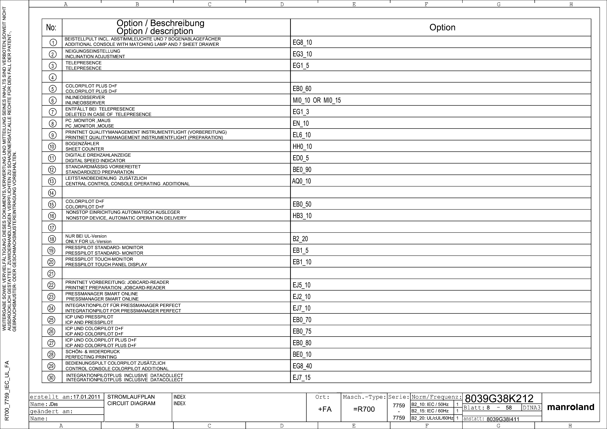

# +FA — Sheet 8 of 58 — INDEX

**INDEX**

> Part of the manroland **R700** printing press IEC/UL circuit diagrams.
> Drawing class: **Stromlaufplan / Circuit diagram** (DIN A3).
> Document `+FA` covers the **Delivery** machine section.

## At a glance

| Field | Value |
|---|---|
| Document | `+FA`  (8039G38K212) |
| Sheet | **8** of 58 |
| Section (DE) | INDEX |
| Section (EN) | INDEX |
| Section type | INDEX — Index |
| Machine type | `=R700` |
| Series | `7759` |
| Created | 17.01.2011 |
| Replaces | `8039G38I411` |
| Columns used | A, B, D, F |
| Path numbers | — |
| Labels on sheet | 112 |
| Cross-refs out | 0 |
| Cross-refs in | 0 |

**Previous:** [+FA sheet 7](SHEET_0007.md) · **Next:** [+FA sheet 9](SHEET_0009.md) · **Document TOC:** [_TOC.md](_TOC.md)  (+FA) · **Master TOC:** [all sheets](../_MASTER_TOC.md)

## Sheet image (300 DPI, exact vector render)



_Rendered directly from the PDF vector layer at 300 DPI (1-bit), no OCR and no resampling. Use it to confirm anything ambiguous in the text below._

## Cross-references on this sheet

Each entry is a wire leaving this sheet. The printed token is `/sheet.column`; the link resolves to that sheet inside the same document.

_No outgoing cross-references on this sheet._

## Devices on this sheet

_No device designators on this sheet._

## Potentials / nets

_No named potentials on this sheet._

## Wire-end annotations (grouped as printed)

A wire that continues elsewhere is annotated with a small cluster: the destination description, the path/line number `#NN`, and the `/sheet.column` cross reference. Each row below is one such cluster exactly as it is grouped on the drawing.

| Col | Y | Path | Cross-ref | Text on the wire |
|---|---|---|---|---|
| D | 37.5 | — | — | `No: Option / Beschreibung Option / description Option` |
| B | 72.6 | — | — | `BEISTELLPULT INCL. ABSTIMMLEUCHTE UND 7 BOGENABLAGEFÄCHER` |
| D | 78.6 | — | — | `EG8_10` |
| A | 80.2 | — | — | `1` |
| B | 83.2 | — | — | `ADDITIONAL CONSOLE WITH MATCHING LAMP AND 7 SHEET DRAWER` |
| A | 96.7 | — | — | `NEIGUNGSEINSTELLUNG INCLINATION ADJUSTMENT` |
| D | 101.3 | — | — | `EG3_10` |
| A | 103.4 | — | — | `2` |
| A | 119.3 | — | — | `TELEPRESENCE TELEPRESENCE` |
| D | 123.9 | — | — | `EG1_5` |
| A | 126.0 | — | — | `3` |
| A | 148.8 | — | — | `4` |
| B | 164.7 | — | — | `INLINEOBSERVER INLINEOBSERVER ENTFÄLLT BEI TELEPRESENCE DELETED IN CASE OF TELEPRESENCE PC ,MONITOR ,MAUS PC ,MONITOR ,MOUSE PRINTNET QUALITYMANAGEMENT INSTRUMENTFLIGHT (VORBEREITUNG) PRINTNET QUALITYMANAGEMENT INSTRUMENTFLIGHT (PREPARATION) BOGENZÄHLER COLORPILOT PLUS D+F COLORPILOT PLUS D+F` |
| D | 169.3 | — | — | `EB0_60` |
| A | 171.4 | — | — | `5` |
| D | 192.0 | — | — | `MI0_10 OR MI0_15` |
| A | 194.1 | — | — | `6` |
| D | 214.6 | — | — | `EG1_3` |
| A | 216.8 | — | — | `7` |
| D | 237.3 | — | — | `EN_10` |
| A | 239.4 | — | — | `8` |
| D | 260.0 | — | — | `EL6_10` |
| A | 262.1 | — | — | `9` |
| D | 282.7 | — | — | `HH0_10` |
| A | 284.1 | — | — | `10` |
| A | 288.7 | — | — | `DIGITALE DREHZAHLANZEIGE DIGITAL SPEED INDICATOR SHEET COUNTER` |
| D | 305.4 | — | — | `ED0_5` |
| A | 306.6 | — | — | `11` |
| B | 323.4 | — | — | `LEITSTANDBEDIENUNG ZUSÄTZLICH STANDARDMÄSSIG VORBEREITET STANDARDIZED PREPARATION` |
| D | 328.0 | — | — | `BE0_90` |
| A | 329.5 | — | — | `12` |
| D | 350.8 | — | — | `AQ0_10` |
| A | 352.1 | — | — | `13` |
| B | 356.7 | — | — | `CENTRAL CONTROL CONSOLE OPERATING ADDITIONAL` |
| A | 375.5 | — | — | `14` |
| A | 391.5 | — | — | `COLORPILOT D+F COLORPILOT D+F` |
| D | 396.1 | — | — | `EB0_50` |
| A | 398.2 | — | — | `15` |
| B | 412.7 | — | — | `NONSTOP EINRICHTUNG AUTOMATISCH AUSLEGER` |
| D | 418.7 | — | — | `HB3_10` |
| A | 420.2 | — | — | `16` |
| B | 424.0 | — | — | `NONSTOP DEVICE, AUTOMATIC OPERATION DELIVERY` |
| A | 443.6 | — | — | `17` |
| A | 459.5 | — | — | `NUR BEI UL Version` |
| D | 464.1 | — | — | `B2_20` |
| A | 466.2 | — | — | `18` |
| B | 470.2 | — | — | `PRESSPILOT STANDARD MONITOR PRESSPILOT STANDARD MONITOR PRESSPILOT TOUCH MONITOR PRESSPILOT TOUCH PANEL DISPLAY ONLY FOR UL Version` |
| D | 486.8 | — | — | `EB1_5` |
| A | 488.2 | — | — | `19` |
| D | 509.5 | — | — | `EB1_10` |
| A | 511.0 | — | — | `20` |
| A | 533.5 | — | — | `21` |
| B | 550.2 | — | — | `PRINTNET VORBEREITUNG: JOBCARD READER PRINTNET PREPARATION: JOBCARD READER PRESSMANAGER SMART ONLINE` |
| D | 554.8 | — | — | `EJ5_10` |
| A | 556.4 | — | — | `22` |
| D | 577.5 | — | — | `EJ2_10` |
| A | 579.0 | — | — | `23` |
| B | 582.8 | — | — | `PRESSMANAGER SMART ONLINE` |
| B | 595.5 | — | — | `INTEGRATIONPILOT FÜR PRESSMANAGER PERFECT INTEGRATIONPILOT FOR PRESSMANAGER PERFECT ICP UND PRESSPILOT ICP AND PRESSPILOT ICP UND COLORPILOT D+F ICP AND COLORPILOT D+F ICP UND COLORPILOT PLUS D+F ICP AND COLORPILOT PLUS D+F` |
| D | 600.1 | — | — | `EJ7_10` |
| A | 601.7 | — | — | `24` |
| D | 622.8 | — | — | `EB0_70` |
| A | 624.4 | — | — | `25` |
| D | 645.5 | — | — | `EB0_75` |
| A | 647.1 | — | — | `26` |
| D | 668.2 | — | — | `EB0_80` |
| A | 669.7 | — | — | `27` |
| B | 686.2 | — | — | `PERFECTING PRINTING BEDIENUNGSPULT COLORPILOT ZUSÄTZLICH SCHÖN & WIDERDRUCK` |
| D | 690.9 | — | — | `BE0_10` |
| A | 692.4 | — | — | `28` |
| D | 713.5 | — | — | `EG8_40` |
| A | 715.1 | — | — | `29` |
| B | 719.6 | — | — | `CONTROL CONSOLE COLORPILOT ADDITIONAL` |
| B | 733.0 | — | — | `INTEGRATIONPILOTPLUS INCLUSIVE DATACOLLECT` |
| D | 736.2 | — | — | `EJ7_15` |
| A | 737.7 | — | — | `30` |
| B | 741.5 | — | — | `INTEGRATIONPILOTPLUS INCLUSIVE DATACOLLECT` |


## Notes and free text on this sheet

| Text | Col | Y (pt) |
|---|---|---|
| `No:` | A | 47.84 |
| `Option` | F | 45.97 |
| `Option / Beschreibung` | B | 37.47 |
| `Option / description` | B | 53.05 |
| `EG8_10` | D | 78.58 |
| `EG3_10` | D | 101.26 |
| `EG1_5` | D | 123.93 |
| `EB0_60` | D | 169.3 |
| `MI0_10 OR MI0_15` | D | 192.01 |
| `EG1_3` | D | 214.64 |
| `EN_10` | D | 237.32 |
| `EL6_10` | D | 259.99 |
| `HH0_10` | D | 282.67 |
| `ED0_5` | D | 305.35 |
| `BE0_90` | D | 328.04 |
| `AQ0_10` | D | 350.76 |
| `EB0_50` | D | 396.07 |
| `HB3_10` | D | 418.74 |
| `B2_20` | D | 464.08 |
| `EB1_5` | D | 486.77 |
| `EB1_10` | D | 509.46 |
| `EJ5_10` | D | 554.8 |
| `EJ2_10` | D | 577.48 |
| `EJ7_10` | D | 600.15 |
| `EB0_70` | D | 622.84 |
| `EB0_75` | D | 645.52 |
| `EB0_80` | D | 668.2 |
| `BE0_10` | D | 690.87 |
| `EG8_40` | D | 713.54 |
| `EJ7_15` | D | 736.22 |
| `BEISTELLPULT INCL. ABSTIMMLEUCHTE UND 7 BOGENABLAGEFÄCHER` | B | 72.56 |
| `ADDITIONAL CONSOLE WITH MATCHING LAMP AND 7 SHEET DRAWER` | B | 83.18 |
| `NEIGUNGSEINSTELLUNG` | A | 96.66 |
| `INCLINATION ADJUSTMENT` | A | 107.29 |
| `TELEPRESENCE` | A | 119.32 |
| `COLORPILOT PLUS D+F` | A | 164.69 |
| `INLINEOBSERVER` | A | 187.35 |
| `ENTFÄLLT BEI TELEPRESENCE` | A | 210.02 |
| `DELETED IN CASE OF TELEPRESENCE` | B | 220.65 |
| `PC ,MONITOR ,MAUS` | A | 232.72 |
| `PC ,MONITOR ,MOUSE` | A | 243.36 |
| `PRINTNET QUALITYMANAGEMENT INSTRUMENTFLIGHT (VORBEREITUNG)` | B | 255.4 |
| `PRINTNET QUALITYMANAGEMENT INSTRUMENTFLIGHT (PREPARATION)` | B | 266.03 |
| `BOGENZÄHLER` | A | 278.08 |
| `SHEET COUNTER` | A | 288.71 |
| `DIGITALE DREHZAHLANZEIGE` | A | 300.74 |
| `DIGITAL SPEED INDICATOR` | A | 311.37 |
| `STANDARDMÄSSIG VORBEREITET` | B | 323.42 |
| `STANDARDIZED PREPARATION` | A | 334.05 |
| `LEITSTANDBEDIENUNG ZUSÄTZLICH` | B | 346.1 |
| `CENTRAL CONTROL CONSOLE OPERATING ADDITIONAL` | B | 356.74 |
| `COLORPILOT D+F` | A | 391.47 |
| `NONSTOP EINRICHTUNG AUTOMATISCH AUSLEGER` | B | 412.72 |
| `NUR BEI UL Version` | A | 459.53 |
| `ONLY FOR UL Version` | A | 470.17 |
| `PRESSPILOT STANDARD MONITOR` | B | 482.17 |
| `PRESSPILOT TOUCH MONITOR` | A | 504.85 |
| `PRESSPILOT TOUCH PANEL DISPLAY` | B | 515.46 |
| `PRINTNET VORBEREITUNG: JOBCARD READER` | B | 550.2 |
| `PRINTNET PREPARATION: JOBCARD READER` | B | 560.82 |
| `PRESSMANAGER SMART ONLINE` | B | 572.88 |
| `INTEGRATIONPILOT FÜR PRESSMANAGER PERFECT` | B | 595.55 |
| `INTEGRATIONPILOT FOR PRESSMANAGER PERFECT` | B | 606.18 |
| `ICP UND PRESSPILOT` | A | 618.22 |
| `ICP AND PRESSPILOT` | A | 628.84 |
| `ICP UND COLORPILOT D+F` | A | 640.92 |
| `ICP AND COLORPILOT D+F` | A | 651.54 |
| `ICP UND COLORPILOT PLUS D+F` | A | 663.59 |
| `ICP AND COLORPILOT PLUS D+F` | A | 674.22 |
| `SCHÖN & WIDERDRUCK` | A | 686.25 |
| `PERFECTING PRINTING` | A | 696.89 |
| `BEDIENUNGSPULT COLORPILOT ZUSÄTZLICH` | B | 708.94 |
| `CONTROL CONSOLE COLORPILOT ADDITIONAL` | B | 719.58 |
| `INTEGRATIONPILOTPLUS INCLUSIVE DATACOLLECT` | B | 733.02 |
| `NONSTOP DEVICE, AUTOMATIC OPERATION DELIVERY` | B | 424.04 |

## Complete label inventory (exact text from the drawing)

Every text object inside the drawing area of this sheet, in DIN reading order (column A→H, then top→bottom). This is the authoritative list: if a string is not here it is not printed on this sheet.

| Col | Y | X | Dir | Type | Text |
|---|---|---|---|---|---|
| A | 47.8 | 90.6 | → | text | `No:` |
| A | 80.2 | 101.7 | → | number | `1` |
| A | 96.7 | 128.1 | → | text | `NEIGUNGSEINSTELLUNG` |
| A | 103.4 | 101.0 | → | number | `2` |
| A | 107.3 | 128.1 | → | text | `INCLINATION ADJUSTMENT` |
| A | 119.3 | 128.7 | → | text | `TELEPRESENCE` |
| A | 126.0 | 100.9 | → | number | `3` |
| A | 130.0 | 128.7 | → | text | `TELEPRESENCE` |
| A | 148.8 | 101.0 | → | number | `4` |
| A | 164.7 | 128.7 | → | text | `COLORPILOT PLUS D+F` |
| A | 171.4 | 100.9 | → | number | `5` |
| A | 175.3 | 128.7 | → | text | `COLORPILOT PLUS D+F` |
| A | 187.4 | 128.1 | → | text | `INLINEOBSERVER` |
| A | 194.1 | 101.0 | → | number | `6` |
| A | 198.0 | 128.1 | → | text | `INLINEOBSERVER` |
| A | 210.0 | 128.1 | → | text | `ENTFÄLLT BEI TELEPRESENCE` |
| A | 216.8 | 101.0 | → | number | `7` |
| A | 232.7 | 128.1 | → | text | `PC ,MONITOR ,MAUS` |
| A | 239.4 | 100.9 | → | number | `8` |
| A | 243.4 | 128.1 | → | text | `PC ,MONITOR ,MOUSE` |
| A | 262.1 | 100.9 | → | number | `9` |
| A | 278.1 | 128.1 | → | text | `BOGENZÄHLER` |
| A | 284.1 | 97.2 | → | number | `10` |
| A | 288.7 | 128.7 | → | text | `SHEET COUNTER` |
| A | 300.7 | 128.1 | → | text | `DIGITALE DREHZAHLANZEIGE` |
| A | 306.6 | 96.8 | → | number | `11` |
| A | 311.4 | 128.1 | → | text | `DIGITAL SPEED INDICATOR` |
| A | 329.5 | 96.5 | → | number | `12` |
| A | 334.1 | 128.7 | → | text | `STANDARDIZED PREPARATION` |
| A | 352.2 | 96.5 | → | number | `13` |
| A | 375.5 | 96.5 | → | number | `14` |
| A | 391.5 | 128.7 | → | text | `COLORPILOT D+F` |
| A | 398.2 | 96.5 | → | number | `15` |
| A | 402.1 | 128.7 | → | text | `COLORPILOT D+F` |
| A | 420.2 | 97.2 | → | number | `16` |
| A | 443.6 | 97.2 | → | number | `17` |
| A | 459.5 | 128.1 | → | text | `NUR BEI UL Version` |
| A | 466.2 | 97.2 | → | number | `18` |
| A | 470.2 | 128.7 | → | text | `ONLY FOR UL Version` |
| A | 488.2 | 95.8 | → | number | `19` |
| A | 504.9 | 128.1 | → | text | `PRESSPILOT TOUCH MONITOR` |
| A | 511.0 | 96.0 | → | number | `20` |
| A | 533.5 | 96.3 | → | number | `21` |
| A | 556.3 | 96.0 | → | number | `22` |
| A | 579.0 | 96.0 | → | number | `23` |
| A | 601.7 | 96.0 | → | number | `24` |
| A | 618.2 | 128.1 | → | text | `ICP UND PRESSPILOT` |
| A | 624.4 | 96.0 | → | number | `25` |
| A | 628.8 | 128.1 | → | text | `ICP AND PRESSPILOT` |
| A | 640.9 | 128.1 | → | text | `ICP UND COLORPILOT D+F` |
| A | 647.1 | 96.0 | → | number | `26` |
| A | 651.5 | 128.1 | → | text | `ICP AND COLORPILOT D+F` |
| A | 663.6 | 128.1 | → | text | `ICP UND COLORPILOT PLUS D+F` |
| A | 669.7 | 96.7 | → | number | `27` |
| A | 674.2 | 128.1 | → | text | `ICP AND COLORPILOT PLUS D+F` |
| A | 686.2 | 128.7 | → | text | `SCHÖN & WIDERDRUCK` |
| A | 692.4 | 96.0 | → | number | `28` |
| A | 696.9 | 128.1 | → | text | `PERFECTING PRINTING` |
| A | 715.1 | 96.0 | → | number | `29` |
| A | 737.7 | 96.0 | → | number | `30` |
| B | 37.5 | 228.8 | → | text | `Option / Beschreibung` |
| B | 53.0 | 228.8 | → | text | `Option / description` |
| B | 72.6 | 126.7 | → | text | `BEISTELLPULT INCL. ABSTIMMLEUCHTE UND 7 BOGENABLAGEFÄCHER` |
| B | 83.2 | 127.6 | → | text | `ADDITIONAL CONSOLE WITH MATCHING LAMP AND 7 SHEET DRAWER` |
| B | 220.7 | 128.1 | → | text | `DELETED IN CASE OF TELEPRESENCE` |
| B | 255.4 | 128.1 | → | text | `PRINTNET QUALITYMANAGEMENT INSTRUMENTFLIGHT (VORBEREITUNG)` |
| B | 266.0 | 128.1 | → | text | `PRINTNET QUALITYMANAGEMENT INSTRUMENTFLIGHT (PREPARATION)` |
| B | 323.4 | 128.7 | → | text | `STANDARDMÄSSIG VORBEREITET` |
| B | 346.1 | 128.1 | → | text | `LEITSTANDBEDIENUNG ZUSÄTZLICH` |
| B | 356.7 | 128.7 | → | text | `CENTRAL CONTROL CONSOLE OPERATING ADDITIONAL` |
| B | 412.7 | 129.5 | → | text | `NONSTOP EINRICHTUNG AUTOMATISCH AUSLEGER` |
| B | 424.0 | 129.5 | → | text | `NONSTOP DEVICE, AUTOMATIC OPERATION DELIVERY` |
| B | 482.2 | 128.1 | → | text | `PRESSPILOT STANDARD MONITOR` |
| B | 492.8 | 128.1 | → | text | `PRESSPILOT STANDARD MONITOR` |
| B | 515.5 | 128.1 | → | text | `PRESSPILOT TOUCH PANEL DISPLAY` |
| B | 550.2 | 128.1 | → | text | `PRINTNET VORBEREITUNG: JOBCARD READER` |
| B | 560.8 | 128.1 | → | text | `PRINTNET PREPARATION: JOBCARD READER` |
| B | 572.9 | 128.1 | → | text | `PRESSMANAGER SMART ONLINE` |
| B | 582.8 | 129.5 | → | text | `PRESSMANAGER SMART ONLINE` |
| B | 595.5 | 128.1 | → | text | `INTEGRATIONPILOT FÜR PRESSMANAGER PERFECT` |
| B | 606.2 | 128.1 | → | text | `INTEGRATIONPILOT FOR PRESSMANAGER PERFECT` |
| B | 708.9 | 128.1 | → | text | `BEDIENUNGSPULT COLORPILOT ZUSÄTZLICH` |
| B | 719.6 | 128.7 | → | text | `CONTROL CONSOLE COLORPILOT ADDITIONAL` |
| B | 733.0 | 127.6 | → | text | `INTEGRATIONPILOTPLUS INCLUSIVE DATACOLLECT` |
| B | 741.5 | 127.6 | → | text | `INTEGRATIONPILOTPLUS INCLUSIVE DATACOLLECT` |
| D | 78.6 | 574.3 | → | text | `EG8_10` |
| D | 101.3 | 574.3 | → | text | `EG3_10` |
| D | 123.9 | 574.3 | → | text | `EG1_5` |
| D | 169.3 | 574.3 | → | text | `EB0_60` |
| D | 192.0 | 574.6 | → | text | `MI0_10 OR MI0_15` |
| D | 214.6 | 574.3 | → | text | `EG1_3` |
| D | 237.3 | 574.3 | → | text | `EN_10` |
| D | 260.0 | 574.3 | → | text | `EL6_10` |
| D | 282.7 | 574.3 | → | text | `HH0_10` |
| D | 305.4 | 574.3 | → | text | `ED0_5` |
| D | 328.0 | 574.3 | → | text | `BE0_90` |
| D | 350.8 | 572.9 | → | text | `AQ0_10` |
| D | 396.1 | 574.3 | → | text | `EB0_50` |
| D | 418.7 | 574.3 | → | text | `HB3_10` |
| D | 464.1 | 574.3 | → | text | `B2_20` |
| D | 486.8 | 574.3 | → | text | `EB1_5` |
| D | 509.5 | 574.3 | → | text | `EB1_10` |
| D | 554.8 | 574.3 | → | text | `EJ5_10` |
| D | 577.5 | 574.3 | → | text | `EJ2_10` |
| D | 600.2 | 574.3 | → | text | `EJ7_10` |
| D | 622.8 | 574.3 | → | text | `EB0_70` |
| D | 645.5 | 574.3 | → | text | `EB0_75` |
| D | 668.2 | 574.3 | → | text | `EB0_80` |
| D | 690.9 | 574.3 | → | text | `BE0_10` |
| D | 713.5 | 574.3 | → | text | `EG8_40` |
| D | 736.2 | 574.3 | → | text | `EJ7_15` |
| F | 46.0 | 842.5 | → | text | `Option` |

## Reading-order text block

The same content as a plain block, grouped by DIN column — convenient to paste or to match against a visual description.

```text
=== Column A ===
  47.8   90.6  text         No:
  80.2  101.7  numeric      1
  96.7  128.1  text         NEIGUNGSEINSTELLUNG
 103.4  101.0  numeric      2
 107.3  128.1  text         INCLINATION ADJUSTMENT
 119.3  128.7  text         TELEPRESENCE
 126.0  100.9  numeric      3
 130.0  128.7  text         TELEPRESENCE
 148.8  101.0  numeric      4
 164.7  128.7  text         COLORPILOT PLUS D+F
 171.4  100.9  numeric      5
 175.3  128.7  text         COLORPILOT PLUS D+F
 187.4  128.1  text         INLINEOBSERVER
 194.1  101.0  numeric      6
 198.0  128.1  text         INLINEOBSERVER
 210.0  128.1  text         ENTFÄLLT BEI TELEPRESENCE
 216.8  101.0  numeric      7
 232.7  128.1  text         PC ,MONITOR ,MAUS
 239.4  100.9  numeric      8
 243.4  128.1  text         PC ,MONITOR ,MOUSE
 262.1  100.9  numeric      9
 278.1  128.1  text         BOGENZÄHLER
 284.1   97.2  numeric      10
 288.7  128.7  text         SHEET COUNTER
 300.7  128.1  text         DIGITALE DREHZAHLANZEIGE
 306.6   96.8  numeric      11
 311.4  128.1  text         DIGITAL SPEED INDICATOR
 329.5   96.5  numeric      12
 334.1  128.7  text         STANDARDIZED PREPARATION
 352.2   96.5  numeric      13
 375.5   96.5  numeric      14
 391.5  128.7  text         COLORPILOT D+F
 398.2   96.5  numeric      15
 402.1  128.7  text         COLORPILOT D+F
 420.2   97.2  numeric      16
 443.6   97.2  numeric      17
 459.5  128.1  text         NUR BEI UL Version
 466.2   97.2  numeric      18
 470.2  128.7  text         ONLY FOR UL Version
 488.2   95.8  numeric      19
 504.9  128.1  text         PRESSPILOT TOUCH MONITOR
 511.0   96.0  numeric      20
 533.5   96.3  numeric      21
 556.3   96.0  numeric      22
 579.0   96.0  numeric      23
 601.7   96.0  numeric      24
 618.2  128.1  text         ICP UND PRESSPILOT
 624.4   96.0  numeric      25
 628.8  128.1  text         ICP AND PRESSPILOT
 640.9  128.1  text         ICP UND COLORPILOT D+F
 647.1   96.0  numeric      26
 651.5  128.1  text         ICP AND COLORPILOT D+F
 663.6  128.1  text         ICP UND COLORPILOT PLUS D+F
 669.7   96.7  numeric      27
 674.2  128.1  text         ICP AND COLORPILOT PLUS D+F
 686.2  128.7  text         SCHÖN & WIDERDRUCK
 692.4   96.0  numeric      28
 696.9  128.1  text         PERFECTING PRINTING
 715.1   96.0  numeric      29
 737.7   96.0  numeric      30
=== Column B ===
  37.5  228.8  text         Option / Beschreibung
  53.0  228.8  text         Option / description
  72.6  126.7  text         BEISTELLPULT INCL. ABSTIMMLEUCHTE UND 7 BOGENABLAGEFÄCHER
  83.2  127.6  text         ADDITIONAL CONSOLE WITH MATCHING LAMP AND 7 SHEET DRAWER
 220.7  128.1  text         DELETED IN CASE OF TELEPRESENCE
 255.4  128.1  text         PRINTNET QUALITYMANAGEMENT INSTRUMENTFLIGHT (VORBEREITUNG)
 266.0  128.1  text         PRINTNET QUALITYMANAGEMENT INSTRUMENTFLIGHT (PREPARATION)
 323.4  128.7  text         STANDARDMÄSSIG VORBEREITET
 346.1  128.1  text         LEITSTANDBEDIENUNG ZUSÄTZLICH
 356.7  128.7  text         CENTRAL CONTROL CONSOLE OPERATING ADDITIONAL
 412.7  129.5  text         NONSTOP EINRICHTUNG AUTOMATISCH AUSLEGER
 424.0  129.5  text         NONSTOP DEVICE, AUTOMATIC OPERATION DELIVERY
 482.2  128.1  text         PRESSPILOT STANDARD MONITOR
 492.8  128.1  text         PRESSPILOT STANDARD MONITOR
 515.5  128.1  text         PRESSPILOT TOUCH PANEL DISPLAY
 550.2  128.1  text         PRINTNET VORBEREITUNG: JOBCARD READER
 560.8  128.1  text         PRINTNET PREPARATION: JOBCARD READER
 572.9  128.1  text         PRESSMANAGER SMART ONLINE
 582.8  129.5  text         PRESSMANAGER SMART ONLINE
 595.5  128.1  text         INTEGRATIONPILOT FÜR PRESSMANAGER PERFECT
 606.2  128.1  text         INTEGRATIONPILOT FOR PRESSMANAGER PERFECT
 708.9  128.1  text         BEDIENUNGSPULT COLORPILOT ZUSÄTZLICH
 719.6  128.7  text         CONTROL CONSOLE COLORPILOT ADDITIONAL
 733.0  127.6  text         INTEGRATIONPILOTPLUS INCLUSIVE DATACOLLECT
 741.5  127.6  text         INTEGRATIONPILOTPLUS INCLUSIVE DATACOLLECT
=== Column D ===
  78.6  574.3  text         EG8_10
 101.3  574.3  text         EG3_10
 123.9  574.3  text         EG1_5
 169.3  574.3  text         EB0_60
 192.0  574.6  text         MI0_10 OR MI0_15
 214.6  574.3  text         EG1_3
 237.3  574.3  text         EN_10
 260.0  574.3  text         EL6_10
 282.7  574.3  text         HH0_10
 305.4  574.3  text         ED0_5
 328.0  574.3  text         BE0_90
 350.8  572.9  text         AQ0_10
 396.1  574.3  text         EB0_50
 418.7  574.3  text         HB3_10
 464.1  574.3  text         B2_20
 486.8  574.3  text         EB1_5
 509.5  574.3  text         EB1_10
 554.8  574.3  text         EJ5_10
 577.5  574.3  text         EJ2_10
 600.2  574.3  text         EJ7_10
 622.8  574.3  text         EB0_70
 645.5  574.3  text         EB0_75
 668.2  574.3  text         EB0_80
 690.9  574.3  text         BE0_10
 713.5  574.3  text         EG8_40
 736.2  574.3  text         EJ7_15
=== Column F ===
  46.0  842.5  text         Option
```

---
_Generated from the PDF vector text layer; no OCR. Source: `R700_7759_IEC_UL_FA`, sheet 8._
