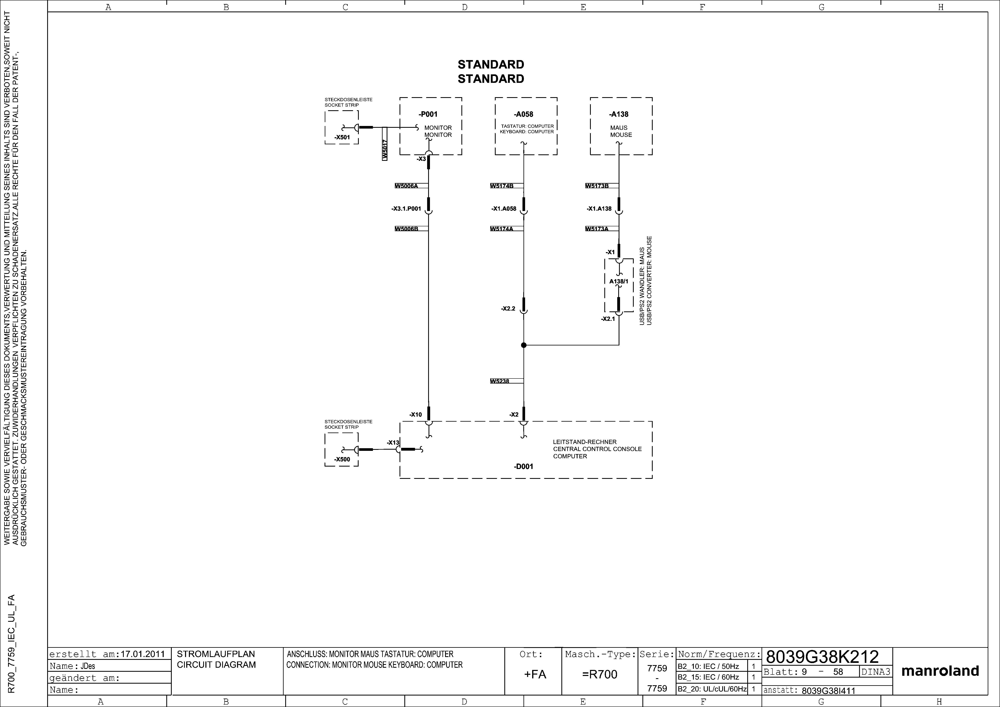

# +FA — Sheet 9 of 58 — ANSCHLUSS: MONITOR MAUS TASTATUR: COMPUTER

**CONNECTION: MONITOR MOUSE KEYBOARD: COMPUTER**

> Part of the manroland **R700** printing press IEC/UL circuit diagrams.
> Drawing class: **Stromlaufplan / Circuit diagram** (DIN A3).
> Document `+FA` covers the **Delivery** machine section.

## At a glance

| Field | Value |
|---|---|
| Document | `+FA`  (8039G38K212) |
| Sheet | **9** of 58 |
| Section (DE) | ANSCHLUSS: MONITOR MAUS TASTATUR: COMPUTER |
| Section (EN) | CONNECTION: MONITOR MOUSE KEYBOARD: COMPUTER |
| Section type | CIRCUIT — Circuit diagram |
| Machine type | `=R700` |
| Series | `7759` |
| Created | 17.01.2011 |
| Replaces | `8039G38I411` |
| Columns used | C, D, E, F |
| Path numbers | — |
| Labels on sheet | 42 |
| Cross-refs out | 0 |
| Cross-refs in | 0 |

**Previous:** [+FA sheet 8](SHEET_0008.md) · **Next:** [+FA sheet 10](SHEET_0010.md) · **Document TOC:** [_TOC.md](_TOC.md)  (+FA) · **Master TOC:** [all sheets](../_MASTER_TOC.md)

## Sheet image (300 DPI, exact vector render)



_Rendered directly from the PDF vector layer at 300 DPI (1-bit), no OCR and no resampling. Use it to confirm anything ambiguous in the text below._

## Cross-references on this sheet

Each entry is a wire leaving this sheet. The printed token is `/sheet.column`; the link resolves to that sheet inside the same document.

_No outgoing cross-references on this sheet._

## Devices on this sheet

| Tag | Class | Class meaning (IEC) | Col | Sub | Terminal | Sign |
|---|---|---|---|---|---|---|
| `P001` | P | Messgeraet / measuring instrument, meter | D | — | — | — |
| `A058` | A | Baugruppe / assembly, module, PC board | D | — | — | — |
| `A138` | A | Baugruppe / assembly, module, PC board | E | — | — | — |
| `D001` | D | Digital / binary element | D | — | — | — |
| `A138/1` | A | Baugruppe / assembly, module, PC board | E | 1 | — | — |
| `X3` | X | Klemme / terminal, plug connector | D | — | — | — |
| `X10` | X | Klemme / terminal, plug connector | D | — | — | — |
| `W5238` | W | Kabel / cable, line, bus | D | — | — | — |
| `X2` | X | Klemme / terminal, plug connector | D | — | — | — |
| `X501` | X | Klemme / terminal, plug connector | C | — | — | — |
| `W5017` | W | Kabel / cable, line, bus | C | — | — | — |
| `X1` | X | Klemme / terminal, plug connector | E | — | — | — |
| `X500` | X | Klemme / terminal, plug connector | C | — | — | — |
| `X13` | X | Klemme / terminal, plug connector | C | — | — | — |
| `X3.1.P001` | — | cross-device reference | D | — | — | — |
| `X1.A058` | — | cross-device reference | D | — | — | — |
| `X1.A138` | — | cross-device reference | E | — | — | — |
| `X2.2` | — | cross-device reference | D | — | — | — |
| `X2.1` | — | cross-device reference | E | — | — | — |

## Potentials / nets

_No named potentials on this sheet._

## Wire-end annotations (grouped as printed)

A wire that continues elsewhere is annotated with a small cluster: the destination description, the path/line number `#NN`, and the `/sheet.column` cross reference. Each row below is one such cluster exactly as it is grouped on the drawing.

| Col | Y | Path | Cross-ref | Text on the wire |
|---|---|---|---|---|
| D | 70.6 | — | — | `STANDARD STANDARD` |
| C | 116.3 | — | — | `STECKDOSENLEISTE SOCKET STRIP` |
| D | 132.2 | — | — | `P001 A058 A138` |
| E | 148.1 | — | — | `KEYBOARD: COMPUTER TASTATUR: COMPUTER` |
| E | 149.0 | — | — | `MAUS MOUSE` |
| D | 149.1 | — | — | `MONITOR MONITOR` |
| C | 160.3 | — | — | `X501` |
| C | 166.1 | — | — | `W5017` |
| D | 186.1 | — | — | `X3` |
| D | 218.5 | — | — | `W5006A` |
| D | 218.5 | — | — | `W5174B` |
| E | 218.5 | — | — | `W5173B` |
| D | 245.3 | — | — | `X3.1.P001` |
| E | 245.4 | — | — | `X1.A058 X1.A138` |
| D | 269.5 | — | — | `W5006B` |
| D | 269.5 | — | — | `W5174A` |
| E | 269.5 | — | — | `W5173A` |
| F | 280.9 | — | — | `USB/PS2 CONVERTER: MOUSE` |
| E | 294.2 | — | — | `USB/PS2 WANDLER: MAUS` |
| E | 297.1 | — | — | `X1` |
| E | 331.9 | — | — | `A138/1` |
| D | 364.4 | — | — | `X2.2` |
| E | 376.5 | — | — | `X2.1` |
| D | 450.9 | — | — | `W5238` |
| D | 490.6 | — | — | `X10` |
| D | 490.6 | — | — | `X2` |
| C | 499.9 | — | — | `STECKDOSENLEISTE SOCKET STRIP` |
| E | 523.2 | — | — | `LEITSTAND RECHNER CENTRAL CONTROL CONSOLE COMPUTER` |
| C | 523.9 | — | — | `X13` |
| C | 543.9 | — | — | `X500` |
| D | 551.7 | — | — | `D001` |


## Notes and free text on this sheet

| Text | Col | Y (pt) |
|---|---|---|
| `W5006A` | D | 218.5 |
| `W5006B` | D | 269.5 |
| `W5173B` | E | 218.47 |
| `W5173A` | E | 269.53 |
| `W5174B` | D | 218.47 |
| `W5174A` | D | 269.53 |
| `STANDARD` | D | 70.58 |
| `MONITOR` | D | 149.07 |
| `TASTATUR: COMPUTER` | E | 148.06 |
| `KEYBOARD: COMPUTER` | E | 154.58 |
| `STECKDOSENLEISTE` | C | 116.27 |
| `SOCKET STRIP` | C | 122.79 |
| `MAUS` | E | 148.97 |
| `MOUSE` | E | 157.56 |
| `LEITSTAND RECHNER` | E | 523.2 |
| `CENTRAL CONTROL CONSOLE` | E | 531.77 |
| `COMPUTER` | E | 540.34 |
| `USB/PS2 WANDLER: MAUS` | E | 294.21 |
| `USB/PS2 CONVERTER: MOUSE` | F | 280.89 |

## Complete label inventory (exact text from the drawing)

Every text object inside the drawing area of this sheet, in DIN reading order (column A→H, then top→bottom). This is the authoritative list: if a string is not here it is not printed on this sheet.

| Col | Y | X | Dir | Type | Text |
|---|---|---|---|---|---|
| C | 116.3 | 386.7 | → | text | `STECKDOSENLEISTE` |
| C | 122.8 | 386.7 | → | text | `SOCKET STRIP` |
| C | 160.3 | 398.0 | → | device tag | `X501` |
| C | 166.1 | 455.2 | ↕ | device tag | `W5017` |
| C | 499.9 | 386.6 | → | text | `STECKDOSENLEISTE` |
| C | 506.4 | 386.6 | → | text | `SOCKET STRIP` |
| C | 523.9 | 460.4 | → | device tag | `X13` |
| C | 543.9 | 397.9 | → | device tag | `X500` |
| D | 70.6 | 545.2 | → | text | `STANDARD` |
| D | 87.7 | 545.2 | → | text | `STANDARD` |
| D | 132.2 | 498.3 | → | device tag | `P001` |
| D | 132.2 | 611.7 | → | device tag | `A058` |
| D | 149.1 | 505.5 | → | text | `MONITOR` |
| D | 157.6 | 505.5 | → | text | `MONITOR` |
| D | 186.1 | 496.1 | → | device tag | `X3` |
| D | 218.5 | 470.6 | → | text | `W5006A` |
| D | 218.5 | 583.9 | → | text | `W5174B` |
| D | 245.4 | 466.1 | → | device ref | `X3.1.P001` |
| D | 245.4 | 585.1 | → | device ref | `X1.A058` |
| D | 269.5 | 470.6 | → | text | `W5006B` |
| D | 269.5 | 583.9 | → | text | `W5174A` |
| D | 364.4 | 596.5 | → | device ref | `X2.2` |
| D | 450.9 | 583.9 | → | device tag | `W5238` |
| D | 490.6 | 487.3 | → | device tag | `X10` |
| D | 490.6 | 606.3 | → | device tag | `X2` |
| D | 551.7 | 611.7 | → | device tag | `D001` |
| E | 132.2 | 725.1 | → | device tag | `A138` |
| E | 148.1 | 596.7 | → | text | `TASTATUR: COMPUTER` |
| E | 149.0 | 726.6 | → | text | `MAUS` |
| E | 154.6 | 595.3 | → | text | `KEYBOARD: COMPUTER` |
| E | 157.6 | 726.6 | → | text | `MOUSE` |
| E | 218.5 | 697.3 | → | text | `W5173B` |
| E | 245.4 | 698.5 | → | device ref | `X1.A138` |
| E | 269.5 | 697.3 | → | text | `W5173A` |
| E | 294.2 | 761.3 | ↕ | text | `USB/PS2 WANDLER: MAUS` |
| E | 297.1 | 721.2 | → | device tag | `X1` |
| E | 331.9 | 725.7 | → | device tag | `A138/1` |
| E | 376.5 | 715.5 | → | device ref | `X2.1` |
| E | 523.2 | 658.5 | → | text | `LEITSTAND RECHNER` |
| E | 531.8 | 658.8 | → | text | `CENTRAL CONTROL CONSOLE` |
| E | 540.3 | 658.8 | → | text | `COMPUTER` |
| F | 280.9 | 769.9 | ↕ | text | `USB/PS2 CONVERTER: MOUSE` |

## Reading-order text block

The same content as a plain block, grouped by DIN column — convenient to paste or to match against a visual description.

```text
=== Column C ===
 116.3  386.7  text         STECKDOSENLEISTE
 122.8  386.7  text         SOCKET STRIP
 160.3  398.0  devtag       X501
 166.1  455.2  devtag       W5017
 499.9  386.6  text         STECKDOSENLEISTE
 506.4  386.6  text         SOCKET STRIP
 523.9  460.4  devtag       X13
 543.9  397.9  devtag       X500
=== Column D ===
  70.6  545.2  text         STANDARD
  87.7  545.2  text         STANDARD
 132.2  498.3  devtag       P001
 132.2  611.7  devtag       A058
 149.1  505.5  text         MONITOR
 157.6  505.5  text         MONITOR
 186.1  496.1  devtag       X3
 218.5  470.6  text         W5006A
 218.5  583.9  text         W5174B
 245.4  466.1  devref       X3.1.P001
 245.4  585.1  devref       X1.A058
 269.5  470.6  text         W5006B
 269.5  583.9  text         W5174A
 364.4  596.5  devref       X2.2
 450.9  583.9  devtag       W5238
 490.6  487.3  devtag       X10
 490.6  606.3  devtag       X2
 551.7  611.7  devtag       D001
=== Column E ===
 132.2  725.1  devtag       A138
 148.1  596.7  text         TASTATUR: COMPUTER
 149.0  726.6  text         MAUS
 154.6  595.3  text         KEYBOARD: COMPUTER
 157.6  726.6  text         MOUSE
 218.5  697.3  text         W5173B
 245.4  698.5  devref       X1.A138
 269.5  697.3  text         W5173A
 294.2  761.3  text         USB/PS2 WANDLER: MAUS
 297.1  721.2  devtag       X1
 331.9  725.7  devtag       A138/1
 376.5  715.5  devref       X2.1
 523.2  658.5  text         LEITSTAND RECHNER
 531.8  658.8  text         CENTRAL CONTROL CONSOLE
 540.3  658.8  text         COMPUTER
=== Column F ===
 280.9  769.9  text         USB/PS2 CONVERTER: MOUSE
```

---
_Generated from the PDF vector text layer; no OCR. Source: `R700_7759_IEC_UL_FA`, sheet 9._
