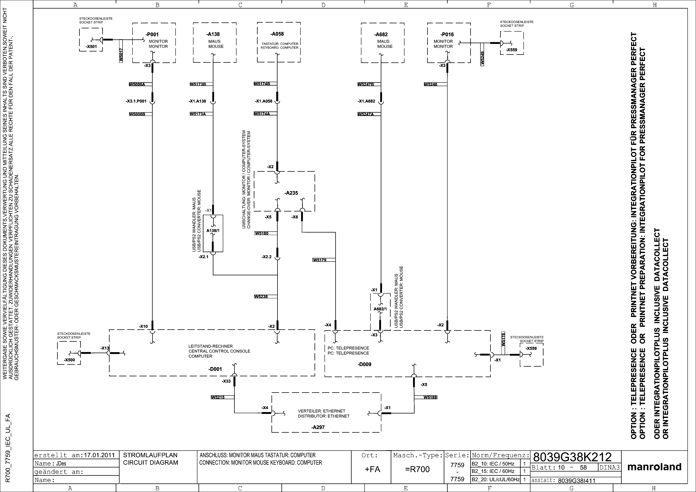

# +FA — Sheet 10 of 58 — ANSCHLUSS: MONITOR MAUS TASTATUR: COMPUTER

**CONNECTION: MONITOR MOUSE KEYBOARD: COMPUTER**

> Part of the manroland **R700** printing press IEC/UL circuit diagrams.
> Drawing class: **Stromlaufplan / Circuit diagram** (DIN A3).
> Document `+FA` covers the **Delivery** machine section.

## At a glance

| Field | Value |
|---|---|
| Document | `+FA`  (8039G38K212) |
| Sheet | **10** of 58 |
| Section (DE) | ANSCHLUSS: MONITOR MAUS TASTATUR: COMPUTER |
| Section (EN) | CONNECTION: MONITOR MOUSE KEYBOARD: COMPUTER |
| Section type | CIRCUIT — Circuit diagram |
| Machine type | `=R700` |
| Series | `7759` |
| Created | 17.01.2011 |
| Replaces | `8039G38I411` |
| Columns used | A, B, C, D, E, F, G, H |
| Path numbers | — |
| Labels on sheet | 91 |
| Cross-refs out | 0 |
| Cross-refs in | 0 |

**Previous:** [+FA sheet 9](SHEET_0009.md) · **Next:** [+FA sheet 11](SHEET_0011.md) · **Document TOC:** [_TOC.md](_TOC.md)  (+FA) · **Master TOC:** [all sheets](../_MASTER_TOC.md)

## Sheet image (300 DPI, exact vector render)



_Rendered directly from the PDF vector layer at 300 DPI (1-bit), no OCR and no resampling. Use it to confirm anything ambiguous in the text below._

## Cross-references on this sheet

Each entry is a wire leaving this sheet. The printed token is `/sheet.column`; the link resolves to that sheet inside the same document.

_No outgoing cross-references on this sheet._

## Devices on this sheet

| Tag | Class | Class meaning (IEC) | Col | Sub | Terminal | Sign |
|---|---|---|---|---|---|---|
| `D001` | D | Digital / binary element | C | — | — | — |
| `D009` | D | Digital / binary element | D | — | — | — |
| `P001` | P | Messgeraet / measuring instrument, meter | B | — | — | — |
| `A058` | A | Baugruppe / assembly, module, PC board | C | — | — | — |
| `A682` | A | Baugruppe / assembly, module, PC board | E | — | — | — |
| `A235` | A | Baugruppe / assembly, module, PC board | D | — | — | — |
| `A682/1` | A | Baugruppe / assembly, module, PC board | E | 1 | — | — |
| `X3` | X | Klemme / terminal, plug connector | B | — | — | — |
| `W5180` | W | Kabel / cable, line, bus | C | — | — | — |
| `X2` | X | Klemme / terminal, plug connector | E | — | — | — |
| `X2` | X | Klemme / terminal, plug connector | C | — | — | — |
| `X10` | X | Klemme / terminal, plug connector | B | — | — | — |
| `X5` | X | Klemme / terminal, plug connector | C | — | — | — |
| `W5179` | W | Kabel / cable, line, bus | D | — | — | — |
| `A138` | A | Baugruppe / assembly, module, PC board | C | — | — | — |
| `A138/1` | A | Baugruppe / assembly, module, PC board | C | 1 | — | — |
| `X8` | X | Klemme / terminal, plug connector | D | — | — | — |
| `X3` | X | Klemme / terminal, plug connector | E | — | — | — |
| `X2` | X | Klemme / terminal, plug connector | C | — | — | — |
| `P016` | P | Messgeraet / measuring instrument, meter | E | — | — | — |
| `W5248` | W | Kabel / cable, line, bus | E | — | — | — |
| `X3` | X | Klemme / terminal, plug connector | E | — | — | — |
| `X5` | X | Klemme / terminal, plug connector | E | — | — | — |
| `X501` | X | Klemme / terminal, plug connector | A | — | — | — |
| `W5017` | W | Kabel / cable, line, bus | B | — | — | — |
| `X559` | X | Klemme / terminal, plug connector | F | — | — | — |
| `W5249` | W | Kabel / cable, line, bus | F | — | — | — |
| `W5238` | W | Kabel / cable, line, bus | C | — | — | — |
| `X1` | X | Klemme / terminal, plug connector | C | — | — | — |
| `X1` | X | Klemme / terminal, plug connector | E | — | — | — |
| `A297` | A | Baugruppe / assembly, module, PC board | D | — | — | — |
| `X33` | X | Klemme / terminal, plug connector | C | — | — | — |
| `X4` | X | Klemme / terminal, plug connector | C | — | — | — |
| `X1` | X | Klemme / terminal, plug connector | E | — | — | — |
| `X4` | X | Klemme / terminal, plug connector | D | — | — | — |
| `W5215` | W | Kabel / cable, line, bus | C | — | — | — |
| `W5188` | W | Kabel / cable, line, bus | E | — | — | — |
| `X500` | X | Klemme / terminal, plug connector | A | — | — | — |
| `X13` | X | Klemme / terminal, plug connector | A | — | — | — |
| `X559` | X | Klemme / terminal, plug connector | G | — | — | — |
| `X1` | X | Klemme / terminal, plug connector | F | — | — | — |
| `W5178` | W | Kabel / cable, line, bus | F | — | — | — |
| `X3.1.P001` | — | cross-device reference | B | — | — | — |
| `X1.A058` | — | cross-device reference | C | — | — | — |
| `X1.A682` | — | cross-device reference | E | — | — | — |
| `X1.A138` | — | cross-device reference | B | — | — | — |
| `X2.2` | — | cross-device reference | C | — | — | — |
| `X2.1` | — | cross-device reference | C | — | — | — |

## Potentials / nets

_No named potentials on this sheet._

## Wire-end annotations (grouped as printed)

A wire that continues elsewhere is annotated with a small cluster: the destination description, the path/line number `#NN`, and the `/sheet.column` cross reference. Each row below is one such cluster exactly as it is grouped on the drawing.

| Col | Y | Path | Cross-ref | Text on the wire |
|---|---|---|---|---|
| D | 29.4 | — | — | `STECKDOSENLEISTE SOCKET STRIP STECKDOSENLEISTE SOCKET STRIP` |
| C | 54.2 | — | — | `P001 A058 A682` |
| C | 54.8 | — | — | `A138` |
| H | 55.0 | — | — | `OPTION : TELEPRESENCE ODER PRINTNET VORBEREITUNG: INTEGRATIONPILOT FÜR PRESSMANAGER PERFECT` |
| E | 55.2 | — | — | `P016` |
| C | 67.8 | — | — | `MAUS MOUSE KEYBOARD: COMPUTER TASTATUR: COMPUTER` |
| E | 67.8 | — | — | `MAUS MOUSE` |
| B | 67.9 | — | — | `MONITOR MONITOR` |
| E | 67.9 | — | — | `MONITOR MONITOR` |
| A | 76.5 | — | — | `X501` |
| H | 80.8 | — | — | `OPTION : TELEPRESENCE OR PRINTNET PREPARATION: INTEGRATIONPILOT FOR PRESSMANAGER PERFECT` |
| F | 82.2 | — | — | `X559` |
| B | 82.3 | — | — | `W5017` |
| F | 87.9 | — | — | `W5249` |
| B | 109.1 | — | — | `X3` |
| E | 109.1 | — | — | `X3` |
| C | 140.5 | — | — | `W5174B` |
| B | 141.1 | — | — | `W5173B` |
| E | 141.5 | — | — | `W5247B` |
| E | 141.5 | — | — | `W5248` |
| B | 141.6 | — | — | `W5006A` |
| B | 169.8 | — | — | `X3.1.P001` |
| B | 169.9 | — | — | `X1.A138` |
| D | 169.9 | — | — | `X1.A058 X1.A682` |
| C | 191.5 | — | — | `W5174A` |
| B | 192.1 | — | — | `W5173A` |
| B | 192.6 | — | — | `W5006B` |
| E | 192.6 | — | — | `W5247A` |
| C | 222.9 | — | — | `UMSCHALTUNG: MONITOR / COMPUTER SYSTEM` |
| C | 224.4 | — | — | `CHANGE OVER: MONITOR / COMPUTER SYSTEM` |
| C | 282.2 | — | — | `X2` |
| C | 324.4 | — | — | `USB/PS2 CONVERTER: MOUSE` |
| D | 326.4 | — | — | `A235` |
| B | 337.8 | — | — | `USB/PS2 WANDLER: MAUS` |
| C | 356.9 | — | — | `X1` |
| C | 368.3 | — | — | `X5` |
| D | 368.3 | — | — | `X8` |
| H | 390.1 | — | — | `ODER INTEGRATIONPILOTPLUS INCLUSIVE DATACOLLECT` |
| C | 391.6 | — | — | `A138/1` |
| C | 396.2 | — | — | `W5180` |
| H | 407.0 | — | — | `OR INTEGRATIONPILOTPLUS INCLUSIVE DATACOLLECT` |
| C | 436.3 | — | — | `X2.1 X2.2` |
| D | 442.2 | — | — | `W5179` |
| E | 454.8 | — | — | `USB/PS2 CONVERTER: MOUSE` |
| E | 468.1 | — | — | `USB/PS2 WANDLER: MAUS` |
| E | 493.0 | — | — | `X1` |
| C | 504.4 | — | — | `W5238` |
| E | 525.8 | — | — | `A682/1` |
| D | 553.0 | — | — | `X4` |
| E | 553.0 | — | — | `X2` |
| B | 555.4 | — | — | `X10` |
| C | 555.4 | — | — | `X2` |
| A | 568.6 | — | — | `STECKDOSENLEISTE SOCKET STRIP` |
| E | 570.0 | — | — | `X3` |
| F | 570.0 | — | — | `W5178` |
| F | 574.7 | — | — | `STECKDOSENLEISTE` |
| G | 581.2 | — | — | `SOCKET STRIP` |
| C | 589.4 | — | — | `LEITSTAND RECHNER CENTRAL CONTROL CONSOLE COMPUTER` |
| D | 592.6 | — | — | `X13 X559` |
| D | 592.6 | — | — | `PC: TELEPRESENCE PC: TELEPRESENCE` |
| A | 612.7 | — | — | `X500` |
| F | 613.1 | — | — | `X1` |
| D | 619.7 | — | — | `D009` |
| C | 627.8 | — | — | `D001` |
| C | 649.3 | — | — | `X33` |
| E | 655.0 | — | — | `X5` |
| D | 676.8 | — | — | `W5215 W5188` |
| D | 694.7 | — | — | `X4 X1` |
| D | 700.4 | — | — | `DISTRIBUTOR: ETHERNET VERTEILER: ETHERNET` |
| D | 727.5 | — | — | `A297` |


## Reconstructed tables

This sheet carries tabular content (pin map / terminal assignment / index). The grid below was rebuilt from the drawing's own rule lines, so each row is exactly one physical row of the table.

### Table 1 — 1 data rows × 3 columns (at x=262.1, y=397.3)

| USB/PS2 USB/PS2 X2.1 |  | W5180 X2.2 |
|---|---|---|
| `LEITSTAND RECHNER CENTRAL COMPUTER` | `CONTROL D001 X33 W5215` | `W5238 X2 CONSOLE X4` |


### Table 2 — 1 data rows × 4 columns (at x=518.0, y=397.3)

| W5179 |  | MOUSE |  |
|---|---|---|---|
| `X4 PC: PC: VERTEILER: ETHERNET` | `X1 X3 TELEPRESENCE TELEPRESENCE D009` | `MAUS CONVERTER: WANDLER: USB/PS2 USB/PS2 X1` | `X2 X5 W5188` |


## Notes and free text on this sheet

| Text | Col | Y (pt) |
|---|---|---|
| `W5006A` | B | 141.55 |
| `W5006B` | B | 192.55 |
| `W5247B` | E | 141.53 |
| `W5247A` | E | 192.58 |
| `W5174B` | C | 140.48 |
| `W5174A` | C | 191.54 |
| `W5173B` | B | 141.07 |
| `W5173A` | B | 192.12 |
| `LEITSTAND RECHNER` | C | 589.42 |
| `CENTRAL CONTROL CONSOLE` | C | 597.99 |
| `COMPUTER` | C | 606.56 |
| `STECKDOSENLEISTE` | A | 29.43 |
| `SOCKET STRIP` | A | 35.94 |
| `STECKDOSENLEISTE` | F | 35.1 |
| `SOCKET STRIP` | F | 41.61 |
| `MONITOR` | B | 67.89 |
| `TASTATUR: COMPUTER` | C | 72.55 |
| `KEYBOARD: COMPUTER` | C | 79.07 |
| `MAUS` | C | 67.79 |
| `MOUSE` | C | 76.38 |
| `MAUS` | E | 67.79 |
| `MOUSE` | E | 76.38 |
| `MONITOR` | E | 67.89 |
| `UMSCHALTUNG: MONITOR / COMPUTER SYSTEM` | C | 222.95 |
| `CHANGE OVER: MONITOR / COMPUTER SYSTEM` | C | 224.37 |
| `PC: TELEPRESENCE` | D | 592.63 |
| `USB/PS2 WANDLER: MAUS` | B | 337.76 |
| `USB/PS2 CONVERTER: MOUSE` | C | 324.44 |
| `USB/PS2 WANDLER: MAUS` | E | 468.15 |
| `USB/PS2 CONVERTER: MOUSE` | E | 454.83 |
| `VERTEILER: ETHERNET` | D | 700.38 |
| `DISTRIBUTOR: ETHERNET` | D | 708.99 |
| `SOCKET STRIP` | G | 581.17 |
| `OPTION : TELEPRESENCE ODER PRINTNET VORBEREITUNG: INTEGRATIONPILOT FÜR PRESSMANAGER PERFECT` | H | 54.98 |
| `OPTION : TELEPRESENCE OR PRINTNET PREPARATION: INTEGRATIONPILOT FOR PRESSMANAGER PERFECT` | H | 80.76 |
| `ODER INTEGRATIONPILOTPLUS INCLUSIVE DATACOLLECT` | H | 390.05 |
| `OR INTEGRATIONPILOTPLUS INCLUSIVE DATACOLLECT` | H | 407.04 |

## Complete label inventory (exact text from the drawing)

Every text object inside the drawing area of this sheet, in DIN reading order (column A→H, then top→bottom). This is the authoritative list: if a string is not here it is not printed on this sheet.

| Col | Y | X | Dir | Type | Text |
|---|---|---|---|---|---|
| A | 29.4 | 135.7 | → | text | `STECKDOSENLEISTE` |
| A | 35.9 | 135.7 | → | text | `SOCKET STRIP` |
| A | 76.5 | 146.9 | → | device tag | `X501` |
| A | 568.6 | 97.9 | → | text | `STECKDOSENLEISTE` |
| A | 575.1 | 97.9 | → | text | `SOCKET STRIP` |
| A | 592.6 | 171.7 | → | device tag | `X13` |
| A | 612.7 | 109.2 | → | device tag | `X500` |
| B | 55.2 | 248.8 | → | device tag | `P001` |
| B | 67.9 | 254.5 | → | text | `MONITOR` |
| B | 76.5 | 254.5 | → | text | `MONITOR` |
| B | 82.3 | 204.1 | ↕ | device tag | `W5017` |
| B | 109.1 | 246.5 | → | device tag | `X3` |
| B | 141.1 | 324.9 | → | text | `W5173B` |
| B | 141.6 | 221.0 | → | text | `W5006A` |
| B | 169.8 | 215.1 | → | device ref | `X3.1.P001` |
| B | 169.9 | 322.8 | → | device ref | `X1.A138` |
| B | 192.1 | 324.9 | → | text | `W5173A` |
| B | 192.5 | 221.0 | → | text | `W5006B` |
| B | 337.8 | 328.9 | ↕ | text | `USB/PS2 WANDLER: MAUS` |
| B | 555.4 | 237.7 | → | device tag | `X10` |
| C | 54.2 | 462.4 | → | device tag | `A058` |
| C | 54.8 | 352.7 | → | device tag | `A138` |
| C | 67.8 | 356.5 | → | text | `MAUS` |
| C | 72.6 | 447.8 | → | text | `TASTATUR: COMPUTER` |
| C | 76.4 | 356.5 | → | text | `MOUSE` |
| C | 79.1 | 446.4 | → | text | `KEYBOARD: COMPUTER` |
| C | 140.5 | 434.6 | → | text | `W5174B` |
| C | 169.9 | 436.2 | → | device ref | `X1.A058` |
| C | 191.5 | 434.6 | → | text | `W5174A` |
| C | 223.0 | 414.0 | ↕ | text | `UMSCHALTUNG: MONITOR / COMPUTER SYSTEM` |
| C | 224.4 | 422.6 | ↕ | text | `CHANGE OVER: MONITOR / COMPUTER SYSTEM` |
| C | 282.2 | 457.0 | → | device tag | `X2` |
| C | 324.4 | 337.5 | ↕ | text | `USB/PS2 CONVERTER: MOUSE` |
| C | 356.9 | 351.1 | → | device tag | `X1` |
| C | 368.3 | 453.2 | → | device tag | `X5` |
| C | 391.6 | 353.1 | → | device tag | `A138/1` |
| C | 396.2 | 436.7 | → | device tag | `W5180` |
| C | 436.3 | 339.8 | → | device ref | `X2.1` |
| C | 436.3 | 447.5 | → | device ref | `X2.2` |
| C | 504.4 | 435.6 | → | device tag | `W5238` |
| C | 555.4 | 458.8 | → | device tag | `X2` |
| C | 589.4 | 322.5 | → | text | `LEITSTAND RECHNER` |
| C | 598.0 | 322.8 | → | text | `CENTRAL CONTROL CONSOLE` |
| C | 606.6 | 322.8 | → | text | `COMPUTER` |
| C | 627.8 | 356.5 | → | device tag | `D001` |
| C | 649.3 | 379.6 | → | device tag | `X33` |
| C | 676.9 | 361.5 | → | device tag | `W5215` |
| C | 694.7 | 447.6 | → | device tag | `X4` |
| D | 326.4 | 486.5 | → | device tag | `A235` |
| D | 368.3 | 498.5 | → | device tag | `X8` |
| D | 442.2 | 535.8 | → | device tag | `W5179` |
| D | 552.9 | 555.3 | → | device tag | `X4` |
| D | 592.6 | 560.7 | → | text | `PC: TELEPRESENCE` |
| D | 601.2 | 560.7 | → | text | `PC: TELEPRESENCE` |
| D | 619.7 | 611.7 | → | device tag | `D009` |
| D | 700.4 | 510.0 | → | text | `VERTEILER: ETHERNET` |
| D | 709.0 | 509.7 | → | text | `DISTRIBUTOR: ETHERNET` |
| D | 727.5 | 532.3 | → | device tag | `A297` |
| E | 55.2 | 640.0 | → | device tag | `A682` |
| E | 55.2 | 753.4 | → | device tag | `P016` |
| E | 67.8 | 645.6 | → | text | `MAUS` |
| E | 67.9 | 742.0 | → | text | `MONITOR` |
| E | 76.4 | 645.6 | → | text | `MOUSE` |
| E | 76.5 | 742.0 | → | text | `MONITOR` |
| E | 109.1 | 751.1 | → | device tag | `X3` |
| E | 141.5 | 612.2 | → | text | `W5247B` |
| E | 141.5 | 725.6 | → | device tag | `W5248` |
| E | 169.9 | 611.9 | → | device ref | `X1.A682` |
| E | 192.6 | 612.2 | → | text | `W5247A` |
| E | 454.8 | 683.3 | ↕ | text | `USB/PS2 CONVERTER: MOUSE` |
| E | 468.2 | 674.7 | ↕ | text | `USB/PS2 WANDLER: MAUS` |
| E | 493.0 | 634.6 | → | device tag | `X1` |
| E | 525.8 | 639.4 | → | device tag | `A682/1` |
| E | 552.9 | 748.1 | → | device tag | `X2` |
| E | 570.0 | 634.7 | → | device tag | `X3` |
| E | 655.0 | 719.7 | → | device tag | `X5` |
| E | 676.8 | 724.8 | → | device tag | `W5188` |
| E | 694.7 | 657.4 | → | device tag | `X1` |
| F | 35.1 | 855.7 | → | text | `STECKDOSENLEISTE` |
| F | 41.6 | 855.7 | → | text | `SOCKET STRIP` |
| F | 82.2 | 865.8 | → | device tag | `X559` |
| F | 87.9 | 822.3 | ↕ | device tag | `W5249` |
| F | 570.0 | 858.1 | ↕ | device tag | `W5178` |
| F | 574.7 | 873.1 | → | text | `STECKDOSENLEISTE` |
| F | 613.1 | 845.8 | → | device tag | `X1` |
| G | 581.2 | 889.5 | → | text | `SOCKET STRIP` |
| G | 593.0 | 899.2 | → | device tag | `X559` |
| H | 55.0 | 1079.0 | ↕ | text | `OPTION : TELEPRESENCE ODER PRINTNET VORBEREITUNG: INTEGRATIONPILOT FÜR PRESSMANAGER PERFECT` |
| H | 80.8 | 1093.7 | ↕ | text | `OPTION : TELEPRESENCE OR PRINTNET PREPARATION: INTEGRATIONPILOT FOR PRESSMANAGER PERFECT` |
| H | 390.1 | 1118.7 | ↕ | text | `ODER INTEGRATIONPILOTPLUS INCLUSIVE DATACOLLECT` |
| H | 407.0 | 1133.4 | ↕ | text | `OR INTEGRATIONPILOTPLUS INCLUSIVE DATACOLLECT` |

## Reading-order text block

The same content as a plain block, grouped by DIN column — convenient to paste or to match against a visual description.

```text
=== Column A ===
  29.4  135.7  text         STECKDOSENLEISTE
  35.9  135.7  text         SOCKET STRIP
  76.5  146.9  devtag       X501
 568.6   97.9  text         STECKDOSENLEISTE
 575.1   97.9  text         SOCKET STRIP
 592.6  171.7  devtag       X13
 612.7  109.2  devtag       X500
=== Column B ===
  55.2  248.8  devtag       P001
  67.9  254.5  text         MONITOR
  76.5  254.5  text         MONITOR
  82.3  204.1  devtag       W5017
 109.1  246.5  devtag       X3
 141.1  324.9  text         W5173B
 141.6  221.0  text         W5006A
 169.8  215.1  devref       X3.1.P001
 169.9  322.8  devref       X1.A138
 192.1  324.9  text         W5173A
 192.5  221.0  text         W5006B
 337.8  328.9  text         USB/PS2 WANDLER: MAUS
 555.4  237.7  devtag       X10
=== Column C ===
  54.2  462.4  devtag       A058
  54.8  352.7  devtag       A138
  67.8  356.5  text         MAUS
  72.6  447.8  text         TASTATUR: COMPUTER
  76.4  356.5  text         MOUSE
  79.1  446.4  text         KEYBOARD: COMPUTER
 140.5  434.6  text         W5174B
 169.9  436.2  devref       X1.A058
 191.5  434.6  text         W5174A
 223.0  414.0  text         UMSCHALTUNG: MONITOR / COMPUTER SYSTEM
 224.4  422.6  text         CHANGE OVER: MONITOR / COMPUTER SYSTEM
 282.2  457.0  devtag       X2
 324.4  337.5  text         USB/PS2 CONVERTER: MOUSE
 356.9  351.1  devtag       X1
 368.3  453.2  devtag       X5
 391.6  353.1  devtag       A138/1
 396.2  436.7  devtag       W5180
 436.3  339.8  devref       X2.1
 436.3  447.5  devref       X2.2
 504.4  435.6  devtag       W5238
 555.4  458.8  devtag       X2
 589.4  322.5  text         LEITSTAND RECHNER
 598.0  322.8  text         CENTRAL CONTROL CONSOLE
 606.6  322.8  text         COMPUTER
 627.8  356.5  devtag       D001
 649.3  379.6  devtag       X33
 676.9  361.5  devtag       W5215
 694.7  447.6  devtag       X4
=== Column D ===
 326.4  486.5  devtag       A235
 368.3  498.5  devtag       X8
 442.2  535.8  devtag       W5179
 552.9  555.3  devtag       X4
 592.6  560.7  text         PC: TELEPRESENCE
 601.2  560.7  text         PC: TELEPRESENCE
 619.7  611.7  devtag       D009
 700.4  510.0  text         VERTEILER: ETHERNET
 709.0  509.7  text         DISTRIBUTOR: ETHERNET
 727.5  532.3  devtag       A297
=== Column E ===
  55.2  640.0  devtag       A682
  55.2  753.4  devtag       P016
  67.8  645.6  text         MAUS
  67.9  742.0  text         MONITOR
  76.4  645.6  text         MOUSE
  76.5  742.0  text         MONITOR
 109.1  751.1  devtag       X3
 141.5  612.2  text         W5247B
 141.5  725.6  devtag       W5248
 169.9  611.9  devref       X1.A682
 192.6  612.2  text         W5247A
 454.8  683.3  text         USB/PS2 CONVERTER: MOUSE
 468.2  674.7  text         USB/PS2 WANDLER: MAUS
 493.0  634.6  devtag       X1
 525.8  639.4  devtag       A682/1
 552.9  748.1  devtag       X2
 570.0  634.7  devtag       X3
 655.0  719.7  devtag       X5
 676.8  724.8  devtag       W5188
 694.7  657.4  devtag       X1
=== Column F ===
  35.1  855.7  text         STECKDOSENLEISTE
  41.6  855.7  text         SOCKET STRIP
  82.2  865.8  devtag       X559
  87.9  822.3  devtag       W5249
 570.0  858.1  devtag       W5178
 574.7  873.1  text         STECKDOSENLEISTE
 613.1  845.8  devtag       X1
=== Column G ===
 581.2  889.5  text         SOCKET STRIP
 593.0  899.2  devtag       X559
=== Column H ===
  55.0 1079.0  text         OPTION : TELEPRESENCE ODER PRINTNET VORBEREITUNG: INTEGRATIONPILOT FÜR PRESSMANAGER PERFECT
  80.8 1093.7  text         OPTION : TELEPRESENCE OR PRINTNET PREPARATION: INTEGRATIONPILOT FOR PRESSMANAGER PERFECT
 390.1 1118.7  text         ODER INTEGRATIONPILOTPLUS INCLUSIVE DATACOLLECT
 407.0 1133.4  text         OR INTEGRATIONPILOTPLUS INCLUSIVE DATACOLLECT
```

---
_Generated from the PDF vector text layer; no OCR. Source: `R700_7759_IEC_UL_FA`, sheet 10._
