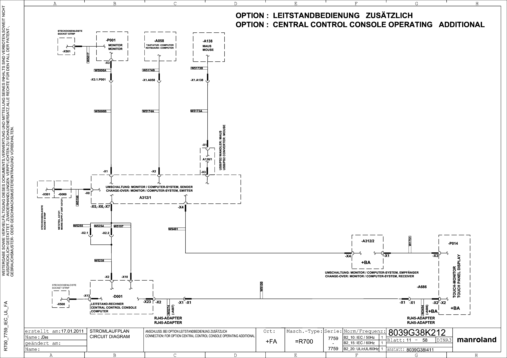

# +FA — Sheet 11 of 58 — ANSCHLUSS: BEI OPTION LEITSTANDBEDIENUNG ZUSÄTZLICH

**CONNECTION: FOR OPTION CENTRAL CONTROL CONSOLE OPERATING ADDITIONAL**

> Part of the manroland **R700** printing press IEC/UL circuit diagrams.
> Drawing class: **Stromlaufplan / Circuit diagram** (DIN A3).
> Document `+FA` covers the **Delivery** machine section.

## At a glance

| Field | Value |
|---|---|
| Document | `+FA`  (8039G38K212) |
| Sheet | **11** of 58 |
| Section (DE) | ANSCHLUSS: BEI OPTION LEITSTANDBEDIENUNG ZUSÄTZLICH |
| Section (EN) | CONNECTION: FOR OPTION CENTRAL CONTROL CONSOLE OPERATING ADDITIONAL |
| Section type | CIRCUIT — Circuit diagram |
| Machine type | `=R700` |
| Series | `7759` |
| Created | 17.01.2011 |
| Replaces | `8039G38I411` |
| Columns used | A, B, C, D, E, F, G, H |
| Path numbers | — |
| Labels on sheet | 93 |
| Cross-refs out | 0 |
| Cross-refs in | 0 |

**Previous:** [+FA sheet 10](SHEET_0010.md) · **Next:** [+FA sheet 12](SHEET_0012.md) · **Document TOC:** [_TOC.md](_TOC.md)  (+FA) · **Master TOC:** [all sheets](../_MASTER_TOC.md)

## Sheet image (300 DPI, exact vector render)



_Rendered directly from the PDF vector layer at 300 DPI (1-bit), no OCR and no resampling. Use it to confirm anything ambiguous in the text below._

## Cross-references on this sheet

Each entry is a wire leaving this sheet. The printed token is `/sheet.column`; the link resolves to that sheet inside the same document.

_No outgoing cross-references on this sheet._

## Devices on this sheet

| Tag | Class | Class meaning (IEC) | Col | Sub | Terminal | Sign |
|---|---|---|---|---|---|---|
| `D001` | D | Digital / binary element | B | — | — | — |
| `P001` | P | Messgeraet / measuring instrument, meter | B | — | — | — |
| `A058` | A | Baugruppe / assembly, module, PC board | C | — | — | — |
| `A138` | A | Baugruppe / assembly, module, PC board | D | — | — | — |
| `A138/1` | A | Baugruppe / assembly, module, PC board | D | 1 | — | — |
| `X3` | X | Klemme / terminal, plug connector | B | — | — | — |
| `X3` | X | Klemme / terminal, plug connector | C | — | — | — |
| `X1` | X | Klemme / terminal, plug connector | B | — | — | — |
| `X2` | X | Klemme / terminal, plug connector | C | — | — | — |
| `X2` | X | Klemme / terminal, plug connector | B | — | — | — |
| `X10` | X | Klemme / terminal, plug connector | B | — | — | — |
| `W5238` | W | Kabel / cable, line, bus | B | — | — | — |
| `X501` | X | Klemme / terminal, plug connector | A | — | — | — |
| `W5017` | W | Kabel / cable, line, bus | B | — | — | — |
| `A312/1` | A | Baugruppe / assembly, module, PC board | C | 1 | — | — |
| `W5197` | W | Kabel / cable, line, bus | B | — | — | — |
| `X23` | X | Klemme / terminal, plug connector | C | — | — | — |
| `W9100` | W | Kabel / cable, line, bus | D | — | — | — |
| `X1` | X | Klemme / terminal, plug connector | G | — | — | — |
| `P014` | P | Messgeraet / measuring instrument, meter | H | — | — | — |
| `A686` | A | Baugruppe / assembly, module, PC board | G | — | — | — |
| `A312/2` | A | Baugruppe / assembly, module, PC board | F | 2 | — | — |
| `W1751` | W | Kabel / cable, line, bus | G | — | — | — |
| `X1` | X | Klemme / terminal, plug connector | G | — | — | — |
| `X3` | X | Klemme / terminal, plug connector | G | — | — | — |
| `X4` | X | Klemme / terminal, plug connector | C | — | — | — |
| `X4` | X | Klemme / terminal, plug connector | F | — | — | — |
| `W9491` | W | Kabel / cable, line, bus | C | — | — | — |
| `X1` | X | Klemme / terminal, plug connector | C | — | — | — |
| `X2` | X | Klemme / terminal, plug connector | G | — | — | — |
| `X1` | X | Klemme / terminal, plug connector | C | — | — | — |
| `W5254` | W | Kabel / cable, line, bus | B | — | — | — |
| `W5255` | W | Kabel / cable, line, bus | A | — | — | — |
| `X500` | X | Klemme / terminal, plug connector | A | — | — | — |
| `X13` | X | Klemme / terminal, plug connector | B | — | — | — |
| `X2` | X | Klemme / terminal, plug connector | C | — | — | — |
| `X1` | X | Klemme / terminal, plug connector | C | — | — | — |
| `W5274` | W | Kabel / cable, line, bus | C | — | — | — |
| `X501` | X | Klemme / terminal, plug connector | A | — | — | — |
| `W5198` | W | Kabel / cable, line, bus | A | — | — | — |
| `G069` | G | Stromversorgung / power supply | A | — | — | — |
| `X2` | X | Klemme / terminal, plug connector | G | — | — | — |
| `X1` | X | Klemme / terminal, plug connector | G | — | — | — |
| `W2454` | W | Kabel / cable, line, bus | G | — | — | — |
| `X0` | X | Klemme / terminal, plug connector | B | — | — | — |
| `X3.1.P001` | — | cross-device reference | B | — | — | — |
| `X1.A058` | — | cross-device reference | C | — | — | — |
| `X1.A138` | — | cross-device reference | C | — | — | — |
| `X2.1` | — | cross-device reference | A | — | — | — |
| `X2.2` | — | cross-device reference | B | — | — | — |

## Potentials / nets

_No named potentials on this sheet._

## Wire-end annotations (grouped as printed)

A wire that continues elsewhere is annotated with a small cluster: the destination description, the path/line number `#NN`, and the `/sheet.column` cross reference. Each row below is one such cluster exactly as it is grouped on the drawing.

| Col | Y | Path | Cross-ref | Text on the wire |
|---|---|---|---|---|
| F | 28.9 | — | — | `OPTION : LEITSTANDBEDIENUNG ZUSÄTZLICH OPTION : CENTRAL CONTROL CONSOLE OPERATING ADDITIONAL` |
| A | 70.5 | — | — | `STECKDOSENLEISTE SOCKET STRIP` |
| C | 90.7 | — | — | `P001 A058 A138` |
| B | 103.3 | — | — | `MONITOR MONITOR` |
| C | 103.8 | — | — | `KEYBOARD: COMPUTER TASTATUR: COMPUTER` |
| D | 105.4 | — | — | `MAUS MOUSE` |
| A | 117.6 | — | — | `X501` |
| B | 123.4 | — | — | `W5017` |
| B | 144.6 | — | — | `X3` |
| C | 157.1 | — | — | `W5173B` |
| C | 162.1 | — | — | `W5174B` |
| B | 162.6 | — | — | `W5006A` |
| B | 183.9 | — | — | `X3.1.P001` |
| C | 185.2 | — | — | `X1.A058 X1.A138` |
| C | 258.2 | — | — | `W5173A` |
| C | 258.6 | — | — | `W5174A` |
| B | 258.8 | — | — | `W5006B` |
| D | 293.1 | — | — | `USB/PS2 CONVERTER: MOUSE` |
| D | 307.3 | — | — | `USB/PS2 WANDLER: MAUS` |
| C | 337.5 | — | — | `X1` |
| D | 371.6 | — | — | `A138/1` |
| B | 399.9 | — | — | `X1 X2` |
| C | 401.6 | — | — | `X3` |
| C | 436.7 | — | — | `UMSCHALTUNG: MONITOR / COMPUTER SYSTEM, SENDER` |
| C | 445.2 | — | — | `CHANGE OVER: MONITOR / COMPUTER SYSTEM, EMITTER` |
| B | 450.9 | — | — | `X0` |
| A | 453.9 | — | — | `X501` |
| A | 454.0 | — | — | `G069` |
| A | 459.7 | — | — | `W5198` |
| C | 461.0 | — | — | `A312/1` |
| A | 466.9 | — | — | `MAINS SUPPLY UNIT A312/1` |
| B | 481.8 | — | — | `X5, X6, X7` |
| A | 482.5 | — | — | `STECKDOSENLEISTE` |
| C | 483.6 | — | — | `X4` |
| A | 494.9 | — | — | `NETZTEIL A312/1` |
| A | 499.5 | — | — | `SOCKET STRIP` |
| B | 528.1 | — | — | `W5255 W5254` |
| B | 529.2 | — | — | `W5197` |
| C | 535.8 | — | — | `W9491` |
| B | 544.5 | — | — | `X2.1 X2.2` |
| G | 556.2 | — | — | `W1751` |
| F | 563.0 | — | — | `A312/2` |
| H | 568.7 | — | — | `P014` |
| G | 597.5 | — | — | `X1 X3` |
| H | 598.1 | — | — | `TOUCH PANEL DISPLAY` |
| F | 598.5 | — | — | `X4` |
| B | 609.9 | — | — | `W5238` |
| F | 612.6 | — | — | `+BA` |
| H | 623.6 | — | — | `TOUCH MONITOR` |
| F | 638.0 | — | — | `UMSCHALTUNG: MONITOR / COMPUTER SYSTEM, EMPFÄNGER CHANGE OVER: MONITOR / COMPUTER SYSTEM, RECEIVER` |
| B | 648.1 | — | — | `X2 X10` |
| D | 663.1 | — | — | `W9100` |
| A | 668.2 | — | — | `STECKDOSENLEISTE SOCKET STRIP` |
| G | 670.8 | — | — | `A686` |
| B | 692.2 | — | — | `X13` |
| B | 693.4 | — | — | `D001` |
| C | 705.8 | — | — | `X23` |
| C | 706.7 | — | — | `X2 X1` |
| G | 707.5 | — | — | `X1` |
| E | 707.6 | — | — | `X1 X2` |
| G | 708.0 | — | — | `X1 X2` |
| B | 711.7 | — | — | `LEITSTAND RECHNER CENTRAL CONTROL CONSOLE COMPUTER` |
| A | 712.2 | — | — | `X500` |
| C | 716.6 | — | — | `W5274 ( A687)` |
| G | 716.6 | — | — | `W2454 ( A686)` |
| H | 720.3 | — | — | `+BA` |
| G | 727.4 | — | — | `+BA` |
| C | 744.4 | — | — | `RJ45 ADAPTER RJ45 ADAPTER` |
| G | 744.4 | — | — | `RJ45 ADAPTER RJ45 ADAPTER` |


## Reconstructed tables

This sheet carries tabular content (pin map / terminal assignment / index). The grid below was rebuilt from the drawing's own rule lines, so each row is exactly one physical row of the table.

### Table 1 — 1 data rows × 2 columns (at x=214.0, y=524.4)

| W5254 X2.2 | W5197 |
|---|---|
| `W5238 X2` | `X10 D001` |


## Notes and free text on this sheet

| Text | Col | Y (pt) |
|---|---|---|
| `OPTION : LEITSTANDBEDIENUNG ZUSÄTZLICH` | E | 28.91 |
| `OPTION : CENTRAL CONTROL CONSOLE OPERATING ADDITIONAL` | F | 50.2 |
| `MAUS` | D | 105.43 |
| `MOUSE` | D | 113.97 |
| `W5006A` | B | 162.58 |
| `W5006B` | B | 258.79 |
| `W5173B` | C | 157.14 |
| `W5173A` | C | 258.17 |
| `W5174B` | C | 162.1 |
| `W5174A` | C | 258.6 |
| `LEITSTAND RECHNER` | B | 711.71 |
| `CENTRAL CONTROL CONSOLE` | B | 720.3 |
| `COMPUTER` | B | 728.85 |
| `STECKDOSENLEISTE` | A | 70.55 |
| `SOCKET STRIP` | A | 77.07 |
| `MONITOR` | B | 103.31 |
| `TASTATUR: COMPUTER` | C | 103.76 |
| `KEYBOARD: COMPUTER` | C | 110.29 |
| `USB/PS2 WANDLER: MAUS` | D | 307.27 |
| `USB/PS2 CONVERTER: MOUSE` | D | 293.1 |
| `UMSCHALTUNG: MONITOR / COMPUTER SYSTEM, SENDER` | C | 436.67 |
| `CHANGE OVER: MONITOR / COMPUTER SYSTEM, EMITTER` | C | 445.25 |
| `RJ45 ADAPTER` | C | 744.43 |
| `RJ45 ADAPTER` | G | 744.43 |
| `TOUCH MONITOR` | H | 623.62 |
| `TOUCH PANEL DISPLAY` | H | 598.11 |
| `+BA` | H | 720.3 |
| `+BA` | F | 612.58 |
| `UMSCHALTUNG: MONITOR / COMPUTER SYSTEM, EMPFÄNGER` | F | 638 |
| `CHANGE OVER: MONITOR / COMPUTER SYSTEM, RECEIVER` | F | 646.57 |
| `X5, X6, X7` | B | 481.82 |
| `( A687)` | C | 716.6 |
| `NETZTEIL A312/1` | A | 494.93 |
| `MAINS SUPPLY UNIT A312/1` | A | 466.87 |
| `+BA` | G | 727.39 |
| `( A686)` | G | 716.6 |

## Complete label inventory (exact text from the drawing)

Every text object inside the drawing area of this sheet, in DIN reading order (column A→H, then top→bottom). This is the authoritative list: if a string is not here it is not printed on this sheet.

| Col | Y | X | Dir | Type | Text |
|---|---|---|---|---|---|
| A | 70.5 | 135.6 | → | text | `STECKDOSENLEISTE` |
| A | 77.1 | 135.6 | → | text | `SOCKET STRIP` |
| A | 117.6 | 146.8 | → | device tag | `X501` |
| A | 453.9 | 98.8 | → | device tag | `X501` |
| A | 454.0 | 136.7 | → | device tag | `G069` |
| A | 459.7 | 178.6 | ↕ | device tag | `W5198` |
| A | 466.9 | 142.7 | ↕ | text | `MAINS SUPPLY UNIT A312/1` |
| A | 482.5 | 96.4 | ↕ | text | `STECKDOSENLEISTE` |
| A | 494.9 | 136.1 | ↕ | text | `NETZTEIL A312/1` |
| A | 499.5 | 103.0 | ↕ | text | `SOCKET STRIP` |
| A | 528.1 | 172.4 | → | device tag | `W5255` |
| A | 544.5 | 190.1 | → | device ref | `X2.1` |
| A | 668.2 | 122.2 | → | text | `STECKDOSENLEISTE` |
| A | 674.7 | 122.2 | → | text | `SOCKET STRIP` |
| A | 712.2 | 133.6 | → | device tag | `X500` |
| B | 90.7 | 248.7 | → | device tag | `P001` |
| B | 103.3 | 254.3 | → | text | `MONITOR` |
| B | 111.9 | 254.3 | → | text | `MONITOR` |
| B | 123.4 | 204.0 | ↕ | device tag | `W5017` |
| B | 144.6 | 246.4 | → | device tag | `X3` |
| B | 162.6 | 222.4 | → | text | `W5006A` |
| B | 183.9 | 212.8 | → | device ref | `X3.1.P001` |
| B | 258.8 | 222.5 | → | text | `W5006B` |
| B | 399.9 | 242.1 | → | device tag | `X1` |
| B | 450.9 | 199.6 | → | device tag | `X0` |
| B | 481.8 | 212.4 | → | text | `X5, X6, X7` |
| B | 528.5 | 221.2 | → | device tag | `W5254` |
| B | 529.2 | 267.5 | → | device tag | `W5197` |
| B | 544.7 | 239.5 | → | device ref | `X2.2` |
| B | 609.9 | 222.0 | → | device tag | `W5238` |
| B | 648.1 | 245.7 | → | device tag | `X2` |
| B | 648.1 | 285.3 | → | device tag | `X10` |
| B | 692.2 | 196.1 | → | device tag | `X13` |
| B | 693.4 | 264.5 | → | device tag | `D001` |
| B | 711.7 | 213.4 | → | text | `LEITSTAND RECHNER` |
| B | 720.3 | 213.7 | → | text | `CENTRAL CONTROL CONSOLE` |
| B | 728.8 | 213.7 | → | text | `COMPUTER` |
| C | 92.1 | 361.9 | → | device tag | `A058` |
| C | 103.8 | 343.5 | → | text | `TASTATUR: COMPUTER` |
| C | 110.3 | 342.0 | → | text | `KEYBOARD: COMPUTER` |
| C | 157.1 | 449.2 | → | text | `W5173B` |
| C | 162.1 | 335.9 | → | text | `W5174B` |
| C | 185.2 | 334.2 | → | device ref | `X1.A058` |
| C | 185.2 | 447.6 | → | device ref | `X1.A138` |
| C | 258.2 | 447.8 | → | text | `W5173A` |
| C | 258.6 | 334.6 | → | text | `W5174A` |
| C | 337.5 | 474.5 | → | device tag | `X1` |
| C | 399.9 | 355.5 | → | device tag | `X2` |
| C | 401.6 | 472.1 | → | device tag | `X3` |
| C | 436.7 | 248.3 | → | text | `UMSCHALTUNG: MONITOR / COMPUTER SYSTEM, SENDER` |
| C | 445.2 | 249.2 | → | text | `CHANGE OVER: MONITOR / COMPUTER SYSTEM, EMITTER` |
| C | 461.0 | 327.4 | → | device tag | `A312/1` |
| C | 483.6 | 417.5 | → | device tag | `X4` |
| C | 535.8 | 395.8 | → | device tag | `W9491` |
| C | 705.8 | 336.0 | → | device tag | `X23` |
| C | 706.7 | 365.0 | → | device tag | `X2` |
| C | 707.6 | 435.8 | → | device tag | `X1` |
| C | 707.8 | 417.8 | → | device tag | `X1` |
| C | 716.6 | 402.8 | ↕ | text | `( A687)` |
| C | 717.6 | 392.7 | ↕ | device tag | `W5274` |
| C | 744.4 | 362.3 | → | text | `RJ45 ADAPTER` |
| C | 755.1 | 362.3 | → | text | `RJ45 ADAPTER` |
| D | 92.8 | 475.7 | → | device tag | `A138` |
| D | 105.4 | 475.7 | → | text | `MAUS` |
| D | 114.0 | 475.7 | → | text | `MOUSE` |
| D | 293.1 | 523.3 | ↕ | text | `USB/PS2 CONVERTER: MOUSE` |
| D | 307.3 | 514.7 | ↕ | text | `USB/PS2 WANDLER: MAUS` |
| D | 371.5 | 475.8 | → | device tag | `A138/1` |
| D | 663.1 | 611.2 | ↕ | device tag | `W9100` |
| E | 28.9 | 553.3 | → | text | `OPTION : LEITSTANDBEDIENUNG ZUSÄTZLICH` |
| F | 50.2 | 553.3 | → | text | `OPTION : CENTRAL CONTROL CONSOLE OPERATING ADDITIONAL` |
| F | 563.0 | 848.4 | → | device tag | `A312/2` |
| F | 598.5 | 810.4 | → | device tag | `X4` |
| F | 612.6 | 848.7 | → | text | `+BA` |
| F | 638.0 | 763.4 | → | text | `UMSCHALTUNG: MONITOR / COMPUTER SYSTEM, EMPFÄNGER` |
| F | 646.6 | 763.7 | → | text | `CHANGE OVER: MONITOR / COMPUTER SYSTEM, RECEIVER` |
| G | 556.2 | 959.8 | ↕ | device tag | `W1751` |
| G | 597.5 | 901.2 | → | device tag | `X1` |
| G | 597.5 | 1015.6 | → | device tag | `X3` |
| G | 670.8 | 978.8 | → | device tag | `A686` |
| G | 707.5 | 938.4 | → | device tag | `X1` |
| G | 708.0 | 961.5 | → | device tag | `X1` |
| G | 708.0 | 1015.8 | → | device tag | `X2` |
| G | 708.1 | 1033.5 | → | device tag | `X2` |
| G | 716.6 | 999.5 | ↕ | text | `( A686)` |
| G | 717.6 | 989.4 | ↕ | device tag | `W2454` |
| G | 727.4 | 1006.0 | → | text | `+BA` |
| G | 744.4 | 956.1 | → | text | `RJ45 ADAPTER` |
| G | 755.1 | 956.1 | → | text | `RJ45 ADAPTER` |
| H | 568.7 | 1052.5 | → | device tag | `P014` |
| H | 598.1 | 1074.0 | ↕ | text | `TOUCH PANEL DISPLAY` |
| H | 623.6 | 1063.3 | ↕ | text | `TOUCH MONITOR` |
| H | 720.3 | 1058.5 | → | text | `+BA` |

## Reading-order text block

The same content as a plain block, grouped by DIN column — convenient to paste or to match against a visual description.

```text
=== Column A ===
  70.5  135.6  text         STECKDOSENLEISTE
  77.1  135.6  text         SOCKET STRIP
 117.6  146.8  devtag       X501
 453.9   98.8  devtag       X501
 454.0  136.7  devtag       G069
 459.7  178.6  devtag       W5198
 466.9  142.7  text         MAINS SUPPLY UNIT A312/1
 482.5   96.4  text         STECKDOSENLEISTE
 494.9  136.1  text         NETZTEIL A312/1
 499.5  103.0  text         SOCKET STRIP
 528.1  172.4  devtag       W5255
 544.5  190.1  devref       X2.1
 668.2  122.2  text         STECKDOSENLEISTE
 674.7  122.2  text         SOCKET STRIP
 712.2  133.6  devtag       X500
=== Column B ===
  90.7  248.7  devtag       P001
 103.3  254.3  text         MONITOR
 111.9  254.3  text         MONITOR
 123.4  204.0  devtag       W5017
 144.6  246.4  devtag       X3
 162.6  222.4  text         W5006A
 183.9  212.8  devref       X3.1.P001
 258.8  222.5  text         W5006B
 399.9  242.1  devtag       X1
 450.9  199.6  devtag       X0
 481.8  212.4  text         X5, X6, X7
 528.5  221.2  devtag       W5254
 529.2  267.5  devtag       W5197
 544.7  239.5  devref       X2.2
 609.9  222.0  devtag       W5238
 648.1  245.7  devtag       X2
 648.1  285.3  devtag       X10
 692.2  196.1  devtag       X13
 693.4  264.5  devtag       D001
 711.7  213.4  text         LEITSTAND RECHNER
 720.3  213.7  text         CENTRAL CONTROL CONSOLE
 728.8  213.7  text         COMPUTER
=== Column C ===
  92.1  361.9  devtag       A058
 103.8  343.5  text         TASTATUR: COMPUTER
 110.3  342.0  text         KEYBOARD: COMPUTER
 157.1  449.2  text         W5173B
 162.1  335.9  text         W5174B
 185.2  334.2  devref       X1.A058
 185.2  447.6  devref       X1.A138
 258.2  447.8  text         W5173A
 258.6  334.6  text         W5174A
 337.5  474.5  devtag       X1
 399.9  355.5  devtag       X2
 401.6  472.1  devtag       X3
 436.7  248.3  text         UMSCHALTUNG: MONITOR / COMPUTER SYSTEM, SENDER
 445.2  249.2  text         CHANGE OVER: MONITOR / COMPUTER SYSTEM, EMITTER
 461.0  327.4  devtag       A312/1
 483.6  417.5  devtag       X4
 535.8  395.8  devtag       W9491
 705.8  336.0  devtag       X23
 706.7  365.0  devtag       X2
 707.6  435.8  devtag       X1
 707.8  417.8  devtag       X1
 716.6  402.8  text         ( A687)
 717.6  392.7  devtag       W5274
 744.4  362.3  text         RJ45 ADAPTER
 755.1  362.3  text         RJ45 ADAPTER
=== Column D ===
  92.8  475.7  devtag       A138
 105.4  475.7  text         MAUS
 114.0  475.7  text         MOUSE
 293.1  523.3  text         USB/PS2 CONVERTER: MOUSE
 307.3  514.7  text         USB/PS2 WANDLER: MAUS
 371.5  475.8  devtag       A138/1
 663.1  611.2  devtag       W9100
=== Column E ===
  28.9  553.3  text         OPTION : LEITSTANDBEDIENUNG ZUSÄTZLICH
=== Column F ===
  50.2  553.3  text         OPTION : CENTRAL CONTROL CONSOLE OPERATING ADDITIONAL
 563.0  848.4  devtag       A312/2
 598.5  810.4  devtag       X4
 612.6  848.7  text         +BA
 638.0  763.4  text         UMSCHALTUNG: MONITOR / COMPUTER SYSTEM, EMPFÄNGER
 646.6  763.7  text         CHANGE OVER: MONITOR / COMPUTER SYSTEM, RECEIVER
=== Column G ===
 556.2  959.8  devtag       W1751
 597.5  901.2  devtag       X1
 597.5 1015.6  devtag       X3
 670.8  978.8  devtag       A686
 707.5  938.4  devtag       X1
 708.0  961.5  devtag       X1
 708.0 1015.8  devtag       X2
 708.1 1033.5  devtag       X2
 716.6  999.5  text         ( A686)
 717.6  989.4  devtag       W2454
 727.4 1006.0  text         +BA
 744.4  956.1  text         RJ45 ADAPTER
 755.1  956.1  text         RJ45 ADAPTER
=== Column H ===
 568.7 1052.5  devtag       P014
 598.1 1074.0  text         TOUCH PANEL DISPLAY
 623.6 1063.3  text         TOUCH MONITOR
 720.3 1058.5  text         +BA
```

---
_Generated from the PDF vector text layer; no OCR. Source: `R700_7759_IEC_UL_FA`, sheet 11._
