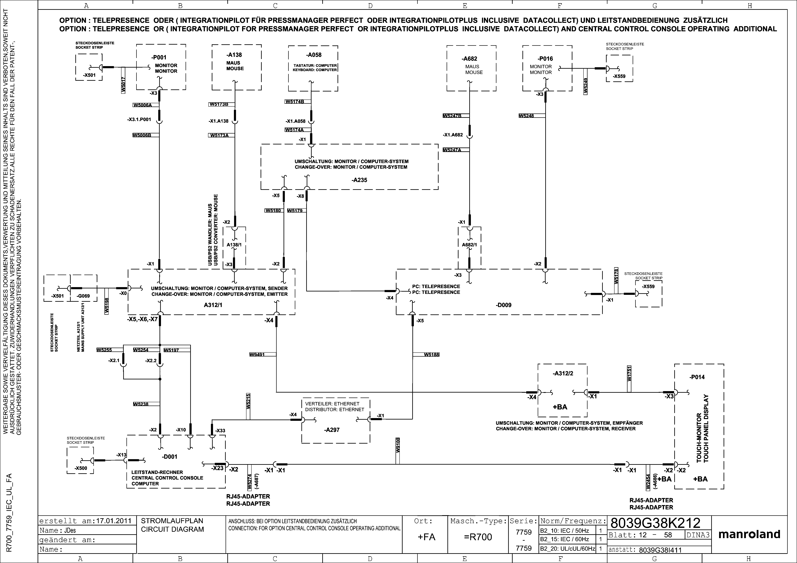

# +FA — Sheet 12 of 58 — ANSCHLUSS: BEI OPTION LEITSTANDBEDIENUNG ZUSÄTZLICH

**CONNECTION: FOR OPTION CENTRAL CONTROL CONSOLE OPERATING ADDITIONAL**

> Part of the manroland **R700** printing press IEC/UL circuit diagrams.
> Drawing class: **Stromlaufplan / Circuit diagram** (DIN A3).
> Document `+FA` covers the **Delivery** machine section.

## At a glance

| Field | Value |
|---|---|
| Document | `+FA`  (8039G38K212) |
| Sheet | **12** of 58 |
| Section (DE) | ANSCHLUSS: BEI OPTION LEITSTANDBEDIENUNG ZUSÄTZLICH |
| Section (EN) | CONNECTION: FOR OPTION CENTRAL CONTROL CONSOLE OPERATING ADDITIONAL |
| Section type | CIRCUIT — Circuit diagram |
| Machine type | `=R700` |
| Series | `7759` |
| Created | 17.01.2011 |
| Replaces | `8039G38I411` |
| Columns used | A, B, C, D, E, F, G, H |
| Path numbers | — |
| Labels on sheet | 139 |
| Cross-refs out | 0 |
| Cross-refs in | 0 |

**Previous:** [+FA sheet 11](SHEET_0011.md) · **Next:** [+FA sheet 13](SHEET_0013.md) · **Document TOC:** [_TOC.md](_TOC.md)  (+FA) · **Master TOC:** [all sheets](../_MASTER_TOC.md)

## Sheet image (300 DPI, exact vector render)



_Rendered directly from the PDF vector layer at 300 DPI (1-bit), no OCR and no resampling. Use it to confirm anything ambiguous in the text below._

## Cross-references on this sheet

Each entry is a wire leaving this sheet. The printed token is `/sheet.column`; the link resolves to that sheet inside the same document.

_No outgoing cross-references on this sheet._

## Devices on this sheet

| Tag | Class | Class meaning (IEC) | Col | Sub | Terminal | Sign |
|---|---|---|---|---|---|---|
| `D001` | D | Digital / binary element | B | — | — | — |
| `D009` | D | Digital / binary element | E | — | — | — |
| `P001` | P | Messgeraet / measuring instrument, meter | B | — | — | — |
| `A058` | A | Baugruppe / assembly, module, PC board | C | — | — | — |
| `A138` | A | Baugruppe / assembly, module, PC board | C | — | — | — |
| `A235` | A | Baugruppe / assembly, module, PC board | D | — | — | — |
| `A138/1` | A | Baugruppe / assembly, module, PC board | C | 1 | — | — |
| `X3` | X | Klemme / terminal, plug connector | B | — | — | — |
| `X1` | X | Klemme / terminal, plug connector | B | — | — | — |
| `X1` | X | Klemme / terminal, plug connector | C | — | — | — |
| `X2` | X | Klemme / terminal, plug connector | B | — | — | — |
| `X2` | X | Klemme / terminal, plug connector | B | — | — | — |
| `X10` | X | Klemme / terminal, plug connector | B | — | — | — |
| `W5238` | W | Kabel / cable, line, bus | B | — | — | — |
| `W5179` | W | Kabel / cable, line, bus | C | — | — | — |
| `X8` | X | Klemme / terminal, plug connector | C | — | — | — |
| `X3` | X | Klemme / terminal, plug connector | E | — | — | — |
| `X501` | X | Klemme / terminal, plug connector | A | — | — | — |
| `W5017` | W | Kabel / cable, line, bus | A | — | — | — |
| `A312/1` | A | Baugruppe / assembly, module, PC board | B | 1 | — | — |
| `W5197` | W | Kabel / cable, line, bus | B | — | — | — |
| `P014` | P | Messgeraet / measuring instrument, meter | G | — | — | — |
| `A312/2` | A | Baugruppe / assembly, module, PC board | F | 2 | — | — |
| `W1751` | W | Kabel / cable, line, bus | G | — | — | — |
| `X1` | X | Klemme / terminal, plug connector | F | — | — | — |
| `X3` | X | Klemme / terminal, plug connector | G | — | — | — |
| `X4` | X | Klemme / terminal, plug connector | C | — | — | — |
| `X4` | X | Klemme / terminal, plug connector | F | — | — | — |
| `W9491` | W | Kabel / cable, line, bus | C | — | — | — |
| `A682` | A | Baugruppe / assembly, module, PC board | E | — | — | — |
| `P016` | P | Messgeraet / measuring instrument, meter | F | — | — | — |
| `W5248` | W | Kabel / cable, line, bus | F | — | — | — |
| `X3` | X | Klemme / terminal, plug connector | F | — | — | — |
| `X559` | X | Klemme / terminal, plug connector | G | — | — | — |
| `W5249` | W | Kabel / cable, line, bus | F | — | — | — |
| `A682/1` | A | Baugruppe / assembly, module, PC board | E | 1 | — | — |
| `X1` | X | Klemme / terminal, plug connector | E | — | — | — |
| `X2` | X | Klemme / terminal, plug connector | F | — | — | — |
| `X5` | X | Klemme / terminal, plug connector | E | — | — | — |
| `W9100` | W | Kabel / cable, line, bus | D | — | — | — |
| `X2` | X | Klemme / terminal, plug connector | C | — | — | — |
| `X1` | X | Klemme / terminal, plug connector | C | — | — | — |
| `X23` | X | Klemme / terminal, plug connector | B | — | — | — |
| `X1` | X | Klemme / terminal, plug connector | G | — | — | — |
| `X2` | X | Klemme / terminal, plug connector | G | — | — | — |
| `X1` | X | Klemme / terminal, plug connector | G | — | — | — |
| `X1` | X | Klemme / terminal, plug connector | C | — | — | — |
| `X2` | X | Klemme / terminal, plug connector | G | — | — | — |
| `W5254` | W | Kabel / cable, line, bus | B | — | — | — |
| `W5255` | W | Kabel / cable, line, bus | A | — | — | — |
| `W5180` | W | Kabel / cable, line, bus | C | — | — | — |
| `X5` | X | Klemme / terminal, plug connector | C | — | — | — |
| `X2` | X | Klemme / terminal, plug connector | C | — | — | — |
| `A297` | A | Baugruppe / assembly, module, PC board | D | — | — | — |
| `X4` | X | Klemme / terminal, plug connector | C | — | — | — |
| `X1` | X | Klemme / terminal, plug connector | D | — | — | — |
| `W5215` | W | Kabel / cable, line, bus | C | — | — | — |
| `W5188` | W | Kabel / cable, line, bus | E | — | — | — |
| `X4` | X | Klemme / terminal, plug connector | D | — | — | — |
| `X33` | X | Klemme / terminal, plug connector | B | — | — | — |
| `X3` | X | Klemme / terminal, plug connector | C | — | — | — |
| `X500` | X | Klemme / terminal, plug connector | A | — | — | — |
| `X13` | X | Klemme / terminal, plug connector | A | — | — | — |
| `X559` | X | Klemme / terminal, plug connector | G | — | — | — |
| `X1` | X | Klemme / terminal, plug connector | G | — | — | — |
| `W5178` | W | Kabel / cable, line, bus | G | — | — | — |
| `X2` | X | Klemme / terminal, plug connector | C | — | — | — |
| `X1` | X | Klemme / terminal, plug connector | C | — | — | — |
| `W5274` | W | Kabel / cable, line, bus | C | — | — | — |
| `W2454` | W | Kabel / cable, line, bus | G | — | — | — |
| `X501` | X | Klemme / terminal, plug connector | A | — | — | — |
| `W5198` | W | Kabel / cable, line, bus | A | — | — | — |
| `G069` | G | Stromversorgung / power supply | A | — | — | — |
| `X0` | X | Klemme / terminal, plug connector | A | — | — | — |
| `X3.1.P001` | — | cross-device reference | B | — | — | — |
| `X1.A058` | — | cross-device reference | C | — | — | — |
| `X1.A138` | — | cross-device reference | B | — | — | — |
| `X2.1` | — | cross-device reference | A | — | — | — |
| `X2.2` | — | cross-device reference | B | — | — | — |
| `X1.A682` | — | cross-device reference | E | — | — | — |

## Potentials / nets

_No named potentials on this sheet._

## Wire-end annotations (grouped as printed)

A wire that continues elsewhere is annotated with a small cluster: the destination description, the path/line number `#NN`, and the `/sheet.column` cross reference. Each row below is one such cluster exactly as it is grouped on the drawing.

| Col | Y | Path | Cross-ref | Text on the wire |
|---|---|---|---|---|
| E | 25.9 | — | — | `OPTION : TELEPRESENCE ODER ( INTEGRATIONPILOT FÜR PRESSMANAGER PERFECT ODER INTEGRATIONPILOTPLUS INCLUSIVE DATACOLLECT) UND LEITSTANDBEDIENUNG ZUSÄTZLICH OPTION : TELEPRESENCE OR ( INTEGRATIONPILOT FOR PRESSMANAGER PERFECT OR INTEGRATIONPILOTPLUS INCLUSIVE DATACOLLECT) AND CENTRAL CONTROL CONSOLE OPERATING ADDITIONAL` |
| A | 62.0 | — | — | `STECKDOSENLEISTE SOCKET STRIP` |
| G | 63.9 | — | — | `STECKDOSENLEISTE SOCKET STRIP` |
| C | 78.3 | — | — | `P001 A138 A058` |
| E | 84.0 | — | — | `A682` |
| F | 84.0 | — | — | `P016` |
| C | 90.9 | — | — | `MAUS MOUSE` |
| B | 94.8 | — | — | `MONITOR MONITOR` |
| C | 95.6 | — | — | `KEYBOARD: COMPUTER TASTATUR: COMPUTER` |
| E | 96.5 | — | — | `MAUS MOUSE` |
| F | 96.7 | — | — | `MONITOR MONITOR` |
| A | 109.1 | — | — | `X501` |
| G | 110.9 | — | — | `X559` |
| A | 114.9 | — | — | `W5017` |
| F | 116.7 | — | — | `W5249` |
| B | 136.1 | — | — | `X3` |
| F | 137.9 | — | — | `X3` |
| C | 149.0 | — | — | `W5174B` |
| B | 152.7 | — | — | `W5173B` |
| B | 154.1 | — | — | `W5006A` |
| E | 170.3 | — | — | `W5247B` |
| F | 170.3 | — | — | `W5248` |
| B | 175.4 | — | — | `X3.1.P001` |
| C | 178.0 | — | — | `X1.A138 X1.A058` |
| C | 191.1 | — | — | `W5174A` |
| E | 198.6 | — | — | `X1.A682` |
| B | 199.3 | — | — | `W5006B` |
| B | 199.6 | — | — | `W5173A` |
| C | 205.4 | — | — | `X1` |
| E | 221.3 | — | — | `W5247A` |
| D | 238.3 | — | — | `UMSCHALTUNG: MONITOR / COMPUTER SYSTEM CHANGE OVER: MONITOR / COMPUTER SYSTEM` |
| D | 265.4 | — | — | `A235` |
| C | 289.3 | — | — | `X5` |
| C | 290.2 | — | — | `X8` |
| B | 290.3 | — | — | `USB/PS2 CONVERTER: MOUSE` |
| B | 304.4 | — | — | `USB/PS2 WANDLER: MAUS` |
| C | 311.9 | — | — | `W5180` |
| C | 312.0 | — | — | `W5179` |
| B | 329.0 | — | — | `X2` |
| E | 329.0 | — | — | `X1` |
| C | 363.1 | — | — | `A138/1` |
| E | 363.1 | — | — | `A682/1` |
| B | 391.4 | — | — | `X1` |
| C | 391.4 | — | — | `X2` |
| F | 391.4 | — | — | `X2` |
| C | 392.4 | — | — | `X3` |
| G | 402.3 | — | — | `W5178` |
| G | 407.0 | — | — | `STECKDOSENLEISTE` |
| E | 408.4 | — | — | `X3` |
| G | 413.5 | — | — | `SOCKET STRIP` |
| E | 425.4 | — | — | `PC: TELEPRESENCE PC: TELEPRESENCE` |
| G | 425.4 | — | — | `X559` |
| B | 428.2 | — | — | `UMSCHALTUNG: MONITOR / COMPUTER SYSTEM, SENDER` |
| A | 435.3 | — | — | `G069 X0` |
| B | 436.7 | — | — | `CHANGE OVER: MONITOR / COMPUTER SYSTEM, EMITTER` |
| A | 439.5 | — | — | `X501` |
| D | 442.4 | — | — | `X4` |
| A | 445.3 | — | — | `W5198` |
| G | 445.4 | — | — | `X1` |
| B | 452.5 | — | — | `A312/1` |
| E | 452.5 | — | — | `D009` |
| A | 452.7 | — | — | `MAINS SUPPLY UNIT A312/1` |
| A | 468.3 | — | — | `STECKDOSENLEISTE` |
| B | 473.3 | — | — | `X5, X6, X7` |
| C | 475.1 | — | — | `X4` |
| E | 476.4 | — | — | `X5` |
| A | 480.8 | — | — | `NETZTEIL A312/1` |
| A | 485.3 | — | — | `SOCKET STRIP` |
| A | 520.5 | — | — | `W5255 W5254` |
| B | 520.8 | — | — | `W5197` |
| C | 527.3 | — | — | `W9491` |
| E | 527.5 | — | — | `W5188` |
| A | 536.0 | — | — | `X2.1 X2.2` |
| G | 547.7 | — | — | `W1751` |
| F | 554.5 | — | — | `A312/2` |
| G | 560.2 | — | — | `P014` |
| G | 589.0 | — | — | `X1 X3` |
| C | 589.2 | — | — | `W5215` |
| H | 589.6 | — | — | `TOUCH PANEL DISPLAY` |
| F | 590.0 | — | — | `X4` |
| D | 600.7 | — | — | `X4 DISTRIBUTOR: ETHERNET VERTEILER: ETHERNET X1` |
| B | 601.4 | — | — | `W5238` |
| F | 604.1 | — | — | `+BA` |
| G | 615.1 | — | — | `TOUCH MONITOR` |
| F | 629.5 | — | — | `UMSCHALTUNG: MONITOR / COMPUTER SYSTEM, EMPFÄNGER CHANGE OVER: MONITOR / COMPUTER SYSTEM, RECEIVER` |
| D | 639.2 | — | — | `A297` |
| B | 639.6 | — | — | `X2 X10` |
| B | 640.8 | — | — | `X33` |
| A | 653.0 | — | — | `STECKDOSENLEISTE SOCKET STRIP` |
| D | 654.6 | — | — | `W9100` |
| A | 677.0 | — | — | `X13` |
| B | 679.2 | — | — | `D001` |
| C | 696.2 | — | — | `X23 X2 X1` |
| A | 697.0 | — | — | `X500` |
| C | 698.2 | — | — | `X2 X1` |
| G | 699.0 | — | — | `X1` |
| E | 699.5 | — | — | `X1 X1 X2` |
| G | 699.5 | — | — | `X2` |
| B | 703.2 | — | — | `LEITSTAND RECHNER CENTRAL CONTROL CONSOLE COMPUTER` |
| C | 708.1 | — | — | `W5274 ( A687)` |
| G | 708.1 | — | — | `W2454 ( A686)` |
| G | 711.8 | — | — | `+BA` |
| G | 711.8 | — | — | `+BA` |
| C | 738.8 | — | — | `RJ45 ADAPTER RJ45 ADAPTER` |
| G | 744.4 | — | — | `RJ45 ADAPTER RJ45 ADAPTER` |


## Reconstructed tables

This sheet carries tabular content (pin map / terminal assignment / index). The grid below was rebuilt from the drawing's own rule lines, so each row is exactly one physical row of the table.

### Table 1 — 2 data rows × 2 columns (at x=185.7, y=515.9)

| W5254 X2.2 | W5197 |
|---|---|
| `W5238` |  |
| `X2` | `X10 D001` |


### Table 2 — 3 data rows × 2 columns (at x=318.2, y=515.9)

| C1 | C2 |
|---|---|
|  | `W9491` |
|  | `W5215` |
| `X33` |  |


## Notes and free text on this sheet

| Text | Col | Y (pt) |
|---|---|---|
| `MAUS` | C | 90.93 |
| `MOUSE` | C | 99.47 |
| `W5006A` | B | 154.08 |
| `W5006B` | B | 199.34 |
| `W5173B` | B | 152.7 |
| `W5173A` | B | 199.61 |
| `W5174B` | C | 148.97 |
| `W5174A` | C | 191.1 |
| `LEITSTAND RECHNER` | B | 703.2 |
| `CENTRAL CONTROL CONSOLE` | B | 711.79 |
| `COMPUTER` | B | 720.34 |
| `STECKDOSENLEISTE` | A | 62.04 |
| `SOCKET STRIP` | A | 68.57 |
| `MONITOR` | B | 94.8 |
| `TASTATUR: COMPUTER` | C | 95.61 |
| `KEYBOARD: COMPUTER` | C | 102.14 |
| `PC: TELEPRESENCE` | E | 425.39 |
| `UMSCHALTUNG: MONITOR / COMPUTER SYSTEM` | D | 238.32 |
| `CHANGE OVER: MONITOR / COMPUTER SYSTEM` | D | 246.9 |
| `USB/PS2 WANDLER: MAUS` | B | 304.44 |
| `USB/PS2 CONVERTER: MOUSE` | B | 290.26 |
| `UMSCHALTUNG: MONITOR / COMPUTER SYSTEM, SENDER` | B | 428.17 |
| `CHANGE OVER: MONITOR / COMPUTER SYSTEM, EMITTER` | B | 436.74 |
| `TOUCH MONITOR` | G | 615.11 |
| `TOUCH PANEL DISPLAY` | H | 589.6 |
| `+BA` | G | 711.8 |
| `+BA` | F | 604.08 |
| `UMSCHALTUNG: MONITOR / COMPUTER SYSTEM, EMPFÄNGER` | F | 629.5 |
| `CHANGE OVER: MONITOR / COMPUTER SYSTEM, RECEIVER` | F | 638.07 |
| `X5, X6, X7` | B | 473.32 |
| `W5247B` | E | 170.28 |
| `W5247A` | E | 221.34 |
| `STECKDOSENLEISTE` | G | 63.85 |
| `SOCKET STRIP` | G | 70.37 |
| `MAUS` | E | 96.55 |
| `MOUSE` | E | 105.14 |
| `MONITOR` | F | 96.65 |
| `RJ45 ADAPTER` | C | 738.76 |
| `RJ45 ADAPTER` | G | 744.43 |
| `VERTEILER: ETHERNET` | D | 600.74 |
| `DISTRIBUTOR: ETHERNET` | D | 609.35 |
| `OPTION : TELEPRESENCE ODER ( INTEGRATIONPILOT FÜR PRESSMANAGER PERFECT ODER INTEGRATIONPILOTPLUS INCLUSIVE DATACOLLECT) UND LEITSTANDBEDIENUNG ZUSÄTZLICH` | D | 25.85 |
| `OPTION : TELEPRESENCE OR ( INTEGRATIONPILOT FOR PRESSMANAGER PERFECT OR INTEGRATIONPILOTPLUS INCLUSIVE DATACOLLECT) AND CENTRAL CONTROL CONSOLE OPERATING ADDITIONAL` | E | 38.54 |
| `( A687)` | C | 708.09 |
| `( A686)` | G | 708.09 |
| `NETZTEIL A312/1` | A | 480.76 |
| `MAINS SUPPLY UNIT A312/1` | A | 452.69 |

## Complete label inventory (exact text from the drawing)

Every text object inside the drawing area of this sheet, in DIN reading order (column A→H, then top→bottom). This is the authoritative list: if a string is not here it is not printed on this sheet.

| Col | Y | X | Dir | Type | Text |
|---|---|---|---|---|---|
| A | 62.0 | 112.9 | → | text | `STECKDOSENLEISTE` |
| A | 68.6 | 112.9 | → | text | `SOCKET STRIP` |
| A | 109.1 | 124.1 | → | device tag | `X501` |
| A | 114.9 | 181.3 | ↕ | device tag | `W5017` |
| A | 435.3 | 178.3 | → | device tag | `X0` |
| A | 439.5 | 76.6 | → | device tag | `X501` |
| A | 439.6 | 114.5 | → | device tag | `G069` |
| A | 445.3 | 156.4 | ↕ | device tag | `W5198` |
| A | 452.7 | 121.4 | ↕ | text | `MAINS SUPPLY UNIT A312/1` |
| A | 468.3 | 75.2 | ↕ | text | `STECKDOSENLEISTE` |
| A | 480.8 | 114.9 | ↕ | text | `NETZTEIL A312/1` |
| A | 485.3 | 81.7 | ↕ | text | `SOCKET STRIP` |
| A | 520.5 | 144.5 | → | device tag | `W5255` |
| A | 536.0 | 161.7 | → | device ref | `X2.1` |
| A | 653.0 | 99.9 | → | text | `STECKDOSENLEISTE` |
| A | 659.5 | 99.9 | → | text | `SOCKET STRIP` |
| A | 677.0 | 173.7 | → | device tag | `X13` |
| A | 697.1 | 111.2 | → | device tag | `X500` |
| B | 82.2 | 226.0 | → | device tag | `P001` |
| B | 94.8 | 231.7 | → | text | `MONITOR` |
| B | 103.4 | 231.7 | → | text | `MONITOR` |
| B | 136.1 | 223.7 | → | device tag | `X3` |
| B | 152.7 | 313.6 | → | text | `W5173B` |
| B | 154.1 | 199.7 | → | text | `W5006A` |
| B | 175.4 | 190.1 | → | device ref | `X3.1.P001` |
| B | 178.0 | 311.6 | → | device ref | `X1.A138` |
| B | 199.3 | 198.4 | → | text | `W5006B` |
| B | 199.6 | 314.4 | → | text | `W5173A` |
| B | 290.3 | 319.2 | ↕ | text | `USB/PS2 CONVERTER: MOUSE` |
| B | 304.4 | 310.6 | ↕ | text | `USB/PS2 WANDLER: MAUS` |
| B | 329.0 | 332.8 | → | device tag | `X2` |
| B | 391.4 | 219.4 | → | device tag | `X1` |
| B | 428.2 | 225.6 | → | text | `UMSCHALTUNG: MONITOR / COMPUTER SYSTEM, SENDER` |
| B | 436.7 | 226.5 | → | text | `CHANGE OVER: MONITOR / COMPUTER SYSTEM, EMITTER` |
| B | 452.5 | 304.7 | → | device tag | `A312/1` |
| B | 473.3 | 189.7 | → | text | `X5, X6, X7` |
| B | 520.5 | 199.2 | → | device tag | `W5254` |
| B | 520.8 | 244.9 | → | device tag | `W5197` |
| B | 536.2 | 216.8 | → | device ref | `X2.2` |
| B | 601.4 | 199.3 | → | device tag | `W5238` |
| B | 639.6 | 223.0 | → | device tag | `X2` |
| B | 639.6 | 262.7 | → | device tag | `X10` |
| B | 640.8 | 321.4 | → | device tag | `X33` |
| B | 679.2 | 241.8 | → | device tag | `D001` |
| B | 696.2 | 315.5 | → | device tag | `X23` |
| B | 703.2 | 196.4 | → | text | `LEITSTAND RECHNER` |
| B | 711.8 | 196.7 | → | text | `CENTRAL CONTROL CONSOLE` |
| B | 720.3 | 196.7 | → | text | `COMPUTER` |
| C | 78.3 | 338.2 | → | device tag | `A138` |
| C | 78.3 | 457.2 | → | device tag | `A058` |
| C | 90.9 | 338.2 | → | text | `MAUS` |
| C | 95.6 | 438.8 | → | text | `TASTATUR: COMPUTER` |
| C | 99.5 | 338.2 | → | text | `MOUSE` |
| C | 102.1 | 437.4 | → | text | `KEYBOARD: COMPUTER` |
| C | 149.0 | 426.8 | → | text | `W5174B` |
| C | 178.2 | 426.7 | → | device ref | `X1.A058` |
| C | 191.1 | 426.5 | → | text | `W5174A` |
| C | 205.4 | 446.3 | → | device tag | `X1` |
| C | 289.3 | 406.5 | → | device tag | `X5` |
| C | 290.3 | 443.2 | → | device tag | `X8` |
| C | 311.9 | 397.1 | → | device tag | `W5180` |
| C | 312.0 | 429.4 | → | device tag | `W5179` |
| C | 363.1 | 338.7 | → | device tag | `A138/1` |
| C | 391.4 | 406.5 | → | device tag | `X2` |
| C | 392.4 | 336.1 | → | device tag | `X3` |
| C | 475.1 | 394.9 | → | device tag | `X4` |
| C | 527.3 | 373.1 | → | device tag | `W9491` |
| C | 589.2 | 368.1 | ↕ | device tag | `W5215` |
| C | 616.8 | 432.1 | → | device tag | `X4` |
| C | 698.2 | 342.3 | → | device tag | `X2` |
| C | 698.2 | 342.3 | → | device tag | `X2` |
| C | 699.2 | 395.1 | → | device tag | `X1` |
| C | 699.2 | 395.1 | → | device tag | `X1` |
| C | 699.6 | 412.8 | → | device tag | `X1` |
| C | 708.1 | 380.1 | ↕ | text | `( A687)` |
| C | 709.1 | 370.0 | ↕ | device tag | `W5274` |
| C | 738.8 | 338.2 | → | text | `RJ45 ADAPTER` |
| C | 749.4 | 338.2 | → | text | `RJ45 ADAPTER` |
| D | 25.8 | 88.7 | → | text | `OPTION : TELEPRESENCE ODER ( INTEGRATIONPILOT FÜR PRESSMANAGER PERFECT ODER INTEGRATIONPILOTPLUS INCLUSIVE DATACOLLECT) UND LEITSTANDBEDIENUNG ZUSÄTZLICH` |
| D | 238.3 | 440.2 | → | text | `UMSCHALTUNG: MONITOR / COMPUTER SYSTEM` |
| D | 246.9 | 440.5 | → | text | `CHANGE OVER: MONITOR / COMPUTER SYSTEM` |
| D | 265.4 | 525.3 | → | device tag | `A235` |
| D | 442.4 | 576.6 | → | device tag | `X4` |
| D | 600.7 | 456.1 | → | text | `VERTEILER: ETHERNET` |
| D | 609.3 | 455.8 | → | text | `DISTRIBUTOR: ETHERNET` |
| D | 618.6 | 563.0 | → | device tag | `X1` |
| D | 639.2 | 484.2 | → | device tag | `A297` |
| D | 654.6 | 591.6 | ↕ | device tag | `W9100` |
| E | 38.5 | 88.7 | → | text | `OPTION : TELEPRESENCE OR ( INTEGRATIONPILOT FOR PRESSMANAGER PERFECT OR INTEGRATIONPILOTPLUS INCLUSIVE DATACOLLECT) AND CENTRAL CONTROL CONSOLE OPERATING ADDITIONAL` |
| E | 84.0 | 689.7 | → | device tag | `A682` |
| E | 96.5 | 695.3 | → | text | `MAUS` |
| E | 105.1 | 695.3 | → | text | `MOUSE` |
| E | 170.3 | 661.9 | → | text | `W5247B` |
| E | 198.6 | 661.6 | → | device ref | `X1.A682` |
| E | 221.3 | 661.9 | → | text | `W5247A` |
| E | 329.0 | 684.3 | → | device tag | `X1` |
| E | 363.1 | 690.2 | → | device tag | `A682/1` |
| E | 408.4 | 678.6 | → | device tag | `X3` |
| E | 425.4 | 616.0 | → | text | `PC: TELEPRESENCE` |
| E | 434.0 | 616.0 | → | text | `PC: TELEPRESENCE` |
| E | 452.5 | 740.7 | → | device tag | `D009` |
| E | 476.4 | 621.9 | → | device tag | `X5` |
| E | 527.4 | 633.5 | → | device tag | `W5188` |
| F | 84.0 | 803.1 | → | device tag | `P016` |
| F | 96.6 | 791.7 | → | text | `MONITOR` |
| F | 105.2 | 791.7 | → | text | `MONITOR` |
| F | 116.7 | 872.0 | ↕ | device tag | `W5249` |
| F | 137.9 | 800.8 | → | device tag | `X3` |
| F | 170.3 | 775.3 | → | device tag | `W5248` |
| F | 391.4 | 797.7 | → | device tag | `X2` |
| F | 554.5 | 825.7 | → | device tag | `A312/2` |
| F | 589.0 | 878.5 | → | device tag | `X1` |
| F | 590.0 | 787.7 | → | device tag | `X4` |
| F | 604.1 | 826.0 | → | text | `+BA` |
| F | 629.5 | 740.7 | → | text | `UMSCHALTUNG: MONITOR / COMPUTER SYSTEM, EMPFÄNGER` |
| F | 638.1 | 741.0 | → | text | `CHANGE OVER: MONITOR / COMPUTER SYSTEM, RECEIVER` |
| G | 63.9 | 905.4 | → | text | `STECKDOSENLEISTE` |
| G | 70.4 | 905.4 | → | text | `SOCKET STRIP` |
| G | 110.9 | 915.4 | → | device tag | `X559` |
| G | 402.3 | 917.9 | ↕ | device tag | `W5178` |
| G | 407.0 | 932.8 | → | text | `STECKDOSENLEISTE` |
| G | 413.5 | 949.3 | → | text | `SOCKET STRIP` |
| G | 425.4 | 959.0 | → | device tag | `X559` |
| G | 445.4 | 905.5 | → | device tag | `X1` |
| G | 547.7 | 937.2 | ↕ | device tag | `W1751` |
| G | 560.2 | 1029.8 | → | device tag | `P014` |
| G | 589.0 | 992.9 | → | device tag | `X3` |
| G | 615.1 | 1040.6 | ↕ | text | `TOUCH MONITOR` |
| G | 699.0 | 915.7 | → | device tag | `X1` |
| G | 699.5 | 937.4 | → | device tag | `X1` |
| G | 699.5 | 991.7 | → | device tag | `X2` |
| G | 699.6 | 1010.9 | → | device tag | `X2` |
| G | 708.1 | 975.4 | ↕ | text | `( A686)` |
| G | 709.1 | 965.3 | ↕ | device tag | `W2454` |
| G | 711.8 | 981.9 | → | text | `+BA` |
| G | 711.8 | 1035.8 | → | text | `+BA` |
| G | 744.4 | 940.5 | → | text | `RJ45 ADAPTER` |
| G | 755.1 | 940.5 | → | text | `RJ45 ADAPTER` |
| H | 589.6 | 1051.3 | ↕ | text | `TOUCH PANEL DISPLAY` |

## Reading-order text block

The same content as a plain block, grouped by DIN column — convenient to paste or to match against a visual description.

```text
=== Column A ===
  62.0  112.9  text         STECKDOSENLEISTE
  68.6  112.9  text         SOCKET STRIP
 109.1  124.1  devtag       X501
 114.9  181.3  devtag       W5017
 435.3  178.3  devtag       X0
 439.5   76.6  devtag       X501
 439.6  114.5  devtag       G069
 445.3  156.4  devtag       W5198
 452.7  121.4  text         MAINS SUPPLY UNIT A312/1
 468.3   75.2  text         STECKDOSENLEISTE
 480.8  114.9  text         NETZTEIL A312/1
 485.3   81.7  text         SOCKET STRIP
 520.5  144.5  devtag       W5255
 536.0  161.7  devref       X2.1
 653.0   99.9  text         STECKDOSENLEISTE
 659.5   99.9  text         SOCKET STRIP
 677.0  173.7  devtag       X13
 697.1  111.2  devtag       X500
=== Column B ===
  82.2  226.0  devtag       P001
  94.8  231.7  text         MONITOR
 103.4  231.7  text         MONITOR
 136.1  223.7  devtag       X3
 152.7  313.6  text         W5173B
 154.1  199.7  text         W5006A
 175.4  190.1  devref       X3.1.P001
 178.0  311.6  devref       X1.A138
 199.3  198.4  text         W5006B
 199.6  314.4  text         W5173A
 290.3  319.2  text         USB/PS2 CONVERTER: MOUSE
 304.4  310.6  text         USB/PS2 WANDLER: MAUS
 329.0  332.8  devtag       X2
 391.4  219.4  devtag       X1
 428.2  225.6  text         UMSCHALTUNG: MONITOR / COMPUTER SYSTEM, SENDER
 436.7  226.5  text         CHANGE OVER: MONITOR / COMPUTER SYSTEM, EMITTER
 452.5  304.7  devtag       A312/1
 473.3  189.7  text         X5, X6, X7
 520.5  199.2  devtag       W5254
 520.8  244.9  devtag       W5197
 536.2  216.8  devref       X2.2
 601.4  199.3  devtag       W5238
 639.6  223.0  devtag       X2
 639.6  262.7  devtag       X10
 640.8  321.4  devtag       X33
 679.2  241.8  devtag       D001
 696.2  315.5  devtag       X23
 703.2  196.4  text         LEITSTAND RECHNER
 711.8  196.7  text         CENTRAL CONTROL CONSOLE
 720.3  196.7  text         COMPUTER
=== Column C ===
  78.3  338.2  devtag       A138
  78.3  457.2  devtag       A058
  90.9  338.2  text         MAUS
  95.6  438.8  text         TASTATUR: COMPUTER
  99.5  338.2  text         MOUSE
 102.1  437.4  text         KEYBOARD: COMPUTER
 149.0  426.8  text         W5174B
 178.2  426.7  devref       X1.A058
 191.1  426.5  text         W5174A
 205.4  446.3  devtag       X1
 289.3  406.5  devtag       X5
 290.3  443.2  devtag       X8
 311.9  397.1  devtag       W5180
 312.0  429.4  devtag       W5179
 363.1  338.7  devtag       A138/1
 391.4  406.5  devtag       X2
 392.4  336.1  devtag       X3
 475.1  394.9  devtag       X4
 527.3  373.1  devtag       W9491
 589.2  368.1  devtag       W5215
 616.8  432.1  devtag       X4
 698.2  342.3  devtag       X2
 698.2  342.3  devtag       X2
 699.2  395.1  devtag       X1
 699.2  395.1  devtag       X1
 699.6  412.8  devtag       X1
 708.1  380.1  text         ( A687)
 709.1  370.0  devtag       W5274
 738.8  338.2  text         RJ45 ADAPTER
 749.4  338.2  text         RJ45 ADAPTER
=== Column D ===
  25.8   88.7  text         OPTION : TELEPRESENCE ODER ( INTEGRATIONPILOT FÜR PRESSMANAGER PERFECT ODER INTEGRATIONPILOTPLUS INCLUSIVE DATACOLLECT) UND LEITSTANDBEDIENUNG ZUSÄTZLICH
 238.3  440.2  text         UMSCHALTUNG: MONITOR / COMPUTER SYSTEM
 246.9  440.5  text         CHANGE OVER: MONITOR / COMPUTER SYSTEM
 265.4  525.3  devtag       A235
 442.4  576.6  devtag       X4
 600.7  456.1  text         VERTEILER: ETHERNET
 609.3  455.8  text         DISTRIBUTOR: ETHERNET
 618.6  563.0  devtag       X1
 639.2  484.2  devtag       A297
 654.6  591.6  devtag       W9100
=== Column E ===
  38.5   88.7  text         OPTION : TELEPRESENCE OR ( INTEGRATIONPILOT FOR PRESSMANAGER PERFECT OR INTEGRATIONPILOTPLUS INCLUSIVE DATACOLLECT) AND CENTRAL CONTROL CONSOLE OPERATING ADDITIONAL
  84.0  689.7  devtag       A682
  96.5  695.3  text         MAUS
 105.1  695.3  text         MOUSE
 170.3  661.9  text         W5247B
 198.6  661.6  devref       X1.A682
 221.3  661.9  text         W5247A
 329.0  684.3  devtag       X1
 363.1  690.2  devtag       A682/1
 408.4  678.6  devtag       X3
 425.4  616.0  text         PC: TELEPRESENCE
 434.0  616.0  text         PC: TELEPRESENCE
 452.5  740.7  devtag       D009
 476.4  621.9  devtag       X5
 527.4  633.5  devtag       W5188
=== Column F ===
  84.0  803.1  devtag       P016
  96.6  791.7  text         MONITOR
 105.2  791.7  text         MONITOR
 116.7  872.0  devtag       W5249
 137.9  800.8  devtag       X3
 170.3  775.3  devtag       W5248
 391.4  797.7  devtag       X2
 554.5  825.7  devtag       A312/2
 589.0  878.5  devtag       X1
 590.0  787.7  devtag       X4
 604.1  826.0  text         +BA
 629.5  740.7  text         UMSCHALTUNG: MONITOR / COMPUTER SYSTEM, EMPFÄNGER
 638.1  741.0  text         CHANGE OVER: MONITOR / COMPUTER SYSTEM, RECEIVER
=== Column G ===
  63.9  905.4  text         STECKDOSENLEISTE
  70.4  905.4  text         SOCKET STRIP
 110.9  915.4  devtag       X559
 402.3  917.9  devtag       W5178
 407.0  932.8  text         STECKDOSENLEISTE
 413.5  949.3  text         SOCKET STRIP
 425.4  959.0  devtag       X559
 445.4  905.5  devtag       X1
 547.7  937.2  devtag       W1751
 560.2 1029.8  devtag       P014
 589.0  992.9  devtag       X3
 615.1 1040.6  text         TOUCH MONITOR
 699.0  915.7  devtag       X1
 699.5  937.4  devtag       X1
 699.5  991.7  devtag       X2
 699.6 1010.9  devtag       X2
 708.1  975.4  text         ( A686)
 709.1  965.3  devtag       W2454
 711.8  981.9  text         +BA
 711.8 1035.8  text         +BA
 744.4  940.5  text         RJ45 ADAPTER
 755.1  940.5  text         RJ45 ADAPTER
=== Column H ===
 589.6 1051.3  text         TOUCH PANEL DISPLAY
```

---
_Generated from the PDF vector text layer; no OCR. Source: `R700_7759_IEC_UL_FA`, sheet 12._
