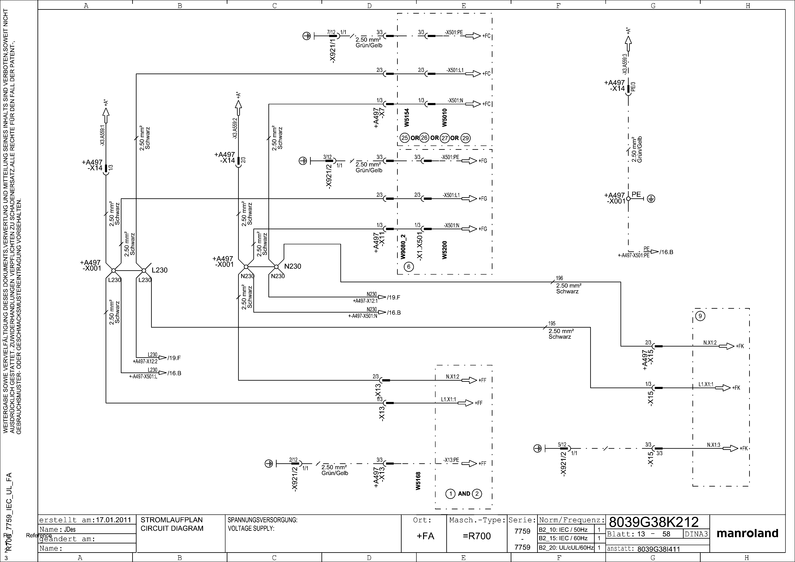

# +FA — Sheet 13 of 58 — SPANNUNGSVERSORGUNG:

**VOLTAGE SUPPLY:**

> Part of the manroland **R700** printing press IEC/UL circuit diagrams.
> Drawing class: **Stromlaufplan / Circuit diagram** (DIN A3).
> Document `+FA` covers the **Delivery** machine section.

## At a glance

| Field | Value |
|---|---|
| Document | `+FA`  (8039G38K212) |
| Sheet | **13** of 58 |
| Section (DE) | SPANNUNGSVERSORGUNG: |
| Section (EN) | VOLTAGE SUPPLY: |
| Section type | POWER_SUPPLY — Voltage supply |
| Machine type | `=R700` |
| Series | `7759` |
| Created | 17.01.2011 |
| Replaces | `8039G38I411` |
| Columns used | A, B, C, D, E, F, G, H |
| Path numbers | — |
| Labels on sheet | 158 |
| Cross-refs out | 5 |
| Cross-refs in | 26 |

**Previous:** [+FA sheet 12](SHEET_0012.md) · **Next:** [+FA sheet 14](SHEET_0014.md) · **Document TOC:** [_TOC.md](_TOC.md)  (+FA) · **Master TOC:** [all sheets](../_MASTER_TOC.md)

## Sheet image (300 DPI, exact vector render)



_Rendered directly from the PDF vector layer at 300 DPI (1-bit), no OCR and no resampling. Use it to confirm anything ambiguous in the text below._

## Cross-references on this sheet

Each entry is a wire leaving this sheet. The printed token is `/sheet.column`; the link resolves to that sheet inside the same document.

| Ref | Target sheet | Col | Path | Destination on target | Target section | From col |
|---|---|---|---|---|---|---|
| `/16.B` | [+FA sheet 16](SHEET_0016.md) | B | — | PE + A497 X501:PE | SPANNUNGSVERSORGUNG: | G |
| `/19.F` | [+FA sheet 19](SHEET_0019.md) | F | — | N230 +A497 X12:1 | LÜFTER | D |
| `/16.B` | [+FA sheet 16](SHEET_0016.md) | B | — | N230 + A497 X501:N | SPANNUNGSVERSORGUNG: | D |
| `/19.F` | [+FA sheet 19](SHEET_0019.md) | F | — | L230 +A497 X12:2 | LÜFTER | B |
| `/16.B` | [+FA sheet 16](SHEET_0016.md) | B | — | L230 + A497 X501:L | SPANNUNGSVERSORGUNG: | B |

### Incoming references (sheets that point here)

Every other sheet that sends a wire to this one. `Back-ref` is the token printed on *that* sheet; `Path` is its line number.

| From sheet | Cols | Back-ref | Path | Refs | What continues there |
|---|---|---|---|---|---|
| [+FA#16](SHEET_0016.md) | B | `/16.B` | — | 3 | L230; N230; PE |
| [+FA#19](SHEET_0019.md) | E, F | `/19.E`, `/19.F` | — | 2 | L230 +A497 X001:L230; N230 +A497 X001:N230 |
| [+FA#44](SHEET_0044.md) | B | `/44.B` | — | 3 | — |
| [+FA#52](SHEET_0052.md) | A, D, E | `/52.A`, `/52.D`, `/52.E` | — | 12 | — |
| [+FA#57](SHEET_0057.md) | B, D, E | `/57.B`, `/57.D`, `/57.E` | — | 6 | — |


## Devices on this sheet

| Tag | Class | Class meaning (IEC) | Col | Sub | Terminal | Sign |
|---|---|---|---|---|---|---|
| `X13` | X | Klemme / terminal, plug connector | D | — | — | — |
| `X13` | X | Klemme / terminal, plug connector | D | — | — | — |
| `N230` | N | Netzteil / power unit, amplifier | D | — | — | — |
| `N230` | N | Netzteil / power unit, amplifier | D | — | — | — |
| `+A497` | A | Baugruppe / assembly, module, PC board | D | — | — | + |
| `X13` | X | Klemme / terminal, plug connector | D | — | — | — |
| `+A497` | A | Baugruppe / assembly, module, PC board | D | — | — | + |
| `X11` | X | Klemme / terminal, plug connector | D | — | — | — |
| `X13:PE` | X | Klemme / terminal, plug connector | E | — | PE | — |
| `+A497` | A | Baugruppe / assembly, module, PC board | A | — | — | + |
| `X14` | X | Klemme / terminal, plug connector | A | — | — | — |
| `+A497` | A | Baugruppe / assembly, module, PC board | B | — | — | + |
| `X14` | X | Klemme / terminal, plug connector | C | — | — | — |
| `+A497` | A | Baugruppe / assembly, module, PC board | G | — | — | + |
| `X14` | X | Klemme / terminal, plug connector | G | — | — | — |
| `X501:PE` | X | Klemme / terminal, plug connector | E | — | PE | — |
| `X501:L1` | X | Klemme / terminal, plug connector | E | — | L1 | — |
| `X501:N` | X | Klemme / terminal, plug connector | E | — | N | — |
| `+A497` | A | Baugruppe / assembly, module, PC board | G | — | — | + |
| `X001` | X | Klemme / terminal, plug connector | G | — | — | — |
| `+A497` | A | Baugruppe / assembly, module, PC board | B | — | — | + |
| `X001` | X | Klemme / terminal, plug connector | B | — | — | — |
| `N230` | N | Netzteil / power unit, amplifier | C | — | — | — |
| `N230` | N | Netzteil / power unit, amplifier | C | — | — | — |
| `N230` | N | Netzteil / power unit, amplifier | C | — | — | — |
| `+A497` | A | Baugruppe / assembly, module, PC board | A | — | — | + |
| `X001` | X | Klemme / terminal, plug connector | A | — | — | — |
| `+A497` | A | Baugruppe / assembly, module, PC board | D | — | — | + |
| `X7` | X | Klemme / terminal, plug connector | D | — | — | — |
| `X501:PE` | X | Klemme / terminal, plug connector | E | — | PE | — |
| `X501:L1` | X | Klemme / terminal, plug connector | E | — | L1 | — |
| `X501:N` | X | Klemme / terminal, plug connector | E | — | N | — |
| `X921/1` | X | Klemme / terminal, plug connector | D | 1 | — | — |
| `X921/2` | X | Klemme / terminal, plug connector | C | 2 | — | — |
| `X921/2` | X | Klemme / terminal, plug connector | D | 2 | — | — |
| `+A497` | A | Baugruppe / assembly, module, PC board | G | — | — | + |
| `X15` | X | Klemme / terminal, plug connector | G | — | — | — |
| `X15` | X | Klemme / terminal, plug connector | G | — | — | — |
| `X15` | X | Klemme / terminal, plug connector | G | — | — | — |
| `X921/2` | X | Klemme / terminal, plug connector | F | 2 | — | — |
| `W5200` | W | Kabel / cable, line, bus | E | — | — | — |
| `W5168` | W | Kabel / cable, line, bus | E | — | — | — |
| `W5010` | W | Kabel / cable, line, bus | E | — | — | — |
| `W5154` | W | Kabel / cable, line, bus | D | — | — | — |
| `X3.A559:1` | — | cross-device reference | A | — | 1 | — |
| `X3.A559:2` | — | cross-device reference | C | — | 2 | — |
| `X3.A559:3` | — | cross-device reference | G | — | 3 | — |
| `X1.X501` | — | cross-device reference | E | — | — | — |

## Potentials / nets

| Potential | Count | Columns | Attached devices | Terminals |
|---|---|---|---|---|
| `L1` | 2 | E, H | `X1` | `1` |
| `L230` | 5 | A, B | — | — |
| `N` | 3 | E, H | `X1` | `2`, `3` |
| `PE` | 3 | G | — | — |


A potential such as `L24+/4` or `M24+` is a named supply/return rail; every place it appears on this sheet is electrically common.

## Conductor data

Each label annotates **the wire beside it**, not the sheet. These summaries are inventories of what is printed; they are not a per-wire map. For a specific conductor, read the label that sits on that wire (see the label inventory below, or the sheet image).

**Cross-section labels printed on this sheet:** 2.5 mm² (×14)

**Wire-colour labels printed on this sheet:** SW = schwarz / black (×10)

**Cross-section + colour appearing together in one annotation block:**

| Cross-section | Colour (DE) | Colour (EN) | Blocks containing both |
|---|---|---|---|
| 2.5 mm² | schwarz | black | 10 |


_This counts annotation blocks that carry both labels. It can be lower than the number of individual labels above, because a block may hold two cross-section labels or two colour labels._

## Wire-end annotations (grouped as printed)

A wire that continues elsewhere is annotated with a small cluster: the destination description, the path/line number `#NN`, and the `/sheet.column` cross reference. Each row below is one such cluster exactly as it is grouped on the drawing.

| Col | Y | Path | Cross-ref | Text on the wire |
|---|---|---|---|---|
| G | 40.9 | — | — | `X3.A559:3 +A*` |
| D | 45.0 | — | — | `7/12 1/1` |
| D | 45.2 | — | — | `3/3` |
| E | 45.2 | — | — | `3/3 X501:PE +FC` |
| D | 55.5 | — | — | `2.50 mm² Grün/Gelb` |
| D | 57.5 | — | — | `X921/1` |
| D | 101.9 | — | — | `2/3` |
| E | 101.9 | — | — | `2/3` |
| E | 102.2 | — | — | `X501:L1 +FC` |
| G | 119.3 | — | — | `+A497` |
| G | 122.9 | — | — | `PE/3` |
| G | 127.9 | — | — | `X14` |
| C | 137.3 | — | — | `X3.A559:2 +A*` |
| D | 147.2 | — | — | `1/3 1/3` |
| E | 147.6 | — | — | `X501:N +FC` |
| A | 148.6 | — | — | `X3.A559:1 +A*` |
| D | 161.0 | — | — | `+A497` |
| D | 161.0 | — | — | `X7` |
| D | 162.4 | — | — | `W5154` |
| E | 162.4 | — | — | `W5010` |
| B | 188.1 | — | — | `2.50 mm² Schwarz` |
| C | 188.1 | — | — | `2.50 mm² Schwarz` |
| E | 202.5 | — | — | `25 26 27` |
| E | 202.9 | — | — | `OR OR OR` |
| E | 203.3 | — | — | `29` |
| G | 203.9 | — | — | `2.50 mm² Grün/Gelb` |
| B | 227.1 | — | — | `+A497` |
| D | 232.3 | — | — | `3/12` |
| D | 232.3 | — | — | `3/3` |
| E | 232.3 | — | — | `3/3 X501:PE +FG` |
| C | 235.2 | — | — | `2/3` |
| C | 235.6 | — | — | `X14` |
| A | 238.4 | — | — | `+A497` |
| D | 242.6 | — | — | `2.50 mm² Grün/Gelb` |
| D | 244.9 | — | — | `1/1` |
| D | 246.1 | — | — | `X921/2` |
| A | 246.9 | — | — | `X14` |
| A | 247.0 | — | — | `1/3` |
| G | 286.6 | — | — | `PE` |
| G | 288.0 | — | — | `+A497` |
| D | 289.0 | — | — | `2/3` |
| E | 289.0 | — | — | `2/3` |
| E | 289.3 | — | — | `X501:L1 +FG` |
| G | 296.5 | — | — | `X001` |
| A | 301.5 | — | — | `2.50 mm² Schwarz` |
| C | 301.5 | — | — | `2.50 mm² Schwarz` |
| D | 334.3 | — | — | `1/3` |
| E | 334.3 | — | — | `1/3` |
| E | 334.7 | — | — | `X501:N +FG` |
| D | 346.7 | — | — | `X11` |
| E | 346.7 | — | — | `X1.X501` |
| A | 346.8 | — | — | `2.50 mm² Schwarz` |
| C | 346.8 | — | — | `2.50 mm² Schwarz` |
| D | 348.1 | — | — | `+A497` |
| D | 351.2 | — | — | `W9080_2` |
| E | 360.9 | — | — | `W5200` |
| G | 369.7 | — | `/16.B` | `+ A497 X501:PE PE` |
| B | 383.0 | — | — | `+A497` |
| B | 388.6 | — | — | `+A497 N230` |
| B | 391.5 | — | — | `X001` |
| D | 395.8 | — | — | `6` |
| A | 397.1 | — | — | `X001` |
| B | 400.0 | — | — | `L230` |
| C | 409.9 | — | — | `N230 N230` |
| F | 413.7 | — | — | `196 2.50 mm² Schwarz` |
| A | 415.6 | — | — | `L230 L230` |
| C | 426.2 | — | — | `2.50 mm² Schwarz` |
| D | 437.9 | — | `/19.F` | `+A497 X12:1 N230` |
| A | 448.9 | — | — | `2.50 mm² Schwarz` |
| D | 460.5 | — | `/16.B` | `+ A497 X501:N N230` |
| G | 469.7 | — | — | `9` |
| F | 481.8 | — | — | `195 2.50 mm² Schwarz` |
| G | 510.1 | — | — | `2/3 N.X1:2 +FK` |
| G | 523.8 | — | — | `X15` |
| G | 523.9 | — | — | `+A497` |
| B | 528.6 | — | `/19.F` | `+A497 X12:2 L230` |
| B | 551.2 | — | `/16.B` | `+ A497 X501:L L230` |
| D | 561.1 | — | — | `2/3` |
| E | 561.4 | — | — | `N.X1:2 +FF` |
| G | 572.4 | — | — | `1/3` |
| H | 572.7 | — | — | `L1.X1:1 +FK` |
| D | 574.9 | — | — | `X13` |
| G | 586.2 | — | — | `X15` |
| D | 595.1 | — | — | `1/3` |
| E | 595.4 | — | — | `L1.X1:1 +FF` |
| D | 608.9 | — | — | `X13` |
| F | 663.2 | — | — | `5/12` |
| G | 663.2 | — | — | `3/3` |
| H | 663.5 | — | — | `N.X1:3 +FK` |
| G | 675.8 | — | — | `1/1 3/3` |
| F | 676.9 | — | — | `X921/2` |
| G | 676.9 | — | — | `X15` |
| C | 685.9 | — | — | `2/12` |
| D | 685.9 | — | — | `3/3` |
| E | 686.2 | — | — | `X13:PE +FF` |
| D | 696.1 | — | — | `2.50 mm² Grün/Gelb` |
| C | 698.4 | — | — | `1/1` |
| C | 699.6 | — | — | `X921/2` |
| D | 699.6 | — | — | `+A497` |
| D | 699.6 | — | — | `X13` |
| E | 706.7 | — | — | `W5168` |
| E | 735.9 | — | — | `1 2` |
| E | 736.0 | — | — | `AND` |


## Reconstructed tables

This sheet carries tabular content (pin map / terminal assignment / index). The grid below was rebuilt from the drawing's own rule lines, so each row is exactly one physical row of the table.

### Table 1 — 3 data rows × 3 columns (at x=158.7, y=110.6)

| +A* 1/3 |  | mm² Schwarz 2.50 |
|---|---|---|
| `mm² Schwarz 2.50 L230 mm² Schwarz 2.50` | `mm² Schwarz 2.50` | `L230` |
|  |  | `+A497 X12:2` |
|  |  | `+ A497 X501:L` |


### Table 2 — 7 data rows × 4 columns (at x=357.2, y=110.6) — **+A***

| 2/3 |  | mm² Schwarz 2.50 | 3/12 |
|---|---|---|---|
|  |  |  | `1/1 X921/2` |
| `mm² Schwarz 2.50` |  |  |  |
|  | `mm² Schwarz` |  |  |
| `N230` | `2.50` | `N230` | `N230` |
| `mm²` |  |  |  |
| `Schwarz 2.50` |  |  |  |
|  |  |  | `2/12` |


## Notes and free text on this sheet

| Text | Col | Y (pt) |
|---|---|---|
| `+A*` | A | 148.6 |
| `+A*` | C | 137.26 |
| `+A*` | G | 40.88 |
| `+FF` | E | 566.82 |
| `+ A497 X501:L` | B | 561.2 |
| `+ A497 X501:N` | D | 470.48 |
| `+ A497 X501:PE` | G | 379.77 |
| `+A497 X12:2` | B | 538.51 |
| `+A497 X12:1` | D | 447.77 |
| `+FG` | E | 237.99 |
| `+FC` | E | 50.94 |
| `+FK` | H | 515.8 |
| `AND` | E | 735.98 |
| `W9080_2` | D | 351.21 |
| `OR` | D | 202.97 |
| `OR` | E | 202.92 |
| `Grün/Gelb` | G | 203.95 |
| `Grün/Gelb` | D | 251.19 |

## Complete label inventory (exact text from the drawing)

Every text object inside the drawing area of this sheet, in DIN reading order (column A→H, then top→bottom). This is the authoritative list: if a string is not here it is not printed on this sheet.

| Col | Y | X | Dir | Type | Text |
|---|---|---|---|---|---|
| A | 148.6 | 155.8 | ↕ | text | `+A*` |
| A | 187.1 | 150.4 | ↕ | device ref | `X3.A559:1` |
| A | 238.4 | 122.5 | → | device tag | `+A497` |
| A | 246.9 | 131.2 | → | device tag | `X14` |
| A | 247.0 | 162.8 | ↕ | pin pair | `1/3` |
| A | 301.5 | 163.2 | ↕ | cross-section | `2.50 mm²` |
| A | 303.6 | 171.8 | ↕ | wire colour | `Schwarz` |
| A | 346.8 | 185.9 | ↕ | cross-section | `2.50 mm²` |
| A | 348.9 | 194.5 | ↕ | wire colour | `Schwarz` |
| A | 388.6 | 119.6 | → | device tag | `+A497` |
| A | 397.2 | 123.9 | → | device tag | `X001` |
| A | 415.6 | 162.1 | → | potential | `L230` |
| A | 448.9 | 163.2 | ↕ | cross-section | `2.50 mm²` |
| A | 451.0 | 171.8 | ↕ | wire colour | `Schwarz` |
| B | 188.1 | 208.6 | ↕ | cross-section | `2.50 mm²` |
| B | 190.2 | 217.2 | ↕ | wire colour | `Schwarz` |
| B | 227.1 | 320.9 | → | device tag | `+A497` |
| B | 383.0 | 318.0 | → | device tag | `+A497` |
| B | 391.5 | 322.3 | → | device tag | `X001` |
| B | 400.0 | 227.3 | → | potential | `L230` |
| B | 415.6 | 207.5 | → | potential | `L230` |
| B | 528.6 | 221.5 | → | potential | `L230` |
| B | 532.5 | 250.9 | → | cross-reference | `/19.F` |
| B | 538.5 | 199.2 | → | text | `+A497 X12:2` |
| B | 551.2 | 221.5 | → | potential | `L230` |
| B | 555.1 | 250.9 | → | cross-reference | `/16.B` |
| B | 561.2 | 193.5 | → | text | `+ A497 X501:L` |
| C | 137.3 | 354.2 | ↕ | text | `+A*` |
| C | 176.9 | 348.9 | ↕ | device ref | `X3.A559:2` |
| C | 188.1 | 407.0 | ↕ | cross-section | `2.50 mm²` |
| C | 190.2 | 415.6 | ↕ | wire colour | `Schwarz` |
| C | 235.2 | 361.3 | ↕ | pin pair | `2/3` |
| C | 235.6 | 329.7 | → | device tag | `X14` |
| C | 301.5 | 361.6 | ↕ | cross-section | `2.50 mm²` |
| C | 303.6 | 370.2 | ↕ | wire colour | `Schwarz` |
| C | 346.8 | 384.3 | ↕ | cross-section | `2.50 mm²` |
| C | 348.9 | 392.9 | ↕ | wire colour | `Schwarz` |
| C | 394.3 | 425.8 | → | device tag | `N230` |
| C | 409.9 | 360.6 | → | device tag | `N230` |
| C | 409.9 | 405.9 | → | device tag | `N230` |
| C | 426.2 | 361.6 | ↕ | cross-section | `2.50 mm²` |
| C | 428.3 | 370.2 | ↕ | wire colour | `Schwarz` |
| C | 685.9 | 433.3 | → | pin pair | `2/12` |
| C | 698.4 | 452.7 | → | pin pair | `1/1` |
| C | 699.6 | 436.8 | ↕ | device tag | `X921/2` |
| D | 45.1 | 509.4 | → | pin pair | `1/1` |
| D | 45.2 | 490.0 | → | pin pair | `7/12` |
| D | 45.2 | 564.1 | → | pin pair | `3/3` |
| D | 55.5 | 532.6 | → | cross-section | `2.50 mm²` |
| D | 57.5 | 493.5 | ↕ | device tag | `X921/1` |
| D | 64.1 | 532.6 | → | text | `Grün/Gelb` |
| D | 101.9 | 564.1 | → | pin pair | `2/3` |
| D | 147.2 | 563.9 | → | pin pair | `1/3` |
| D | 161.0 | 558.7 | ↕ | device tag | `+A497` |
| D | 161.0 | 567.3 | ↕ | device tag | `X7` |
| D | 162.4 | 605.5 | ↕ | device tag | `W5154` |
| D | 202.8 | 601.3 | → | number | `25` |
| D | 203.0 | 615.0 | → | text | `OR` |
| D | 232.3 | 484.3 | → | pin pair | `3/12` |
| D | 232.3 | 564.1 | → | pin pair | `3/3` |
| D | 242.6 | 532.6 | → | cross-section | `2.50 mm²` |
| D | 244.9 | 503.7 | → | pin pair | `1/1` |
| D | 246.0 | 487.9 | ↕ | device tag | `X921/2` |
| D | 251.2 | 532.6 | → | text | `Grün/Gelb` |
| D | 289.0 | 564.1 | → | pin pair | `2/3` |
| D | 334.3 | 563.9 | → | pin pair | `1/3` |
| D | 346.7 | 567.2 | ↕ | device tag | `X11` |
| D | 348.1 | 558.7 | ↕ | device tag | `+A497` |
| D | 351.2 | 599.8 | ↕ | text | `W9080_2` |
| D | 395.8 | 609.9 | → | number | `6` |
| D | 437.9 | 549.4 | → | device tag | `N230` |
| D | 441.8 | 579.7 | → | cross-reference | `/19.F` |
| D | 447.8 | 528.8 | → | text | `+A497 X12:1` |
| D | 460.5 | 549.4 | → | device tag | `N230` |
| D | 464.4 | 579.7 | → | cross-reference | `/16.B` |
| D | 470.5 | 521.7 | → | text | `+ A497 X501:N` |
| D | 561.1 | 558.4 | → | pin pair | `2/3` |
| D | 574.9 | 561.6 | ↕ | device tag | `X13` |
| D | 595.1 | 563.9 | → | pin pair | `1/3` |
| D | 608.9 | 567.2 | ↕ | device tag | `X13` |
| D | 685.9 | 564.1 | → | pin pair | `3/3` |
| D | 696.1 | 481.6 | → | cross-section | `2.50 mm²` |
| D | 699.6 | 558.7 | ↕ | device tag | `+A497` |
| D | 699.6 | 567.2 | ↕ | device tag | `X13` |
| D | 704.7 | 481.6 | → | text | `Grün/Gelb` |
| E | 45.2 | 626.4 | → | pin pair | `3/3` |
| E | 45.5 | 666.3 | → | device tag | `X501:PE` |
| E | 50.9 | 722.6 | → | text | `+FC` |
| E | 101.9 | 626.4 | → | pin pair | `2/3` |
| E | 102.2 | 668.8 | → | device tag | `X501:L1` |
| E | 107.6 | 722.6 | → | text | `+FC` |
| E | 147.2 | 626.3 | → | pin pair | `1/3` |
| E | 147.6 | 670.6 | → | device tag | `X501:N` |
| E | 153.0 | 722.6 | → | text | `+FC` |
| E | 162.4 | 662.2 | ↕ | device tag | `W5010` |
| E | 202.5 | 630.6 | → | number | `26` |
| E | 202.9 | 644.6 | → | text | `OR` |
| E | 203.1 | 674.4 | → | text | `OR` |
| E | 203.3 | 661.3 | → | number | `27` |
| E | 203.3 | 692.5 | → | number | `29` |
| E | 232.3 | 620.8 | → | pin pair | `3/3` |
| E | 232.6 | 660.7 | → | device tag | `X501:PE` |
| E | 238.0 | 716.9 | → | text | `+FG` |
| E | 289.0 | 620.8 | → | pin pair | `2/3` |
| E | 289.3 | 663.1 | → | device tag | `X501:L1` |
| E | 294.7 | 716.9 | → | text | `+FG` |
| E | 334.3 | 620.6 | → | pin pair | `1/3` |
| E | 334.7 | 664.9 | → | device tag | `X501:N` |
| E | 340.0 | 716.9 | → | text | `+FG` |
| E | 346.7 | 623.9 | ↕ | device ref | `X1.X501` |
| E | 360.8 | 662.2 | ↕ | device tag | `W5200` |
| E | 561.4 | 668.2 | → | potential | `N.X1:2` |
| E | 566.8 | 716.9 | → | text | `+FF` |
| E | 595.4 | 660.9 | → | potential | `L1.X1:1` |
| E | 600.8 | 711.2 | → | text | `+FF` |
| E | 686.2 | 664.1 | → | device tag | `X13:PE` |
| E | 691.5 | 716.9 | → | text | `+FF` |
| E | 706.7 | 622.5 | ↕ | device tag | `W5168` |
| E | 735.9 | 672.7 | → | number | `1` |
| E | 735.9 | 712.1 | → | number | `2` |
| E | 736.0 | 686.0 | → | text | `AND` |
| F | 413.7 | 832.5 | → | number | `196` |
| F | 424.0 | 833.1 | → | cross-section | `2.50 mm²` |
| F | 432.6 | 833.1 | → | wire colour | `Schwarz` |
| F | 481.8 | 821.2 | → | number | `195` |
| F | 492.0 | 821.8 | → | cross-section | `2.50 mm²` |
| F | 500.6 | 821.8 | → | wire colour | `Schwarz` |
| F | 663.2 | 835.8 | → | pin pair | `5/12` |
| F | 675.8 | 855.2 | → | pin pair | `1/1` |
| F | 676.9 | 839.4 | ↕ | device tag | `X921/2` |
| G | 40.9 | 938.1 | ↕ | text | `+A*` |
| G | 80.8 | 932.8 | ↕ | device ref | `X3.A559:3` |
| G | 119.3 | 904.8 | → | device tag | `+A497` |
| G | 122.9 | 945.2 | ↕ | potential | `PE/3` |
| G | 127.9 | 913.6 | → | device tag | `X14` |
| G | 204.0 | 954.2 | ↕ | text | `Grün/Gelb` |
| G | 205.1 | 945.6 | ↕ | cross-section | `2.50 mm²` |
| G | 286.6 | 945.9 | → | potential | `PE` |
| G | 288.0 | 904.8 | → | device tag | `+A497` |
| G | 296.5 | 909.1 | → | device tag | `X001` |
| G | 369.7 | 964.0 | → | potential | `PE` |
| G | 373.7 | 987.9 | → | cross-reference | `/16.B` |
| G | 379.8 | 925.7 | → | text | `+ A497 X501:PE` |
| G | 469.7 | 1046.4 | → | number | `9` |
| G | 510.1 | 966.6 | → | pin pair | `2/3` |
| G | 523.8 | 961.2 | ↕ | device tag | `+A497` |
| G | 523.8 | 969.8 | ↕ | device tag | `X15` |
| G | 572.4 | 966.4 | → | pin pair | `1/3` |
| G | 586.2 | 969.8 | ↕ | device tag | `X15` |
| G | 663.2 | 966.6 | → | pin pair | `3/3` |
| G | 675.9 | 983.3 | → | pin pair | `3/3` |
| G | 676.9 | 969.8 | ↕ | device tag | `X15` |
| H | 510.4 | 1053.7 | → | potential | `N.X1:2` |
| H | 515.8 | 1102.4 | → | text | `+FK` |
| H | 572.7 | 1046.4 | → | potential | `L1.X1:1` |
| H | 578.2 | 1096.7 | → | text | `+FK` |
| H | 663.5 | 1059.1 | → | potential | `N.X1:3` |
| H | 668.9 | 1108.1 | → | text | `+FK` |

## Reading-order text block

The same content as a plain block, grouped by DIN column — convenient to paste or to match against a visual description.

```text
=== Column A ===
 148.6  155.8  text         +A*
 187.1  150.4  devref       X3.A559:1
 238.4  122.5  devtag       +A497
 246.9  131.2  devtag       X14
 247.0  162.8  pinpair      1/3
 301.5  163.2  xsection     2.50 mm²
 303.6  171.8  colour       Schwarz
 346.8  185.9  xsection     2.50 mm²
 348.9  194.5  colour       Schwarz
 388.6  119.6  devtag       +A497
 397.2  123.9  devtag       X001
 415.6  162.1  net          L230
 448.9  163.2  xsection     2.50 mm²
 451.0  171.8  colour       Schwarz
=== Column B ===
 188.1  208.6  xsection     2.50 mm²
 190.2  217.2  colour       Schwarz
 227.1  320.9  devtag       +A497
 383.0  318.0  devtag       +A497
 391.5  322.3  devtag       X001
 400.0  227.3  net          L230
 415.6  207.5  net          L230
 528.6  221.5  net          L230
 532.5  250.9  xref         /19.F
 538.5  199.2  text         +A497 X12:2
 551.2  221.5  net          L230
 555.1  250.9  xref         /16.B
 561.2  193.5  text         + A497 X501:L
=== Column C ===
 137.3  354.2  text         +A*
 176.9  348.9  devref       X3.A559:2
 188.1  407.0  xsection     2.50 mm²
 190.2  415.6  colour       Schwarz
 235.2  361.3  pinpair      2/3
 235.6  329.7  devtag       X14
 301.5  361.6  xsection     2.50 mm²
 303.6  370.2  colour       Schwarz
 346.8  384.3  xsection     2.50 mm²
 348.9  392.9  colour       Schwarz
 394.3  425.8  devtag       N230
 409.9  360.6  devtag       N230
 409.9  405.9  devtag       N230
 426.2  361.6  xsection     2.50 mm²
 428.3  370.2  colour       Schwarz
 685.9  433.3  pinpair      2/12
 698.4  452.7  pinpair      1/1
 699.6  436.8  devtag       X921/2
=== Column D ===
  45.1  509.4  pinpair      1/1
  45.2  490.0  pinpair      7/12
  45.2  564.1  pinpair      3/3
  55.5  532.6  xsection     2.50 mm²
  57.5  493.5  devtag       X921/1
  64.1  532.6  text         Grün/Gelb
 101.9  564.1  pinpair      2/3
 147.2  563.9  pinpair      1/3
 161.0  558.7  devtag       +A497
 161.0  567.3  devtag       X7
 162.4  605.5  devtag       W5154
 202.8  601.3  numeric      25
 203.0  615.0  text         OR
 232.3  484.3  pinpair      3/12
 232.3  564.1  pinpair      3/3
 242.6  532.6  xsection     2.50 mm²
 244.9  503.7  pinpair      1/1
 246.0  487.9  devtag       X921/2
 251.2  532.6  text         Grün/Gelb
 289.0  564.1  pinpair      2/3
 334.3  563.9  pinpair      1/3
 346.7  567.2  devtag       X11
 348.1  558.7  devtag       +A497
 351.2  599.8  text         W9080_2
 395.8  609.9  numeric      6
 437.9  549.4  devtag       N230
 441.8  579.7  xref         /19.F
 447.8  528.8  text         +A497 X12:1
 460.5  549.4  devtag       N230
 464.4  579.7  xref         /16.B
 470.5  521.7  text         + A497 X501:N
 561.1  558.4  pinpair      2/3
 574.9  561.6  devtag       X13
 595.1  563.9  pinpair      1/3
 608.9  567.2  devtag       X13
 685.9  564.1  pinpair      3/3
 696.1  481.6  xsection     2.50 mm²
 699.6  558.7  devtag       +A497
 699.6  567.2  devtag       X13
 704.7  481.6  text         Grün/Gelb
=== Column E ===
  45.2  626.4  pinpair      3/3
  45.5  666.3  devtag       X501:PE
  50.9  722.6  text         +FC
 101.9  626.4  pinpair      2/3
 102.2  668.8  devtag       X501:L1
 107.6  722.6  text         +FC
 147.2  626.3  pinpair      1/3
 147.6  670.6  devtag       X501:N
 153.0  722.6  text         +FC
 162.4  662.2  devtag       W5010
 202.5  630.6  numeric      26
 202.9  644.6  text         OR
 203.1  674.4  text         OR
 203.3  661.3  numeric      27
 203.3  692.5  numeric      29
 232.3  620.8  pinpair      3/3
 232.6  660.7  devtag       X501:PE
 238.0  716.9  text         +FG
 289.0  620.8  pinpair      2/3
 289.3  663.1  devtag       X501:L1
 294.7  716.9  text         +FG
 334.3  620.6  pinpair      1/3
 334.7  664.9  devtag       X501:N
 340.0  716.9  text         +FG
 346.7  623.9  devref       X1.X501
 360.8  662.2  devtag       W5200
 561.4  668.2  net          N.X1:2
 566.8  716.9  text         +FF
 595.4  660.9  net          L1.X1:1
 600.8  711.2  text         +FF
 686.2  664.1  devtag       X13:PE
 691.5  716.9  text         +FF
 706.7  622.5  devtag       W5168
 735.9  672.7  numeric      1
 735.9  712.1  numeric      2
 736.0  686.0  text         AND
=== Column F ===
 413.7  832.5  numeric      196
 424.0  833.1  xsection     2.50 mm²
 432.6  833.1  colour       Schwarz
 481.8  821.2  numeric      195
 492.0  821.8  xsection     2.50 mm²
 500.6  821.8  colour       Schwarz
 663.2  835.8  pinpair      5/12
 675.8  855.2  pinpair      1/1
 676.9  839.4  devtag       X921/2
=== Column G ===
  40.9  938.1  text         +A*
  80.8  932.8  devref       X3.A559:3
 119.3  904.8  devtag       +A497
 122.9  945.2  net          PE/3
 127.9  913.6  devtag       X14
 204.0  954.2  text         Grün/Gelb
 205.1  945.6  xsection     2.50 mm²
 286.6  945.9  net          PE
 288.0  904.8  devtag       +A497
 296.5  909.1  devtag       X001
 369.7  964.0  net          PE
 373.7  987.9  xref         /16.B
 379.8  925.7  text         + A497 X501:PE
 469.7 1046.4  numeric      9
 510.1  966.6  pinpair      2/3
 523.8  961.2  devtag       +A497
 523.8  969.8  devtag       X15
 572.4  966.4  pinpair      1/3
 586.2  969.8  devtag       X15
 663.2  966.6  pinpair      3/3
 675.9  983.3  pinpair      3/3
 676.9  969.8  devtag       X15
=== Column H ===
 510.4 1053.7  net          N.X1:2
 515.8 1102.4  text         +FK
 572.7 1046.4  net          L1.X1:1
 578.2 1096.7  text         +FK
 663.5 1059.1  net          N.X1:3
 668.9 1108.1  text         +FK
```

---
_Generated from the PDF vector text layer; no OCR. Source: `R700_7759_IEC_UL_FA`, sheet 13._
