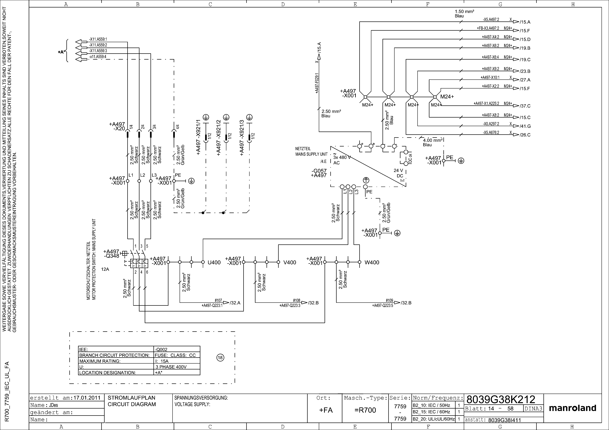

# +FA — Sheet 14 of 58 — SPANNUNGSVERSORGUNG:

**VOLTAGE SUPPLY:**

> Part of the manroland **R700** printing press IEC/UL circuit diagrams.
> Drawing class: **Stromlaufplan / Circuit diagram** (DIN A3).
> Document `+FA` covers the **Delivery** machine section.

## At a glance

| Field | Value |
|---|---|
| Document | `+FA`  (8039G38K212) |
| Sheet | **14** of 58 |
| Section (DE) | SPANNUNGSVERSORGUNG: |
| Section (EN) | VOLTAGE SUPPLY: |
| Section type | POWER_SUPPLY — Voltage supply |
| Machine type | `=R700` |
| Series | `7759` |
| Created | 17.01.2011 |
| Replaces | `8039G38I411` |
| Columns used | A, B, C, D, E, F, G |
| Path numbers | 107, 108, 109 |
| Labels on sheet | 174 |
| Cross-refs out | 17 |
| Cross-refs in | 38 |

**Previous:** [+FA sheet 13](SHEET_0013.md) · **Next:** [+FA sheet 15](SHEET_0015.md) · **Document TOC:** [_TOC.md](_TOC.md)  (+FA) · **Master TOC:** [all sheets](../_MASTER_TOC.md)

## Sheet image (300 DPI, exact vector render)



_Rendered directly from the PDF vector layer at 300 DPI (1-bit), no OCR and no resampling. Use it to confirm anything ambiguous in the text below._

## Cross-references on this sheet

Each entry is a wire leaving this sheet. The printed token is `/sheet.column`; the link resolves to that sheet inside the same document.

| Ref | Target sheet | Col | Path | Destination on target | Target section | From col |
|---|---|---|---|---|---|---|
| `/15.A` | [+FA sheet 15](SHEET_0015.md) | A | — | X X5.A497:2 | SPANNUNGSVERSORGUNG: | G |
| `/15.F` | [+FA sheet 15](SHEET_0015.md) | F | — | +FB X3.A497:2 M24+ | SPANNUNGSVERSORGUNG: | G |
| `/15.D` | [+FA sheet 15](SHEET_0015.md) | D | — | +A497 X4:2 M24+ | SPANNUNGSVERSORGUNG: | G |
| `/15.A` | [+FA sheet 15](SHEET_0015.md) | A | — | X +A497 F029:1 | SPANNUNGSVERSORGUNG: | D |
| `/19.B` | [+FA sheet 19](SHEET_0019.md) | B | — | +A497 X6:2 M24+ | LÜFTER | G |
| `/19.C` | [+FA sheet 19](SHEET_0019.md) | C | — | M24+ +A497 X6:4 | LÜFTER | G |
| `/23.B` | [+FA sheet 23](SHEET_0023.md) | B | — | +A497 X9:2 M24+ | JOBCARD READER | G |
| `/27.A` | [+FA sheet 27](SHEET_0027.md) | A | — | X +A497 X10:1 | TASTATUR: BEDIENUNGSPULT MASCHINE | G |
| `/15.F` | [+FA sheet 15](SHEET_0015.md) | F | — | +A497 X2:2 M24+ | SPANNUNGSVERSORGUNG: | G |
| `/37.C` | [+FA sheet 37](SHEET_0037.md) | C | — | M24+ +A497 X1.A225:2 | OPTION: TELEPRESENCE | G |
| `/15.C` | [+FA sheet 15](SHEET_0015.md) | C | — | +A497 X8:2 M24+ | SPANNUNGSVERSORGUNG: | G |
| `/41.G` | [+FA sheet 41](SHEET_0041.md) | G | — | X X0.A297:2 | OPTION: TELEPRESENCE ODER ICP | G |
| `/26.C` | [+FA sheet 26](SHEET_0026.md) | C | — | X X5.A676:2 | USB ANSCHLUSS | G |
| `/4.E` | [+FA sheet 4](SHEET_0004.md) | E | — | — | ANORDNUNGSPLAN A497 | E |
| `/32.A` | [+FA sheet 32](SHEET_0032.md) | A | `#107` | +A497 Q223:1 +A497 Q223:3 +A497 Q223:5 | OPTION: COLORPILOT, COLORPILOTPLUS | D |
| `/32.B` | [+FA sheet 32](SHEET_0032.md) | B | `#107` | +A497 Q223:1 +A497 Q223:3 +A497 Q223:5 | OPTION: COLORPILOT, COLORPILOTPLUS | D |
| `/32.B` | [+FA sheet 32](SHEET_0032.md) | B | `#107` | +A497 Q223:1 +A497 Q223:3 +A497 Q223:5 | OPTION: COLORPILOT, COLORPILOTPLUS | D |

### Incoming references (sheets that point here)

Every other sheet that sends a wire to this one. `Back-ref` is the token printed on *that* sheet; `Path` is its line number.

| From sheet | Cols | Back-ref | Path | Refs | What continues there |
|---|---|---|---|---|---|
| [+FA#4](SHEET_0004.md) | E, F | `/4.E`, `/4.F` | — | 2 | G057; Q348 |
| [+FA#15](SHEET_0015.md) | A, C, D, F | `/15.A`, `/15.C`, `/15.D`, `/15.F` | — | 6 | +A497 X001:M24+ M24+; M24+; X |
| [+FA#19](SHEET_0019.md) | B, C | `/19.B`, `/19.C` | — | 2 | +A497 X001:M24+ M24+ |
| [+FA#23](SHEET_0023.md) | B | `/23.B` | — | 1 | +A497 X001:M24+ M24+ |
| [+FA#26](SHEET_0026.md) | C | `/26.C` | — | 1 | X +A497 X001:M24+ |
| [+FA#27](SHEET_0027.md) | A | `/27.A` | — | 1 | X +A497 X001:M24+ |
| [+FA#32](SHEET_0032.md) | A, B | `/32.A`, `/32.B` | — | 3 | +A497 X001:U400; +A497 X001:V400; +A497 X001:W400 |
| [+FA#37](SHEET_0037.md) | C | `/37.C` | — | 1 | +A497 X001:M24+ M24+ |
| [+FA#41](SHEET_0041.md) | G | `/41.G` | — | 1 | +A497 X001:M24+ |
| [+FA#44](SHEET_0044.md) | B | `/44.B` | — | 10 | — |
| [+FA#53](SHEET_0053.md) | B | `/53.B` | — | 4 | — |
| [+FA#57](SHEET_0057.md) | A, C, D, G | `/57.A`, `/57.C`, `/57.D`, `/57.G` | — | 6 | — |


## Devices on this sheet

| Tag | Class | Class meaning (IEC) | Col | Sub | Terminal | Sign |
|---|---|---|---|---|---|---|
| `+A497` | A | Baugruppe / assembly, module, PC board | B | — | — | + |
| `X20` | X | Klemme / terminal, plug connector | B | — | — | — |
| `G057` | G | Stromversorgung / power supply | E | — | — | — |
| `+A497` | A | Baugruppe / assembly, module, PC board | D | — | — | + |
| `Q002` | Q | Leistungsschalter / power switching device | B | — | — | — |
| `Q348` | Q | Leistungsschalter / power switching device | B | — | — | — |
| `+A497` | A | Baugruppe / assembly, module, PC board | B | — | — | + |
| `+A497` | A | Baugruppe / assembly, module, PC board | B | — | — | + |
| `X001` | X | Klemme / terminal, plug connector | B | — | — | — |
| `+A497` | A | Baugruppe / assembly, module, PC board | B | — | — | + |
| `X001` | X | Klemme / terminal, plug connector | B | — | — | — |
| `+A497` | A | Baugruppe / assembly, module, PC board | E | — | — | + |
| `X001` | X | Klemme / terminal, plug connector | E | — | — | — |
| `+A497` | A | Baugruppe / assembly, module, PC board | D | — | — | + |
| `X001` | X | Klemme / terminal, plug connector | D | — | — | — |
| `W400` | W | Kabel / cable, line, bus | E | — | — | — |
| `+A497` | A | Baugruppe / assembly, module, PC board | C | — | — | + |
| `X001` | X | Klemme / terminal, plug connector | C | — | — | — |
| `V400` | V | Diode / semiconductor valve | D | — | — | — |
| `+A497` | A | Baugruppe / assembly, module, PC board | B | — | — | + |
| `X001` | X | Klemme / terminal, plug connector | B | — | — | — |
| `U400` | U | Umrichter / frequency converter | C | — | — | — |
| `+A497` | A | Baugruppe / assembly, module, PC board | F | — | — | + |
| `X001` | X | Klemme / terminal, plug connector | F | — | — | — |
| `+A497` | A | Baugruppe / assembly, module, PC board | E | — | — | + |
| `X001` | X | Klemme / terminal, plug connector | E | — | — | — |
| `X11.A559:1` | — | cross-device reference | A | — | 1 | — |
| `X11.A559:2` | — | cross-device reference | A | — | 2 | — |
| `X11.A559:3` | — | cross-device reference | A | — | 3 | — |
| `x11.A559:4` | — | cross-device reference | A | — | 4 | — |
| `X5.A497:2` | — | cross-device reference | G | — | 2 | — |
| `X0.A297:2` | — | cross-device reference | G | — | 2 | — |
| `X5.A676:2` | — | cross-device reference | G | — | 2 | — |

## Potentials / nets

| Potential | Count | Columns | Attached devices | Terminals |
|---|---|---|---|---|
| `24 V` | 1 | F | — | — |
| `L1` | 2 | B, E | — | — |
| `L2` | 2 | B, E | — | — |
| `L3` | 2 | B, E | — | — |
| `M24+` | 13 | E, F, G | — | — |
| `PE` | 4 | C, E, F | — | — |


A potential such as `L24+/4` or `M24+` is a named supply/return rail; every place it appears on this sheet is electrically common.

## Conductor data

Each label annotates **the wire beside it**, not the sheet. These summaries are inventories of what is printed; they are not a per-wire map. For a specific conductor, read the label that sits on that wire (see the label inventory below, or the sheet image).

**Cross-section labels printed on this sheet:** 1.5 mm² (×1), 2.5 mm² (×16), 4 mm² (×1)

**Wire-colour labels printed on this sheet:** BL = blau / blue (×4), SW = schwarz / black (×11)

**Cross-section + colour appearing together in one annotation block:**

| Cross-section | Colour (DE) | Colour (EN) | Blocks containing both |
|---|---|---|---|
| 1.5 mm² | blau | blue | 1 |
| 2.5 mm² | blau | blue | 2 |
| 2.5 mm² | schwarz | black | 11 |
| 4 mm² | blau | blue | 1 |


_This counts annotation blocks that carry both labels. It can be lower than the number of individual labels above, because a block may hold two cross-section labels or two colour labels._

## Wire-end annotations (grouped as printed)

A wire that continues elsewhere is annotated with a small cluster: the destination description, the path/line number `#NN`, and the `/sheet.column` cross reference. Each row below is one such cluster exactly as it is grouped on the drawing.

| Col | Y | Path | Cross-ref | Text on the wire |
|---|---|---|---|---|
| G | 18.6 | — | — | `1.50 mm² Blau` |
| G | 35.3 | — | `/15.A` | `X5.A497:2 X` |
| G | 52.4 | — | `/15.F` | `+FB X3.A497:2 M24+` |
| G | 69.4 | — | `/15.D` | `+A497 X4:2 M24+` |
| A | 73.9 | — | — | `X11.A559:1` |
| D | 82.8 | — | `/15.A` | `X +A497 F029:1` |
| A | 85.2 | — | — | `X11.A559:2` |
| G | 86.4 | — | `/19.B` | `+A497 X6:2 M24+` |
| A | 96.6 | — | — | `X11.A559:3` |
| A | 98.2 | — | — | `+A*` |
| A | 108.0 | — | — | `x11.A559:4` |
| G | 109.1 | — | `/19.C` | `+A497 X6:4 M24+` |
| G | 131.7 | — | `/23.B` | `+A497 X9:2 M24+` |
| G | 148.7 | — | `/27.A` | `+A497 X10:1 X` |
| G | 165.8 | — | `/15.F` | `+A497 X2:2 M24+` |
| E | 173.8 | — | — | `+A497` |
| E | 182.3 | — | — | `X001` |
| F | 184.5 | — | — | `M24+` |
| G | 199.8 | — | `/37.C` | `+A497 X1.A225:2 M24+` |
| F | 201.6 | — | — | `M24+ M24+ M24+ M24+` |
| E | 214.2 | — | — | `Blau 2.50 mm²` |
| E | 216.4 | — | — | `2.50 mm² Blau` |
| G | 222.4 | — | `/15.C` | `+A497 X8:2 M24+` |
| C | 233.3 | — | — | `+A497 X921/1` |
| C | 234.7 | — | — | `+A497 X921/2` |
| C | 234.7 | — | — | `+A497 X921/3` |
| B | 238.4 | — | — | `+A497` |
| G | 239.4 | — | `/41.G` | `X0.A297:2 X` |
| B | 243.8 | — | — | `2/4` |
| B | 243.8 | — | — | `3/4` |
| C | 243.8 | — | — | `4/4` |
| B | 244.2 | — | — | `1/4` |
| B | 246.9 | — | — | `X20` |
| G | 256.4 | — | `/26.C` | `X5.A676:2 X` |
| C | 260.5 | — | — | `1/12` |
| C | 260.5 | — | — | `1/12` |
| D | 260.5 | — | — | `1/12` |
| F | 270.9 | — | — | `Blau 4.00 mm²` |
| E | 278.1 | — | — | `+ +` |
| C | 283.3 | — | — | `2.50 mm² 2.50 mm² Grün/Gelb Grün/Gelb` |
| B | 284.5 | — | — | `2.50 mm² Schwarz` |
| B | 284.5 | — | — | `2.50 mm² Schwarz` |
| B | 284.5 | — | — | `2.50 mm² Schwarz` |
| D | 288.3 | — | — | `NETZTEIL MAINS SUPPLY UNIT` |
| E | 296.7 | — | — | `~` |
| F | 301.2 | — | — | `DC ok` |
| F | 303.6 | — | — | `PE` |
| E | 304.3 | — | — | `3x 480 V AC` |
| F | 305.0 | — | — | `+A497` |
| E | 313.1 | — | `/4.E` | — |
| F | 313.5 | — | — | `X001` |
| F | 329.8 | — | — | `24 V DC` |
| D | 330.0 | — | — | `+A497 G057` |
| B | 339.0 | — | — | `+A497 L2 L3 PE` |
| B | 339.1 | — | — | `L1` |
| B | 344.7 | — | — | `+A497` |
| B | 353.2 | — | — | `X001` |
| B | 353.2 | — | — | `X001` |
| E | 369.6 | — | — | `L1` |
| E | 370.8 | — | — | `L2` |
| E | 371.1 | — | — | `L3` |
| E | 371.6 | — | — | `PE` |
| B | 392.2 | — | — | `2.50 mm² Schwarz` |
| B | 392.2 | — | — | `2.50 mm² Schwarz` |
| B | 392.2 | — | — | `2.50 mm² Schwarz` |
| E | 396.7 | — | — | `2.50 mm² Grün/Gelb` |
| E | 398.1 | — | — | `2.50 mm² Schwarz` |
| A | 428.3 | — | — | `MOTOR PROTECTION SWITCH: MAINS SUPPLY UNIT` |
| E | 445.3 | — | — | `PE` |
| E | 446.7 | — | — | `+A497` |
| E | 455.3 | — | — | `X001` |
| A | 472.6 | — | — | `MOTORSCHUTZSCHALTER: NETZTEIL` |
| B | 478.4 | — | — | `1` |
| B | 478.9 | — | — | `3` |
| B | 478.9 | — | — | `5` |
| B | 487.8 | — | — | `+A497 Q348` |
| C | 502.0 | — | — | `+A497 X001 V400` |
| D | 502.0 | — | — | `+A497 X001 W400` |
| D | 502.0 | — | — | `+A497` |
| C | 509.1 | — | — | `X001 U400` |
| B | 518.3 | — | — | `I> I> I>` |
| B | 523.3 | — | — | `12A` |
| E | 528.2 | — | — | `2.50 mm² Schwarz` |
| B | 529.9 | — | — | `2` |
| B | 529.9 | — | — | `4` |
| B | 529.9 | — | — | `6` |
| C | 533.9 | — | — | `2.50 mm² Schwarz` |
| D | 533.9 | — | — | `2.50 mm² Schwarz` |
| B | 545.9 | — | — | `2.50 mm² Schwarz` |
| D | 585.3 | `#107`, `#108`, `#109` | `/32.A`, `/32.B`, `/32.B` | `+A497 Q223:1 +A497 Q223:3 +A497 Q223:5` |
| B | 680.5 | — | — | `IEE: BRANCH CIRCUIT PROTECTION: U: LOCATION DESIGNATION: MAXIMUM RATING:` |
| B | 680.6 | — | — | `Q002` |
| C | 691.9 | — | — | `FUSE: CLASS: CC` |
| C | 696.5 | — | — | `15A 18` |
| B | 703.1 | — | — | `I:` |
| B | 714.6 | — | — | `3 PHASE 400V` |
| B | 725.9 | — | — | `+A*` |


## Reconstructed tables

This sheet carries tabular content (pin map / terminal assignment / index). The grid below was rebuilt from the drawing's own rule lines, so each row is exactly one physical row of the table.

### Table 1 — 5 data rows × 6 columns (at x=249.4, y=42.5)

| 1/4 |  |  |  | 2/4 |  |
|---|---|---|---|---|---|
| `mm² 2.50 L1` |  | `Schwarz` |  | `mm² 2.50 L2` | `Schwarz` |
| `mm²` |  | `Schwarz` |  | `mm²` | `Schwarz` |
| `2.50` |  |  |  | `2.50` |  |
| `I> Schwarz` | `1 2` |  | `3 I> 4` | `I>` | `5 6` |
|  | `PROTECTION:` |  |  |  |  |


### Table 2 — 9 data rows × 1 columns (at x=300.5, y=42.5)

| C1 |
|---|
| `3/4` |
| `mm² Schwarz 2.50 L3 +A497 X001` |
| `mm² Schwarz` |
| `2.50` |
| `+A497 X001` |
| `Q002` |
| `FUSE:` |
| `I: 15A` |
| `3 PHASE` |


### Table 3 — 5 data rows × 2 columns (at x=340.2, y=42.5)

| 4/4 | X921/1 |
|---|---|
| `mm² 2.50 PE` | `+A497 Grün/Gelb` |
| `mm² 2.50` | `Grün/Gelb` |
|  | `mm² Schwarz 2.50` |
| `CLASS:` | `CC` |
|  | `400V` |


### Table 4 — 6 data rows × 2 columns (at x=402.5, y=42.5)

| X921/2 | X921/3 |
|---|---|
| `1/12` | `1/12` |
| `+A497` | `+A497` |
| `U400 #107` | `+A497 X001` |
|  | `/32.A` |
| `+A497 Q223:1` |  |
| `18` |  |


### Table 5 — 10 data rows × 19 columns (at x=487.6, y=42.5) — **/15.A X +A497 F029:1**

|  |  |  |  |  |  |  |  | +A497 X001 |  | M24+ |  |  | M24+ |  |  | M24+ |  | M24+ |
|---|---|---|---|---|---|---|---|---|---|---|---|---|---|---|---|---|---|---|
|  |  |  |  | `2.50 Blau` |  | `mm²` |  |  |  |  |  |  | `mm²` |  |  |  |  |  |
|  |  |  |  |  |  |  |  |  |  |  |  |  | `Blau 2.50` |  |  |  |  |  |
| `1/12` |  |  |  |  |  |  |  |  |  |  |  |  |  |  |  |  |  |  |
|  |  |  |  |  |  |  |  |  |  | `+` | `+` |  |  |  |  |  | `4.00 Blau` | `mm²` |
|  |  | `NETZTEIL MAINS SUPPLY +A497` | `UNIT /4.E G057` |  | `~ 3x` | `AC` | `480` | `V` |  |  |  |  |  | `24 DC` | `V` | `ok DC` |  | `+A497 X001` |
|  |  |  |  |  | `mm²` | `Schwarz` | `L1` | `L2` | `L3` | `PE` |  |  | `Grün/Gelb mm²` |  |  |  |  |  |
|  |  |  |  |  | `2.50` |  |  |  |  | `+A497 X001` |  |  | `2.50 PE` |  |  |  |  |  |
|  | `mm² Schwarz 2.50` | `+A497 V400 X001 #108` |  |  |  | `mm² 2.50` | `Schwarz` |  |  |  | `W400` |  | `#109` |  |  |  |  |  |
|  |  | `/32.B` |  |  |  |  |  |  |  |  |  |  |  |  |  | `/32.B` |  |  |
|  |  | `+A497 Q223:3` |  |  |  |  |  |  |  |  |  | `+A497 Q223:5` |  |  |  |  |  |  |


## Notes and free text on this sheet

| Text | Col | Y (pt) |
|---|---|---|
| `+A497 X921/3` | C | 234.71 |
| `+FB X3.A497:2` | G | 52.35 |
| `+A497 X4:2` | G | 69.37 |
| `+A497 X6:2` | G | 86.38 |
| `+A497 X6:4` | G | 109.06 |
| `+A497 X9:2` | G | 131.73 |
| `+A497 X10:1` | G | 148.72 |
| `+A497 X8:2` | G | 222.44 |
| `+A497 X2:2` | G | 165.75 |
| `+A497 X1.A225:2` | G | 199.77 |
| `+A497 Q223:1` | C | 595.19 |
| `+A497 Q223:3` | D | 595.22 |
| `+A497 Q223:5` | E | 595.22 |
| `+A497 X921/1` | C | 233.29 |
| `+A497 F029:1` | D | 142.87 |
| `DC ok` | F | 301.18 |
| `NETZTEIL` | D | 288.31 |
| `MAINS SUPPLY UNIT` | D | 298.97 |
| `DC` | F | 340.49 |
| `3x 480 V` | E | 304.33 |
| `AC` | E | 314.93 |
| `IEE:` | A | 680.51 |
| `BRANCH CIRCUIT PROTECTION:` | B | 691.94 |
| `MAXIMUM RATING:` | A | 703.28 |
| `U:` | A | 714.61 |
| `LOCATION DESIGNATION:` | B | 725.94 |
| `FUSE: CLASS: CC` | C | 691.9 |
| `I:` | B | 703.12 |
| `3 PHASE 400V` | B | 714.59 |
| `+A*` | B | 725.94 |
| `15A` | B | 703.28 |
| `I>` | B | 518.27 |
| `MOTORSCHUTZSCHALTER: NETZTEIL` | A | 472.57 |
| `MOTOR PROTECTION SWITCH: MAINS SUPPLY UNIT` | A | 428.3 |
| `12A` | B | 523.28 |
| `+A497 X921/2` | C | 234.71 |
| `+A*` | A | 98.17 |
| `Grün/Gelb` | C | 283.32 |
| `Grün/Gelb` | E | 396.71 |

## Complete label inventory (exact text from the drawing)

Every text object inside the drawing area of this sheet, in DIN reading order (column A→H, then top→bottom). This is the authoritative list: if a string is not here it is not printed on this sheet.

| Col | Y | X | Dir | Type | Text |
|---|---|---|---|---|---|
| A | 73.9 | 174.3 | → | device ref | `X11.A559:1` |
| A | 85.2 | 174.3 | → | device ref | `X11.A559:2` |
| A | 96.6 | 174.3 | → | device ref | `X11.A559:3` |
| A | 98.2 | 113.1 | → | text | `+A*` |
| A | 108.0 | 174.3 | → | device ref | `x11.A559:4` |
| A | 428.3 | 180.6 | ↕ | text | `MOTOR PROTECTION SWITCH: MAINS SUPPLY UNIT` |
| A | 472.6 | 170.0 | ↕ | text | `MOTORSCHUTZSCHALTER: NETZTEIL` |
| A | 680.5 | 155.1 | → | text | `IEE:` |
| A | 703.3 | 155.3 | → | text | `MAXIMUM RATING:` |
| A | 714.6 | 155.1 | → | text | `U:` |
| B | 238.4 | 213.2 | → | device tag | `+A497` |
| B | 243.7 | 276.3 | ↕ | pin pair | `2/4` |
| B | 243.7 | 298.9 | ↕ | pin pair | `3/4` |
| B | 244.2 | 253.5 | ↕ | pin pair | `1/4` |
| B | 246.9 | 222.0 | → | device tag | `X20` |
| B | 284.5 | 253.9 | ↕ | cross-section | `2.50 mm²` |
| B | 284.5 | 276.6 | ↕ | cross-section | `2.50 mm²` |
| B | 284.5 | 299.3 | ↕ | cross-section | `2.50 mm²` |
| B | 286.6 | 262.5 | ↕ | wire colour | `Schwarz` |
| B | 286.6 | 285.2 | ↕ | wire colour | `Schwarz` |
| B | 286.6 | 307.9 | ↕ | wire colour | `Schwarz` |
| B | 339.1 | 251.4 | → | potential | `L1` |
| B | 339.1 | 274.1 | → | potential | `L2` |
| B | 339.1 | 296.8 | → | potential | `L3` |
| B | 344.7 | 213.2 | → | device tag | `+A497` |
| B | 344.7 | 303.9 | → | device tag | `+A497` |
| B | 353.2 | 217.4 | → | device tag | `X001` |
| B | 353.2 | 308.1 | → | device tag | `X001` |
| B | 392.2 | 253.9 | ↕ | cross-section | `2.50 mm²` |
| B | 392.2 | 276.6 | ↕ | cross-section | `2.50 mm²` |
| B | 392.2 | 299.3 | ↕ | cross-section | `2.50 mm²` |
| B | 394.3 | 262.5 | ↕ | wire colour | `Schwarz` |
| B | 394.3 | 285.2 | ↕ | wire colour | `Schwarz` |
| B | 394.3 | 307.9 | ↕ | wire colour | `Schwarz` |
| B | 478.4 | 262.8 | → | number | `1` |
| B | 478.9 | 274.7 | → | number | `3` |
| B | 478.9 | 286.0 | → | number | `5` |
| B | 487.8 | 201.8 | → | device tag | `+A497` |
| B | 496.4 | 203.5 | → | device tag | `Q348` |
| B | 502.0 | 292.5 | → | device tag | `+A497` |
| B | 510.5 | 296.8 | → | device tag | `X001` |
| B | 518.3 | 258.5 | → | text | `I>` |
| B | 518.3 | 269.8 | → | text | `I>` |
| B | 518.3 | 281.2 | → | text | `I>` |
| B | 523.3 | 197.6 | → | text | `12A` |
| B | 529.8 | 263.3 | → | number | `2` |
| B | 529.9 | 274.7 | → | number | `4` |
| B | 529.9 | 286.0 | → | number | `6` |
| B | 545.9 | 240.3 | ↕ | cross-section | `2.50 mm²` |
| B | 547.4 | 248.3 | ↕ | wire colour | `Schwarz` |
| B | 680.6 | 303.0 | → | device tag | `Q002` |
| B | 691.9 | 155.1 | → | text | `BRANCH CIRCUIT PROTECTION:` |
| B | 703.1 | 303.9 | → | text | `I:` |
| B | 703.3 | 313.8 | → | text | `15A` |
| B | 714.6 | 304.4 | → | text | `3 PHASE 400V` |
| B | 725.9 | 155.1 | → | text | `LOCATION DESIGNATION:` |
| B | 725.9 | 303.0 | → | text | `+A*` |
| C | 233.3 | 383.0 | ↕ | text | `+A497 X921/1` |
| C | 234.7 | 422.6 | ↕ | text | `+A497 X921/2` |
| C | 234.7 | 468.0 | ↕ | text | `+A497 X921/3` |
| C | 243.7 | 344.3 | ↕ | pin pair | `4/4` |
| C | 260.5 | 406.6 | ↕ | pin pair | `1/12` |
| C | 260.5 | 446.3 | ↕ | pin pair | `1/12` |
| C | 283.3 | 353.2 | ↕ | text | `Grün/Gelb` |
| C | 284.5 | 344.6 | ↕ | cross-section | `2.50 mm²` |
| C | 339.0 | 342.1 | → | potential | `PE` |
| C | 368.4 | 353.2 | ↕ | text | `Grün/Gelb` |
| C | 369.5 | 344.6 | ↕ | cross-section | `2.50 mm²` |
| C | 502.0 | 439.9 | → | device tag | `+A497` |
| C | 509.1 | 405.9 | → | device tag | `U400` |
| C | 510.5 | 444.2 | → | device tag | `X001` |
| C | 533.9 | 356.0 | ↕ | cross-section | `2.50 mm²` |
| C | 536.0 | 364.6 | ↕ | wire colour | `Schwarz` |
| C | 585.3 | 420.2 | → | path no. | `#107` |
| C | 589.1 | 449.3 | → | cross-reference | `/32.A` |
| C | 595.2 | 394.4 | → | text | `+A497 Q223:1` |
| C | 691.9 | 302.5 | → | text | `FUSE: CLASS: CC` |
| C | 696.5 | 425.5 | → | number | `18` |
| D | 119.1 | 616.4 | ↕ | not fitted | `X` |
| D | 142.9 | 616.4 | ↕ | text | `+A497 F029:1` |
| D | 260.5 | 491.7 | ↕ | pin pair | `1/12` |
| D | 288.3 | 577.4 | → | text | `NETZTEIL` |
| D | 299.0 | 577.7 | → | text | `MAINS SUPPLY UNIT` |
| D | 338.5 | 607.6 | → | device tag | `+A497` |
| D | 502.0 | 598.7 | → | device tag | `+A497` |
| D | 509.1 | 554.2 | → | device tag | `V400` |
| D | 510.5 | 602.9 | → | device tag | `X001` |
| D | 533.9 | 503.4 | ↕ | cross-section | `2.50 mm²` |
| D | 536.0 | 512.0 | ↕ | wire colour | `Schwarz` |
| D | 585.3 | 573.3 | → | path no. | `#108` |
| D | 589.1 | 602.4 | → | cross-reference | `/32.B` |
| D | 595.2 | 546.4 | → | text | `+A497 Q223:3` |
| E | 82.8 | 620.3 | ↕ | cross-reference | `/15.A` |
| E | 173.8 | 664.7 | → | device tag | `+A497` |
| E | 182.3 | 669.0 | → | device tag | `X001` |
| E | 201.6 | 708.1 | → | potential | `M24+` |
| E | 201.6 | 752.0 | → | potential | `M24+` |
| E | 214.2 | 629.0 | → | cross-section | `2.50 mm²` |
| E | 216.4 | 752.8 | ↕ | cross-section | `2.50 mm²` |
| E | 222.9 | 628.4 | → | wire colour | `Blau` |
| E | 278.1 | 705.5 | → | number | `+` |
| E | 278.1 | 728.2 | → | number | `+` |
| E | 296.7 | 651.4 | → | other | `~` |
| E | 304.3 | 651.7 | → | text | `3x 480 V` |
| E | 313.1 | 626.9 | → | cross-reference | `/4.E` |
| E | 314.9 | 652.0 | → | text | `AC` |
| E | 330.0 | 609.3 | → | device tag | `G057` |
| E | 369.6 | 670.7 | ↕ | potential | `L1` |
| E | 370.8 | 682.1 | ↕ | potential | `L2` |
| E | 371.1 | 693.4 | ↕ | potential | `L3` |
| E | 371.6 | 716.3 | → | potential | `PE` |
| E | 396.7 | 755.8 | ↕ | text | `Grün/Gelb` |
| E | 397.8 | 747.2 | ↕ | cross-section | `2.50 mm²` |
| E | 398.1 | 648.2 | ↕ | cross-section | `2.50 mm²` |
| E | 400.0 | 656.5 | ↕ | wire colour | `Schwarz` |
| E | 445.3 | 747.5 | → | potential | `PE` |
| E | 446.7 | 706.4 | → | device tag | `+A497` |
| E | 455.3 | 710.6 | → | device tag | `X001` |
| E | 509.0 | 712.9 | → | device tag | `W400` |
| E | 528.2 | 662.1 | ↕ | cross-section | `2.50 mm²` |
| E | 530.4 | 670.7 | ↕ | wire colour | `Schwarz` |
| E | 585.3 | 754.7 | → | path no. | `#109` |
| E | 595.2 | 727.9 | → | text | `+A497 Q223:5` |
| F | 27.3 | 889.2 | → | wire colour | `Blau` |
| F | 184.5 | 860.9 | → | potential | `M24+` |
| F | 201.6 | 797.4 | → | potential | `M24+` |
| F | 201.6 | 842.7 | → | potential | `M24+` |
| F | 226.8 | 761.4 | ↕ | wire colour | `Blau` |
| F | 270.9 | 827.4 | → | cross-section | `4.00 mm²` |
| F | 279.5 | 826.9 | → | wire colour | `Blau` |
| F | 301.2 | 799.3 | ↕ | text | `DC ok` |
| F | 303.6 | 872.2 | → | potential | `PE` |
| F | 305.0 | 831.1 | → | device tag | `+A497` |
| F | 313.5 | 835.4 | → | device tag | `X001` |
| F | 329.8 | 769.9 | → | potential | `24 V` |
| F | 340.5 | 775.8 | → | text | `DC` |
| F | 589.1 | 783.8 | → | cross-reference | `/32.B` |
| G | 18.6 | 889.2 | → | cross-section | `1.50 mm²` |
| G | 35.3 | 944.2 | → | device ref | `X5.A497:2` |
| G | 35.3 | 996.4 | → | not fitted | `X` |
| G | 39.2 | 1016.2 | → | cross-reference | `/15.A` |
| G | 52.4 | 932.6 | → | text | `+FB X3.A497:2` |
| G | 52.4 | 985.4 | → | potential | `M24+` |
| G | 56.2 | 1016.2 | → | cross-reference | `/15.F` |
| G | 69.4 | 942.4 | → | text | `+A497 X4:2` |
| G | 69.4 | 985.4 | → | potential | `M24+` |
| G | 73.3 | 1016.2 | → | cross-reference | `/15.D` |
| G | 86.4 | 942.4 | → | text | `+A497 X6:2` |
| G | 86.4 | 985.4 | → | potential | `M24+` |
| G | 90.2 | 1016.2 | → | cross-reference | `/19.B` |
| G | 109.1 | 942.2 | → | text | `+A497 X6:4` |
| G | 109.1 | 985.4 | → | potential | `M24+` |
| G | 113.0 | 1016.2 | → | cross-reference | `/19.C` |
| G | 131.7 | 942.4 | → | text | `+A497 X9:2` |
| G | 131.7 | 985.4 | → | potential | `M24+` |
| G | 135.6 | 1016.2 | → | cross-reference | `/23.B` |
| G | 148.7 | 939.8 | → | text | `+A497 X10:1` |
| G | 148.7 | 996.4 | → | not fitted | `X` |
| G | 152.6 | 1016.2 | → | cross-reference | `/27.A` |
| G | 165.7 | 942.4 | → | text | `+A497 X2:2` |
| G | 165.8 | 985.4 | → | potential | `M24+` |
| G | 169.6 | 1016.2 | → | cross-reference | `/15.F` |
| G | 199.8 | 926.1 | → | text | `+A497 X1.A225:2` |
| G | 199.8 | 985.4 | → | potential | `M24+` |
| G | 203.7 | 1016.2 | → | cross-reference | `/37.C` |
| G | 222.4 | 942.4 | → | text | `+A497 X8:2` |
| G | 222.4 | 985.4 | → | potential | `M24+` |
| G | 226.3 | 1016.2 | → | cross-reference | `/15.C` |
| G | 239.4 | 944.2 | → | device ref | `X0.A297:2` |
| G | 239.4 | 996.4 | → | not fitted | `X` |
| G | 243.3 | 1016.2 | → | cross-reference | `/41.G` |
| G | 256.4 | 944.2 | → | device ref | `X5.A676:2` |
| G | 256.4 | 996.4 | → | not fitted | `X` |
| G | 260.4 | 1016.2 | → | cross-reference | `/26.C` |

## Reading-order text block

The same content as a plain block, grouped by DIN column — convenient to paste or to match against a visual description.

```text
=== Column A ===
  73.9  174.3  devref       X11.A559:1
  85.2  174.3  devref       X11.A559:2
  96.6  174.3  devref       X11.A559:3
  98.2  113.1  text         +A*
 108.0  174.3  devref       x11.A559:4
 428.3  180.6  text         MOTOR PROTECTION SWITCH: MAINS SUPPLY UNIT
 472.6  170.0  text         MOTORSCHUTZSCHALTER: NETZTEIL
 680.5  155.1  text         IEE:
 703.3  155.3  text         MAXIMUM RATING:
 714.6  155.1  text         U:
=== Column B ===
 238.4  213.2  devtag       +A497
 243.7  276.3  pinpair      2/4
 243.7  298.9  pinpair      3/4
 244.2  253.5  pinpair      1/4
 246.9  222.0  devtag       X20
 284.5  253.9  xsection     2.50 mm²
 284.5  276.6  xsection     2.50 mm²
 284.5  299.3  xsection     2.50 mm²
 286.6  262.5  colour       Schwarz
 286.6  285.2  colour       Schwarz
 286.6  307.9  colour       Schwarz
 339.1  251.4  net          L1
 339.1  274.1  net          L2
 339.1  296.8  net          L3
 344.7  213.2  devtag       +A497
 344.7  303.9  devtag       +A497
 353.2  217.4  devtag       X001
 353.2  308.1  devtag       X001
 392.2  253.9  xsection     2.50 mm²
 392.2  276.6  xsection     2.50 mm²
 392.2  299.3  xsection     2.50 mm²
 394.3  262.5  colour       Schwarz
 394.3  285.2  colour       Schwarz
 394.3  307.9  colour       Schwarz
 478.4  262.8  numeric      1
 478.9  274.7  numeric      3
 478.9  286.0  numeric      5
 487.8  201.8  devtag       +A497
 496.4  203.5  devtag       Q348
 502.0  292.5  devtag       +A497
 510.5  296.8  devtag       X001
 518.3  258.5  text         I>
 518.3  269.8  text         I>
 518.3  281.2  text         I>
 523.3  197.6  text         12A
 529.8  263.3  numeric      2
 529.9  274.7  numeric      4
 529.9  286.0  numeric      6
 545.9  240.3  xsection     2.50 mm²
 547.4  248.3  colour       Schwarz
 680.6  303.0  devtag       Q002
 691.9  155.1  text         BRANCH CIRCUIT PROTECTION:
 703.1  303.9  text         I:
 703.3  313.8  text         15A
 714.6  304.4  text         3 PHASE 400V
 725.9  155.1  text         LOCATION DESIGNATION:
 725.9  303.0  text         +A*
=== Column C ===
 233.3  383.0  text         +A497 X921/1
 234.7  422.6  text         +A497 X921/2
 234.7  468.0  text         +A497 X921/3
 243.7  344.3  pinpair      4/4
 260.5  406.6  pinpair      1/12
 260.5  446.3  pinpair      1/12
 283.3  353.2  text         Grün/Gelb
 284.5  344.6  xsection     2.50 mm²
 339.0  342.1  net          PE
 368.4  353.2  text         Grün/Gelb
 369.5  344.6  xsection     2.50 mm²
 502.0  439.9  devtag       +A497
 509.1  405.9  devtag       U400
 510.5  444.2  devtag       X001
 533.9  356.0  xsection     2.50 mm²
 536.0  364.6  colour       Schwarz
 585.3  420.2  path         #107
 589.1  449.3  xref         /32.A
 595.2  394.4  text         +A497 Q223:1
 691.9  302.5  text         FUSE: CLASS: CC
 696.5  425.5  numeric      18
=== Column D ===
 119.1  616.4  placeholder  X
 142.9  616.4  text         +A497 F029:1
 260.5  491.7  pinpair      1/12
 288.3  577.4  text         NETZTEIL
 299.0  577.7  text         MAINS SUPPLY UNIT
 338.5  607.6  devtag       +A497
 502.0  598.7  devtag       +A497
 509.1  554.2  devtag       V400
 510.5  602.9  devtag       X001
 533.9  503.4  xsection     2.50 mm²
 536.0  512.0  colour       Schwarz
 585.3  573.3  path         #108
 589.1  602.4  xref         /32.B
 595.2  546.4  text         +A497 Q223:3
=== Column E ===
  82.8  620.3  xref         /15.A
 173.8  664.7  devtag       +A497
 182.3  669.0  devtag       X001
 201.6  708.1  net          M24+
 201.6  752.0  net          M24+
 214.2  629.0  xsection     2.50 mm²
 216.4  752.8  xsection     2.50 mm²
 222.9  628.4  colour       Blau
 278.1  705.5  numeric      +
 278.1  728.2  numeric      +
 296.7  651.4  other        ~
 304.3  651.7  text         3x 480 V
 313.1  626.9  xref         /4.E
 314.9  652.0  text         AC
 330.0  609.3  devtag       G057
 369.6  670.7  net          L1
 370.8  682.1  net          L2
 371.1  693.4  net          L3
 371.6  716.3  net          PE
 396.7  755.8  text         Grün/Gelb
 397.8  747.2  xsection     2.50 mm²
 398.1  648.2  xsection     2.50 mm²
 400.0  656.5  colour       Schwarz
 445.3  747.5  net          PE
 446.7  706.4  devtag       +A497
 455.3  710.6  devtag       X001
 509.0  712.9  devtag       W400
 528.2  662.1  xsection     2.50 mm²
 530.4  670.7  colour       Schwarz
 585.3  754.7  path         #109
 595.2  727.9  text         +A497 Q223:5
=== Column F ===
  27.3  889.2  colour       Blau
 184.5  860.9  net          M24+
 201.6  797.4  net          M24+
 201.6  842.7  net          M24+
 226.8  761.4  colour       Blau
 270.9  827.4  xsection     4.00 mm²
 279.5  826.9  colour       Blau
 301.2  799.3  text         DC ok
 303.6  872.2  net          PE
 305.0  831.1  devtag       +A497
 313.5  835.4  devtag       X001
 329.8  769.9  net          24 V
 340.5  775.8  text         DC
 589.1  783.8  xref         /32.B
=== Column G ===
  18.6  889.2  xsection     1.50 mm²
  35.3  944.2  devref       X5.A497:2
  35.3  996.4  placeholder  X
  39.2 1016.2  xref         /15.A
  52.4  932.6  text         +FB X3.A497:2
  52.4  985.4  net          M24+
  56.2 1016.2  xref         /15.F
  69.4  942.4  text         +A497 X4:2
  69.4  985.4  net          M24+
  73.3 1016.2  xref         /15.D
  86.4  942.4  text         +A497 X6:2
  86.4  985.4  net          M24+
  90.2 1016.2  xref         /19.B
 109.1  942.2  text         +A497 X6:4
 109.1  985.4  net          M24+
 113.0 1016.2  xref         /19.C
 131.7  942.4  text         +A497 X9:2
 131.7  985.4  net          M24+
 135.6 1016.2  xref         /23.B
 148.7  939.8  text         +A497 X10:1
 148.7  996.4  placeholder  X
 152.6 1016.2  xref         /27.A
 165.7  942.4  text         +A497 X2:2
 165.8  985.4  net          M24+
 169.6 1016.2  xref         /15.F
 199.8  926.1  text         +A497 X1.A225:2
 199.8  985.4  net          M24+
 203.7 1016.2  xref         /37.C
 222.4  942.4  text         +A497 X8:2
 222.4  985.4  net          M24+
 226.3 1016.2  xref         /15.C
 239.4  944.2  devref       X0.A297:2
 239.4  996.4  placeholder  X
 243.3 1016.2  xref         /41.G
 256.4  944.2  devref       X5.A676:2
 256.4  996.4  placeholder  X
 260.4 1016.2  xref         /26.C
```

---
_Generated from the PDF vector text layer; no OCR. Source: `R700_7759_IEC_UL_FA`, sheet 14._
