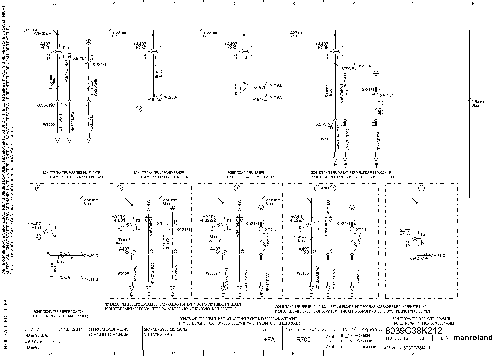

# +FA — Sheet 15 of 58 — SPANNUNGSVERSORGUNG:

**VOLTAGE SUPPLY:**

> Part of the manroland **R700** printing press IEC/UL circuit diagrams.
> Drawing class: **Stromlaufplan / Circuit diagram** (DIN A3).
> Document `+FA` covers the **Delivery** machine section.

## At a glance

| Field | Value |
|---|---|
| Document | `+FA`  (8039G38K212) |
| Sheet | **15** of 58 |
| Section (DE) | SPANNUNGSVERSORGUNG: |
| Section (EN) | VOLTAGE SUPPLY: |
| Section type | POWER_SUPPLY — Voltage supply |
| Machine type | `=R700` |
| Series | `7759` |
| Created | 17.01.2011 |
| Replaces | `8039G38I411` |
| Columns used | A, B, C, D, E, F, G, H |
| Path numbers | 216 |
| Labels on sheet | 258 |
| Cross-refs out | 22 |
| Cross-refs in | 47 |

**Previous:** [+FA sheet 14](SHEET_0014.md) · **Next:** [+FA sheet 16](SHEET_0016.md) · **Document TOC:** [_TOC.md](_TOC.md)  (+FA) · **Master TOC:** [all sheets](../_MASTER_TOC.md)

## Sheet image (300 DPI, exact vector render)



_Rendered directly from the PDF vector layer at 300 DPI (1-bit), no OCR and no resampling. Use it to confirm anything ambiguous in the text below._

## Cross-references on this sheet

Each entry is a wire leaving this sheet. The printed token is `/sheet.column`; the link resolves to that sheet inside the same document.

| Ref | Target sheet | Col | Path | Destination on target | Target section | From col |
|---|---|---|---|---|---|---|
| `/14.E` | [+FA sheet 14](SHEET_0014.md) | E | — | X | SPANNUNGSVERSORGUNG: | A |
| `/14.G` | [+FA sheet 14](SHEET_0014.md) | G | — | X | SPANNUNGSVERSORGUNG: | A |
| `/4.E` | [+FA sheet 4](SHEET_0004.md) | E | — | 2 | ANORDNUNGSPLAN A497 | A |
| `/4.E` | [+FA sheet 4](SHEET_0004.md) | E | — | 2 | ANORDNUNGSPLAN A497 | C |
| `/4.E` | [+FA sheet 4](SHEET_0004.md) | E | — | 2 | ANORDNUNGSPLAN A497 | D |
| `/4.F` | [+FA sheet 4](SHEET_0004.md) | F | — | 2 | ANORDNUNGSPLAN A497 | F |
| `/27.A` | [+FA sheet 27](SHEET_0027.md) | A | — | X +A497 X10:2 | TASTATUR: BEDIENUNGSPULT MASCHINE | F |
| `/14.G` | [+FA sheet 14](SHEET_0014.md) | G | — | M24+ | SPANNUNGSVERSORGUNG: | F |
| `/19.B` | [+FA sheet 19](SHEET_0019.md) | B | — | X +A497 X6:1 | LÜFTER | E |
| `/23.A` | [+FA sheet 23](SHEET_0023.md) | A | — | L24+/1 X +A497 X9:1 +A497 X6:3 | JOBCARD READER | D |
| `/19.C` | [+FA sheet 19](SHEET_0019.md) | C | — | L24+/1 X +A497 X9:1 +A497 X6:3 | LÜFTER | D |
| `/14.G` | [+FA sheet 14](SHEET_0014.md) | G | — | M24+ | SPANNUNGSVERSORGUNG: | C |
| `/14.G` | [+FA sheet 14](SHEET_0014.md) | G | — | +A497 X001:M24+ M24+ | SPANNUNGSVERSORGUNG: | D |
| `/14.G` | [+FA sheet 14](SHEET_0014.md) | G | — | +A497 X001:M24+ M24+ | SPANNUNGSVERSORGUNG: | F |
| `/4.E` | [+FA sheet 4](SHEET_0004.md) | E | — | 2 | ANORDNUNGSPLAN A497 | B |
| `/4.E` | [+FA sheet 4](SHEET_0004.md) | E | — | 2 | ANORDNUNGSPLAN A497 | D |
| `/4.E` | [+FA sheet 4](SHEET_0004.md) | E | — | 2 | ANORDNUNGSPLAN A497 | E |
| `/4.D` | [+FA sheet 4](SHEET_0004.md) | D | — | 2 | ANORDNUNGSPLAN A497 | A |
| `/4.D` | [+FA sheet 4](SHEET_0004.md) | D | — | 2 | ANORDNUNGSPLAN A497 | G |
| `/26.C` | [+FA sheet 26](SHEET_0026.md) | C | — | X5.A676:1 X | USB ANSCHLUSS | A |
| `/37.C` | [+FA sheet 37](SHEET_0037.md) | C | `#216` | — | OPTION: TELEPRESENCE | G |
| `/41.G` | [+FA sheet 41](SHEET_0041.md) | G | — | X0.A297:1 X | OPTION: TELEPRESENCE ODER ICP | A |

### Incoming references (sheets that point here)

Every other sheet that sends a wire to this one. `Back-ref` is the token printed on *that* sheet; `Path` is its line number.

| From sheet | Cols | Back-ref | Path | Refs | What continues there |
|---|---|---|---|---|---|
| [+FA#4](SHEET_0004.md) | D, E, F | `/4.D`, `/4.E`, `/4.F` | — | 9 | — |
| [+FA#14](SHEET_0014.md) | D, G | `/14.D`, `/14.G` | — | 6 | +A497 X2:2 M24+; +A497 X4:2 M24+; +A497 X8:2 M24+; +FB X3.A497:2 M24+; X +A497 F029:1; X X5.A497:2 |
| [+FA#19](SHEET_0019.md) | B, C | `/19.B`, `/19.C` | — | 2 | +A497 F280:2 X |
| [+FA#23](SHEET_0023.md) | A | `/23.A` | — | 1 | L24+/1 +A497 F030:2 |
| [+FA#26](SHEET_0026.md) | C | `/26.C` | — | 1 | X +A497 F151:2 |
| [+FA#27](SHEET_0027.md) | A | `/27.A` | — | 1 | X +A497 F069:2 |
| [+FA#37](SHEET_0037.md) | C | `/37.C` | `#216` | 1 | +A497 F110:2 |
| [+FA#41](SHEET_0041.md) | G | `/41.G` | — | 1 | +A497 F151:2 |
| [+FA#52](SHEET_0052.md) | E | `/52.E` | — | 3 | — |
| [+FA#54](SHEET_0054.md) | C, F | `/54.C`, `/54.F` | — | 6 | — |
| [+FA#55](SHEET_0055.md) | B | `/55.B` | — | 3 | — |
| [+FA#56](SHEET_0056.md) | A | `/56.A` | — | 3 | — |
| [+FA#57](SHEET_0057.md) | A, B, C, D, E, F | `/57.A`, `/57.B`, `/57.C`, `/57.D`, `/57.E`, `/57.F` | — | 10 | — |


## Devices on this sheet

| Tag | Class | Class meaning (IEC) | Col | Sub | Terminal | Sign |
|---|---|---|---|---|---|---|
| `+A497` | A | Baugruppe / assembly, module, PC board | D | — | — | + |
| `X4` | X | Klemme / terminal, plug connector | D | — | — | — |
| `+A497` | A | Baugruppe / assembly, module, PC board | B | — | — | + |
| `X8` | X | Klemme / terminal, plug connector | B | — | — | — |
| `+A497` | A | Baugruppe / assembly, module, PC board | E | — | — | + |
| `X2` | X | Klemme / terminal, plug connector | E | — | — | — |
| `X921/1` | X | Klemme / terminal, plug connector | A | 1 | — | — |
| `X921/1` | X | Klemme / terminal, plug connector | B | 1 | — | — |
| `X921/1` | X | Klemme / terminal, plug connector | F | 1 | — | — |
| `X921/1` | X | Klemme / terminal, plug connector | G | 1 | — | — |
| `X921/1` | X | Klemme / terminal, plug connector | F | 1 | — | — |
| `X921/1` | X | Klemme / terminal, plug connector | F | 1 | — | — |
| `X921/1` | X | Klemme / terminal, plug connector | D | 1 | — | — |
| `X921/1` | X | Klemme / terminal, plug connector | E | 1 | — | — |
| `X921/1` | X | Klemme / terminal, plug connector | C | 1 | — | — |
| `X921/1` | X | Klemme / terminal, plug connector | C | 1 | — | — |
| `F029/2` | F | Schutz / protection device (fuse, circuit breaker) | D | 2 | — | — |
| `+A497` | A | Baugruppe / assembly, module, PC board | D | — | — | + |
| `F029/1` | F | Schutz / protection device (fuse, circuit breaker) | E | 1 | — | — |
| `+A497` | A | Baugruppe / assembly, module, PC board | E | — | — | + |
| `F029` | F | Schutz / protection device (fuse, circuit breaker) | A | — | — | — |
| `+A497` | A | Baugruppe / assembly, module, PC board | A | — | — | + |
| `F081` | F | Schutz / protection device (fuse, circuit breaker) | B | — | — | — |
| `+A497` | A | Baugruppe / assembly, module, PC board | B | — | — | + |
| `F069` | F | Schutz / protection device (fuse, circuit breaker) | E | — | — | — |
| `+A497` | A | Baugruppe / assembly, module, PC board | E | — | — | + |
| `F280` | F | Schutz / protection device (fuse, circuit breaker) | D | — | — | — |
| `+A497` | A | Baugruppe / assembly, module, PC board | D | — | — | + |
| `F110` | F | Schutz / protection device (fuse, circuit breaker) | G | — | — | — |
| `+A497` | A | Baugruppe / assembly, module, PC board | G | — | — | + |
| `F030` | F | Schutz / protection device (fuse, circuit breaker) | B | — | — | — |
| `+A497` | A | Baugruppe / assembly, module, PC board | B | — | — | + |
| `F151` | F | Schutz / protection device (fuse, circuit breaker) | A | — | — | — |
| `+A497` | A | Baugruppe / assembly, module, PC board | A | — | — | + |
| `W5009` | W | Kabel / cable, line, bus | A | — | — | — |
| `W5106` | W | Kabel / cable, line, bus | F | — | — | — |
| `W5106` | W | Kabel / cable, line, bus | E | — | — | — |
| `W5009/1` | W | Kabel / cable, line, bus | D | 1 | — | — |
| `W5156` | W | Kabel / cable, line, bus | B | — | — | — |
| `X3.A497` | — | cross-device reference | F | — | — | — |
| `L24+\4.X2.A497\2:1` | — | cross-device reference | D | — | 1 | — |
| `L24+\4.X2.A497\2:1` | — | cross-device reference | E | — | 1 | — |
| `X5.A497` | — | cross-device reference | A | — | — | — |
| `X0.A297:1` | — | cross-device reference | A | — | 1 | — |
| `X5.A676:1` | — | cross-device reference | A | — | 1 | — |

## Potentials / nets

| Potential | Count | Columns | Attached devices | Terminals |
|---|---|---|---|---|
| `L24+/1` | 2 | A, C | `E004` | `1` |
| `M24` | 1 | F | `A497\2`, `X2` | `2` |
| `M24+` | 6 | A, C, D, F | `A497\2`, `E004`, `X1`, `X3` | `2` |
| `PE` | 3 | B, E, F | `A497\2`, `E004`, `X1`, `X2`, `X3` | `3`, `5` |


A potential such as `L24+/4` or `M24+` is a named supply/return rail; every place it appears on this sheet is electrically common.

## Conductor data

Each label annotates **the wire beside it**, not the sheet. These summaries are inventories of what is printed; they are not a per-wire map. For a specific conductor, read the label that sits on that wire (see the label inventory below, or the sheet image).

**Cross-section labels printed on this sheet:** 1.5 mm² (×14), 2.5 mm² (×7)

**Wire-colour labels printed on this sheet:** BL = blau / blue (×16)

**Cross-section + colour appearing together in one annotation block:**

| Cross-section | Colour (DE) | Colour (EN) | Blocks containing both |
|---|---|---|---|
| 1.5 mm² | blau | blue | 9 |
| 2.5 mm² | blau | blue | 7 |


_This counts annotation blocks that carry both labels. It can be lower than the number of individual labels above, because a block may hold two cross-section labels or two colour labels._

## Wire-end annotations (grouped as printed)

A wire that continues elsewhere is annotated with a small cluster: the destination description, the path/line number `#NN`, and the `/sheet.column` cross reference. Each row below is one such cluster exactly as it is grouped on the drawing.

| Col | Y | Path | Cross-ref | Text on the wire |
|---|---|---|---|---|
| A | 63.7 | — | `/14.E` | `X` |
| B | 72.5 | — | — | `Blau 2.50 mm²` |
| D | 72.5 | — | — | `Blau 2.50 mm²` |
| E | 72.5 | — | — | `Blau 2.50 mm²` |
| A | 76.5 | — | — | `+A497 G057:+` |
| A | 99.5 | — | — | `+A497 F029` |
| B | 99.5 | — | — | `+A497 F030` |
| D | 99.5 | — | — | `+A497 F280` |
| E | 99.5 | — | — | `+A497 F069` |
| A | 104.3 | — | — | `1` |
| C | 104.3 | — | — | `1` |
| D | 104.3 | — | — | `1` |
| F | 104.3 | — | — | `1` |
| A | 110.3 | — | `/14.G` | `X` |
| A | 110.4 | — | — | `13` |
| C | 110.4 | — | — | `13` |
| D | 110.4 | — | — | `13` |
| F | 110.4 | — | — | `13` |
| A | 127.4 | — | — | `12 A` |
| C | 127.4 | — | — | `1 A` |
| D | 127.4 | — | — | `3 A` |
| F | 127.4 | — | — | `6 A` |
| B | 129.7 | — | — | `2/12` |
| A | 130.2 | — | — | `14` |
| C | 130.2 | — | — | `14` |
| D | 130.2 | — | — | `14` |
| F | 130.2 | — | — | `14` |
| A | 133.0 | — | `/4.E` | `2` |
| C | 133.0 | — | `/4.E` | `2` |
| D | 133.0 | — | `/4.E` | `2` |
| F | 133.0 | — | `/4.F` | `2` |
| A | 133.5 | — | — | `X921/1` |
| A | 141.2 | — | — | `+A497 X001:M24+` |
| B | 147.7 | — | — | `X921/1` |
| B | 148.5 | — | — | `1/1` |
| F | 148.7 | — | `/27.A` | `+A497 X10:2 X` |
| C | 154.3 | — | — | `1.50 mm² Blau` |
| F | 172.6 | — | `/14.G` | `M24+` |
| A | 174.2 | — | — | `1.50 mm² Blau` |
| B | 186.9 | — | — | `1.50 mm² Grün/Gelb` |
| D | 194.0 | — | — | `1.50 mm² Blau` |
| E | 194.1 | — | `/19.B` | `+A497 X6:1 X` |
| F | 195.0 | — | — | `+A497 X001:M24+` |
| F | 199.7 | — | — | `1.50 mm² Blau` |
| F | 203.4 | — | — | `3/12` |
| F | 207.2 | — | — | `X921/1` |
| G | 221.4 | — | — | `X921/1` |
| F | 222.2 | — | — | `1/1` |
| D | 222.4 | — | `/23.A`, `/19.C` | `+A497 X9:1 L24+/1 +A497 X6:3 X` |
| H | 236.9 | — | — | `Blau 2.50 mm²` |
| F | 238.0 | — | — | `1.50 mm² Grün/Gelb` |
| A | 243.5 | — | — | `1/5` |
| A | 243.5 | — | — | `2/5` |
| B | 243.5 | — | — | `5/5` |
| A | 244.1 | — | — | `X5.A497` |
| B | 254.3 | — | — | `12` |
| A | 263.9 | — | — | `+FB M24+.X1.E004:2` |
| A | 269.6 | — | — | `+FB L24+/1.E004:1` |
| B | 271.2 | — | — | `+FB PE.X1.E004:3` |
| F | 288.9 | — | — | `1/5 2/5` |
| F | 288.9 | — | — | `5/5` |
| F | 289.4 | — | — | `X3.A497 +FB` |
| A | 290.9 | — | — | `W5009` |
| F | 300.2 | — | — | `+FB L24+\4.X3.A492/2:1` |
| F | 304.0 | — | — | `+FB M24+.X3.A492/2:2` |
| F | 311.3 | — | — | `+FB PE.X3.A492/2:5` |
| F | 324.9 | — | — | `W5106` |
| A | 405.3 | — | — | `PROTECTIVE SWITCH:COLOR MATCHING LAMP SCHUTZSCHALTER:FARBABSTIMMLEUCHTE` |
| C | 405.3 | — | — | `PROTECTIVE SWITCH: JOBCARD READER SCHUTZSCHALTER: JOBCARD READER` |
| D | 405.3 | — | — | `PROTECTIVE SWITCH: VENTILATOR SCHUTZSCHALTER: LÜFTER` |
| F | 405.3 | — | — | `PROTECTIVE SWITCH: KEYBOARD CONTROL CONSOLE MACHINE SCHUTZSCHALTER: TASTATUR BEDIENUNGSPULT MASCHINE` |
| B | 441.1 | — | — | `5` |
| E | 441.1 | — | — | `1 1 2` |
| G | 441.1 | — | — | `3` |
| C | 441.2 | — | — | `12 AND` |
| C | 469.4 | — | — | `Blau 2.50 mm² Blau 2.50 mm²` |
| C | 469.4 | — | — | `Blau 2.50 mm²` |
| C | 473.1 | — | `/14.G` | `M24+` |
| D | 473.1 | — | `/14.G` | `+A497 X001:M24+ M24+` |
| F | 473.1 | — | `/14.G` | `+A497 X001:M24+ M24+` |
| B | 507.7 | — | — | `+A497 F081` |
| D | 507.7 | — | — | `+A497` |
| E | 507.7 | — | — | `+A497` |
| C | 509.7 | — | — | `+A497 X001:M24+` |
| B | 512.5 | — | — | `1` |
| D | 512.5 | — | — | `1` |
| E | 512.5 | — | — | `1` |
| D | 516.2 | — | — | `F029/2` |
| E | 516.2 | — | — | `F029/1` |
| B | 518.6 | — | — | `13` |
| D | 518.6 | — | — | `13` |
| E | 518.6 | — | — | `13` |
| C | 520.9 | — | — | `6/12` |
| E | 520.9 | — | — | `5/12` |
| F | 520.9 | — | — | `4/12` |
| A | 524.7 | — | — | `+A497 F151` |
| C | 524.7 | — | — | `X921/1` |
| D | 524.7 | — | — | `X921/1` |
| F | 524.7 | — | — | `X921/1` |
| A | 529.5 | — | — | `1` |
| A | 535.6 | — | — | `13` |
| B | 535.6 | — | — | `8,0 A` |
| D | 535.6 | — | — | `12 A` |
| E | 535.6 | — | — | `12 A` |
| B | 538.4 | — | — | `14` |
| D | 538.4 | — | — | `14` |
| E | 538.4 | — | — | `14` |
| C | 538.9 | — | — | `X921/1` |
| E | 538.9 | — | — | `X921/1` |
| F | 538.9 | — | — | `X921/1` |
| C | 539.7 | — | — | `1/1` |
| D | 539.7 | — | — | `1/1` |
| F | 539.7 | — | — | `1/1` |
| B | 541.2 | — | `/4.E` | `2` |
| D | 541.2 | — | `/4.E` | `2` |
| E | 541.2 | — | `/4.E` | `2` |
| G | 541.7 | — | — | `+A497 F110` |
| G | 546.5 | — | — | `1` |
| C | 549.8 | — | — | `1.50 mm² Grün/Gelb` |
| E | 549.8 | — | — | `1.50 mm² Grün/Gelb` |
| F | 549.8 | — | — | `1.50 mm² Grün/Gelb` |
| A | 552.6 | — | — | `1 A` |
| G | 552.6 | — | — | `13` |
| A | 555.4 | — | — | `14` |
| D | 555.9 | — | — | `1.50 mm² Blau 1.50 mm² Blau` |
| A | 558.2 | — | `/4.D` | `2` |
| B | 562.9 | — | — | `1.50 mm² Blau` |
| G | 569.6 | — | — | `3 A` |
| G | 572.4 | — | — | `14` |
| G | 575.2 | — | `/4.D` | `2` |
| B | 584.2 | — | — | `+A497` |
| D | 584.2 | — | — | `+A497` |
| E | 584.2 | — | — | `+A497` |
| C | 589.6 | — | — | `2/5` |
| C | 589.6 | — | — | `5/5` |
| D | 589.6 | — | — | `2/5` |
| E | 589.6 | — | — | `5/5` |
| F | 589.6 | — | — | `2/5` |
| F | 589.6 | — | — | `5/5` |
| B | 590.0 | — | — | `1/5` |
| D | 590.0 | — | — | `1/5` |
| E | 590.0 | — | — | `1/5` |
| B | 592.8 | — | — | `X8` |
| D | 592.8 | — | — | `X4` |
| E | 592.8 | — | — | `X2` |
| A | 596.6 | — | `/26.C` | `X5.A676:1 X` |
| G | 596.6 | `#216` | `/37.C` | — |
| A | 605.4 | — | — | `1.50 mm² Blau` |
| G | 609.4 | — | — | `+A497 X1.A225:1` |
| A | 619.2 | — | — | `1.50 mm² Blau` |
| B | 620.2 | — | — | `L24\4.X2.A497/2:1` |
| C | 620.3 | — | — | `M24+.X2.A497/2:2` |
| C | 627.7 | — | — | `PE.X2.A497/2:5` |
| E | 627.9 | — | — | `L24+\4.X2.A497\2:1` |
| D | 633.6 | — | — | `L24+\4.X2.A497\2:1` |
| F | 635.3 | — | — | `M24.X2.A497\2:2` |
| D | 637.3 | — | — | `M24+.X3.A497\2:2` |
| F | 639.0 | — | — | `PE.X2.A497\2:5` |
| D | 642.4 | — | — | `W5156 W5009/1 W5106` |
| E | 644.7 | — | — | `PE.X3.A497\2:5` |
| A | 653.3 | — | `/41.G` | `X0.A297:1 X` |
| B | 691.4 | — | — | `+FD` |
| C | 691.4 | — | — | `+FD` |
| C | 691.4 | — | — | `+FD` |
| D | 691.4 | — | — | `+FF` |
| D | 691.4 | — | — | `+FF` |
| D | 691.4 | — | — | `+FF` |
| E | 691.4 | — | — | `+FF` |
| F | 691.4 | — | — | `+FF` |
| F | 691.4 | — | — | `+FF` |
| C | 717.1 | — | — | `PROTECTIVE SWITCH: DC/DC CONVERTER, MAGAZINE COLORPILOT, KEYBOARD: INK SLIDE SETTING SCHUTZSCHALTER: DC/DC WANDLER, MAGAZIN COLORPILOT, TASTATUR: FARBSCHIEBEREINSTELLUNG` |
| F | 722.8 | — | — | `PROTECTIVE SWITCH: ADDITIONAL CONSOLE WITH MATCHING LAMP AND 7 SHEET DRAWER INCLINATION ADJUSTMENT SCHUTZSCHALTER: BEISTELLPULT INCL. ABSTIMMLEUCHTE UND 7 BOGENABLAGEFÄCHER NEIGUNGSEINSTELLUNG` |
| A | 734.1 | — | — | `PROTECTIVE SWITCH: ETERNET SWITCH; SCHUTZSCHALTER: ETERNET SWITCH;` |
| D | 751.1 | — | — | `PROTECTIVE SWITCH: ADDITIONAL CONSOLE WITH MATCHING LAMP AND 7 SHEET DRAWER SCHUTZSCHALTER: BEISTELLPULT INCL. ABSTIMMLEUCHTE UND 7 BOGENABLAGEFÄCHER` |
| G | 751.1 | — | — | `PROTECTIVE SWITCH: DIAGNOSIS BUS MASTER SCHUTZSCHALTER: DIAGNOSEBUS MASTER` |


## Reconstructed tables

This sheet carries tabular content (pin map / terminal assignment / index). The grid below was rebuilt from the drawing's own rule lines, so each row is exactly one physical row of the table.

### Table 1 — 2 data rows × 7 columns (at x=113.4, y=70.9)

| A /4.E mm² Blau 1.50 W5009 PROTECTIVE | 1 13 14 2 +A497 X001:M24+ 2/5 1/5 L24+/1.E004:1 +FB | /14.G X921/1 X 1/1 5/5 M24+.X1.E004:2 +FB SCHUTZSCHALTER:FARBABSTIMMLEUCHTE SWITCH:COLOR | 2.50 mm² Blau 2/12 X921/1 Grün/Gelb mm² 1.50 PE.X1.E004:3 +FB MATCHING LAMP 5 | +A497 F030 1 A /4.E 12 SCHUTZSCHALTER: PROTECTIVE |  | 1 13 14 2 mm² Blau 1.50 L24+/1 +A497 X9:1 JOBCARD READER SWITCH: |
|---|---|---|---|---|---|---|
| `1 13 14 2` | `X5.A676:1` | `2.50 Blau X` | `mm² +A497 F081 8,0 A /4.E 1.50 mm² Blau +A497 X8` | `M24+ 1 13 14 2 1/5` | `/14.G +A497 X001:M24+ 2/5` | `2.50 Blau X921/1 1/1 Grün/Gelb mm² 1.50` |
| `mm² Blau 1.50` | `1.50 mm² Blau X0.A297:1` | `X` | `/26.C W5156` | `L24\4.X2.A497/2:1` | `M24+.X2.A497/2:2` |  |


### Table 2 — 1 data rows × 3 columns (at x=527.2, y=70.9)

| +A497 F280 3 A /4.E mm² 1.50 | Blau | 1 13 14 2 +A497 X6:1 |
|---|---|---|
| `PROTECTIVE 1` | `SCHUTZSCHALTER:` | `+A497 X6:3 LÜFTER SWITCH:` |


## Notes and free text on this sheet

| Text | Col | Y (pt) |
|---|---|---|
| `+FB` | F | 297.93 |
| `+FB` | A | 339.88 |
| `+FB` | B | 339.88 |
| `L24+\4.X3.A492/2:1` | F | 300.23 |
| `M24+.X3.A492/2:2` | F | 303.98 |
| `PE.X3.A492/2:5` | F | 311.31 |
| `+FF` | D | 691.37 |
| `+FF` | E | 691.37 |
| `+FD` | B | 691.37 |
| `L24\4.X2.A497/2:1` | B | 620.2 |
| `+FD` | C | 691.37 |
| `M24+.X2.A497/2:2` | C | 620.33 |
| `PE.X2.A497/2:5` | C | 627.66 |
| `+FF` | F | 691.37 |
| `+A497 X1.A225:1` | G | 609.35 |
| `+A497 X10:2` | F | 158.67 |
| `+A497 X6:1` | D | 203.99 |
| `+A497 X6:3` | D | 232.37 |
| `+A497 X9:1` | C | 232.33 |
| `+A497 G057:+` | A | 76.47 |
| `+A497 X001:M24+` | A | 141.17 |
| `+A497 X001:M24+` | F | 195.02 |
| `+A497 X001:M24+` | D | 509.67 |
| `+A497 X001:M24+` | C | 509.67 |
| `12 A` | D | 535.61 |
| `SCHUTZSCHALTER: BEISTELLPULT INCL. ABSTIMMLEUCHTE UND 7 BOGENABLAGEFÄCHER` | D | 751.11 |
| `PROTECTIVE SWITCH: ADDITIONAL CONSOLE WITH MATCHING LAMP AND 7 SHEET DRAWER` | D | 761.72 |
| `12 A` | E | 535.61 |
| `SCHUTZSCHALTER: BEISTELLPULT INCL. ABSTIMMLEUCHTE UND 7 BOGENABLAGEFÄCHER NEIGUNGSEINSTELLUNG` | F | 722.76 |
| `PROTECTIVE SWITCH: ADDITIONAL CONSOLE WITH MATCHING LAMP AND 7 SHEET DRAWER INCLINATION ADJUSTMENT` | F | 733.38 |
| `12 A` | A | 127.43 |
| `SCHUTZSCHALTER:FARBABSTIMMLEUCHTE` | A | 405.29 |
| `PROTECTIVE SWITCH:COLOR MATCHING LAMP` | A | 415.9 |
| `8,0 A` | B | 535.64 |
| `SCHUTZSCHALTER: DC/DC WANDLER, MAGAZIN COLORPILOT, TASTATUR: FARBSCHIEBEREINSTELLUNG` | C | 717.09 |
| `PROTECTIVE SWITCH: DC/DC CONVERTER, MAGAZINE COLORPILOT, KEYBOARD: INK SLIDE SETTING` | C | 727.71 |
| `6 A` | F | 127.44 |
| `SCHUTZSCHALTER: TASTATUR BEDIENUNGSPULT MASCHINE` | F | 405.28 |
| `PROTECTIVE SWITCH: KEYBOARD CONTROL CONSOLE MACHINE` | F | 415.9 |
| `3 A` | D | 127.44 |
| `SCHUTZSCHALTER: LÜFTER` | D | 405.29 |
| `PROTECTIVE SWITCH: VENTILATOR` | D | 415.88 |
| `3 A` | G | 569.64 |
| `SCHUTZSCHALTER: DIAGNOSEBUS MASTER` | G | 751.11 |
| `PROTECTIVE SWITCH: DIAGNOSIS BUS MASTER` | G | 761.71 |
| `1 A` | C | 127.39 |
| `SCHUTZSCHALTER: JOBCARD READER` | C | 405.29 |
| `PROTECTIVE SWITCH: JOBCARD READER` | C | 415.89 |
| `1 A` | A | 552.58 |
| `SCHUTZSCHALTER: ETERNET SWITCH;` | A | 734.08 |
| `PROTECTIVE SWITCH: ETERNET SWITCH;` | A | 744.69 |
| `AND` | F | 441.17 |
| `Grün/Gelb` | F | 549.78 |
| `Grün/Gelb` | C | 549.78 |
| `Grün/Gelb` | E | 549.78 |
| `Grün/Gelb` | G | 237.97 |
| `Grün/Gelb` | B | 186.95 |

## Complete label inventory (exact text from the drawing)

Every text object inside the drawing area of this sheet, in DIN reading order (column A→H, then top→bottom). This is the authoritative list: if a string is not here it is not printed on this sheet.

| Col | Y | X | Dir | Type | Text |
|---|---|---|---|---|---|
| A | 63.7 | 93.5 | → | not fitted | `X` |
| A | 67.6 | 57.8 | → | cross-reference | `/14.E` |
| A | 76.5 | 79.1 | → | text | `+A497 G057:+` |
| A | 99.5 | 88.4 | → | device tag | `+A497` |
| A | 104.3 | 138.0 | → | number | `1` |
| A | 108.0 | 91.8 | → | device tag | `F029` |
| A | 110.3 | 161.1 | ↕ | cross-reference | `/14.G` |
| A | 110.4 | 148.0 | → | number | `13` |
| A | 127.4 | 105.9 | → | text | `12 A` |
| A | 130.2 | 148.0 | → | number | `14` |
| A | 133.0 | 138.6 | → | number | `2` |
| A | 133.5 | 168.9 | → | device tag | `X921/1` |
| A | 135.9 | 108.2 | → | cross-reference | `/4.E` |
| A | 141.2 | 154.4 | ↕ | text | `+A497 X001:M24+` |
| A | 147.4 | 167.1 | ↕ | not fitted | `X` |
| A | 174.2 | 115.0 | ↕ | cross-section | `1.50 mm²` |
| A | 184.3 | 123.6 | ↕ | wire colour | `Blau` |
| A | 243.5 | 140.1 | ↕ | pin pair | `1/5` |
| A | 243.5 | 155.8 | ↕ | pin pair | `2/5` |
| A | 244.1 | 86.7 | → | device ref | `X5.A497` |
| A | 263.9 | 168.3 | ↕ | potential | `M24+.X1.E004:2` |
| A | 269.6 | 139.9 | ↕ | potential | `L24+/1.E004:1` |
| A | 290.9 | 102.0 | → | device tag | `W5009` |
| A | 339.9 | 134.5 | ↕ | text | `+FB` |
| A | 339.9 | 162.9 | ↕ | text | `+FB` |
| A | 405.3 | 101.8 | → | text | `SCHUTZSCHALTER:FARBABSTIMMLEUCHTE` |
| A | 415.9 | 101.2 | → | text | `PROTECTIVE SWITCH:COLOR MATCHING LAMP` |
| A | 441.4 | 85.5 | → | number | `12` |
| A | 524.7 | 65.8 | → | device tag | `+A497` |
| A | 529.5 | 115.4 | → | number | `1` |
| A | 533.2 | 70.6 | → | device tag | `F151` |
| A | 535.6 | 125.3 | → | number | `13` |
| A | 552.6 | 86.7 | → | text | `1 A` |
| A | 555.4 | 125.3 | → | number | `14` |
| A | 558.2 | 115.9 | → | number | `2` |
| A | 561.2 | 85.1 | → | cross-reference | `/4.D` |
| A | 596.6 | 140.0 | → | device ref | `X5.A676:1` |
| A | 596.6 | 191.4 | → | not fitted | `X` |
| A | 605.4 | 135.2 | → | cross-section | `1.50 mm²` |
| A | 614.0 | 135.2 | → | wire colour | `Blau` |
| A | 619.2 | 117.9 | ↕ | cross-section | `1.50 mm²` |
| A | 629.3 | 126.5 | ↕ | wire colour | `Blau` |
| A | 653.3 | 140.0 | → | device ref | `X0.A297:1` |
| A | 653.3 | 191.4 | → | not fitted | `X` |
| A | 734.1 | 79.1 | → | text | `SCHUTZSCHALTER: ETERNET SWITCH;` |
| A | 744.7 | 78.5 | → | text | `PROTECTIVE SWITCH: ETERNET SWITCH;` |
| B | 72.5 | 266.2 | → | cross-section | `2.50 mm²` |
| B | 81.1 | 265.6 | → | wire colour | `Blau` |
| B | 99.5 | 315.2 | → | device tag | `+A497` |
| B | 108.0 | 318.6 | → | device tag | `F030` |
| B | 129.7 | 213.9 | ↕ | pin pair | `2/12` |
| B | 147.7 | 215.1 | → | device tag | `X921/1` |
| B | 148.5 | 201.0 | ↕ | pin pair | `1/1` |
| B | 186.9 | 222.8 | ↕ | text | `Grün/Gelb` |
| B | 188.4 | 214.2 | ↕ | cross-section | `1.50 mm²` |
| B | 243.5 | 201.1 | ↕ | pin pair | `5/5` |
| B | 254.3 | 323.6 | → | number | `12` |
| B | 271.2 | 213.6 | ↕ | potential | `PE.X1.E004:3` |
| B | 339.9 | 208.2 | ↕ | text | `+FB` |
| B | 441.1 | 281.1 | → | number | `5` |
| B | 469.4 | 198.1 | → | cross-section | `2.50 mm²` |
| B | 478.0 | 197.6 | → | wire colour | `Blau` |
| B | 507.7 | 264.2 | → | device tag | `+A497` |
| B | 512.5 | 313.8 | → | number | `1` |
| B | 516.2 | 269.0 | → | device tag | `F081` |
| B | 518.6 | 323.7 | → | number | `13` |
| B | 535.6 | 280.0 | → | text | `8,0 A` |
| B | 538.4 | 323.7 | → | number | `14` |
| B | 541.2 | 314.4 | → | number | `2` |
| B | 544.1 | 283.9 | → | cross-reference | `/4.E` |
| B | 562.9 | 271.3 | → | cross-section | `1.50 mm²` |
| B | 571.5 | 271.3 | → | wire colour | `Blau` |
| B | 584.2 | 275.5 | → | device tag | `+A497` |
| B | 590.0 | 315.9 | ↕ | pin pair | `1/5` |
| B | 592.8 | 290.3 | → | device tag | `X8` |
| B | 600.5 | 211.2 | → | cross-reference | `/26.C` |
| B | 620.2 | 317.4 | ↕ | text | `L24\4.X2.A497/2:1` |
| B | 642.4 | 277.8 | → | device tag | `W5156` |
| B | 657.2 | 211.2 | → | cross-reference | `/41.G` |
| B | 691.4 | 308.9 | ↕ | text | `+FD` |
| C | 104.3 | 364.8 | → | number | `1` |
| C | 110.4 | 374.7 | → | number | `13` |
| C | 127.4 | 336.1 | → | text | `1 A` |
| C | 130.2 | 374.7 | → | number | `14` |
| C | 133.0 | 365.4 | → | number | `2` |
| C | 135.9 | 335.0 | → | cross-reference | `/4.E` |
| C | 154.3 | 367.3 | ↕ | cross-section | `1.50 mm²` |
| C | 164.4 | 375.9 | ↕ | wire colour | `Blau` |
| C | 222.4 | 364.5 | → | potential | `L24+/1` |
| C | 226.3 | 398.3 | → | cross-reference | `/23.A` |
| C | 232.3 | 350.8 | → | text | `+A497 X9:1` |
| C | 405.3 | 317.2 | → | text | `SCHUTZSCHALTER: JOBCARD READER` |
| C | 415.9 | 316.6 | → | text | `PROTECTIVE SWITCH: JOBCARD READER` |
| C | 469.4 | 385.2 | → | cross-section | `2.50 mm²` |
| C | 473.1 | 348.2 | ↕ | cross-reference | `/14.G` |
| C | 478.0 | 384.7 | → | wire colour | `Blau` |
| C | 509.7 | 344.3 | ↕ | potential | `M24+` |
| C | 509.7 | 354.3 | ↕ | text | `+A497 X001:M24+` |
| C | 520.9 | 412.3 | ↕ | pin pair | `6/12` |
| C | 524.7 | 367.4 | → | device tag | `X921/1` |
| C | 538.9 | 413.6 | → | device tag | `X921/1` |
| C | 539.7 | 399.4 | ↕ | pin pair | `1/1` |
| C | 549.8 | 392.9 | ↕ | text | `Grün/Gelb` |
| C | 551.2 | 384.3 | ↕ | cross-section | `1.50 mm²` |
| C | 589.6 | 355.6 | ↕ | pin pair | `2/5` |
| C | 589.6 | 412.3 | ↕ | pin pair | `5/5` |
| C | 620.3 | 358.5 | ↕ | text | `M24+.X2.A497/2:2` |
| C | 627.7 | 413.8 | ↕ | text | `PE.X2.A497/2:5` |
| C | 691.4 | 350.0 | ↕ | text | `+FD` |
| C | 691.4 | 405.3 | ↕ | text | `+FD` |
| C | 717.1 | 249.2 | → | text | `SCHUTZSCHALTER: DC/DC WANDLER, MAGAZIN COLORPILOT, TASTATUR: FARBSCHIEBEREINSTELLUNG` |
| C | 727.7 | 248.6 | → | text | `PROTECTIVE SWITCH: DC/DC CONVERTER, MAGAZINE COLORPILOT, KEYBOARD: INK SLIDE SETTING` |
| D | 72.5 | 481.6 | → | cross-section | `2.50 mm²` |
| D | 81.1 | 481.0 | → | wire colour | `Blau` |
| D | 99.5 | 530.6 | → | device tag | `+A497` |
| D | 104.3 | 580.3 | → | number | `1` |
| D | 108.0 | 534.0 | → | device tag | `F280` |
| D | 110.4 | 590.2 | → | number | `13` |
| D | 127.4 | 551.7 | → | text | `3 A` |
| D | 130.2 | 590.2 | → | number | `14` |
| D | 133.0 | 580.8 | → | number | `2` |
| D | 135.9 | 550.4 | → | cross-reference | `/4.E` |
| D | 194.0 | 554.4 | ↕ | cross-section | `1.50 mm²` |
| D | 204.0 | 600.2 | → | text | `+A497 X6:1` |
| D | 204.1 | 563.0 | ↕ | wire colour | `Blau` |
| D | 232.4 | 599.2 | → | text | `+A497 X6:3` |
| D | 405.3 | 538.3 | → | text | `SCHUTZSCHALTER: LÜFTER` |
| D | 415.9 | 537.7 | → | text | `PROTECTIVE SWITCH: VENTILATOR` |
| D | 441.1 | 559.3 | → | number | `1` |
| D | 473.1 | 563.7 | ↕ | cross-reference | `/14.G` |
| D | 507.7 | 479.6 | → | device tag | `+A497` |
| D | 509.7 | 559.8 | ↕ | text | `+A497 X001:M24+` |
| D | 509.7 | 569.7 | ↕ | potential | `M24+` |
| D | 512.5 | 529.2 | → | number | `1` |
| D | 516.2 | 474.2 | → | device tag | `F029/2` |
| D | 518.6 | 539.1 | → | number | `13` |
| D | 524.7 | 577.1 | → | device tag | `X921/1` |
| D | 535.6 | 497.1 | → | text | `12 A` |
| D | 538.4 | 539.1 | → | number | `14` |
| D | 539.7 | 609.1 | ↕ | pin pair | `1/1` |
| D | 541.2 | 529.8 | → | number | `2` |
| D | 544.1 | 499.4 | → | cross-reference | `/4.E` |
| D | 555.9 | 495.8 | → | wire colour | `Blau` |
| D | 564.3 | 485.4 | → | cross-section | `1.50 mm²` |
| D | 584.2 | 491.0 | → | device tag | `+A497` |
| D | 589.6 | 571.1 | ↕ | pin pair | `2/5` |
| D | 590.0 | 531.3 | ↕ | pin pair | `1/5` |
| D | 592.8 | 505.7 | → | device tag | `X4` |
| D | 633.6 | 534.2 | ↕ | device ref | `L24+\4.X2.A497\2:1` |
| D | 637.3 | 579.6 | ↕ | potential | `M24+.X3.A497\2:2` |
| D | 642.4 | 487.6 | → | device tag | `W5009/1` |
| D | 691.4 | 525.7 | ↕ | text | `+FF` |
| D | 691.4 | 565.4 | ↕ | text | `+FF` |
| D | 691.4 | 616.4 | ↕ | text | `+FF` |
| D | 751.1 | 424.9 | → | text | `SCHUTZSCHALTER: BEISTELLPULT INCL. ABSTIMMLEUCHTE UND 7 BOGENABLAGEFÄCHER` |
| D | 761.7 | 424.3 | → | text | `PROTECTIVE SWITCH: ADDITIONAL CONSOLE WITH MATCHING LAMP AND 7 SHEET DRAWER` |
| E | 72.5 | 685.7 | → | cross-section | `2.50 mm²` |
| E | 81.1 | 685.1 | → | wire colour | `Blau` |
| E | 99.5 | 746.1 | → | device tag | `+A497` |
| E | 108.0 | 749.5 | → | device tag | `F069` |
| E | 194.1 | 627.9 | → | not fitted | `X` |
| E | 198.0 | 647.7 | → | cross-reference | `/19.B` |
| E | 222.4 | 627.9 | → | not fitted | `X` |
| E | 226.3 | 647.7 | → | cross-reference | `/19.C` |
| E | 441.1 | 749.2 | → | number | `1` |
| E | 469.4 | 629.0 | → | cross-section | `2.50 mm²` |
| E | 478.0 | 628.4 | → | wire colour | `Blau` |
| E | 507.7 | 689.4 | → | device tag | `+A497` |
| E | 512.5 | 739.0 | → | number | `1` |
| E | 516.2 | 685.4 | → | device tag | `F029/1` |
| E | 518.6 | 748.9 | → | number | `13` |
| E | 520.9 | 622.1 | ↕ | pin pair | `5/12` |
| E | 535.6 | 706.9 | → | text | `12 A` |
| E | 538.4 | 748.9 | → | number | `14` |
| E | 538.9 | 623.3 | → | device tag | `X921/1` |
| E | 541.2 | 739.6 | → | number | `2` |
| E | 544.1 | 709.1 | → | cross-reference | `/4.E` |
| E | 549.8 | 631.0 | ↕ | text | `Grün/Gelb` |
| E | 551.2 | 622.4 | ↕ | cross-section | `1.50 mm²` |
| E | 557.2 | 695.2 | → | cross-section | `1.50 mm²` |
| E | 564.4 | 705.5 | → | wire colour | `Blau` |
| E | 584.2 | 700.7 | → | device tag | `+A497` |
| E | 589.6 | 622.1 | ↕ | pin pair | `5/5` |
| E | 590.0 | 741.1 | ↕ | pin pair | `1/5` |
| E | 592.8 | 715.5 | → | device tag | `X2` |
| E | 627.9 | 748.2 | ↕ | device ref | `L24+\4.X2.A497\2:1` |
| E | 642.4 | 703.0 | → | device tag | `W5106` |
| E | 644.7 | 630.6 | ↕ | potential | `PE.X3.A497\2:5` |
| E | 691.4 | 734.1 | ↕ | text | `+FF` |
| F | 104.3 | 795.7 | → | number | `1` |
| F | 110.4 | 805.6 | → | number | `13` |
| F | 127.4 | 767.2 | → | text | `6 A` |
| F | 130.2 | 805.6 | → | number | `14` |
| F | 133.0 | 796.3 | → | number | `2` |
| F | 135.9 | 766.0 | → | cross-reference | `/4.F` |
| F | 148.7 | 837.7 | → | not fitted | `X` |
| F | 152.6 | 857.5 | → | cross-reference | `/27.A` |
| F | 158.7 | 805.8 | → | text | `+A497 X10:2` |
| F | 172.6 | 813.1 | ↕ | cross-reference | `/14.G` |
| F | 195.0 | 806.4 | ↕ | text | `+A497 X001:M24+` |
| F | 199.7 | 769.8 | ↕ | cross-section | `1.50 mm²` |
| F | 203.4 | 894.2 | ↕ | pin pair | `3/12` |
| F | 207.2 | 849.3 | → | device tag | `X921/1` |
| F | 209.2 | 819.1 | ↕ | potential | `M24+` |
| F | 209.8 | 778.4 | ↕ | wire colour | `Blau` |
| F | 222.2 | 881.3 | ↕ | pin pair | `1/1` |
| F | 239.4 | 894.6 | ↕ | cross-section | `1.50 mm²` |
| F | 288.9 | 797.8 | ↕ | pin pair | `1/5` |
| F | 288.9 | 807.8 | ↕ | pin pair | `2/5` |
| F | 288.9 | 881.5 | ↕ | pin pair | `5/5` |
| F | 289.4 | 744.4 | → | device ref | `X3.A497` |
| F | 297.9 | 768.8 | → | text | `+FB` |
| F | 300.2 | 797.6 | ↕ | text | `L24+\4.X3.A492/2:1` |
| F | 304.0 | 820.3 | ↕ | text | `M24+.X3.A492/2:2` |
| F | 311.3 | 893.9 | ↕ | text | `PE.X3.A492/2:5` |
| F | 324.9 | 759.7 | → | device tag | `W5106` |
| F | 385.2 | 792.2 | ↕ | text | `+FB` |
| F | 385.2 | 814.8 | ↕ | text | `+FB` |
| F | 385.2 | 888.5 | ↕ | text | `+FB` |
| F | 405.3 | 736.7 | → | text | `SCHUTZSCHALTER: TASTATUR BEDIENUNGSPULT MASCHINE` |
| F | 415.9 | 736.2 | → | text | `PROTECTIVE SWITCH: KEYBOARD CONTROL CONSOLE MACHINE` |
| F | 441.1 | 785.8 | → | number | `2` |
| F | 441.2 | 759.7 | → | text | `AND` |
| F | 473.1 | 773.4 | ↕ | cross-reference | `/14.G` |
| F | 509.7 | 769.5 | ↕ | text | `+A497 X001:M24+` |
| F | 509.7 | 779.5 | ↕ | potential | `M24+` |
| F | 520.9 | 837.5 | ↕ | pin pair | `4/12` |
| F | 524.7 | 792.6 | → | device tag | `X921/1` |
| F | 538.9 | 838.8 | → | device tag | `X921/1` |
| F | 539.7 | 824.6 | ↕ | pin pair | `1/1` |
| F | 549.8 | 846.5 | ↕ | text | `Grün/Gelb` |
| F | 551.2 | 837.9 | ↕ | cross-section | `1.50 mm²` |
| F | 589.6 | 780.8 | ↕ | pin pair | `2/5` |
| F | 589.6 | 837.5 | ↕ | pin pair | `5/5` |
| F | 635.3 | 788.0 | ↕ | potential | `M24.X2.A497\2:2` |
| F | 639.0 | 844.6 | ↕ | potential | `PE.X2.A497\2:5` |
| F | 691.4 | 773.7 | ↕ | text | `+FF` |
| F | 691.4 | 830.4 | ↕ | text | `+FF` |
| F | 722.8 | 651.7 | → | text | `SCHUTZSCHALTER: BEISTELLPULT INCL. ABSTIMMLEUCHTE UND 7 BOGENABLAGEFÄCHER NEIGUNGSEINSTELLUNG` |
| F | 733.4 | 651.1 | → | text | `PROTECTIVE SWITCH: ADDITIONAL CONSOLE WITH MATCHING LAMP AND 7 SHEET DRAWER INCLINATION ADJUSTMENT` |
| G | 221.4 | 895.5 | → | device tag | `X921/1` |
| G | 238.0 | 903.2 | ↕ | text | `Grün/Gelb` |
| G | 441.1 | 995.4 | → | number | `3` |
| G | 541.7 | 938.8 | → | device tag | `+A497` |
| G | 546.5 | 988.4 | → | number | `1` |
| G | 550.2 | 942.2 | → | device tag | `F110` |
| G | 552.6 | 998.4 | → | number | `13` |
| G | 569.6 | 959.9 | → | text | `3 A` |
| G | 572.4 | 998.4 | → | number | `14` |
| G | 575.2 | 989.0 | → | number | `2` |
| G | 578.2 | 958.2 | → | cross-reference | `/4.D` |
| G | 596.6 | 1004.2 | → | path no. | `#216` |
| G | 600.5 | 1033.2 | → | cross-reference | `/37.C` |
| G | 609.4 | 966.6 | → | text | `+A497 X1.A225:1` |
| G | 751.1 | 929.5 | → | text | `SCHUTZSCHALTER: DIAGNOSEBUS MASTER` |
| G | 761.7 | 928.9 | → | text | `PROTECTIVE SWITCH: DIAGNOSIS BUS MASTER` |
| H | 236.9 | 1116.6 | → | cross-section | `2.50 mm²` |
| H | 245.5 | 1116.0 | → | wire colour | `Blau` |

## Reading-order text block

The same content as a plain block, grouped by DIN column — convenient to paste or to match against a visual description.

```text
=== Column A ===
  63.7   93.5  placeholder  X
  67.6   57.8  xref         /14.E
  76.5   79.1  text         +A497 G057:+
  99.5   88.4  devtag       +A497
 104.3  138.0  numeric      1
 108.0   91.8  devtag       F029
 110.3  161.1  xref         /14.G
 110.4  148.0  numeric      13
 127.4  105.9  text         12 A
 130.2  148.0  numeric      14
 133.0  138.6  numeric      2
 133.5  168.9  devtag       X921/1
 135.9  108.2  xref         /4.E
 141.2  154.4  text         +A497 X001:M24+
 147.4  167.1  placeholder  X
 174.2  115.0  xsection     1.50 mm²
 184.3  123.6  colour       Blau
 243.5  140.1  pinpair      1/5
 243.5  155.8  pinpair      2/5
 244.1   86.7  devref       X5.A497
 263.9  168.3  net          M24+.X1.E004:2
 269.6  139.9  net          L24+/1.E004:1
 290.9  102.0  devtag       W5009
 339.9  134.5  text         +FB
 339.9  162.9  text         +FB
 405.3  101.8  text         SCHUTZSCHALTER:FARBABSTIMMLEUCHTE
 415.9  101.2  text         PROTECTIVE SWITCH:COLOR MATCHING LAMP
 441.4   85.5  numeric      12
 524.7   65.8  devtag       +A497
 529.5  115.4  numeric      1
 533.2   70.6  devtag       F151
 535.6  125.3  numeric      13
 552.6   86.7  text         1 A
 555.4  125.3  numeric      14
 558.2  115.9  numeric      2
 561.2   85.1  xref         /4.D
 596.6  140.0  devref       X5.A676:1
 596.6  191.4  placeholder  X
 605.4  135.2  xsection     1.50 mm²
 614.0  135.2  colour       Blau
 619.2  117.9  xsection     1.50 mm²
 629.3  126.5  colour       Blau
 653.3  140.0  devref       X0.A297:1
 653.3  191.4  placeholder  X
 734.1   79.1  text         SCHUTZSCHALTER: ETERNET SWITCH;
 744.7   78.5  text         PROTECTIVE SWITCH: ETERNET SWITCH;
=== Column B ===
  72.5  266.2  xsection     2.50 mm²
  81.1  265.6  colour       Blau
  99.5  315.2  devtag       +A497
 108.0  318.6  devtag       F030
 129.7  213.9  pinpair      2/12
 147.7  215.1  devtag       X921/1
 148.5  201.0  pinpair      1/1
 186.9  222.8  text         Grün/Gelb
 188.4  214.2  xsection     1.50 mm²
 243.5  201.1  pinpair      5/5
 254.3  323.6  numeric      12
 271.2  213.6  net          PE.X1.E004:3
 339.9  208.2  text         +FB
 441.1  281.1  numeric      5
 469.4  198.1  xsection     2.50 mm²
 478.0  197.6  colour       Blau
 507.7  264.2  devtag       +A497
 512.5  313.8  numeric      1
 516.2  269.0  devtag       F081
 518.6  323.7  numeric      13
 535.6  280.0  text         8,0 A
 538.4  323.7  numeric      14
 541.2  314.4  numeric      2
 544.1  283.9  xref         /4.E
 562.9  271.3  xsection     1.50 mm²
 571.5  271.3  colour       Blau
 584.2  275.5  devtag       +A497
 590.0  315.9  pinpair      1/5
 592.8  290.3  devtag       X8
 600.5  211.2  xref         /26.C
 620.2  317.4  text         L24\4.X2.A497/2:1
 642.4  277.8  devtag       W5156
 657.2  211.2  xref         /41.G
 691.4  308.9  text         +FD
=== Column C ===
 104.3  364.8  numeric      1
 110.4  374.7  numeric      13
 127.4  336.1  text         1 A
 130.2  374.7  numeric      14
 133.0  365.4  numeric      2
 135.9  335.0  xref         /4.E
 154.3  367.3  xsection     1.50 mm²
 164.4  375.9  colour       Blau
 222.4  364.5  net          L24+/1
 226.3  398.3  xref         /23.A
 232.3  350.8  text         +A497 X9:1
 405.3  317.2  text         SCHUTZSCHALTER: JOBCARD READER
 415.9  316.6  text         PROTECTIVE SWITCH: JOBCARD READER
 469.4  385.2  xsection     2.50 mm²
 473.1  348.2  xref         /14.G
 478.0  384.7  colour       Blau
 509.7  344.3  net          M24+
 509.7  354.3  text         +A497 X001:M24+
 520.9  412.3  pinpair      6/12
 524.7  367.4  devtag       X921/1
 538.9  413.6  devtag       X921/1
 539.7  399.4  pinpair      1/1
 549.8  392.9  text         Grün/Gelb
 551.2  384.3  xsection     1.50 mm²
 589.6  355.6  pinpair      2/5
 589.6  412.3  pinpair      5/5
 620.3  358.5  text         M24+.X2.A497/2:2
 627.7  413.8  text         PE.X2.A497/2:5
 691.4  350.0  text         +FD
 691.4  405.3  text         +FD
 717.1  249.2  text         SCHUTZSCHALTER: DC/DC WANDLER, MAGAZIN COLORPILOT, TASTATUR: FARBSCHIEBEREINSTELLUNG
 727.7  248.6  text         PROTECTIVE SWITCH: DC/DC CONVERTER, MAGAZINE COLORPILOT, KEYBOARD: INK SLIDE SETTING
=== Column D ===
  72.5  481.6  xsection     2.50 mm²
  81.1  481.0  colour       Blau
  99.5  530.6  devtag       +A497
 104.3  580.3  numeric      1
 108.0  534.0  devtag       F280
 110.4  590.2  numeric      13
 127.4  551.7  text         3 A
 130.2  590.2  numeric      14
 133.0  580.8  numeric      2
 135.9  550.4  xref         /4.E
 194.0  554.4  xsection     1.50 mm²
 204.0  600.2  text         +A497 X6:1
 204.1  563.0  colour       Blau
 232.4  599.2  text         +A497 X6:3
 405.3  538.3  text         SCHUTZSCHALTER: LÜFTER
 415.9  537.7  text         PROTECTIVE SWITCH: VENTILATOR
 441.1  559.3  numeric      1
 473.1  563.7  xref         /14.G
 507.7  479.6  devtag       +A497
 509.7  559.8  text         +A497 X001:M24+
 509.7  569.7  net          M24+
 512.5  529.2  numeric      1
 516.2  474.2  devtag       F029/2
 518.6  539.1  numeric      13
 524.7  577.1  devtag       X921/1
 535.6  497.1  text         12 A
 538.4  539.1  numeric      14
 539.7  609.1  pinpair      1/1
 541.2  529.8  numeric      2
 544.1  499.4  xref         /4.E
 555.9  495.8  colour       Blau
 564.3  485.4  xsection     1.50 mm²
 584.2  491.0  devtag       +A497
 589.6  571.1  pinpair      2/5
 590.0  531.3  pinpair      1/5
 592.8  505.7  devtag       X4
 633.6  534.2  devref       L24+\4.X2.A497\2:1
 637.3  579.6  net          M24+.X3.A497\2:2
 642.4  487.6  devtag       W5009/1
 691.4  525.7  text         +FF
 691.4  565.4  text         +FF
 691.4  616.4  text         +FF
 751.1  424.9  text         SCHUTZSCHALTER: BEISTELLPULT INCL. ABSTIMMLEUCHTE UND 7 BOGENABLAGEFÄCHER
 761.7  424.3  text         PROTECTIVE SWITCH: ADDITIONAL CONSOLE WITH MATCHING LAMP AND 7 SHEET DRAWER
=== Column E ===
  72.5  685.7  xsection     2.50 mm²
  81.1  685.1  colour       Blau
  99.5  746.1  devtag       +A497
 108.0  749.5  devtag       F069
 194.1  627.9  placeholder  X
 198.0  647.7  xref         /19.B
 222.4  627.9  placeholder  X
 226.3  647.7  xref         /19.C
 441.1  749.2  numeric      1
 469.4  629.0  xsection     2.50 mm²
 478.0  628.4  colour       Blau
 507.7  689.4  devtag       +A497
 512.5  739.0  numeric      1
 516.2  685.4  devtag       F029/1
 518.6  748.9  numeric      13
 520.9  622.1  pinpair      5/12
 535.6  706.9  text         12 A
 538.4  748.9  numeric      14
 538.9  623.3  devtag       X921/1
 541.2  739.6  numeric      2
 544.1  709.1  xref         /4.E
 549.8  631.0  text         Grün/Gelb
 551.2  622.4  xsection     1.50 mm²
 557.2  695.2  xsection     1.50 mm²
 564.4  705.5  colour       Blau
 584.2  700.7  devtag       +A497
 589.6  622.1  pinpair      5/5
 590.0  741.1  pinpair      1/5
 592.8  715.5  devtag       X2
 627.9  748.2  devref       L24+\4.X2.A497\2:1
 642.4  703.0  devtag       W5106
 644.7  630.6  net          PE.X3.A497\2:5
 691.4  734.1  text         +FF
=== Column F ===
 104.3  795.7  numeric      1
 110.4  805.6  numeric      13
 127.4  767.2  text         6 A
 130.2  805.6  numeric      14
 133.0  796.3  numeric      2
 135.9  766.0  xref         /4.F
 148.7  837.7  placeholder  X
 152.6  857.5  xref         /27.A
 158.7  805.8  text         +A497 X10:2
 172.6  813.1  xref         /14.G
 195.0  806.4  text         +A497 X001:M24+
 199.7  769.8  xsection     1.50 mm²
 203.4  894.2  pinpair      3/12
 207.2  849.3  devtag       X921/1
 209.2  819.1  net          M24+
 209.8  778.4  colour       Blau
 222.2  881.3  pinpair      1/1
 239.4  894.6  xsection     1.50 mm²
 288.9  797.8  pinpair      1/5
 288.9  807.8  pinpair      2/5
 288.9  881.5  pinpair      5/5
 289.4  744.4  devref       X3.A497
 297.9  768.8  text         +FB
 300.2  797.6  text         L24+\4.X3.A492/2:1
 304.0  820.3  text         M24+.X3.A492/2:2
 311.3  893.9  text         PE.X3.A492/2:5
 324.9  759.7  devtag       W5106
 385.2  792.2  text         +FB
 385.2  814.8  text         +FB
 385.2  888.5  text         +FB
 405.3  736.7  text         SCHUTZSCHALTER: TASTATUR BEDIENUNGSPULT MASCHINE
 415.9  736.2  text         PROTECTIVE SWITCH: KEYBOARD CONTROL CONSOLE MACHINE
 441.1  785.8  numeric      2
 441.2  759.7  text         AND
 473.1  773.4  xref         /14.G
 509.7  769.5  text         +A497 X001:M24+
 509.7  779.5  net          M24+
 520.9  837.5  pinpair      4/12
 524.7  792.6  devtag       X921/1
 538.9  838.8  devtag       X921/1
 539.7  824.6  pinpair      1/1
 549.8  846.5  text         Grün/Gelb
 551.2  837.9  xsection     1.50 mm²
 589.6  780.8  pinpair      2/5
 589.6  837.5  pinpair      5/5
 635.3  788.0  net          M24.X2.A497\2:2
 639.0  844.6  net          PE.X2.A497\2:5
 691.4  773.7  text         +FF
 691.4  830.4  text         +FF
 722.8  651.7  text         SCHUTZSCHALTER: BEISTELLPULT INCL. ABSTIMMLEUCHTE UND 7 BOGENABLAGEFÄCHER NEIGUNGSEINSTELLUNG
 733.4  651.1  text         PROTECTIVE SWITCH: ADDITIONAL CONSOLE WITH MATCHING LAMP AND 7 SHEET DRAWER INCLINATION ADJUSTMENT
=== Column G ===
 221.4  895.5  devtag       X921/1
 238.0  903.2  text         Grün/Gelb
 441.1  995.4  numeric      3
 541.7  938.8  devtag       +A497
 546.5  988.4  numeric      1
 550.2  942.2  devtag       F110
 552.6  998.4  numeric      13
 569.6  959.9  text         3 A
 572.4  998.4  numeric      14
 575.2  989.0  numeric      2
 578.2  958.2  xref         /4.D
 596.6 1004.2  path         #216
 600.5 1033.2  xref         /37.C
 609.4  966.6  text         +A497 X1.A225:1
 751.1  929.5  text         SCHUTZSCHALTER: DIAGNOSEBUS MASTER
 761.7  928.9  text         PROTECTIVE SWITCH: DIAGNOSIS BUS MASTER
=== Column H ===
 236.9 1116.6  xsection     2.50 mm²
 245.5 1116.0  colour       Blau
```

---
_Generated from the PDF vector text layer; no OCR. Source: `R700_7759_IEC_UL_FA`, sheet 15._
