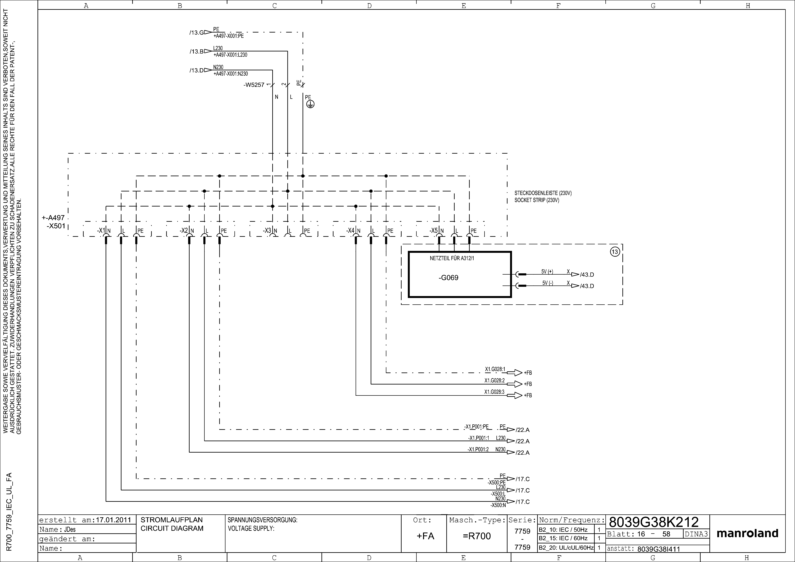

# +FA — Sheet 16 of 58 — SPANNUNGSVERSORGUNG:

**VOLTAGE SUPPLY:**

> Part of the manroland **R700** printing press IEC/UL circuit diagrams.
> Drawing class: **Stromlaufplan / Circuit diagram** (DIN A3).
> Document `+FA` covers the **Delivery** machine section.

## At a glance

| Field | Value |
|---|---|
| Document | `+FA`  (8039G38K212) |
| Sheet | **16** of 58 |
| Section (DE) | SPANNUNGSVERSORGUNG: |
| Section (EN) | VOLTAGE SUPPLY: |
| Section type | POWER_SUPPLY — Voltage supply |
| Machine type | `=R700` |
| Series | `7759` |
| Created | 17.01.2011 |
| Replaces | `8039G38I411` |
| Columns used | A, B, C, D, E, F, G |
| Path numbers | — |
| Labels on sheet | 73 |
| Cross-refs out | 11 |
| Cross-refs in | 21 |

**Previous:** [+FA sheet 15](SHEET_0015.md) · **Next:** [+FA sheet 17](SHEET_0017.md) · **Document TOC:** [_TOC.md](_TOC.md)  (+FA) · **Master TOC:** [all sheets](../_MASTER_TOC.md)

## Sheet image (300 DPI, exact vector render)



_Rendered directly from the PDF vector layer at 300 DPI (1-bit), no OCR and no resampling. Use it to confirm anything ambiguous in the text below._

## Cross-references on this sheet

Each entry is a wire leaving this sheet. The printed token is `/sheet.column`; the link resolves to that sheet inside the same document.

| Ref | Target sheet | Col | Path | Destination on target | Target section | From col |
|---|---|---|---|---|---|---|
| `/13.G` | [+FA sheet 13](SHEET_0013.md) | G | — | PE | SPANNUNGSVERSORGUNG: | B |
| `/13.B` | [+FA sheet 13](SHEET_0013.md) | B | — | L230 | SPANNUNGSVERSORGUNG: | B |
| `/13.D` | [+FA sheet 13](SHEET_0013.md) | D | — | N230 | SPANNUNGSVERSORGUNG: | B |
| `/43.D` | [+FA sheet 43](SHEET_0043.md) | D | — | X 5V (+) | — | F |
| `/43.D` | [+FA sheet 43](SHEET_0043.md) | D | — | X 5V ( ) | — | F |
| `/22.A` | [+FA sheet 22](SHEET_0022.md) | A | — | PE X1.P001:PE | MONITOR | E |
| `/22.A` | [+FA sheet 22](SHEET_0022.md) | A | — | X1.P001:1 L230 | MONITOR | E |
| `/22.A` | [+FA sheet 22](SHEET_0022.md) | A | — | N230 X1.P001:2 | MONITOR | E |
| `/17.C` | [+FA sheet 17](SHEET_0017.md) | C | — | PE X500:PE | SPANNUNGSVERSORGUNG: | E |
| `/17.C` | [+FA sheet 17](SHEET_0017.md) | C | — | L230 X500:L | SPANNUNGSVERSORGUNG: | E |
| `/17.C` | [+FA sheet 17](SHEET_0017.md) | C | — | N230 X500:N | SPANNUNGSVERSORGUNG: | E |

### Incoming references (sheets that point here)

Every other sheet that sends a wire to this one. `Back-ref` is the token printed on *that* sheet; `Path` is its line number.

| From sheet | Cols | Back-ref | Path | Refs | What continues there |
|---|---|---|---|---|---|
| [+FA#4](SHEET_0004.md) | B | `/4.B` | — | 1 | X501 |
| [+FA#13](SHEET_0013.md) | B, D, G | `/13.B`, `/13.D`, `/13.G` | — | 3 | L230 + A497 X501:L; N230 + A497 X501:N; PE + A497 X501:PE |
| [+FA#17](SHEET_0017.md) | C | `/17.C` | — | 3 | L230; N230; PE |
| [+FA#22](SHEET_0022.md) | A | `/22.A` | — | 3 | L230 + A497 X501:2; N230 + A497 X501:1; PE + A497 X501:PE |
| [+FA#43](SHEET_0043.md) | D | `/43.D` | — | 2 | X X1.G069:1; X X1.G069:2 |
| [+FA#55](SHEET_0055.md) | B, C, D | `/55.B`, `/55.C`, `/55.D` | — | 9 | — |


## Devices on this sheet

| Tag | Class | Class meaning (IEC) | Col | Sub | Terminal | Sign |
|---|---|---|---|---|---|---|
| `X500:PE` | X | Klemme / terminal, plug connector | E | — | PE | — |
| `X500:L` | X | Klemme / terminal, plug connector | E | — | L | — |
| `N230` | N | Netzteil / power unit, amplifier | E | — | — | — |
| `X500:N` | X | Klemme / terminal, plug connector | E | — | N | — |
| `N230` | N | Netzteil / power unit, amplifier | B | — | — | — |
| `X501` | X | Klemme / terminal, plug connector | A | — | — | — |
| `X1` | X | Klemme / terminal, plug connector | A | — | — | — |
| `X2` | X | Klemme / terminal, plug connector | B | — | — | — |
| `X3` | X | Klemme / terminal, plug connector | C | — | — | — |
| `X4` | X | Klemme / terminal, plug connector | D | — | — | — |
| `X5` | X | Klemme / terminal, plug connector | E | — | — | — |
| `N230` | N | Netzteil / power unit, amplifier | E | — | — | — |
| `G069` | G | Stromversorgung / power supply | E | — | — | — |
| `W5257` | W | Kabel / cable, line, bus | C | — | — | — |
| `X1.G028:1` | — | cross-device reference | E | — | 1 | — |
| `X1.G028:2` | — | cross-device reference | E | — | 2 | — |
| `X1.G028:3` | — | cross-device reference | E | — | 3 | — |
| `X1.P001:PE` | — | cross-device reference | E | — | PE | — |
| `X1.P001:1` | — | cross-device reference | E | — | 1 | — |
| `X1.P001:2` | — | cross-device reference | E | — | 2 | — |

## Potentials / nets

| Potential | Count | Columns | Attached devices | Terminals |
|---|---|---|---|---|
| `L230` | 3 | B, E | — | — |
| `N` | 6 | A, B, C, D, E | — | — |
| `PE` | 10 | B, C, D, E | — | — |


A potential such as `L24+/4` or `M24+` is a named supply/return rail; every place it appears on this sheet is electrically common.

## Wire-end annotations (grouped as printed)

A wire that continues elsewhere is annotated with a small cluster: the destination description, the path/line number `#NN`, and the `/sheet.column` cross reference. Each row below is one such cluster exactly as it is grouped on the drawing.

| Col | Y | Path | Cross-ref | Text on the wire |
|---|---|---|---|---|
| B | 40.9 | — | `/13.G` | `PE` |
| C | 50.9 | — | — | `+A497 X001:PE` |
| B | 69.3 | — | `/13.B` | `L230` |
| C | 79.3 | — | — | `+A497 X001:L230` |
| B | 97.7 | — | `/13.D` | `N230` |
| C | 107.7 | — | — | `+A497 X001:N230` |
| C | 119.5 | — | — | `PE` |
| C | 123.3 | — | — | `W5257` |
| C | 124.2 | — | — | `1` |
| C | 124.2 | — | — | `2` |
| C | 142.0 | — | — | `N L PE` |
| F | 286.2 | — | — | `STECKDOSENLEISTE (230V) SOCKET STRIP (230V)` |
| A | 321.5 | — | — | `+ A497 X501` |
| C | 341.6 | — | — | `X1 N L PE X2 N L PE X3 N L PE X4 N L PE X5 N L PE` |
| G | 373.4 | — | — | `13` |
| E | 384.0 | — | — | `NETZTEIL FÜR A312/1` |
| F | 403.8 | — | `/43.D` | `5V (+) X` |
| E | 411.3 | — | — | `G069` |
| F | 420.8 | — | `/43.D` | `5V ( ) X` |
| E | 550.1 | — | — | `X1.G028:1 +FB` |
| E | 567.1 | — | — | `X1.G028:2 +FB` |
| E | 584.1 | — | — | `X1.G028:3 +FB` |
| E | 636.1 | — | `/22.A` | `X1.P001:PE PE` |
| E | 653.3 | — | `/22.A` | `X1.P001:1 L230` |
| E | 670.3 | — | `/22.A` | `X1.P001:2 N230` |
| E | 709.8 | — | `/17.C` | `X500:PE PE` |
| E | 727.0 | — | `/17.C` | `X500:L L230` |
| E | 744.0 | — | `/17.C` | `X500:N N230` |


## Reconstructed tables

This sheet carries tabular content (pin map / terminal assignment / index). The grid below was rebuilt from the drawing's own rule lines, so each row is exactly one physical row of the table.

### Table 1 — 3 data rows × 4 columns (at x=249.4, y=48.2)

|  | /13.G | L230 | +A497 X001:PE |
|---|---|---|---|
|  | `/13.B` | `N230` | `+A497 X001:L230` |
|  | `/13.D` |  | `+A497 X001:N230` |
| `X2` | `N` | `L` | `PE` |


### Table 2 — 1 data rows × 4 columns (at x=374.2, y=48.2)

| W5257 1 | 2 N | PE L | PE |
|---|---|---|---|
| `X3` | `N` | `L` | `PE` |


### Table 3 — 10 data rows × 5 columns (at x=623.6, y=48.2)

| X5 | N | L | PE |  |
|---|---|---|---|---|
|  | `NETZTEIL G069` | `FÜR A312/1` |  |  |
|  |  |  |  | `X1.G028:1` |
|  |  |  |  | `X1.G028:2` |
|  |  |  |  | `X1.G028:3` |
|  |  |  | `X1.P001:PE` | `PE` |
|  |  |  | `X1.P001:1` | `L230` |
|  |  |  | `X1.P001:2` | `N230` |
|  |  |  |  | `PE` |
|  |  |  |  | `X500:PE L230` |
|  |  |  |  | `X500:L N230` |


## Notes and free text on this sheet

| Text | Col | Y (pt) |
|---|---|---|
| `+FB` | F | 555.47 |
| `+A497 X001:N230` | C | 107.66 |
| `+A497 X001:L230` | C | 79.31 |
| `+A497 X001:PE` | C | 50.94 |
| `+ A497` | A | 321.46 |
| `L` | C | 142 |
| `STECKDOSENLEISTE (230V)` | F | 286.22 |
| `SOCKET STRIP (230V)` | F | 296.84 |
| `L` | A | 342.7 |
| `L` | B | 342.7 |
| `L` | D | 342.7 |
| `L` | E | 342.7 |
| `NETZTEIL FÜR A312/1` | E | 383.99 |
| `5V (+)` | F | 403.84 |
| `5V ( )` | F | 420.85 |

## Complete label inventory (exact text from the drawing)

Every text object inside the drawing area of this sheet, in DIN reading order (column A→H, then top→bottom). This is the authoritative list: if a string is not here it is not printed on this sheet.

| Col | Y | X | Dir | Type | Text |
|---|---|---|---|---|---|
| A | 321.5 | 62.4 | → | text | `+ A497` |
| A | 333.9 | 70.0 | → | device tag | `X501` |
| A | 341.6 | 145.6 | → | device tag | `X1` |
| A | 342.7 | 160.7 | → | potential | `N` |
| A | 342.7 | 183.4 | → | text | `L` |
| B | 40.9 | 319.5 | → | potential | `PE` |
| B | 44.9 | 283.7 | → | cross-reference | `/13.G` |
| B | 69.4 | 319.5 | → | potential | `L230` |
| B | 73.2 | 284.3 | → | cross-reference | `/13.B` |
| B | 97.7 | 319.5 | → | device tag | `N230` |
| B | 101.6 | 284.0 | → | cross-reference | `/13.D` |
| B | 341.7 | 269.3 | → | device tag | `X2` |
| B | 342.7 | 206.1 | → | potential | `PE` |
| B | 342.7 | 285.4 | → | potential | `N` |
| B | 342.7 | 308.1 | → | text | `L` |
| B | 342.7 | 330.8 | → | potential | `PE` |
| C | 50.9 | 320.0 | → | text | `+A497 X001:PE` |
| C | 79.3 | 320.0 | → | text | `+A497 X001:L230` |
| C | 107.7 | 320.0 | → | text | `+A497 X001:N230` |
| C | 119.5 | 444.8 | ↕ | potential | `PE` |
| C | 123.3 | 364.8 | → | device tag | `W5257` |
| C | 124.2 | 399.1 | ↕ | number | `1` |
| C | 124.2 | 422.1 | ↕ | number | `2` |
| C | 142.0 | 411.9 | → | potential | `N` |
| C | 142.0 | 434.6 | → | text | `L` |
| C | 142.9 | 456.9 | → | potential | `PE` |
| C | 341.7 | 394.0 | → | device tag | `X3` |
| C | 342.7 | 410.2 | → | potential | `N` |
| C | 342.7 | 432.9 | → | text | `L` |
| C | 342.7 | 455.5 | → | potential | `PE` |
| D | 341.7 | 518.7 | → | device tag | `X4` |
| D | 342.7 | 534.9 | → | potential | `N` |
| D | 342.7 | 557.6 | → | text | `L` |
| D | 342.7 | 580.3 | → | potential | `PE` |
| E | 341.7 | 643.5 | → | device tag | `X5` |
| E | 342.7 | 659.6 | → | potential | `N` |
| E | 342.7 | 682.3 | → | text | `L` |
| E | 342.7 | 705.0 | → | potential | `PE` |
| E | 384.0 | 644.0 | → | text | `NETZTEIL FÜR A312/1` |
| E | 411.3 | 657.1 | → | device tag | `G069` |
| E | 550.1 | 726.6 | → | device ref | `X1.G028:1` |
| E | 567.1 | 725.8 | → | device ref | `X1.G028:2` |
| E | 584.1 | 725.6 | → | device ref | `X1.G028:3` |
| E | 636.1 | 748.6 | → | potential | `PE` |
| E | 636.3 | 695.4 | → | device ref | `X1.P001:PE` |
| E | 653.3 | 701.3 | → | device ref | `X1.P001:1` |
| E | 653.3 | 743.1 | → | potential | `L230` |
| E | 670.3 | 700.5 | → | device ref | `X1.P001:2` |
| E | 670.3 | 742.1 | → | device tag | `N230` |
| E | 709.8 | 748.6 | → | potential | `PE` |
| E | 719.9 | 730.4 | → | device tag | `X500:PE` |
| E | 727.0 | 743.1 | → | potential | `L230` |
| E | 736.9 | 735.2 | → | device tag | `X500:L` |
| E | 744.0 | 742.1 | → | device tag | `N230` |
| E | 753.9 | 734.6 | → | device tag | `X500:N` |
| F | 286.2 | 770.7 | → | text | `STECKDOSENLEISTE (230V)` |
| F | 296.8 | 770.7 | → | text | `SOCKET STRIP (230V)` |
| F | 403.8 | 810.9 | → | text | `5V (+)` |
| F | 403.8 | 849.0 | → | not fitted | `X` |
| F | 407.8 | 868.8 | → | cross-reference | `/43.D` |
| F | 420.8 | 849.0 | → | not fitted | `X` |
| F | 420.9 | 812.5 | → | text | `5V ( )` |
| F | 424.8 | 868.8 | → | cross-reference | `/43.D` |
| F | 555.5 | 784.9 | → | text | `+FB` |
| F | 572.5 | 784.9 | → | text | `+FB` |
| F | 589.5 | 784.9 | → | text | `+FB` |
| F | 640.2 | 772.4 | → | cross-reference | `/22.A` |
| F | 657.2 | 772.4 | → | cross-reference | `/22.A` |
| F | 674.2 | 772.4 | → | cross-reference | `/22.A` |
| F | 713.9 | 772.4 | → | cross-reference | `/17.C` |
| F | 730.9 | 772.4 | → | cross-reference | `/17.C` |
| F | 747.9 | 772.4 | → | cross-reference | `/17.C` |
| G | 373.4 | 915.9 | → | number | `13` |

## Reading-order text block

The same content as a plain block, grouped by DIN column — convenient to paste or to match against a visual description.

```text
=== Column A ===
 321.5   62.4  text         + A497
 333.9   70.0  devtag       X501
 341.6  145.6  devtag       X1
 342.7  160.7  net          N
 342.7  183.4  text         L
=== Column B ===
  40.9  319.5  net          PE
  44.9  283.7  xref         /13.G
  69.4  319.5  net          L230
  73.2  284.3  xref         /13.B
  97.7  319.5  devtag       N230
 101.6  284.0  xref         /13.D
 341.7  269.3  devtag       X2
 342.7  206.1  net          PE
 342.7  285.4  net          N
 342.7  308.1  text         L
 342.7  330.8  net          PE
=== Column C ===
  50.9  320.0  text         +A497 X001:PE
  79.3  320.0  text         +A497 X001:L230
 107.7  320.0  text         +A497 X001:N230
 119.5  444.8  net          PE
 123.3  364.8  devtag       W5257
 124.2  399.1  numeric      1
 124.2  422.1  numeric      2
 142.0  411.9  net          N
 142.0  434.6  text         L
 142.9  456.9  net          PE
 341.7  394.0  devtag       X3
 342.7  410.2  net          N
 342.7  432.9  text         L
 342.7  455.5  net          PE
=== Column D ===
 341.7  518.7  devtag       X4
 342.7  534.9  net          N
 342.7  557.6  text         L
 342.7  580.3  net          PE
=== Column E ===
 341.7  643.5  devtag       X5
 342.7  659.6  net          N
 342.7  682.3  text         L
 342.7  705.0  net          PE
 384.0  644.0  text         NETZTEIL FÜR A312/1
 411.3  657.1  devtag       G069
 550.1  726.6  devref       X1.G028:1
 567.1  725.8  devref       X1.G028:2
 584.1  725.6  devref       X1.G028:3
 636.1  748.6  net          PE
 636.3  695.4  devref       X1.P001:PE
 653.3  701.3  devref       X1.P001:1
 653.3  743.1  net          L230
 670.3  700.5  devref       X1.P001:2
 670.3  742.1  devtag       N230
 709.8  748.6  net          PE
 719.9  730.4  devtag       X500:PE
 727.0  743.1  net          L230
 736.9  735.2  devtag       X500:L
 744.0  742.1  devtag       N230
 753.9  734.6  devtag       X500:N
=== Column F ===
 286.2  770.7  text         STECKDOSENLEISTE (230V)
 296.8  770.7  text         SOCKET STRIP (230V)
 403.8  810.9  text         5V (+)
 403.8  849.0  placeholder  X
 407.8  868.8  xref         /43.D
 420.8  849.0  placeholder  X
 420.9  812.5  text         5V ( )
 424.8  868.8  xref         /43.D
 555.5  784.9  text         +FB
 572.5  784.9  text         +FB
 589.5  784.9  text         +FB
 640.2  772.4  xref         /22.A
 657.2  772.4  xref         /22.A
 674.2  772.4  xref         /22.A
 713.9  772.4  xref         /17.C
 730.9  772.4  xref         /17.C
 747.9  772.4  xref         /17.C
=== Column G ===
 373.4  915.9  numeric      13
```

---
_Generated from the PDF vector text layer; no OCR. Source: `R700_7759_IEC_UL_FA`, sheet 16._
