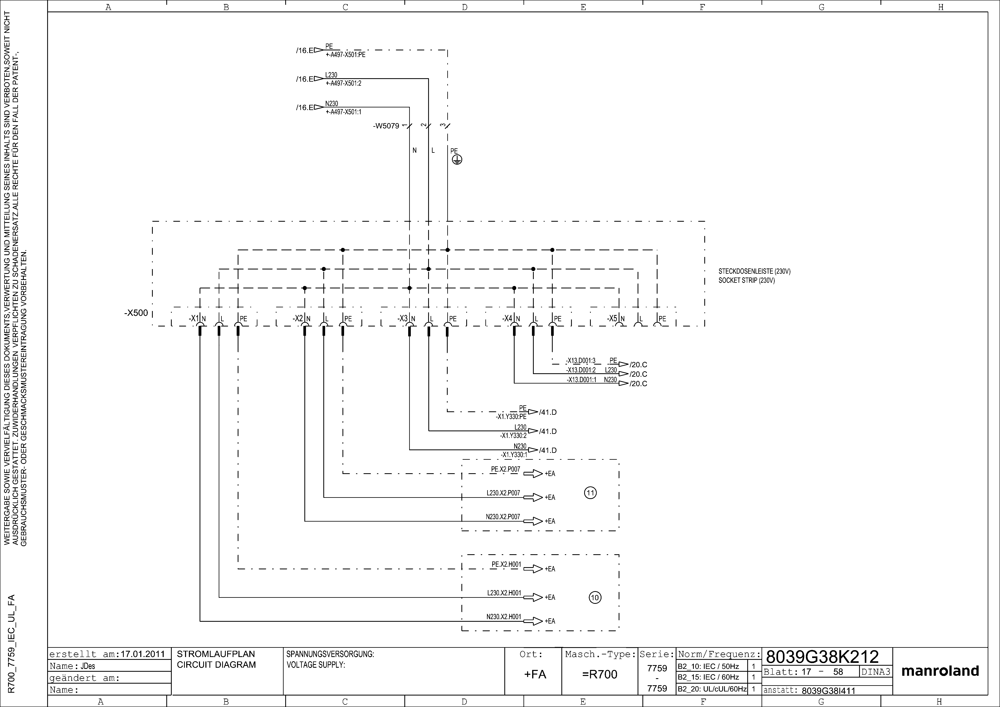

# +FA — Sheet 17 of 58 — SPANNUNGSVERSORGUNG:

**VOLTAGE SUPPLY:**

> Part of the manroland **R700** printing press IEC/UL circuit diagrams.
> Drawing class: **Stromlaufplan / Circuit diagram** (DIN A3).
> Document `+FA` covers the **Delivery** machine section.

## At a glance

| Field | Value |
|---|---|
| Document | `+FA`  (8039G38K212) |
| Sheet | **17** of 58 |
| Section (DE) | SPANNUNGSVERSORGUNG: |
| Section (EN) | VOLTAGE SUPPLY: |
| Section type | POWER_SUPPLY — Voltage supply |
| Machine type | `=R700` |
| Series | `7759` |
| Created | 17.01.2011 |
| Replaces | `8039G38I411` |
| Columns used | A, B, C, D, E, F |
| Path numbers | — |
| Labels on sheet | 71 |
| Cross-refs out | 9 |
| Cross-refs in | 22 |

**Previous:** [+FA sheet 16](SHEET_0016.md) · **Next:** [+FA sheet 18](SHEET_0018.md) · **Document TOC:** [_TOC.md](_TOC.md)  (+FA) · **Master TOC:** [all sheets](../_MASTER_TOC.md)

## Sheet image (300 DPI, exact vector render)



_Rendered directly from the PDF vector layer at 300 DPI (1-bit), no OCR and no resampling. Use it to confirm anything ambiguous in the text below._

## Cross-references on this sheet

Each entry is a wire leaving this sheet. The printed token is `/sheet.column`; the link resolves to that sheet inside the same document.

| Ref | Target sheet | Col | Path | Destination on target | Target section | From col |
|---|---|---|---|---|---|---|
| `/16.E` | [+FA sheet 16](SHEET_0016.md) | E | — | PE | SPANNUNGSVERSORGUNG: | C |
| `/16.E` | [+FA sheet 16](SHEET_0016.md) | E | — | L230 | SPANNUNGSVERSORGUNG: | C |
| `/16.E` | [+FA sheet 16](SHEET_0016.md) | E | — | N230 | SPANNUNGSVERSORGUNG: | C |
| `/20.C` | [+FA sheet 20](SHEET_0020.md) | C | — | PE X13.D001:3 | LEITSTAND RECHNER | E |
| `/20.C` | [+FA sheet 20](SHEET_0020.md) | C | — | L230 X13.D001:2 | LEITSTAND RECHNER | E |
| `/20.C` | [+FA sheet 20](SHEET_0020.md) | C | — | X13.D001:1 N230 | LEITSTAND RECHNER | E |
| `/41.D` | [+FA sheet 41](SHEET_0041.md) | D | — | PE X1.Y330:PE | OPTION: TELEPRESENCE ODER ICP | E |
| `/41.D` | [+FA sheet 41](SHEET_0041.md) | D | — | L230 X1.Y330:2 | OPTION: TELEPRESENCE ODER ICP | E |
| `/41.D` | [+FA sheet 41](SHEET_0041.md) | D | — | N230 X1.Y330:1 | OPTION: TELEPRESENCE ODER ICP | E |

### Incoming references (sheets that point here)

Every other sheet that sends a wire to this one. `Back-ref` is the token printed on *that* sheet; `Path` is its line number.

| From sheet | Cols | Back-ref | Path | Refs | What continues there |
|---|---|---|---|---|---|
| [+FA#5](SHEET_0005.md) | F | `/5.F` | — | 1 | — |
| [+FA#16](SHEET_0016.md) | E | `/16.E` | — | 3 | L230 X500:L; N230 X500:N; PE X500:PE |
| [+FA#20](SHEET_0020.md) | C | `/20.C` | — | 3 | L230 X500:2; PE X500:PE; X500:1 N230 |
| [+FA#41](SHEET_0041.md) | D | `/41.D` | — | 3 | X500:1 N230 L230 X500:2 PE X500:PE |
| [+FA#55](SHEET_0055.md) | A, E, F, G | `/55.A`, `/55.E`, `/55.F`, `/55.G` | — | 12 | — |


## Devices on this sheet

| Tag | Class | Class meaning (IEC) | Col | Sub | Terminal | Sign |
|---|---|---|---|---|---|---|
| `N230` | N | Netzteil / power unit, amplifier | C | — | — | — |
| `X500` | X | Klemme / terminal, plug connector | A | — | — | — |
| `X1` | X | Klemme / terminal, plug connector | B | — | — | — |
| `X2` | X | Klemme / terminal, plug connector | C | — | — | — |
| `X3` | X | Klemme / terminal, plug connector | C | — | — | — |
| `X4` | X | Klemme / terminal, plug connector | D | — | — | — |
| `X5` | X | Klemme / terminal, plug connector | E | — | — | — |
| `N230` | N | Netzteil / power unit, amplifier | D | — | — | — |
| `N230` | N | Netzteil / power unit, amplifier | E | — | — | — |
| `W5079` | W | Kabel / cable, line, bus | C | — | — | — |
| `N230.X2.P007` | — | cross-device reference | D | — | — | — |
| `N230.X2.H001` | — | cross-device reference | D | — | — | — |
| `X1.Y330:PE` | — | cross-device reference | D | — | PE | — |
| `X1.Y330:2` | — | cross-device reference | D | — | 2 | — |
| `X1.Y330:1` | — | cross-device reference | D | — | 1 | — |
| `X13.D001:3` | — | cross-device reference | E | — | 3 | — |
| `X13.D001:2` | — | cross-device reference | E | — | 2 | — |
| `X13.D001:1` | — | cross-device reference | E | — | 1 | — |

## Potentials / nets

| Potential | Count | Columns | Attached devices | Terminals |
|---|---|---|---|---|
| `L230` | 5 | C, D, E | `H001`, `P007`, `X2` | — |
| `N` | 6 | B, C, D, E | — | — |
| `PE` | 11 | B, C, D, E, F | `H001`, `P007`, `X2` | — |


A potential such as `L24+/4` or `M24+` is a named supply/return rail; every place it appears on this sheet is electrically common.

## Wire-end annotations (grouped as printed)

A wire that continues elsewhere is annotated with a small cluster: the destination description, the path/line number `#NN`, and the `/sheet.column` cross reference. Each row below is one such cluster exactly as it is grouped on the drawing.

| Col | Y | Path | Cross-ref | Text on the wire |
|---|---|---|---|---|
| C | 52.2 | — | `/16.E` | `PE` |
| C | 62.3 | — | — | `+ A497 X501:PE` |
| C | 86.4 | — | `/16.E` | `L230` |
| C | 96.3 | — | — | `+ A497 X501:2` |
| C | 120.4 | — | `/16.E` | `N230` |
| C | 130.3 | — | — | `+ A497 X501:1` |
| C | 145.9 | — | — | `W5079` |
| D | 146.8 | — | — | `2` |
| D | 146.9 | — | — | `1` |
| D | 146.9 | — | — | `3` |
| D | 176.0 | — | — | `N L PE` |
| F | 320.2 | — | — | `STECKDOSENLEISTE (230V) SOCKET STRIP (230V)` |
| A | 367.9 | — | — | `X500` |
| D | 375.6 | — | — | `X1 N L PE X2 N L PE X3 N L PE X4 N L PE X5 N L PE` |
| E | 426.4 | — | `/20.C` | `X13.D001:3 PE` |
| E | 437.9 | — | `/20.C` | `X13.D001:2 L230` |
| E | 449.2 | — | `/20.C` | `X13.D001:1 N230` |
| E | 483.1 | — | `/41.D` | `X1.Y330:PE PE` |
| E | 505.9 | — | `/41.D` | `X1.Y330:2 L230` |
| E | 528.6 | — | `/41.D` | `X1.Y330:1 N230` |
| D | 555.8 | — | — | `PE.X2.P007 +EA` |
| E | 583.1 | — | — | `11` |
| D | 584.1 | — | — | `L230.X2.P007 +EA` |
| D | 612.5 | — | — | `N230.X2.P007 +EA` |
| D | 669.1 | — | — | `PE.X2.H001 +EA` |
| D | 703.2 | — | — | `L230.X2.H001 +EA` |
| E | 707.9 | — | — | `10` |
| D | 731.5 | — | — | `N230.X2.H001 +EA` |


## Reconstructed tables

This sheet carries tabular content (pin map / terminal assignment / index). The grid below was rebuilt from the drawing's own rule lines, so each row is exactly one physical row of the table.

### Table 1 — 3 data rows × 4 columns (at x=328.8, y=59.5)

|  | /16.E | L230 | + A497 X501:PE |
|---|---|---|---|
|  | `/16.E` | `N230` | `+ A497 X501:2` |
|  | `/16.E` |  | `+ A497 X501:1` |
| `X2` | `N` | `L` | `PE` |


### Table 2 — 1 data rows × 4 columns (at x=453.5, y=59.5)

| W5079 1 | 2 N | 3 L | PE |
|---|---|---|---|
| `X3` | `N` | `L` | `PE` |


### Table 3 — 11 data rows × 9 columns (at x=578.3, y=59.5)

| X4 | N | L | PE | X13.D001:3 | X5 PE | N | L | PE |
|---|---|---|---|---|---|---|---|---|
|  |  |  |  | `X13.D001:2` | `L230` |  | `/20.C` |  |
|  |  |  |  | `X13.D001:1` | `N230` |  | `/20.C` |  |
|  | `PE` |  |  |  |  |  | `/20.C` |  |
| `X1.Y330:PE` | `L230` | `/41.D` |  |  |  |  |  |  |
| `X1.Y330:2` | `N230` | `/41.D` |  |  |  |  |  |  |
| `X1.Y330:1 PE.X2.P007` |  | `/41.D` |  |  |  |  |  |  |
| `L230.X2.P007` |  | `+EA` |  |  | `11` |  |  |  |
| `N230.X2.P007` |  | `+EA` |  |  |  |  |  |  |
| `PE.X2.H001` |  | `+EA` |  |  |  |  |  |  |
| `L230.X2.H001` |  | `+EA` |  |  |  |  |  |  |
| `N230.X2.H001` |  | `+EA` |  |  | `10` |  |  |  |


## Notes and free text on this sheet

| Text | Col | Y (pt) |
|---|---|---|
| `+ A497 X501:1` | C | 130.31 |
| `+ A497 X501:2` | C | 96.31 |
| `+ A497 X501:PE` | C | 62.29 |
| `+EA` | E | 561.15 |
| `L` | D | 176.02 |
| `STECKDOSENLEISTE (230V)` | F | 320.23 |
| `SOCKET STRIP (230V)` | F | 330.86 |
| `L` | B | 376.71 |
| `L` | C | 376.71 |
| `L` | E | 376.71 |

## Complete label inventory (exact text from the drawing)

Every text object inside the drawing area of this sheet, in DIN reading order (column A→H, then top→bottom). This is the authoritative list: if a string is not here it is not printed on this sheet.

| Col | Y | X | Dir | Type | Text |
|---|---|---|---|---|---|
| A | 367.9 | 148.0 | → | device tag | `X500` |
| B | 375.6 | 224.9 | → | device tag | `X1` |
| B | 376.7 | 240.1 | → | potential | `N` |
| B | 376.7 | 262.8 | → | text | `L` |
| B | 376.8 | 285.4 | → | potential | `PE` |
| C | 52.2 | 387.5 | → | potential | `PE` |
| C | 56.2 | 352.6 | → | cross-reference | `/16.E` |
| C | 62.3 | 388.1 | → | text | `+ A497 X501:PE` |
| C | 86.4 | 387.5 | → | potential | `L230` |
| C | 90.2 | 352.6 | → | cross-reference | `/16.E` |
| C | 96.3 | 388.1 | → | text | `+ A497 X501:2` |
| C | 120.4 | 387.5 | → | device tag | `N230` |
| C | 124.3 | 352.6 | → | cross-reference | `/16.E` |
| C | 130.3 | 388.1 | → | text | `+ A497 X501:1` |
| C | 145.9 | 444.2 | → | device tag | `W5079` |
| C | 375.7 | 348.6 | → | device tag | `X2` |
| C | 375.7 | 473.4 | → | device tag | `X3` |
| C | 376.7 | 364.8 | → | potential | `N` |
| C | 376.7 | 387.5 | → | text | `L` |
| C | 376.8 | 410.2 | → | potential | `PE` |
| D | 146.9 | 478.4 | ↕ | number | `1` |
| D | 146.9 | 501.5 | ↕ | number | `2` |
| D | 146.9 | 524.2 | ↕ | number | `3` |
| D | 176.0 | 491.2 | → | potential | `N` |
| D | 176.0 | 513.9 | → | text | `L` |
| D | 176.9 | 536.3 | → | potential | `PE` |
| D | 375.7 | 598.1 | → | device tag | `X4` |
| D | 376.7 | 489.5 | → | potential | `N` |
| D | 376.7 | 512.2 | → | text | `L` |
| D | 376.7 | 614.3 | → | potential | `N` |
| D | 376.8 | 534.9 | → | potential | `PE` |
| D | 483.1 | 618.2 | → | potential | `PE` |
| D | 493.1 | 590.6 | → | device ref | `X1.Y330:PE` |
| D | 505.9 | 612.7 | → | potential | `L230` |
| D | 515.8 | 595.6 | → | device ref | `X1.Y330:2` |
| D | 528.6 | 611.7 | → | device tag | `N230` |
| D | 538.5 | 596.4 | → | device ref | `X1.Y330:1` |
| D | 555.8 | 584.8 | → | potential | `PE.X2.P007` |
| D | 584.1 | 579.6 | → | potential | `L230.X2.P007` |
| D | 612.5 | 578.6 | → | device ref | `N230.X2.P007` |
| D | 669.1 | 585.6 | → | potential | `PE.X2.H001` |
| D | 703.2 | 580.4 | → | potential | `L230.X2.H001` |
| D | 731.5 | 579.4 | → | device ref | `N230.X2.H001` |
| E | 375.7 | 722.8 | → | device tag | `X5` |
| E | 376.7 | 636.9 | → | text | `L` |
| E | 376.7 | 739.0 | → | potential | `N` |
| E | 376.7 | 761.7 | → | text | `L` |
| E | 376.8 | 659.6 | → | potential | `PE` |
| E | 426.4 | 725.9 | → | potential | `PE` |
| E | 426.5 | 674.0 | → | device ref | `X13.D001:3` |
| E | 430.4 | 749.8 | → | cross-reference | `/20.C` |
| E | 437.9 | 674.2 | → | device ref | `X13.D001:2` |
| E | 437.9 | 720.4 | → | potential | `L230` |
| E | 441.8 | 749.8 | → | cross-reference | `/20.C` |
| E | 449.2 | 675.0 | → | device ref | `X13.D001:1` |
| E | 449.2 | 719.4 | → | device tag | `N230` |
| E | 453.1 | 749.8 | → | cross-reference | `/20.C` |
| E | 487.1 | 642.0 | → | cross-reference | `/41.D` |
| E | 509.8 | 642.0 | → | cross-reference | `/41.D` |
| E | 532.5 | 642.0 | → | cross-reference | `/41.D` |
| E | 561.1 | 648.9 | → | text | `+EA` |
| E | 583.1 | 698.3 | → | number | `11` |
| E | 589.5 | 648.9 | → | text | `+EA` |
| E | 617.8 | 648.9 | → | text | `+EA` |
| E | 674.5 | 648.9 | → | text | `+EA` |
| E | 707.9 | 703.3 | → | number | `10` |
| E | 708.5 | 648.9 | → | text | `+EA` |
| E | 736.9 | 648.9 | → | text | `+EA` |
| F | 320.2 | 855.8 | → | text | `STECKDOSENLEISTE (230V)` |
| F | 330.9 | 855.8 | → | text | `SOCKET STRIP (230V)` |
| F | 376.8 | 784.3 | → | potential | `PE` |

## Reading-order text block

The same content as a plain block, grouped by DIN column — convenient to paste or to match against a visual description.

```text
=== Column A ===
 367.9  148.0  devtag       X500
=== Column B ===
 375.6  224.9  devtag       X1
 376.7  240.1  net          N
 376.7  262.8  text         L
 376.8  285.4  net          PE
=== Column C ===
  52.2  387.5  net          PE
  56.2  352.6  xref         /16.E
  62.3  388.1  text         + A497 X501:PE
  86.4  387.5  net          L230
  90.2  352.6  xref         /16.E
  96.3  388.1  text         + A497 X501:2
 120.4  387.5  devtag       N230
 124.3  352.6  xref         /16.E
 130.3  388.1  text         + A497 X501:1
 145.9  444.2  devtag       W5079
 375.7  348.6  devtag       X2
 375.7  473.4  devtag       X3
 376.7  364.8  net          N
 376.7  387.5  text         L
 376.8  410.2  net          PE
=== Column D ===
 146.9  478.4  numeric      1
 146.9  501.5  numeric      2
 146.9  524.2  numeric      3
 176.0  491.2  net          N
 176.0  513.9  text         L
 176.9  536.3  net          PE
 375.7  598.1  devtag       X4
 376.7  489.5  net          N
 376.7  512.2  text         L
 376.7  614.3  net          N
 376.8  534.9  net          PE
 483.1  618.2  net          PE
 493.1  590.6  devref       X1.Y330:PE
 505.9  612.7  net          L230
 515.8  595.6  devref       X1.Y330:2
 528.6  611.7  devtag       N230
 538.5  596.4  devref       X1.Y330:1
 555.8  584.8  net          PE.X2.P007
 584.1  579.6  net          L230.X2.P007
 612.5  578.6  devref       N230.X2.P007
 669.1  585.6  net          PE.X2.H001
 703.2  580.4  net          L230.X2.H001
 731.5  579.4  devref       N230.X2.H001
=== Column E ===
 375.7  722.8  devtag       X5
 376.7  636.9  text         L
 376.7  739.0  net          N
 376.7  761.7  text         L
 376.8  659.6  net          PE
 426.4  725.9  net          PE
 426.5  674.0  devref       X13.D001:3
 430.4  749.8  xref         /20.C
 437.9  674.2  devref       X13.D001:2
 437.9  720.4  net          L230
 441.8  749.8  xref         /20.C
 449.2  675.0  devref       X13.D001:1
 449.2  719.4  devtag       N230
 453.1  749.8  xref         /20.C
 487.1  642.0  xref         /41.D
 509.8  642.0  xref         /41.D
 532.5  642.0  xref         /41.D
 561.1  648.9  text         +EA
 583.1  698.3  numeric      11
 589.5  648.9  text         +EA
 617.8  648.9  text         +EA
 674.5  648.9  text         +EA
 707.9  703.3  numeric      10
 708.5  648.9  text         +EA
 736.9  648.9  text         +EA
=== Column F ===
 320.2  855.8  text         STECKDOSENLEISTE (230V)
 330.9  855.8  text         SOCKET STRIP (230V)
 376.8  784.3  net          PE
```

---
_Generated from the PDF vector text layer; no OCR. Source: `R700_7759_IEC_UL_FA`, sheet 17._
