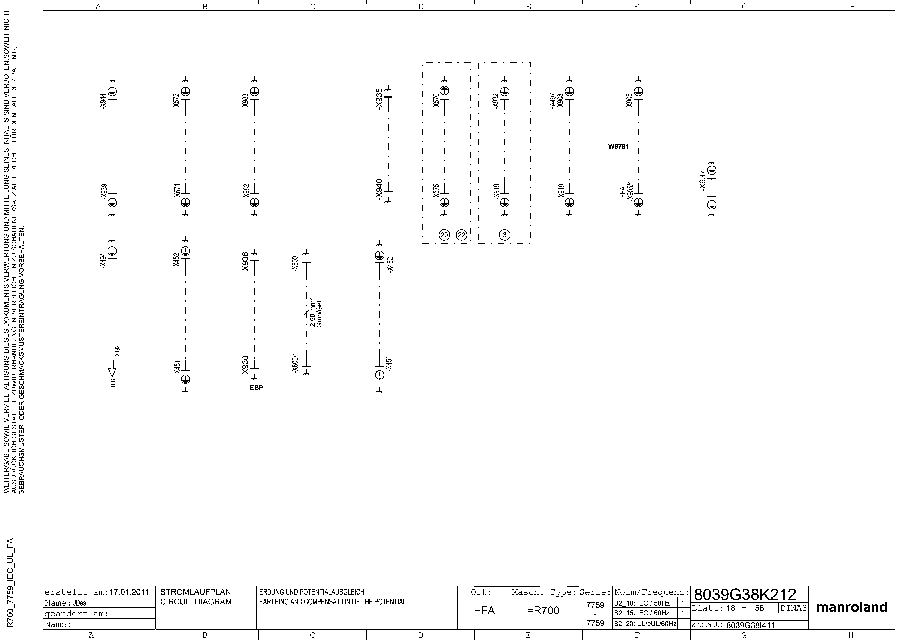

# +FA — Sheet 18 of 58 — ERDUNG UND POTENTIALAUSGLEICH

**EARTHING AND COMPENSATION OF THE POTENTIAL**

> Part of the manroland **R700** printing press IEC/UL circuit diagrams.
> Drawing class: **Stromlaufplan / Circuit diagram** (DIN A3).
> Document `+FA` covers the **Delivery** machine section.

## At a glance

| Field | Value |
|---|---|
| Document | `+FA`  (8039G38K212) |
| Sheet | **18** of 58 |
| Section (DE) | ERDUNG UND POTENTIALAUSGLEICH |
| Section (EN) | EARTHING AND COMPENSATION OF THE POTENTIAL |
| Section type | EARTHING — Earthing / potential compensation |
| Machine type | `=R700` |
| Series | `7759` |
| Created | 17.01.2011 |
| Replaces | `8039G38I411` |
| Columns used | A, B, C, D, E, F, G |
| Path numbers | — |
| Labels on sheet | 37 |
| Cross-refs out | 0 |
| Cross-refs in | 0 |

**Previous:** [+FA sheet 17](SHEET_0017.md) · **Next:** [+FA sheet 19](SHEET_0019.md) · **Document TOC:** [_TOC.md](_TOC.md)  (+FA) · **Master TOC:** [all sheets](../_MASTER_TOC.md)

## Sheet image (300 DPI, exact vector render)



_Rendered directly from the PDF vector layer at 300 DPI (1-bit), no OCR and no resampling. Use it to confirm anything ambiguous in the text below._

## Cross-references on this sheet

Each entry is a wire leaving this sheet. The printed token is `/sheet.column`; the link resolves to that sheet inside the same document.

_No outgoing cross-references on this sheet._

## Devices on this sheet

| Tag | Class | Class meaning (IEC) | Col | Sub | Terminal | Sign |
|---|---|---|---|---|---|---|
| `X939` | X | Klemme / terminal, plug connector | A | — | — | — |
| `X571` | X | Klemme / terminal, plug connector | B | — | — | — |
| `X982` | X | Klemme / terminal, plug connector | B | — | — | — |
| `X935` | X | Klemme / terminal, plug connector | D | — | — | — |
| `X940` | X | Klemme / terminal, plug connector | D | — | — | — |
| `X575` | X | Klemme / terminal, plug connector | D | — | — | — |
| `X576` | X | Klemme / terminal, plug connector | D | — | — | — |
| `X919` | X | Klemme / terminal, plug connector | E | — | — | — |
| `X932` | X | Klemme / terminal, plug connector | E | — | — | — |
| `X944` | X | Klemme / terminal, plug connector | A | — | — | — |
| `X572` | X | Klemme / terminal, plug connector | B | — | — | — |
| `X983` | X | Klemme / terminal, plug connector | B | — | — | — |
| `X937` | X | Klemme / terminal, plug connector | G | — | — | — |
| `X919` | X | Klemme / terminal, plug connector | E | — | — | — |
| `X908` | X | Klemme / terminal, plug connector | E | — | — | — |
| `+A497` | A | Baugruppe / assembly, module, PC board | E | — | — | + |
| `X905` | X | Klemme / terminal, plug connector | F | — | — | — |
| `X905/1` | X | Klemme / terminal, plug connector | F | 1 | — | — |
| `X494` | X | Klemme / terminal, plug connector | A | — | — | — |
| `X451` | X | Klemme / terminal, plug connector | B | — | — | — |
| `X452` | X | Klemme / terminal, plug connector | B | — | — | — |
| `X930` | X | Klemme / terminal, plug connector | B | — | — | — |
| `X936` | X | Klemme / terminal, plug connector | B | — | — | — |
| `X600/1` | X | Klemme / terminal, plug connector | C | 1 | — | — |
| `X600` | X | Klemme / terminal, plug connector | C | — | — | — |
| `X492` | X | Klemme / terminal, plug connector | A | — | — | — |
| `X452` | X | Klemme / terminal, plug connector | D | — | — | — |
| `X451` | X | Klemme / terminal, plug connector | D | — | — | — |
| `W9791` | W | Kabel / cable, line, bus | F | — | — | — |

## Potentials / nets

_No named potentials on this sheet._

## Conductor data

Each label annotates **the wire beside it**, not the sheet. These summaries are inventories of what is printed; they are not a per-wire map. For a specific conductor, read the label that sits on that wire (see the label inventory below, or the sheet image).

**Cross-section labels printed on this sheet:** 2.5 mm² (×1)

## Wire-end annotations (grouped as printed)

A wire that continues elsewhere is annotated with a small cluster: the destination description, the path/line number `#NN`, and the `/sheet.column` cross reference. Each row below is one such cluster exactly as it is grouped on the drawing.

| Col | Y | Path | Cross-ref | Text on the wire |
|---|---|---|---|---|
| D | 116.1 | — | — | `X935 X940` |
| E | 122.0 | — | — | `+A497 X908 X919` |
| A | 122.9 | — | — | `X944` |
| B | 122.9 | — | — | `X572` |
| B | 122.9 | — | — | `X983` |
| D | 122.9 | — | — | `X576 X575` |
| E | 122.9 | — | — | `X932 X919` |
| F | 122.9 | — | — | `+EA X905 X905/1` |
| F | 188.8 | — | — | `W9791` |
| G | 223.8 | — | — | `X937` |
| B | 241.0 | — | — | `X571` |
| A | 242.0 | — | — | `X939` |
| B | 242.0 | — | — | `X982` |
| D | 305.1 | — | — | `20 3` |
| D | 305.3 | — | — | `22` |
| B | 331.5 | — | — | `X936 X930` |
| A | 332.7 | — | — | `X494` |
| B | 332.7 | — | — | `X452 X451` |
| C | 336.8 | — | — | `X600/1 X600` |
| D | 338.3 | — | — | `X451 X452` |
| C | 391.0 | — | — | `2.50 mm² Grün/Gelb` |
| A | 454.2 | — | — | `+FB X492` |
| B | 506.4 | — | — | `EBP` |


## Notes and free text on this sheet

| Text | Col | Y (pt) |
|---|---|---|
| `+EA` | F | 245.42 |
| `+FB` | A | 498.62 |
| `EBP` | B | 506.35 |
| `Grün/Gelb` | C | 391.04 |

## Complete label inventory (exact text from the drawing)

Every text object inside the drawing area of this sheet, in DIN reading order (column A→H, then top→bottom). This is the authoritative list: if a string is not here it is not printed on this sheet.

| Col | Y | X | Dir | Type | Text |
|---|---|---|---|---|---|
| A | 122.9 | 131.9 | ↕ | device tag | `X944` |
| A | 242.0 | 133.4 | ↕ | device tag | `X939` |
| A | 332.7 | 131.9 | ↕ | device tag | `X494` |
| A | 454.2 | 151.3 | ↕ | device tag | `X492` |
| A | 498.6 | 145.9 | ↕ | text | `+FB` |
| B | 122.9 | 228.3 | ↕ | device tag | `X572` |
| B | 122.9 | 319.0 | ↕ | device tag | `X983` |
| B | 241.0 | 229.7 | ↕ | device tag | `X571` |
| B | 242.0 | 320.4 | ↕ | device tag | `X982` |
| B | 331.5 | 317.8 | ↕ | device tag | `X936` |
| B | 332.7 | 228.3 | ↕ | device tag | `X452` |
| B | 467.6 | 317.8 | ↕ | device tag | `X930` |
| B | 473.5 | 229.7 | ↕ | device tag | `X451` |
| B | 506.4 | 328.3 | → | text | `EBP` |
| C | 336.8 | 384.2 | ↕ | device tag | `X600` |
| C | 391.0 | 415.6 | ↕ | text | `Grün/Gelb` |
| C | 392.2 | 407.0 | ↕ | cross-section | `2.50 mm²` |
| C | 463.7 | 384.2 | ↕ | device tag | `X600/1` |
| D | 116.1 | 493.5 | ↕ | device tag | `X935` |
| D | 122.9 | 569.9 | ↕ | device tag | `X576` |
| D | 235.1 | 493.5 | ↕ | device tag | `X940` |
| D | 242.0 | 569.9 | ↕ | device tag | `X575` |
| D | 305.3 | 579.1 | → | number | `20` |
| D | 305.3 | 601.9 | → | number | `22` |
| D | 338.3 | 509.0 | ↕ | device tag | `X452` |
| D | 467.8 | 507.5 | ↕ | device tag | `X451` |
| E | 122.0 | 722.9 | ↕ | device tag | `+A497` |
| E | 122.9 | 647.9 | ↕ | device tag | `X932` |
| E | 122.9 | 732.9 | ↕ | device tag | `X908` |
| E | 242.0 | 649.3 | ↕ | device tag | `X919` |
| E | 242.0 | 734.3 | ↕ | device tag | `X919` |
| E | 305.0 | 660.9 | → | number | `3` |
| F | 122.9 | 823.6 | ↕ | device tag | `X905` |
| F | 188.8 | 799.4 | → | device tag | `W9791` |
| F | 237.9 | 825.0 | ↕ | device tag | `X905/1` |
| F | 245.4 | 815.1 | ↕ | text | `+EA` |
| G | 223.8 | 918.7 | ↕ | device tag | `X937` |

## Reading-order text block

The same content as a plain block, grouped by DIN column — convenient to paste or to match against a visual description.

```text
=== Column A ===
 122.9  131.9  devtag       X944
 242.0  133.4  devtag       X939
 332.7  131.9  devtag       X494
 454.2  151.3  devtag       X492
 498.6  145.9  text         +FB
=== Column B ===
 122.9  228.3  devtag       X572
 122.9  319.0  devtag       X983
 241.0  229.7  devtag       X571
 242.0  320.4  devtag       X982
 331.5  317.8  devtag       X936
 332.7  228.3  devtag       X452
 467.6  317.8  devtag       X930
 473.5  229.7  devtag       X451
 506.4  328.3  text         EBP
=== Column C ===
 336.8  384.2  devtag       X600
 391.0  415.6  text         Grün/Gelb
 392.2  407.0  xsection     2.50 mm²
 463.7  384.2  devtag       X600/1
=== Column D ===
 116.1  493.5  devtag       X935
 122.9  569.9  devtag       X576
 235.1  493.5  devtag       X940
 242.0  569.9  devtag       X575
 305.3  579.1  numeric      20
 305.3  601.9  numeric      22
 338.3  509.0  devtag       X452
 467.8  507.5  devtag       X451
=== Column E ===
 122.0  722.9  devtag       +A497
 122.9  647.9  devtag       X932
 122.9  732.9  devtag       X908
 242.0  649.3  devtag       X919
 242.0  734.3  devtag       X919
 305.0  660.9  numeric      3
=== Column F ===
 122.9  823.6  devtag       X905
 188.8  799.4  devtag       W9791
 237.9  825.0  devtag       X905/1
 245.4  815.1  text         +EA
=== Column G ===
 223.8  918.7  devtag       X937
```

---
_Generated from the PDF vector text layer; no OCR. Source: `R700_7759_IEC_UL_FA`, sheet 18._
