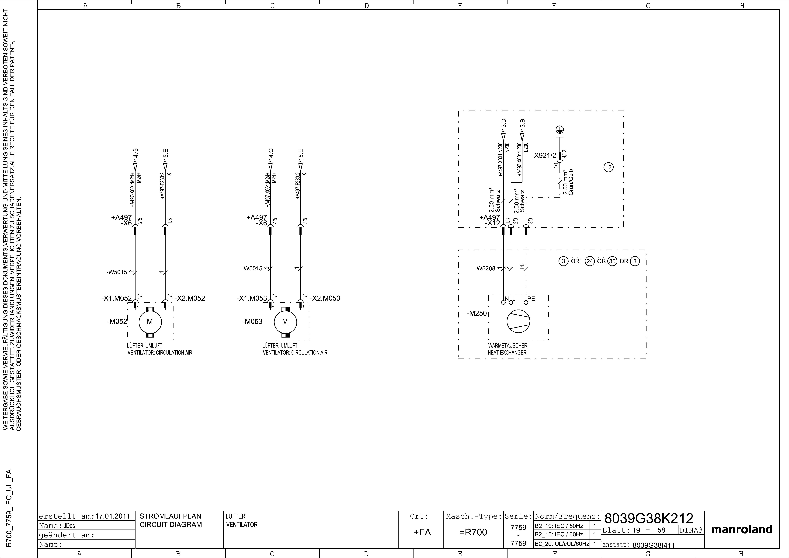

# +FA — Sheet 19 of 58 — LÜFTER

**VENTILATOR**

> Part of the manroland **R700** printing press IEC/UL circuit diagrams.
> Drawing class: **Stromlaufplan / Circuit diagram** (DIN A3).
> Document `+FA` covers the **Delivery** machine section.

## At a glance

| Field | Value |
|---|---|
| Document | `+FA`  (8039G38K212) |
| Sheet | **19** of 58 |
| Section (DE) | LÜFTER |
| Section (EN) | VENTILATOR |
| Section type | CIRCUIT — Circuit diagram |
| Machine type | `=R700` |
| Series | `7759` |
| Created | 17.01.2011 |
| Replaces | `8039G38I411` |
| Columns used | A, B, C, D, E, F, G |
| Path numbers | — |
| Labels on sheet | 81 |
| Cross-refs out | 6 |
| Cross-refs in | 29 |

**Previous:** [+FA sheet 18](SHEET_0018.md) · **Next:** [+FA sheet 20](SHEET_0020.md) · **Document TOC:** [_TOC.md](_TOC.md)  (+FA) · **Master TOC:** [all sheets](../_MASTER_TOC.md)

## Sheet image (300 DPI, exact vector render)



_Rendered directly from the PDF vector layer at 300 DPI (1-bit), no OCR and no resampling. Use it to confirm anything ambiguous in the text below._

## Cross-references on this sheet

Each entry is a wire leaving this sheet. The printed token is `/sheet.column`; the link resolves to that sheet inside the same document.

| Ref | Target sheet | Col | Path | Destination on target | Target section | From col |
|---|---|---|---|---|---|---|
| `/13.D` | [+FA sheet 13](SHEET_0013.md) | D | — | N230 +A497 X001:N230 | SPANNUNGSVERSORGUNG: | E |
| `/13.B` | [+FA sheet 13](SHEET_0013.md) | B | — | L230 +A497 X001:L230 | SPANNUNGSVERSORGUNG: | F |
| `/14.G` | [+FA sheet 14](SHEET_0014.md) | G | — | +A497 X001:M24+ M24+ | SPANNUNGSVERSORGUNG: | B |
| `/14.G` | [+FA sheet 14](SHEET_0014.md) | G | — | +A497 X001:M24+ M24+ | SPANNUNGSVERSORGUNG: | C |
| `/15.E` | [+FA sheet 15](SHEET_0015.md) | E | — | +A497 F280:2 X | SPANNUNGSVERSORGUNG: | B |
| `/15.E` | [+FA sheet 15](SHEET_0015.md) | E | — | +A497 F280:2 X | SPANNUNGSVERSORGUNG: | C |

### Incoming references (sheets that point here)

Every other sheet that sends a wire to this one. `Back-ref` is the token printed on *that* sheet; `Path` is its line number.

| From sheet | Cols | Back-ref | Path | Refs | What continues there |
|---|---|---|---|---|---|
| [+FA#5](SHEET_0005.md) | B, C, D | `/5.B`, `/5.C`, `/5.D` | — | 3 | M052; M053; M250 |
| [+FA#13](SHEET_0013.md) | B, D | `/13.B`, `/13.D` | — | 2 | L230 +A497 X12:2; N230 +A497 X12:1 |
| [+FA#14](SHEET_0014.md) | G | `/14.G` | — | 2 | +A497 X6:2 M24+; M24+ +A497 X6:4 |
| [+FA#15](SHEET_0015.md) | D, E | `/15.D`, `/15.E` | — | 2 | L24+/1 X +A497 X9:1 +A497 X6:3; X +A497 X6:1 |
| [+FA#51](SHEET_0051.md) | B, C | `/51.B`, `/51.C` | — | 2 | — |
| [+FA#52](SHEET_0052.md) | F, G | `/52.F`, `/52.G` | — | 6 | — |
| [+FA#53](SHEET_0053.md) | E, F | `/53.E`, `/53.F` | — | 2 | — |
| [+FA#56](SHEET_0056.md) | B, C | `/56.B`, `/56.C` | — | 8 | — |
| [+FA#57](SHEET_0057.md) | D, E | `/57.D`, `/57.E` | — | 2 | — |


## Devices on this sheet

| Tag | Class | Class meaning (IEC) | Col | Sub | Terminal | Sign |
|---|---|---|---|---|---|---|
| `+A497` | A | Baugruppe / assembly, module, PC board | A | — | — | + |
| `X6` | X | Klemme / terminal, plug connector | A | — | — | — |
| `+A497` | A | Baugruppe / assembly, module, PC board | C | — | — | + |
| `X6` | X | Klemme / terminal, plug connector | C | — | — | — |
| `N230` | N | Netzteil / power unit, amplifier | F | — | — | — |
| `+A497` | A | Baugruppe / assembly, module, PC board | E | — | — | + |
| `X12` | X | Klemme / terminal, plug connector | E | — | — | — |
| `X921/2` | X | Klemme / terminal, plug connector | F | 2 | — | — |
| `W5015` | W | Kabel / cable, line, bus | A | — | — | — |
| `W5015` | W | Kabel / cable, line, bus | C | — | — | — |
| `W5208` | W | Kabel / cable, line, bus | E | — | — | — |
| `X1.M052` | — | cross-device reference | A | — | — | — |
| `X2.M052` | — | cross-device reference | B | — | — | — |
| `X1.M053` | — | cross-device reference | C | — | — | — |
| `X2.M053` | — | cross-device reference | D | — | — | — |

## Potentials / nets

| Potential | Count | Columns | Attached devices | Terminals |
|---|---|---|---|---|
| `L230` | 1 | F | — | — |
| `M052` | 1 | A | — | — |
| `M053` | 1 | C | — | — |
| `M24+` | 2 | B, C | — | — |
| `M250` | 1 | E | — | — |
| `PE` | 2 | F | — | — |


A potential such as `L24+/4` or `M24+` is a named supply/return rail; every place it appears on this sheet is electrically common.

## Conductor data

Each label annotates **the wire beside it**, not the sheet. These summaries are inventories of what is printed; they are not a per-wire map. For a specific conductor, read the label that sits on that wire (see the label inventory below, or the sheet image).

**Cross-section labels printed on this sheet:** 2.5 mm² (×3)

**Wire-colour labels printed on this sheet:** SW = schwarz / black (×2)

**Cross-section + colour appearing together in one annotation block:**

| Cross-section | Colour (DE) | Colour (EN) | Blocks containing both |
|---|---|---|---|
| 2.5 mm² | schwarz | black | 2 |


_This counts annotation blocks that carry both labels. It can be lower than the number of individual labels above, because a block may hold two cross-section labels or two colour labels._

## Wire-end annotations (grouped as printed)

A wire that continues elsewhere is annotated with a small cluster: the destination description, the path/line number `#NN`, and the `/sheet.column` cross reference. Each row below is one such cluster exactly as it is grouped on the drawing.

| Col | Y | Path | Cross-ref | Text on the wire |
|---|---|---|---|---|
| E | 178.9 | — | `/13.D` | `+A497 X001:N230 N230` |
| F | 179.2 | — | `/13.B` | `+A497 X001:L230 L230` |
| B | 223.7 | — | `/14.G` | `+A497 X001:M24+ M24+` |
| C | 223.7 | — | `/14.G` | `+A497 X001:M24+ M24+` |
| B | 224.5 | — | `/15.E` | `+A497 F280:2 X` |
| C | 224.5 | — | `/15.E` | `+A497 F280:2 X` |
| F | 226.1 | — | — | `4/12` |
| F | 229.9 | — | — | `X921/2` |
| F | 244.9 | — | — | `1/1` |
| G | 248.6 | — | — | `12` |
| F | 255.0 | — | — | `2.50 mm² Grün/Gelb` |
| E | 283.1 | — | — | `2.50 mm² Schwarz` |
| F | 284.5 | — | — | `2.50 mm² Schwarz` |
| A | 323.4 | — | — | `+A497` |
| C | 323.4 | — | — | `+A497` |
| E | 323.4 | — | — | `+A497` |
| B | 328.8 | — | — | `2/5` |
| C | 328.8 | — | — | `4/5` |
| C | 328.8 | — | — | `3/5` |
| F | 328.8 | — | — | `2/3` |
| F | 328.8 | — | — | `3/3` |
| B | 329.2 | — | — | `1/5` |
| F | 329.2 | — | — | `1/3` |
| A | 332.0 | — | — | `X6` |
| C | 332.0 | — | — | `X6` |
| E | 332.0 | — | — | `X12` |
| F | 390.1 | — | — | `3` |
| F | 390.1 | — | — | `OR 24` |
| G | 390.1 | — | — | `OR 30 OR 8` |
| F | 397.3 | — | — | `PE` |
| C | 401.1 | — | — | `W5015` |
| E | 401.1 | — | — | `W5208` |
| C | 402.0 | — | — | `2` |
| C | 402.0 | — | — | `1` |
| E | 402.0 | — | — | `1 2` |
| A | 406.7 | — | — | `W5015` |
| A | 407.6 | — | — | `2` |
| B | 407.7 | — | — | `1` |
| B | 442.2 | — | — | `1/1` |
| B | 442.2 | — | — | `1/1` |
| C | 442.2 | — | — | `1/1` |
| C | 442.2 | — | — | `1/1` |
| A | 445.4 | — | — | `X1.M052` |
| B | 445.4 | — | — | `X2.M052` |
| C | 445.4 | — | — | `X1.M053` |
| D | 445.4 | — | — | `X2.M053` |
| F | 446.7 | — | — | `N L PE` |
| B | 459.0 | — | — | `+` |
| C | 459.0 | — | — | `+` |
| E | 468.0 | — | — | `M250` |
| B | 480.4 | — | — | `M052 M` |
| C | 480.4 | — | — | `M053` |
| B | 480.8 | — | — | `M` |
| F | 518.6 | — | — | `HEAT EXCHANGER WÄRMETAUSCHER` |
| B | 518.7 | — | — | `LÜFTER: UMLUFT` |
| C | 518.7 | — | — | `LÜFTER: UMLUFT` |
| B | 529.3 | — | — | `VENTILATOR: CIRCULATION AIR` |
| C | 529.3 | — | — | `VENTILATOR: CIRCULATION AIR` |


## Notes and free text on this sheet

| Text | Col | Y (pt) |
|---|---|---|
| `+A497 X001:M24+` | B | 260.22 |
| `+A497 X001:M24+` | C | 260.22 |
| `+A497 F280:2` | B | 260.22 |
| `+A497 F280:2` | C | 260.22 |
| `+A497 X001:N230` | E | 215.15 |
| `+A497 X001:L230` | F | 215.15 |
| `M` | B | 480.8 |
| `LÜFTER: UMLUFT` | B | 518.67 |
| `VENTILATOR: CIRCULATION AIR` | B | 529.3 |
| `M` | C | 480.8 |
| `LÜFTER: UMLUFT` | C | 518.67 |
| `VENTILATOR: CIRCULATION AIR` | C | 529.3 |
| `N L` | F | 446.78 |
| `WÄRMETAUSCHER` | F | 518.65 |
| `HEAT EXCHANGER` | E | 529.28 |
| `OR` | F | 390.08 |
| `OR` | G | 390.08 |
| `Grün/Gelb` | F | 254.98 |

## Complete label inventory (exact text from the drawing)

Every text object inside the drawing area of this sheet, in DIN reading order (column A→H, then top→bottom). This is the authoritative list: if a string is not here it is not printed on this sheet.

| Col | Y | X | Dir | Type | Text |
|---|---|---|---|---|---|
| A | 323.4 | 167.8 | → | device tag | `+A497` |
| A | 332.0 | 182.6 | → | device tag | `X6` |
| A | 406.7 | 160.7 | → | device tag | `W5015` |
| A | 407.6 | 195.4 | ↕ | number | `2` |
| A | 445.4 | 153.1 | → | device ref | `X1.M052` |
| A | 480.4 | 161.9 | → | potential | `M052` |
| B | 223.7 | 200.8 | ↕ | cross-reference | `/14.G` |
| B | 224.5 | 246.2 | ↕ | cross-reference | `/15.E` |
| B | 260.2 | 197.0 | ↕ | text | `+A497 X001:M24+` |
| B | 260.2 | 206.9 | ↕ | potential | `M24+` |
| B | 260.2 | 242.3 | ↕ | text | `+A497 F280:2` |
| B | 260.8 | 252.2 | ↕ | not fitted | `X` |
| B | 328.8 | 208.2 | ↕ | pin pair | `2/5` |
| B | 329.2 | 253.5 | ↕ | pin pair | `1/5` |
| B | 407.7 | 240.3 | ↕ | number | `1` |
| B | 442.2 | 208.0 | ↕ | pin pair | `1/1` |
| B | 442.2 | 253.4 | ↕ | pin pair | `1/1` |
| B | 445.4 | 263.6 | → | device ref | `X2.M052` |
| B | 459.0 | 252.0 | → | number | `+` |
| B | 480.8 | 221.7 | → | text | `M` |
| B | 518.7 | 191.9 | → | text | `LÜFTER: UMLUFT` |
| B | 529.3 | 192.8 | → | text | `VENTILATOR: CIRCULATION AIR` |
| C | 223.7 | 404.9 | ↕ | cross-reference | `/14.G` |
| C | 224.5 | 450.2 | ↕ | cross-reference | `/15.E` |
| C | 260.2 | 401.0 | ↕ | text | `+A497 X001:M24+` |
| C | 260.2 | 410.9 | ↕ | potential | `M24+` |
| C | 260.2 | 446.4 | ↕ | text | `+A497 F280:2` |
| C | 260.8 | 456.3 | ↕ | not fitted | `X` |
| C | 323.4 | 371.9 | → | device tag | `+A497` |
| C | 328.8 | 412.3 | ↕ | pin pair | `4/5` |
| C | 328.8 | 457.7 | ↕ | pin pair | `3/5` |
| C | 332.0 | 386.6 | → | device tag | `X6` |
| C | 401.1 | 364.8 | → | device tag | `W5015` |
| C | 402.0 | 399.5 | ↕ | number | `2` |
| C | 402.0 | 444.4 | ↕ | number | `1` |
| C | 442.2 | 412.1 | ↕ | pin pair | `1/1` |
| C | 442.2 | 457.5 | ↕ | pin pair | `1/1` |
| C | 445.4 | 357.2 | → | device ref | `X1.M053` |
| C | 459.0 | 456.1 | → | number | `+` |
| C | 480.4 | 366.0 | → | potential | `M053` |
| C | 480.8 | 425.8 | → | text | `M` |
| C | 518.7 | 396.0 | → | text | `LÜFTER: UMLUFT` |
| C | 529.3 | 396.9 | → | text | `VENTILATOR: CIRCULATION AIR` |
| D | 445.4 | 467.7 | → | device ref | `X2.M053` |
| E | 178.9 | 756.4 | ↕ | cross-reference | `/13.D` |
| E | 215.2 | 752.5 | ↕ | text | `+A497 X001:N230` |
| E | 283.1 | 737.9 | ↕ | cross-section | `2.50 mm²` |
| E | 286.6 | 747.2 | ↕ | wire colour | `Schwarz` |
| E | 323.4 | 723.4 | → | device tag | `+A497` |
| E | 332.0 | 732.2 | → | device tag | `X12` |
| E | 401.1 | 716.3 | → | device tag | `W5208` |
| E | 402.0 | 750.6 | ↕ | number | `1` |
| E | 468.0 | 704.7 | → | potential | `M250` |
| E | 529.3 | 736.2 | → | text | `HEAT EXCHANGER` |
| F | 179.2 | 784.7 | ↕ | cross-reference | `/13.B` |
| F | 215.2 | 762.4 | ↕ | device tag | `N230` |
| F | 215.2 | 780.9 | ↕ | text | `+A497 X001:L230` |
| F | 215.2 | 790.8 | ↕ | potential | `L230` |
| F | 226.1 | 848.9 | ↕ | pin pair | `4/12` |
| F | 229.9 | 802.5 | → | device tag | `X921/2` |
| F | 244.9 | 835.9 | ↕ | pin pair | `1/1` |
| F | 255.0 | 857.8 | ↕ | text | `Grün/Gelb` |
| F | 256.1 | 849.2 | ↕ | cross-section | `2.50 mm²` |
| F | 284.5 | 775.5 | ↕ | cross-section | `2.50 mm²` |
| F | 286.6 | 784.1 | ↕ | wire colour | `Schwarz` |
| F | 328.8 | 775.2 | ↕ | pin pair | `2/3` |
| F | 328.8 | 797.8 | ↕ | pin pair | `3/3` |
| F | 329.2 | 763.8 | ↕ | pin pair | `1/3` |
| F | 390.1 | 848.0 | → | number | `3` |
| F | 390.1 | 861.4 | → | text | `OR` |
| F | 390.4 | 885.3 | → | number | `24` |
| F | 397.3 | 784.9 | ↕ | potential | `PE` |
| F | 402.0 | 762.3 | ↕ | number | `2` |
| F | 446.7 | 795.7 | → | potential | `PE` |
| F | 446.8 | 761.7 | → | text | `N L` |
| F | 518.7 | 737.0 | → | text | `WÄRMETAUSCHER` |
| G | 248.6 | 913.2 | → | number | `12` |
| G | 390.1 | 901.1 | → | text | `OR` |
| G | 390.1 | 935.1 | → | text | `OR` |
| G | 390.4 | 919.3 | → | number | `30` |
| G | 390.4 | 955.7 | → | number | `8` |

## Reading-order text block

The same content as a plain block, grouped by DIN column — convenient to paste or to match against a visual description.

```text
=== Column A ===
 323.4  167.8  devtag       +A497
 332.0  182.6  devtag       X6
 406.7  160.7  devtag       W5015
 407.6  195.4  numeric      2
 445.4  153.1  devref       X1.M052
 480.4  161.9  net          M052
=== Column B ===
 223.7  200.8  xref         /14.G
 224.5  246.2  xref         /15.E
 260.2  197.0  text         +A497 X001:M24+
 260.2  206.9  net          M24+
 260.2  242.3  text         +A497 F280:2
 260.8  252.2  placeholder  X
 328.8  208.2  pinpair      2/5
 329.2  253.5  pinpair      1/5
 407.7  240.3  numeric      1
 442.2  208.0  pinpair      1/1
 442.2  253.4  pinpair      1/1
 445.4  263.6  devref       X2.M052
 459.0  252.0  numeric      +
 480.8  221.7  text         M
 518.7  191.9  text         LÜFTER: UMLUFT
 529.3  192.8  text         VENTILATOR: CIRCULATION AIR
=== Column C ===
 223.7  404.9  xref         /14.G
 224.5  450.2  xref         /15.E
 260.2  401.0  text         +A497 X001:M24+
 260.2  410.9  net          M24+
 260.2  446.4  text         +A497 F280:2
 260.8  456.3  placeholder  X
 323.4  371.9  devtag       +A497
 328.8  412.3  pinpair      4/5
 328.8  457.7  pinpair      3/5
 332.0  386.6  devtag       X6
 401.1  364.8  devtag       W5015
 402.0  399.5  numeric      2
 402.0  444.4  numeric      1
 442.2  412.1  pinpair      1/1
 442.2  457.5  pinpair      1/1
 445.4  357.2  devref       X1.M053
 459.0  456.1  numeric      +
 480.4  366.0  net          M053
 480.8  425.8  text         M
 518.7  396.0  text         LÜFTER: UMLUFT
 529.3  396.9  text         VENTILATOR: CIRCULATION AIR
=== Column D ===
 445.4  467.7  devref       X2.M053
=== Column E ===
 178.9  756.4  xref         /13.D
 215.2  752.5  text         +A497 X001:N230
 283.1  737.9  xsection     2.50 mm²
 286.6  747.2  colour       Schwarz
 323.4  723.4  devtag       +A497
 332.0  732.2  devtag       X12
 401.1  716.3  devtag       W5208
 402.0  750.6  numeric      1
 468.0  704.7  net          M250
 529.3  736.2  text         HEAT EXCHANGER
=== Column F ===
 179.2  784.7  xref         /13.B
 215.2  762.4  devtag       N230
 215.2  780.9  text         +A497 X001:L230
 215.2  790.8  net          L230
 226.1  848.9  pinpair      4/12
 229.9  802.5  devtag       X921/2
 244.9  835.9  pinpair      1/1
 255.0  857.8  text         Grün/Gelb
 256.1  849.2  xsection     2.50 mm²
 284.5  775.5  xsection     2.50 mm²
 286.6  784.1  colour       Schwarz
 328.8  775.2  pinpair      2/3
 328.8  797.8  pinpair      3/3
 329.2  763.8  pinpair      1/3
 390.1  848.0  numeric      3
 390.1  861.4  text         OR
 390.4  885.3  numeric      24
 397.3  784.9  net          PE
 402.0  762.3  numeric      2
 446.7  795.7  net          PE
 446.8  761.7  text         N L
 518.7  737.0  text         WÄRMETAUSCHER
=== Column G ===
 248.6  913.2  numeric      12
 390.1  901.1  text         OR
 390.1  935.1  text         OR
 390.4  919.3  numeric      30
 390.4  955.7  numeric      8
```

---
_Generated from the PDF vector text layer; no OCR. Source: `R700_7759_IEC_UL_FA`, sheet 19._
