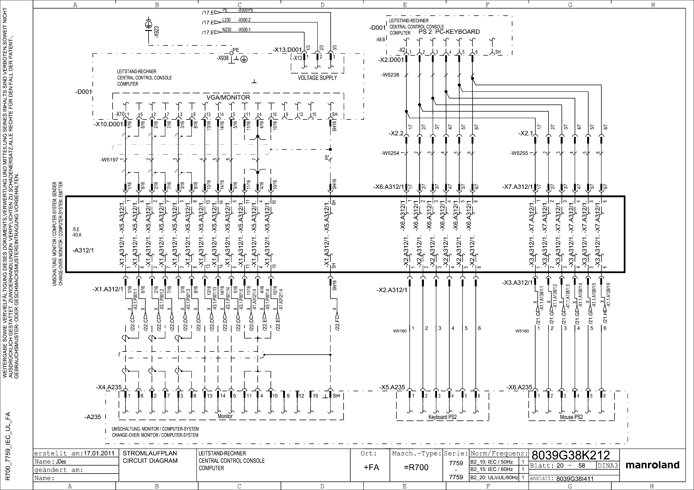

# +FA — Sheet 20 of 58 — LEITSTAND RECHNER

**CENTRAL CONTROL CONSOLE**

> Part of the manroland **R700** printing press IEC/UL circuit diagrams.
> Drawing class: **Stromlaufplan / Circuit diagram** (DIN A3).
> Document `+FA` covers the **Delivery** machine section.

## At a glance

| Field | Value |
|---|---|
| Document | `+FA`  (8039G38K212) |
| Sheet | **20** of 58 |
| Section (DE) | LEITSTAND RECHNER |
| Section (EN) | CENTRAL CONTROL CONSOLE |
| Section type | CIRCUIT — Circuit diagram |
| Machine type | `=R700` |
| Series | `7759` |
| Created | 17.01.2011 |
| Replaces | `8039G38I411` |
| Columns used | A, B, C, D, E, F, G |
| Path numbers | — |
| Labels on sheet | 362 |
| Cross-refs out | 25 |
| Cross-refs in | 127 |

**Previous:** [+FA sheet 19](SHEET_0019.md) · **Next:** [+FA sheet 21](SHEET_0021.md) · **Document TOC:** [_TOC.md](_TOC.md)  (+FA) · **Master TOC:** [all sheets](../_MASTER_TOC.md)

## Sheet image (300 DPI, exact vector render)



_Rendered directly from the PDF vector layer at 300 DPI (1-bit), no OCR and no resampling. Use it to confirm anything ambiguous in the text below._

## Cross-references on this sheet

Each entry is a wire leaving this sheet. The printed token is `/sheet.column`; the link resolves to that sheet inside the same document.

| Ref | Target sheet | Col | Path | Destination on target | Target section | From col |
|---|---|---|---|---|---|---|
| `/17.E` | [+FA sheet 17](SHEET_0017.md) | E | — | PE X500:PE | SPANNUNGSVERSORGUNG: | C |
| `/17.E` | [+FA sheet 17](SHEET_0017.md) | E | — | L230 X500:2 | SPANNUNGSVERSORGUNG: | C |
| `/17.E` | [+FA sheet 17](SHEET_0017.md) | E | — | X500:1 N230 | SPANNUNGSVERSORGUNG: | C |
| `/48.B` | [+FA sheet 48](SHEET_0048.md) | B | — | — | REFERENZMODUL | E |
| `/5.E` | [+FA sheet 5](SHEET_0005.md) | E | — | — | ANORDNUNGSPLAN | A |
| `/43.A` | [+FA sheet 43](SHEET_0043.md) | A | — | — | — | A |
| `/21.H` | [+FA sheet 21](SHEET_0021.md) | H | — | X | TASTATUR: COMPUTER, MAUS | G |
| `/21.G` | [+FA sheet 21](SHEET_0021.md) | G | — | X | TASTATUR: COMPUTER, MAUS | G |
| `/21.G` | [+FA sheet 21](SHEET_0021.md) | G | — | X | TASTATUR: COMPUTER, MAUS | G |
| `/21.G` | [+FA sheet 21](SHEET_0021.md) | G | — | X | TASTATUR: COMPUTER, MAUS | G |
| `/21.G` | [+FA sheet 21](SHEET_0021.md) | G | — | X | TASTATUR: COMPUTER, MAUS | G |
| `/21.G` | [+FA sheet 21](SHEET_0021.md) | G | — | X | TASTATUR: COMPUTER, MAUS | G |
| `/22.C` | [+FA sheet 22](SHEET_0022.md) | C | — | X | MONITOR | B |
| `/22.C` | [+FA sheet 22](SHEET_0022.md) | C | — | X | MONITOR | B |
| `/22.C` | [+FA sheet 22](SHEET_0022.md) | C | — | X | MONITOR | B |
| `/22.D` | [+FA sheet 22](SHEET_0022.md) | D | — | X | MONITOR | B |
| `/22.D` | [+FA sheet 22](SHEET_0022.md) | D | — | X | MONITOR | B |
| `/22.D` | [+FA sheet 22](SHEET_0022.md) | D | — | X | MONITOR | B |
| `/22.D` | [+FA sheet 22](SHEET_0022.md) | D | — | X | MONITOR | C |
| `/22.D` | [+FA sheet 22](SHEET_0022.md) | D | — | X | MONITOR | C |
| `/22.D` | [+FA sheet 22](SHEET_0022.md) | D | — | X | MONITOR | C |
| `/22.D` | [+FA sheet 22](SHEET_0022.md) | D | — | X | MONITOR | C |
| `/22.E` | [+FA sheet 22](SHEET_0022.md) | E | — | X | MONITOR | C |
| `/22.E` | [+FA sheet 22](SHEET_0022.md) | E | — | X | MONITOR | C |
| `/22.F` | [+FA sheet 22](SHEET_0022.md) | F | — | X | MONITOR | D |

### Incoming references (sheets that point here)

Every other sheet that sends a wire to this one. `Back-ref` is the token printed on *that* sheet; `Path` is its line number.

| From sheet | Cols | Back-ref | Path | Refs | What continues there |
|---|---|---|---|---|---|
| [+FA#5](SHEET_0005.md) | E | `/5.E` | — | 1 | — |
| [+FA#17](SHEET_0017.md) | E | `/17.E` | — | 3 | L230 X13.D001:2; PE X13.D001:3; X13.D001:1 N230 |
| [+FA#21](SHEET_0021.md) | G | `/21.G` | — | 6 | X X3.A312/1:1; X X3.A312/1:2; X X3.A312/1:3; X X3.A312/1:4; X X3.A312/1:5; X X3.A312/1:6 |
| [+FA#22](SHEET_0022.md) | C, D, E | `/22.C`, `/22.D`, `/22.E` | — | 13 | X X1.A312/1:1; X X1.A312/1:10; X X1.A312/1:11; X X1.A312/1:13; X X1.A312/1:14; X X1.A312/1:2; X X1.A312/1:3; X X1.A312/1:4; X X1.A312/1:5; X X1.A312/1:6; X X1.A |
| [+FA#43](SHEET_0043.md) | A | `/43.A` | — | 1 | — |
| [+FA#48](SHEET_0048.md) | B | `/48.B` | — | 2 | — |
| [+FA#52](SHEET_0052.md) | A, B, F, G | `/52.A`, `/52.B`, `/52.F`, `/52.G` | — | 28 | — |
| [+FA#53](SHEET_0053.md) | A, B, D | `/53.A`, `/53.B`, `/53.D` | — | 30 | — |
| [+FA#54](SHEET_0054.md) | E | `/54.E` | — | 6 | — |
| [+FA#55](SHEET_0055.md) | A | `/55.A` | — | 13 | — |
| [+FA#56](SHEET_0056.md) | A, C, D, G | `/56.A`, `/56.C`, `/56.D`, `/56.G` | — | 24 | — |


## Devices on this sheet

| Tag | Class | Class meaning (IEC) | Col | Sub | Terminal | Sign |
|---|---|---|---|---|---|---|
| `X500:PE` | X | Klemme / terminal, plug connector | C | — | PE | — |
| `X500:2` | X | Klemme / terminal, plug connector | C | — | 2 | — |
| `N230` | N | Netzteil / power unit, amplifier | C | — | — | — |
| `X500:1` | X | Klemme / terminal, plug connector | C | — | 1 | — |
| `A235` | A | Baugruppe / assembly, module, PC board | A | — | — | — |
| `X923` | X | Klemme / terminal, plug connector | B | — | — | — |
| `D001` | D | Digital / binary element | A | — | — | — |
| `X10` | X | Klemme / terminal, plug connector | B | — | — | — |
| `X13` | X | Klemme / terminal, plug connector | D | — | — | — |
| `X938` | X | Klemme / terminal, plug connector | C | — | — | — |
| `D001` | D | Digital / binary element | E | — | — | — |
| `X2` | X | Klemme / terminal, plug connector | E | — | — | — |
| `A312/1` | A | Baugruppe / assembly, module, PC board | A | 1 | — | — |
| `W5180` | W | Kabel / cable, line, bus | F | — | — | — |
| `W5180` | W | Kabel / cable, line, bus | E | — | — | — |
| `W5238` | W | Kabel / cable, line, bus | E | — | — | — |
| `W5197` | W | Kabel / cable, line, bus | A | — | — | — |
| `W5254` | W | Kabel / cable, line, bus | E | — | — | — |
| `W5255` | W | Kabel / cable, line, bus | F | — | — | — |
| `X13.D001` | — | cross-device reference | D | — | — | — |
| `X2.1` | — | cross-device reference | F | — | — | — |
| `X2.2` | — | cross-device reference | E | — | — | — |
| `X2.D001` | — | cross-device reference | E | — | — | — |
| `X4.A235` | — | cross-device reference | A | — | — | — |
| `X5.A235` | — | cross-device reference | E | — | — | — |
| `X6.A235` | — | cross-device reference | F | — | — | — |
| `X10.D001` | — | cross-device reference | A | — | — | — |
| `X3.1.P001:1` | — | cross-device reference | B | — | 1 | — |
| `X3.1.P001:2` | — | cross-device reference | B | — | 2 | — |
| `X3.1.P001:3` | — | cross-device reference | B | — | 3 | — |
| `X3.1.P001:13` | — | cross-device reference | C | — | 13 | — |
| `X3.1.P001:14` | — | cross-device reference | C | — | 14 | — |
| `X3.1.P001:5` | — | cross-device reference | C | — | 5 | — |
| `X3.1.P001:4` | — | cross-device reference | C | — | 4 | — |

## Potentials / nets

| Potential | Count | Columns | Attached devices | Terminals |
|---|---|---|---|---|
| `L230` | 1 | C | — | — |
| `PE` | 3 | C, D | — | — |


A potential such as `L24+/4` or `M24+` is a named supply/return rail; every place it appears on this sheet is electrically common.

## Wire-end annotations (grouped as printed)

A wire that continues elsewhere is annotated with a small cluster: the destination description, the path/line number `#NN`, and the `/sheet.column` cross reference. Each row below is one such cluster exactly as it is grouped on the drawing.

| Col | Y | Path | Cross-ref | Text on the wire |
|---|---|---|---|---|
| C | 13.9 | — | `/17.E` | `PE X500:PE` |
| C | 31.1 | — | `/17.E` | `L230 X500:2` |
| E | 32.5 | — | — | `LEITSTAND RECHNER` |
| E | 42.8 | — | — | `D001` |
| E | 43.2 | — | — | `CENTRAL CONTROL CONSOLE COMPUTER` |
| B | 45.0 | — | — | `X923` |
| C | 48.1 | — | `/17.E` | `N230 X500:1` |
| F | 50.0 | — | — | `PS 2 PC KEYBOARD` |
| E | 65.1 | — | `/48.B` | — |
| D | 77.6 | — | — | `2/3` |
| D | 77.6 | — | — | `3/3` |
| D | 78.0 | — | — | `1/3` |
| D | 80.8 | — | — | `X13.D001` |
| D | 81.8 | — | — | `PE 1 2 3` |
| E | 82.3 | — | — | `X2` |
| E | 85.9 | — | — | `1 2 3 4 5 6` |
| F | 86.3 | — | — | `SH` |
| C | 96.2 | — | — | `X938 X13` |
| E | 98.1 | — | — | `X2.D001` |
| B | 120.1 | — | — | `LEITSTAND RECHNER` |
| E | 124.7 | — | — | `W5238` |
| D | 130.3 | — | — | `VOLTAGE SUPPLY` |
| B | 130.7 | — | — | `CENTRAL CONTROL CONSOLE COMPUTER` |
| A | 153.1 | — | — | `D001` |
| C | 163.0 | — | — | `VGA/MONITOR` |
| B | 192.6 | — | — | `X10` |
| C | 193.2 | — | — | `1 6 2 7 3 8 13 14 5 11 4 10 9 12 15 SH` |
| B | 208.3 | — | — | `1/16` |
| B | 208.3 | — | — | `6/16` |
| B | 208.3 | — | — | `2/16` |
| B | 208.3 | — | — | `7/16` |
| B | 208.3 | — | — | `3/16` |
| B | 208.3 | — | — | `8/16` |
| C | 208.3 | — | — | `13/16` |
| C | 208.3 | — | — | `14/16` |
| C | 208.3 | — | — | `5/16` |
| C | 208.3 | — | — | `11/16` |
| C | 208.3 | — | — | `4/16` |
| C | 208.3 | — | — | `10/16` |
| D | 208.3 | — | — | `SH/16` |
| A | 208.9 | — | — | `X10.D001` |
| E | 213.7 | — | — | `1/7` |
| E | 213.7 | — | — | `2/7` |
| E | 213.7 | — | — | `3/7` |
| F | 213.7 | — | — | `4/7` |
| F | 213.7 | — | — | `5/7` |
| F | 213.7 | — | — | `6/7` |
| G | 213.7 | — | — | `1/7` |
| G | 213.7 | — | — | `2/7` |
| G | 213.7 | — | — | `3/7` |
| G | 213.7 | — | — | `4/7` |
| G | 213.7 | — | — | `5/7` |
| G | 213.7 | — | — | `6/7` |
| F | 224.3 | — | — | `X2.2 X2.1` |
| E | 259.3 | — | — | `W5254` |
| F | 259.3 | — | — | `W5255` |
| E | 260.2 | — | — | `2` |
| G | 260.2 | — | — | `2` |
| E | 260.3 | — | — | `1` |
| E | 260.3 | — | — | `3` |
| E | 260.3 | — | — | `4` |
| F | 260.3 | — | — | `5` |
| F | 260.3 | — | — | `6` |
| G | 260.3 | — | — | `1` |
| G | 260.3 | — | — | `3` |
| G | 260.3 | — | — | `4` |
| G | 260.3 | — | — | `5` |
| G | 260.3 | — | — | `6` |
| D | 265.7 | — | — | `PE` |
| A | 270.7 | — | — | `W5197` |
| B | 271.6 | — | — | `1` |
| B | 271.6 | — | — | `2` |
| B | 271.7 | — | — | `3` |
| C | 271.7 | — | — | `4` |
| C | 271.7 | — | — | `5` |
| C | 271.7 | — | — | `6` |
| C | 271.7 | — | — | `7` |
| D | 307.4 | — | — | `SH/16` |
| C | 309.6 | — | — | `13/16` |
| C | 309.6 | — | — | `14/16` |
| C | 309.6 | — | — | `11/16` |
| C | 309.6 | — | — | `10/16` |
| A | 311.8 | — | — | `CHANGE OVER: MONITOR / COMPUTER SYSTEM, EMITTER` |
| A | 312.2 | — | — | `UMSCHALTUNG: MONITOR / COMPUTER SYSTEM, SENDER` |
| B | 312.6 | — | — | `6/16` |
| B | 312.6 | — | — | `2/16` |
| B | 312.6 | — | — | `7/16` |
| B | 312.6 | — | — | `3/16` |
| B | 312.6 | — | — | `8/16` |
| C | 312.6 | — | — | `5/16` |
| C | 312.6 | — | — | `4/16` |
| B | 313.0 | — | — | `1/16` |
| E | 316.1 | — | — | `2/7` |
| E | 316.1 | — | — | `3/7` |
| F | 316.1 | — | — | `4/7` |
| F | 316.1 | — | — | `5/7` |
| F | 316.1 | — | — | `6/7` |
| G | 316.1 | — | — | `2/7` |
| G | 316.1 | — | — | `3/7` |
| G | 316.1 | — | — | `4/7` |
| G | 316.1 | — | — | `5/7` |
| G | 316.1 | — | — | `6/7` |
| E | 316.4 | — | — | `X6.A312/1` |
| E | 316.4 | — | — | `1/7` |
| F | 316.4 | — | — | `X7.A312/1` |
| G | 316.4 | — | — | `1/7` |
| B | 342.7 | — | — | `X5.A312/1. 1` |
| C | 342.7 | — | — | `X5.A312/1. 11` |
| E | 342.7 | — | — | `X6.A312/1 1` |
| G | 342.7 | — | — | `X7.A312/1. 1` |
| D | 343.6 | — | — | `X5.A312/1. SH` |
| B | 343.8 | — | — | `X5.A312/1. 2` |
| E | 343.8 | — | — | `X6.A312/1 2` |
| G | 343.8 | — | — | `X7.A312/1. 2` |
| E | 343.9 | — | — | `X6.A312/1 3` |
| E | 343.9 | — | — | `X6.A312/1 4` |
| F | 343.9 | — | — | `X6.A312/1 5` |
| F | 343.9 | — | — | `X6.A312/1 6` |
| B | 344.1 | — | — | `X5.A312/1. 6` |
| B | 344.1 | — | — | `X5.A312/1. 7` |
| B | 344.1 | — | — | `X5.A312/1. 3` |
| B | 344.1 | — | — | `X5.A312/1. 8` |
| C | 344.1 | — | — | `X5.A312/1. 13` |
| C | 344.1 | — | — | `X5.A312/1. 14` |
| C | 344.1 | — | — | `X5.A312/1. 5` |
| C | 344.1 | — | — | `X5.A312/1. 4` |
| C | 344.1 | — | — | `X5.A312/1. 10` |
| G | 344.1 | — | — | `X7.A312/1. 3` |
| G | 344.1 | — | — | `X7.A312/1. 4` |
| G | 344.1 | — | — | `X7.A312/1. 5` |
| G | 344.1 | — | — | `X7.A312/1. 6` |
| A | 391.0 | — | `/5.E` | — |
| A | 400.4 | — | `/43.A` | — |
| B | 403.6 | — | — | `X1.A312/1. 1` |
| B | 403.6 | — | — | `X1.A312/1. 6` |
| B | 403.6 | — | — | `X1.A312/1. 2` |
| B | 403.6 | — | — | `X1.A312/1. 7` |
| B | 403.6 | — | — | `X1.A312/1. 3` |
| B | 403.6 | — | — | `X1.A312/1. 8` |
| C | 403.6 | — | — | `X1.A312/1. 13` |
| C | 403.6 | — | — | `X1.A312/1. 14` |
| C | 403.6 | — | — | `X1.A312/1. 5` |
| C | 403.6 | — | — | `X1.A312/1. 11` |
| C | 403.6 | — | — | `X1.A312/1. 4` |
| C | 403.6 | — | — | `X1.A312/1. 10` |
| D | 403.6 | — | — | `X1.A312/1. SH` |
| E | 403.6 | — | — | `X2.A312/1. 1` |
| E | 403.6 | — | — | `X2.A312/1. 2` |
| E | 403.6 | — | — | `X2.A312/1. 3` |
| F | 403.6 | — | — | `X2.A312/1. 4` |
| F | 403.6 | — | — | `X2.A312/1. 5` |
| F | 403.6 | — | — | `X2.A312/1. 6` |
| G | 403.6 | — | — | `X3.A312/1. 1` |
| G | 403.6 | — | — | `X3.A312/1. 2` |
| G | 403.6 | — | — | `X3.A312/1. 3` |
| G | 403.6 | — | — | `X3.A312/1. 4` |
| G | 403.6 | — | — | `X3.A312/1. 5` |
| G | 403.6 | — | — | `X3.A312/1. 6` |
| A | 425.5 | — | — | `A312/1` |
| F | 480.8 | — | — | `X3.A312/1` |
| D | 481.6 | — | — | `SH/16` |
| G | 485.9 | — | — | `X1.1.A138/1:6` |
| G | 486.2 | — | — | `X1.1.A138/1:4` |
| G | 486.2 | — | — | `X1.1.A138/1:5` |
| G | 488.0 | — | — | `X1.1.A138/1:2` |
| G | 488.7 | — | — | `X1.1.A138/1:3` |
| G | 491.4 | — | — | `X1.1.A138/1:1` |
| B | 491.5 | — | — | `1/16` |
| B | 491.5 | — | — | `6/16` |
| B | 491.5 | — | — | `2/16` |
| B | 491.5 | — | — | `7/16` |
| B | 491.5 | — | — | `3/16` |
| B | 491.5 | — | — | `8/16` |
| C | 491.5 | — | — | `13/16` |
| C | 491.5 | — | — | `14/16` |
| C | 491.5 | — | — | `5/16` |
| C | 491.5 | — | — | `11/16` |
| C | 491.5 | — | — | `4/16` |
| C | 491.5 | — | — | `10/16` |
| A | 492.1 | — | — | `X1.A312/1` |
| C | 493.2 | — | — | `X3.1.P001:13` |
| C | 493.2 | — | — | `X3.1.P001:14` |
| E | 493.5 | — | — | `X2.A312/1` |
| B | 496.2 | — | — | `X3.1.P001:1` |
| B | 496.5 | — | — | `X3.1.P001:2` |
| B | 496.6 | — | — | `X3.1.P001:3` |
| C | 496.6 | — | — | `X3.1.P001:5` |
| C | 496.6 | — | — | `X1.A312/1:4` |
| C | 496.6 | — | — | `X3.1.P001:4` |
| D | 496.6 | — | — | `X1.A312/1:4` |
| G | 515.8 | — | `/21.H` | `X` |
| G | 516.4 | — | `/21.G` | `X` |
| G | 516.4 | — | `/21.G` | `X` |
| G | 517.0 | — | `/21.G` | `X` |
| G | 517.0 | — | `/21.G` | `X` |
| G | 517.4 | — | `/21.G` | `X` |
| B | 528.7 | — | `/22.C` | `X` |
| B | 528.7 | — | `/22.C` | `X` |
| B | 528.7 | — | `/22.C` | `X` |
| B | 528.7 | — | `/22.D` | `X` |
| B | 528.7 | — | `/22.D` | `X` |
| B | 528.7 | — | `/22.D` | `X` |
| C | 528.7 | — | `/22.D` | `X` |
| C | 528.7 | — | `/22.D` | `X` |
| C | 528.7 | — | `/22.D` | `X` |
| C | 528.7 | — | `/22.D` | `X` |
| C | 528.7 | — | `/22.E` | `X` |
| C | 528.7 | — | `/22.E` | `X` |
| D | 528.7 | — | `/22.F` | `X` |
| F | 560.2 | — | — | `1 2 3 4 5 6 1 2 3 4 5 6` |
| F | 565.6 | — | — | `W5180 W5180` |
| D | 660.8 | — | — | `X4.A235 X5.A235 X6.A235` |
| D | 676.3 | — | — | `SH` |
| E | 676.4 | — | — | `1 6 2 7 3 8 13 14 5 11 4 10 9 12 15 1 2 3 4 5 6 1 2 3 4 5 6` |
| E | 711.7 | — | — | `Monitor Keyboard PS2 Mouse PS2` |
| A | 711.8 | — | — | `A235` |
| B | 734.1 | — | — | `UMSCHALTUNG: MONITOR / COMPUTER SYSTEM` |
| B | 744.7 | — | — | `CHANGE OVER: MONITOR / COMPUTER SYSTEM` |


## Reconstructed tables

This sheet carries tabular content (pin map / terminal assignment / index). The grid below was rebuilt from the drawing's own rule lines, so each row is exactly one physical row of the table.

### Table 1 — 3 data rows × 1 columns (at x=113.4, y=21.3)

| C1 |
|---|
| `X10.D001` |
| `W5197 /5.E /43.A A312/1 X1.A312/1` |
| `X4.A235 A235` |


### Table 2 — 10 data rows × 39 columns (at x=203.9, y=21.3)

|  |  |  |  |  |  |  | /17.E | L230 | X500:2 |  |  |  |  |  |  |  |  |  | LEITSTAND RECHNER |  |  |  |  |  |  |  |  |  |  |  |  |  |  |  |  |  |  |  |
|---|---|---|---|---|---|---|---|---|---|---|---|---|---|---|---|---|---|---|---|---|---|---|---|---|---|---|---|---|---|---|---|---|---|---|---|---|---|---|
|  |  |  | `X923` |  |  |  | `/17.E` | `N230` | `X500:1` |  |  |  |  |  |  |  | `D001` | `CENTRAL` |  | `CONTROL` | `PS` | `2` | `CONSOLE` |  |  | `PC KEYBOARD` |  |  |  |  |  |  |  |  |  |  |  |  |
|  |  |  |  |  |  |  | `/17.E` |  |  |  |  |  |  |  |  |  | `/48.B` | `COMPUTER` |  |  |  |  |  |  |  |  |  |  |  |  |  |  |  |  |  |  |  |  |
|  | `LEITSTAND RECHNER` |  |  |  |  |  |  | `X938` | `PE` |  |  | `X13.D001` | `X13` | `1/3 1` | `2/3 2` | `3/3 3` | `X2.D001` | `X2` |  | `1` |  | `2` |  | `3` |  | `4` |  | `5` |  | `6` | `SH` |  |  |  |  |  |  |  |
|  | `CENTRAL COMPUTER` | `CONTROL` | `CONSOLE` |  |  |  |  |  |  |  |  |  |  | `VOLTAGE` | `SUPPLY` |  | `W5238` |  |  |  |  |  |  |  |  |  |  |  |  |  |  |  |  |  |  |  |  |  |
|  |  |  |  |  |  |  |  | `VGA/MONITOR` |  |  |  |  |  |  |  |  |  |  |  |  |  |  |  |  |  |  |  |  |  |  |  |  |  |  |  |  |  |  |
| `X10` | `1` | `6` | `2` | `7` | `3` | `8` | `13` | `14` | `5` | `11` | `4` | `10 9` | `12` | `15` |  | `SH` |  |  |  |  |  |  |  |  |  |  |  |  |  |  |  |  |  |  |  |  |  |  |
|  | `1/16` | `6/16` | `2/16` | `7/16` | `3/16` | `8/16` | `13/16` | `14/16` | `5/16` | `11/16` | `4/16` | `10/16` |  |  |  | `SH/16` | `X2.2` |  |  | `1/7` |  | `2/7` |  | `3/7` |  | `4/7` |  | `5/7` |  | `6/7` | `X2.1` |  | `1/7` | `2/7` | `3/7` | `4/7` | `5/7` | `6/7` |
|  |  |  |  |  |  |  |  |  |  |  |  |  |  |  |  |  | `W5254` | `1` |  | `2` |  | `3` |  | `4` |  | `5` |  | `6` |  |  | `W5255` | `1` | `2` | `3` | `4` | `5` | `6` |  |
| `1 X5.A312/1. X1.A312/1.` | `1/16 1 X5.A312/1. X1.A312/1. 1 1/16 X3.1.P001:1 X /22.C` | `2 6/16 6 X5.A312/1. X1.A312/1. 6 6/16 X /22.C` | `2/16 2 X5.A312/1. X1.A312/1. 2 2/16 X3.1.P001:2 X /22.C` | `3 7/16 7 X5.A312/1. X1.A312/1. 7 7/16 X /22.D` | `3/16 3 X5.A312/1. X1.A312/1. 3 3/16 X3.1.P001:3 X /22.D` | `4 8/16 8 X5.A312/1. X1.A312/1. 8 8/16 X /22.D` | `5 13/16 13 X5.A312/1. X1.A312/1. 13 13/16 X3.1.P001:13 X /22.D` | `6 14/16 14 X5.A312/1. X1.A312/1. 14 14/16 X3.1.P001:14 X /22.D` | `5/16 5 X5.A312/1. X1.A312/1. 5 5/16 X3.1.P001:5 X /22.D` | `7 11/16 11 X5.A312/1. X1.A312/1. 11 11/16 X1.A312/1:4 X /22.D` | `4/16 4 X5.A312/1. X1.A312/1. 4 4/16 X3.1.P001:4 X /22.E` | `10/16 10 10 10/16 X1.A312/1:4 X /22.E` |  |  | `PE X5.A312/1. X1.A312/1.` | `SH/16 SH SH SH/16 X /22.F` | `X6.A312/1 X2.A312/1` | `X6.A312/1 W5180` | `X2.A312/1.` | `1/7 1 X6.A312/1 1 1` | `X2.A312/1.` | `2/7 2 X6.A312/1 2 2` | `X2.A312/1.` | `3/7 X6.A312/1 3 3 3` | `X2.A312/1.` | `4/7 X6.A312/1 4 4 4` | `X2.A312/1.` | `5/7 X6.A312/1 5 5 5` | `X2.A312/1.` | `6/7 6 6 6` | `X7.A312/1 X3.A312/1 W5180` | `X7.A312/1. X3.A312/1.` | `1/7 1 X7.A312/1. X3.A312/1. 1 X1.1.A138/1:1 X /21.G 1` | `2/7 2 X7.A312/1. X3.A312/1. 2 X1.1.A138/1:2 X X /21.G 2` | `3/7 3 X7.A312/1. X3.A312/1. 3 X1.1.A138/1:3 /21.G 3` | `4/7 4 X7.A312/1. X3.A312/1. 4 X1.1.A138/1:4 X /21.G 4` | `5/7 5 X7.A312/1. X3.A312/1. 5 X1.1.A138/1:5 X /21.G 5` | `6/7 6 6 X1.1.A138/1:6 X /21.H 6` |
|  | `1` | `6` | `2` | `7` | `3` | `8` | `13` | `14 Monitor` | `5` | `11` | `4` | `10 9` | `12` | `15` |  | `SH` | `X5.A235` |  |  | `1` |  | `2` |  | `3 Keyboard` |  | `4 PS2` |  | `5` |  | `6` | `X6.A235` |  | `1` | `2` | `3 Mouse` | `4 PS2` | `5` | `6` |


## Notes and free text on this sheet

| Text | Col | Y (pt) |
|---|---|---|
| `X2.A312/1` | E | 493.54 |
| `SH/16` | D | 481.61 |
| `X1.A312/1` | A | 492.11 |
| `Monitor` | C | 711.69 |
| `Keyboard PS2` | E | 713.11 |
| `Mouse PS2` | G | 713.08 |
| `SH` | D | 676.34 |
| `UMSCHALTUNG: MONITOR / COMPUTER SYSTEM` | B | 734.11 |
| `CHANGE OVER: MONITOR / COMPUTER SYSTEM` | B | 744.74 |
| `VGA/MONITOR` | C | 163.02 |
| `VOLTAGE SUPPLY` | D | 130.28 |
| `LEITSTAND RECHNER` | B | 120.09 |
| `CENTRAL CONTROL CONSOLE` | B | 130.73 |
| `COMPUTER` | B | 141.37 |
| `PS 2 PC KEYBOARD` | F | 49.97 |
| `LEITSTAND RECHNER` | E | 32.55 |
| `CENTRAL CONTROL CONSOLE` | E | 43.19 |
| `COMPUTER` | E | 53.82 |
| `SH` | F | 86.3 |
| `UMSCHALTUNG: MONITOR / COMPUTER SYSTEM, SENDER` | A | 312.2 |
| `CHANGE OVER: MONITOR / COMPUTER SYSTEM, EMITTER` | A | 311.79 |
| `X2.A312/1.` | E | 403.65 |
| `X2.A312/1.` | F | 403.65 |
| `X3.A312/1.` | G | 403.65 |
| `X1.A312/1.` | B | 403.65 |
| `X1.A312/1.` | C | 403.65 |
| `X1.A312/1.` | D | 403.65 |
| `X5.A312/1.` | B | 344.69 |
| `X6.A312/1` | E | 343.85 |
| `X6.A312/1` | F | 343.85 |
| `X5.A312/1.` | C | 344.69 |
| `X5.A312/1.` | D | 344.69 |
| `X7.A312/1.` | G | 344.69 |
| `X7.A312/1` | F | 316.4 |
| `X1.A312/1:4` | C | 496.6 |
| `X1.A312/1:4` | D | 496.6 |
| `X3.A312/1` | F | 480.84 |
| `X1.1.A138/1:1` | G | 491.39 |
| `X1.1.A138/1:2` | G | 487.97 |
| `X1.1.A138/1:3` | G | 488.68 |
| `X1.1.A138/1:4` | G | 486.19 |
| `X1.1.A138/1:5` | G | 486.19 |
| `X1.1.A138/1:6` | G | 485.87 |

## Complete label inventory (exact text from the drawing)

Every text object inside the drawing area of this sheet, in DIN reading order (column A→H, then top→bottom). This is the authoritative list: if a string is not here it is not printed on this sheet.

| Col | Y | X | Dir | Type | Text |
|---|---|---|---|---|---|
| A | 153.1 | 129.4 | → | device tag | `D001` |
| A | 208.9 | 160.9 | → | device ref | `X10.D001` |
| A | 270.7 | 171.9 | → | device tag | `W5197` |
| A | 311.8 | 101.3 | ↕ | text | `CHANGE OVER: MONITOR / COMPUTER SYSTEM, EMITTER` |
| A | 312.2 | 90.6 | ↕ | text | `UMSCHALTUNG: MONITOR / COMPUTER SYSTEM, SENDER` |
| A | 391.0 | 124.7 | → | cross-reference | `/5.E` |
| A | 400.4 | 124.7 | → | cross-reference | `/43.A` |
| A | 425.5 | 124.4 | → | device tag | `A312/1` |
| A | 492.1 | 158.9 | → | text | `X1.A312/1` |
| A | 660.8 | 164.5 | → | device ref | `X4.A235` |
| A | 711.8 | 145.0 | → | device tag | `A235` |
| B | 45.0 | 265.0 | ↕ | device tag | `X923` |
| B | 120.1 | 200.8 | → | text | `LEITSTAND RECHNER` |
| B | 130.7 | 201.4 | → | text | `CENTRAL CONTROL CONSOLE` |
| B | 141.4 | 201.4 | → | text | `COMPUTER` |
| B | 192.6 | 197.4 | → | device tag | `X10` |
| B | 193.2 | 217.8 | → | number | `1` |
| B | 193.6 | 263.8 | → | number | `2` |
| B | 193.7 | 241.1 | → | number | `6` |
| B | 193.7 | 286.4 | → | number | `7` |
| B | 193.7 | 309.1 | → | number | `3` |
| B | 193.7 | 331.8 | → | number | `8` |
| B | 208.3 | 219.4 | ↕ | pin pair | `1/16` |
| B | 208.3 | 242.1 | ↕ | pin pair | `6/16` |
| B | 208.3 | 264.8 | ↕ | pin pair | `2/16` |
| B | 208.3 | 287.5 | ↕ | pin pair | `7/16` |
| B | 208.3 | 310.1 | ↕ | pin pair | `3/16` |
| B | 208.3 | 332.8 | ↕ | pin pair | `8/16` |
| B | 271.6 | 251.9 | ↕ | number | `2` |
| B | 271.7 | 206.2 | ↕ | number | `1` |
| B | 271.7 | 297.3 | ↕ | number | `3` |
| B | 312.6 | 242.1 | ↕ | pin pair | `6/16` |
| B | 312.6 | 264.8 | ↕ | pin pair | `2/16` |
| B | 312.6 | 287.5 | ↕ | pin pair | `7/16` |
| B | 312.6 | 310.1 | ↕ | pin pair | `3/16` |
| B | 312.6 | 332.8 | ↕ | pin pair | `8/16` |
| B | 313.0 | 219.4 | ↕ | pin pair | `1/16` |
| B | 342.7 | 217.7 | ↕ | number | `1` |
| B | 343.8 | 263.4 | ↕ | number | `2` |
| B | 344.1 | 240.8 | ↕ | number | `6` |
| B | 344.1 | 286.1 | ↕ | number | `7` |
| B | 344.1 | 308.8 | ↕ | number | `3` |
| B | 344.1 | 331.5 | ↕ | number | `8` |
| B | 344.7 | 204.4 | ↕ | text | `X5.A312/1.` |
| B | 344.7 | 227.1 | ↕ | text | `X5.A312/1.` |
| B | 344.7 | 249.8 | ↕ | text | `X5.A312/1.` |
| B | 344.7 | 272.4 | ↕ | text | `X5.A312/1.` |
| B | 344.7 | 295.1 | ↕ | text | `X5.A312/1.` |
| B | 344.7 | 317.8 | ↕ | text | `X5.A312/1.` |
| B | 403.7 | 204.4 | ↕ | text | `X1.A312/1.` |
| B | 403.7 | 227.1 | ↕ | text | `X1.A312/1.` |
| B | 403.7 | 249.8 | ↕ | text | `X1.A312/1.` |
| B | 403.7 | 272.4 | ↕ | text | `X1.A312/1.` |
| B | 403.7 | 295.1 | ↕ | text | `X1.A312/1.` |
| B | 403.7 | 317.8 | ↕ | text | `X1.A312/1.` |
| B | 457.2 | 263.4 | ↕ | number | `2` |
| B | 457.3 | 217.7 | ↕ | number | `1` |
| B | 457.3 | 240.8 | ↕ | number | `6` |
| B | 457.3 | 286.1 | ↕ | number | `7` |
| B | 457.3 | 308.8 | ↕ | number | `3` |
| B | 457.3 | 331.5 | ↕ | number | `8` |
| B | 491.5 | 219.7 | ↕ | pin pair | `1/16` |
| B | 491.5 | 242.4 | ↕ | pin pair | `6/16` |
| B | 491.5 | 265.1 | ↕ | pin pair | `2/16` |
| B | 491.5 | 287.8 | ↕ | pin pair | `7/16` |
| B | 491.5 | 310.5 | ↕ | pin pair | `3/16` |
| B | 491.5 | 333.1 | ↕ | pin pair | `8/16` |
| B | 496.2 | 229.5 | ↕ | device ref | `X3.1.P001:1` |
| B | 496.5 | 274.9 | ↕ | device ref | `X3.1.P001:2` |
| B | 496.6 | 320.2 | ↕ | device ref | `X3.1.P001:3` |
| B | 528.7 | 219.6 | ↕ | not fitted | `X` |
| B | 528.7 | 242.2 | ↕ | not fitted | `X` |
| B | 528.7 | 264.9 | ↕ | not fitted | `X` |
| B | 528.7 | 287.6 | ↕ | not fitted | `X` |
| B | 528.7 | 310.3 | ↕ | not fitted | `X` |
| B | 528.7 | 333.0 | ↕ | not fitted | `X` |
| B | 548.2 | 223.5 | ↕ | cross-reference | `/22.C` |
| B | 548.2 | 246.2 | ↕ | cross-reference | `/22.C` |
| B | 548.2 | 268.9 | ↕ | cross-reference | `/22.C` |
| B | 548.2 | 291.5 | ↕ | cross-reference | `/22.D` |
| B | 548.2 | 314.2 | ↕ | cross-reference | `/22.D` |
| B | 676.4 | 219.0 | → | number | `1` |
| B | 676.4 | 241.2 | → | number | `6` |
| B | 676.4 | 264.0 | → | number | `2` |
| B | 676.4 | 286.6 | → | number | `7` |
| B | 676.4 | 309.2 | → | number | `3` |
| B | 676.4 | 331.9 | → | number | `8` |
| B | 734.1 | 191.8 | → | text | `UMSCHALTUNG: MONITOR / COMPUTER SYSTEM` |
| B | 744.7 | 192.3 | → | text | `CHANGE OVER: MONITOR / COMPUTER SYSTEM` |
| C | 13.9 | 381.7 | → | potential | `PE` |
| C | 14.1 | 407.8 | → | device tag | `X500:PE` |
| C | 18.0 | 346.8 | → | cross-reference | `/17.E` |
| C | 31.1 | 381.7 | → | potential | `L230` |
| C | 31.1 | 407.8 | → | device tag | `X500:2` |
| C | 35.0 | 346.8 | → | cross-reference | `/17.E` |
| C | 48.1 | 381.7 | → | device tag | `N230` |
| C | 48.1 | 407.8 | → | device tag | `X500:1` |
| C | 52.0 | 346.8 | → | cross-reference | `/17.E` |
| C | 81.8 | 399.0 | → | potential | `PE` |
| C | 96.2 | 371.8 | → | device tag | `X938` |
| C | 163.0 | 354.3 | → | text | `VGA/MONITOR` |
| C | 193.5 | 421.9 | → | number | `11` |
| C | 193.7 | 353.9 | → | number | `13` |
| C | 193.7 | 376.6 | → | number | `14` |
| C | 193.7 | 399.8 | → | number | `5` |
| C | 193.7 | 445.2 | → | number | `4` |
| C | 193.7 | 467.3 | → | number | `10` |
| C | 208.3 | 355.5 | ↕ | pin pair | `13/16` |
| C | 208.3 | 378.2 | ↕ | pin pair | `14/16` |
| C | 208.3 | 400.9 | ↕ | pin pair | `5/16` |
| C | 208.3 | 423.5 | ↕ | pin pair | `11/16` |
| C | 208.3 | 446.2 | ↕ | pin pair | `4/16` |
| C | 208.3 | 468.9 | ↕ | pin pair | `10/16` |
| C | 271.7 | 342.7 | ↕ | number | `4` |
| C | 271.7 | 365.3 | ↕ | number | `5` |
| C | 271.7 | 388.0 | ↕ | number | `6` |
| C | 271.7 | 433.4 | ↕ | number | `7` |
| C | 309.6 | 355.5 | ↕ | pin pair | `13/16` |
| C | 309.6 | 378.2 | ↕ | pin pair | `14/16` |
| C | 309.6 | 423.5 | ↕ | pin pair | `11/16` |
| C | 309.6 | 468.9 | ↕ | pin pair | `10/16` |
| C | 312.6 | 400.9 | ↕ | pin pair | `5/16` |
| C | 312.6 | 446.2 | ↕ | pin pair | `4/16` |
| C | 342.7 | 422.0 | ↕ | number | `11` |
| C | 344.1 | 354.2 | ↕ | number | `13` |
| C | 344.1 | 376.8 | ↕ | number | `14` |
| C | 344.1 | 399.5 | ↕ | number | `5` |
| C | 344.1 | 444.9 | ↕ | number | `4` |
| C | 344.1 | 467.6 | ↕ | number | `10` |
| C | 344.7 | 340.5 | ↕ | text | `X5.A312/1.` |
| C | 344.7 | 363.2 | ↕ | text | `X5.A312/1.` |
| C | 344.7 | 385.8 | ↕ | text | `X5.A312/1.` |
| C | 344.7 | 408.5 | ↕ | text | `X5.A312/1.` |
| C | 344.7 | 431.2 | ↕ | text | `X5.A312/1.` |
| C | 344.7 | 453.9 | ↕ | text | `X5.A312/1.` |
| C | 403.7 | 340.5 | ↕ | text | `X1.A312/1.` |
| C | 403.7 | 363.2 | ↕ | text | `X1.A312/1.` |
| C | 403.7 | 385.8 | ↕ | text | `X1.A312/1.` |
| C | 403.7 | 408.5 | ↕ | text | `X1.A312/1.` |
| C | 403.7 | 431.2 | ↕ | text | `X1.A312/1.` |
| C | 403.7 | 453.9 | ↕ | text | `X1.A312/1.` |
| C | 453.9 | 422.0 | ↕ | number | `11` |
| C | 454.3 | 354.2 | ↕ | number | `13` |
| C | 454.3 | 376.8 | ↕ | number | `14` |
| C | 454.3 | 467.6 | ↕ | number | `10` |
| C | 457.3 | 399.5 | ↕ | number | `5` |
| C | 457.3 | 444.9 | ↕ | number | `4` |
| C | 491.5 | 355.8 | ↕ | pin pair | `13/16` |
| C | 491.5 | 378.5 | ↕ | pin pair | `14/16` |
| C | 491.5 | 401.2 | ↕ | pin pair | `5/16` |
| C | 491.5 | 423.8 | ↕ | pin pair | `11/16` |
| C | 491.5 | 446.5 | ↕ | pin pair | `4/16` |
| C | 491.5 | 469.2 | ↕ | pin pair | `10/16` |
| C | 493.2 | 365.6 | ↕ | device ref | `X3.1.P001:13` |
| C | 493.2 | 388.3 | ↕ | device ref | `X3.1.P001:14` |
| C | 496.6 | 410.9 | ↕ | device ref | `X3.1.P001:5` |
| C | 496.6 | 433.6 | ↕ | text | `X1.A312/1:4` |
| C | 496.6 | 456.3 | ↕ | device ref | `X3.1.P001:4` |
| C | 528.7 | 355.6 | ↕ | not fitted | `X` |
| C | 528.7 | 378.3 | ↕ | not fitted | `X` |
| C | 528.7 | 401.0 | ↕ | not fitted | `X` |
| C | 528.7 | 423.7 | ↕ | not fitted | `X` |
| C | 528.7 | 446.3 | ↕ | not fitted | `X` |
| C | 528.7 | 469.0 | ↕ | not fitted | `X` |
| C | 547.9 | 450.2 | ↕ | cross-reference | `/22.E` |
| C | 547.9 | 472.9 | ↕ | cross-reference | `/22.E` |
| C | 548.2 | 336.9 | ↕ | cross-reference | `/22.D` |
| C | 548.2 | 359.6 | ↕ | cross-reference | `/22.D` |
| C | 548.2 | 382.3 | ↕ | cross-reference | `/22.D` |
| C | 548.2 | 404.9 | ↕ | cross-reference | `/22.D` |
| C | 548.2 | 427.6 | ↕ | cross-reference | `/22.D` |
| C | 676.4 | 354.7 | → | number | `13` |
| C | 676.4 | 377.4 | → | number | `14` |
| C | 676.4 | 400.0 | → | number | `5` |
| C | 676.4 | 422.8 | → | number | `11` |
| C | 676.4 | 446.7 | → | number | `4` |
| C | 676.4 | 466.7 | → | number | `10` |
| C | 711.7 | 373.8 | → | text | `Monitor` |
| D | 77.6 | 548.8 | ↕ | pin pair | `2/3` |
| D | 77.6 | 571.5 | ↕ | pin pair | `3/3` |
| D | 78.0 | 526.1 | ↕ | pin pair | `1/3` |
| D | 80.8 | 467.6 | → | device ref | `X13.D001` |
| D | 94.0 | 525.4 | → | number | `1` |
| D | 94.4 | 548.7 | → | number | `2` |
| D | 94.5 | 571.3 | → | number | `3` |
| D | 96.2 | 502.2 | → | device tag | `X13` |
| D | 130.3 | 511.2 | → | text | `VOLTAGE SUPPLY` |
| D | 193.7 | 490.5 | → | number | `9` |
| D | 193.7 | 512.7 | → | number | `12` |
| D | 193.7 | 535.3 | → | number | `15` |
| D | 193.7 | 569.9 | → | text | `SH` |
| D | 208.3 | 570.9 | ↕ | text | `SH/16` |
| D | 265.7 | 558.0 | ↕ | potential | `PE` |
| D | 307.4 | 570.9 | ↕ | text | `SH/16` |
| D | 343.6 | 569.6 | ↕ | text | `SH` |
| D | 344.7 | 555.9 | ↕ | text | `X5.A312/1.` |
| D | 403.7 | 555.9 | ↕ | text | `X1.A312/1.` |
| D | 451.9 | 569.6 | ↕ | text | `SH` |
| D | 481.6 | 571.1 | ↕ | text | `SH/16` |
| D | 496.6 | 479.0 | ↕ | text | `X1.A312/1:4` |
| D | 528.7 | 571.1 | ↕ | not fitted | `X` |
| D | 548.2 | 575.0 | ↕ | cross-reference | `/22.F` |
| D | 676.3 | 570.9 | → | text | `SH` |
| D | 676.4 | 492.1 | → | number | `9` |
| D | 676.4 | 512.2 | → | number | `12` |
| D | 676.4 | 536.2 | → | number | `15` |
| E | 32.5 | 668.0 | → | text | `LEITSTAND RECHNER` |
| E | 42.8 | 633.4 | → | device tag | `D001` |
| E | 43.2 | 668.5 | → | text | `CENTRAL CONTROL CONSOLE` |
| E | 53.8 | 668.5 | → | text | `COMPUTER` |
| E | 65.1 | 645.8 | → | cross-reference | `/48.B` |
| E | 82.3 | 683.0 | → | device tag | `X2` |
| E | 85.9 | 702.0 | → | number | `1` |
| E | 86.2 | 725.2 | → | number | `2` |
| E | 86.3 | 747.9 | → | number | `3` |
| E | 98.1 | 648.7 | → | device ref | `X2.D001` |
| E | 124.7 | 653.8 | → | device tag | `W5238` |
| E | 213.7 | 701.4 | ↕ | pin pair | `1/7` |
| E | 213.7 | 724.1 | ↕ | pin pair | `2/7` |
| E | 213.7 | 746.8 | ↕ | pin pair | `3/7` |
| E | 224.3 | 667.0 | → | device ref | `X2.2` |
| E | 259.3 | 653.8 | → | device tag | `W5254` |
| E | 260.2 | 711.1 | ↕ | number | `2` |
| E | 260.3 | 688.0 | ↕ | number | `1` |
| E | 260.3 | 733.9 | ↕ | number | `3` |
| E | 260.3 | 756.5 | ↕ | number | `4` |
| E | 316.1 | 724.0 | ↕ | pin pair | `2/7` |
| E | 316.1 | 746.7 | ↕ | pin pair | `3/7` |
| E | 316.4 | 640.5 | → | text | `X6.A312/1` |
| E | 316.5 | 701.2 | ↕ | pin pair | `1/7` |
| E | 342.7 | 699.5 | ↕ | number | `1` |
| E | 343.8 | 686.3 | ↕ | text | `X6.A312/1` |
| E | 343.8 | 709.0 | ↕ | text | `X6.A312/1` |
| E | 343.8 | 722.6 | ↕ | number | `2` |
| E | 343.8 | 731.7 | ↕ | text | `X6.A312/1` |
| E | 343.8 | 754.3 | ↕ | text | `X6.A312/1` |
| E | 344.1 | 745.3 | ↕ | number | `3` |
| E | 403.7 | 692.0 | ↕ | text | `X2.A312/1.` |
| E | 403.7 | 714.7 | ↕ | text | `X2.A312/1.` |
| E | 403.7 | 737.3 | ↕ | text | `X2.A312/1.` |
| E | 403.7 | 760.0 | ↕ | text | `X2.A312/1.` |
| E | 457.2 | 728.3 | ↕ | number | `2` |
| E | 457.3 | 705.2 | ↕ | number | `1` |
| E | 457.3 | 751.0 | ↕ | number | `3` |
| E | 493.5 | 646.3 | → | text | `X2.A312/1` |
| E | 560.2 | 706.2 | → | number | `1` |
| E | 560.2 | 729.5 | → | number | `2` |
| E | 560.2 | 752.2 | → | number | `3` |
| E | 565.6 | 674.5 | → | device tag | `W5180` |
| E | 660.8 | 650.7 | → | device ref | `X5.A235` |
| E | 676.9 | 706.9 | → | number | `1` |
| E | 677.2 | 729.5 | → | number | `2` |
| E | 677.3 | 752.1 | → | number | `3` |
| E | 713.1 | 735.2 | → | text | `Keyboard PS2` |
| F | 50.0 | 718.1 | → | text | `PS 2 PC KEYBOARD` |
| F | 86.3 | 770.6 | → | number | `4` |
| F | 86.3 | 793.3 | → | number | `5` |
| F | 86.3 | 815.9 | → | number | `6` |
| F | 86.3 | 850.0 | → | text | `SH` |
| F | 213.7 | 769.5 | ↕ | pin pair | `4/7` |
| F | 213.7 | 792.2 | ↕ | pin pair | `5/7` |
| F | 213.7 | 814.8 | ↕ | pin pair | `6/7` |
| F | 224.3 | 889.5 | → | device ref | `X2.1` |
| F | 259.3 | 874.9 | → | device tag | `W5255` |
| F | 260.3 | 779.2 | ↕ | number | `5` |
| F | 260.3 | 801.9 | ↕ | number | `6` |
| F | 316.1 | 769.3 | ↕ | pin pair | `4/7` |
| F | 316.1 | 792.0 | ↕ | pin pair | `5/7` |
| F | 316.1 | 814.7 | ↕ | pin pair | `6/7` |
| F | 316.4 | 861.6 | → | text | `X7.A312/1` |
| F | 343.8 | 777.0 | ↕ | text | `X6.A312/1` |
| F | 343.8 | 799.7 | ↕ | text | `X6.A312/1` |
| F | 344.1 | 768.0 | ↕ | number | `4` |
| F | 344.1 | 790.7 | ↕ | number | `5` |
| F | 344.1 | 813.4 | ↕ | number | `6` |
| F | 403.7 | 782.7 | ↕ | text | `X2.A312/1.` |
| F | 403.7 | 805.4 | ↕ | text | `X2.A312/1.` |
| F | 457.3 | 773.7 | ↕ | number | `4` |
| F | 457.3 | 796.4 | ↕ | number | `5` |
| F | 457.3 | 819.0 | ↕ | number | `6` |
| F | 480.8 | 861.3 | → | text | `X3.A312/1` |
| F | 560.2 | 774.8 | → | number | `4` |
| F | 560.2 | 797.5 | → | number | `5` |
| F | 560.2 | 820.2 | → | number | `6` |
| F | 565.6 | 884.3 | → | device tag | `W5180` |
| F | 660.8 | 868.9 | → | device ref | `X6.A235` |
| F | 677.3 | 774.7 | → | number | `4` |
| F | 677.3 | 797.4 | → | number | `5` |
| F | 677.3 | 820.1 | → | number | `6` |
| G | 213.7 | 922.5 | ↕ | pin pair | `1/7` |
| G | 213.7 | 945.2 | ↕ | pin pair | `2/7` |
| G | 213.7 | 967.9 | ↕ | pin pair | `3/7` |
| G | 213.7 | 990.6 | ↕ | pin pair | `4/7` |
| G | 213.7 | 1013.3 | ↕ | pin pair | `5/7` |
| G | 213.7 | 1035.9 | ↕ | pin pair | `6/7` |
| G | 260.2 | 932.2 | ↕ | number | `2` |
| G | 260.3 | 909.2 | ↕ | number | `1` |
| G | 260.3 | 955.0 | ↕ | number | `3` |
| G | 260.3 | 977.6 | ↕ | number | `4` |
| G | 260.3 | 1000.3 | ↕ | number | `5` |
| G | 260.3 | 1023.0 | ↕ | number | `6` |
| G | 316.1 | 945.1 | ↕ | pin pair | `2/7` |
| G | 316.1 | 967.8 | ↕ | pin pair | `3/7` |
| G | 316.1 | 990.4 | ↕ | pin pair | `4/7` |
| G | 316.1 | 1013.1 | ↕ | pin pair | `5/7` |
| G | 316.1 | 1035.8 | ↕ | pin pair | `6/7` |
| G | 316.5 | 922.4 | ↕ | pin pair | `1/7` |
| G | 342.7 | 920.6 | ↕ | number | `1` |
| G | 343.8 | 943.7 | ↕ | number | `2` |
| G | 344.1 | 966.5 | ↕ | number | `3` |
| G | 344.1 | 989.1 | ↕ | number | `4` |
| G | 344.1 | 1011.8 | ↕ | number | `5` |
| G | 344.1 | 1034.5 | ↕ | number | `6` |
| G | 344.7 | 907.4 | ↕ | text | `X7.A312/1.` |
| G | 344.7 | 930.1 | ↕ | text | `X7.A312/1.` |
| G | 344.7 | 952.8 | ↕ | text | `X7.A312/1.` |
| G | 344.7 | 975.4 | ↕ | text | `X7.A312/1.` |
| G | 344.7 | 998.1 | ↕ | text | `X7.A312/1.` |
| G | 344.7 | 1020.8 | ↕ | text | `X7.A312/1.` |
| G | 403.7 | 907.4 | ↕ | text | `X3.A312/1.` |
| G | 403.7 | 930.1 | ↕ | text | `X3.A312/1.` |
| G | 403.7 | 952.8 | ↕ | text | `X3.A312/1.` |
| G | 403.7 | 975.4 | ↕ | text | `X3.A312/1.` |
| G | 403.7 | 998.1 | ↕ | text | `X3.A312/1.` |
| G | 403.7 | 1020.8 | ↕ | text | `X3.A312/1.` |
| G | 457.2 | 943.7 | ↕ | number | `2` |
| G | 457.3 | 920.6 | ↕ | number | `1` |
| G | 457.3 | 966.5 | ↕ | number | `3` |
| G | 457.3 | 989.1 | ↕ | number | `4` |
| G | 457.3 | 1011.8 | ↕ | number | `5` |
| G | 457.3 | 1034.5 | ↕ | number | `6` |
| G | 485.9 | 1040.9 | ↕ | text | `X1.1.A138/1:6` |
| G | 486.2 | 992.8 | ↕ | text | `X1.1.A138/1:4` |
| G | 486.2 | 1016.2 | ↕ | text | `X1.1.A138/1:5` |
| G | 488.0 | 949.2 | ↕ | text | `X1.1.A138/1:2` |
| G | 488.7 | 971.3 | ↕ | text | `X1.1.A138/1:3` |
| G | 491.4 | 926.4 | ↕ | text | `X1.1.A138/1:1` |
| G | 515.8 | 1030.4 | ↕ | not fitted | `X` |
| G | 516.4 | 938.7 | ↕ | not fitted | `X` |
| G | 516.4 | 1005.4 | ↕ | not fitted | `X` |
| G | 517.0 | 915.3 | ↕ | not fitted | `X` |
| G | 517.0 | 959.6 | ↕ | not fitted | `X` |
| G | 517.3 | 982.7 | ↕ | not fitted | `X` |
| G | 534.8 | 1034.3 | ↕ | cross-reference | `/21.H` |
| G | 535.7 | 942.6 | ↕ | cross-reference | `/21.G` |
| G | 535.7 | 1009.3 | ↕ | cross-reference | `/21.G` |
| G | 536.3 | 919.2 | ↕ | cross-reference | `/21.G` |
| G | 536.3 | 963.5 | ↕ | cross-reference | `/21.G` |
| G | 536.6 | 986.6 | ↕ | cross-reference | `/21.G` |
| G | 560.2 | 921.7 | → | number | `1` |
| G | 560.2 | 944.9 | → | number | `2` |
| G | 560.2 | 967.6 | → | number | `3` |
| G | 560.2 | 990.3 | → | number | `4` |
| G | 560.2 | 1012.9 | → | number | `5` |
| G | 560.2 | 1035.6 | → | number | `6` |
| G | 676.9 | 922.3 | → | number | `1` |
| G | 677.2 | 944.9 | → | number | `2` |
| G | 677.3 | 967.5 | → | number | `3` |
| G | 677.3 | 990.2 | → | number | `4` |
| G | 677.3 | 1012.9 | → | number | `5` |
| G | 677.3 | 1035.5 | → | number | `6` |
| G | 713.1 | 961.0 | → | text | `Mouse PS2` |

## Reading-order text block

The same content as a plain block, grouped by DIN column — convenient to paste or to match against a visual description.

```text
=== Column A ===
 153.1  129.4  devtag       D001
 208.9  160.9  devref       X10.D001
 270.7  171.9  devtag       W5197
 311.8  101.3  text         CHANGE OVER: MONITOR / COMPUTER SYSTEM, EMITTER
 312.2   90.6  text         UMSCHALTUNG: MONITOR / COMPUTER SYSTEM, SENDER
 391.0  124.7  xref         /5.E
 400.4  124.7  xref         /43.A
 425.5  124.4  devtag       A312/1
 492.1  158.9  text         X1.A312/1
 660.8  164.5  devref       X4.A235
 711.8  145.0  devtag       A235
=== Column B ===
  45.0  265.0  devtag       X923
 120.1  200.8  text         LEITSTAND RECHNER
 130.7  201.4  text         CENTRAL CONTROL CONSOLE
 141.4  201.4  text         COMPUTER
 192.6  197.4  devtag       X10
 193.2  217.8  numeric      1
 193.6  263.8  numeric      2
 193.7  241.1  numeric      6
 193.7  286.4  numeric      7
 193.7  309.1  numeric      3
 193.7  331.8  numeric      8
 208.3  219.4  pinpair      1/16
 208.3  242.1  pinpair      6/16
 208.3  264.8  pinpair      2/16
 208.3  287.5  pinpair      7/16
 208.3  310.1  pinpair      3/16
 208.3  332.8  pinpair      8/16
 271.6  251.9  numeric      2
 271.7  206.2  numeric      1
 271.7  297.3  numeric      3
 312.6  242.1  pinpair      6/16
 312.6  264.8  pinpair      2/16
 312.6  287.5  pinpair      7/16
 312.6  310.1  pinpair      3/16
 312.6  332.8  pinpair      8/16
 313.0  219.4  pinpair      1/16
 342.7  217.7  numeric      1
 343.8  263.4  numeric      2
 344.1  240.8  numeric      6
 344.1  286.1  numeric      7
 344.1  308.8  numeric      3
 344.1  331.5  numeric      8
 344.7  204.4  text         X5.A312/1.
 344.7  227.1  text         X5.A312/1.
 344.7  249.8  text         X5.A312/1.
 344.7  272.4  text         X5.A312/1.
 344.7  295.1  text         X5.A312/1.
 344.7  317.8  text         X5.A312/1.
 403.7  204.4  text         X1.A312/1.
 403.7  227.1  text         X1.A312/1.
 403.7  249.8  text         X1.A312/1.
 403.7  272.4  text         X1.A312/1.
 403.7  295.1  text         X1.A312/1.
 403.7  317.8  text         X1.A312/1.
 457.2  263.4  numeric      2
 457.3  217.7  numeric      1
 457.3  240.8  numeric      6
 457.3  286.1  numeric      7
 457.3  308.8  numeric      3
 457.3  331.5  numeric      8
 491.5  219.7  pinpair      1/16
 491.5  242.4  pinpair      6/16
 491.5  265.1  pinpair      2/16
 491.5  287.8  pinpair      7/16
 491.5  310.5  pinpair      3/16
 491.5  333.1  pinpair      8/16
 496.2  229.5  devref       X3.1.P001:1
 496.5  274.9  devref       X3.1.P001:2
 496.6  320.2  devref       X3.1.P001:3
 528.7  219.6  placeholder  X
 528.7  242.2  placeholder  X
 528.7  264.9  placeholder  X
 528.7  287.6  placeholder  X
 528.7  310.3  placeholder  X
 528.7  333.0  placeholder  X
 548.2  223.5  xref         /22.C
 548.2  246.2  xref         /22.C
 548.2  268.9  xref         /22.C
 548.2  291.5  xref         /22.D
 548.2  314.2  xref         /22.D
 676.4  219.0  numeric      1
 676.4  241.2  numeric      6
 676.4  264.0  numeric      2
 676.4  286.6  numeric      7
 676.4  309.2  numeric      3
 676.4  331.9  numeric      8
 734.1  191.8  text         UMSCHALTUNG: MONITOR / COMPUTER SYSTEM
 744.7  192.3  text         CHANGE OVER: MONITOR / COMPUTER SYSTEM
=== Column C ===
  13.9  381.7  net          PE
  14.1  407.8  devtag       X500:PE
  18.0  346.8  xref         /17.E
  31.1  381.7  net          L230
  31.1  407.8  devtag       X500:2
  35.0  346.8  xref         /17.E
  48.1  381.7  devtag       N230
  48.1  407.8  devtag       X500:1
  52.0  346.8  xref         /17.E
  81.8  399.0  net          PE
  96.2  371.8  devtag       X938
 163.0  354.3  text         VGA/MONITOR
 193.5  421.9  numeric      11
 193.7  353.9  numeric      13
 193.7  376.6  numeric      14
 193.7  399.8  numeric      5
 193.7  445.2  numeric      4
 193.7  467.3  numeric      10
 208.3  355.5  pinpair      13/16
 208.3  378.2  pinpair      14/16
 208.3  400.9  pinpair      5/16
 208.3  423.5  pinpair      11/16
 208.3  446.2  pinpair      4/16
 208.3  468.9  pinpair      10/16
 271.7  342.7  numeric      4
 271.7  365.3  numeric      5
 271.7  388.0  numeric      6
 271.7  433.4  numeric      7
 309.6  355.5  pinpair      13/16
 309.6  378.2  pinpair      14/16
 309.6  423.5  pinpair      11/16
 309.6  468.9  pinpair      10/16
 312.6  400.9  pinpair      5/16
 312.6  446.2  pinpair      4/16
 342.7  422.0  numeric      11
 344.1  354.2  numeric      13
 344.1  376.8  numeric      14
 344.1  399.5  numeric      5
 344.1  444.9  numeric      4
 344.1  467.6  numeric      10
 344.7  340.5  text         X5.A312/1.
 344.7  363.2  text         X5.A312/1.
 344.7  385.8  text         X5.A312/1.
 344.7  408.5  text         X5.A312/1.
 344.7  431.2  text         X5.A312/1.
 344.7  453.9  text         X5.A312/1.
 403.7  340.5  text         X1.A312/1.
 403.7  363.2  text         X1.A312/1.
 403.7  385.8  text         X1.A312/1.
 403.7  408.5  text         X1.A312/1.
 403.7  431.2  text         X1.A312/1.
 403.7  453.9  text         X1.A312/1.
 453.9  422.0  numeric      11
 454.3  354.2  numeric      13
 454.3  376.8  numeric      14
 454.3  467.6  numeric      10
 457.3  399.5  numeric      5
 457.3  444.9  numeric      4
 491.5  355.8  pinpair      13/16
 491.5  378.5  pinpair      14/16
 491.5  401.2  pinpair      5/16
 491.5  423.8  pinpair      11/16
 491.5  446.5  pinpair      4/16
 491.5  469.2  pinpair      10/16
 493.2  365.6  devref       X3.1.P001:13
 493.2  388.3  devref       X3.1.P001:14
 496.6  410.9  devref       X3.1.P001:5
 496.6  433.6  text         X1.A312/1:4
 496.6  456.3  devref       X3.1.P001:4
 528.7  355.6  placeholder  X
 528.7  378.3  placeholder  X
 528.7  401.0  placeholder  X
 528.7  423.7  placeholder  X
 528.7  446.3  placeholder  X
 528.7  469.0  placeholder  X
 547.9  450.2  xref         /22.E
 547.9  472.9  xref         /22.E
 548.2  336.9  xref         /22.D
 548.2  359.6  xref         /22.D
 548.2  382.3  xref         /22.D
 548.2  404.9  xref         /22.D
 548.2  427.6  xref         /22.D
 676.4  354.7  numeric      13
 676.4  377.4  numeric      14
 676.4  400.0  numeric      5
 676.4  422.8  numeric      11
 676.4  446.7  numeric      4
 676.4  466.7  numeric      10
 711.7  373.8  text         Monitor
=== Column D ===
  77.6  548.8  pinpair      2/3
  77.6  571.5  pinpair      3/3
  78.0  526.1  pinpair      1/3
  80.8  467.6  devref       X13.D001
  94.0  525.4  numeric      1
  94.4  548.7  numeric      2
  94.5  571.3  numeric      3
  96.2  502.2  devtag       X13
 130.3  511.2  text         VOLTAGE SUPPLY
 193.7  490.5  numeric      9
 193.7  512.7  numeric      12
 193.7  535.3  numeric      15
 193.7  569.9  text         SH
 208.3  570.9  text         SH/16
 265.7  558.0  net          PE
 307.4  570.9  text         SH/16
 343.6  569.6  text         SH
 344.7  555.9  text         X5.A312/1.
 403.7  555.9  text         X1.A312/1.
 451.9  569.6  text         SH
 481.6  571.1  text         SH/16
 496.6  479.0  text         X1.A312/1:4
 528.7  571.1  placeholder  X
 548.2  575.0  xref         /22.F
 676.3  570.9  text         SH
 676.4  492.1  numeric      9
 676.4  512.2  numeric      12
 676.4  536.2  numeric      15
=== Column E ===
  32.5  668.0  text         LEITSTAND RECHNER
  42.8  633.4  devtag       D001
  43.2  668.5  text         CENTRAL CONTROL CONSOLE
  53.8  668.5  text         COMPUTER
  65.1  645.8  xref         /48.B
  82.3  683.0  devtag       X2
  85.9  702.0  numeric      1
  86.2  725.2  numeric      2
  86.3  747.9  numeric      3
  98.1  648.7  devref       X2.D001
 124.7  653.8  devtag       W5238
 213.7  701.4  pinpair      1/7
 213.7  724.1  pinpair      2/7
 213.7  746.8  pinpair      3/7
 224.3  667.0  devref       X2.2
 259.3  653.8  devtag       W5254
 260.2  711.1  numeric      2
 260.3  688.0  numeric      1
 260.3  733.9  numeric      3
 260.3  756.5  numeric      4
 316.1  724.0  pinpair      2/7
 316.1  746.7  pinpair      3/7
 316.4  640.5  text         X6.A312/1
 316.5  701.2  pinpair      1/7
 342.7  699.5  numeric      1
 343.8  686.3  text         X6.A312/1
 343.8  709.0  text         X6.A312/1
 343.8  722.6  numeric      2
 343.8  731.7  text         X6.A312/1
 343.8  754.3  text         X6.A312/1
 344.1  745.3  numeric      3
 403.7  692.0  text         X2.A312/1.
 403.7  714.7  text         X2.A312/1.
 403.7  737.3  text         X2.A312/1.
 403.7  760.0  text         X2.A312/1.
 457.2  728.3  numeric      2
 457.3  705.2  numeric      1
 457.3  751.0  numeric      3
 493.5  646.3  text         X2.A312/1
 560.2  706.2  numeric      1
 560.2  729.5  numeric      2
 560.2  752.2  numeric      3
 565.6  674.5  devtag       W5180
 660.8  650.7  devref       X5.A235
 676.9  706.9  numeric      1
 677.2  729.5  numeric      2
 677.3  752.1  numeric      3
 713.1  735.2  text         Keyboard PS2
=== Column F ===
  50.0  718.1  text         PS 2 PC KEYBOARD
  86.3  770.6  numeric      4
  86.3  793.3  numeric      5
  86.3  815.9  numeric      6
  86.3  850.0  text         SH
 213.7  769.5  pinpair      4/7
 213.7  792.2  pinpair      5/7
 213.7  814.8  pinpair      6/7
 224.3  889.5  devref       X2.1
 259.3  874.9  devtag       W5255
 260.3  779.2  numeric      5
 260.3  801.9  numeric      6
 316.1  769.3  pinpair      4/7
 316.1  792.0  pinpair      5/7
 316.1  814.7  pinpair      6/7
 316.4  861.6  text         X7.A312/1
 343.8  777.0  text         X6.A312/1
 343.8  799.7  text         X6.A312/1
 344.1  768.0  numeric      4
 344.1  790.7  numeric      5
 344.1  813.4  numeric      6
 403.7  782.7  text         X2.A312/1.
 403.7  805.4  text         X2.A312/1.
 457.3  773.7  numeric      4
 457.3  796.4  numeric      5
 457.3  819.0  numeric      6
 480.8  861.3  text         X3.A312/1
 560.2  774.8  numeric      4
 560.2  797.5  numeric      5
 560.2  820.2  numeric      6
 565.6  884.3  devtag       W5180
 660.8  868.9  devref       X6.A235
 677.3  774.7  numeric      4
 677.3  797.4  numeric      5
 677.3  820.1  numeric      6
=== Column G ===
 213.7  922.5  pinpair      1/7
 213.7  945.2  pinpair      2/7
 213.7  967.9  pinpair      3/7
 213.7  990.6  pinpair      4/7
 213.7 1013.3  pinpair      5/7
 213.7 1035.9  pinpair      6/7
 260.2  932.2  numeric      2
 260.3  909.2  numeric      1
 260.3  955.0  numeric      3
 260.3  977.6  numeric      4
 260.3 1000.3  numeric      5
 260.3 1023.0  numeric      6
 316.1  945.1  pinpair      2/7
 316.1  967.8  pinpair      3/7
 316.1  990.4  pinpair      4/7
 316.1 1013.1  pinpair      5/7
 316.1 1035.8  pinpair      6/7
 316.5  922.4  pinpair      1/7
 342.7  920.6  numeric      1
 343.8  943.7  numeric      2
 344.1  966.5  numeric      3
 344.1  989.1  numeric      4
 344.1 1011.8  numeric      5
 344.1 1034.5  numeric      6
 344.7  907.4  text         X7.A312/1.
 344.7  930.1  text         X7.A312/1.
 344.7  952.8  text         X7.A312/1.
 344.7  975.4  text         X7.A312/1.
 344.7  998.1  text         X7.A312/1.
 344.7 1020.8  text         X7.A312/1.
 403.7  907.4  text         X3.A312/1.
 403.7  930.1  text         X3.A312/1.
 403.7  952.8  text         X3.A312/1.
 403.7  975.4  text         X3.A312/1.
 403.7  998.1  text         X3.A312/1.
 403.7 1020.8  text         X3.A312/1.
 457.2  943.7  numeric      2
 457.3  920.6  numeric      1
 457.3  966.5  numeric      3
 457.3  989.1  numeric      4
 457.3 1011.8  numeric      5
 457.3 1034.5  numeric      6
 485.9 1040.9  text         X1.1.A138/1:6
 486.2  992.8  text         X1.1.A138/1:4
 486.2 1016.2  text         X1.1.A138/1:5
 488.0  949.2  text         X1.1.A138/1:2
 488.7  971.3  text         X1.1.A138/1:3
 491.4  926.4  text         X1.1.A138/1:1
 515.8 1030.4  placeholder  X
 516.4  938.7  placeholder  X
 516.4 1005.4  placeholder  X
 517.0  915.3  placeholder  X
 517.0  959.6  placeholder  X
 517.3  982.7  placeholder  X
 534.8 1034.3  xref         /21.H
 535.7  942.6  xref         /21.G
 535.7 1009.3  xref         /21.G
 536.3  919.2  xref         /21.G
 536.3  963.5  xref         /21.G
 536.6  986.6  xref         /21.G
 560.2  921.7  numeric      1
 560.2  944.9  numeric      2
 560.2  967.6  numeric      3
 560.2  990.3  numeric      4
 560.2 1012.9  numeric      5
 560.2 1035.6  numeric      6
 676.9  922.3  numeric      1
 677.2  944.9  numeric      2
 677.3  967.5  numeric      3
 677.3  990.2  numeric      4
 677.3 1012.9  numeric      5
 677.3 1035.5  numeric      6
 713.1  961.0  text         Mouse PS2
```

---
_Generated from the PDF vector text layer; no OCR. Source: `R700_7759_IEC_UL_FA`, sheet 20._
