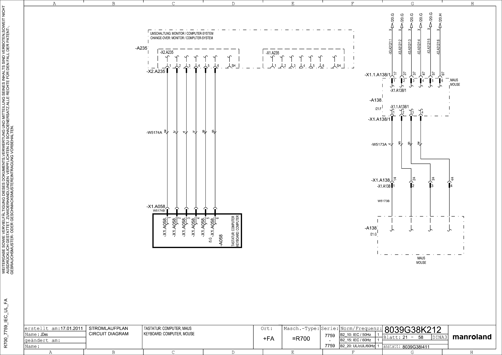

# +FA — Sheet 21 of 58 — TASTATUR: COMPUTER, MAUS

**KEYBOARD: COMPUTER, MOUSE**

> Part of the manroland **R700** printing press IEC/UL circuit diagrams.
> Drawing class: **Stromlaufplan / Circuit diagram** (DIN A3).
> Document `+FA` covers the **Delivery** machine section.

## At a glance

| Field | Value |
|---|---|
| Document | `+FA`  (8039G38K212) |
| Sheet | **21** of 58 |
| Section (DE) | TASTATUR: COMPUTER, MAUS |
| Section (EN) | KEYBOARD: COMPUTER, MOUSE |
| Section type | CIRCUIT — Circuit diagram |
| Machine type | `=R700` |
| Series | `7759` |
| Created | 17.01.2011 |
| Replaces | `8039G38I411` |
| Columns used | B, C, D, E, F, G, H |
| Path numbers | — |
| Labels on sheet | 106 |
| Cross-refs out | 9 |
| Cross-refs in | 28 |

**Previous:** [+FA sheet 20](SHEET_0020.md) · **Next:** [+FA sheet 22](SHEET_0022.md) · **Document TOC:** [_TOC.md](_TOC.md)  (+FA) · **Master TOC:** [all sheets](../_MASTER_TOC.md)

## Sheet image (300 DPI, exact vector render)



_Rendered directly from the PDF vector layer at 300 DPI (1-bit), no OCR and no resampling. Use it to confirm anything ambiguous in the text below._

## Cross-references on this sheet

Each entry is a wire leaving this sheet. The printed token is `/sheet.column`; the link resolves to that sheet inside the same document.

| Ref | Target sheet | Col | Path | Destination on target | Target section | From col |
|---|---|---|---|---|---|---|
| `/20.G` | [+FA sheet 20](SHEET_0020.md) | G | — | X X3.A312/1:5 | LEITSTAND RECHNER | G |
| `/20.G` | [+FA sheet 20](SHEET_0020.md) | G | — | X X3.A312/1:4 | LEITSTAND RECHNER | G |
| `/20.G` | [+FA sheet 20](SHEET_0020.md) | G | — | X X3.A312/1:3 | LEITSTAND RECHNER | G |
| `/20.G` | [+FA sheet 20](SHEET_0020.md) | G | — | X X3.A312/1:1 | LEITSTAND RECHNER | G |
| `/20.G` | [+FA sheet 20](SHEET_0020.md) | G | — | X X3.A312/1:2 | LEITSTAND RECHNER | G |
| `/20.H` | [+FA sheet 20](SHEET_0020.md) | H | — | X X3.A312/1:6 | LEITSTAND RECHNER | G |
| `/21.F` | [+FA sheet 21](SHEET_0021.md) | F | — | 1 2 3 4 | TASTATUR: COMPUTER, MAUS | G |
| `/21.G` | [+FA sheet 21](SHEET_0021.md) | G | — | — | TASTATUR: COMPUTER, MAUS | F |
| `/5.G` | [+FA sheet 5](SHEET_0005.md) | G | — | — | ANORDNUNGSPLAN | D |

### Incoming references (sheets that point here)

Every other sheet that sends a wire to this one. `Back-ref` is the token printed on *that* sheet; `Path` is its line number.

| From sheet | Cols | Back-ref | Path | Refs | What continues there |
|---|---|---|---|---|---|
| [+FA#5](SHEET_0005.md) | B, G | `/5.B`, `/5.G` | — | 2 | A682 |
| [+FA#20](SHEET_0020.md) | G | `/20.G` | — | 6 | X |
| [+FA#21](SHEET_0021.md) | F, G | `/21.F`, `/21.G` | — | 2 | 1 2 3 4 |
| [+FA#51](SHEET_0051.md) | D, E | `/51.D`, `/51.E` | — | 12 | — |
| [+FA#53](SHEET_0053.md) | D | `/53.D` | — | 6 | — |


## Devices on this sheet

| Tag | Class | Class meaning (IEC) | Col | Sub | Terminal | Sign |
|---|---|---|---|---|---|---|
| `A235` | A | Baugruppe / assembly, module, PC board | B | — | — | — |
| `A138` | A | Baugruppe / assembly, module, PC board | F | — | — | — |
| `A138` | A | Baugruppe / assembly, module, PC board | F | — | — | — |
| `A058` | A | Baugruppe / assembly, module, PC board | D | — | — | — |
| `X2.A235` | — | cross-device reference | C | — | — | — |
| `X1.A235` | — | cross-device reference | E | — | — | — |
| `X2.A235` | — | cross-device reference | C | — | — | — |
| `X1.A058.` | — | cross-device reference | D | — | — | — |
| `X1.A058.` | — | cross-device reference | C | — | — | — |
| `X1.A058.` | — | cross-device reference | C | — | — | — |
| `X1.A058.` | — | cross-device reference | C | — | — | — |
| `X1.A058.` | — | cross-device reference | C | — | — | — |
| `X1.A058.` | — | cross-device reference | C | — | — | — |
| `X1.A058` | — | cross-device reference | C | — | — | — |
| `X1.A138` | — | cross-device reference | F | — | — | — |

## Potentials / nets

_No named potentials on this sheet._

## Wire-end annotations (grouped as printed)

A wire that continues elsewhere is annotated with a small cluster: the destination description, the path/line number `#NN`, and the `/sheet.column` cross reference. Each row below is one such cluster exactly as it is grouped on the drawing.

| Col | Y | Path | Cross-ref | Text on the wire |
|---|---|---|---|---|
| G | 29.2 | — | `/20.G` | `X X3.A312/1:5` |
| G | 31.1 | — | `/20.G` | `X X3.A312/1:4` |
| G | 31.3 | — | `/20.G` | `X X3.A312/1:3` |
| G | 31.4 | — | `/20.G` | `X3.A312/1:1 X` |
| G | 31.8 | — | `/20.G` | `X X3.A312/1:2` |
| G | 32.0 | — | `/20.H` | `X X3.A312/1:6` |
| C | 76.5 | — | — | `UMSCHALTUNG: MONITOR / COMPUTER SYSTEM` |
| C | 87.1 | — | — | `CHANGE OVER: MONITOR / COMPUTER SYSTEM` |
| B | 109.4 | — | — | `A235` |
| D | 120.6 | — | — | `X2.A235 X1.A235` |
| D | 152.5 | — | — | `1 2 3 4 5 6 SH 1 2 3 4 5 6 SH` |
| C | 164.7 | — | — | `X2.A235` |
| G | 169.7 | — | — | `2/7` |
| G | 169.7 | — | — | `3/7` |
| G | 169.7 | — | — | `4/7` |
| G | 169.7 | — | — | `5/7` |
| G | 169.8 | — | — | `1/7` |
| H | 170.1 | — | — | `6/7` |
| F | 172.6 | — | — | `X1.1.A138/1` |
| H | 187.0 | — | — | `MAUS MOUSE` |
| G | 187.9 | — | — | `1 2 3 4 5 6` |
| G | 211.0 | — | — | `X1.A138/1` |
| F | 232.7 | — | — | `A138` |
| G | 249.6 | — | — | `X1.1.A138/1` |
| G | 255.0 | — | `/21.F` | `1 2 3 4` |
| F | 278.1 | — | — | `X1.A138/1` |
| C | 307.3 | — | — | `sw` |
| D | 307.8 | — | — | `gn` |
| D | 308.1 | — | — | `ge` |
| C | 309.6 | — | — | `br` |
| C | 309.6 | — | — | `or` |
| C | 310.3 | — | — | `W5174A` |
| C | 311.1 | — | — | `rt` |
| G | 335.1 | — | — | `ws` |
| G | 335.6 | — | — | `sw` |
| G | 336.2 | — | — | `gn` |
| F | 338.7 | — | — | `W5173A` |
| G | 339.5 | — | — | `rt` |
| G | 419.5 | — | — | `2/4` |
| G | 419.5 | — | — | `3/4` |
| H | 419.5 | — | — | `4/4` |
| G | 419.9 | — | — | `1/4` |
| F | 422.7 | — | — | `X1.A138` |
| G | 436.9 | — | — | `X1.A138 1 2 3 4` |
| G | 473.5 | — | — | `W5173B` |
| C | 485.0 | — | — | `X1.A058` |
| C | 496.2 | — | — | `W5174B` |
| D | 510.6 | — | — | `KEYBOARD: COMPUTER` |
| D | 512.0 | — | — | `TASTATUR: COMPUTER` |
| C | 514.2 | — | — | `X1.A058. 1` |
| C | 514.8 | — | — | `X1.A058. 2 X1.A058. 3` |
| C | 514.8 | — | — | `X1.A058. 4` |
| D | 514.8 | — | — | `X1.A058. 5` |
| D | 514.8 | — | — | `X1.A058. 6` |
| F | 536.0 | — | — | `A138` |
| F | 552.6 | — | `/21.G` | — |
| D | 555.9 | — | — | `A058` |
| D | 563.4 | — | `/5.G` | — |
| G | 609.4 | — | — | `MOUSE MAUS` |


## Reconstructed tables

This sheet carries tabular content (pin map / terminal assignment / index). The grid below was rebuilt from the drawing's own rule lines, so each row is exactly one physical row of the table.

### Table 1 — 1 data rows × 8 columns (at x=362.8, y=116.2)

| X2.A235 W5174A X1.A058 | X2.A235 sw W5174B | 1 br | 2 rt | 3 or | 4 ge | 5 gn | SH 6 |
|---|---|---|---|---|---|---|---|
|  | `X1.A058.` | `1 X1.A058.` | `X1.A058. 2` | `X1.A058. 3` | `X1.A058. 4` | `X1.A058. 5 /5.G` | `COMPUTER COMPUTER 6 KEYBOARD: TASTATUR: A058` |


## Notes and free text on this sheet

| Text | Col | Y (pt) |
|---|---|---|
| `SH` | D | 152.9 |
| `SH` | F | 152.9 |
| `UMSCHALTUNG: MONITOR / COMPUTER SYSTEM` | C | 76.47 |
| `CHANGE OVER: MONITOR / COMPUTER SYSTEM` | C | 87.1 |
| `X1.A138/1` | F | 278.11 |
| `X1.A138 1` | G | 436.86 |
| `MAUS` | G | 609.35 |
| `MOUSE` | G | 619.99 |
| `X1.1.A138/1` | G | 249.59 |
| `X1.A138/1` | G | 211.02 |
| `MAUS` | H | 186.98 |
| `MOUSE` | H | 197.63 |
| `TASTATUR: COMPUTER` | D | 512 |
| `KEYBOARD: COMPUTER` | D | 510.6 |
| `X1.1.A138/1` | F | 172.61 |
| `X3.A312/1:1` | G | 92.38 |
| `X3.A312/1:2` | G | 93.83 |
| `X3.A312/1:3` | G | 93.64 |
| `X3.A312/1:4` | G | 93.49 |
| `X3.A312/1:5` | G | 91.62 |
| `X3.A312/1:6` | G | 93.8 |
| `W5173B` | G | 473.5 |
| `W5174B` | C | 496.17 |
| `W5173A` | F | 338.69 |
| `rt` | G | 339.49 |
| `ws` | G | 335.06 |
| `gn` | G | 336.19 |
| `sw` | G | 335.63 |
| `W5174A` | C | 310.34 |
| `sw` | C | 307.28 |
| `or` | C | 309.62 |
| `ge` | D | 308.12 |
| `gn` | D | 307.84 |
| `rt` | C | 311.14 |
| `br` | C | 309.62 |

## Complete label inventory (exact text from the drawing)

Every text object inside the drawing area of this sheet, in DIN reading order (column A→H, then top→bottom). This is the authoritative list: if a string is not here it is not printed on this sheet.

| Col | Y | X | Dir | Type | Text |
|---|---|---|---|---|---|
| B | 109.4 | 320.9 | → | device tag | `A235` |
| C | 76.5 | 356.3 | → | text | `UMSCHALTUNG: MONITOR / COMPUTER SYSTEM` |
| C | 87.1 | 356.9 | → | text | `CHANGE OVER: MONITOR / COMPUTER SYSTEM` |
| C | 120.6 | 379.6 | → | device ref | `X2.A235` |
| C | 152.5 | 401.7 | → | number | `1` |
| C | 152.8 | 424.9 | → | number | `2` |
| C | 152.9 | 447.6 | → | number | `3` |
| C | 152.9 | 470.3 | → | number | `4` |
| C | 164.7 | 347.5 | → | device ref | `X2.A235` |
| C | 307.3 | 388.3 | ↕ | text | `sw` |
| C | 309.6 | 410.9 | ↕ | text | `br` |
| C | 309.6 | 456.4 | ↕ | text | `or` |
| C | 310.3 | 347.2 | → | text | `W5174A` |
| C | 311.1 | 433.4 | ↕ | text | `rt` |
| C | 485.0 | 347.5 | → | device ref | `X1.A058` |
| C | 496.2 | 362.8 | → | text | `W5174B` |
| C | 514.2 | 399.1 | ↕ | number | `1` |
| C | 514.8 | 385.8 | ↕ | device ref | `X1.A058.` |
| C | 514.8 | 408.5 | ↕ | device ref | `X1.A058.` |
| C | 514.8 | 431.2 | ↕ | device ref | `X1.A058.` |
| C | 514.8 | 453.9 | ↕ | device ref | `X1.A058.` |
| C | 514.8 | 476.5 | ↕ | device ref | `X1.A058.` |
| C | 515.3 | 422.1 | ↕ | number | `2` |
| C | 515.6 | 444.9 | ↕ | number | `3` |
| C | 515.6 | 467.6 | ↕ | number | `4` |
| D | 152.9 | 492.9 | → | number | `5` |
| D | 152.9 | 515.6 | → | number | `6` |
| D | 152.9 | 549.6 | → | text | `SH` |
| D | 307.8 | 501.6 | ↕ | text | `gn` |
| D | 308.1 | 479.0 | ↕ | text | `ge` |
| D | 510.6 | 560.5 | ↕ | text | `KEYBOARD: COMPUTER` |
| D | 512.0 | 549.8 | ↕ | text | `TASTATUR: COMPUTER` |
| D | 514.8 | 499.2 | ↕ | device ref | `X1.A058.` |
| D | 515.6 | 490.2 | ↕ | number | `5` |
| D | 515.6 | 512.9 | ↕ | number | `6` |
| D | 555.9 | 519.0 | ↕ | device tag | `A058` |
| D | 563.4 | 495.9 | ↕ | cross-reference | `/5.G` |
| E | 122.0 | 630.4 | → | device ref | `X1.A235` |
| E | 152.5 | 651.1 | → | number | `1` |
| E | 152.8 | 674.4 | → | number | `2` |
| E | 152.9 | 697.0 | → | number | `3` |
| E | 152.9 | 719.7 | → | number | `4` |
| E | 152.9 | 742.4 | → | number | `5` |
| F | 152.9 | 765.1 | → | number | `6` |
| F | 152.9 | 799.1 | → | text | `SH` |
| F | 172.6 | 864.8 | → | text | `X1.1.A138/1` |
| F | 232.7 | 876.5 | → | device tag | `A138` |
| F | 255.0 | 890.2 | → | cross-reference | `/21.F` |
| F | 278.1 | 873.1 | → | text | `X1.A138/1` |
| F | 338.7 | 880.2 | → | text | `W5173A` |
| F | 422.7 | 880.4 | → | device ref | `X1.A138` |
| F | 536.1 | 865.1 | → | device tag | `A138` |
| F | 552.7 | 878.0 | → | cross-reference | `/21.G` |
| G | 29.3 | 1017.9 | ↕ | cross-reference | `/20.G` |
| G | 31.1 | 994.5 | ↕ | cross-reference | `/20.G` |
| G | 31.3 | 972.5 | ↕ | cross-reference | `/20.G` |
| G | 31.4 | 927.0 | ↕ | cross-reference | `/20.G` |
| G | 31.7 | 949.8 | ↕ | cross-reference | `/20.G` |
| G | 32.0 | 1040.5 | ↕ | cross-reference | `/20.H` |
| G | 66.4 | 1014.0 | ↕ | not fitted | `X` |
| G | 68.3 | 990.6 | ↕ | not fitted | `X` |
| G | 68.4 | 968.6 | ↕ | not fitted | `X` |
| G | 68.6 | 923.1 | ↕ | not fitted | `X` |
| G | 68.6 | 1036.6 | ↕ | not fitted | `X` |
| G | 68.9 | 945.9 | ↕ | not fitted | `X` |
| G | 91.6 | 1014.0 | ↕ | text | `X3.A312/1:5` |
| G | 92.4 | 923.1 | ↕ | text | `X3.A312/1:1` |
| G | 93.5 | 990.6 | ↕ | text | `X3.A312/1:4` |
| G | 93.6 | 968.6 | ↕ | text | `X3.A312/1:3` |
| G | 93.8 | 945.9 | ↕ | text | `X3.A312/1:2` |
| G | 93.8 | 1036.6 | ↕ | text | `X3.A312/1:6` |
| G | 169.7 | 957.2 | ↕ | pin pair | `2/7` |
| G | 169.7 | 979.9 | ↕ | pin pair | `3/7` |
| G | 169.7 | 1002.1 | ↕ | pin pair | `4/7` |
| G | 169.7 | 1025.2 | ↕ | pin pair | `5/7` |
| G | 169.8 | 934.4 | ↕ | pin pair | `1/7` |
| G | 187.9 | 933.2 | → | number | `1` |
| G | 188.3 | 956.4 | → | number | `2` |
| G | 188.3 | 979.1 | → | number | `3` |
| G | 188.3 | 1001.8 | → | number | `4` |
| G | 188.3 | 1024.4 | → | number | `5` |
| G | 188.3 | 1047.1 | → | number | `6` |
| G | 211.0 | 925.5 | → | text | `X1.A138/1` |
| G | 249.6 | 925.2 | → | text | `X1.1.A138/1` |
| G | 263.0 | 931.7 | → | number | `1` |
| G | 263.4 | 955.0 | → | number | `2` |
| G | 263.5 | 977.7 | → | number | `3` |
| G | 263.5 | 1000.3 | → | number | `4` |
| G | 335.1 | 943.9 | ↕ | text | `ws` |
| G | 335.6 | 989.2 | ↕ | text | `sw` |
| G | 336.2 | 966.5 | ↕ | text | `gn` |
| G | 339.5 | 921.0 | ↕ | text | `rt` |
| G | 419.5 | 979.3 | ↕ | pin pair | `2/4` |
| G | 419.5 | 1024.6 | ↕ | pin pair | `3/4` |
| G | 419.9 | 933.8 | ↕ | pin pair | `1/4` |
| G | 436.9 | 894.4 | → | text | `X1.A138 1` |
| G | 436.9 | 977.7 | → | number | `2` |
| G | 436.9 | 1023.0 | → | number | `3` |
| G | 473.5 | 895.7 | → | text | `W5173B` |
| G | 609.3 | 990.1 | → | text | `MAUS` |
| G | 620.0 | 987.7 | → | text | `MOUSE` |
| H | 170.0 | 1047.9 | ↕ | pin pair | `6/7` |
| H | 187.0 | 1068.1 | → | text | `MAUS` |
| H | 197.6 | 1068.1 | → | text | `MOUSE` |
| H | 419.5 | 1070.0 | ↕ | pin pair | `4/4` |
| H | 436.9 | 1068.4 | → | number | `4` |

## Reading-order text block

The same content as a plain block, grouped by DIN column — convenient to paste or to match against a visual description.

```text
=== Column B ===
 109.4  320.9  devtag       A235
=== Column C ===
  76.5  356.3  text         UMSCHALTUNG: MONITOR / COMPUTER SYSTEM
  87.1  356.9  text         CHANGE OVER: MONITOR / COMPUTER SYSTEM
 120.6  379.6  devref       X2.A235
 152.5  401.7  numeric      1
 152.8  424.9  numeric      2
 152.9  447.6  numeric      3
 152.9  470.3  numeric      4
 164.7  347.5  devref       X2.A235
 307.3  388.3  text         sw
 309.6  410.9  text         br
 309.6  456.4  text         or
 310.3  347.2  text         W5174A
 311.1  433.4  text         rt
 485.0  347.5  devref       X1.A058
 496.2  362.8  text         W5174B
 514.2  399.1  numeric      1
 514.8  385.8  devref       X1.A058.
 514.8  408.5  devref       X1.A058.
 514.8  431.2  devref       X1.A058.
 514.8  453.9  devref       X1.A058.
 514.8  476.5  devref       X1.A058.
 515.3  422.1  numeric      2
 515.6  444.9  numeric      3
 515.6  467.6  numeric      4
=== Column D ===
 152.9  492.9  numeric      5
 152.9  515.6  numeric      6
 152.9  549.6  text         SH
 307.8  501.6  text         gn
 308.1  479.0  text         ge
 510.6  560.5  text         KEYBOARD: COMPUTER
 512.0  549.8  text         TASTATUR: COMPUTER
 514.8  499.2  devref       X1.A058.
 515.6  490.2  numeric      5
 515.6  512.9  numeric      6
 555.9  519.0  devtag       A058
 563.4  495.9  xref         /5.G
=== Column E ===
 122.0  630.4  devref       X1.A235
 152.5  651.1  numeric      1
 152.8  674.4  numeric      2
 152.9  697.0  numeric      3
 152.9  719.7  numeric      4
 152.9  742.4  numeric      5
=== Column F ===
 152.9  765.1  numeric      6
 152.9  799.1  text         SH
 172.6  864.8  text         X1.1.A138/1
 232.7  876.5  devtag       A138
 255.0  890.2  xref         /21.F
 278.1  873.1  text         X1.A138/1
 338.7  880.2  text         W5173A
 422.7  880.4  devref       X1.A138
 536.1  865.1  devtag       A138
 552.7  878.0  xref         /21.G
=== Column G ===
  29.3 1017.9  xref         /20.G
  31.1  994.5  xref         /20.G
  31.3  972.5  xref         /20.G
  31.4  927.0  xref         /20.G
  31.7  949.8  xref         /20.G
  32.0 1040.5  xref         /20.H
  66.4 1014.0  placeholder  X
  68.3  990.6  placeholder  X
  68.4  968.6  placeholder  X
  68.6  923.1  placeholder  X
  68.6 1036.6  placeholder  X
  68.9  945.9  placeholder  X
  91.6 1014.0  text         X3.A312/1:5
  92.4  923.1  text         X3.A312/1:1
  93.5  990.6  text         X3.A312/1:4
  93.6  968.6  text         X3.A312/1:3
  93.8  945.9  text         X3.A312/1:2
  93.8 1036.6  text         X3.A312/1:6
 169.7  957.2  pinpair      2/7
 169.7  979.9  pinpair      3/7
 169.7 1002.1  pinpair      4/7
 169.7 1025.2  pinpair      5/7
 169.8  934.4  pinpair      1/7
 187.9  933.2  numeric      1
 188.3  956.4  numeric      2
 188.3  979.1  numeric      3
 188.3 1001.8  numeric      4
 188.3 1024.4  numeric      5
 188.3 1047.1  numeric      6
 211.0  925.5  text         X1.A138/1
 249.6  925.2  text         X1.1.A138/1
 263.0  931.7  numeric      1
 263.4  955.0  numeric      2
 263.5  977.7  numeric      3
 263.5 1000.3  numeric      4
 335.1  943.9  text         ws
 335.6  989.2  text         sw
 336.2  966.5  text         gn
 339.5  921.0  text         rt
 419.5  979.3  pinpair      2/4
 419.5 1024.6  pinpair      3/4
 419.9  933.8  pinpair      1/4
 436.9  894.4  text         X1.A138 1
 436.9  977.7  numeric      2
 436.9 1023.0  numeric      3
 473.5  895.7  text         W5173B
 609.3  990.1  text         MAUS
 620.0  987.7  text         MOUSE
=== Column H ===
 170.0 1047.9  pinpair      6/7
 187.0 1068.1  text         MAUS
 197.6 1068.1  text         MOUSE
 419.5 1070.0  pinpair      4/4
 436.9 1068.4  numeric      4
```

---
_Generated from the PDF vector text layer; no OCR. Source: `R700_7759_IEC_UL_FA`, sheet 21._
