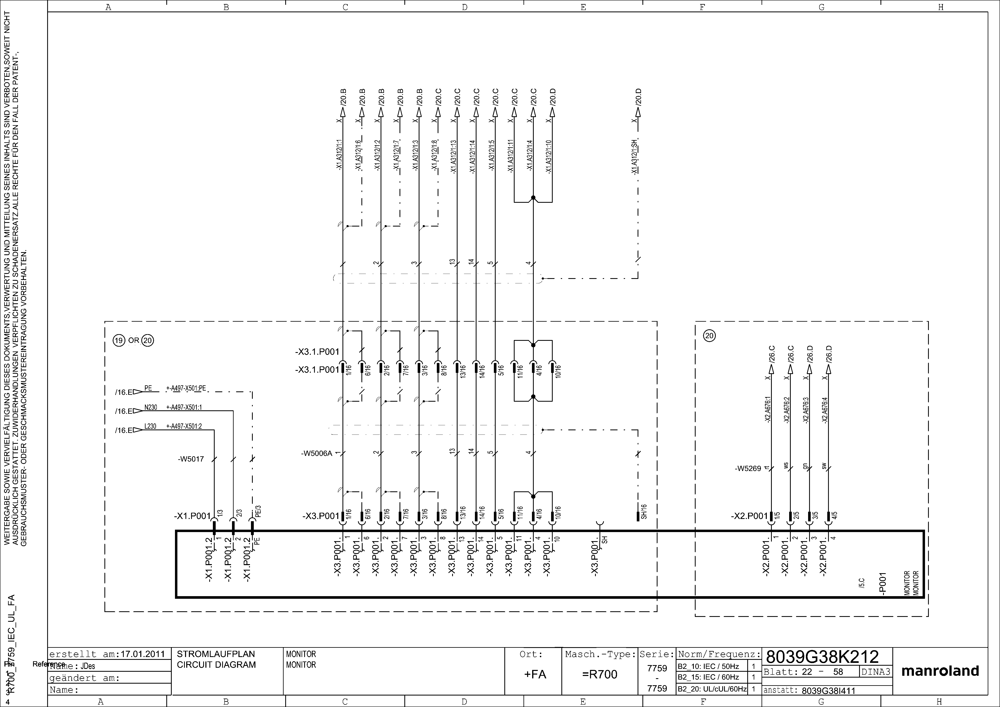

# +FA — Sheet 22 of 58 — MONITOR

**MONITOR**

> Part of the manroland **R700** printing press IEC/UL circuit diagrams.
> Drawing class: **Stromlaufplan / Circuit diagram** (DIN A3).
> Document `+FA` covers the **Delivery** machine section.

## At a glance

| Field | Value |
|---|---|
| Document | `+FA`  (8039G38K212) |
| Sheet | **22** of 58 |
| Section (DE) | MONITOR |
| Section (EN) | MONITOR |
| Section type | CIRCUIT — Circuit diagram |
| Machine type | `=R700` |
| Series | `7759` |
| Created | 17.01.2011 |
| Replaces | `8039G38I411` |
| Columns used | A, B, C, D, E, F, G, H |
| Path numbers | — |
| Labels on sheet | 165 |
| Cross-refs out | 21 |
| Cross-refs in | 27 |

**Previous:** [+FA sheet 21](SHEET_0021.md) · **Next:** [+FA sheet 23](SHEET_0023.md) · **Document TOC:** [_TOC.md](_TOC.md)  (+FA) · **Master TOC:** [all sheets](../_MASTER_TOC.md)

## Sheet image (300 DPI, exact vector render)



_Rendered directly from the PDF vector layer at 300 DPI (1-bit), no OCR and no resampling. Use it to confirm anything ambiguous in the text below._

## Cross-references on this sheet

Each entry is a wire leaving this sheet. The printed token is `/sheet.column`; the link resolves to that sheet inside the same document.

| Ref | Target sheet | Col | Path | Destination on target | Target section | From col |
|---|---|---|---|---|---|---|
| `/20.C` | [+FA sheet 20](SHEET_0020.md) | C | — | X X1.A312/1:8 | LEITSTAND RECHNER | D |
| `/20.C` | [+FA sheet 20](SHEET_0020.md) | C | — | X X1.A312/1:13 | LEITSTAND RECHNER | D |
| `/20.C` | [+FA sheet 20](SHEET_0020.md) | C | — | X X1.A312/1:14 | LEITSTAND RECHNER | D |
| `/20.C` | [+FA sheet 20](SHEET_0020.md) | C | — | X X1.A312/1:5 | LEITSTAND RECHNER | D |
| `/20.C` | [+FA sheet 20](SHEET_0020.md) | C | — | X X1.A312/1:11 | LEITSTAND RECHNER | D |
| `/20.C` | [+FA sheet 20](SHEET_0020.md) | C | — | X X1.A312/1:4 | LEITSTAND RECHNER | E |
| `/20.D` | [+FA sheet 20](SHEET_0020.md) | D | — | X X1.A312/1:10 | LEITSTAND RECHNER | E |
| `/20.D` | [+FA sheet 20](SHEET_0020.md) | D | — | X X1.A312/1:SH | LEITSTAND RECHNER | E |
| `/20.B` | [+FA sheet 20](SHEET_0020.md) | B | — | X X1.A312/1:1 | LEITSTAND RECHNER | C |
| `/20.B` | [+FA sheet 20](SHEET_0020.md) | B | — | X X1.A312/1:6 | LEITSTAND RECHNER | C |
| `/20.B` | [+FA sheet 20](SHEET_0020.md) | B | — | X X1.A312/1:2 | LEITSTAND RECHNER | C |
| `/20.B` | [+FA sheet 20](SHEET_0020.md) | B | — | X X1.A312/1:7 | LEITSTAND RECHNER | C |
| `/20.B` | [+FA sheet 20](SHEET_0020.md) | B | — | X X1.A312/1:3 | LEITSTAND RECHNER | D |
| `/26.C` | [+FA sheet 26](SHEET_0026.md) | C | — | X X2.A676:1 | USB ANSCHLUSS | G |
| `/26.C` | [+FA sheet 26](SHEET_0026.md) | C | — | X X2.A676:2 | USB ANSCHLUSS | G |
| `/26.D` | [+FA sheet 26](SHEET_0026.md) | D | — | X X2.A676:3 | USB ANSCHLUSS | G |
| `/26.D` | [+FA sheet 26](SHEET_0026.md) | D | — | X X2.A676:4 | USB ANSCHLUSS | G |
| `/16.E` | [+FA sheet 16](SHEET_0016.md) | E | — | PE + A497 X501:PE | SPANNUNGSVERSORGUNG: | A |
| `/16.E` | [+FA sheet 16](SHEET_0016.md) | E | — | N230 + A497 X501:1 | SPANNUNGSVERSORGUNG: | A |
| `/16.E` | [+FA sheet 16](SHEET_0016.md) | E | — | L230 + A497 X501:2 | SPANNUNGSVERSORGUNG: | A |
| `/5.C` | [+FA sheet 5](SHEET_0005.md) | C | — | — | ANORDNUNGSPLAN | G |

### Incoming references (sheets that point here)

Every other sheet that sends a wire to this one. `Back-ref` is the token printed on *that* sheet; `Path` is its line number.

| From sheet | Cols | Back-ref | Path | Refs | What continues there |
|---|---|---|---|---|---|
| [+FA#5](SHEET_0005.md) | B | `/5.B` | — | 1 | — |
| [+FA#16](SHEET_0016.md) | E | `/16.E` | — | 3 | N230 X1.P001:2; PE X1.P001:PE; X1.P001:1 L230 |
| [+FA#20](SHEET_0020.md) | B, C, D | `/20.B`, `/20.C`, `/20.D` | — | 13 | X |
| [+FA#26](SHEET_0026.md) | C, D | `/26.C`, `/26.D` | — | 4 | X2.P001:1 X; X2.P001:2 X; X2.P001:3 X; X2.P001:4 X |
| [+FA#51](SHEET_0051.md) | D, E | `/51.D`, `/51.E` | — | 6 | — |


## Devices on this sheet

| Tag | Class | Class meaning (IEC) | Col | Sub | Terminal | Sign |
|---|---|---|---|---|---|---|
| `P001` | P | Messgeraet / measuring instrument, meter | H | — | — | — |
| `N230` | N | Netzteil / power unit, amplifier | A | — | — | — |
| `W5017` | W | Kabel / cable, line, bus | B | — | — | — |
| `W5269` | W | Kabel / cable, line, bus | F | — | — | — |
| `X1.P001.2` | — | cross-device reference | B | — | — | — |
| `X1.P001.2` | — | cross-device reference | B | — | — | — |
| `X1.P001.2` | — | cross-device reference | B | — | — | — |
| `X3.P001.` | — | cross-device reference | C | — | — | — |
| `X3.P001.` | — | cross-device reference | C | — | — | — |
| `X3.P001.` | — | cross-device reference | D | — | — | — |
| `X3.P001.` | — | cross-device reference | C | — | — | — |
| `X3.P001.` | — | cross-device reference | C | — | — | — |
| `X3.P001.` | — | cross-device reference | D | — | — | — |
| `X3.P001.` | — | cross-device reference | D | — | — | — |
| `X3.P001.` | — | cross-device reference | D | — | — | — |
| `X3.P001.` | — | cross-device reference | D | — | — | — |
| `X3.P001.` | — | cross-device reference | E | — | — | — |
| `X3.P001.` | — | cross-device reference | E | — | — | — |
| `X3.P001.` | — | cross-device reference | D | — | — | — |
| `X3.P001.` | — | cross-device reference | E | — | — | — |
| `X1.P001` | — | cross-device reference | B | — | — | — |
| `X2.P001` | — | cross-device reference | F | — | — | — |
| `X2.A676:1` | — | cross-device reference | G | — | 1 | — |
| `X2.A676:2` | — | cross-device reference | G | — | 2 | — |
| `X2.A676:3` | — | cross-device reference | G | — | 3 | — |
| `X2.A676:4` | — | cross-device reference | G | — | 4 | — |
| `X2.P001.` | — | cross-device reference | G | — | — | — |
| `X2.P001.` | — | cross-device reference | G | — | — | — |
| `X2.P001.` | — | cross-device reference | G | — | — | — |
| `X2.P001.` | — | cross-device reference | G | — | — | — |
| `X3.1.P001` | — | cross-device reference | C | — | — | — |
| `X3.1.P001` | — | cross-device reference | C | — | — | — |
| `X3.P001` | — | cross-device reference | C | — | — | — |

## Potentials / nets

| Potential | Count | Columns | Attached devices | Terminals |
|---|---|---|---|---|
| `L230` | 1 | A | — | — |
| `PE` | 3 | A, B | — | — |


A potential such as `L24+/4` or `M24+` is a named supply/return rail; every place it appears on this sheet is electrically common.

## Wire-end annotations (grouped as printed)

A wire that continues elsewhere is annotated with a small cluster: the destination description, the path/line number `#NN`, and the `/sheet.column` cross reference. Each row below is one such cluster exactly as it is grouped on the drawing.

| Col | Y | Path | Cross-ref | Text on the wire |
|---|---|---|---|---|
| D | 105.2 | — | `/20.C` | `X X1.A312/1:8` |
| D | 105.2 | — | `/20.C` | `X X1.A312/1:13` |
| D | 105.2 | — | `/20.C` | `X X1.A312/1:14` |
| D | 105.2 | — | `/20.C` | `X X1.A312/1:5` |
| D | 105.2 | — | `/20.C` | `X X1.A312/1:11` |
| E | 105.2 | — | `/20.C` | `X X1.A312/1:4` |
| E | 105.2 | — | `/20.D` | `X X1.A312/1:10` |
| E | 105.2 | — | `/20.D` | `X X1.A312/1:SH` |
| C | 105.5 | — | `/20.B` | `X1.A312/1:1 X` |
| C | 105.5 | — | `/20.B` | `X X1.A312/1:6` |
| C | 105.5 | — | `/20.B` | `X X1.A312/1:2` |
| C | 105.5 | — | `/20.B` | `X X1.A312/1:7` |
| D | 105.5 | — | `/20.B` | `X X1.A312/1:3` |
| D | 308.3 | — | — | `13` |
| D | 308.3 | — | — | `14` |
| C | 311.3 | — | — | `2` |
| D | 311.3 | — | — | `3` |
| D | 311.3 | — | — | `5` |
| E | 311.3 | — | — | `4` |
| D | 396.0 | — | — | `19 20` |
| A | 401.4 | — | — | `OR 20` |
| G | 411.3 | — | `/26.C` | `X2.A676:1 X` |
| G | 411.3 | — | `/26.C` | `X X2.A676:2` |
| G | 411.3 | — | `/26.D` | `X X2.A676:3` |
| G | 411.3 | — | `/26.D` | `X X2.A676:4` |
| C | 414.2 | — | — | `X3.1.P001` |
| C | 435.1 | — | — | `1/16` |
| C | 435.1 | — | — | `6/16` |
| C | 435.1 | — | — | `2/16` |
| D | 435.1 | — | — | `7/16` |
| D | 435.1 | — | — | `3/16` |
| D | 435.1 | — | — | `8/16` |
| D | 435.1 | — | — | `13/16` |
| D | 435.1 | — | — | `14/16` |
| D | 435.1 | — | — | `5/16` |
| D | 435.1 | — | — | `11/16` |
| E | 435.1 | — | — | `4/16` |
| E | 435.1 | — | — | `10/16` |
| C | 435.7 | — | — | `X3.1.P001` |
| A | 459.2 | — | `/16.E` | `PE + A497 X501:PE` |
| A | 482.1 | — | `/16.E` | `N230 + A497 X501:1` |
| A | 504.7 | — | `/16.E` | `L230 + A497 X501:2` |
| D | 533.9 | — | — | `13` |
| D | 533.9 | — | — | `14` |
| C | 535.9 | — | — | `W5006A` |
| C | 536.9 | — | — | `1` |
| C | 536.9 | — | — | `2` |
| D | 537.0 | — | — | `3` |
| D | 537.0 | — | — | `5` |
| E | 537.0 | — | — | `4` |
| B | 542.8 | — | — | `W5017` |
| G | 550.5 | — | — | `ws` |
| G | 551.1 | — | — | `sw` |
| G | 551.6 | — | — | `gn` |
| F | 554.1 | — | — | `W5269` |
| G | 554.9 | — | — | `rt` |
| F | 600.8 | — | — | `SH/16` |
| B | 602.0 | — | — | `PE/3` |
| D | 603.0 | — | — | `13/16` |
| D | 603.0 | — | — | `14/16` |
| D | 603.0 | — | — | `11/16` |
| E | 603.0 | — | — | `10/16` |
| C | 606.0 | — | — | `6/16` |
| C | 606.0 | — | — | `2/16` |
| D | 606.0 | — | — | `7/16` |
| D | 606.0 | — | — | `3/16` |
| D | 606.0 | — | — | `8/16` |
| D | 606.0 | — | — | `5/16` |
| E | 606.0 | — | — | `4/16` |
| C | 606.4 | — | — | `1/16` |
| B | 606.6 | — | — | `2/3` |
| B | 607.0 | — | — | `1/3` |
| G | 609.4 | — | — | `2/5` |
| G | 609.4 | — | — | `3/5` |
| G | 609.4 | — | — | `4/5` |
| B | 609.8 | — | — | `X1.P001` |
| C | 609.8 | — | — | `X3.P001` |
| F | 609.8 | — | — | `X2.P001` |
| G | 609.8 | — | — | `1/5` |
| C | 637.5 | — | — | `X3.P001. 1` |
| D | 637.5 | — | — | `X3.P001. 11` |
| G | 637.5 | — | — | `X2.P001. 1` |
| E | 638.4 | — | — | `X3.P001. SH` |
| C | 638.6 | — | — | `X3.P001. 2` |
| G | 638.6 | — | — | `X2.P001. 2` |
| B | 638.9 | — | — | `X1.P001.2 1` |
| C | 638.9 | — | — | `X3.P001. 6` |
| C | 638.9 | — | — | `X3.P001. 7` |
| D | 638.9 | — | — | `X3.P001. 3` |
| D | 638.9 | — | — | `X3.P001. 8` |
| D | 638.9 | — | — | `X3.P001. 13` |
| D | 638.9 | — | — | `X3.P001. 14` |
| D | 638.9 | — | — | `X3.P001. 5` |
| E | 638.9 | — | — | `X3.P001. 4` |
| E | 638.9 | — | — | `X3.P001. 10` |
| G | 638.9 | — | — | `X2.P001. 3` |
| G | 638.9 | — | — | `X2.P001. 4` |
| B | 640.1 | — | — | `X1.P001.2 2` |
| B | 640.1 | — | — | `X1.P001.2 PE` |
| H | 679.8 | — | — | `MONITOR` |
| H | 679.8 | — | — | `MONITOR` |
| H | 680.6 | — | — | `P001` |
| G | 688.6 | — | `/5.C` | — |


## Reconstructed tables

This sheet carries tabular content (pin map / terminal assignment / index). The grid below was rebuilt from the drawing's own rule lines, so each row is exactly one physical row of the table.

### Table 1 — 4 data rows × 17 columns (at x=209.8, y=326.0)

| + A497 X501:PE |  |  | X3.1.P001 X3.1.P001 | 1/16 | 6/16 | 2/16 | 7/16 | 3/16 | 8/16 | 13/16 | 14/16 | 5/16 | 11/16 | 4/16 | 10/16 |  |
|---|---|---|---|---|---|---|---|---|---|---|---|---|---|---|---|---|
| `+ A497 X501:1` |  |  |  |  |  |  |  |  |  |  |  |  |  |  |  |  |
| `+ A497 X501:2` |  |  |  |  |  |  |  |  |  |  |  |  |  |  |  |  |
| `W5017 X1.P001` | `1/3` | `2/3` | `W5006A 1 PE/3 X3.P001` | `1/16` | `2 6/16` | `2/16` | `3 7/16` | `3/16` | `13 8/16` | `14 13/16` | `5 14/16` | `5/16` | `4 11/16` | `4/16` | `10/16` |  |
| `X1.P001.2` | `1 X1.P001.2` | `2 X1.P001.2` | `X3.P001. PE` | `1 X3.P001.` | `6 X3.P001.` | `2 X3.P001.` | `7 X3.P001.` | `3 X3.P001.` | `8 X3.P001.` | `13 X3.P001.` | `14 X3.P001.` | `5 X3.P001.` | `11 X3.P001.` | `4 X3.P001.` | `10 X3.P001.` | `SH` |


## Notes and free text on this sheet

| Text | Col | Y (pt) |
|---|---|---|
| `MONITOR` | H | 679.8 |
| `SH` | E | 638.36 |
| `+ A497 X501:PE` | B | 459.38 |
| `+ A497 X501:1` | B | 482.05 |
| `+ A497 X501:2` | B | 504.75 |
| `OR` | A | 401.42 |
| `SH/16` | F | 600.76 |
| `X1.A312/1:1` | C | 165.55 |
| `X1.A312/1:6` | C | 166.96 |
| `X1.A312/1:2` | C | 166.68 |
| `X1.A312/1:7` | C | 166.96 |
| `X1.A312/1:3` | D | 166.96 |
| `X1.A312/1:8` | D | 166.96 |
| `X1.A312/1:13` | D | 166.96 |
| `X1.A312/1:14` | D | 166.96 |
| `X1.A312/1:5` | D | 166.96 |
| `X1.A312/1:11` | D | 165.54 |
| `X1.A312/1:4` | E | 166.96 |
| `X1.A312/1:10` | E | 166.96 |
| `X1.A312/1:SH` | E | 166.39 |
| `rt` | G | 554.92 |
| `ws` | G | 550.49 |
| `gn` | G | 551.62 |
| `sw` | G | 551.06 |
| `W5006A` | C | 535.94 |

## Complete label inventory (exact text from the drawing)

Every text object inside the drawing area of this sheet, in DIN reading order (column A→H, then top→bottom). This is the authoritative list: if a string is not here it is not printed on this sheet.

| Col | Y | X | Dir | Type | Text |
|---|---|---|---|---|---|
| A | 401.4 | 152.8 | → | text | `OR` |
| A | 401.7 | 136.3 | → | number | `19` |
| A | 401.7 | 170.9 | → | number | `20` |
| A | 459.2 | 172.1 | → | potential | `PE` |
| A | 463.3 | 137.2 | → | cross-reference | `/16.E` |
| A | 482.0 | 172.1 | → | device tag | `N230` |
| A | 485.9 | 137.2 | → | cross-reference | `/16.E` |
| A | 504.7 | 172.1 | → | potential | `L230` |
| A | 508.6 | 137.2 | → | cross-reference | `/16.E` |
| B | 459.4 | 198.1 | → | text | `+ A497 X501:PE` |
| B | 482.0 | 198.1 | → | text | `+ A497 X501:1` |
| B | 504.7 | 198.1 | → | text | `+ A497 X501:2` |
| B | 542.8 | 211.7 | → | device tag | `W5017` |
| B | 602.0 | 304.6 | ↕ | potential | `PE/3` |
| B | 606.6 | 281.9 | ↕ | pin pair | `2/3` |
| B | 607.0 | 259.2 | ↕ | pin pair | `1/3` |
| B | 609.8 | 207.2 | → | device ref | `X1.P001` |
| B | 638.9 | 257.3 | ↕ | number | `1` |
| B | 640.1 | 244.1 | ↕ | device ref | `X1.P001.2` |
| B | 640.1 | 266.8 | ↕ | device ref | `X1.P001.2` |
| B | 640.1 | 280.4 | ↕ | number | `2` |
| B | 640.1 | 289.4 | ↕ | device ref | `X1.P001.2` |
| B | 640.1 | 303.1 | ↕ | potential | `PE` |
| C | 105.4 | 404.9 | ↕ | cross-reference | `/20.B` |
| C | 105.4 | 427.6 | ↕ | cross-reference | `/20.B` |
| C | 105.4 | 450.2 | ↕ | cross-reference | `/20.B` |
| C | 105.4 | 472.9 | ↕ | cross-reference | `/20.B` |
| C | 141.7 | 401.0 | ↕ | not fitted | `X` |
| C | 141.7 | 423.7 | ↕ | not fitted | `X` |
| C | 141.7 | 446.3 | ↕ | not fitted | `X` |
| C | 141.7 | 469.0 | ↕ | not fitted | `X` |
| C | 165.5 | 401.0 | ↕ | text | `X1.A312/1:1` |
| C | 166.7 | 446.4 | ↕ | text | `X1.A312/1:2` |
| C | 167.0 | 423.7 | ↕ | text | `X1.A312/1:6` |
| C | 167.0 | 469.1 | ↕ | text | `X1.A312/1:7` |
| C | 311.3 | 444.8 | ↕ | number | `2` |
| C | 414.2 | 351.5 | → | device ref | `X3.1.P001` |
| C | 435.1 | 412.3 | ↕ | pin pair | `1/16` |
| C | 435.1 | 435.0 | ↕ | pin pair | `6/16` |
| C | 435.1 | 457.7 | ↕ | pin pair | `2/16` |
| C | 435.7 | 351.5 | → | device ref | `X3.1.P001` |
| C | 535.9 | 358.6 | → | text | `W5006A` |
| C | 536.9 | 399.1 | ↕ | number | `1` |
| C | 536.9 | 444.8 | ↕ | number | `2` |
| C | 606.0 | 435.0 | ↕ | pin pair | `6/16` |
| C | 606.0 | 457.7 | ↕ | pin pair | `2/16` |
| C | 606.4 | 412.3 | ↕ | pin pair | `1/16` |
| C | 609.8 | 360.3 | → | device ref | `X3.P001` |
| C | 637.5 | 410.4 | ↕ | number | `1` |
| C | 638.6 | 456.1 | ↕ | number | `2` |
| C | 638.9 | 433.5 | ↕ | number | `6` |
| C | 639.5 | 397.2 | ↕ | device ref | `X3.P001.` |
| C | 639.5 | 419.8 | ↕ | device ref | `X3.P001.` |
| C | 639.5 | 442.5 | ↕ | device ref | `X3.P001.` |
| C | 639.5 | 465.2 | ↕ | device ref | `X3.P001.` |
| D | 105.2 | 518.3 | ↕ | cross-reference | `/20.C` |
| D | 105.2 | 541.0 | ↕ | cross-reference | `/20.C` |
| D | 105.2 | 563.7 | ↕ | cross-reference | `/20.C` |
| D | 105.2 | 586.3 | ↕ | cross-reference | `/20.C` |
| D | 105.2 | 609.0 | ↕ | cross-reference | `/20.C` |
| D | 105.4 | 495.6 | ↕ | cross-reference | `/20.B` |
| D | 141.7 | 491.7 | ↕ | not fitted | `X` |
| D | 141.7 | 514.4 | ↕ | not fitted | `X` |
| D | 141.7 | 537.1 | ↕ | not fitted | `X` |
| D | 141.7 | 559.7 | ↕ | not fitted | `X` |
| D | 141.7 | 582.4 | ↕ | not fitted | `X` |
| D | 141.7 | 605.1 | ↕ | not fitted | `X` |
| D | 165.5 | 605.1 | ↕ | text | `X1.A312/1:11` |
| D | 167.0 | 491.7 | ↕ | text | `X1.A312/1:3` |
| D | 167.0 | 514.4 | ↕ | text | `X1.A312/1:8` |
| D | 167.0 | 537.1 | ↕ | text | `X1.A312/1:13` |
| D | 167.0 | 559.8 | ↕ | text | `X1.A312/1:14` |
| D | 167.0 | 582.4 | ↕ | text | `X1.A312/1:5` |
| D | 308.3 | 535.6 | ↕ | number | `13` |
| D | 308.3 | 558.3 | ↕ | number | `14` |
| D | 311.3 | 490.2 | ↕ | number | `3` |
| D | 311.3 | 580.9 | ↕ | number | `5` |
| D | 435.1 | 480.4 | ↕ | pin pair | `7/16` |
| D | 435.1 | 503.1 | ↕ | pin pair | `3/16` |
| D | 435.1 | 525.7 | ↕ | pin pair | `8/16` |
| D | 435.1 | 548.4 | ↕ | pin pair | `13/16` |
| D | 435.1 | 571.1 | ↕ | pin pair | `14/16` |
| D | 435.1 | 593.8 | ↕ | pin pair | `5/16` |
| D | 435.1 | 616.4 | ↕ | pin pair | `11/16` |
| D | 533.9 | 535.6 | ↕ | number | `13` |
| D | 533.9 | 558.3 | ↕ | number | `14` |
| D | 536.9 | 490.2 | ↕ | number | `3` |
| D | 536.9 | 580.9 | ↕ | number | `5` |
| D | 603.0 | 548.4 | ↕ | pin pair | `13/16` |
| D | 603.0 | 571.1 | ↕ | pin pair | `14/16` |
| D | 603.0 | 616.4 | ↕ | pin pair | `11/16` |
| D | 606.0 | 480.4 | ↕ | pin pair | `7/16` |
| D | 606.0 | 503.1 | ↕ | pin pair | `3/16` |
| D | 606.0 | 525.7 | ↕ | pin pair | `8/16` |
| D | 606.0 | 593.8 | ↕ | pin pair | `5/16` |
| D | 637.5 | 614.8 | ↕ | number | `11` |
| D | 638.9 | 478.9 | ↕ | number | `7` |
| D | 638.9 | 501.6 | ↕ | number | `3` |
| D | 638.9 | 524.2 | ↕ | number | `8` |
| D | 638.9 | 546.9 | ↕ | number | `13` |
| D | 638.9 | 569.6 | ↕ | number | `14` |
| D | 638.9 | 592.3 | ↕ | number | `5` |
| D | 639.5 | 487.9 | ↕ | device ref | `X3.P001.` |
| D | 639.5 | 510.6 | ↕ | device ref | `X3.P001.` |
| D | 639.5 | 533.2 | ↕ | device ref | `X3.P001.` |
| D | 639.5 | 555.9 | ↕ | device ref | `X3.P001.` |
| D | 639.5 | 578.6 | ↕ | device ref | `X3.P001.` |
| D | 639.5 | 601.3 | ↕ | device ref | `X3.P001.` |
| E | 105.2 | 631.7 | ↕ | cross-reference | `/20.C` |
| E | 105.2 | 654.4 | ↕ | cross-reference | `/20.D` |
| E | 105.2 | 756.4 | ↕ | cross-reference | `/20.D` |
| E | 141.7 | 627.8 | ↕ | not fitted | `X` |
| E | 141.7 | 650.4 | ↕ | not fitted | `X` |
| E | 141.7 | 752.5 | ↕ | not fitted | `X` |
| E | 166.4 | 752.5 | ↕ | text | `X1.A312/1:SH` |
| E | 167.0 | 627.8 | ↕ | text | `X1.A312/1:4` |
| E | 167.0 | 650.5 | ↕ | text | `X1.A312/1:10` |
| E | 311.3 | 626.3 | ↕ | number | `4` |
| E | 435.1 | 639.1 | ↕ | pin pair | `4/16` |
| E | 435.1 | 661.8 | ↕ | pin pair | `10/16` |
| E | 536.9 | 626.3 | ↕ | number | `4` |
| E | 603.0 | 661.8 | ↕ | pin pair | `10/16` |
| E | 606.0 | 639.1 | ↕ | pin pair | `4/16` |
| E | 638.4 | 717.0 | ↕ | text | `SH` |
| E | 638.9 | 637.6 | ↕ | number | `4` |
| E | 638.9 | 660.3 | ↕ | number | `10` |
| E | 639.5 | 623.9 | ↕ | device ref | `X3.P001.` |
| E | 639.5 | 646.3 | ↕ | device ref | `X3.P001.` |
| E | 639.5 | 703.3 | ↕ | device ref | `X3.P001.` |
| F | 396.0 | 839.9 | → | number | `20` |
| F | 554.1 | 875.1 | → | device tag | `W5269` |
| F | 600.8 | 763.8 | ↕ | text | `SH/16` |
| F | 609.8 | 870.5 | → | device ref | `X2.P001` |
| G | 411.3 | 915.2 | ↕ | cross-reference | `/26.C` |
| G | 411.3 | 937.8 | ↕ | cross-reference | `/26.C` |
| G | 411.3 | 960.5 | ↕ | cross-reference | `/26.D` |
| G | 411.3 | 983.2 | ↕ | cross-reference | `/26.D` |
| G | 447.9 | 911.2 | ↕ | not fitted | `X` |
| G | 447.9 | 933.9 | ↕ | not fitted | `X` |
| G | 447.9 | 956.6 | ↕ | not fitted | `X` |
| G | 447.9 | 979.3 | ↕ | not fitted | `X` |
| G | 471.7 | 911.2 | ↕ | device ref | `X2.A676:1` |
| G | 472.8 | 933.9 | ↕ | device ref | `X2.A676:2` |
| G | 473.1 | 956.6 | ↕ | device ref | `X2.A676:3` |
| G | 473.1 | 979.3 | ↕ | device ref | `X2.A676:4` |
| G | 550.5 | 932.5 | ↕ | text | `ws` |
| G | 551.1 | 977.9 | ↕ | text | `sw` |
| G | 551.6 | 955.1 | ↕ | text | `gn` |
| G | 554.9 | 909.7 | ↕ | text | `rt` |
| G | 609.4 | 945.2 | ↕ | pin pair | `2/5` |
| G | 609.4 | 967.9 | ↕ | pin pair | `3/5` |
| G | 609.4 | 990.6 | ↕ | pin pair | `4/5` |
| G | 609.8 | 922.5 | ↕ | pin pair | `1/5` |
| G | 637.5 | 920.6 | ↕ | number | `1` |
| G | 638.6 | 943.7 | ↕ | number | `2` |
| G | 638.9 | 966.5 | ↕ | number | `3` |
| G | 638.9 | 989.1 | ↕ | number | `4` |
| G | 639.5 | 907.4 | ↕ | device ref | `X2.P001.` |
| G | 639.5 | 930.1 | ↕ | device ref | `X2.P001.` |
| G | 639.5 | 952.8 | ↕ | device ref | `X2.P001.` |
| G | 639.5 | 975.4 | ↕ | device ref | `X2.P001.` |
| G | 688.6 | 1023.2 | ↕ | cross-reference | `/5.C` |
| H | 679.8 | 1077.1 | ↕ | text | `MONITOR` |
| H | 679.8 | 1087.7 | ↕ | text | `MONITOR` |
| H | 680.6 | 1046.3 | ↕ | device tag | `P001` |

## Reading-order text block

The same content as a plain block, grouped by DIN column — convenient to paste or to match against a visual description.

```text
=== Column A ===
 401.4  152.8  text         OR
 401.7  136.3  numeric      19
 401.7  170.9  numeric      20
 459.2  172.1  net          PE
 463.3  137.2  xref         /16.E
 482.0  172.1  devtag       N230
 485.9  137.2  xref         /16.E
 504.7  172.1  net          L230
 508.6  137.2  xref         /16.E
=== Column B ===
 459.4  198.1  text         + A497 X501:PE
 482.0  198.1  text         + A497 X501:1
 504.7  198.1  text         + A497 X501:2
 542.8  211.7  devtag       W5017
 602.0  304.6  net          PE/3
 606.6  281.9  pinpair      2/3
 607.0  259.2  pinpair      1/3
 609.8  207.2  devref       X1.P001
 638.9  257.3  numeric      1
 640.1  244.1  devref       X1.P001.2
 640.1  266.8  devref       X1.P001.2
 640.1  280.4  numeric      2
 640.1  289.4  devref       X1.P001.2
 640.1  303.1  net          PE
=== Column C ===
 105.4  404.9  xref         /20.B
 105.4  427.6  xref         /20.B
 105.4  450.2  xref         /20.B
 105.4  472.9  xref         /20.B
 141.7  401.0  placeholder  X
 141.7  423.7  placeholder  X
 141.7  446.3  placeholder  X
 141.7  469.0  placeholder  X
 165.5  401.0  text         X1.A312/1:1
 166.7  446.4  text         X1.A312/1:2
 167.0  423.7  text         X1.A312/1:6
 167.0  469.1  text         X1.A312/1:7
 311.3  444.8  numeric      2
 414.2  351.5  devref       X3.1.P001
 435.1  412.3  pinpair      1/16
 435.1  435.0  pinpair      6/16
 435.1  457.7  pinpair      2/16
 435.7  351.5  devref       X3.1.P001
 535.9  358.6  text         W5006A
 536.9  399.1  numeric      1
 536.9  444.8  numeric      2
 606.0  435.0  pinpair      6/16
 606.0  457.7  pinpair      2/16
 606.4  412.3  pinpair      1/16
 609.8  360.3  devref       X3.P001
 637.5  410.4  numeric      1
 638.6  456.1  numeric      2
 638.9  433.5  numeric      6
 639.5  397.2  devref       X3.P001.
 639.5  419.8  devref       X3.P001.
 639.5  442.5  devref       X3.P001.
 639.5  465.2  devref       X3.P001.
=== Column D ===
 105.2  518.3  xref         /20.C
 105.2  541.0  xref         /20.C
 105.2  563.7  xref         /20.C
 105.2  586.3  xref         /20.C
 105.2  609.0  xref         /20.C
 105.4  495.6  xref         /20.B
 141.7  491.7  placeholder  X
 141.7  514.4  placeholder  X
 141.7  537.1  placeholder  X
 141.7  559.7  placeholder  X
 141.7  582.4  placeholder  X
 141.7  605.1  placeholder  X
 165.5  605.1  text         X1.A312/1:11
 167.0  491.7  text         X1.A312/1:3
 167.0  514.4  text         X1.A312/1:8
 167.0  537.1  text         X1.A312/1:13
 167.0  559.8  text         X1.A312/1:14
 167.0  582.4  text         X1.A312/1:5
 308.3  535.6  numeric      13
 308.3  558.3  numeric      14
 311.3  490.2  numeric      3
 311.3  580.9  numeric      5
 435.1  480.4  pinpair      7/16
 435.1  503.1  pinpair      3/16
 435.1  525.7  pinpair      8/16
 435.1  548.4  pinpair      13/16
 435.1  571.1  pinpair      14/16
 435.1  593.8  pinpair      5/16
 435.1  616.4  pinpair      11/16
 533.9  535.6  numeric      13
 533.9  558.3  numeric      14
 536.9  490.2  numeric      3
 536.9  580.9  numeric      5
 603.0  548.4  pinpair      13/16
 603.0  571.1  pinpair      14/16
 603.0  616.4  pinpair      11/16
 606.0  480.4  pinpair      7/16
 606.0  503.1  pinpair      3/16
 606.0  525.7  pinpair      8/16
 606.0  593.8  pinpair      5/16
 637.5  614.8  numeric      11
 638.9  478.9  numeric      7
 638.9  501.6  numeric      3
 638.9  524.2  numeric      8
 638.9  546.9  numeric      13
 638.9  569.6  numeric      14
 638.9  592.3  numeric      5
 639.5  487.9  devref       X3.P001.
 639.5  510.6  devref       X3.P001.
 639.5  533.2  devref       X3.P001.
 639.5  555.9  devref       X3.P001.
 639.5  578.6  devref       X3.P001.
 639.5  601.3  devref       X3.P001.
=== Column E ===
 105.2  631.7  xref         /20.C
 105.2  654.4  xref         /20.D
 105.2  756.4  xref         /20.D
 141.7  627.8  placeholder  X
 141.7  650.4  placeholder  X
 141.7  752.5  placeholder  X
 166.4  752.5  text         X1.A312/1:SH
 167.0  627.8  text         X1.A312/1:4
 167.0  650.5  text         X1.A312/1:10
 311.3  626.3  numeric      4
 435.1  639.1  pinpair      4/16
 435.1  661.8  pinpair      10/16
 536.9  626.3  numeric      4
 603.0  661.8  pinpair      10/16
 606.0  639.1  pinpair      4/16
 638.4  717.0  text         SH
 638.9  637.6  numeric      4
 638.9  660.3  numeric      10
 639.5  623.9  devref       X3.P001.
 639.5  646.3  devref       X3.P001.
 639.5  703.3  devref       X3.P001.
=== Column F ===
 396.0  839.9  numeric      20
 554.1  875.1  devtag       W5269
 600.8  763.8  text         SH/16
 609.8  870.5  devref       X2.P001
=== Column G ===
 411.3  915.2  xref         /26.C
 411.3  937.8  xref         /26.C
 411.3  960.5  xref         /26.D
 411.3  983.2  xref         /26.D
 447.9  911.2  placeholder  X
 447.9  933.9  placeholder  X
 447.9  956.6  placeholder  X
 447.9  979.3  placeholder  X
 471.7  911.2  devref       X2.A676:1
 472.8  933.9  devref       X2.A676:2
 473.1  956.6  devref       X2.A676:3
 473.1  979.3  devref       X2.A676:4
 550.5  932.5  text         ws
 551.1  977.9  text         sw
 551.6  955.1  text         gn
 554.9  909.7  text         rt
 609.4  945.2  pinpair      2/5
 609.4  967.9  pinpair      3/5
 609.4  990.6  pinpair      4/5
 609.8  922.5  pinpair      1/5
 637.5  920.6  numeric      1
 638.6  943.7  numeric      2
 638.9  966.5  numeric      3
 638.9  989.1  numeric      4
 639.5  907.4  devref       X2.P001.
 639.5  930.1  devref       X2.P001.
 639.5  952.8  devref       X2.P001.
 639.5  975.4  devref       X2.P001.
 688.6 1023.2  xref         /5.C
=== Column H ===
 679.8 1077.1  text         MONITOR
 679.8 1087.7  text         MONITOR
 680.6 1046.3  devtag       P001
```

---
_Generated from the PDF vector text layer; no OCR. Source: `R700_7759_IEC_UL_FA`, sheet 22._
