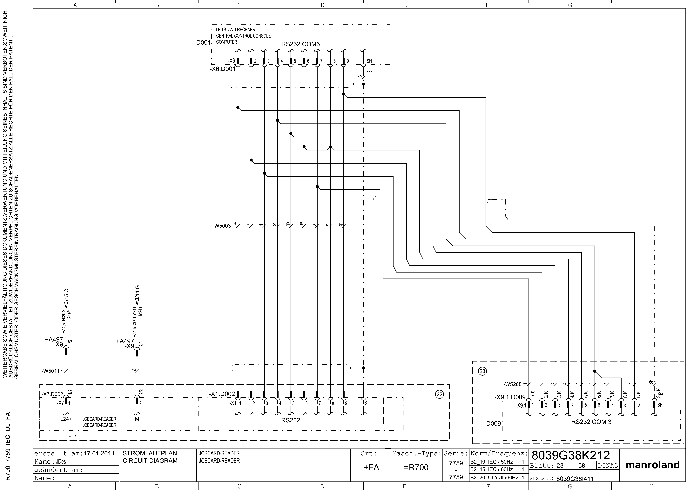

# +FA — Sheet 23 of 58 — JOBCARD READER

**JOBCARD READER**

> Part of the manroland **R700** printing press IEC/UL circuit diagrams.
> Drawing class: **Stromlaufplan / Circuit diagram** (DIN A3).
> Document `+FA` covers the **Delivery** machine section.

## At a glance

| Field | Value |
|---|---|
| Document | `+FA`  (8039G38K212) |
| Sheet | **23** of 58 |
| Section (DE) | JOBCARD READER |
| Section (EN) | JOBCARD READER |
| Section type | CIRCUIT — Circuit diagram |
| Machine type | `=R700` |
| Series | `7759` |
| Created | 17.01.2011 |
| Replaces | `8039G38I411` |
| Columns used | A, B, C, D, E, F, G, H |
| Path numbers | — |
| Labels on sheet | 103 |
| Cross-refs out | 3 |
| Cross-refs in | 29 |

**Previous:** [+FA sheet 22](SHEET_0022.md) · **Next:** [+FA sheet 24](SHEET_0024.md) · **Document TOC:** [_TOC.md](_TOC.md)  (+FA) · **Master TOC:** [all sheets](../_MASTER_TOC.md)

## Sheet image (300 DPI, exact vector render)



_Rendered directly from the PDF vector layer at 300 DPI (1-bit), no OCR and no resampling. Use it to confirm anything ambiguous in the text below._

## Cross-references on this sheet

Each entry is a wire leaving this sheet. The printed token is `/sheet.column`; the link resolves to that sheet inside the same document.

| Ref | Target sheet | Col | Path | Destination on target | Target section | From col |
|---|---|---|---|---|---|---|
| `/14.G` | [+FA sheet 14](SHEET_0014.md) | G | — | +A497 X001:M24+ M24+ | SPANNUNGSVERSORGUNG: | B |
| `/15.C` | [+FA sheet 15](SHEET_0015.md) | C | — | L24+/1 +A497 F030:2 | SPANNUNGSVERSORGUNG: | A |
| `/5.G` | [+FA sheet 5](SHEET_0005.md) | G | — | — | ANORDNUNGSPLAN | A |

### Incoming references (sheets that point here)

Every other sheet that sends a wire to this one. `Back-ref` is the token printed on *that* sheet; `Path` is its line number.

| From sheet | Cols | Back-ref | Path | Refs | What continues there |
|---|---|---|---|---|---|
| [+FA#5](SHEET_0005.md) | G | `/5.G` | — | 1 | — |
| [+FA#14](SHEET_0014.md) | G | `/14.G` | — | 1 | +A497 X9:2 M24+ |
| [+FA#15](SHEET_0015.md) | D | `/15.D` | — | 1 | L24+/1 X +A497 X9:1 +A497 X6:3 |
| [+FA#48](SHEET_0048.md) | B | `/48.B` | — | 1 | — |
| [+FA#49](SHEET_0049.md) | D | `/49.D` | — | 1 | — |
| [+FA#51](SHEET_0051.md) | G | `/51.G` | — | 10 | — |
| [+FA#56](SHEET_0056.md) | B, D, F | `/56.B`, `/56.D`, `/56.F` | — | 14 | — |


## Devices on this sheet

| Tag | Class | Class meaning (IEC) | Col | Sub | Terminal | Sign |
|---|---|---|---|---|---|---|
| `+A497` | A | Baugruppe / assembly, module, PC board | A | — | — | + |
| `X9` | X | Klemme / terminal, plug connector | A | — | — | — |
| `+A497` | A | Baugruppe / assembly, module, PC board | B | — | — | + |
| `X9` | X | Klemme / terminal, plug connector | B | — | — | — |
| `X1` | X | Klemme / terminal, plug connector | C | — | — | — |
| `X7` | X | Klemme / terminal, plug connector | A | — | — | — |
| `RS232` | RS |  | D | — | — | — |
| `D001` | D | Digital / binary element | C | — | — | — |
| `X6` | X | Klemme / terminal, plug connector | C | — | — | — |
| `D009` | D | Digital / binary element | F | — | — | — |
| `W5003` | W | Kabel / cable, line, bus | C | — | — | — |
| `W5011` | W | Kabel / cable, line, bus | A | — | — | — |
| `W5268` | W | Kabel / cable, line, bus | F | — | — | — |
| `X7.D002` | — | cross-device reference | A | — | — | — |
| `X6.D001` | — | cross-device reference | C | — | — | — |
| `X1.D002` | — | cross-device reference | C | — | — | — |
| `X9.1.D009` | — | cross-device reference | F | — | — | — |
| `X9.1` | — | cross-device reference | F | — | — | — |

## Potentials / nets

| Potential | Count | Columns | Attached devices | Terminals |
|---|---|---|---|---|
| `L24+` | 1 | A | — | — |
| `L24+/1` | 1 | A | — | — |
| `M24+` | 1 | B | — | — |


A potential such as `L24+/4` or `M24+` is a named supply/return rail; every place it appears on this sheet is electrically common.

## Wire-end annotations (grouped as printed)

A wire that continues elsewhere is annotated with a small cluster: the destination description, the path/line number `#NN`, and the `/sheet.column` cross reference. Each row below is one such cluster exactly as it is grouped on the drawing.

| Col | Y | Path | Cross-ref | Text on the wire |
|---|---|---|---|---|
| C | 48.1 | — | — | `LEITSTAND RECHNER` |
| C | 58.8 | — | — | `CENTRAL CONTROL CONSOLE COMPUTER` |
| C | 68.3 | — | — | `D001` |
| D | 71.2 | — | — | `RS232 COM5` |
| D | 100.8 | — | — | `X6 1 2 3 4 5 6 7 8 9 SH` |
| C | 113.7 | — | — | `X6.D001` |
| D | 124.5 | — | — | `SH` |
| C | 381.0 | — | — | `sw` |
| D | 381.5 | — | — | `gn` |
| D | 381.8 | — | — | `ge` |
| D | 383.1 | — | — | `gr` |
| C | 383.3 | — | — | `br` |
| C | 383.3 | — | — | `or` |
| D | 383.8 | — | — | `bl` |
| D | 383.8 | — | — | `vi` |
| C | 384.0 | — | — | `W5003` |
| C | 384.8 | — | — | `rt` |
| B | 490.1 | — | `/14.G` | `+A497 X001:M24+ M24+` |
| A | 496.4 | — | `/15.C` | `+A497 F030:2 L24+/1` |
| A | 578.5 | — | — | `+A497` |
| B | 581.4 | — | — | `+A497` |
| A | 584.3 | — | — | `1/5` |
| B | 586.7 | — | — | `2/5` |
| A | 587.1 | — | — | `X9` |
| B | 589.9 | — | — | `X9` |
| A | 633.5 | — | — | `W5011` |
| F | 634.1 | — | — | `23` |
| B | 634.4 | — | — | `2` |
| A | 634.5 | — | — | `1` |
| H | 651.8 | — | — | `SH` |
| F | 656.2 | — | — | `W5268` |
| G | 657.1 | — | — | `2` |
| F | 657.2 | — | — | `1` |
| G | 657.2 | — | — | `3` |
| G | 657.2 | — | — | `4` |
| G | 657.2 | — | — | `5` |
| G | 657.2 | — | — | `6` |
| G | 657.2 | — | — | `7` |
| H | 657.2 | — | — | `8` |
| H | 666.0 | — | — | `SH/10` |
| B | 668.9 | — | — | `2/2` |
| A | 669.3 | — | — | `1/2` |
| G | 671.2 | — | — | `2/10` |
| G | 671.2 | — | — | `3/10` |
| G | 671.2 | — | — | `4/10` |
| G | 671.2 | — | — | `5/10` |
| G | 671.2 | — | — | `6/10` |
| H | 671.2 | — | — | `7/10` |
| H | 671.2 | — | — | `8/10` |
| H | 671.2 | — | — | `9/10` |
| G | 671.6 | — | — | `1/10` |
| C | 672.1 | — | — | `X1.D002` |
| A | 673.5 | — | — | `X7.D002` |
| E | 673.8 | — | — | `22` |
| F | 677.8 | — | — | `X9.1.D009` |
| C | 688.8 | — | — | `X7 1 2 X1 1 2 3 4 5 6 7 8 9` |
| E | 690.1 | — | — | `SH` |
| G | 692.5 | — | — | `X9.1 1 2 3 4 5 6 7 8 9 SH` |
| B | 716.1 | — | — | `L24+ JOBCARD READER JOBCARD READER M RS232` |
| G | 720.3 | — | — | `RS232 COM 3` |
| F | 723.1 | — | — | `D009` |
| A | 745.4 | — | `/5.G` | — |


## Reconstructed tables

This sheet carries tabular content (pin map / terminal assignment / index). The grid below was rebuilt from the drawing's own rule lines, so each row is exactly one physical row of the table.

### Table 1 — 2 data rows × 1 columns (at x=235.3, y=138.9)

| C1 |
|---|
| `/14.G M24+ 2/5` |
| `2/2 2` |


### Table 2 — 2 data rows × 11 columns (at x=374.2, y=138.9)

| sw | br | rt | or | ge | gn | bl | vi | gr |  |  |
|---|---|---|---|---|---|---|---|---|---|---|
| `W5003` |  |  |  |  |  |  |  |  |  |  |
| `X1.D002 X1` | `1` | `2` | `3` | `4 RS232` | `5` | `6` | `7` | `8` | `9` | `SH` |


## Notes and free text on this sheet

| Text | Col | Y (pt) |
|---|---|---|
| `+A497 F030:2` | A | 532.35 |
| `+A497 X001:M24+` | B | 526.68 |
| `M` | B | 716.13 |
| `JOBCARD READER` | A | 717.1 |
| `SH` | E | 690.06 |
| `RS232 COM5` | D | 71.17 |
| `LEITSTAND RECHNER` | C | 48.12 |
| `CENTRAL CONTROL CONSOLE` | C | 58.76 |
| `COMPUTER` | C | 69.4 |
| `SH/10` | H | 665.96 |
| `SH` | H | 692.9 |
| `RS232 COM 3` | G | 720.31 |
| `sw` | C | 380.98 |
| `br` | C | 383.32 |
| `rt` | C | 384.84 |
| `or` | C | 383.32 |
| `ge` | D | 381.82 |
| `gn` | D | 381.54 |
| `bl` | D | 383.76 |
| `vi` | D | 383.76 |
| `gr` | D | 383.11 |
| `SH` | D | 124.53 |

## Complete label inventory (exact text from the drawing)

Every text object inside the drawing area of this sheet, in DIN reading order (column A→H, then top→bottom). This is the authoritative list: if a string is not here it is not printed on this sheet.

| Col | Y | X | Dir | Type | Text |
|---|---|---|---|---|---|
| A | 496.3 | 110.1 | ↕ | cross-reference | `/15.C` |
| A | 531.2 | 116.1 | ↕ | potential | `L24+/1` |
| A | 532.3 | 106.2 | ↕ | text | `+A497 F030:2` |
| A | 578.5 | 77.1 | → | device tag | `+A497` |
| A | 584.3 | 117.5 | ↕ | pin pair | `1/5` |
| A | 587.1 | 91.8 | → | device tag | `X9` |
| A | 633.5 | 71.4 | → | device tag | `W5011` |
| A | 634.5 | 104.3 | ↕ | number | `1` |
| A | 669.3 | 117.4 | ↕ | pin pair | `1/2` |
| A | 673.5 | 71.4 | → | device ref | `X7.D002` |
| A | 688.9 | 97.8 | → | device tag | `X7` |
| A | 689.6 | 116.8 | → | number | `1` |
| A | 716.1 | 103.5 | → | potential | `L24+` |
| A | 717.1 | 141.4 | → | text | `JOBCARD READER` |
| A | 727.7 | 141.4 | → | text | `JOBCARD READER` |
| A | 745.4 | 118.9 | → | cross-reference | `/5.G` |
| B | 490.1 | 232.0 | ↕ | cross-reference | `/14.G` |
| B | 526.7 | 228.1 | ↕ | text | `+A497 X001:M24+` |
| B | 526.7 | 238.0 | ↕ | potential | `M24+` |
| B | 581.4 | 199.0 | → | device tag | `+A497` |
| B | 586.7 | 239.4 | ↕ | pin pair | `2/5` |
| B | 589.9 | 213.7 | → | device tag | `X9` |
| B | 634.4 | 226.5 | ↕ | number | `2` |
| B | 668.9 | 239.4 | ↕ | pin pair | `2/2` |
| B | 690.0 | 239.2 | → | number | `2` |
| B | 716.1 | 231.7 | → | text | `M` |
| C | 48.1 | 370.5 | → | text | `LEITSTAND RECHNER` |
| C | 58.8 | 371.1 | → | text | `CENTRAL CONTROL CONSOLE` |
| C | 68.3 | 333.1 | → | device tag | `D001` |
| C | 69.4 | 371.1 | → | text | `COMPUTER` |
| C | 100.8 | 391.2 | → | device tag | `X6` |
| C | 101.4 | 413.0 | → | number | `1` |
| C | 101.8 | 436.3 | → | number | `2` |
| C | 101.9 | 458.9 | → | number | `3` |
| C | 113.7 | 359.7 | → | device ref | `X6.D001` |
| C | 381.0 | 399.6 | ↕ | text | `sw` |
| C | 383.3 | 422.3 | ↕ | text | `br` |
| C | 383.3 | 467.8 | ↕ | text | `or` |
| C | 384.0 | 364.8 | → | device tag | `W5003` |
| C | 384.8 | 444.8 | ↕ | text | `rt` |
| C | 672.1 | 358.3 | → | device ref | `X1.D002` |
| C | 688.8 | 393.6 | → | device tag | `X1` |
| C | 689.6 | 410.2 | → | number | `1` |
| C | 690.0 | 433.4 | → | number | `2` |
| C | 690.1 | 456.1 | → | number | `3` |
| C | 690.1 | 478.8 | → | number | `4` |
| D | 71.2 | 482.7 | → | text | `RS232 COM5` |
| D | 101.9 | 481.6 | → | number | `4` |
| D | 101.9 | 504.3 | → | number | `5` |
| D | 101.9 | 527.0 | → | number | `6` |
| D | 101.9 | 549.6 | → | number | `7` |
| D | 101.9 | 572.3 | → | number | `8` |
| D | 101.9 | 595.0 | → | number | `9` |
| D | 124.5 | 614.9 | ↕ | text | `SH` |
| D | 381.5 | 512.9 | ↕ | text | `gn` |
| D | 381.8 | 490.4 | ↕ | text | `ge` |
| D | 383.1 | 581.1 | ↕ | text | `gr` |
| D | 383.8 | 535.5 | ↕ | text | `bl` |
| D | 383.8 | 558.3 | ↕ | text | `vi` |
| D | 690.1 | 501.4 | → | number | `5` |
| D | 690.1 | 524.1 | → | number | `6` |
| D | 690.1 | 546.8 | → | number | `7` |
| D | 690.1 | 569.5 | → | number | `8` |
| D | 690.1 | 592.2 | → | number | `9` |
| D | 717.5 | 482.5 | → | device tag | `RS232` |
| E | 101.9 | 629.0 | → | text | `SH` |
| E | 673.8 | 749.3 | → | number | `22` |
| E | 690.1 | 626.2 | → | text | `SH` |
| F | 634.2 | 822.9 | → | number | `23` |
| F | 656.2 | 863.7 | → | device tag | `W5268` |
| F | 657.2 | 898.0 | ↕ | number | `1` |
| F | 677.8 | 848.4 | → | device ref | `X9.1.D009` |
| F | 693.1 | 884.8 | → | device ref | `X9.1` |
| F | 723.1 | 830.6 | → | device tag | `D009` |
| G | 657.1 | 921.0 | ↕ | number | `2` |
| G | 657.2 | 943.8 | ↕ | number | `3` |
| G | 657.2 | 966.5 | ↕ | number | `4` |
| G | 657.2 | 989.1 | ↕ | number | `5` |
| G | 657.2 | 1011.8 | ↕ | number | `6` |
| G | 657.2 | 1034.5 | ↕ | number | `7` |
| G | 671.2 | 933.9 | ↕ | pin pair | `2/10` |
| G | 671.2 | 956.6 | ↕ | pin pair | `3/10` |
| G | 671.2 | 979.3 | ↕ | pin pair | `4/10` |
| G | 671.2 | 1002.0 | ↕ | pin pair | `5/10` |
| G | 671.2 | 1024.6 | ↕ | pin pair | `6/10` |
| G | 671.6 | 911.2 | ↕ | pin pair | `1/10` |
| G | 692.5 | 911.9 | → | number | `1` |
| G | 692.8 | 935.1 | → | number | `2` |
| G | 692.9 | 957.8 | → | number | `3` |
| G | 692.9 | 980.5 | → | number | `4` |
| G | 692.9 | 1003.2 | → | number | `5` |
| G | 692.9 | 1025.9 | → | number | `6` |
| G | 720.3 | 980.2 | → | text | `RS232 COM 3` |
| H | 651.8 | 1113.8 | ↕ | text | `SH` |
| H | 657.2 | 1079.8 | ↕ | number | `8` |
| H | 666.0 | 1126.7 | ↕ | text | `SH/10` |
| H | 671.2 | 1047.3 | ↕ | pin pair | `7/10` |
| H | 671.2 | 1070.0 | ↕ | pin pair | `8/10` |
| H | 671.2 | 1092.7 | ↕ | pin pair | `9/10` |
| H | 692.9 | 1048.5 | → | number | `7` |
| H | 692.9 | 1071.2 | → | number | `8` |
| H | 692.9 | 1093.9 | → | number | `9` |
| H | 692.9 | 1127.9 | → | text | `SH` |

## Reading-order text block

The same content as a plain block, grouped by DIN column — convenient to paste or to match against a visual description.

```text
=== Column A ===
 496.3  110.1  xref         /15.C
 531.2  116.1  net          L24+/1
 532.3  106.2  text         +A497 F030:2
 578.5   77.1  devtag       +A497
 584.3  117.5  pinpair      1/5
 587.1   91.8  devtag       X9
 633.5   71.4  devtag       W5011
 634.5  104.3  numeric      1
 669.3  117.4  pinpair      1/2
 673.5   71.4  devref       X7.D002
 688.9   97.8  devtag       X7
 689.6  116.8  numeric      1
 716.1  103.5  net          L24+
 717.1  141.4  text         JOBCARD READER
 727.7  141.4  text         JOBCARD READER
 745.4  118.9  xref         /5.G
=== Column B ===
 490.1  232.0  xref         /14.G
 526.7  228.1  text         +A497 X001:M24+
 526.7  238.0  net          M24+
 581.4  199.0  devtag       +A497
 586.7  239.4  pinpair      2/5
 589.9  213.7  devtag       X9
 634.4  226.5  numeric      2
 668.9  239.4  pinpair      2/2
 690.0  239.2  numeric      2
 716.1  231.7  text         M
=== Column C ===
  48.1  370.5  text         LEITSTAND RECHNER
  58.8  371.1  text         CENTRAL CONTROL CONSOLE
  68.3  333.1  devtag       D001
  69.4  371.1  text         COMPUTER
 100.8  391.2  devtag       X6
 101.4  413.0  numeric      1
 101.8  436.3  numeric      2
 101.9  458.9  numeric      3
 113.7  359.7  devref       X6.D001
 381.0  399.6  text         sw
 383.3  422.3  text         br
 383.3  467.8  text         or
 384.0  364.8  devtag       W5003
 384.8  444.8  text         rt
 672.1  358.3  devref       X1.D002
 688.8  393.6  devtag       X1
 689.6  410.2  numeric      1
 690.0  433.4  numeric      2
 690.1  456.1  numeric      3
 690.1  478.8  numeric      4
=== Column D ===
  71.2  482.7  text         RS232 COM5
 101.9  481.6  numeric      4
 101.9  504.3  numeric      5
 101.9  527.0  numeric      6
 101.9  549.6  numeric      7
 101.9  572.3  numeric      8
 101.9  595.0  numeric      9
 124.5  614.9  text         SH
 381.5  512.9  text         gn
 381.8  490.4  text         ge
 383.1  581.1  text         gr
 383.8  535.5  text         bl
 383.8  558.3  text         vi
 690.1  501.4  numeric      5
 690.1  524.1  numeric      6
 690.1  546.8  numeric      7
 690.1  569.5  numeric      8
 690.1  592.2  numeric      9
 717.5  482.5  devtag       RS232
=== Column E ===
 101.9  629.0  text         SH
 673.8  749.3  numeric      22
 690.1  626.2  text         SH
=== Column F ===
 634.2  822.9  numeric      23
 656.2  863.7  devtag       W5268
 657.2  898.0  numeric      1
 677.8  848.4  devref       X9.1.D009
 693.1  884.8  devref       X9.1
 723.1  830.6  devtag       D009
=== Column G ===
 657.1  921.0  numeric      2
 657.2  943.8  numeric      3
 657.2  966.5  numeric      4
 657.2  989.1  numeric      5
 657.2 1011.8  numeric      6
 657.2 1034.5  numeric      7
 671.2  933.9  pinpair      2/10
 671.2  956.6  pinpair      3/10
 671.2  979.3  pinpair      4/10
 671.2 1002.0  pinpair      5/10
 671.2 1024.6  pinpair      6/10
 671.6  911.2  pinpair      1/10
 692.5  911.9  numeric      1
 692.8  935.1  numeric      2
 692.9  957.8  numeric      3
 692.9  980.5  numeric      4
 692.9 1003.2  numeric      5
 692.9 1025.9  numeric      6
 720.3  980.2  text         RS232 COM 3
=== Column H ===
 651.8 1113.8  text         SH
 657.2 1079.8  numeric      8
 666.0 1126.7  text         SH/10
 671.2 1047.3  pinpair      7/10
 671.2 1070.0  pinpair      8/10
 671.2 1092.7  pinpair      9/10
 692.9 1048.5  numeric      7
 692.9 1071.2  numeric      8
 692.9 1093.9  numeric      9
 692.9 1127.9  text         SH
```

---
_Generated from the PDF vector text layer; no OCR. Source: `R700_7759_IEC_UL_FA`, sheet 23._
