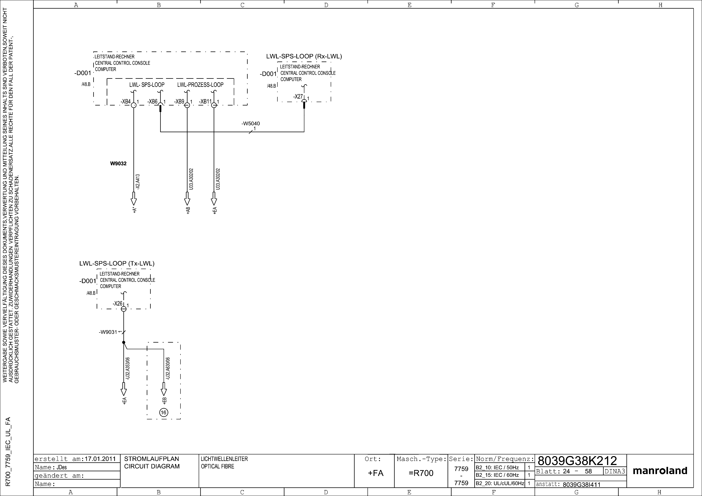

# +FA — Sheet 24 of 58 — LICHTWELLENLEITER

**OPTICAL FIBRE**

> Part of the manroland **R700** printing press IEC/UL circuit diagrams.
> Drawing class: **Stromlaufplan / Circuit diagram** (DIN A3).
> Document `+FA` covers the **Delivery** machine section.

## At a glance

| Field | Value |
|---|---|
| Document | `+FA`  (8039G38K212) |
| Sheet | **24** of 58 |
| Section (DE) | LICHTWELLENLEITER |
| Section (EN) | OPTICAL FIBRE |
| Section type | CIRCUIT — Circuit diagram |
| Machine type | `=R700` |
| Series | `7759` |
| Created | 17.01.2011 |
| Replaces | `8039G38I411` |
| Columns used | A, B, C, D |
| Path numbers | — |
| Labels on sheet | 47 |
| Cross-refs out | 3 |
| Cross-refs in | 9 |

**Previous:** [+FA sheet 23](SHEET_0023.md) · **Next:** [+FA sheet 25](SHEET_0025.md) · **Document TOC:** [_TOC.md](_TOC.md)  (+FA) · **Master TOC:** [all sheets](../_MASTER_TOC.md)

## Sheet image (300 DPI, exact vector render)



_Rendered directly from the PDF vector layer at 300 DPI (1-bit), no OCR and no resampling. Use it to confirm anything ambiguous in the text below._

## Cross-references on this sheet

Each entry is a wire leaving this sheet. The printed token is `/sheet.column`; the link resolves to that sheet inside the same document.

| Ref | Target sheet | Col | Path | Destination on target | Target section | From col |
|---|---|---|---|---|---|---|
| `/48.B` | [+FA sheet 48](SHEET_0048.md) | B | — | — | REFERENZMODUL | A |
| `/48.B` | [+FA sheet 48](SHEET_0048.md) | B | — | — | REFERENZMODUL | C |
| `/48.B` | [+FA sheet 48](SHEET_0048.md) | B | — | — | REFERENZMODUL | A |

### Incoming references (sheets that point here)

Every other sheet that sends a wire to this one. `Back-ref` is the token printed on *that* sheet; `Path` is its line number.

| From sheet | Cols | Back-ref | Path | Refs | What continues there |
|---|---|---|---|---|---|
| [+FA#48](SHEET_0048.md) | B | `/48.B` | — | 3 | — |
| [+FA#53](SHEET_0053.md) | C, D | `/53.C`, `/53.D` | — | 2 | — |
| [+FA#57](SHEET_0057.md) | G | `/57.G` | — | 1 | — |
| [+FA#58](SHEET_0058.md) | A, B, C | `/58.A`, `/58.B`, `/58.C` | — | 3 | — |


## Devices on this sheet

| Tag | Class | Class meaning (IEC) | Col | Sub | Terminal | Sign |
|---|---|---|---|---|---|---|
| `D001` | D | Digital / binary element | A | — | — | — |
| `XB4` | XB |  | B | — | — | — |
| `XB6` | XB |  | B | — | — | — |
| `XB9` | XB |  | B | — | — | — |
| `XB11` | XB |  | C | — | — | — |
| `D001` | D | Digital / binary element | A | — | — | — |
| `X26` | X | Klemme / terminal, plug connector | B | — | — | — |
| `D001` | D | Digital / binary element | C | — | — | — |
| `X27` | X | Klemme / terminal, plug connector | D | — | — | — |
| `W9032` | W | Kabel / cable, line, bus | B | — | — | — |
| `W9031` | W | Kabel / cable, line, bus | A | — | — | — |
| `W5040` | W | Kabel / cable, line, bus | C | — | — | — |
| `X2.A413` | — | cross-device reference | B | — | — | — |

## Potentials / nets

_No named potentials on this sheet._

## Wire-end annotations (grouped as printed)

A wire that continues elsewhere is annotated with a small cluster: the destination description, the path/line number `#NN`, and the `/sheet.column` cross reference. Each row below is one such cluster exactly as it is grouped on the drawing.

| Col | Y | Path | Cross-ref | Text on the wire |
|---|---|---|---|---|
| D | 91.0 | — | — | `LWL SPS LOOP (Rx LWL)` |
| A | 93.5 | — | — | `LEITSTAND RECHNER` |
| B | 104.1 | — | — | `CENTRAL CONTROL CONSOLE COMPUTER` |
| D | 110.5 | — | — | `LEITSTAND RECHNER` |
| A | 119.4 | — | — | `D001` |
| C | 120.8 | — | — | `D001` |
| D | 121.1 | — | — | `CENTRAL CONTROL CONSOLE COMPUTER` |
| A | 140.2 | — | `/48.B` | — |
| B | 140.4 | — | — | `LWL SPS LOOP LWL PROZESS LOOP` |
| C | 143.0 | — | `/48.B` | — |
| D | 160.3 | — | — | `X27 1` |
| B | 168.7 | — | — | `XB4 1 XB6 1 XB9 1 XB11 1` |
| C | 205.7 | — | — | `W5040` |
| C | 214.8 | — | — | `1` |
| B | 273.9 | — | — | `W9032` |
| B | 285.7 | — | — | `+AB U33.A302/02` |
| C | 285.7 | — | — | `+EA U33.A302/02` |
| B | 295.6 | — | — | `+A* X2.A413` |
| A | 442.5 | — | — | `LWL SPS LOOP (Tx LWL)` |
| B | 462.0 | — | — | `LEITSTAND RECHNER` |
| A | 472.3 | — | — | `D001` |
| B | 472.6 | — | — | `CENTRAL CONTROL CONSOLE COMPUTER` |
| A | 494.5 | — | `/48.B` | — |
| B | 511.8 | — | — | `X26 1` |
| A | 559.8 | — | — | `W9031` |
| B | 560.8 | — | — | `1` |
| B | 606.5 | — | — | `+EA U32.A353/06` |
| B | 606.5 | — | — | `+EB U32.A630/06` |
| B | 696.5 | — | — | `16` |


## Reconstructed tables

This sheet carries tabular content (pin map / terminal assignment / index). The grid below was rebuilt from the drawing's own rule lines, so each row is exactly one physical row of the table.

### Table 1 — 1 data rows × 3 columns (at x=181.4, y=133.2)

|  | XB4 | LWL SPS LOOP XB6 1 |
|---|---|---|
| `W9032 LEITSTAND RECHNER CENTRAL COMPUTER X26 W9031 1` | `CONTROL 1` | `X2.A413 +A* (Tx LWL) CONSOLE` |


### Table 2 — 1 data rows × 3 columns (at x=277.8, y=133.2)

| XB9 1 | LWL PROZESS LOOP XB11 1 | 1 |
|---|---|---|
|  | `U33.A302/02 +AB` | `U33.A302/02 +EA` |


## Notes and free text on this sheet

| Text | Col | Y (pt) |
|---|---|---|
| `+A*` | B | 351.21 |
| `+AB` | B | 351.21 |
| `U33.A302/02` | B | 285.66 |
| `+EA` | C | 351.5 |
| `U33.A302/02` | C | 285.66 |
| `+EA` | B | 674.65 |
| `U32.A353/06` | B | 606.48 |
| `+EB` | B | 674.36 |
| `U32.A630/06` | B | 606.48 |
| `LWL SPS LOOP` | B | 140.45 |
| `LWL PROZESS LOOP` | B | 140.46 |
| `LEITSTAND RECHNER` | A | 93.47 |
| `CENTRAL CONTROL CONSOLE` | B | 104.11 |
| `COMPUTER` | A | 114.75 |
| `LWL SPS LOOP (Tx LWL)` | A | 442.5 |
| `LEITSTAND RECHNER` | B | 461.97 |
| `LWL SPS LOOP (Rx LWL)` | D | 91 |
| `LEITSTAND RECHNER` | D | 110.48 |
| `CENTRAL CONTROL CONSOLE` | D | 121.12 |
| `COMPUTER` | D | 131.76 |

## Complete label inventory (exact text from the drawing)

Every text object inside the drawing area of this sheet, in DIN reading order (column A→H, then top→bottom). This is the authoritative list: if a string is not here it is not printed on this sheet.

| Col | Y | X | Dir | Type | Text |
|---|---|---|---|---|---|
| A | 93.5 | 160.7 | → | text | `LEITSTAND RECHNER` |
| A | 114.7 | 161.3 | → | text | `COMPUTER` |
| A | 119.4 | 126.1 | → | device tag | `D001` |
| A | 140.2 | 138.6 | → | cross-reference | `/48.B` |
| A | 442.5 | 134.6 | → | text | `LWL SPS LOOP (Tx LWL)` |
| A | 472.3 | 134.6 | → | device tag | `D001` |
| A | 483.3 | 169.8 | → | text | `COMPUTER` |
| A | 494.5 | 147.1 | → | cross-reference | `/48.B` |
| A | 559.8 | 167.8 | → | device tag | `W9031` |
| B | 104.1 | 161.3 | → | text | `CENTRAL CONTROL CONSOLE` |
| B | 140.4 | 219.6 | → | text | `LWL SPS LOOP` |
| B | 140.5 | 300.9 | → | text | `LWL PROZESS LOOP` |
| B | 168.8 | 204.7 | → | device tag | `XB4` |
| B | 168.8 | 250.1 | → | device tag | `XB6` |
| B | 168.8 | 295.4 | → | device tag | `XB9` |
| B | 169.5 | 231.6 | → | number | `1` |
| B | 169.5 | 276.9 | → | number | `1` |
| B | 169.5 | 322.3 | → | number | `1` |
| B | 273.9 | 187.1 | → | device tag | `W9032` |
| B | 285.7 | 321.4 | ↕ | text | `U33.A302/02` |
| B | 295.6 | 230.7 | ↕ | device ref | `X2.A413` |
| B | 351.2 | 225.2 | ↕ | text | `+A*` |
| B | 351.2 | 315.9 | ↕ | text | `+AB` |
| B | 462.0 | 169.2 | → | text | `LEITSTAND RECHNER` |
| B | 472.6 | 169.8 | → | text | `CENTRAL CONTROL CONSOLE` |
| B | 511.8 | 191.3 | → | device tag | `X26` |
| B | 515.3 | 214.6 | → | number | `1` |
| B | 560.8 | 200.6 | ↕ | number | `1` |
| B | 606.5 | 213.7 | ↕ | text | `U32.A353/06` |
| B | 606.5 | 281.7 | ↕ | text | `U32.A630/06` |
| B | 674.4 | 276.2 | ↕ | text | `+EB` |
| B | 674.6 | 208.2 | ↕ | text | `+EA` |
| B | 696.5 | 272.4 | → | number | `16` |
| C | 120.8 | 440.8 | → | device tag | `D001` |
| C | 143.0 | 453.2 | → | cross-reference | `/48.B` |
| C | 168.7 | 337.6 | → | device tag | `XB11` |
| C | 169.5 | 367.7 | → | number | `1` |
| C | 205.7 | 409.6 | → | device tag | `W5040` |
| C | 214.8 | 430.0 | → | number | `1` |
| C | 285.7 | 366.7 | ↕ | text | `U33.A302/02` |
| C | 351.5 | 361.3 | ↕ | text | `+EA` |
| D | 91.0 | 451.6 | → | text | `LWL SPS LOOP (Rx LWL)` |
| D | 110.5 | 475.4 | → | text | `LEITSTAND RECHNER` |
| D | 121.1 | 475.9 | → | text | `CENTRAL CONTROL CONSOLE` |
| D | 131.8 | 475.9 | → | text | `COMPUTER` |
| D | 160.3 | 497.5 | → | device tag | `X27` |
| D | 163.8 | 520.7 | → | number | `1` |

## Reading-order text block

The same content as a plain block, grouped by DIN column — convenient to paste or to match against a visual description.

```text
=== Column A ===
  93.5  160.7  text         LEITSTAND RECHNER
 114.7  161.3  text         COMPUTER
 119.4  126.1  devtag       D001
 140.2  138.6  xref         /48.B
 442.5  134.6  text         LWL SPS LOOP (Tx LWL)
 472.3  134.6  devtag       D001
 483.3  169.8  text         COMPUTER
 494.5  147.1  xref         /48.B
 559.8  167.8  devtag       W9031
=== Column B ===
 104.1  161.3  text         CENTRAL CONTROL CONSOLE
 140.4  219.6  text         LWL SPS LOOP
 140.5  300.9  text         LWL PROZESS LOOP
 168.8  204.7  devtag       XB4
 168.8  250.1  devtag       XB6
 168.8  295.4  devtag       XB9
 169.5  231.6  numeric      1
 169.5  276.9  numeric      1
 169.5  322.3  numeric      1
 273.9  187.1  devtag       W9032
 285.7  321.4  text         U33.A302/02
 295.6  230.7  devref       X2.A413
 351.2  225.2  text         +A*
 351.2  315.9  text         +AB
 462.0  169.2  text         LEITSTAND RECHNER
 472.6  169.8  text         CENTRAL CONTROL CONSOLE
 511.8  191.3  devtag       X26
 515.3  214.6  numeric      1
 560.8  200.6  numeric      1
 606.5  213.7  text         U32.A353/06
 606.5  281.7  text         U32.A630/06
 674.4  276.2  text         +EB
 674.6  208.2  text         +EA
 696.5  272.4  numeric      16
=== Column C ===
 120.8  440.8  devtag       D001
 143.0  453.2  xref         /48.B
 168.7  337.6  devtag       XB11
 169.5  367.7  numeric      1
 205.7  409.6  devtag       W5040
 214.8  430.0  numeric      1
 285.7  366.7  text         U33.A302/02
 351.5  361.3  text         +EA
=== Column D ===
  91.0  451.6  text         LWL SPS LOOP (Rx LWL)
 110.5  475.4  text         LEITSTAND RECHNER
 121.1  475.9  text         CENTRAL CONTROL CONSOLE
 131.8  475.9  text         COMPUTER
 160.3  497.5  devtag       X27
 163.8  520.7  numeric      1
```

---
_Generated from the PDF vector text layer; no OCR. Source: `R700_7759_IEC_UL_FA`, sheet 24._
