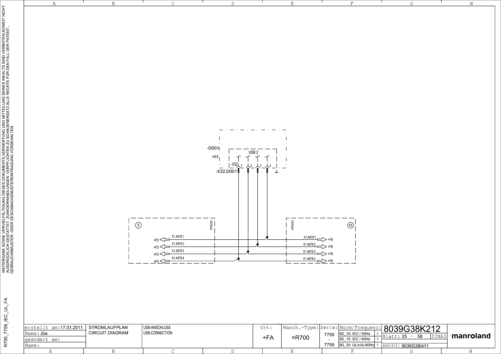

# +FA — Sheet 25 of 58 — USB ANSCHLUSS

**USB CONNECTION**

> Part of the manroland **R700** printing press IEC/UL circuit diagrams.
> Drawing class: **Stromlaufplan / Circuit diagram** (DIN A3).
> Document `+FA` covers the **Delivery** machine section.

## At a glance

| Field | Value |
|---|---|
| Document | `+FA`  (8039G38K212) |
| Sheet | **25** of 58 |
| Section (DE) | USB ANSCHLUSS |
| Section (EN) | USB CONNECTION |
| Section type | CIRCUIT — Circuit diagram |
| Machine type | `=R700` |
| Series | `7759` |
| Created | 17.01.2011 |
| Replaces | `8039G38I411` |
| Columns used | B, C, D, E, F |
| Path numbers | — |
| Labels on sheet | 29 |
| Cross-refs out | 1 |
| Cross-refs in | 5 |

**Previous:** [+FA sheet 24](SHEET_0024.md) · **Next:** [+FA sheet 26](SHEET_0026.md) · **Document TOC:** [_TOC.md](_TOC.md)  (+FA) · **Master TOC:** [all sheets](../_MASTER_TOC.md)

## Sheet image (300 DPI, exact vector render)



_Rendered directly from the PDF vector layer at 300 DPI (1-bit), no OCR and no resampling. Use it to confirm anything ambiguous in the text below._

## Cross-references on this sheet

Each entry is a wire leaving this sheet. The printed token is `/sheet.column`; the link resolves to that sheet inside the same document.

| Ref | Target sheet | Col | Path | Destination on target | Target section | From col |
|---|---|---|---|---|---|---|
| `/48.B` | [+FA sheet 48](SHEET_0048.md) | B | — | — | REFERENZMODUL | D |

### Incoming references (sheets that point here)

Every other sheet that sends a wire to this one. `Back-ref` is the token printed on *that* sheet; `Path` is its line number.

| From sheet | Cols | Back-ref | Path | Refs | What continues there |
|---|---|---|---|---|---|
| [+FA#48](SHEET_0048.md) | B | `/48.B` | — | 1 | — |
| [+FA#54](SHEET_0054.md) | G | `/54.G` | — | 4 | — |


## Devices on this sheet

| Tag | Class | Class meaning (IEC) | Col | Sub | Terminal | Sign |
|---|---|---|---|---|---|---|
| `D001` | D | Digital / binary element | D | — | — | — |
| `X32` | X | Klemme / terminal, plug connector | D | — | — | — |
| `W5252` | W | Kabel / cable, line, bus | E | — | — | — |
| `W5252` | W | Kabel / cable, line, bus | D | — | — | — |
| `X32.D001` | — | cross-device reference | D | — | — | — |
| `X1.A678:4` | — | cross-device reference | E | — | 4 | — |
| `X1.A678:1` | — | cross-device reference | E | — | 1 | — |
| `X1.A678:2` | — | cross-device reference | E | — | 2 | — |
| `X1.A678:3` | — | cross-device reference | E | — | 3 | — |
| `X1.A678:4` | — | cross-device reference | C | — | 4 | — |
| `X1.A678:3` | — | cross-device reference | C | — | 3 | — |
| `X1.A678:2` | — | cross-device reference | C | — | 2 | — |
| `X1.A678:1` | — | cross-device reference | C | — | 1 | — |

## Potentials / nets

_No named potentials on this sheet._

## Wire-end annotations (grouped as printed)

A wire that continues elsewhere is annotated with a small cluster: the destination description, the path/line number `#NN`, and the `/sheet.column` cross reference. Each row below is one such cluster exactly as it is grouped on the drawing.

| Col | Y | Path | Cross-ref | Text on the wire |
|---|---|---|---|---|
| D | 347.6 | — | — | `D001` |
| D | 358.7 | — | — | `USB 2` |
| D | 369.8 | — | `/48.B` | — |
| D | 387.1 | — | — | `X32` |
| D | 390.6 | — | — | `1 2 3 4` |
| D | 402.8 | — | — | `X32.D001` |
| D | 523.8 | — | — | `W5252` |
| E | 523.8 | — | — | `W5252` |
| D | 531.8 | — | — | `5 15` |
| C | 559.7 | — | — | `X1.A678:1` |
| E | 561.4 | — | — | `X1.A678:1 +FB` |
| C | 568.3 | — | — | `+FD X1.A678:2` |
| E | 578.5 | — | — | `X1.A678:2 +FB` |
| C | 585.3 | — | — | `+FD X1.A678:3` |
| E | 595.5 | — | — | `X1.A678:3 +FB` |
| C | 602.3 | — | — | `+FD X1.A678:4` |
| E | 612.5 | — | — | `X1.A678:4 +FB` |
| C | 619.3 | — | — | `+FD` |


## Notes and free text on this sheet

| Text | Col | Y (pt) |
|---|---|---|
| `USB 2` | D | 358.7 |
| `+FB` | F | 617.83 |
| `+FD` | C | 619.28 |

## Complete label inventory (exact text from the drawing)

Every text object inside the drawing area of this sheet, in DIN reading order (column A→H, then top→bottom). This is the authoritative list: if a string is not here it is not printed on this sheet.

| Col | Y | X | Dir | Type | Text |
|---|---|---|---|---|---|
| B | 531.8 | 326.4 | → | number | `5` |
| C | 559.7 | 408.2 | → | device ref | `X1.A678:1` |
| C | 568.3 | 365.3 | → | text | `+FD` |
| C | 576.8 | 408.2 | → | device ref | `X1.A678:2` |
| C | 585.3 | 365.3 | → | text | `+FD` |
| C | 593.8 | 408.2 | → | device ref | `X1.A678:3` |
| C | 602.3 | 365.3 | → | text | `+FD` |
| C | 610.8 | 408.2 | → | device ref | `X1.A678:4` |
| C | 619.3 | 365.3 | → | text | `+FD` |
| D | 347.5 | 491.8 | → | device tag | `D001` |
| D | 358.7 | 591.1 | → | text | `USB 2` |
| D | 369.8 | 504.2 | → | cross-reference | `/48.B` |
| D | 387.1 | 548.5 | → | device tag | `X32` |
| D | 390.6 | 571.7 | → | number | `1` |
| D | 391.0 | 595.0 | → | number | `2` |
| D | 391.0 | 617.7 | → | number | `3` |
| D | 402.8 | 512.5 | → | device ref | `X32.D001` |
| D | 523.8 | 499.0 | ↕ | device tag | `W5252` |
| E | 391.0 | 640.3 | → | number | `4` |
| E | 523.8 | 691.8 | ↕ | device tag | `W5252` |
| E | 561.4 | 721.5 | → | device ref | `X1.A678:1` |
| E | 578.5 | 720.7 | → | device ref | `X1.A678:2` |
| E | 595.5 | 720.5 | → | device ref | `X1.A678:3` |
| E | 612.5 | 720.5 | → | device ref | `X1.A678:4` |
| F | 532.1 | 828.0 | → | number | `15` |
| F | 566.8 | 779.2 | → | text | `+FB` |
| F | 583.8 | 779.2 | → | text | `+FB` |
| F | 600.8 | 779.2 | → | text | `+FB` |
| F | 617.8 | 779.2 | → | text | `+FB` |

## Reading-order text block

The same content as a plain block, grouped by DIN column — convenient to paste or to match against a visual description.

```text
=== Column B ===
 531.8  326.4  numeric      5
=== Column C ===
 559.7  408.2  devref       X1.A678:1
 568.3  365.3  text         +FD
 576.8  408.2  devref       X1.A678:2
 585.3  365.3  text         +FD
 593.8  408.2  devref       X1.A678:3
 602.3  365.3  text         +FD
 610.8  408.2  devref       X1.A678:4
 619.3  365.3  text         +FD
=== Column D ===
 347.5  491.8  devtag       D001
 358.7  591.1  text         USB 2
 369.8  504.2  xref         /48.B
 387.1  548.5  devtag       X32
 390.6  571.7  numeric      1
 391.0  595.0  numeric      2
 391.0  617.7  numeric      3
 402.8  512.5  devref       X32.D001
 523.8  499.0  devtag       W5252
=== Column E ===
 391.0  640.3  numeric      4
 523.8  691.8  devtag       W5252
 561.4  721.5  devref       X1.A678:1
 578.5  720.7  devref       X1.A678:2
 595.5  720.5  devref       X1.A678:3
 612.5  720.5  devref       X1.A678:4
=== Column F ===
 532.1  828.0  numeric      15
 566.8  779.2  text         +FB
 583.8  779.2  text         +FB
 600.8  779.2  text         +FB
 617.8  779.2  text         +FB
```

---
_Generated from the PDF vector text layer; no OCR. Source: `R700_7759_IEC_UL_FA`, sheet 25._
