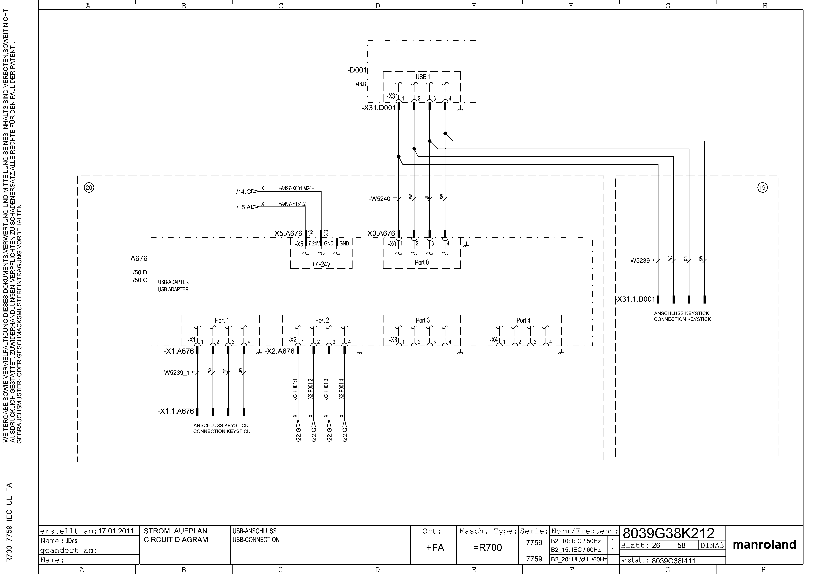

# +FA — Sheet 26 of 58 — USB ANSCHLUSS

**USB CONNECTION**

> Part of the manroland **R700** printing press IEC/UL circuit diagrams.
> Drawing class: **Stromlaufplan / Circuit diagram** (DIN A3).
> Document `+FA` covers the **Delivery** machine section.

## At a glance

| Field | Value |
|---|---|
| Document | `+FA`  (8039G38K212) |
| Sheet | **26** of 58 |
| Section (DE) | USB ANSCHLUSS |
| Section (EN) | USB CONNECTION |
| Section type | CIRCUIT — Circuit diagram |
| Machine type | `=R700` |
| Series | `7759` |
| Created | 17.01.2011 |
| Replaces | `8039G38I411` |
| Columns used | A, B, C, D, E, F, G, H |
| Path numbers | — |
| Labels on sheet | 96 |
| Cross-refs out | 9 |
| Cross-refs in | 18 |

**Previous:** [+FA sheet 25](SHEET_0025.md) · **Next:** [+FA sheet 27](SHEET_0027.md) · **Document TOC:** [_TOC.md](_TOC.md)  (+FA) · **Master TOC:** [all sheets](../_MASTER_TOC.md)

## Sheet image (300 DPI, exact vector render)



_Rendered directly from the PDF vector layer at 300 DPI (1-bit), no OCR and no resampling. Use it to confirm anything ambiguous in the text below._

## Cross-references on this sheet

Each entry is a wire leaving this sheet. The printed token is `/sheet.column`; the link resolves to that sheet inside the same document.

| Ref | Target sheet | Col | Path | Destination on target | Target section | From col |
|---|---|---|---|---|---|---|
| `/48.B` | [+FA sheet 48](SHEET_0048.md) | B | — | — | REFERENZMODUL | D |
| `/14.G` | [+FA sheet 14](SHEET_0014.md) | G | — | X +A497 X001:M24+ | SPANNUNGSVERSORGUNG: | C |
| `/15.A` | [+FA sheet 15](SHEET_0015.md) | A | — | X +A497 F151:2 | SPANNUNGSVERSORGUNG: | C |
| `/50.D` | [+FA sheet 50](SHEET_0050.md) | D | — | — | REFERENZMODUL | B |
| `/50.C` | [+FA sheet 50](SHEET_0050.md) | C | — | — | REFERENZMODUL | B |
| `/22.G` | [+FA sheet 22](SHEET_0022.md) | G | — | X2.P001:1 X | MONITOR | C |
| `/22.G` | [+FA sheet 22](SHEET_0022.md) | G | — | X2.P001:2 X | MONITOR | C |
| `/22.G` | [+FA sheet 22](SHEET_0022.md) | G | — | X2.P001:3 X | MONITOR | C |
| `/22.G` | [+FA sheet 22](SHEET_0022.md) | G | — | X2.P001:4 X | MONITOR | D |

### Incoming references (sheets that point here)

Every other sheet that sends a wire to this one. `Back-ref` is the token printed on *that* sheet; `Path` is its line number.

| From sheet | Cols | Back-ref | Path | Refs | What continues there |
|---|---|---|---|---|---|
| [+FA#4](SHEET_0004.md) | C | `/4.C` | — | 1 | — |
| [+FA#14](SHEET_0014.md) | G | `/14.G` | — | 1 | X X5.A676:2 |
| [+FA#15](SHEET_0015.md) | A | `/15.A` | — | 1 | X5.A676:1 X |
| [+FA#22](SHEET_0022.md) | G | `/22.G` | — | 4 | X X2.A676:1; X X2.A676:2; X X2.A676:3; X X2.A676:4 |
| [+FA#48](SHEET_0048.md) | B | `/48.B` | — | 1 | — |
| [+FA#50](SHEET_0050.md) | C, D | `/50.C`, `/50.D` | — | 2 | — |
| [+FA#54](SHEET_0054.md) | C, D | `/54.C`, `/54.D` | — | 8 | — |


## Devices on this sheet

| Tag | Class | Class meaning (IEC) | Col | Sub | Terminal | Sign |
|---|---|---|---|---|---|---|
| `D001` | D | Digital / binary element | D | — | — | — |
| `X31` | X | Klemme / terminal, plug connector | D | — | — | — |
| `A676` | A | Baugruppe / assembly, module, PC board | B | — | — | — |
| `X1` | X | Klemme / terminal, plug connector | B | — | — | — |
| `X2` | X | Klemme / terminal, plug connector | C | — | — | — |
| `X3` | X | Klemme / terminal, plug connector | D | — | — | — |
| `X4` | X | Klemme / terminal, plug connector | E | — | — | — |
| `X0` | X | Klemme / terminal, plug connector | D | — | — | — |
| `X5` | X | Klemme / terminal, plug connector | C | — | — | — |
| `W5240` | W | Kabel / cable, line, bus | D | — | — | — |
| `W5239` | W | Kabel / cable, line, bus | G | — | — | — |
| `X1.A676` | — | cross-device reference | B | — | — | — |
| `X1.1.A676` | — | cross-device reference | B | — | — | — |
| `X31.D001` | — | cross-device reference | D | — | — | — |
| `X0.A676` | — | cross-device reference | D | — | — | — |
| `X2.P001:1` | — | cross-device reference | C | — | 1 | — |
| `X2.P001:2` | — | cross-device reference | C | — | 2 | — |
| `X2.P001:3` | — | cross-device reference | C | — | 3 | — |
| `X2.P001:4` | — | cross-device reference | D | — | 4 | — |
| `X2.A676` | — | cross-device reference | C | — | — | — |
| `X5.A676` | — | cross-device reference | C | — | — | — |
| `X31.1.D001` | — | cross-device reference | G | — | — | — |

## Potentials / nets

_No named potentials on this sheet._

## Wire-end annotations (grouped as printed)

A wire that continues elsewhere is annotated with a small cluster: the destination description, the path/line number `#NN`, and the `/sheet.column` cross reference. Each row below is one such cluster exactly as it is grouped on the drawing.

| Col | Y | Path | Cross-ref | Text on the wire |
|---|---|---|---|---|
| D | 98.1 | — | — | `D001` |
| D | 109.2 | — | — | `USB 1` |
| D | 120.4 | — | `/48.B` | — |
| D | 137.5 | — | — | `X31` |
| E | 141.1 | — | — | `1 2 3 4` |
| D | 153.4 | — | — | `X31.D001` |
| D | 271.3 | — | — | `20 19` |
| C | 273.4 | — | `/14.G` | `X +A497 X001:M24+` |
| D | 284.0 | — | — | `ws` |
| E | 284.6 | — | — | `sw` |
| E | 285.2 | — | — | `gn` |
| D | 287.7 | — | — | `W5240` |
| D | 288.5 | — | — | `rt` |
| C | 296.1 | — | `/15.A` | `X +A497 F151:2` |
| C | 337.3 | — | — | `2/3` |
| C | 337.6 | — | — | `X5.A676` |
| D | 337.6 | — | — | `X0.A676` |
| C | 337.7 | — | — | `1/3` |
| D | 353.7 | — | — | `X5 X0 1 2 3 4` |
| C | 354.3 | — | — | `7 24V GND GND` |
| B | 374.5 | — | — | `A676` |
| G | 374.8 | — | — | `ws` |
| G | 375.3 | — | — | `sw` |
| G | 375.9 | — | — | `gn` |
| G | 378.4 | — | — | `W5239` |
| G | 379.2 | — | — | `rt` |
| D | 381.4 | — | — | `+7~24V Port 0` |
| B | 395.7 | — | `/50.D` | — |
| B | 407.1 | — | `/50.C` | — |
| B | 410.9 | — | — | `USB ADAPTER USB ADAPTER` |
| G | 434.0 | — | — | `X31.1.D001` |
| G | 456.6 | — | — | `CONNECTION KEYSTICK ANSCHLUSS KEYSTICK` |
| D | 466.4 | — | — | `Port 1 Port 2 Port 3 Port 4` |
| D | 494.6 | — | — | `X1 X2 X3 X4` |
| D | 498.3 | — | — | `1 2 3 4 1 2 3 4 1 2 3 4 1 2 3 4` |
| B | 510.6 | — | — | `X1.A676` |
| C | 510.6 | — | — | `X2.A676` |
| B | 539.2 | — | — | `ws` |
| C | 539.7 | — | — | `sw` |
| B | 540.3 | — | — | `gn` |
| B | 542.8 | — | — | `W5239_1` |
| B | 543.6 | — | — | `rt` |
| C | 555.3 | — | `/22.G` | `X2.P001:1 X` |
| C | 555.6 | — | `/22.G` | `X X2.P001:2` |
| C | 555.7 | — | `/22.G` | `X X2.P001:3` |
| D | 555.7 | — | `/22.G` | `X X2.P001:4` |
| B | 598.4 | — | — | `X1.1.A676` |
| B | 621.0 | — | — | `CONNECTION KEYSTICK ANSCHLUSS KEYSTICK` |


## Reconstructed tables

This sheet carries tabular content (pin map / terminal assignment / index). The grid below was rebuilt from the drawing's own rule lines, so each row is exactly one physical row of the table.

### Table 1 — 2 data rows × 1 columns (at x=334.5, y=104.9)

| C1 |
|---|
| `/14.G` |
| `/15.A` |


### Table 2 — 2 data rows × 7 columns (at x=379.8, y=104.9)

| X |  | +A497 X001:M24+ |  |  |  |  |
|---|---|---|---|---|---|---|
| `X` |  | `+A497 F151:2` |  |  |  |  |
|  | `X5.A676` |  | `X5` | `1/3` | `7 24V +7~24V` | `2/3 GND` |


### Table 3 — 2 data rows × 6 columns (at x=527.2, y=104.9)

| /48.B X31.D001 | X31 | 1 | USB 1 2 | 3 | 4 |
|---|---|---|---|---|---|
| `W5240` | `rt` | `ws` | `gn` | `sw` |  |
| `X0.A676` | `X0` | `1` | `2 Port 0` | `3` | `4` |


## Notes and free text on this sheet

| Text | Col | Y (pt) |
|---|---|---|
| `USB 1` | D | 109.19 |
| `7 24V` | C | 354.27 |
| `GND` | C | 354.27 |
| `GND` | D | 354.27 |
| `USB ADAPTER` | B | 410.93 |
| `Port 1` | B | 466.37 |
| `Port 2` | C | 466.44 |
| `Port 3` | D | 466.44 |
| `Port 4` | F | 466.44 |
| `Port 0` | D | 381.4 |
| `+7~24V` | C | 384.15 |
| `+A497 X001:M24+` | C | 273.49 |
| `+A497 F151:2` | C | 296.15 |
| `ANSCHLUSS KEYSTICK` | B | 620.99 |
| `CONNECTION KEYSTICK` | B | 629.61 |
| `ANSCHLUSS KEYSTICK` | G | 456.58 |
| `CONNECTION KEYSTICK` | G | 465.2 |
| `W5239_1` | B | 542.81 |
| `rt` | B | 543.58 |
| `ws` | B | 539.16 |
| `gn` | B | 540.28 |
| `sw` | C | 539.72 |
| `rt` | D | 288.47 |
| `ws` | D | 284.04 |
| `gn` | E | 285.16 |
| `sw` | E | 284.6 |
| `rt` | G | 379.17 |
| `ws` | G | 374.75 |
| `gn` | G | 375.87 |
| `sw` | G | 375.31 |

## Complete label inventory (exact text from the drawing)

Every text object inside the drawing area of this sheet, in DIN reading order (column A→H, then top→bottom). This is the authoritative list: if a string is not here it is not printed on this sheet.

| Col | Y | X | Dir | Type | Text |
|---|---|---|---|---|---|
| A | 271.3 | 125.6 | → | number | `20` |
| B | 374.5 | 187.7 | → | device tag | `A676` |
| B | 395.7 | 194.7 | → | cross-reference | `/50.D` |
| B | 407.1 | 194.7 | → | cross-reference | `/50.C` |
| B | 410.9 | 231.6 | → | text | `USB ADAPTER` |
| B | 421.6 | 231.6 | → | text | `USB ADAPTER` |
| B | 466.4 | 314.8 | → | text | `Port 1` |
| B | 494.6 | 274.5 | → | device tag | `X1` |
| B | 498.3 | 294.0 | → | number | `1` |
| B | 498.7 | 317.2 | → | number | `2` |
| B | 510.5 | 239.8 | → | device ref | `X1.A676` |
| B | 539.2 | 303.2 | ↕ | text | `ws` |
| B | 540.3 | 325.9 | ↕ | text | `gn` |
| B | 542.8 | 237.5 | → | text | `W5239_1` |
| B | 543.6 | 280.4 | ↕ | text | `rt` |
| B | 598.4 | 231.0 | → | device ref | `X1.1.A676` |
| B | 621.0 | 283.5 | → | text | `ANSCHLUSS KEYSTICK` |
| B | 629.6 | 283.2 | → | text | `CONNECTION KEYSTICK` |
| C | 273.4 | 382.7 | → | not fitted | `X` |
| C | 273.5 | 407.9 | → | text | `+A497 X001:M24+` |
| C | 277.4 | 346.1 | → | cross-reference | `/14.G` |
| C | 296.1 | 382.7 | → | not fitted | `X` |
| C | 296.2 | 407.9 | → | text | `+A497 F151:2` |
| C | 300.0 | 346.4 | → | cross-reference | `/15.A` |
| C | 337.3 | 474.7 | ↕ | pin pair | `2/3` |
| C | 337.6 | 398.6 | → | device ref | `X5.A676` |
| C | 337.7 | 452.0 | ↕ | pin pair | `1/3` |
| C | 354.3 | 451.8 | → | text | `7 24V` |
| C | 354.3 | 474.5 | → | text | `GND` |
| C | 354.5 | 432.3 | → | device tag | `X5` |
| C | 384.2 | 456.8 | → | text | `+7~24V` |
| C | 466.4 | 461.7 | → | text | `Port 2` |
| C | 494.8 | 422.3 | → | device tag | `X2` |
| C | 498.3 | 441.4 | → | number | `1` |
| C | 498.7 | 339.9 | → | number | `3` |
| C | 498.7 | 362.6 | → | number | `4` |
| C | 498.7 | 464.6 | → | number | `2` |
| C | 510.5 | 387.2 | → | device ref | `X2.A676` |
| C | 539.7 | 348.6 | ↕ | text | `sw` |
| C | 555.3 | 429.3 | ↕ | device ref | `X2.P001:1` |
| C | 555.6 | 452.0 | ↕ | device ref | `X2.P001:2` |
| C | 555.7 | 474.7 | ↕ | device ref | `X2.P001:3` |
| C | 608.1 | 429.3 | ↕ | not fitted | `X` |
| C | 608.1 | 452.0 | ↕ | not fitted | `X` |
| C | 608.1 | 474.7 | ↕ | not fitted | `X` |
| C | 627.3 | 433.3 | ↕ | cross-reference | `/22.G` |
| C | 627.3 | 455.9 | ↕ | cross-reference | `/22.G` |
| D | 98.1 | 508.8 | → | device tag | `D001` |
| D | 109.2 | 608.7 | → | text | `USB 1` |
| D | 120.4 | 521.3 | → | cross-reference | `/48.B` |
| D | 137.5 | 566.5 | → | device tag | `X31` |
| D | 141.1 | 588.8 | → | number | `1` |
| D | 141.5 | 612.0 | → | number | `2` |
| D | 153.4 | 529.5 | → | device ref | `X31.D001` |
| D | 284.0 | 598.0 | ↕ | text | `ws` |
| D | 287.7 | 540.6 | → | device tag | `W5240` |
| D | 288.5 | 575.2 | ↕ | text | `rt` |
| D | 337.6 | 534.6 | → | device ref | `X0.A676` |
| D | 353.7 | 585.9 | → | number | `1` |
| D | 354.1 | 609.2 | → | number | `2` |
| D | 354.3 | 497.2 | → | text | `GND` |
| D | 354.5 | 568.3 | → | device tag | `X0` |
| D | 381.4 | 607.6 | → | text | `Port 0` |
| D | 466.4 | 609.1 | → | text | `Port 3` |
| D | 494.8 | 569.7 | → | device tag | `X3` |
| D | 498.3 | 588.8 | → | number | `1` |
| D | 498.7 | 487.3 | → | number | `3` |
| D | 498.7 | 510.0 | → | number | `4` |
| D | 498.7 | 612.0 | → | number | `2` |
| D | 555.7 | 497.4 | ↕ | device ref | `X2.P001:4` |
| D | 608.1 | 497.4 | ↕ | not fitted | `X` |
| D | 627.3 | 478.6 | ↕ | cross-reference | `/22.G` |
| D | 627.3 | 501.3 | ↕ | cross-reference | `/22.G` |
| E | 141.6 | 634.7 | → | number | `3` |
| E | 141.6 | 657.4 | → | number | `4` |
| E | 284.6 | 643.4 | ↕ | text | `sw` |
| E | 285.2 | 620.7 | ↕ | text | `gn` |
| E | 354.2 | 631.8 | → | number | `3` |
| E | 354.2 | 654.5 | → | number | `4` |
| E | 494.8 | 717.2 | → | device tag | `X4` |
| E | 498.3 | 736.2 | → | number | `1` |
| E | 498.7 | 634.7 | → | number | `3` |
| E | 498.7 | 657.4 | → | number | `4` |
| E | 498.7 | 759.4 | → | number | `2` |
| F | 466.4 | 756.5 | → | text | `Port 4` |
| F | 498.7 | 782.1 | → | number | `3` |
| F | 498.7 | 804.8 | → | number | `4` |
| G | 374.7 | 977.9 | ↕ | text | `ws` |
| G | 375.3 | 1023.2 | ↕ | text | `sw` |
| G | 375.9 | 1000.5 | ↕ | text | `gn` |
| G | 378.4 | 920.4 | → | device tag | `W5239` |
| G | 379.2 | 955.0 | ↕ | text | `rt` |
| G | 434.0 | 900.6 | → | device ref | `X31.1.D001` |
| G | 456.6 | 958.1 | → | text | `ANSCHLUSS KEYSTICK` |
| G | 465.2 | 957.8 | → | text | `CONNECTION KEYSTICK` |
| H | 271.3 | 1111.5 | → | number | `19` |

## Reading-order text block

The same content as a plain block, grouped by DIN column — convenient to paste or to match against a visual description.

```text
=== Column A ===
 271.3  125.6  numeric      20
=== Column B ===
 374.5  187.7  devtag       A676
 395.7  194.7  xref         /50.D
 407.1  194.7  xref         /50.C
 410.9  231.6  text         USB ADAPTER
 421.6  231.6  text         USB ADAPTER
 466.4  314.8  text         Port 1
 494.6  274.5  devtag       X1
 498.3  294.0  numeric      1
 498.7  317.2  numeric      2
 510.5  239.8  devref       X1.A676
 539.2  303.2  text         ws
 540.3  325.9  text         gn
 542.8  237.5  text         W5239_1
 543.6  280.4  text         rt
 598.4  231.0  devref       X1.1.A676
 621.0  283.5  text         ANSCHLUSS KEYSTICK
 629.6  283.2  text         CONNECTION KEYSTICK
=== Column C ===
 273.4  382.7  placeholder  X
 273.5  407.9  text         +A497 X001:M24+
 277.4  346.1  xref         /14.G
 296.1  382.7  placeholder  X
 296.2  407.9  text         +A497 F151:2
 300.0  346.4  xref         /15.A
 337.3  474.7  pinpair      2/3
 337.6  398.6  devref       X5.A676
 337.7  452.0  pinpair      1/3
 354.3  451.8  text         7 24V
 354.3  474.5  text         GND
 354.5  432.3  devtag       X5
 384.2  456.8  text         +7~24V
 466.4  461.7  text         Port 2
 494.8  422.3  devtag       X2
 498.3  441.4  numeric      1
 498.7  339.9  numeric      3
 498.7  362.6  numeric      4
 498.7  464.6  numeric      2
 510.5  387.2  devref       X2.A676
 539.7  348.6  text         sw
 555.3  429.3  devref       X2.P001:1
 555.6  452.0  devref       X2.P001:2
 555.7  474.7  devref       X2.P001:3
 608.1  429.3  placeholder  X
 608.1  452.0  placeholder  X
 608.1  474.7  placeholder  X
 627.3  433.3  xref         /22.G
 627.3  455.9  xref         /22.G
=== Column D ===
  98.1  508.8  devtag       D001
 109.2  608.7  text         USB 1
 120.4  521.3  xref         /48.B
 137.5  566.5  devtag       X31
 141.1  588.8  numeric      1
 141.5  612.0  numeric      2
 153.4  529.5  devref       X31.D001
 284.0  598.0  text         ws
 287.7  540.6  devtag       W5240
 288.5  575.2  text         rt
 337.6  534.6  devref       X0.A676
 353.7  585.9  numeric      1
 354.1  609.2  numeric      2
 354.3  497.2  text         GND
 354.5  568.3  devtag       X0
 381.4  607.6  text         Port 0
 466.4  609.1  text         Port 3
 494.8  569.7  devtag       X3
 498.3  588.8  numeric      1
 498.7  487.3  numeric      3
 498.7  510.0  numeric      4
 498.7  612.0  numeric      2
 555.7  497.4  devref       X2.P001:4
 608.1  497.4  placeholder  X
 627.3  478.6  xref         /22.G
 627.3  501.3  xref         /22.G
=== Column E ===
 141.6  634.7  numeric      3
 141.6  657.4  numeric      4
 284.6  643.4  text         sw
 285.2  620.7  text         gn
 354.2  631.8  numeric      3
 354.2  654.5  numeric      4
 494.8  717.2  devtag       X4
 498.3  736.2  numeric      1
 498.7  634.7  numeric      3
 498.7  657.4  numeric      4
 498.7  759.4  numeric      2
=== Column F ===
 466.4  756.5  text         Port 4
 498.7  782.1  numeric      3
 498.7  804.8  numeric      4
=== Column G ===
 374.7  977.9  text         ws
 375.3 1023.2  text         sw
 375.9 1000.5  text         gn
 378.4  920.4  devtag       W5239
 379.2  955.0  text         rt
 434.0  900.6  devref       X31.1.D001
 456.6  958.1  text         ANSCHLUSS KEYSTICK
 465.2  957.8  text         CONNECTION KEYSTICK
=== Column H ===
 271.3 1111.5  numeric      19
```

---
_Generated from the PDF vector text layer; no OCR. Source: `R700_7759_IEC_UL_FA`, sheet 26._
