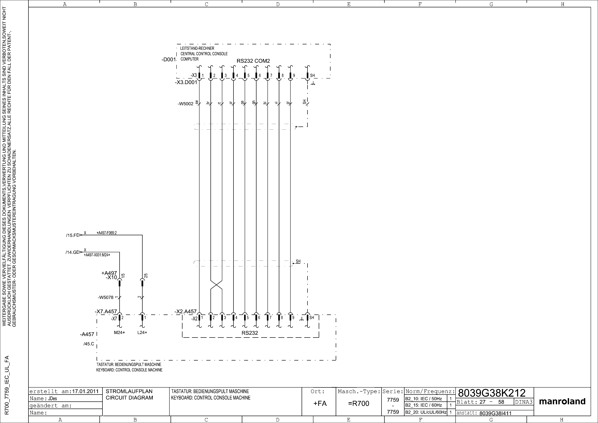

# +FA — Sheet 27 of 58 — TASTATUR: BEDIENUNGSPULT MASCHINE

**KEYBOARD: CONTROL CONSOLE MACHINE**

> Part of the manroland **R700** printing press IEC/UL circuit diagrams.
> Drawing class: **Stromlaufplan / Circuit diagram** (DIN A3).
> Document `+FA` covers the **Delivery** machine section.

## At a glance

| Field | Value |
|---|---|
| Document | `+FA`  (8039G38K212) |
| Sheet | **27** of 58 |
| Section (DE) | TASTATUR: BEDIENUNGSPULT MASCHINE |
| Section (EN) | KEYBOARD: CONTROL CONSOLE MACHINE |
| Section type | CIRCUIT — Circuit diagram |
| Machine type | `=R700` |
| Series | `7759` |
| Created | 17.01.2011 |
| Replaces | `8039G38I411` |
| Columns used | A, B, C, D |
| Path numbers | — |
| Labels on sheet | 65 |
| Cross-refs out | 3 |
| Cross-refs in | 30 |

**Previous:** [+FA sheet 26](SHEET_0026.md) · **Next:** [+FA sheet 28](SHEET_0028.md) · **Document TOC:** [_TOC.md](_TOC.md)  (+FA) · **Master TOC:** [all sheets](../_MASTER_TOC.md)

## Sheet image (300 DPI, exact vector render)



_Rendered directly from the PDF vector layer at 300 DPI (1-bit), no OCR and no resampling. Use it to confirm anything ambiguous in the text below._

## Cross-references on this sheet

Each entry is a wire leaving this sheet. The printed token is `/sheet.column`; the link resolves to that sheet inside the same document.

| Ref | Target sheet | Col | Path | Destination on target | Target section | From col |
|---|---|---|---|---|---|---|
| `/15.F` | [+FA sheet 15](SHEET_0015.md) | F | — | X +A497 F069:2 | SPANNUNGSVERSORGUNG: | A |
| `/14.G` | [+FA sheet 14](SHEET_0014.md) | G | — | X +A497 X001:M24+ | SPANNUNGSVERSORGUNG: | A |
| `/45.C` | [+FA sheet 45](SHEET_0045.md) | C | — | — | REFERENZMODUL | A |

### Incoming references (sheets that point here)

Every other sheet that sends a wire to this one. `Back-ref` is the token printed on *that* sheet; `Path` is its line number.

| From sheet | Cols | Back-ref | Path | Refs | What continues there |
|---|---|---|---|---|---|
| [+FA#14](SHEET_0014.md) | G | `/14.G` | — | 1 | X +A497 X10:1 |
| [+FA#15](SHEET_0015.md) | F | `/15.F` | — | 1 | X +A497 X10:2 |
| [+FA#45](SHEET_0045.md) | C | `/45.C` | — | 1 | — |
| [+FA#48](SHEET_0048.md) | B | `/48.B` | — | 1 | — |
| [+FA#51](SHEET_0051.md) | C, D | `/51.C`, `/51.D` | — | 4 | — |
| [+FA#53](SHEET_0053.md) | C | `/53.C` | — | 10 | — |
| [+FA#54](SHEET_0054.md) | A | `/54.A` | — | 10 | — |
| [+FA#56](SHEET_0056.md) | E | `/56.E` | — | 2 | — |


## Devices on this sheet

| Tag | Class | Class meaning (IEC) | Col | Sub | Terminal | Sign |
|---|---|---|---|---|---|---|
| `+A497` | A | Baugruppe / assembly, module, PC board | B | — | — | + |
| `X10` | X | Klemme / terminal, plug connector | B | — | — | — |
| `D001` | D | Digital / binary element | B | — | — | — |
| `X3` | X | Klemme / terminal, plug connector | C | — | — | — |
| `A457` | A | Baugruppe / assembly, module, PC board | A | — | — | — |
| `X7` | X | Klemme / terminal, plug connector | B | — | — | — |
| `X2` | X | Klemme / terminal, plug connector | C | — | — | — |
| `RS232` | RS |  | D | — | — | — |
| `W5002` | W | Kabel / cable, line, bus | C | — | — | — |
| `W5078` | W | Kabel / cable, line, bus | B | — | — | — |
| `X2.A457` | — | cross-device reference | C | — | — | — |
| `X3.D001` | — | cross-device reference | C | — | — | — |
| `X7.A457` | — | cross-device reference | B | — | — | — |

## Potentials / nets

| Potential | Count | Columns | Attached devices | Terminals |
|---|---|---|---|---|
| `L24+` | 1 | B | — | — |
| `M24+` | 1 | B | — | — |


A potential such as `L24+/4` or `M24+` is a named supply/return rail; every place it appears on this sheet is electrically common.

## Wire-end annotations (grouped as printed)

A wire that continues elsewhere is annotated with a small cluster: the destination description, the path/line number `#NN`, and the `/sheet.column` cross reference. Each row below is one such cluster exactly as it is grouped on the drawing.

| Col | Y | Path | Cross-ref | Text on the wire |
|---|---|---|---|---|
| C | 93.5 | — | — | `LEITSTAND RECHNER` |
| C | 104.1 | — | — | `CENTRAL CONTROL CONSOLE COMPUTER` |
| B | 113.7 | — | — | `D001` |
| D | 116.5 | — | — | `RS232 COM2` |
| D | 146.1 | — | — | `X3 1 2 3 4 5 6 7 8 9 SH` |
| C | 159.1 | — | — | `X3.D001` |
| D | 198.2 | — | — | `SH` |
| C | 199.6 | — | — | `sw` |
| D | 200.1 | — | — | `gn` |
| D | 200.4 | — | — | `ge` |
| D | 201.7 | — | — | `gr` |
| C | 201.9 | — | — | `br` |
| C | 201.9 | — | — | `or` |
| D | 202.3 | — | — | `bl` |
| D | 202.3 | — | — | `vi` |
| C | 202.6 | — | — | `W5002` |
| C | 203.4 | — | — | `rt` |
| A | 460.5 | — | `/15.F` | `X +A497 F069:2` |
| A | 494.5 | — | `/14.G` | `+A497 X001:M24+ X` |
| D | 517.1 | — | — | `SH` |
| B | 538.9 | — | — | `+A497` |
| B | 544.2 | — | — | `2/5` |
| B | 544.6 | — | — | `1/5` |
| B | 547.4 | — | — | `X10` |
| B | 588.1 | — | — | `W5078` |
| B | 589.1 | — | — | `1` |
| B | 589.1 | — | — | `2` |
| B | 615.4 | — | — | `X7.A457` |
| C | 615.4 | — | — | `X2.A457` |
| C | 628.7 | — | — | `X7 2 1 X2 1 2 3 4 5 6 7 8 9` |
| D | 629.1 | — | — | `SH` |
| C | 657.9 | — | — | `M24+ L24+ RS232` |
| A | 660.8 | — | — | `A457` |
| A | 680.6 | — | `/45.C` | — |
| B | 722.8 | — | — | `KEYBOARD: CONTROL CONSOLE MACHINE TASTATUR: BEDIENUNGSPULT MASCHINE` |


## Reconstructed tables

This sheet carries tabular content (pin map / terminal assignment / index). The grid below was rebuilt from the drawing's own rule lines, so each row is exactly one physical row of the table.

### Table 1 — 0 data rows × 13 columns (at x=238.1, y=246.6) — **SH**

_none_


## Notes and free text on this sheet

| Text | Col | Y (pt) |
|---|---|---|
| `+A497 X001:M24+` | A | 504.51 |
| `SH` | D | 517.15 |
| `+A497 F069:2` | B | 460.56 |
| `RS232 COM2` | D | 116.53 |
| `LEITSTAND RECHNER` | C | 93.47 |
| `CENTRAL CONTROL CONSOLE` | C | 104.11 |
| `COMPUTER` | C | 114.75 |
| `TASTATUR: BEDIENUNGSPULT MASCHINE` | B | 722.76 |
| `KEYBOARD: CONTROL CONSOLE MACHINE` | B | 733.39 |
| `gr` | D | 201.7 |
| `vi` | D | 202.34 |
| `gn` | D | 200.12 |
| `ge` | D | 200.41 |
| `or` | C | 201.9 |
| `rt` | C | 203.43 |
| `bl` | D | 202.34 |
| `br` | C | 201.9 |
| `sw` | C | 199.57 |

## Complete label inventory (exact text from the drawing)

Every text object inside the drawing area of this sheet, in DIN reading order (column A→H, then top→bottom). This is the authoritative list: if a string is not here it is not printed on this sheet.

| Col | Y | X | Dir | Type | Text |
|---|---|---|---|---|---|
| A | 460.5 | 167.2 | → | not fitted | `X` |
| A | 464.4 | 131.8 | → | cross-reference | `/15.F` |
| A | 494.5 | 167.2 | → | not fitted | `X` |
| A | 498.5 | 130.7 | → | cross-reference | `/14.G` |
| A | 504.5 | 167.0 | → | text | `+A497 X001:M24+` |
| A | 660.8 | 159.3 | → | device tag | `A457` |
| A | 680.6 | 166.4 | → | cross-reference | `/45.C` |
| B | 113.7 | 321.7 | → | device tag | `D001` |
| B | 460.6 | 192.5 | → | text | `+A497 F069:2` |
| B | 538.9 | 201.8 | → | device tag | `+A497` |
| B | 544.2 | 287.6 | ↕ | pin pair | `2/5` |
| B | 544.6 | 242.2 | ↕ | pin pair | `1/5` |
| B | 547.4 | 210.6 | → | device tag | `X10` |
| B | 588.1 | 194.7 | → | device tag | `W5078` |
| B | 589.1 | 229.0 | ↕ | number | `1` |
| B | 589.1 | 274.7 | ↕ | number | `2` |
| B | 615.4 | 188.8 | → | device ref | `X7.A457` |
| B | 628.7 | 286.9 | → | number | `1` |
| B | 629.1 | 242.1 | → | number | `2` |
| B | 630.8 | 221.1 | → | device tag | `X7` |
| B | 658.0 | 227.2 | → | potential | `M24+` |
| B | 658.0 | 273.5 | → | potential | `L24+` |
| B | 722.8 | 192.5 | → | text | `TASTATUR: BEDIENUNGSPULT MASCHINE` |
| B | 733.4 | 191.9 | → | text | `KEYBOARD: CONTROL CONSOLE MACHINE` |
| C | 93.5 | 359.1 | → | text | `LEITSTAND RECHNER` |
| C | 104.1 | 359.7 | → | text | `CENTRAL CONTROL CONSOLE` |
| C | 114.7 | 359.7 | → | text | `COMPUTER` |
| C | 146.1 | 379.8 | → | device tag | `X3` |
| C | 146.8 | 401.7 | → | number | `1` |
| C | 147.2 | 424.9 | → | number | `2` |
| C | 147.2 | 447.6 | → | number | `3` |
| C | 147.2 | 470.3 | → | number | `4` |
| C | 159.1 | 348.4 | → | device ref | `X3.D001` |
| C | 199.6 | 388.3 | ↕ | text | `sw` |
| C | 201.9 | 410.9 | ↕ | text | `br` |
| C | 201.9 | 456.4 | ↕ | text | `or` |
| C | 202.6 | 353.8 | → | device tag | `W5002` |
| C | 203.4 | 433.4 | ↕ | text | `rt` |
| C | 615.4 | 347.5 | → | device ref | `X2.A457` |
| C | 628.7 | 400.3 | → | number | `1` |
| C | 629.1 | 423.5 | → | number | `2` |
| C | 629.1 | 446.2 | → | number | `3` |
| C | 629.1 | 468.9 | → | number | `4` |
| C | 630.8 | 381.2 | → | device tag | `X2` |
| D | 116.5 | 471.4 | → | text | `RS232 COM2` |
| D | 147.2 | 492.9 | → | number | `5` |
| D | 147.2 | 515.6 | → | number | `6` |
| D | 147.2 | 538.3 | → | number | `7` |
| D | 147.2 | 561.0 | → | number | `8` |
| D | 147.2 | 583.7 | → | number | `9` |
| D | 147.2 | 617.7 | → | text | `SH` |
| D | 198.2 | 603.6 | ↕ | text | `SH` |
| D | 200.1 | 501.6 | ↕ | text | `gn` |
| D | 200.4 | 479.0 | ↕ | text | `ge` |
| D | 201.7 | 569.7 | ↕ | text | `gr` |
| D | 202.3 | 524.2 | ↕ | text | `bl` |
| D | 202.3 | 547.0 | ↕ | text | `vi` |
| D | 517.2 | 589.3 | → | text | `SH` |
| D | 629.1 | 491.5 | → | number | `5` |
| D | 629.1 | 514.2 | → | number | `6` |
| D | 629.1 | 536.9 | → | number | `7` |
| D | 629.1 | 559.6 | → | number | `8` |
| D | 629.1 | 582.2 | → | number | `9` |
| D | 629.1 | 616.3 | → | text | `SH` |
| D | 657.9 | 481.0 | → | device tag | `RS232` |

## Reading-order text block

The same content as a plain block, grouped by DIN column — convenient to paste or to match against a visual description.

```text
=== Column A ===
 460.5  167.2  placeholder  X
 464.4  131.8  xref         /15.F
 494.5  167.2  placeholder  X
 498.5  130.7  xref         /14.G
 504.5  167.0  text         +A497 X001:M24+
 660.8  159.3  devtag       A457
 680.6  166.4  xref         /45.C
=== Column B ===
 113.7  321.7  devtag       D001
 460.6  192.5  text         +A497 F069:2
 538.9  201.8  devtag       +A497
 544.2  287.6  pinpair      2/5
 544.6  242.2  pinpair      1/5
 547.4  210.6  devtag       X10
 588.1  194.7  devtag       W5078
 589.1  229.0  numeric      1
 589.1  274.7  numeric      2
 615.4  188.8  devref       X7.A457
 628.7  286.9  numeric      1
 629.1  242.1  numeric      2
 630.8  221.1  devtag       X7
 658.0  227.2  net          M24+
 658.0  273.5  net          L24+
 722.8  192.5  text         TASTATUR: BEDIENUNGSPULT MASCHINE
 733.4  191.9  text         KEYBOARD: CONTROL CONSOLE MACHINE
=== Column C ===
  93.5  359.1  text         LEITSTAND RECHNER
 104.1  359.7  text         CENTRAL CONTROL CONSOLE
 114.7  359.7  text         COMPUTER
 146.1  379.8  devtag       X3
 146.8  401.7  numeric      1
 147.2  424.9  numeric      2
 147.2  447.6  numeric      3
 147.2  470.3  numeric      4
 159.1  348.4  devref       X3.D001
 199.6  388.3  text         sw
 201.9  410.9  text         br
 201.9  456.4  text         or
 202.6  353.8  devtag       W5002
 203.4  433.4  text         rt
 615.4  347.5  devref       X2.A457
 628.7  400.3  numeric      1
 629.1  423.5  numeric      2
 629.1  446.2  numeric      3
 629.1  468.9  numeric      4
 630.8  381.2  devtag       X2
=== Column D ===
 116.5  471.4  text         RS232 COM2
 147.2  492.9  numeric      5
 147.2  515.6  numeric      6
 147.2  538.3  numeric      7
 147.2  561.0  numeric      8
 147.2  583.7  numeric      9
 147.2  617.7  text         SH
 198.2  603.6  text         SH
 200.1  501.6  text         gn
 200.4  479.0  text         ge
 201.7  569.7  text         gr
 202.3  524.2  text         bl
 202.3  547.0  text         vi
 517.2  589.3  text         SH
 629.1  491.5  numeric      5
 629.1  514.2  numeric      6
 629.1  536.9  numeric      7
 629.1  559.6  numeric      8
 629.1  582.2  numeric      9
 629.1  616.3  text         SH
 657.9  481.0  devtag       RS232
```

---
_Generated from the PDF vector text layer; no OCR. Source: `R700_7759_IEC_UL_FA`, sheet 27._
