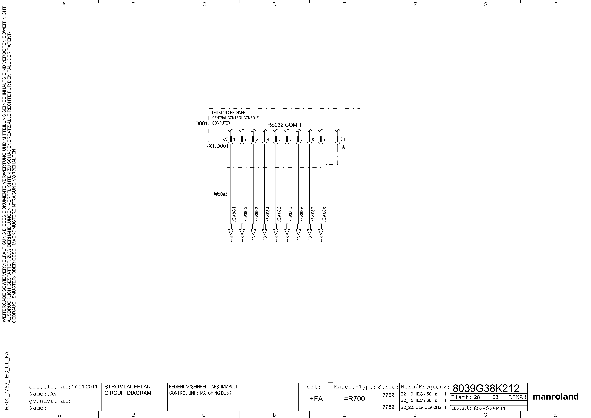

# +FA — Sheet 28 of 58 — BEDIENUNGSEINHEIT: ABSTIMMPULT

**CONTROL UNIT: MATCHING DESK**

> Part of the manroland **R700** printing press IEC/UL circuit diagrams.
> Drawing class: **Stromlaufplan / Circuit diagram** (DIN A3).
> Document `+FA` covers the **Delivery** machine section.

## At a glance

| Field | Value |
|---|---|
| Document | `+FA`  (8039G38K212) |
| Sheet | **28** of 58 |
| Section (DE) | BEDIENUNGSEINHEIT: ABSTIMMPULT |
| Section (EN) | CONTROL UNIT: MATCHING DESK |
| Section type | CONTROL_UNIT — Control unit |
| Machine type | `=R700` |
| Series | `7759` |
| Created | 17.01.2011 |
| Replaces | `8039G38I411` |
| Columns used | C, D, E |
| Path numbers | — |
| Labels on sheet | 36 |
| Cross-refs out | 0 |
| Cross-refs in | 1 |

**Previous:** [+FA sheet 27](SHEET_0027.md) · **Next:** [+FA sheet 29](SHEET_0029.md) · **Document TOC:** [_TOC.md](_TOC.md)  (+FA) · **Master TOC:** [all sheets](../_MASTER_TOC.md)

## Sheet image (300 DPI, exact vector render)



_Rendered directly from the PDF vector layer at 300 DPI (1-bit), no OCR and no resampling. Use it to confirm anything ambiguous in the text below._

## Cross-references on this sheet

Each entry is a wire leaving this sheet. The printed token is `/sheet.column`; the link resolves to that sheet inside the same document.

_No outgoing cross-references on this sheet._

### Incoming references (sheets that point here)

Every other sheet that sends a wire to this one. `Back-ref` is the token printed on *that* sheet; `Path` is its line number.

| From sheet | Cols | Back-ref | Path | Refs | What continues there |
|---|---|---|---|---|---|
| [+FA#48](SHEET_0048.md) | B | `/48.B` | — | 1 | — |


## Devices on this sheet

| Tag | Class | Class meaning (IEC) | Col | Sub | Terminal | Sign |
|---|---|---|---|---|---|---|
| `D001` | D | Digital / binary element | C | — | — | — |
| `X1` | X | Klemme / terminal, plug connector | C | — | — | — |
| `W5093` | W | Kabel / cable, line, bus | C | — | — | — |
| `X1.D001` | — | cross-device reference | C | — | — | — |
| `X8.A368:1` | — | cross-device reference | C | — | 1 | — |
| `X8.A368:2` | — | cross-device reference | D | — | 2 | — |
| `X8.A368:3` | — | cross-device reference | D | — | 3 | — |
| `X8.A368:4` | — | cross-device reference | D | — | 4 | — |
| `X8.A368:2` | — | cross-device reference | D | — | 2 | — |
| `X8.A368:5` | — | cross-device reference | D | — | 5 | — |
| `X8.A368:6` | — | cross-device reference | D | — | 6 | — |
| `X8.A368:7` | — | cross-device reference | E | — | 7 | — |
| `X8.A368:8` | — | cross-device reference | E | — | 8 | — |

## Potentials / nets

_No named potentials on this sheet._

## Wire-end annotations (grouped as printed)

A wire that continues elsewhere is annotated with a small cluster: the destination description, the path/line number `#NN`, and the `/sheet.column` cross reference. Each row below is one such cluster exactly as it is grouped on the drawing.

| Col | Y | Path | Cross-ref | Text on the wire |
|---|---|---|---|---|
| C | 223.9 | — | — | `LEITSTAND RECHNER` |
| C | 234.5 | — | — | `CENTRAL CONTROL CONSOLE COMPUTER` |
| C | 244.1 | — | — | `D001` |
| D | 246.9 | — | — | `RS232 COM 1` |
| D | 276.4 | — | — | `X1 1 2 3 4 5 6 7 8 9 SH` |
| C | 289.4 | — | — | `X1.D001` |
| C | 387.2 | — | — | `W5093` |
| C | 416.5 | — | — | `+FB X8.A368:1` |
| D | 416.8 | — | — | `+FB X8.A368:2` |
| D | 416.8 | — | — | `+FB X8.A368:2` |
| D | 416.9 | — | — | `+FB X8.A368:3` |
| D | 416.9 | — | — | `+FB X8.A368:4` |
| D | 416.9 | — | — | `+FB X8.A368:5` |
| D | 416.9 | — | — | `+FB X8.A368:6` |
| E | 416.9 | — | — | `+FB X8.A368:7` |
| E | 416.9 | — | — | `+FB X8.A368:8` |


## Notes and free text on this sheet

| Text | Col | Y (pt) |
|---|---|---|
| `+FB` | C | 475.94 |
| `+FB` | D | 475.94 |
| `+FB` | E | 475.94 |
| `SH` | E | 277.62 |
| `RS232 COM 1` | D | 246.93 |
| `LEITSTAND RECHNER` | C | 223.86 |
| `CENTRAL CONTROL CONSOLE` | C | 234.51 |
| `COMPUTER` | C | 245.14 |

## Complete label inventory (exact text from the drawing)

Every text object inside the drawing area of this sheet, in DIN reading order (column A→H, then top→bottom). This is the authoritative list: if a string is not here it is not printed on this sheet.

| Col | Y | X | Dir | Type | Text |
|---|---|---|---|---|---|
| C | 223.9 | 427.2 | → | text | `LEITSTAND RECHNER` |
| C | 234.5 | 427.7 | → | text | `CENTRAL CONTROL CONSOLE` |
| C | 244.1 | 389.8 | → | device tag | `D001` |
| C | 245.1 | 427.7 | → | text | `COMPUTER` |
| C | 276.4 | 448.9 | → | device tag | `X1` |
| C | 277.2 | 469.7 | → | number | `1` |
| C | 289.4 | 416.4 | → | device ref | `X1.D001` |
| C | 387.2 | 430.9 | → | device tag | `W5093` |
| C | 416.5 | 468.7 | ↕ | device ref | `X8.A368:1` |
| C | 475.9 | 463.3 | ↕ | text | `+FB` |
| D | 246.9 | 538.7 | → | text | `RS232 COM 1` |
| D | 277.6 | 492.9 | → | number | `2` |
| D | 277.6 | 515.6 | → | number | `3` |
| D | 277.6 | 538.3 | → | number | `4` |
| D | 277.6 | 561.0 | → | number | `5` |
| D | 277.6 | 583.7 | → | number | `6` |
| D | 277.6 | 606.3 | → | number | `7` |
| D | 416.8 | 491.4 | ↕ | device ref | `X8.A368:2` |
| D | 416.8 | 559.5 | ↕ | device ref | `X8.A368:2` |
| D | 416.9 | 514.1 | ↕ | device ref | `X8.A368:3` |
| D | 416.9 | 536.8 | ↕ | device ref | `X8.A368:4` |
| D | 416.9 | 582.2 | ↕ | device ref | `X8.A368:5` |
| D | 416.9 | 604.8 | ↕ | device ref | `X8.A368:6` |
| D | 475.9 | 486.0 | ↕ | text | `+FB` |
| D | 475.9 | 508.7 | ↕ | text | `+FB` |
| D | 475.9 | 531.4 | ↕ | text | `+FB` |
| D | 475.9 | 554.1 | ↕ | text | `+FB` |
| D | 475.9 | 576.7 | ↕ | text | `+FB` |
| D | 475.9 | 599.4 | ↕ | text | `+FB` |
| E | 277.6 | 629.0 | → | number | `8` |
| E | 277.6 | 651.7 | → | number | `9` |
| E | 277.6 | 685.7 | → | text | `SH` |
| E | 416.9 | 627.5 | ↕ | device ref | `X8.A368:7` |
| E | 416.9 | 650.2 | ↕ | device ref | `X8.A368:8` |
| E | 475.9 | 622.1 | ↕ | text | `+FB` |
| E | 475.9 | 644.8 | ↕ | text | `+FB` |

## Reading-order text block

The same content as a plain block, grouped by DIN column — convenient to paste or to match against a visual description.

```text
=== Column C ===
 223.9  427.2  text         LEITSTAND RECHNER
 234.5  427.7  text         CENTRAL CONTROL CONSOLE
 244.1  389.8  devtag       D001
 245.1  427.7  text         COMPUTER
 276.4  448.9  devtag       X1
 277.2  469.7  numeric      1
 289.4  416.4  devref       X1.D001
 387.2  430.9  devtag       W5093
 416.5  468.7  devref       X8.A368:1
 475.9  463.3  text         +FB
=== Column D ===
 246.9  538.7  text         RS232 COM 1
 277.6  492.9  numeric      2
 277.6  515.6  numeric      3
 277.6  538.3  numeric      4
 277.6  561.0  numeric      5
 277.6  583.7  numeric      6
 277.6  606.3  numeric      7
 416.8  491.4  devref       X8.A368:2
 416.8  559.5  devref       X8.A368:2
 416.9  514.1  devref       X8.A368:3
 416.9  536.8  devref       X8.A368:4
 416.9  582.2  devref       X8.A368:5
 416.9  604.8  devref       X8.A368:6
 475.9  486.0  text         +FB
 475.9  508.7  text         +FB
 475.9  531.4  text         +FB
 475.9  554.1  text         +FB
 475.9  576.7  text         +FB
 475.9  599.4  text         +FB
=== Column E ===
 277.6  629.0  numeric      8
 277.6  651.7  numeric      9
 277.6  685.7  text         SH
 416.9  627.5  devref       X8.A368:7
 416.9  650.2  devref       X8.A368:8
 475.9  622.1  text         +FB
 475.9  644.8  text         +FB
```

---
_Generated from the PDF vector text layer; no OCR. Source: `R700_7759_IEC_UL_FA`, sheet 28._
