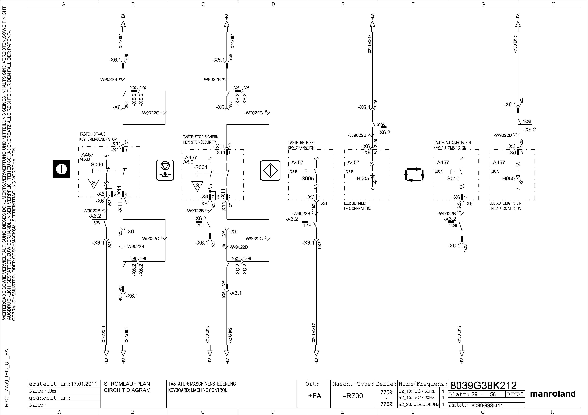

# +FA — Sheet 29 of 58 — TASTATUR: MASCHINENSTEUERUNG

**KEYBOARD: MACHINE CONTROL**

> Part of the manroland **R700** printing press IEC/UL circuit diagrams.
> Drawing class: **Stromlaufplan / Circuit diagram** (DIN A3).
> Document `+FA` covers the **Delivery** machine section.

## At a glance

| Field | Value |
|---|---|
| Document | `+FA`  (8039G38K212) |
| Sheet | **29** of 58 |
| Section (DE) | TASTATUR: MASCHINENSTEUERUNG |
| Section (EN) | KEYBOARD: MACHINE CONTROL |
| Section type | CIRCUIT — Circuit diagram |
| Machine type | `=R700` |
| Series | `7759` |
| Created | 17.01.2011 |
| Replaces | `8039G38I411` |
| Columns used | A, B, C, D, E, F, G, H |
| Path numbers | — |
| Labels on sheet | 180 |
| Cross-refs out | 6 |
| Cross-refs in | 46 |

**Previous:** [+FA sheet 28](SHEET_0028.md) · **Next:** [+FA sheet 30](SHEET_0030.md) · **Document TOC:** [_TOC.md](_TOC.md)  (+FA) · **Master TOC:** [all sheets](../_MASTER_TOC.md)

## Sheet image (300 DPI, exact vector render)



_Rendered directly from the PDF vector layer at 300 DPI (1-bit), no OCR and no resampling. Use it to confirm anything ambiguous in the text below._

## Cross-references on this sheet

Each entry is a wire leaving this sheet. The printed token is `/sheet.column`; the link resolves to that sheet inside the same document.

| Ref | Target sheet | Col | Path | Destination on target | Target section | From col |
|---|---|---|---|---|---|---|
| `/45.B` | [+FA sheet 45](SHEET_0045.md) | B | — | — | REFERENZMODUL | A |
| `/45.B` | [+FA sheet 45](SHEET_0045.md) | B | — | — | REFERENZMODUL | C |
| `/45.B` | [+FA sheet 45](SHEET_0045.md) | B | — | — | REFERENZMODUL | D |
| `/45.B` | [+FA sheet 45](SHEET_0045.md) | B | — | — | REFERENZMODUL | E |
| `/45.B` | [+FA sheet 45](SHEET_0045.md) | B | — | — | REFERENZMODUL | F |
| `/45.C` | [+FA sheet 45](SHEET_0045.md) | C | — | — | REFERENZMODUL | G |

### Incoming references (sheets that point here)

Every other sheet that sends a wire to this one. `Back-ref` is the token printed on *that* sheet; `Path` is its line number.

| From sheet | Cols | Back-ref | Path | Refs | What continues there |
|---|---|---|---|---|---|
| [+FA#45](SHEET_0045.md) | B, C | `/45.B`, `/45.C` | — | 6 | — |
| [+FA#56](SHEET_0056.md) | A, D, E, F | `/56.A`, `/56.D`, `/56.E`, `/56.F` | — | 40 | — |


## Devices on this sheet

| Tag | Class | Class meaning (IEC) | Col | Sub | Terminal | Sign |
|---|---|---|---|---|---|---|
| `X6` | X | Klemme / terminal, plug connector | E | — | — | — |
| `X6` | X | Klemme / terminal, plug connector | G | — | — | — |
| `X6` | X | Klemme / terminal, plug connector | E | — | — | — |
| `X6` | X | Klemme / terminal, plug connector | G | — | — | — |
| `X6` | X | Klemme / terminal, plug connector | B | — | — | — |
| `X6` | X | Klemme / terminal, plug connector | C | — | — | — |
| `X6` | X | Klemme / terminal, plug connector | B | — | — | — |
| `X6` | X | Klemme / terminal, plug connector | C | — | — | — |
| `X6` | X | Klemme / terminal, plug connector | B | — | — | — |
| `X6` | X | Klemme / terminal, plug connector | C | — | — | — |
| `A457` | A | Baugruppe / assembly, module, PC board | E | — | — | — |
| `X6` | X | Klemme / terminal, plug connector | E | — | — | — |
| `A457` | A | Baugruppe / assembly, module, PC board | G | — | — | — |
| `X6` | X | Klemme / terminal, plug connector | G | — | — | — |
| `A457` | A | Baugruppe / assembly, module, PC board | F | — | — | — |
| `X6` | X | Klemme / terminal, plug connector | G | — | — | — |
| `S050` | S | Schalter / switch | G | — | — | — |
| `A457` | A | Baugruppe / assembly, module, PC board | D | — | — | — |
| `X6` | X | Klemme / terminal, plug connector | E | — | — | — |
| `S005` | S | Schalter / switch | D | — | — | — |
| `A457` | A | Baugruppe / assembly, module, PC board | C | — | — | — |
| `S001` | S | Schalter / switch | C | — | — | — |
| `X6` | X | Klemme / terminal, plug connector | C | — | — | — |
| `X11` | X | Klemme / terminal, plug connector | C | — | — | — |
| `X11` | X | Klemme / terminal, plug connector | C | — | — | — |
| `A457` | A | Baugruppe / assembly, module, PC board | A | — | — | — |
| `S000` | S | Schalter / switch | A | — | — | — |
| `X6` | X | Klemme / terminal, plug connector | B | — | — | — |
| `X11` | X | Klemme / terminal, plug connector | B | — | — | — |
| `X11` | X | Klemme / terminal, plug connector | B | — | — | — |
| `X11` | X | Klemme / terminal, plug connector | B | — | — | — |
| `X11` | X | Klemme / terminal, plug connector | B | — | — | — |
| `X11` | X | Klemme / terminal, plug connector | C | — | — | — |
| `X11` | X | Klemme / terminal, plug connector | C | — | — | — |
| `X13.A334:4` | — | cross-device reference | B | — | 4 | — |
| `X13.A334:5` | — | cross-device reference | C | — | 5 | — |
| `X25.1.A334:2` | — | cross-device reference | E | — | 2 | — |
| `X25.1.A334:4` | — | cross-device reference | E | — | 4 | — |
| `X13.A334:34` | — | cross-device reference | G | — | 34 | — |
| `X13.A334:2` | — | cross-device reference | G | — | 2 | — |
| `X6.1` | — | cross-device reference | A | — | — | — |
| `X6.1` | — | cross-device reference | C | — | — | — |
| `X6.1` | — | cross-device reference | E | — | — | — |
| `X6.1` | — | cross-device reference | E | — | — | — |
| `X6.1` | — | cross-device reference | G | — | — | — |
| `X6.1` | — | cross-device reference | G | — | — | — |
| `X6.2` | — | cross-device reference | B | — | — | — |
| `X6.1` | — | cross-device reference | B | — | — | — |
| `X4.A710:2` | — | cross-device reference | B | — | 2 | — |
| `X6.2` | — | cross-device reference | C | — | — | — |
| `X6.1` | — | cross-device reference | C | — | — | — |
| `X2.A710:2` | — | cross-device reference | C | — | 2 | — |
| `X6.2` | — | cross-device reference | C | — | — | — |
| `X6.1` | — | cross-device reference | B | — | — | — |
| `X6.1` | — | cross-device reference | C | — | — | — |
| `X4.A710:1` | — | cross-device reference | B | — | 1 | — |
| `X2.A710:1` | — | cross-device reference | C | — | 1 | — |
| `X6.2` | — | cross-device reference | A | — | — | — |
| `X6.2` | — | cross-device reference | C | — | — | — |
| `X6.2` | — | cross-device reference | D | — | — | — |
| `X6.2` | — | cross-device reference | B | — | — | — |
| `X6.2` | — | cross-device reference | F | — | — | — |
| `X6.2` | — | cross-device reference | H | — | — | — |
| `X6.2` | — | cross-device reference | G | — | — | — |
| `X6.2` | — | cross-device reference | B | — | — | — |
| `X6.2` | — | cross-device reference | B | — | — | — |
| `X6.2` | — | cross-device reference | D | — | — | — |
| `X6.2` | — | cross-device reference | D | — | — | — |

## Potentials / nets

| Potential | Count | Columns | Attached devices | Terminals |
|---|---|---|---|---|
| `H005` | 1 | E | — | — |
| `H050` | 1 | G | — | — |


A potential such as `L24+/4` or `M24+` is a named supply/return rail; every place it appears on this sheet is electrically common.

## Wire-end annotations (grouped as printed)

A wire that continues elsewhere is annotated with a small cluster: the destination description, the path/line number `#NN`, and the `/sheet.column` cross reference. Each row below is one such cluster exactly as it is grouped on the drawing.

| Col | Y | Path | Cross-ref | Text on the wire |
|---|---|---|---|---|
| B | 27.8 | — | — | `X4.A710:1 +EA` |
| C | 27.8 | — | — | `+EA` |
| E | 27.8 | — | — | `X25.1.A334:4 +EA` |
| G | 27.8 | — | — | `X13.A334:34 +EA` |
| C | 68.0 | — | — | `X2.A710:1` |
| B | 109.9 | — | — | `3/26` |
| C | 109.9 | — | — | `9/26` |
| B | 116.5 | — | — | `X6.1` |
| C | 116.5 | — | — | `X6.1` |
| B | 157.3 | — | — | `W9022B` |
| C | 157.3 | — | — | `W9022B` |
| B | 158.3 | — | — | `3` |
| C | 158.3 | — | — | `9` |
| B | 175.7 | — | — | `3/26` |
| B | 175.7 | — | — | `3/26` |
| C | 175.7 | — | — | `9/26` |
| D | 175.7 | — | — | `9/26` |
| B | 189.4 | — | — | `X6.2` |
| B | 189.4 | — | — | `X6.2` |
| C | 189.4 | — | — | `X6.2` |
| D | 189.4 | — | — | `X6.2` |
| H | 197.6 | — | — | `19/26` |
| E | 202.9 | — | — | `21/26` |
| B | 206.3 | — | — | `3/26` |
| C | 206.3 | — | — | `9/26` |
| G | 207.3 | — | — | `X6.1` |
| B | 212.9 | — | — | `X6` |
| C | 212.9 | — | — | `X6` |
| E | 212.9 | — | — | `X6.1` |
| D | 222.2 | — | — | `sw` |
| B | 225.3 | — | — | `W9022C` |
| D | 225.3 | — | — | `W9022C` |
| B | 226.1 | — | — | `rt` |
| H | 243.7 | — | — | `19/26` |
| G | 249.4 | — | — | `21/26 X6.2` |
| F | 263.9 | — | — | `X6.2` |
| E | 267.8 | — | — | `21` |
| G | 268.6 | — | — | `19` |
| A | 269.2 | — | — | `KEY: EMERGENCY STOP TASTE: NOT AUS` |
| E | 270.7 | — | — | `W9022B` |
| G | 270.7 | — | — | `W9022B` |
| C | 274.9 | — | — | `KEY: STOP SECURITY TASTE: STOP SICHERN` |
| E | 282.3 | — | — | `21/26` |
| H | 282.7 | — | — | `19/26` |
| B | 283.4 | — | — | `X11 3/4` |
| D | 286.2 | — | — | `KEY: OPERATION: TASTE: BETRIEB:` |
| G | 286.2 | — | — | `KEY: AUTOMATIC, ON TASTE: AUTOMATIK, EIN` |
| B | 286.6 | — | — | `X11` |
| C | 289.5 | — | — | `X11 1/4` |
| C | 292.3 | — | — | `X11` |
| E | 292.3 | — | — | `X6` |
| G | 292.3 | — | — | `X6` |
| B | 299.4 | — | — | `X11` |
| B | 301.7 | — | — | `3` |
| C | 305.0 | — | — | `X11` |
| E | 305.1 | — | — | `X6` |
| G | 305.1 | — | — | `X6` |
| E | 305.9 | — | — | `21` |
| H | 306.0 | — | — | `19` |
| C | 306.9 | — | — | `1` |
| A | 309.3 | — | — | `A457` |
| C | 314.9 | — | — | `A457` |
| A | 319.1 | — | `/45.B` | — |
| C | 324.8 | — | `/45.B` | — |
| D | 324.9 | — | — | `A457` |
| E | 324.9 | — | — | `A457` |
| F | 324.9 | — | — | `A457` |
| G | 324.9 | — | — | `A457` |
| A | 329.1 | — | — | `S000` |
| C | 334.8 | — | — | `S001` |
| D | 345.7 | — | `/45.B` | — |
| E | 345.7 | — | `/45.B` | — |
| F | 345.7 | — | `/45.B` | — |
| G | 345.8 | — | `/45.C` | — |
| D | 357.5 | — | — | `S005` |
| E | 357.5 | — | — | `H005` |
| G | 357.5 | — | — | `S050` |
| G | 357.5 | — | — | `H050` |
| A | 366.0 | — | — | `S` |
| C | 371.6 | — | — | `S` |
| B | 376.2 | — | — | `X11` |
| C | 381.8 | — | — | `X11` |
| B | 388.7 | — | — | `X6` |
| B | 391.0 | — | — | `5 6 4` |
| C | 394.3 | — | — | `X6` |
| E | 395.8 | — | — | `X6` |
| G | 395.8 | — | — | `X6` |
| C | 396.6 | — | — | `7 8 2` |
| E | 397.9 | — | — | `11` |
| G | 398.1 | — | — | `12` |
| B | 402.8 | — | — | `X6` |
| B | 405.1 | — | — | `5/26` |
| B | 405.1 | — | — | `4/4` |
| C | 408.5 | — | — | `X6` |
| E | 408.5 | — | — | `X6` |
| G | 408.5 | — | — | `X6` |
| E | 409.5 | — | — | `LED: BETRIEB: LED: OPERATION:` |
| G | 409.5 | — | — | `LED:AUTOMATIK, EIN LED:AUTOMATIC, ON` |
| C | 410.7 | — | — | `7/26` |
| C | 410.7 | — | — | `2/4` |
| E | 410.7 | — | — | `11/26` |
| G | 410.7 | — | — | `12/26` |
| A | 423.7 | — | — | `W9022B` |
| C | 423.7 | — | — | `W9022B` |
| B | 424.7 | — | — | `5` |
| C | 424.7 | — | — | `7` |
| E | 427.0 | — | — | `11` |
| G | 427.3 | — | — | `12` |
| D | 429.4 | — | — | `W9022B` |
| F | 429.4 | — | — | `W9022B` |
| A | 433.4 | — | — | `X6.2` |
| B | 438.5 | — | — | `5/26 X6.2` |
| D | 439.7 | — | — | `X6.2` |
| G | 439.8 | — | — | `X6.2` |
| C | 454.9 | — | — | `7/26 X6` |
| D | 454.9 | — | — | `11/26` |
| G | 454.9 | — | — | `12/26` |
| B | 465.2 | — | — | `X6` |
| B | 467.4 | — | — | `4/26` |
| C | 467.4 | — | — | `10/26` |
| B | 479.7 | — | — | `or` |
| D | 479.7 | — | — | `br` |
| B | 480.4 | — | — | `W9022C` |
| D | 480.4 | — | — | `W9022C` |
| A | 487.9 | — | — | `X6.1` |
| C | 487.9 | — | — | `X6.1` |
| E | 487.9 | — | — | `X6.1` |
| B | 490.1 | — | — | `5/26` |
| C | 490.1 | — | — | `7/26` |
| E | 490.1 | — | — | `11/26` |
| G | 493.6 | — | — | `X6.1` |
| C | 495.4 | — | — | `10` |
| G | 495.8 | — | — | `12/26` |
| B | 496.3 | — | — | `W9022B` |
| D | 497.3 | — | — | `W9022B` |
| B | 498.4 | — | — | `4` |
| B | 521.5 | — | — | `4/26` |
| B | 521.5 | — | — | `4/26` |
| C | 521.5 | — | — | `10/26` |
| D | 521.5 | — | — | `10/26` |
| B | 535.2 | — | — | `X6.2` |
| B | 535.2 | — | — | `X6.2` |
| C | 535.2 | — | — | `X6.2` |
| D | 535.2 | — | — | `X6.2` |
| C | 569.0 | — | — | `10/26` |
| B | 577.6 | — | — | `4/26` |
| C | 589.9 | — | — | `X6.1` |
| C | 592.2 | — | — | `10/26 +EA X2.A710:2` |
| B | 595.6 | — | — | `X6.1` |
| B | 597.8 | — | — | `4/26 +EA X4.A710:2` |
| E | 655.8 | — | — | `X25.1.A334:2 +EA` |
| G | 661.0 | — | — | `X13.A334:2 +EA` |
| B | 661.1 | — | — | `X13.A334:4 +EA` |
| C | 661.1 | — | — | `X13.A334:5 +EA` |


## Reconstructed tables

This sheet carries tabular content (pin map / terminal assignment / index). The grid below was rebuilt from the drawing's own rule lines, so each row is exactly one physical row of the table.

### Table 1 — 5 data rows × 5 columns (at x=158.7, y=184.3)

|  | X6 | X6.2 3/26 | X6.2 W9022C | rt |
|---|---|---|---|---|
| `TASTE: NOT AUS KEY: EMERGENCY` | `STOP X11` | `3/4` |  |  |
| `A457 /45.B S000` | `X11` | `3` |  |  |
| `S X6` | `X11 5 6` | `4` |  |  |
| `X6 W9022B 5 X6.2` | `5/26 X11` | `4/4` |  |  |
| `5/26 X6.1` | `4/26 5/26 4` | `X6 W9022B 4/26` | `W9022C 4/26` | `or` |


### Table 2 — 6 data rows × 5 columns (at x=368.5, y=184.3)

|  | X6 | X6.2 9/26 | X6.2 W9022C | sw |
|---|---|---|---|---|
| `TASTE: STOP SICHERN KEY: STOP SECURITY` | `X11` | `1/4` |  |  |
| `A457 /45.B S001` | `X11` | `1` |  |  |
| `S X6` | `X11` |  |  |  |
|  | `7 8` | `2` |  |  |
| `X6 W9022B 7 X6.2` | `X11 7/26` | `2/4` |  |  |
| `7/26 X6.1` | `10/26 7/26 10` | `X6 W9022B 10/26` | `W9022C 10/26` | `br` |


### Table 3 — 8 data rows × 2 columns (at x=583.9, y=184.3)

| C1 | C2 |
|---|---|
| `TASTE: BETRIEB:` |  |
| `KEY: OPERATION:` |  |
| `A457` |  |
| `/45.B` |  |
| `S005` |  |
| `X6` | `11` |
| `11/26 11 W9022B X6.2` | `X6` |
| `11/26 X6.1` | `11/26` |


### Table 4 — 5 data rows × 2 columns (at x=697.3, y=184.3)

| X6.1 | 21/26 |
|---|---|
| `21 W9022B X6` | `21/26 X6.2 21/26` |
| `X6 A457` | `21` |
| `/45.B` |  |
| `H005` |  |
| `LED: BETRIEB: LED: OPERATION:` |  |


### Table 5 — 7 data rows × 2 columns (at x=878.7, y=184.3)

| TASTE: AUTOMATIK, | EIN |
|---|---|
| `KEY: AUTOMATIC,` | `ON` |
| `A457` |  |
| `/45.B` |  |
| `S050` |  |
| `X6` | `12` |
| `12/26 12 W9022B` | `X6` |
| `X6.2 12/26 X6.1` | `12/26` |


### Table 6 — 5 data rows × 2 columns (at x=992.1, y=184.3)

| X6.1 | 19/26 19/26 |
|---|---|
| `19 W9022B X6` | `X6.2 19/26` |
| `X6 A457` | `19` |
| `/45.C` |  |
| `H050` |  |
| `LED:AUTOMATIK, LED:AUTOMATIC,` | `EIN ON` |


## Notes and free text on this sheet

| Text | Col | Y (pt) |
|---|---|---|
| `+EA` | B | 725.67 |
| `+EA` | C | 725.67 |
| `+EA` | E | 725.67 |
| `+EA` | H | 27.81 |
| `+EA` | G | 725.67 |
| `LED: BETRIEB:` | E | 409.48 |
| `LED: OPERATION:` | E | 420.13 |
| `LED:AUTOMATIK, EIN` | G | 409.5 |
| `LED:AUTOMATIC, ON` | G | 420.15 |
| `TASTE: AUTOMATIK, EIN` | G | 286.19 |
| `KEY: AUTOMATIC, ON` | G | 296.83 |
| `TASTE: BETRIEB:` | D | 286.17 |
| `KEY: OPERATION:` | D | 296.81 |
| `S` | C | 371.64 |
| `TASTE: STOP SICHERN` | C | 274.87 |
| `KEY: STOP SECURITY` | C | 285.5 |
| `S` | A | 365.97 |
| `TASTE: NOT AUS` | A | 269.19 |
| `KEY: EMERGENCY STOP` | A | 279.83 |
| `W9022B` | C | 423.73 |
| `W9022B` | D | 429.4 |
| `W9022B` | E | 270.66 |
| `W9022B` | G | 270.66 |
| `W9022B` | A | 423.73 |
| `W9022B` | B | 496.29 |
| `W9022B` | F | 429.4 |
| `W9022C` | D | 225.32 |
| `sw` | D | 222.24 |
| `br` | D | 479.69 |
| `W9022C` | B | 225.32 |
| `rt` | B | 226.1 |
| `or` | B | 479.69 |

## Complete label inventory (exact text from the drawing)

Every text object inside the drawing area of this sheet, in DIN reading order (column A→H, then top→bottom). This is the authoritative list: if a string is not here it is not printed on this sheet.

| Col | Y | X | Dir | Type | Text |
|---|---|---|---|---|---|
| A | 269.2 | 161.3 | → | text | `TASTE: NOT AUS` |
| A | 279.8 | 160.7 | → | text | `KEY: EMERGENCY STOP` |
| A | 309.3 | 161.3 | → | device tag | `A457` |
| A | 319.1 | 161.6 | → | cross-reference | `/45.B` |
| A | 329.1 | 180.6 | → | device tag | `S000` |
| A | 366.0 | 186.4 | → | text | `S` |
| A | 423.7 | 166.1 | → | text | `W9022B` |
| A | 433.3 | 179.2 | → | device ref | `X6.2` |
| A | 449.2 | 189.6 | → | pin pair | `5/26` |
| A | 487.9 | 186.5 | → | device ref | `X6.1` |
| B | 27.8 | 246.5 | ↕ | text | `+EA` |
| B | 68.0 | 241.1 | ↕ | device ref | `X4.A710:1` |
| B | 109.9 | 253.6 | ↕ | pin pair | `3/26` |
| B | 116.5 | 220.5 | → | device ref | `X6.1` |
| B | 157.3 | 200.1 | → | text | `W9022B` |
| B | 158.3 | 240.8 | ↕ | number | `3` |
| B | 175.7 | 263.0 | → | pin pair | `3/26` |
| B | 175.7 | 283.2 | → | pin pair | `3/26` |
| B | 189.4 | 266.8 | ↕ | device ref | `X6.2` |
| B | 189.4 | 281.0 | ↕ | device ref | `X6.2` |
| B | 206.3 | 253.6 | ↕ | pin pair | `3/26` |
| B | 212.9 | 227.9 | → | device tag | `X6` |
| B | 225.3 | 284.9 | → | text | `W9022C` |
| B | 226.1 | 325.7 | ↕ | text | `rt` |
| B | 283.4 | 253.6 | ↕ | pin pair | `3/4` |
| B | 286.6 | 223.4 | → | device tag | `X11` |
| B | 299.4 | 224.8 | → | device tag | `X11` |
| B | 301.7 | 253.4 | → | number | `3` |
| B | 376.2 | 237.0 | ↕ | device tag | `X11` |
| B | 388.7 | 195.3 | → | device tag | `X6` |
| B | 391.0 | 219.4 | → | number | `5` |
| B | 391.0 | 230.7 | → | number | `6` |
| B | 391.0 | 253.4 | → | number | `4` |
| B | 402.8 | 193.9 | → | device tag | `X6` |
| B | 405.1 | 219.6 | ↕ | pin pair | `5/26` |
| B | 405.1 | 253.6 | ↕ | pin pair | `4/4` |
| B | 409.0 | 238.4 | ↕ | device tag | `X11` |
| B | 424.7 | 206.8 | ↕ | number | `5` |
| B | 465.2 | 254.8 | → | device tag | `X6` |
| B | 467.4 | 240.9 | ↕ | pin pair | `4/26` |
| B | 479.7 | 326.0 | ↕ | text | `or` |
| B | 480.4 | 284.9 | → | text | `W9022C` |
| B | 490.1 | 219.6 | ↕ | pin pair | `5/26` |
| B | 496.3 | 254.8 | → | text | `W9022B` |
| B | 498.4 | 240.8 | ↕ | number | `4` |
| B | 521.5 | 263.0 | → | pin pair | `4/26` |
| B | 521.5 | 283.2 | → | pin pair | `4/26` |
| B | 535.2 | 266.8 | ↕ | device ref | `X6.2` |
| B | 535.2 | 281.0 | ↕ | device ref | `X6.2` |
| B | 577.7 | 240.9 | ↕ | pin pair | `4/26` |
| B | 595.6 | 254.8 | → | device ref | `X6.1` |
| B | 597.8 | 240.9 | ↕ | pin pair | `4/26` |
| B | 661.1 | 207.1 | ↕ | device ref | `X13.A334:4` |
| B | 664.5 | 253.3 | ↕ | device ref | `X4.A710:2` |
| B | 725.7 | 212.5 | ↕ | text | `+EA` |
| B | 725.7 | 247.9 | ↕ | text | `+EA` |
| C | 27.8 | 456.3 | ↕ | text | `+EA` |
| C | 68.0 | 467.9 | ↕ | device ref | `X2.A710:1` |
| C | 109.9 | 463.4 | ↕ | pin pair | `9/26` |
| C | 116.5 | 430.3 | → | device ref | `X6.1` |
| C | 157.3 | 409.9 | → | text | `W9022B` |
| C | 158.3 | 450.5 | ↕ | number | `9` |
| C | 175.7 | 472.8 | → | pin pair | `9/26` |
| C | 189.4 | 476.5 | ↕ | device ref | `X6.2` |
| C | 206.3 | 463.4 | ↕ | pin pair | `9/26` |
| C | 212.9 | 437.7 | → | device tag | `X6` |
| C | 274.9 | 371.1 | → | text | `TASTE: STOP SICHERN` |
| C | 285.5 | 370.5 | → | text | `KEY: STOP SECURITY` |
| C | 289.5 | 463.3 | ↕ | pin pair | `1/4` |
| C | 292.3 | 433.1 | → | device tag | `X11` |
| C | 305.0 | 434.6 | → | device tag | `X11` |
| C | 306.9 | 462.6 | → | number | `1` |
| C | 314.9 | 371.1 | → | device tag | `A457` |
| C | 324.8 | 371.3 | → | cross-reference | `/45.B` |
| C | 334.8 | 391.7 | → | device tag | `S001` |
| C | 371.6 | 396.1 | → | text | `S` |
| C | 381.8 | 446.8 | ↕ | device tag | `X11` |
| C | 394.3 | 405.1 | → | device tag | `X6` |
| C | 396.6 | 463.2 | → | number | `2` |
| C | 396.7 | 429.2 | → | number | `7` |
| C | 396.7 | 440.5 | → | number | `8` |
| C | 408.5 | 403.7 | → | device tag | `X6` |
| C | 409.0 | 448.2 | ↕ | device tag | `X11` |
| C | 410.7 | 429.4 | ↕ | pin pair | `7/26` |
| C | 410.7 | 463.3 | ↕ | pin pair | `2/4` |
| C | 423.7 | 375.9 | → | text | `W9022B` |
| C | 424.7 | 416.5 | ↕ | number | `7` |
| C | 438.5 | 392.4 | → | device ref | `X6.2` |
| C | 454.9 | 399.4 | → | pin pair | `7/26` |
| C | 465.2 | 464.6 | → | device tag | `X6` |
| C | 467.4 | 450.6 | ↕ | pin pair | `10/26` |
| C | 487.9 | 396.3 | → | device ref | `X6.1` |
| C | 490.1 | 429.4 | ↕ | pin pair | `7/26` |
| C | 495.4 | 450.5 | ↕ | number | `10` |
| C | 521.5 | 469.2 | → | pin pair | `10/26` |
| C | 535.2 | 476.5 | ↕ | device ref | `X6.2` |
| C | 569.0 | 450.6 | ↕ | pin pair | `10/26` |
| C | 589.9 | 464.6 | → | device ref | `X6.1` |
| C | 592.2 | 450.6 | ↕ | pin pair | `10/26` |
| C | 661.1 | 416.9 | ↕ | device ref | `X13.A334:5` |
| C | 664.5 | 463.1 | ↕ | device ref | `X2.A710:2` |
| C | 725.7 | 422.2 | ↕ | text | `+EA` |
| C | 725.7 | 457.7 | ↕ | text | `+EA` |
| D | 175.7 | 492.9 | → | pin pair | `9/26` |
| D | 189.4 | 490.7 | ↕ | device ref | `X6.2` |
| D | 222.2 | 535.7 | ↕ | text | `sw` |
| D | 225.3 | 494.6 | → | text | `W9022C` |
| D | 286.2 | 583.7 | → | text | `TASTE: BETRIEB:` |
| D | 296.8 | 583.1 | → | text | `KEY: OPERATION:` |
| D | 324.9 | 586.5 | → | device tag | `A457` |
| D | 345.7 | 586.8 | → | cross-reference | `/45.B` |
| D | 357.5 | 607.2 | → | device tag | `S005` |
| D | 429.4 | 591.3 | → | text | `W9022B` |
| D | 439.7 | 578.0 | → | device ref | `X6.2` |
| D | 454.9 | 614.3 | → | pin pair | `11/26` |
| D | 479.7 | 535.7 | ↕ | text | `br` |
| D | 480.4 | 494.6 | → | text | `W9022C` |
| D | 497.3 | 465.2 | → | text | `W9022B` |
| D | 521.5 | 492.4 | → | pin pair | `10/26` |
| D | 535.2 | 490.7 | ↕ | device ref | `X6.2` |
| E | 27.8 | 751.1 | ↕ | text | `+EA` |
| E | 69.4 | 745.7 | ↕ | device ref | `X25.1.A334:4` |
| E | 202.9 | 758.2 | ↕ | pin pair | `21/26` |
| E | 212.9 | 725.1 | → | device ref | `X6.1` |
| E | 267.8 | 745.2 | ↕ | number | `21` |
| E | 270.7 | 704.7 | → | text | `W9022B` |
| E | 282.3 | 758.2 | ↕ | pin pair | `21/26` |
| E | 292.3 | 732.5 | → | device tag | `X6` |
| E | 305.0 | 733.9 | → | device tag | `X6` |
| E | 305.9 | 758.0 | → | number | `21` |
| E | 324.9 | 699.9 | → | device tag | `A457` |
| E | 345.7 | 700.2 | → | cross-reference | `/45.B` |
| E | 357.5 | 718.6 | → | potential | `H005` |
| E | 395.8 | 620.5 | → | device tag | `X6` |
| E | 397.9 | 644.0 | → | number | `11` |
| E | 408.5 | 646.0 | → | device tag | `X6` |
| E | 409.5 | 696.5 | → | text | `LED: BETRIEB:` |
| E | 410.7 | 632.0 | ↕ | pin pair | `11/26` |
| E | 420.1 | 696.5 | → | text | `LED: OPERATION:` |
| E | 427.0 | 631.8 | ↕ | number | `11` |
| E | 487.9 | 611.7 | → | device ref | `X6.1` |
| E | 490.1 | 644.8 | ↕ | pin pair | `11/26` |
| E | 655.8 | 632.3 | ↕ | device ref | `X25.1.A334:2` |
| E | 725.7 | 637.7 | ↕ | text | `+EA` |
| F | 249.4 | 764.1 | → | pin pair | `21/26` |
| F | 264.0 | 765.1 | → | device ref | `X6.2` |
| F | 324.9 | 881.3 | → | device tag | `A457` |
| F | 345.7 | 881.6 | → | cross-reference | `/45.B` |
| F | 429.4 | 886.1 | → | text | `W9022B` |
| G | 69.4 | 1040.5 | ↕ | device ref | `X13.A334:34` |
| G | 207.3 | 1019.9 | → | device ref | `X6.1` |
| G | 268.6 | 1040.2 | ↕ | number | `19` |
| G | 270.7 | 999.5 | → | text | `W9022B` |
| G | 286.2 | 878.5 | → | text | `TASTE: AUTOMATIK, EIN` |
| G | 292.3 | 1027.3 | → | device tag | `X6` |
| G | 296.8 | 877.9 | → | text | `KEY: AUTOMATIC, ON` |
| G | 305.0 | 1028.7 | → | device tag | `X6` |
| G | 324.9 | 994.7 | → | device tag | `A457` |
| G | 345.7 | 995.0 | → | cross-reference | `/45.C` |
| G | 357.5 | 902.0 | → | device tag | `S050` |
| G | 357.5 | 1013.4 | → | potential | `H050` |
| G | 395.8 | 915.3 | → | device tag | `X6` |
| G | 398.1 | 938.8 | → | number | `12` |
| G | 408.5 | 940.8 | → | device tag | `X6` |
| G | 409.5 | 991.3 | → | text | `LED:AUTOMATIK, EIN` |
| G | 410.7 | 926.8 | ↕ | pin pair | `12/26` |
| G | 420.2 | 991.3 | → | text | `LED:AUTOMATIC, ON` |
| G | 427.3 | 926.7 | ↕ | number | `12` |
| G | 439.7 | 898.1 | → | device ref | `X6.2` |
| G | 454.9 | 909.1 | → | pin pair | `12/26` |
| G | 493.6 | 906.5 | → | device ref | `X6.1` |
| G | 495.8 | 939.6 | ↕ | pin pair | `12/26` |
| G | 661.0 | 927.1 | ↕ | device ref | `X13.A334:2` |
| G | 725.7 | 932.5 | ↕ | text | `+EA` |
| H | 27.8 | 1045.9 | ↕ | text | `+EA` |
| H | 197.6 | 1053.0 | ↕ | pin pair | `19/26` |
| H | 243.7 | 1058.8 | → | pin pair | `19/26` |
| H | 258.3 | 1059.9 | → | device ref | `X6.2` |
| H | 282.7 | 1053.0 | ↕ | pin pair | `19/26` |
| H | 306.0 | 1052.2 | → | number | `19` |

## Reading-order text block

The same content as a plain block, grouped by DIN column — convenient to paste or to match against a visual description.

```text
=== Column A ===
 269.2  161.3  text         TASTE: NOT AUS
 279.8  160.7  text         KEY: EMERGENCY STOP
 309.3  161.3  devtag       A457
 319.1  161.6  xref         /45.B
 329.1  180.6  devtag       S000
 366.0  186.4  text         S
 423.7  166.1  text         W9022B
 433.3  179.2  devref       X6.2
 449.2  189.6  pinpair      5/26
 487.9  186.5  devref       X6.1
=== Column B ===
  27.8  246.5  text         +EA
  68.0  241.1  devref       X4.A710:1
 109.9  253.6  pinpair      3/26
 116.5  220.5  devref       X6.1
 157.3  200.1  text         W9022B
 158.3  240.8  numeric      3
 175.7  263.0  pinpair      3/26
 175.7  283.2  pinpair      3/26
 189.4  266.8  devref       X6.2
 189.4  281.0  devref       X6.2
 206.3  253.6  pinpair      3/26
 212.9  227.9  devtag       X6
 225.3  284.9  text         W9022C
 226.1  325.7  text         rt
 283.4  253.6  pinpair      3/4
 286.6  223.4  devtag       X11
 299.4  224.8  devtag       X11
 301.7  253.4  numeric      3
 376.2  237.0  devtag       X11
 388.7  195.3  devtag       X6
 391.0  219.4  numeric      5
 391.0  230.7  numeric      6
 391.0  253.4  numeric      4
 402.8  193.9  devtag       X6
 405.1  219.6  pinpair      5/26
 405.1  253.6  pinpair      4/4
 409.0  238.4  devtag       X11
 424.7  206.8  numeric      5
 465.2  254.8  devtag       X6
 467.4  240.9  pinpair      4/26
 479.7  326.0  text         or
 480.4  284.9  text         W9022C
 490.1  219.6  pinpair      5/26
 496.3  254.8  text         W9022B
 498.4  240.8  numeric      4
 521.5  263.0  pinpair      4/26
 521.5  283.2  pinpair      4/26
 535.2  266.8  devref       X6.2
 535.2  281.0  devref       X6.2
 577.7  240.9  pinpair      4/26
 595.6  254.8  devref       X6.1
 597.8  240.9  pinpair      4/26
 661.1  207.1  devref       X13.A334:4
 664.5  253.3  devref       X4.A710:2
 725.7  212.5  text         +EA
 725.7  247.9  text         +EA
=== Column C ===
  27.8  456.3  text         +EA
  68.0  467.9  devref       X2.A710:1
 109.9  463.4  pinpair      9/26
 116.5  430.3  devref       X6.1
 157.3  409.9  text         W9022B
 158.3  450.5  numeric      9
 175.7  472.8  pinpair      9/26
 189.4  476.5  devref       X6.2
 206.3  463.4  pinpair      9/26
 212.9  437.7  devtag       X6
 274.9  371.1  text         TASTE: STOP SICHERN
 285.5  370.5  text         KEY: STOP SECURITY
 289.5  463.3  pinpair      1/4
 292.3  433.1  devtag       X11
 305.0  434.6  devtag       X11
 306.9  462.6  numeric      1
 314.9  371.1  devtag       A457
 324.8  371.3  xref         /45.B
 334.8  391.7  devtag       S001
 371.6  396.1  text         S
 381.8  446.8  devtag       X11
 394.3  405.1  devtag       X6
 396.6  463.2  numeric      2
 396.7  429.2  numeric      7
 396.7  440.5  numeric      8
 408.5  403.7  devtag       X6
 409.0  448.2  devtag       X11
 410.7  429.4  pinpair      7/26
 410.7  463.3  pinpair      2/4
 423.7  375.9  text         W9022B
 424.7  416.5  numeric      7
 438.5  392.4  devref       X6.2
 454.9  399.4  pinpair      7/26
 465.2  464.6  devtag       X6
 467.4  450.6  pinpair      10/26
 487.9  396.3  devref       X6.1
 490.1  429.4  pinpair      7/26
 495.4  450.5  numeric      10
 521.5  469.2  pinpair      10/26
 535.2  476.5  devref       X6.2
 569.0  450.6  pinpair      10/26
 589.9  464.6  devref       X6.1
 592.2  450.6  pinpair      10/26
 661.1  416.9  devref       X13.A334:5
 664.5  463.1  devref       X2.A710:2
 725.7  422.2  text         +EA
 725.7  457.7  text         +EA
=== Column D ===
 175.7  492.9  pinpair      9/26
 189.4  490.7  devref       X6.2
 222.2  535.7  text         sw
 225.3  494.6  text         W9022C
 286.2  583.7  text         TASTE: BETRIEB:
 296.8  583.1  text         KEY: OPERATION:
 324.9  586.5  devtag       A457
 345.7  586.8  xref         /45.B
 357.5  607.2  devtag       S005
 429.4  591.3  text         W9022B
 439.7  578.0  devref       X6.2
 454.9  614.3  pinpair      11/26
 479.7  535.7  text         br
 480.4  494.6  text         W9022C
 497.3  465.2  text         W9022B
 521.5  492.4  pinpair      10/26
 535.2  490.7  devref       X6.2
=== Column E ===
  27.8  751.1  text         +EA
  69.4  745.7  devref       X25.1.A334:4
 202.9  758.2  pinpair      21/26
 212.9  725.1  devref       X6.1
 267.8  745.2  numeric      21
 270.7  704.7  text         W9022B
 282.3  758.2  pinpair      21/26
 292.3  732.5  devtag       X6
 305.0  733.9  devtag       X6
 305.9  758.0  numeric      21
 324.9  699.9  devtag       A457
 345.7  700.2  xref         /45.B
 357.5  718.6  net          H005
 395.8  620.5  devtag       X6
 397.9  644.0  numeric      11
 408.5  646.0  devtag       X6
 409.5  696.5  text         LED: BETRIEB:
 410.7  632.0  pinpair      11/26
 420.1  696.5  text         LED: OPERATION:
 427.0  631.8  numeric      11
 487.9  611.7  devref       X6.1
 490.1  644.8  pinpair      11/26
 655.8  632.3  devref       X25.1.A334:2
 725.7  637.7  text         +EA
=== Column F ===
 249.4  764.1  pinpair      21/26
 264.0  765.1  devref       X6.2
 324.9  881.3  devtag       A457
 345.7  881.6  xref         /45.B
 429.4  886.1  text         W9022B
=== Column G ===
  69.4 1040.5  devref       X13.A334:34
 207.3 1019.9  devref       X6.1
 268.6 1040.2  numeric      19
 270.7  999.5  text         W9022B
 286.2  878.5  text         TASTE: AUTOMATIK, EIN
 292.3 1027.3  devtag       X6
 296.8  877.9  text         KEY: AUTOMATIC, ON
 305.0 1028.7  devtag       X6
 324.9  994.7  devtag       A457
 345.7  995.0  xref         /45.C
 357.5  902.0  devtag       S050
 357.5 1013.4  net          H050
 395.8  915.3  devtag       X6
 398.1  938.8  numeric      12
 408.5  940.8  devtag       X6
 409.5  991.3  text         LED:AUTOMATIK, EIN
 410.7  926.8  pinpair      12/26
 420.2  991.3  text         LED:AUTOMATIC, ON
 427.3  926.7  numeric      12
 439.7  898.1  devref       X6.2
 454.9  909.1  pinpair      12/26
 493.6  906.5  devref       X6.1
 495.8  939.6  pinpair      12/26
 661.0  927.1  devref       X13.A334:2
 725.7  932.5  text         +EA
=== Column H ===
  27.8 1045.9  text         +EA
 197.6 1053.0  pinpair      19/26
 243.7 1058.8  pinpair      19/26
 258.3 1059.9  devref       X6.2
 282.7 1053.0  pinpair      19/26
 306.0 1052.2  numeric      19
```

---
_Generated from the PDF vector text layer; no OCR. Source: `R700_7759_IEC_UL_FA`, sheet 29._
