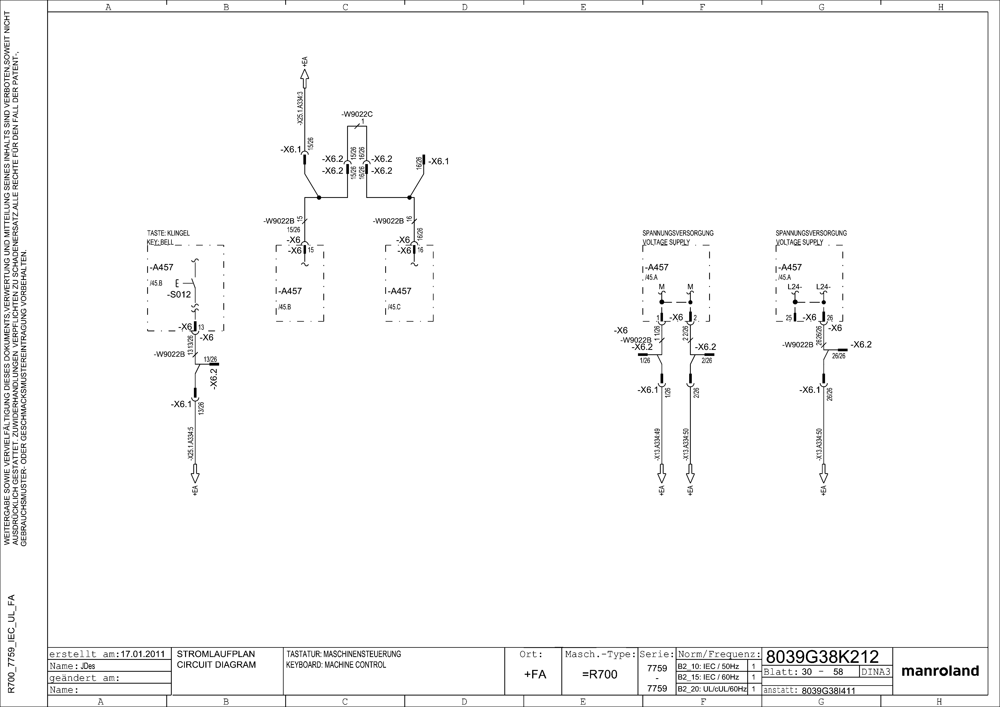

# +FA — Sheet 30 of 58 — TASTATUR: MASCHINENSTEUERUNG

**KEYBOARD: MACHINE CONTROL**

> Part of the manroland **R700** printing press IEC/UL circuit diagrams.
> Drawing class: **Stromlaufplan / Circuit diagram** (DIN A3).
> Document `+FA` covers the **Delivery** machine section.

## At a glance

| Field | Value |
|---|---|
| Document | `+FA`  (8039G38K212) |
| Sheet | **30** of 58 |
| Section (DE) | TASTATUR: MASCHINENSTEUERUNG |
| Section (EN) | KEYBOARD: MACHINE CONTROL |
| Section type | CIRCUIT — Circuit diagram |
| Machine type | `=R700` |
| Series | `7759` |
| Created | 17.01.2011 |
| Replaces | `8039G38I411` |
| Columns used | A, B, C, D, E, F, G |
| Path numbers | — |
| Labels on sheet | 94 |
| Cross-refs out | 5 |
| Cross-refs in | 26 |

**Previous:** [+FA sheet 29](SHEET_0029.md) · **Next:** [+FA sheet 31](SHEET_0031.md) · **Document TOC:** [_TOC.md](_TOC.md)  (+FA) · **Master TOC:** [all sheets](../_MASTER_TOC.md)

## Sheet image (300 DPI, exact vector render)



_Rendered directly from the PDF vector layer at 300 DPI (1-bit), no OCR and no resampling. Use it to confirm anything ambiguous in the text below._

## Cross-references on this sheet

Each entry is a wire leaving this sheet. The printed token is `/sheet.column`; the link resolves to that sheet inside the same document.

| Ref | Target sheet | Col | Path | Destination on target | Target section | From col |
|---|---|---|---|---|---|---|
| `/45.A` | [+FA sheet 45](SHEET_0045.md) | A | — | — | REFERENZMODUL | F |
| `/45.A` | [+FA sheet 45](SHEET_0045.md) | A | — | — | REFERENZMODUL | G |
| `/45.B` | [+FA sheet 45](SHEET_0045.md) | B | — | — | REFERENZMODUL | A |
| `/45.B` | [+FA sheet 45](SHEET_0045.md) | B | — | — | REFERENZMODUL | B |
| `/45.C` | [+FA sheet 45](SHEET_0045.md) | C | — | — | REFERENZMODUL | C |

### Incoming references (sheets that point here)

Every other sheet that sends a wire to this one. `Back-ref` is the token printed on *that* sheet; `Path` is its line number.

| From sheet | Cols | Back-ref | Path | Refs | What continues there |
|---|---|---|---|---|---|
| [+FA#45](SHEET_0045.md) | B, C | `/45.B`, `/45.C` | — | 3 | — |
| [+FA#56](SHEET_0056.md) | A, D, E, F | `/56.A`, `/56.D`, `/56.E`, `/56.F` | — | 23 | — |


## Devices on this sheet

| Tag | Class | Class meaning (IEC) | Col | Sub | Terminal | Sign |
|---|---|---|---|---|---|---|
| `X6` | X | Klemme / terminal, plug connector | B | — | — | — |
| `X6` | X | Klemme / terminal, plug connector | C | — | — | — |
| `X6` | X | Klemme / terminal, plug connector | G | — | — | — |
| `X6` | X | Klemme / terminal, plug connector | E | — | — | — |
| `A457` | A | Baugruppe / assembly, module, PC board | G | — | — | — |
| `X6` | X | Klemme / terminal, plug connector | G | — | — | — |
| `A457` | A | Baugruppe / assembly, module, PC board | F | — | — | — |
| `X6` | X | Klemme / terminal, plug connector | F | — | — | — |
| `A457` | A | Baugruppe / assembly, module, PC board | C | — | — | — |
| `X6` | X | Klemme / terminal, plug connector | C | — | — | — |
| `A457` | A | Baugruppe / assembly, module, PC board | C | — | — | — |
| `X6` | X | Klemme / terminal, plug connector | C | — | — | — |
| `A457` | A | Baugruppe / assembly, module, PC board | A | — | — | — |
| `X6` | X | Klemme / terminal, plug connector | B | — | — | — |
| `S012` | S | Schalter / switch | B | — | — | — |
| `X6` | X | Klemme / terminal, plug connector | C | — | — | — |
| `X25.1.A334:5` | — | cross-device reference | B | — | 5 | — |
| `X13.A334:49` | — | cross-device reference | F | — | 49 | — |
| `X13.A334:50` | — | cross-device reference | F | — | 50 | — |
| `X25.1.A334:3` | — | cross-device reference | C | — | 3 | — |
| `X13.A334:50` | — | cross-device reference | G | — | 50 | — |
| `X6.1` | — | cross-device reference | B | — | — | — |
| `X6.1` | — | cross-device reference | F | — | — | — |
| `X6.1` | — | cross-device reference | G | — | — | — |
| `X6.1` | — | cross-device reference | C | — | — | — |
| `X6.2` | — | cross-device reference | B | — | — | — |
| `X6.2` | — | cross-device reference | E | — | — | — |
| `X6.2` | — | cross-device reference | F | — | — | — |
| `X6.2` | — | cross-device reference | G | — | — | — |
| `X6.1` | — | cross-device reference | D | — | — | — |
| `X6.2` | — | cross-device reference | C | — | — | — |
| `X6.2` | — | cross-device reference | C | — | — | — |
| `X6.2` | — | cross-device reference | C | — | — | — |
| `X6.2` | — | cross-device reference | C | — | — | — |

## Potentials / nets

| Potential | Count | Columns | Attached devices | Terminals |
|---|---|---|---|---|
| `L24` | 2 | G | — | — |


A potential such as `L24+/4` or `M24+` is a named supply/return rail; every place it appears on this sheet is electrically common.

## Wire-end annotations (grouped as printed)

A wire that continues elsewhere is annotated with a small cluster: the destination description, the path/line number `#NN`, and the `/sheet.column` cross reference. Each row below is one such cluster exactly as it is grouped on the drawing.

| Col | Y | Path | Cross-ref | Text on the wire |
|---|---|---|---|---|
| C | 67.5 | — | — | `X25.1.A334:3 +EA` |
| C | 132.1 | — | — | `W9022C` |
| C | 141.1 | — | — | `1` |
| C | 163.6 | — | — | `15/26` |
| C | 173.2 | — | — | `X6.1` |
| C | 174.9 | — | — | `15/26` |
| C | 174.9 | — | — | `16/26` |
| C | 184.6 | — | — | `X6.2` |
| C | 184.6 | — | — | `X6.2` |
| D | 186.8 | — | — | `16/26` |
| D | 187.4 | — | — | `X6.1` |
| C | 198.1 | — | — | `15/26` |
| C | 198.1 | — | — | `16/26` |
| C | 198.8 | — | — | `X6.2` |
| C | 198.8 | — | — | `X6.2` |
| C | 257.3 | — | — | `15` |
| D | 257.3 | — | — | `16` |
| B | 259.3 | — | — | `W9022B` |
| C | 259.3 | — | — | `W9022B` |
| C | 270.6 | — | — | `15/26` |
| D | 271.3 | — | — | `16/26` |
| B | 274.9 | — | — | `KEY: BELL TASTE: KLINGEL` |
| F | 274.9 | — | — | `SPANNUNGSVERSORGUNG VOLTAGE SUPPLY` |
| G | 274.9 | — | — | `SPANNUNGSVERSORGUNG VOLTAGE SUPPLY` |
| C | 280.9 | — | — | `X6` |
| C | 280.9 | — | — | `X6` |
| C | 293.7 | — | — | `X6 15` |
| D | 293.7 | — | — | `X6 16` |
| A | 313.5 | — | — | `A457` |
| F | 313.5 | — | — | `A457` |
| G | 313.5 | — | — | `A457` |
| F | 327.3 | — | `/45.A` | — |
| G | 327.3 | — | `/45.A` | — |
| A | 334.4 | — | `/45.B` | — |
| E | 337.7 | — | — | `A457 M M` |
| G | 337.7 | — | — | `L24 L24` |
| C | 341.9 | — | — | `A457` |
| B | 346.1 | — | — | `S012` |
| B | 362.7 | — | `/45.B` | — |
| C | 362.8 | — | `/45.C` | — |
| F | 373.1 | — | — | `1 X6 2` |
| G | 373.1 | — | — | `25 X6 26` |
| B | 384.4 | — | — | `X6` |
| G | 385.8 | — | — | `X6` |
| B | 386.8 | — | — | `13` |
| F | 388.1 | — | — | `1/26` |
| F | 388.1 | — | — | `2/26` |
| G | 388.1 | — | — | `26/26` |
| E | 388.7 | — | — | `X6` |
| B | 397.2 | — | — | `X6` |
| B | 399.4 | — | — | `13/26` |
| E | 401.1 | — | — | `W9022B` |
| F | 402.0 | — | — | `1` |
| F | 402.0 | — | — | `2` |
| G | 404.3 | — | — | `26` |
| G | 405.7 | — | — | `X6.2` |
| G | 406.7 | — | — | `W9022B` |
| D | 408.5 | — | — | `13/26 X6.2` |
| F | 408.5 | — | — | `1/26 X6.2` |
| B | 416.0 | — | — | `13` |
| B | 418.1 | — | — | `W9022B` |
| G | 420.9 | — | — | `26/26` |
| F | 426.5 | — | — | `2/26` |
| B | 438.8 | — | — | `X6.2` |
| F | 459.5 | — | — | `X6.1` |
| G | 459.5 | — | — | `X6.1` |
| F | 461.8 | — | — | `1/26` |
| F | 461.8 | — | — | `2/26` |
| G | 461.8 | — | — | `26/26` |
| B | 476.6 | — | — | `X6.1` |
| B | 478.8 | — | — | `13/26` |
| B | 508.5 | — | — | `X25.1.A334:5 +EA` |
| F | 510.3 | — | — | `X13.A334:49 +EA` |
| F | 510.3 | — | — | `X13.A334:50 +EA` |
| G | 510.3 | — | — | `X13.A334:50 +EA` |


## Reconstructed tables

This sheet carries tabular content (pin map / terminal assignment / index). The grid below was rebuilt from the drawing's own rule lines, so each row is exactly one physical row of the table.

### Table 1 — 0 data rows × 2 columns (at x=175.7, y=235.3) — **TASTE: KLINGEL KEY: BELL A457 /45.B S012**

_none_


### Table 2 — 0 data rows × 2 columns (at x=328.8, y=235.3) — **15 W9022B 15/26 X6**

_none_


### Table 3 — 1 data rows × 2 columns (at x=459.2, y=235.3)

| 16 W9022B X6 | 16/26 |
|---|---|
| `X6 A457 /45.C` | `16` |


## Notes and free text on this sheet

| Text | Col | Y (pt) |
|---|---|---|
| `+EA` | B | 578.27 |
| `+EA` | F | 578.27 |
| `+EA` | C | 67.5 |
| `+EA` | G | 578.27 |
| `SPANNUNGSVERSORGUNG` | G | 274.89 |
| `VOLTAGE SUPPLY` | G | 285.51 |
| `SPANNUNGSVERSORGUNG` | F | 274.89 |
| `VOLTAGE SUPPLY` | F | 285.51 |
| `M` | F | 337.71 |
| `TASTE: KLINGEL` | B | 274.86 |
| `KEY: BELL` | A | 285.46 |
| `W9022B` | B | 418.06 |
| `W9022B` | E | 401.05 |
| `W9022B` | G | 406.72 |
| `W9022B` | C | 259.32 |
| `W9022C` | C | 132.06 |

## Complete label inventory (exact text from the drawing)

Every text object inside the drawing area of this sheet, in DIN reading order (column A→H, then top→bottom). This is the authoritative list: if a string is not here it is not printed on this sheet.

| Col | Y | X | Dir | Type | Text |
|---|---|---|---|---|---|
| A | 285.5 | 174.9 | → | text | `KEY: BELL` |
| A | 313.5 | 178.3 | → | device tag | `A457` |
| A | 334.4 | 178.6 | → | cross-reference | `/45.B` |
| B | 259.3 | 313.5 | → | text | `W9022B` |
| B | 274.9 | 175.5 | → | text | `TASTE: KLINGEL` |
| B | 346.1 | 199.0 | → | device tag | `S012` |
| B | 362.7 | 331.7 | → | cross-reference | `/45.B` |
| B | 384.4 | 212.3 | → | device tag | `X6` |
| B | 386.8 | 235.8 | → | number | `13` |
| B | 397.2 | 237.8 | → | device tag | `X6` |
| B | 399.4 | 223.8 | ↕ | pin pair | `13/26` |
| B | 416.0 | 223.8 | ↕ | number | `13` |
| B | 418.1 | 183.1 | → | text | `W9022B` |
| B | 425.1 | 242.4 | → | pin pair | `13/26` |
| B | 438.8 | 249.8 | ↕ | device ref | `X6.2` |
| B | 476.5 | 203.5 | → | device ref | `X6.1` |
| B | 478.8 | 236.6 | ↕ | pin pair | `13/26` |
| B | 508.5 | 224.1 | ↕ | device ref | `X25.1.A334:5` |
| B | 578.3 | 229.5 | ↕ | text | `+EA` |
| C | 67.5 | 359.9 | ↕ | text | `+EA` |
| C | 109.1 | 354.5 | ↕ | device ref | `X25.1.A334:3` |
| C | 132.1 | 406.5 | → | text | `W9022C` |
| C | 141.1 | 430.0 | → | number | `1` |
| C | 163.6 | 367.0 | ↕ | pin pair | `15/26` |
| C | 173.2 | 333.9 | → | device ref | `X6.1` |
| C | 174.9 | 418.0 | ↕ | pin pair | `15/26` |
| C | 174.9 | 427.9 | ↕ | pin pair | `16/26` |
| C | 184.6 | 383.5 | → | device ref | `X6.2` |
| C | 184.6 | 441.9 | → | device ref | `X6.2` |
| C | 198.1 | 418.0 | ↕ | pin pair | `15/26` |
| C | 198.1 | 427.9 | ↕ | pin pair | `16/26` |
| C | 198.8 | 383.5 | → | device ref | `X6.2` |
| C | 198.8 | 441.9 | → | device ref | `X6.2` |
| C | 257.3 | 354.2 | ↕ | number | `15` |
| C | 259.3 | 443.9 | → | text | `W9022B` |
| C | 270.6 | 341.6 | → | pin pair | `15/26` |
| C | 281.0 | 341.3 | → | device tag | `X6` |
| C | 281.0 | 471.7 | → | device tag | `X6` |
| C | 293.7 | 342.9 | → | device tag | `X6` |
| C | 293.7 | 473.3 | → | device tag | `X6` |
| C | 294.6 | 366.4 | → | number | `15` |
| C | 341.9 | 331.4 | → | device tag | `A457` |
| C | 341.9 | 461.8 | → | device tag | `A457` |
| C | 362.8 | 462.0 | → | cross-reference | `/45.C` |
| D | 186.8 | 496.0 | ↕ | pin pair | `16/26` |
| D | 187.4 | 510.0 | → | device ref | `X6.1` |
| D | 257.3 | 484.6 | ↕ | number | `16` |
| D | 271.3 | 497.4 | ↕ | pin pair | `16/26` |
| D | 294.6 | 496.8 | → | number | `16` |
| E | 388.7 | 731.1 | → | device tag | `X6` |
| E | 401.0 | 738.7 | → | text | `W9022B` |
| E | 408.5 | 752.0 | → | device ref | `X6.2` |
| F | 274.9 | 765.1 | → | text | `SPANNUNGSVERSORGUNG` |
| F | 285.5 | 765.4 | → | text | `VOLTAGE SUPPLY` |
| F | 313.5 | 767.9 | → | device tag | `A457` |
| F | 327.3 | 768.2 | → | cross-reference | `/45.A` |
| F | 337.7 | 784.5 | → | text | `M` |
| F | 337.7 | 818.5 | → | text | `M` |
| F | 373.1 | 797.0 | → | device tag | `X6` |
| F | 375.0 | 781.3 | → | number | `1` |
| F | 375.4 | 826.0 | → | number | `2` |
| F | 388.1 | 779.4 | ↕ | pin pair | `1/26` |
| F | 388.1 | 813.5 | ↕ | pin pair | `2/26` |
| F | 402.0 | 778.9 | ↕ | number | `1` |
| F | 402.0 | 813.3 | ↕ | number | `2` |
| F | 408.5 | 827.4 | → | device ref | `X6.2` |
| F | 426.5 | 761.7 | → | pin pair | `1/26` |
| F | 426.5 | 835.6 | → | pin pair | `2/26` |
| F | 459.5 | 759.1 | → | device ref | `X6.1` |
| F | 461.8 | 792.2 | ↕ | pin pair | `1/26` |
| F | 461.8 | 826.2 | ↕ | pin pair | `2/26` |
| F | 510.3 | 779.7 | ↕ | device ref | `X13.A334:49` |
| F | 510.3 | 813.8 | ↕ | device ref | `X13.A334:50` |
| F | 578.3 | 785.1 | ↕ | text | `+EA` |
| F | 578.3 | 819.1 | ↕ | text | `+EA` |
| G | 274.9 | 923.8 | → | text | `SPANNUNGSVERSORGUNG` |
| G | 285.5 | 924.1 | → | text | `VOLTAGE SUPPLY` |
| G | 313.5 | 926.6 | → | device tag | `A457` |
| G | 327.3 | 926.9 | → | cross-reference | `/45.A` |
| G | 337.7 | 937.8 | → | potential | `L24` |
| G | 337.7 | 971.9 | → | potential | `L24` |
| G | 373.1 | 955.7 | → | device tag | `X6` |
| G | 375.5 | 935.8 | → | number | `25` |
| G | 375.5 | 984.8 | → | number | `26` |
| G | 385.8 | 986.2 | → | device tag | `X6` |
| G | 388.1 | 972.2 | ↕ | pin pair | `26/26` |
| G | 404.3 | 972.2 | ↕ | number | `26` |
| G | 405.7 | 1012.8 | → | device ref | `X6.2` |
| G | 406.7 | 931.5 | → | text | `W9022B` |
| G | 420.9 | 990.9 | → | pin pair | `26/26` |
| G | 459.5 | 951.9 | → | device ref | `X6.1` |
| G | 461.8 | 985.0 | ↕ | pin pair | `26/26` |
| G | 510.3 | 972.5 | ↕ | device ref | `X13.A334:50` |
| G | 578.3 | 977.8 | ↕ | text | `+EA` |

## Reading-order text block

The same content as a plain block, grouped by DIN column — convenient to paste or to match against a visual description.

```text
=== Column A ===
 285.5  174.9  text         KEY: BELL
 313.5  178.3  devtag       A457
 334.4  178.6  xref         /45.B
=== Column B ===
 259.3  313.5  text         W9022B
 274.9  175.5  text         TASTE: KLINGEL
 346.1  199.0  devtag       S012
 362.7  331.7  xref         /45.B
 384.4  212.3  devtag       X6
 386.8  235.8  numeric      13
 397.2  237.8  devtag       X6
 399.4  223.8  pinpair      13/26
 416.0  223.8  numeric      13
 418.1  183.1  text         W9022B
 425.1  242.4  pinpair      13/26
 438.8  249.8  devref       X6.2
 476.5  203.5  devref       X6.1
 478.8  236.6  pinpair      13/26
 508.5  224.1  devref       X25.1.A334:5
 578.3  229.5  text         +EA
=== Column C ===
  67.5  359.9  text         +EA
 109.1  354.5  devref       X25.1.A334:3
 132.1  406.5  text         W9022C
 141.1  430.0  numeric      1
 163.6  367.0  pinpair      15/26
 173.2  333.9  devref       X6.1
 174.9  418.0  pinpair      15/26
 174.9  427.9  pinpair      16/26
 184.6  383.5  devref       X6.2
 184.6  441.9  devref       X6.2
 198.1  418.0  pinpair      15/26
 198.1  427.9  pinpair      16/26
 198.8  383.5  devref       X6.2
 198.8  441.9  devref       X6.2
 257.3  354.2  numeric      15
 259.3  443.9  text         W9022B
 270.6  341.6  pinpair      15/26
 281.0  341.3  devtag       X6
 281.0  471.7  devtag       X6
 293.7  342.9  devtag       X6
 293.7  473.3  devtag       X6
 294.6  366.4  numeric      15
 341.9  331.4  devtag       A457
 341.9  461.8  devtag       A457
 362.8  462.0  xref         /45.C
=== Column D ===
 186.8  496.0  pinpair      16/26
 187.4  510.0  devref       X6.1
 257.3  484.6  numeric      16
 271.3  497.4  pinpair      16/26
 294.6  496.8  numeric      16
=== Column E ===
 388.7  731.1  devtag       X6
 401.0  738.7  text         W9022B
 408.5  752.0  devref       X6.2
=== Column F ===
 274.9  765.1  text         SPANNUNGSVERSORGUNG
 285.5  765.4  text         VOLTAGE SUPPLY
 313.5  767.9  devtag       A457
 327.3  768.2  xref         /45.A
 337.7  784.5  text         M
 337.7  818.5  text         M
 373.1  797.0  devtag       X6
 375.0  781.3  numeric      1
 375.4  826.0  numeric      2
 388.1  779.4  pinpair      1/26
 388.1  813.5  pinpair      2/26
 402.0  778.9  numeric      1
 402.0  813.3  numeric      2
 408.5  827.4  devref       X6.2
 426.5  761.7  pinpair      1/26
 426.5  835.6  pinpair      2/26
 459.5  759.1  devref       X6.1
 461.8  792.2  pinpair      1/26
 461.8  826.2  pinpair      2/26
 510.3  779.7  devref       X13.A334:49
 510.3  813.8  devref       X13.A334:50
 578.3  785.1  text         +EA
 578.3  819.1  text         +EA
=== Column G ===
 274.9  923.8  text         SPANNUNGSVERSORGUNG
 285.5  924.1  text         VOLTAGE SUPPLY
 313.5  926.6  devtag       A457
 327.3  926.9  xref         /45.A
 337.7  937.8  net          L24
 337.7  971.9  net          L24
 373.1  955.7  devtag       X6
 375.5  935.8  numeric      25
 375.5  984.8  numeric      26
 385.8  986.2  devtag       X6
 388.1  972.2  pinpair      26/26
 404.3  972.2  numeric      26
 405.7 1012.8  devref       X6.2
 406.7  931.5  text         W9022B
 420.9  990.9  pinpair      26/26
 459.5  951.9  devref       X6.1
 461.8  985.0  pinpair      26/26
 510.3  972.5  devref       X13.A334:50
 578.3  977.8  text         +EA
```

---
_Generated from the PDF vector text layer; no OCR. Source: `R700_7759_IEC_UL_FA`, sheet 30._
