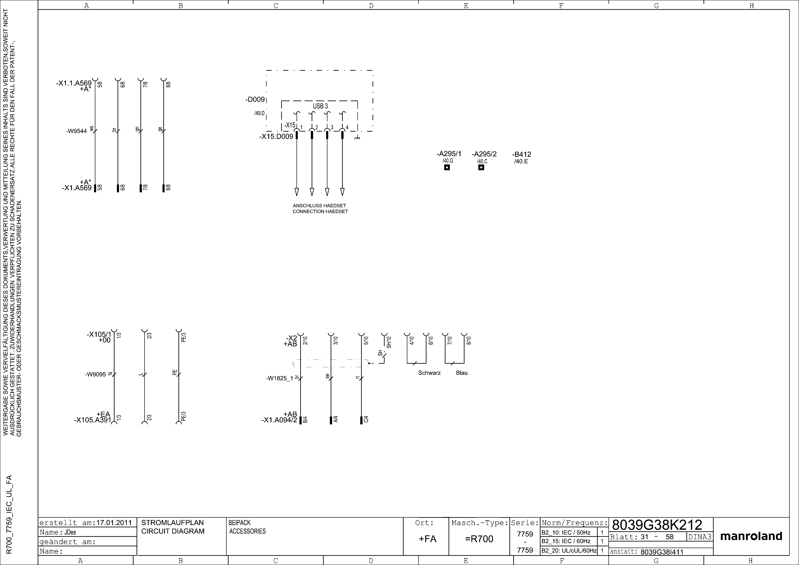

# +FA — Sheet 31 of 58 — BEIPACK

**ACCESSORIES**

> Part of the manroland **R700** printing press IEC/UL circuit diagrams.
> Drawing class: **Stromlaufplan / Circuit diagram** (DIN A3).
> Document `+FA` covers the **Delivery** machine section.

## At a glance

| Field | Value |
|---|---|
| Document | `+FA`  (8039G38K212) |
| Sheet | **31** of 58 |
| Section (DE) | BEIPACK |
| Section (EN) | ACCESSORIES |
| Section type | ACCESSORIES — Accessories |
| Machine type | `=R700` |
| Series | `7759` |
| Created | 17.01.2011 |
| Replaces | `8039G38I411` |
| Columns used | A, B, C, D, E, F |
| Path numbers | — |
| Labels on sheet | 70 |
| Cross-refs out | 4 |
| Cross-refs in | 31 |

**Previous:** [+FA sheet 30](SHEET_0030.md) · **Next:** [+FA sheet 32](SHEET_0032.md) · **Document TOC:** [_TOC.md](_TOC.md)  (+FA) · **Master TOC:** [all sheets](../_MASTER_TOC.md)

## Sheet image (300 DPI, exact vector render)



_Rendered directly from the PDF vector layer at 300 DPI (1-bit), no OCR and no resampling. Use it to confirm anything ambiguous in the text below._

## Cross-references on this sheet

Each entry is a wire leaving this sheet. The printed token is `/sheet.column`; the link resolves to that sheet inside the same document.

| Ref | Target sheet | Col | Path | Destination on target | Target section | From col |
|---|---|---|---|---|---|---|
| `/49.D` | [+FA sheet 49](SHEET_0049.md) | D | — | — | REFERENZMODUL | C |
| `/40.E` | [+FA sheet 40](SHEET_0040.md) | E | — | — | OPTION: TELEPRESENCE | F |
| `/40.G` | [+FA sheet 40](SHEET_0040.md) | G | — | — | OPTION: TELEPRESENCE | E |
| `/40.C` | [+FA sheet 40](SHEET_0040.md) | C | — | — | OPTION: TELEPRESENCE | E |

### Incoming references (sheets that point here)

Every other sheet that sends a wire to this one. `Back-ref` is the token printed on *that* sheet; `Path` is its line number.

| From sheet | Cols | Back-ref | Path | Refs | What continues there |
|---|---|---|---|---|---|
| [+FA#40](SHEET_0040.md) | E | `/40.E` | — | 1 | — |
| [+FA#49](SHEET_0049.md) | D | `/49.D` | — | 1 | — |
| [+FA#51](SHEET_0051.md) | C, D, F | `/51.C`, `/51.D`, `/51.F` | — | 11 | — |
| [+FA#52](SHEET_0052.md) | C, D, F | `/52.C`, `/52.D`, `/52.F` | — | 18 | — |


## Devices on this sheet

| Tag | Class | Class meaning (IEC) | Col | Sub | Terminal | Sign |
|---|---|---|---|---|---|---|
| `B412` | B | Umformer / transducer, sensor | F | — | — | — |
| `X105/1` | X | Klemme / terminal, plug connector | A | 1 | — | — |
| `X2` | X | Klemme / terminal, plug connector | C | — | — | — |
| `A295/1` | A | Baugruppe / assembly, module, PC board | E | 1 | — | — |
| `A295/2` | A | Baugruppe / assembly, module, PC board | E | 2 | — | — |
| `D009` | D | Digital / binary element | C | — | — | — |
| `X15` | X | Klemme / terminal, plug connector | C | — | — | — |
| `W9095` | W | Kabel / cable, line, bus | A | — | — | — |
| `W9544` | W | Kabel / cable, line, bus | A | — | — | — |
| `X105.A391` | — | cross-device reference | A | — | — | — |
| `X1.1.A569` | — | cross-device reference | A | — | — | — |
| `X1.A569` | — | cross-device reference | A | — | — | — |
| `X15.D009` | — | cross-device reference | C | — | — | — |

## Potentials / nets

| Potential | Count | Columns | Attached devices | Terminals |
|---|---|---|---|---|
| `N` | 1 | A | — | — |
| `PE` | 3 | B | — | — |


A potential such as `L24+/4` or `M24+` is a named supply/return rail; every place it appears on this sheet is electrically common.

## Conductor data

Each label annotates **the wire beside it**, not the sheet. These summaries are inventories of what is printed; they are not a per-wire map. For a specific conductor, read the label that sits on that wire (see the label inventory below, or the sheet image).

**Wire-colour labels printed on this sheet:** BL = blau / blue (×1), SW = schwarz / black (×1)

## Wire-end annotations (grouped as printed)

A wire that continues elsewhere is annotated with a small cluster: the destination description, the path/line number `#NN`, and the `/sheet.column` cross reference. Each row below is one such cluster exactly as it is grouped on the drawing.

| Col | Y | Path | Cross-ref | Text on the wire |
|---|---|---|---|---|
| A | 119.4 | — | — | `X1.1.A569 +A*` |
| A | 121.6 | — | — | `5/8` |
| A | 121.6 | — | — | `6/8` |
| B | 121.6 | — | — | `7/8` |
| B | 121.6 | — | — | `8/8` |
| C | 143.4 | — | — | `D009` |
| C | 154.6 | — | — | `USB 3` |
| C | 165.8 | — | `/49.D` | — |
| C | 183.0 | — | — | `X15` |
| D | 186.5 | — | — | `1 2 3 4` |
| A | 187.7 | — | — | `ws` |
| B | 188.8 | — | — | `gn` |
| B | 189.1 | — | — | `ge` |
| A | 190.6 | — | — | `br` |
| A | 191.3 | — | — | `W9544` |
| C | 198.7 | — | — | `X15.D009` |
| E | 224.2 | — | — | `A295/1` |
| E | 224.8 | — | — | `A295/2` |
| F | 225.2 | — | — | `B412` |
| F | 236.4 | — | `/40.E` | — |
| E | 236.6 | — | `/40.G` | — |
| E | 237.5 | — | `/40.C` | — |
| A | 266.8 | — | — | `X1.A569 +A*` |
| A | 274.9 | — | — | `5/8` |
| A | 274.9 | — | — | `6/8` |
| B | 274.9 | — | — | `7/8` |
| B | 274.9 | — | — | `8/8` |
| C | 303.5 | — | — | `CONNECTION HAEDSET ANSCHLUSS HAEDSET` |
| A | 493.5 | — | — | `X105/1 +00` |
| A | 495.8 | — | — | `1/3` |
| B | 495.8 | — | — | `2/3` |
| B | 495.8 | — | — | `PE/3` |
| C | 499.2 | — | — | `X2` |
| C | 501.4 | — | — | `2/10` |
| D | 501.4 | — | — | `3/10` |
| D | 501.4 | — | — | `5/10` |
| D | 501.4 | — | — | `SH/10` |
| D | 501.4 | — | — | `4/10` |
| E | 501.4 | — | — | `6/10` |
| E | 501.4 | — | — | `7/10` |
| E | 501.4 | — | — | `8/10` |
| C | 507.7 | — | — | `+AB` |
| D | 521.4 | — | — | `SH` |
| B | 550.4 | — | — | `PE` |
| E | 551.6 | — | — | `Schwarz Blau` |
| A | 554.1 | — | — | `W9095` |
| A | 554.4 | — | — | `N` |
| B | 555.5 | — | — | `L` |
| D | 556.7 | — | — | `sw` |
| C | 559.1 | — | — | `br` |
| C | 559.8 | — | — | `W1825_1` |
| D | 560.6 | — | — | `rt` |
| A | 612.6 | — | — | `X105.A391 +EA` |
| C | 612.6 | — | — | `X1.A094/2 +AB` |
| B | 613.3 | — | — | `PE/3` |
| B | 617.9 | — | — | `2/3` |
| A | 618.3 | — | — | `1/3` |
| D | 619.8 | — | — | `A/4` |
| D | 619.8 | — | — | `C/4` |
| C | 620.4 | — | — | `B/4` |


## Notes and free text on this sheet

| Text | Col | Y (pt) |
|---|---|---|
| `+EA` | A | 612.58 |
| `+AB` | C | 507.7 |
| `A/4` | D | 619.75 |
| `X1.A094/2` | C | 621.1 |
| `B/4` | C | 620.35 |
| `C/4` | D | 619.75 |
| `SH/10` | D | 501.45 |
| `+A*` | A | 127.89 |
| `USB 3` | C | 154.61 |
| `ANSCHLUSS HAEDSET` | C | 303.5 |
| `CONNECTION HAEDSET` | C | 312.11 |
| `L` | B | 555.53 |
| `sw` | D | 556.73 |
| `W1825_1` | C | 559.81 |
| `br` | C | 559.06 |
| `rt` | D | 560.59 |
| `SH` | D | 521.38 |
| `ws` | A | 187.66 |
| `br` | A | 190.56 |
| `gn` | B | 188.79 |
| `ge` | B | 189.07 |

## Complete label inventory (exact text from the drawing)

Every text object inside the drawing area of this sheet, in DIN reading order (column A→H, then top→bottom). This is the authoritative list: if a string is not here it is not printed on this sheet.

| Col | Y | X | Dir | Type | Text |
|---|---|---|---|---|---|
| A | 119.4 | 83.6 | → | device ref | `X1.1.A569` |
| A | 121.6 | 145.9 | ↕ | pin pair | `5/8` |
| A | 121.6 | 179.9 | ↕ | pin pair | `6/8` |
| A | 127.9 | 118.8 | → | text | `+A*` |
| A | 187.7 | 133.2 | ↕ | text | `ws` |
| A | 190.6 | 167.1 | ↕ | text | `br` |
| A | 191.3 | 98.4 | → | device tag | `W9544` |
| A | 266.8 | 118.8 | → | text | `+A*` |
| A | 274.9 | 145.9 | ↕ | pin pair | `5/8` |
| A | 274.9 | 179.9 | ↕ | pin pair | `6/8` |
| A | 275.3 | 92.4 | → | device ref | `X1.A569` |
| A | 493.5 | 129.3 | → | device tag | `X105/1` |
| A | 495.8 | 174.2 | ↕ | pin pair | `1/3` |
| A | 502.0 | 146.8 | → | number | `+00` |
| A | 554.1 | 126.7 | → | device tag | `W9095` |
| A | 554.4 | 161.2 | ↕ | potential | `N` |
| A | 612.6 | 143.7 | → | text | `+EA` |
| A | 618.3 | 174.2 | ↕ | pin pair | `1/3` |
| A | 621.1 | 110.3 | → | device ref | `X105.A391` |
| B | 121.6 | 213.9 | ↕ | pin pair | `7/8` |
| B | 121.6 | 247.9 | ↕ | pin pair | `8/8` |
| B | 188.8 | 201.1 | ↕ | text | `gn` |
| B | 189.1 | 235.3 | ↕ | text | `ge` |
| B | 274.9 | 213.9 | ↕ | pin pair | `7/8` |
| B | 274.9 | 247.9 | ↕ | pin pair | `8/8` |
| B | 495.8 | 219.6 | ↕ | pin pair | `2/3` |
| B | 495.8 | 270.5 | ↕ | potential | `PE/3` |
| B | 550.4 | 257.7 | ↕ | potential | `PE` |
| B | 555.5 | 206.6 | ↕ | text | `L` |
| B | 613.3 | 270.5 | ↕ | potential | `PE/3` |
| B | 617.9 | 219.6 | ↕ | pin pair | `2/3` |
| C | 143.5 | 365.7 | → | device tag | `D009` |
| C | 154.6 | 466.4 | → | text | `USB 3` |
| C | 165.7 | 379.3 | → | cross-reference | `/49.D` |
| C | 183.0 | 423.8 | → | device tag | `X15` |
| C | 186.5 | 447.0 | → | number | `1` |
| C | 186.9 | 470.3 | → | number | `2` |
| C | 198.7 | 386.4 | → | device ref | `X15.D009` |
| C | 303.5 | 436.5 | → | text | `ANSCHLUSS HAEDSET` |
| C | 312.1 | 436.3 | → | text | `CONNECTION HAEDSET` |
| C | 499.2 | 426.3 | → | device tag | `X2` |
| C | 501.4 | 452.0 | ↕ | pin pair | `2/10` |
| C | 507.7 | 422.4 | → | text | `+AB` |
| C | 559.1 | 439.3 | ↕ | text | `br` |
| C | 559.8 | 396.3 | → | text | `W1825_1` |
| C | 612.6 | 422.4 | → | text | `+AB` |
| C | 620.4 | 451.9 | ↕ | text | `B/4` |
| C | 621.1 | 389.8 | → | text | `X1.A094/2` |
| D | 186.9 | 492.9 | → | number | `3` |
| D | 186.9 | 515.6 | → | number | `4` |
| D | 501.4 | 497.4 | ↕ | pin pair | `3/10` |
| D | 501.4 | 542.7 | ↕ | pin pair | `5/10` |
| D | 501.4 | 576.8 | ↕ | text | `SH/10` |
| D | 501.4 | 610.8 | ↕ | pin pair | `4/10` |
| D | 521.4 | 563.9 | ↕ | text | `SH` |
| D | 556.7 | 484.6 | ↕ | text | `sw` |
| D | 560.6 | 529.8 | ↕ | text | `rt` |
| D | 619.8 | 497.4 | ↕ | text | `A/4` |
| D | 619.8 | 542.7 | ↕ | text | `C/4` |
| E | 224.2 | 650.8 | → | device tag | `A295/1` |
| E | 224.8 | 703.0 | → | device tag | `A295/2` |
| E | 236.6 | 659.8 | → | cross-reference | `/40.G` |
| E | 237.5 | 711.4 | → | cross-reference | `/40.C` |
| E | 501.4 | 639.1 | ↕ | pin pair | `6/10` |
| E | 501.4 | 667.5 | ↕ | pin pair | `7/10` |
| E | 501.4 | 695.8 | ↕ | pin pair | `8/10` |
| E | 551.6 | 623.3 | → | wire colour | `Schwarz` |
| E | 551.7 | 679.5 | → | wire colour | `Blau` |
| F | 225.2 | 763.2 | → | device tag | `B412` |
| F | 236.4 | 766.4 | → | cross-reference | `/40.E` |

## Reading-order text block

The same content as a plain block, grouped by DIN column — convenient to paste or to match against a visual description.

```text
=== Column A ===
 119.4   83.6  devref       X1.1.A569
 121.6  145.9  pinpair      5/8
 121.6  179.9  pinpair      6/8
 127.9  118.8  text         +A*
 187.7  133.2  text         ws
 190.6  167.1  text         br
 191.3   98.4  devtag       W9544
 266.8  118.8  text         +A*
 274.9  145.9  pinpair      5/8
 274.9  179.9  pinpair      6/8
 275.3   92.4  devref       X1.A569
 493.5  129.3  devtag       X105/1
 495.8  174.2  pinpair      1/3
 502.0  146.8  numeric      +00
 554.1  126.7  devtag       W9095
 554.4  161.2  net          N
 612.6  143.7  text         +EA
 618.3  174.2  pinpair      1/3
 621.1  110.3  devref       X105.A391
=== Column B ===
 121.6  213.9  pinpair      7/8
 121.6  247.9  pinpair      8/8
 188.8  201.1  text         gn
 189.1  235.3  text         ge
 274.9  213.9  pinpair      7/8
 274.9  247.9  pinpair      8/8
 495.8  219.6  pinpair      2/3
 495.8  270.5  net          PE/3
 550.4  257.7  net          PE
 555.5  206.6  text         L
 613.3  270.5  net          PE/3
 617.9  219.6  pinpair      2/3
=== Column C ===
 143.5  365.7  devtag       D009
 154.6  466.4  text         USB 3
 165.7  379.3  xref         /49.D
 183.0  423.8  devtag       X15
 186.5  447.0  numeric      1
 186.9  470.3  numeric      2
 198.7  386.4  devref       X15.D009
 303.5  436.5  text         ANSCHLUSS HAEDSET
 312.1  436.3  text         CONNECTION HAEDSET
 499.2  426.3  devtag       X2
 501.4  452.0  pinpair      2/10
 507.7  422.4  text         +AB
 559.1  439.3  text         br
 559.8  396.3  text         W1825_1
 612.6  422.4  text         +AB
 620.4  451.9  text         B/4
 621.1  389.8  text         X1.A094/2
=== Column D ===
 186.9  492.9  numeric      3
 186.9  515.6  numeric      4
 501.4  497.4  pinpair      3/10
 501.4  542.7  pinpair      5/10
 501.4  576.8  text         SH/10
 501.4  610.8  pinpair      4/10
 521.4  563.9  text         SH
 556.7  484.6  text         sw
 560.6  529.8  text         rt
 619.8  497.4  text         A/4
 619.8  542.7  text         C/4
=== Column E ===
 224.2  650.8  devtag       A295/1
 224.8  703.0  devtag       A295/2
 236.6  659.8  xref         /40.G
 237.5  711.4  xref         /40.C
 501.4  639.1  pinpair      6/10
 501.4  667.5  pinpair      7/10
 501.4  695.8  pinpair      8/10
 551.6  623.3  colour       Schwarz
 551.7  679.5  colour       Blau
=== Column F ===
 225.2  763.2  devtag       B412
 236.4  766.4  xref         /40.E
```

---
_Generated from the PDF vector text layer; no OCR. Source: `R700_7759_IEC_UL_FA`, sheet 31._
