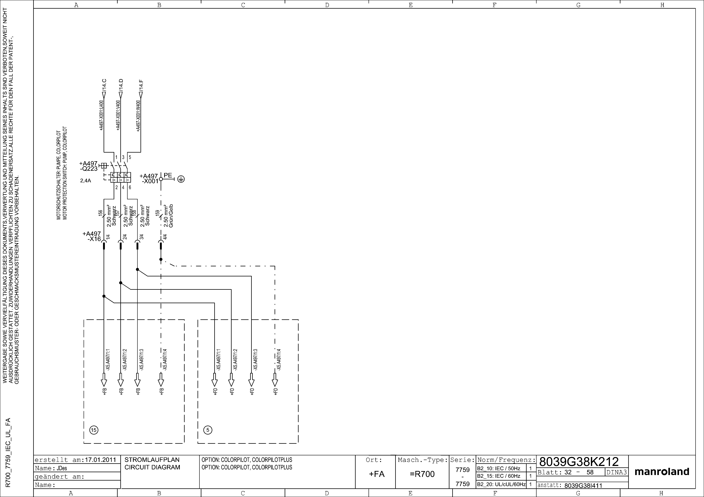

# +FA — Sheet 32 of 58 — OPTION: COLORPILOT, COLORPILOTPLUS

**OPTION: COLORPILOT, COLORPILOTPLUS**

> Part of the manroland **R700** printing press IEC/UL circuit diagrams.
> Drawing class: **Stromlaufplan / Circuit diagram** (DIN A3).
> Document `+FA` covers the **Delivery** machine section.

## At a glance

| Field | Value |
|---|---|
| Document | `+FA`  (8039G38K212) |
| Sheet | **32** of 58 |
| Section (DE) | OPTION: COLORPILOT, COLORPILOTPLUS |
| Section (EN) | OPTION: COLORPILOT, COLORPILOTPLUS |
| Section type | OPTION — ColorPilot |
| Machine type | `=R700` |
| Series | `7759` |
| Created | 17.01.2011 |
| Replaces | `8039G38I411` |
| Columns used | A, B, C |
| Path numbers | — |
| Labels on sheet | 59 |
| Cross-refs out | 3 |
| Cross-refs in | 9 |

**Previous:** [+FA sheet 31](SHEET_0031.md) · **Next:** [+FA sheet 33](SHEET_0033.md) · **Document TOC:** [_TOC.md](_TOC.md)  (+FA) · **Master TOC:** [all sheets](../_MASTER_TOC.md)

## Sheet image (300 DPI, exact vector render)



_Rendered directly from the PDF vector layer at 300 DPI (1-bit), no OCR and no resampling. Use it to confirm anything ambiguous in the text below._

## Cross-references on this sheet

Each entry is a wire leaving this sheet. The printed token is `/sheet.column`; the link resolves to that sheet inside the same document.

| Ref | Target sheet | Col | Path | Destination on target | Target section | From col |
|---|---|---|---|---|---|---|
| `/14.C` | [+FA sheet 14](SHEET_0014.md) | C | — | +A497 X001:U400 | SPANNUNGSVERSORGUNG: | A |
| `/14.D` | [+FA sheet 14](SHEET_0014.md) | D | — | +A497 X001:V400 | SPANNUNGSVERSORGUNG: | B |
| `/14.F` | [+FA sheet 14](SHEET_0014.md) | F | — | +A497 X001:W400 | SPANNUNGSVERSORGUNG: | B |

### Incoming references (sheets that point here)

Every other sheet that sends a wire to this one. `Back-ref` is the token printed on *that* sheet; `Path` is its line number.

| From sheet | Cols | Back-ref | Path | Refs | What continues there |
|---|---|---|---|---|---|
| [+FA#4](SHEET_0004.md) | F | `/4.F` | — | 1 | Q223 |
| [+FA#14](SHEET_0014.md) | D | `/14.D` | `#107` | 3 | +A497 Q223:1 +A497 Q223:3 +A497 Q223:5 |
| [+FA#44](SHEET_0044.md) | B | `/44.B` | — | 1 | — |
| [+FA#52](SHEET_0052.md) | G | `/52.G` | — | 4 | — |


## Devices on this sheet

| Tag | Class | Class meaning (IEC) | Col | Sub | Terminal | Sign |
|---|---|---|---|---|---|---|
| `Q223` | Q | Leistungsschalter / power switching device | A | — | — | — |
| `+A497` | A | Baugruppe / assembly, module, PC board | A | — | — | + |
| `+A497` | A | Baugruppe / assembly, module, PC board | A | — | — | + |
| `X16` | X | Klemme / terminal, plug connector | A | — | — | — |
| `+A497` | A | Baugruppe / assembly, module, PC board | B | — | — | + |
| `X001` | X | Klemme / terminal, plug connector | B | — | — | — |

## Potentials / nets

| Potential | Count | Columns | Attached devices | Terminals |
|---|---|---|---|---|
| `PE` | 1 | B | — | — |


A potential such as `L24+/4` or `M24+` is a named supply/return rail; every place it appears on this sheet is electrically common.

## Conductor data

Each label annotates **the wire beside it**, not the sheet. These summaries are inventories of what is printed; they are not a per-wire map. For a specific conductor, read the label that sits on that wire (see the label inventory below, or the sheet image).

**Cross-section labels printed on this sheet:** 2.5 mm² (×4)

**Wire-colour labels printed on this sheet:** SW = schwarz / black (×3)

**Cross-section + colour appearing together in one annotation block:**

| Cross-section | Colour (DE) | Colour (EN) | Blocks containing both |
|---|---|---|---|
| 2.5 mm² | schwarz | black | 3 |


_This counts annotation blocks that carry both labels. It can be lower than the number of individual labels above, because a block may hold two cross-section labels or two colour labels._

## Wire-end annotations (grouped as printed)

A wire that continues elsewhere is annotated with a small cluster: the destination description, the path/line number `#NN`, and the `/sheet.column` cross reference. Each row below is one such cluster exactly as it is grouped on the drawing.

| Col | Y | Path | Cross-ref | Text on the wire |
|---|---|---|---|---|
| A | 133.5 | — | `/14.C` | `+A497 X001:U400` |
| B | 133.5 | — | `/14.D` | `+A497 X001:V400` |
| B | 134.4 | — | `/14.F` | `+A497 X001:W400` |
| A | 213.9 | — | — | `MOTOR PROTECTION SWITCH: PUMP, COLORPILOT` |
| A | 220.9 | — | — | `MOTORSCHUTZSCHALTER: PUMPE, COLORPILOT` |
| A | 263.0 | — | — | `1` |
| B | 263.5 | — | — | `3` |
| B | 263.5 | — | — | `5` |
| A | 272.4 | — | — | `+A497 Q223` |
| B | 292.3 | — | — | `PE` |
| B | 293.7 | — | — | `+A497` |
| A | 302.2 | — | — | `2,4A` |
| B | 302.2 | — | — | `X001` |
| B | 302.8 | — | — | `I> I> I>` |
| A | 314.4 | — | — | `2` |
| B | 314.5 | — | — | `4` |
| B | 314.5 | — | — | `6` |
| B | 345.7 | — | — | `2.50 mm² Grün/Gelb` |
| A | 346.8 | — | — | `2.50 mm² Schwarz 157` |
| B | 346.8 | — | — | `2.50 mm² Schwarz 158` |
| B | 346.8 | — | — | `2.50 mm² Schwarz` |
| A | 355.9 | — | — | `156` |
| B | 355.9 | — | — | `159` |
| A | 391.5 | — | — | `+A497` |
| B | 396.8 | — | — | `2/4` |
| B | 396.8 | — | — | `3/4` |
| B | 396.8 | — | — | `4/4` |
| A | 397.2 | — | — | `1/4` |
| A | 400.0 | — | — | `X16` |
| A | 590.9 | — | — | `+FB X5.A497/1:1` |
| C | 590.9 | — | — | `+FD X5.A497/1:1` |
| B | 591.2 | — | — | `+FB X5.A497/1:2` |
| C | 591.2 | — | — | `+FD X5.A497/1:2` |
| B | 591.3 | — | — | `+FB X5.A497/1:3` |
| B | 591.3 | — | — | `+FB X5.A497/1:4` |
| C | 591.3 | — | — | `+FD X5.A497/1:3` |
| C | 591.3 | — | — | `+FD X5.A497/1:4` |
| B | 724.6 | — | — | `15 5` |


## Notes and free text on this sheet

| Text | Col | Y (pt) |
|---|---|---|
| `+FB` | A | 657.36 |
| `X5.A497/1:1` | A | 590.87 |
| `+FB` | B | 657.36 |
| `X5.A497/1:2` | B | 591.2 |
| `X5.A497/1:3` | B | 591.28 |
| `X5.A497/1:4` | B | 591.28 |
| `+FD` | C | 657.35 |
| `X5.A497/1:1` | C | 590.87 |
| `X5.A497/1:2` | C | 591.2 |
| `X5.A497/1:3` | C | 591.28 |
| `X5.A497/1:4` | C | 591.28 |
| `+A497 X001:U400` | A | 169.8 |
| `+A497 X001:V400` | B | 169.8 |
| `+A497 X001:W400` | B | 169.8 |
| `I>` | A | 302.84 |
| `I>` | B | 302.84 |
| `MOTORSCHUTZSCHALTER: PUMPE, COLORPILOT` | A | 220.92 |
| `MOTOR PROTECTION SWITCH: PUMP, COLORPILOT` | A | 213.87 |
| `2,4A` | A | 302.16 |
| `Grün/Gelb` | B | 345.69 |

## Complete label inventory (exact text from the drawing)

Every text object inside the drawing area of this sheet, in DIN reading order (column A→H, then top→bottom). This is the authoritative list: if a string is not here it is not printed on this sheet.

| Col | Y | X | Dir | Type | Text |
|---|---|---|---|---|---|
| A | 133.5 | 172.5 | ↕ | cross-reference | `/14.C` |
| A | 169.8 | 168.6 | ↕ | text | `+A497 X001:U400` |
| A | 213.9 | 106.9 | ↕ | text | `MOTOR PROTECTION SWITCH: PUMP, COLORPILOT` |
| A | 220.9 | 96.3 | ↕ | text | `MOTORSCHUTZSCHALTER: PUMPE, COLORPILOT` |
| A | 263.0 | 194.7 | → | number | `1` |
| A | 272.4 | 133.8 | → | device tag | `+A497` |
| A | 280.9 | 135.5 | → | device tag | `Q223` |
| A | 302.2 | 135.8 | → | text | `2,4A` |
| A | 302.8 | 190.5 | → | text | `I>` |
| A | 314.4 | 195.3 | → | number | `2` |
| A | 346.8 | 180.2 | ↕ | cross-section | `2.50 mm²` |
| A | 348.9 | 188.8 | ↕ | wire colour | `Schwarz` |
| A | 355.9 | 167.1 | ↕ | number | `156` |
| A | 391.5 | 139.5 | → | device tag | `+A497` |
| A | 397.2 | 179.8 | ↕ | pin pair | `1/4` |
| A | 400.0 | 148.3 | → | device tag | `X16` |
| A | 590.9 | 179.6 | ↕ | text | `X5.A497/1:1` |
| A | 657.4 | 174.2 | ↕ | text | `+FB` |
| A | 724.9 | 153.4 | → | number | `15` |
| B | 133.5 | 200.8 | ↕ | cross-reference | `/14.D` |
| B | 134.4 | 234.8 | ↕ | cross-reference | `/14.F` |
| B | 169.8 | 196.9 | ↕ | text | `+A497 X001:V400` |
| B | 169.8 | 230.9 | ↕ | text | `+A497 X001:W400` |
| B | 263.5 | 206.6 | → | number | `3` |
| B | 263.5 | 218.0 | → | number | `5` |
| B | 292.3 | 276.9 | → | potential | `PE` |
| B | 293.7 | 235.8 | → | device tag | `+A497` |
| B | 302.2 | 240.1 | → | device tag | `X001` |
| B | 302.8 | 201.8 | → | text | `I>` |
| B | 302.8 | 213.2 | → | text | `I>` |
| B | 314.5 | 206.6 | → | number | `4` |
| B | 314.5 | 218.0 | → | number | `6` |
| B | 345.7 | 285.2 | ↕ | text | `Grün/Gelb` |
| B | 346.8 | 208.6 | ↕ | cross-section | `2.50 mm²` |
| B | 346.8 | 236.9 | ↕ | cross-section | `2.50 mm²` |
| B | 346.8 | 276.6 | ↕ | cross-section | `2.50 mm²` |
| B | 348.9 | 217.2 | ↕ | wire colour | `Schwarz` |
| B | 348.9 | 245.5 | ↕ | wire colour | `Schwarz` |
| B | 355.9 | 195.5 | ↕ | number | `157` |
| B | 355.9 | 223.8 | ↕ | number | `158` |
| B | 355.9 | 263.5 | ↕ | number | `159` |
| B | 396.8 | 208.2 | ↕ | pin pair | `2/4` |
| B | 396.8 | 236.6 | ↕ | pin pair | `3/4` |
| B | 396.8 | 276.3 | ↕ | pin pair | `4/4` |
| B | 591.2 | 208.0 | ↕ | text | `X5.A497/1:2` |
| B | 591.3 | 236.3 | ↕ | text | `X5.A497/1:3` |
| B | 591.3 | 276.0 | ↕ | text | `X5.A497/1:4` |
| B | 657.4 | 202.6 | ↕ | text | `+FB` |
| B | 657.4 | 230.9 | ↕ | text | `+FB` |
| B | 657.4 | 270.6 | ↕ | text | `+FB` |
| C | 590.9 | 366.7 | ↕ | text | `X5.A497/1:1` |
| C | 591.2 | 395.1 | ↕ | text | `X5.A497/1:2` |
| C | 591.3 | 429.1 | ↕ | text | `X5.A497/1:3` |
| C | 591.3 | 468.8 | ↕ | text | `X5.A497/1:4` |
| C | 657.4 | 361.3 | ↕ | text | `+FD` |
| C | 657.4 | 389.7 | ↕ | text | `+FD` |
| C | 657.4 | 423.7 | ↕ | text | `+FD` |
| C | 657.4 | 463.4 | ↕ | text | `+FD` |
| C | 724.6 | 349.1 | → | number | `5` |

## Reading-order text block

The same content as a plain block, grouped by DIN column — convenient to paste or to match against a visual description.

```text
=== Column A ===
 133.5  172.5  xref         /14.C
 169.8  168.6  text         +A497 X001:U400
 213.9  106.9  text         MOTOR PROTECTION SWITCH: PUMP, COLORPILOT
 220.9   96.3  text         MOTORSCHUTZSCHALTER: PUMPE, COLORPILOT
 263.0  194.7  numeric      1
 272.4  133.8  devtag       +A497
 280.9  135.5  devtag       Q223
 302.2  135.8  text         2,4A
 302.8  190.5  text         I>
 314.4  195.3  numeric      2
 346.8  180.2  xsection     2.50 mm²
 348.9  188.8  colour       Schwarz
 355.9  167.1  numeric      156
 391.5  139.5  devtag       +A497
 397.2  179.8  pinpair      1/4
 400.0  148.3  devtag       X16
 590.9  179.6  text         X5.A497/1:1
 657.4  174.2  text         +FB
 724.9  153.4  numeric      15
=== Column B ===
 133.5  200.8  xref         /14.D
 134.4  234.8  xref         /14.F
 169.8  196.9  text         +A497 X001:V400
 169.8  230.9  text         +A497 X001:W400
 263.5  206.6  numeric      3
 263.5  218.0  numeric      5
 292.3  276.9  net          PE
 293.7  235.8  devtag       +A497
 302.2  240.1  devtag       X001
 302.8  201.8  text         I>
 302.8  213.2  text         I>
 314.5  206.6  numeric      4
 314.5  218.0  numeric      6
 345.7  285.2  text         Grün/Gelb
 346.8  208.6  xsection     2.50 mm²
 346.8  236.9  xsection     2.50 mm²
 346.8  276.6  xsection     2.50 mm²
 348.9  217.2  colour       Schwarz
 348.9  245.5  colour       Schwarz
 355.9  195.5  numeric      157
 355.9  223.8  numeric      158
 355.9  263.5  numeric      159
 396.8  208.2  pinpair      2/4
 396.8  236.6  pinpair      3/4
 396.8  276.3  pinpair      4/4
 591.2  208.0  text         X5.A497/1:2
 591.3  236.3  text         X5.A497/1:3
 591.3  276.0  text         X5.A497/1:4
 657.4  202.6  text         +FB
 657.4  230.9  text         +FB
 657.4  270.6  text         +FB
=== Column C ===
 590.9  366.7  text         X5.A497/1:1
 591.2  395.1  text         X5.A497/1:2
 591.3  429.1  text         X5.A497/1:3
 591.3  468.8  text         X5.A497/1:4
 657.4  361.3  text         +FD
 657.4  389.7  text         +FD
 657.4  423.7  text         +FD
 657.4  463.4  text         +FD
 724.6  349.1  numeric      5
```

---
_Generated from the PDF vector text layer; no OCR. Source: `R700_7759_IEC_UL_FA`, sheet 32._
