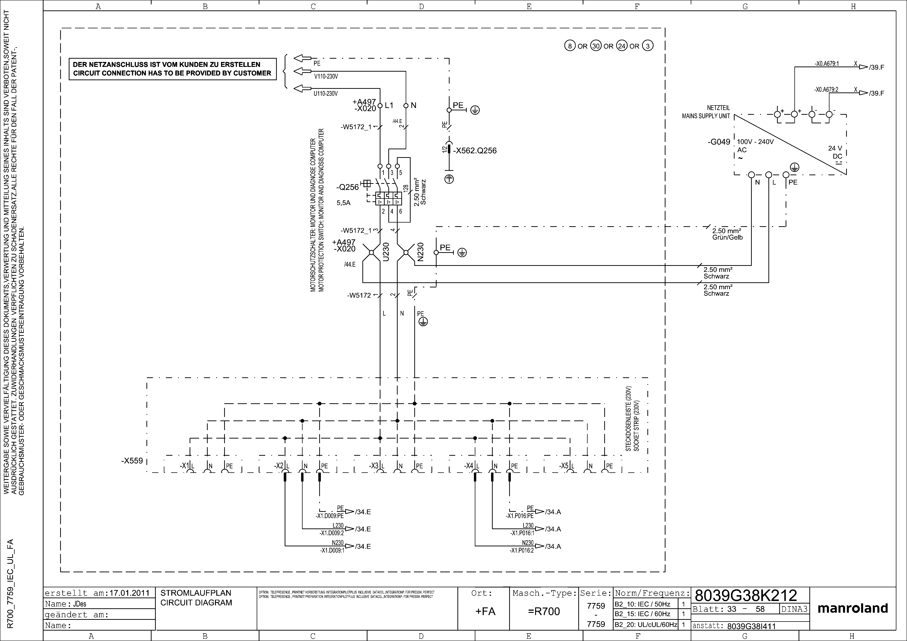

# +FA — Sheet 33 of 58 — OPTION: TELEPRESENCE , PRINTNET VORBEREITUNG: INTEGRATIONPILOTPLUS INCLUSIVE DATACOL.,INTEGRATIONP. FÜR PRESSM. PERFECT

> Part of the manroland **R700** printing press IEC/UL circuit diagrams.
> Drawing class: **Stromlaufplan / Circuit diagram** (DIN A3).
> Document `+FA` covers the **Delivery** machine section.

## At a glance

| Field | Value |
|---|---|
| Document | `+FA`  (8039G38K212) |
| Sheet | **33** of 58 |
| Section (DE) | OPTION: TELEPRESENCE , PRINTNET VORBEREITUNG: INTEGRATIONPILOTPLUS INCLUSIVE DATACOL.,INTEGRATIONP. FÜR PRESSM. PERFECT |
| Section (EN) | — |
| Section type | CIRCUIT — Circuit diagram |
| Machine type | `=R700` |
| Series | `7759` |
| Created | 17.01.2011 |
| Replaces | `8039G38I411` |
| Columns used | A, B, C, D, E, F, G, H |
| Path numbers | — |
| Labels on sheet | 122 |
| Cross-refs out | 10 |
| Cross-refs in | 24 |

**Previous:** [+FA sheet 32](SHEET_0032.md) · **Next:** [+FA sheet 34](SHEET_0034.md) · **Document TOC:** [_TOC.md](_TOC.md)  (+FA) · **Master TOC:** [all sheets](../_MASTER_TOC.md)

## Sheet image (300 DPI, exact vector render)



_Rendered directly from the PDF vector layer at 300 DPI (1-bit), no OCR and no resampling. Use it to confirm anything ambiguous in the text below._

## Cross-references on this sheet

Each entry is a wire leaving this sheet. The printed token is `/sheet.column`; the link resolves to that sheet inside the same document.

| Ref | Target sheet | Col | Path | Destination on target | Target section | From col |
|---|---|---|---|---|---|---|
| `/39.F` | [+FA sheet 39](SHEET_0039.md) | F | — | X0.A679:1 X | OPTION: TELEPRESENCE | H |
| `/39.F` | [+FA sheet 39](SHEET_0039.md) | F | — | X X0.A679:2 | OPTION: TELEPRESENCE | H |
| `/44.E` | [+FA sheet 44](SHEET_0044.md) | E | — | — | KLEMMLEISTE | D |
| `/44.E` | [+FA sheet 44](SHEET_0044.md) | E | — | — | KLEMMLEISTE | C |
| `/34.E` | [+FA sheet 34](SHEET_0034.md) | E | — | PE X1.D009:PE | OPTION: TELEPRESENCE , PRINTNET VORBEREITUNG: INTEGRATIONPILOTPLUS INCLUSIVE DATACOL.,INTEGRATIONP. FÜR PRESSM. PERFECT | C |
| `/34.A` | [+FA sheet 34](SHEET_0034.md) | A | — | PE X1.P016:PE | OPTION: TELEPRESENCE , PRINTNET VORBEREITUNG: INTEGRATIONPILOTPLUS INCLUSIVE DATACOL.,INTEGRATIONP. FÜR PRESSM. PERFECT | E |
| `/34.E` | [+FA sheet 34](SHEET_0034.md) | E | — | L230 X1.D009:2 | OPTION: TELEPRESENCE , PRINTNET VORBEREITUNG: INTEGRATIONPILOTPLUS INCLUSIVE DATACOL.,INTEGRATIONP. FÜR PRESSM. PERFECT | C |
| `/34.A` | [+FA sheet 34](SHEET_0034.md) | A | — | L230 X1.P016:1 | OPTION: TELEPRESENCE , PRINTNET VORBEREITUNG: INTEGRATIONPILOTPLUS INCLUSIVE DATACOL.,INTEGRATIONP. FÜR PRESSM. PERFECT | E |
| `/34.E` | [+FA sheet 34](SHEET_0034.md) | E | — | N230 X1.D009:1 | OPTION: TELEPRESENCE , PRINTNET VORBEREITUNG: INTEGRATIONPILOTPLUS INCLUSIVE DATACOL.,INTEGRATIONP. FÜR PRESSM. PERFECT | C |
| `/34.A` | [+FA sheet 34](SHEET_0034.md) | A | — | N230 X1.P016:2 | OPTION: TELEPRESENCE , PRINTNET VORBEREITUNG: INTEGRATIONPILOTPLUS INCLUSIVE DATACOL.,INTEGRATIONP. FÜR PRESSM. PERFECT | E |

### Incoming references (sheets that point here)

Every other sheet that sends a wire to this one. `Back-ref` is the token printed on *that* sheet; `Path` is its line number.

| From sheet | Cols | Back-ref | Path | Refs | What continues there |
|---|---|---|---|---|---|
| [+FA#4](SHEET_0004.md) | B | `/4.B` | — | 1 | — |
| [+FA#5](SHEET_0005.md) | E, H | `/5.E`, `/5.H` | — | 2 | Q256; X559 |
| [+FA#34](SHEET_0034.md) | A, E | `/34.A`, `/34.E` | — | 6 | L230 X559:2; N230 X559:1; PE X559:PE; PE X559:PE SH/16; X559:1 N230 |
| [+FA#39](SHEET_0039.md) | F | `/39.F` | — | 2 | X G049:; X G049:+ |
| [+FA#44](SHEET_0044.md) | E | `/44.E` | — | 6 | — |
| [+FA#55](SHEET_0055.md) | A, B, F | `/55.A`, `/55.B`, `/55.F` | — | 7 | — |


## Devices on this sheet

| Tag | Class | Class meaning (IEC) | Col | Sub | Terminal | Sign |
|---|---|---|---|---|---|---|
| `Q256` | Q | Leistungsschalter / power switching device | C | — | — | — |
| `N230` | N | Netzteil / power unit, amplifier | C | — | — | — |
| `X559` | X | Klemme / terminal, plug connector | A | — | — | — |
| `X1` | X | Klemme / terminal, plug connector | B | — | — | — |
| `X2` | X | Klemme / terminal, plug connector | C | — | — | — |
| `X3` | X | Klemme / terminal, plug connector | D | — | — | — |
| `X4` | X | Klemme / terminal, plug connector | D | — | — | — |
| `X5` | X | Klemme / terminal, plug connector | E | — | — | — |
| `+A497` | A | Baugruppe / assembly, module, PC board | C | — | — | + |
| `X020` | X | Klemme / terminal, plug connector | C | — | — | — |
| `G049` | G | Stromversorgung / power supply | G | — | — | — |
| `N230` | N | Netzteil / power unit, amplifier | E | — | — | — |
| `+A497` | A | Baugruppe / assembly, module, PC board | C | — | — | + |
| `X020` | X | Klemme / terminal, plug connector | C | — | — | — |
| `U230` | U | Umrichter / frequency converter | D | — | — | — |
| `N230` | N | Netzteil / power unit, amplifier | D | — | — | — |
| `W5172` | W | Kabel / cable, line, bus | C | — | — | — |
| `X562.Q256` | — | cross-device reference | D | — | — | — |
| `X1.D009:PE` | — | cross-device reference | C | — | PE | — |
| `X1.D009:2` | — | cross-device reference | C | — | 2 | — |
| `X1.D009:1` | — | cross-device reference | C | — | 1 | — |
| `X0.A679:1` | — | cross-device reference | H | — | 1 | — |
| `X0.A679:2` | — | cross-device reference | H | — | 2 | — |
| `X1.P016:PE` | — | cross-device reference | E | — | PE | — |
| `X1.P016:1` | — | cross-device reference | E | — | 1 | — |
| `X1.P016:2` | — | cross-device reference | E | — | 2 | — |

## Potentials / nets

| Potential | Count | Columns | Attached devices | Terminals |
|---|---|---|---|---|
| `24 V` | 1 | H | — | — |
| `L1` | 1 | D | — | — |
| `L230` | 2 | C, E | — | — |
| `N` | 8 | B, C, D, E, F, G | — | — |
| `PE` | 14 | B, C, D, E, F, G | — | — |


A potential such as `L24+/4` or `M24+` is a named supply/return rail; every place it appears on this sheet is electrically common.

## Conductor data

Each label annotates **the wire beside it**, not the sheet. These summaries are inventories of what is printed; they are not a per-wire map. For a specific conductor, read the label that sits on that wire (see the label inventory below, or the sheet image).

**Cross-section labels printed on this sheet:** 2.5 mm² (×4)

**Wire-colour labels printed on this sheet:** SW = schwarz / black (×3)

**Cross-section + colour appearing together in one annotation block:**

| Cross-section | Colour (DE) | Colour (EN) | Blocks containing both |
|---|---|---|---|
| 2.5 mm² | schwarz | black | 3 |


_This counts annotation blocks that carry both labels. It can be lower than the number of individual labels above, because a block may hold two cross-section labels or two colour labels._

## Wire-end annotations (grouped as printed)

A wire that continues elsewhere is annotated with a small cluster: the destination description, the path/line number `#NN`, and the `/sheet.column` cross reference. Each row below is one such cluster exactly as it is grouped on the drawing.

| Col | Y | Path | Cross-ref | Text on the wire |
|---|---|---|---|---|
| F | 56.7 | — | — | `8 OR 30 OR 24 OR 3` |
| C | 80.2 | — | — | `PE` |
| H | 80.7 | — | `/39.F` | `X0.A679:1 X` |
| B | 81.1 | — | — | `DER NETZANSCHLUSS IST VOM KUNDEN ZU ERSTELLEN CIRCUIT CONNECTION HAS TO BE PROVIDED BY CUSTOMER` |
| C | 97.5 | — | — | `V110 230V` |
| H | 114.7 | — | `/39.F` | `X0.A679:2 X` |
| C | 120.1 | — | — | `U110 230V` |
| C | 129.3 | — | — | `+A497` |
| D | 133.5 | — | — | `X020 L1` |
| D | 133.5 | — | — | `N PE` |
| G | 138.8 | — | — | `MAINS SUPPLY UNIT NETZTEIL + +` |
| D | 156.9 | — | `/44.E` | — |
| D | 159.2 | — | — | `PE` |
| C | 163.0 | — | — | `W5172_1` |
| D | 163.9 | — | — | `1` |
| D | 163.9 | — | — | `2` |
| C | 168.9 | — | — | `MOTOR PROTECTION SWITCH: MONITOR AND DIAGNOSIS COMPUTER` |
| C | 181.7 | — | — | `MOTORSCHUTZSCHALTER: MONITOR UND DIAGNOSE COMPUTER` |
| G | 181.7 | — | — | `G049` |
| G | 182.4 | — | — | `100V 240V AC` |
| H | 190.9 | — | — | `24 V DC` |
| D | 192.2 | — | — | `1/2` |
| D | 193.1 | — | — | `X562.Q256` |
| G | 203.2 | — | — | `~` |
| D | 223.3 | — | — | `1` |
| D | 223.8 | — | — | `3` |
| D | 223.8 | — | — | `5` |
| D | 233.4 | — | — | `2.50 mm² Schwarz` |
| G | 235.5 | — | — | `N L PE` |
| C | 241.2 | — | — | `Q256` |
| D | 242.5 | — | — | `128` |
| C | 262.5 | — | — | `5,5A` |
| D | 263.1 | — | — | `I> I> I>` |
| D | 274.7 | — | — | `2` |
| D | 274.8 | — | — | `4` |
| D | 274.8 | — | — | `6` |
| C | 299.0 | — | — | `W5172_1` |
| G | 299.3 | — | — | `2.50 mm² Grün/Gelb` |
| D | 300.0 | — | — | `3` |
| D | 300.0 | — | — | `4` |
| C | 313.5 | — | — | `+A497` |
| D | 318.3 | — | — | `U230` |
| D | 318.3 | — | — | `N230` |
| D | 320.6 | — | — | `PE` |
| C | 322.0 | — | — | `X020` |
| C | 344.3 | — | `/44.E` | — |
| G | 350.3 | — | — | `2.50 mm² Schwarz` |
| G | 373.0 | — | — | `2.50 mm² Schwarz` |
| D | 380.3 | — | — | `PE` |
| C | 384.0 | — | — | `W5172` |
| D | 385.0 | — | — | `1` |
| D | 385.0 | — | — | `2` |
| D | 408.4 | — | — | `L N PE` |
| F | 507.3 | — | — | `STECKDOSENLEISTE (230V)` |
| F | 526.1 | — | — | `SOCKET STRIP (230V)` |
| A | 600.3 | — | — | `X559` |
| D | 608.0 | — | — | `X1 L N PE X2 L N PE X3 L N PE X4 L N PE X5 L N PE` |
| C | 664.5 | — | `/34.E` | `X1.D009:PE PE` |
| E | 664.5 | — | `/34.A` | `X1.P016:PE PE` |
| C | 687.3 | — | `/34.E` | `X1.D009:2 L230` |
| E | 687.3 | — | `/34.A` | `X1.P016:1 L230` |
| C | 710.0 | — | `/34.E` | `X1.D009:1 N230` |
| E | 710.0 | — | `/34.A` | `X1.P016:2 N230` |


## Reconstructed tables

This sheet carries tabular content (pin map / terminal assignment / index). The grid below was rebuilt from the drawing's own rule lines, so each row is exactly one physical row of the table.

### Table 1 — 6 data rows × 20 columns (at x=215.4, y=76.5)

| VOM | KUNDEN | ZU | ERSTELLEN |  |  |  | PE |  |  |  |  |  |  |  |  |  |  |  |  |
|---|---|---|---|---|---|---|---|---|---|---|---|---|---|---|---|---|---|---|---|
| `TO BE` | `PROVIDED` |  | `BY` | `CUSTOMER` |  |  |  | `V110 230V` |  |  |  |  |  |  |  |  |  |  |  |
|  |  |  |  |  |  |  | `COMPUTER DIAGNOSE UND MONITOR` | `U110 230V COMPUTER DIAGNOSIS AND MONITOR` | `Q256 5,5A` | `W5172_1` | `+A497 X020 1 I>` | `1 2` |  | `L1 3 I> 4` | `/44.E I>` | `2 5 6` | `128` | `N` | `mm² Schwarz 2.50` |
|  |  |  |  |  |  |  | `MOTORSCHUTZSCHALTER:` | `SWITCH: PROTECTION` | `+A497 X020 /44.E` | `W5172_1` | `3` |  | `U230` |  | `4` |  |  |  | `N230` |
|  |  |  |  |  |  |  |  | `MOTOR` |  | `W5172` | `1` | `L` |  |  | `2` | `N` |  | `PE` | `PE` |
| `X1` | `L` | `N` | `PE` |  | `X2` | `L` | `N` | `PE X1.D009:PE` | `PE L230` |  | `X3 /34.E` | `L` |  |  |  | `N` |  |  | `PE` |
|  |  |  |  |  |  |  |  | `X1.D009:2` | `N230` |  | `/34.E` |  |  |  |  |  |  |  |  |


### Table 2 — 3 data rows × 10 columns (at x=572.6, y=76.5)

| PE 1/2 | PE | X562.Q256 |  |  |  |  |  |  |  |
|---|---|---|---|---|---|---|---|---|---|
| `PE` |  |  |  |  |  |  |  |  |  |
|  | `X4` | `L` | `N` | `PE X1.P016:PE` | `PE L230` | `X5 /34.A` | `L` | `N` | `PE` |
|  |  |  |  | `X1.P016:1` | `N230` | `/34.A` |  |  |  |


### Table 3 — 3 data rows × 6 columns (at x=963.8, y=87.9)

|  |  | + |  | X0.A679:2 + |  |
|---|---|---|---|---|---|
| `100V AC ~` | `240V` |  |  |  | `24 V DC` |
|  | `N` | `L` | `PE` |  |  |
| `mm²` |  |  |  |  |  |


## Notes and free text on this sheet

| Text | Col | Y (pt) |
|---|---|---|
| `U110 230V` | C | 120.13 |
| `V110 230V` | C | 97.46 |
| `I>` | D | 263.15 |
| `MOTORSCHUTZSCHALTER: MONITOR UND DIAGNOSE COMPUTER` | C | 181.74 |
| `MOTOR PROTECTION SWITCH: MONITOR AND DIAGNOSIS COMPUTER` | C | 168.86 |
| `5,5A` | C | 262.47 |
| `L` | D | 408.46 |
| `STECKDOSENLEISTE (230V)` | F | 507.34 |
| `SOCKET STRIP (230V)` | F | 526.06 |
| `L` | B | 609.15 |
| `L` | C | 609.15 |
| `L` | E | 609.15 |
| `L` | G | 235.6 |
| `NETZTEIL` | G | 138.79 |
| `MAINS SUPPLY UNIT` | G | 149.44 |
| `DC` | H | 201.6 |
| `100V 240V` | G | 182.41 |
| `AC` | G | 193.04 |
| `OR` | F | 57.01 |
| `OR` | E | 57.01 |
| `DER NETZANSCHLUSS IST VOM KUNDEN ZU ERSTELLEN` | B | 81.06 |
| `CIRCUIT CONNECTION HAS TO BE PROVIDED BY CUSTOMER` | B | 92.44 |
| `W5172_1` | C | 162.96 |
| `Grün/Gelb` | G | 307.88 |

## Complete label inventory (exact text from the drawing)

Every text object inside the drawing area of this sheet, in DIN reading order (column A→H, then top→bottom). This is the authoritative list: if a string is not here it is not printed on this sheet.

| Col | Y | X | Dir | Type | Text |
|---|---|---|---|---|---|
| A | 600.3 | 159.3 | → | device tag | `X559` |
| B | 81.1 | 95.8 | → | text | `DER NETZANSCHLUSS IST VOM KUNDEN ZU ERSTELLEN` |
| B | 92.4 | 96.1 | → | text | `CIRCUIT CONNECTION HAS TO BE PROVIDED BY CUSTOMER` |
| B | 608.0 | 236.3 | → | device tag | `X1` |
| B | 609.1 | 274.1 | → | potential | `N` |
| B | 609.2 | 251.4 | → | text | `L` |
| B | 609.2 | 296.8 | → | potential | `PE` |
| C | 80.3 | 411.9 | → | potential | `PE` |
| C | 97.5 | 412.7 | → | text | `V110 230V` |
| C | 120.1 | 411.9 | → | text | `U110 230V` |
| C | 129.3 | 462.6 | → | device tag | `+A497` |
| C | 137.8 | 465.4 | → | device tag | `X020` |
| C | 163.0 | 447.3 | → | text | `W5172_1` |
| C | 168.9 | 418.7 | ↕ | text | `MOTOR PROTECTION SWITCH: MONITOR AND DIAGNOSIS COMPUTER` |
| C | 181.7 | 408.1 | ↕ | text | `MOTORSCHUTZSCHALTER: MONITOR UND DIAGNOSE COMPUTER` |
| C | 241.3 | 441.6 | → | device tag | `Q256` |
| C | 262.5 | 441.9 | → | text | `5,5A` |
| C | 299.0 | 447.3 | → | text | `W5172_1` |
| C | 313.5 | 435.7 | → | device tag | `+A497` |
| C | 322.0 | 438.5 | → | device tag | `X020` |
| C | 344.3 | 452.0 | → | cross-reference | `/44.E` |
| C | 384.0 | 455.8 | → | device tag | `W5172` |
| C | 608.2 | 360.0 | → | device tag | `X2` |
| C | 609.1 | 398.8 | → | potential | `N` |
| C | 609.2 | 376.2 | → | text | `L` |
| C | 609.2 | 421.5 | → | potential | `PE` |
| C | 664.5 | 442.4 | → | potential | `PE` |
| C | 668.5 | 466.3 | → | cross-reference | `/34.E` |
| C | 674.6 | 414.6 | → | device ref | `X1.D009:PE` |
| C | 687.3 | 437.0 | → | potential | `L230` |
| C | 691.2 | 466.3 | → | cross-reference | `/34.E` |
| C | 697.2 | 419.6 | → | device ref | `X1.D009:2` |
| C | 710.0 | 436.0 | → | device tag | `N230` |
| C | 713.9 | 466.3 | → | cross-reference | `/34.E` |
| C | 719.9 | 420.4 | → | device ref | `X1.D009:1` |
| D | 133.5 | 505.1 | → | potential | `L1` |
| D | 133.5 | 539.1 | → | potential | `N` |
| D | 133.5 | 594.4 | → | potential | `PE` |
| D | 156.9 | 515.6 | → | cross-reference | `/44.E` |
| D | 159.2 | 580.9 | ↕ | potential | `PE` |
| D | 163.9 | 489.8 | ↕ | number | `1` |
| D | 163.9 | 524.2 | ↕ | number | `2` |
| D | 192.2 | 580.9 | ↕ | pin pair | `1/2` |
| D | 193.1 | 595.0 | → | device ref | `X562.Q256` |
| D | 223.3 | 500.9 | → | number | `1` |
| D | 223.8 | 512.8 | → | number | `3` |
| D | 223.8 | 524.1 | → | number | `5` |
| D | 233.4 | 543.1 | ↕ | cross-section | `2.50 mm²` |
| D | 235.6 | 551.6 | ↕ | wire colour | `Schwarz` |
| D | 242.5 | 530.0 | ↕ | number | `128` |
| D | 263.2 | 496.6 | → | text | `I>` |
| D | 263.2 | 508.0 | → | text | `I>` |
| D | 263.2 | 519.3 | → | text | `I>` |
| D | 274.7 | 501.4 | → | number | `2` |
| D | 274.8 | 512.8 | → | number | `4` |
| D | 274.8 | 524.1 | → | number | `6` |
| D | 300.0 | 490.2 | ↕ | number | `3` |
| D | 300.0 | 512.9 | ↕ | number | `4` |
| D | 318.3 | 502.0 | ↕ | device tag | `U230` |
| D | 318.3 | 547.4 | ↕ | device tag | `N230` |
| D | 320.6 | 577.4 | → | potential | `PE` |
| D | 380.3 | 535.5 | ↕ | potential | `PE` |
| D | 385.0 | 489.8 | ↕ | number | `1` |
| D | 385.0 | 512.8 | ↕ | number | `2` |
| D | 408.4 | 525.3 | → | potential | `N` |
| D | 408.5 | 502.6 | → | text | `L` |
| D | 409.4 | 547.7 | → | potential | `PE` |
| D | 608.2 | 484.7 | → | device tag | `X3` |
| D | 608.2 | 609.4 | → | device tag | `X4` |
| D | 609.1 | 523.6 | → | potential | `N` |
| D | 609.2 | 500.9 | → | text | `L` |
| D | 609.2 | 546.2 | → | potential | `PE` |
| E | 56.7 | 745.9 | → | number | `8` |
| E | 57.0 | 758.3 | → | text | `OR` |
| E | 608.2 | 734.2 | → | device tag | `X5` |
| E | 609.1 | 648.3 | → | potential | `N` |
| E | 609.2 | 625.6 | → | text | `L` |
| E | 609.2 | 671.0 | → | potential | `PE` |
| E | 609.2 | 750.3 | → | text | `L` |
| E | 664.5 | 691.9 | → | potential | `PE` |
| E | 668.5 | 715.7 | → | cross-reference | `/34.A` |
| E | 674.5 | 664.3 | → | device ref | `X1.P016:PE` |
| E | 687.3 | 686.4 | → | potential | `L230` |
| E | 691.2 | 715.7 | → | cross-reference | `/34.A` |
| E | 697.2 | 670.1 | → | device ref | `X1.P016:1` |
| E | 710.0 | 685.4 | → | device tag | `N230` |
| E | 713.9 | 715.7 | → | cross-reference | `/34.A` |
| E | 719.9 | 669.3 | → | device ref | `X1.P016:2` |
| F | 56.7 | 777.5 | → | number | `30` |
| F | 56.7 | 811.6 | → | number | `24` |
| F | 57.0 | 792.3 | → | text | `OR` |
| F | 57.0 | 826.3 | → | text | `OR` |
| F | 57.0 | 848.0 | → | number | `3` |
| F | 507.3 | 822.0 | ↕ | text | `STECKDOSENLEISTE (230V)` |
| F | 526.1 | 832.6 | ↕ | text | `SOCKET STRIP (230V)` |
| F | 609.1 | 773.0 | → | potential | `N` |
| F | 609.2 | 795.7 | → | potential | `PE` |
| G | 138.8 | 928.5 | → | text | `NETZTEIL` |
| G | 142.0 | 1024.4 | → | number | `+` |
| G | 149.4 | 895.6 | → | text | `MAINS SUPPLY UNIT` |
| G | 181.7 | 929.2 | → | device tag | `G049` |
| G | 182.4 | 967.2 | → | text | `100V 240V` |
| G | 193.0 | 968.0 | → | text | `AC` |
| G | 203.2 | 968.9 | → | other | `~` |
| G | 235.5 | 1035.2 | → | potential | `PE` |
| G | 235.6 | 991.3 | → | potential | `N` |
| G | 235.6 | 1014.0 | → | text | `L` |
| G | 299.3 | 935.1 | → | cross-section | `2.50 mm²` |
| G | 307.9 | 935.1 | → | text | `Grün/Gelb` |
| G | 350.3 | 923.8 | → | cross-section | `2.50 mm²` |
| G | 358.9 | 923.8 | → | wire colour | `Schwarz` |
| G | 373.0 | 923.8 | → | cross-section | `2.50 mm²` |
| G | 381.6 | 923.8 | → | wire colour | `Schwarz` |
| H | 80.7 | 1069.8 | → | device ref | `X0.A679:1` |
| H | 80.7 | 1121.1 | → | not fitted | `X` |
| H | 84.6 | 1140.9 | → | cross-reference | `/39.F` |
| H | 114.7 | 1069.0 | → | device ref | `X0.A679:2` |
| H | 114.7 | 1121.1 | → | not fitted | `X` |
| H | 118.6 | 1140.9 | → | cross-reference | `/39.F` |
| H | 142.0 | 1047.1 | → | number | `+` |
| H | 190.9 | 1087.4 | → | potential | `24 V` |
| H | 201.6 | 1093.3 | → | text | `DC` |

## Reading-order text block

The same content as a plain block, grouped by DIN column — convenient to paste or to match against a visual description.

```text
=== Column A ===
 600.3  159.3  devtag       X559
=== Column B ===
  81.1   95.8  text         DER NETZANSCHLUSS IST VOM KUNDEN ZU ERSTELLEN
  92.4   96.1  text         CIRCUIT CONNECTION HAS TO BE PROVIDED BY CUSTOMER
 608.0  236.3  devtag       X1
 609.1  274.1  net          N
 609.2  251.4  text         L
 609.2  296.8  net          PE
=== Column C ===
  80.3  411.9  net          PE
  97.5  412.7  text         V110 230V
 120.1  411.9  text         U110 230V
 129.3  462.6  devtag       +A497
 137.8  465.4  devtag       X020
 163.0  447.3  text         W5172_1
 168.9  418.7  text         MOTOR PROTECTION SWITCH: MONITOR AND DIAGNOSIS COMPUTER
 181.7  408.1  text         MOTORSCHUTZSCHALTER: MONITOR UND DIAGNOSE COMPUTER
 241.3  441.6  devtag       Q256
 262.5  441.9  text         5,5A
 299.0  447.3  text         W5172_1
 313.5  435.7  devtag       +A497
 322.0  438.5  devtag       X020
 344.3  452.0  xref         /44.E
 384.0  455.8  devtag       W5172
 608.2  360.0  devtag       X2
 609.1  398.8  net          N
 609.2  376.2  text         L
 609.2  421.5  net          PE
 664.5  442.4  net          PE
 668.5  466.3  xref         /34.E
 674.6  414.6  devref       X1.D009:PE
 687.3  437.0  net          L230
 691.2  466.3  xref         /34.E
 697.2  419.6  devref       X1.D009:2
 710.0  436.0  devtag       N230
 713.9  466.3  xref         /34.E
 719.9  420.4  devref       X1.D009:1
=== Column D ===
 133.5  505.1  net          L1
 133.5  539.1  net          N
 133.5  594.4  net          PE
 156.9  515.6  xref         /44.E
 159.2  580.9  net          PE
 163.9  489.8  numeric      1
 163.9  524.2  numeric      2
 192.2  580.9  pinpair      1/2
 193.1  595.0  devref       X562.Q256
 223.3  500.9  numeric      1
 223.8  512.8  numeric      3
 223.8  524.1  numeric      5
 233.4  543.1  xsection     2.50 mm²
 235.6  551.6  colour       Schwarz
 242.5  530.0  numeric      128
 263.2  496.6  text         I>
 263.2  508.0  text         I>
 263.2  519.3  text         I>
 274.7  501.4  numeric      2
 274.8  512.8  numeric      4
 274.8  524.1  numeric      6
 300.0  490.2  numeric      3
 300.0  512.9  numeric      4
 318.3  502.0  devtag       U230
 318.3  547.4  devtag       N230
 320.6  577.4  net          PE
 380.3  535.5  net          PE
 385.0  489.8  numeric      1
 385.0  512.8  numeric      2
 408.4  525.3  net          N
 408.5  502.6  text         L
 409.4  547.7  net          PE
 608.2  484.7  devtag       X3
 608.2  609.4  devtag       X4
 609.1  523.6  net          N
 609.2  500.9  text         L
 609.2  546.2  net          PE
=== Column E ===
  56.7  745.9  numeric      8
  57.0  758.3  text         OR
 608.2  734.2  devtag       X5
 609.1  648.3  net          N
 609.2  625.6  text         L
 609.2  671.0  net          PE
 609.2  750.3  text         L
 664.5  691.9  net          PE
 668.5  715.7  xref         /34.A
 674.5  664.3  devref       X1.P016:PE
 687.3  686.4  net          L230
 691.2  715.7  xref         /34.A
 697.2  670.1  devref       X1.P016:1
 710.0  685.4  devtag       N230
 713.9  715.7  xref         /34.A
 719.9  669.3  devref       X1.P016:2
=== Column F ===
  56.7  777.5  numeric      30
  56.7  811.6  numeric      24
  57.0  792.3  text         OR
  57.0  826.3  text         OR
  57.0  848.0  numeric      3
 507.3  822.0  text         STECKDOSENLEISTE (230V)
 526.1  832.6  text         SOCKET STRIP (230V)
 609.1  773.0  net          N
 609.2  795.7  net          PE
=== Column G ===
 138.8  928.5  text         NETZTEIL
 142.0 1024.4  numeric      +
 149.4  895.6  text         MAINS SUPPLY UNIT
 181.7  929.2  devtag       G049
 182.4  967.2  text         100V 240V
 193.0  968.0  text         AC
 203.2  968.9  other        ~
 235.5 1035.2  net          PE
 235.6  991.3  net          N
 235.6 1014.0  text         L
 299.3  935.1  xsection     2.50 mm²
 307.9  935.1  text         Grün/Gelb
 350.3  923.8  xsection     2.50 mm²
 358.9  923.8  colour       Schwarz
 373.0  923.8  xsection     2.50 mm²
 381.6  923.8  colour       Schwarz
=== Column H ===
  80.7 1069.8  devref       X0.A679:1
  80.7 1121.1  placeholder  X
  84.6 1140.9  xref         /39.F
 114.7 1069.0  devref       X0.A679:2
 114.7 1121.1  placeholder  X
 118.6 1140.9  xref         /39.F
 142.0 1047.1  numeric      +
 190.9 1087.4  net          24 V
 201.6 1093.3  text         DC
```

---
_Generated from the PDF vector text layer; no OCR. Source: `R700_7759_IEC_UL_FA`, sheet 33._
