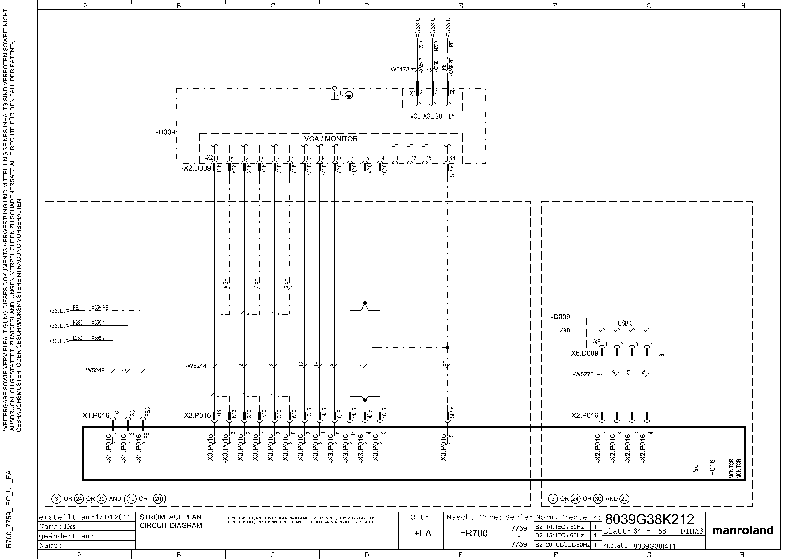

# +FA — Sheet 34 of 58 — OPTION: TELEPRESENCE , PRINTNET VORBEREITUNG: INTEGRATIONPILOTPLUS INCLUSIVE DATACOL.,INTEGRATIONP. FÜR PRESSM. PERFECT

> Part of the manroland **R700** printing press IEC/UL circuit diagrams.
> Drawing class: **Stromlaufplan / Circuit diagram** (DIN A3).
> Document `+FA` covers the **Delivery** machine section.

## At a glance

| Field | Value |
|---|---|
| Document | `+FA`  (8039G38K212) |
| Sheet | **34** of 58 |
| Section (DE) | OPTION: TELEPRESENCE , PRINTNET VORBEREITUNG: INTEGRATIONPILOTPLUS INCLUSIVE DATACOL.,INTEGRATIONP. FÜR PRESSM. PERFECT |
| Section (EN) | — |
| Section type | CIRCUIT — Circuit diagram |
| Machine type | `=R700` |
| Series | `7759` |
| Created | 17.01.2011 |
| Replaces | `8039G38I411` |
| Columns used | A, B, C, D, E, F, G, H |
| Path numbers | — |
| Labels on sheet | 171 |
| Cross-refs out | 8 |
| Cross-refs in | 31 |

**Previous:** [+FA sheet 33](SHEET_0033.md) · **Next:** [+FA sheet 35](SHEET_0035.md) · **Document TOC:** [_TOC.md](_TOC.md)  (+FA) · **Master TOC:** [all sheets](../_MASTER_TOC.md)

## Sheet image (300 DPI, exact vector render)



_Rendered directly from the PDF vector layer at 300 DPI (1-bit), no OCR and no resampling. Use it to confirm anything ambiguous in the text below._

## Cross-references on this sheet

Each entry is a wire leaving this sheet. The printed token is `/sheet.column`; the link resolves to that sheet inside the same document.

| Ref | Target sheet | Col | Path | Destination on target | Target section | From col |
|---|---|---|---|---|---|---|
| `/33.C` | [+FA sheet 33](SHEET_0033.md) | C | — | L230 X559:2 | OPTION: TELEPRESENCE , PRINTNET VORBEREITUNG: INTEGRATIONPILOTPLUS INCLUSIVE DATACOL.,INTEGRATIONP. FÜR PRESSM. PERFECT | E |
| `/33.C` | [+FA sheet 33](SHEET_0033.md) | C | — | N230 X559:1 | OPTION: TELEPRESENCE , PRINTNET VORBEREITUNG: INTEGRATIONPILOTPLUS INCLUSIVE DATACOL.,INTEGRATIONP. FÜR PRESSM. PERFECT | E |
| `/33.C` | [+FA sheet 33](SHEET_0033.md) | C | — | PE X559:PE SH/16 | OPTION: TELEPRESENCE , PRINTNET VORBEREITUNG: INTEGRATIONPILOTPLUS INCLUSIVE DATACOL.,INTEGRATIONP. FÜR PRESSM. PERFECT | E |
| `/33.E` | [+FA sheet 33](SHEET_0033.md) | E | — | PE X559:PE | OPTION: TELEPRESENCE , PRINTNET VORBEREITUNG: INTEGRATIONPILOTPLUS INCLUSIVE DATACOL.,INTEGRATIONP. FÜR PRESSM. PERFECT | A |
| `/33.E` | [+FA sheet 33](SHEET_0033.md) | E | — | X559:1 N230 | OPTION: TELEPRESENCE , PRINTNET VORBEREITUNG: INTEGRATIONPILOTPLUS INCLUSIVE DATACOL.,INTEGRATIONP. FÜR PRESSM. PERFECT | A |
| `/49.D` | [+FA sheet 49](SHEET_0049.md) | D | — | — | REFERENZMODUL | F |
| `/33.E` | [+FA sheet 33](SHEET_0033.md) | E | — | L230 X559:2 | OPTION: TELEPRESENCE , PRINTNET VORBEREITUNG: INTEGRATIONPILOTPLUS INCLUSIVE DATACOL.,INTEGRATIONP. FÜR PRESSM. PERFECT | A |
| `/5.C` | [+FA sheet 5](SHEET_0005.md) | C | — | — | ANORDNUNGSPLAN | H |

### Incoming references (sheets that point here)

Every other sheet that sends a wire to this one. `Back-ref` is the token printed on *that* sheet; `Path` is its line number.

| From sheet | Cols | Back-ref | Path | Refs | What continues there |
|---|---|---|---|---|---|
| [+FA#5](SHEET_0005.md) | C | `/5.C` | — | 1 | — |
| [+FA#33](SHEET_0033.md) | C, E | `/33.C`, `/33.E` | — | 6 | L230 X1.D009:2; L230 X1.P016:1; N230 X1.D009:1; N230 X1.P016:2; PE X1.D009:PE; PE X1.P016:PE |
| [+FA#49](SHEET_0049.md) | D | `/49.D` | — | 2 | — |
| [+FA#51](SHEET_0051.md) | A, F, G | `/51.A`, `/51.F`, `/51.G` | — | 9 | — |
| [+FA#54](SHEET_0054.md) | B | `/54.B` | — | 13 | — |


## Devices on this sheet

| Tag | Class | Class meaning (IEC) | Col | Sub | Terminal | Sign |
|---|---|---|---|---|---|---|
| `P016` | P | Messgeraet / measuring instrument, meter | H | — | — | — |
| `X559:PE` | X | Klemme / terminal, plug connector | A | — | PE | — |
| `N230` | N | Netzteil / power unit, amplifier | A | — | — | — |
| `X559:1` | X | Klemme / terminal, plug connector | A | — | 1 | — |
| `X559:2` | X | Klemme / terminal, plug connector | A | — | 2 | — |
| `X559:PE` | X | Klemme / terminal, plug connector | E | — | PE | — |
| `X559:2` | X | Klemme / terminal, plug connector | E | — | 2 | — |
| `N230` | N | Netzteil / power unit, amplifier | E | — | — | — |
| `X559:1` | X | Klemme / terminal, plug connector | E | — | 1 | — |
| `D009` | D | Digital / binary element | B | — | — | — |
| `X2` | X | Klemme / terminal, plug connector | B | — | — | — |
| `X1` | X | Klemme / terminal, plug connector | D | — | — | — |
| `D009` | D | Digital / binary element | F | — | — | — |
| `X6` | X | Klemme / terminal, plug connector | F | — | — | — |
| `W5248` | W | Kabel / cable, line, bus | B | — | — | — |
| `W5249` | W | Kabel / cable, line, bus | A | — | — | — |
| `W5178` | W | Kabel / cable, line, bus | D | — | — | — |
| `W5270` | W | Kabel / cable, line, bus | F | — | — | — |
| `X1.P016.` | — | cross-device reference | A | — | — | — |
| `X1.P016.` | — | cross-device reference | A | — | — | — |
| `X1.P016.` | — | cross-device reference | B | — | — | — |
| `X3.P016.` | — | cross-device reference | B | — | — | — |
| `X3.P016.` | — | cross-device reference | C | — | — | — |
| `X3.P016.` | — | cross-device reference | C | — | — | — |
| `X3.P016.` | — | cross-device reference | B | — | — | — |
| `X3.P016.` | — | cross-device reference | C | — | — | — |
| `X3.P016.` | — | cross-device reference | C | — | — | — |
| `X3.P016.` | — | cross-device reference | C | — | — | — |
| `X3.P016.` | — | cross-device reference | D | — | — | — |
| `X3.P016.` | — | cross-device reference | C | — | — | — |
| `X3.P016.` | — | cross-device reference | D | — | — | — |
| `X3.P016.` | — | cross-device reference | E | — | — | — |
| `X3.P016.` | — | cross-device reference | D | — | — | — |
| `X3.P016.` | — | cross-device reference | D | — | — | — |
| `X1.P016` | — | cross-device reference | A | — | — | — |
| `X2.D009` | — | cross-device reference | B | — | — | — |
| `X3.P016` | — | cross-device reference | B | — | — | — |
| `X2.P016.` | — | cross-device reference | F | — | — | — |
| `X2.P016.` | — | cross-device reference | G | — | — | — |
| `X6.D009` | — | cross-device reference | F | — | — | — |
| `X2.P016` | — | cross-device reference | F | — | — | — |
| `X2.P016.` | — | cross-device reference | G | — | — | — |
| `X2.P016.` | — | cross-device reference | G | — | — | — |

## Potentials / nets

| Potential | Count | Columns | Attached devices | Terminals |
|---|---|---|---|---|
| `L230` | 2 | A, E | — | — |
| `PE` | 7 | A, B, E | — | — |


A potential such as `L24+/4` or `M24+` is a named supply/return rail; every place it appears on this sheet is electrically common.

## Wire-end annotations (grouped as printed)

A wire that continues elsewhere is annotated with a small cluster: the destination description, the path/line number `#NN`, and the `/sheet.column` cross reference. Each row below is one such cluster exactly as it is grouped on the drawing.

| Col | Y | Path | Cross-ref | Text on the wire |
|---|---|---|---|---|
| E | 25.8 | — | `/33.C` | `L230 X559:2` |
| E | 25.8 | — | `/33.C` | `X559:1 N230` |
| E | 25.8 | — | `/33.C` | `PE X559:PE SH/16` |
| E | 96.9 | — | — | `PE` |
| D | 100.6 | — | — | `W5178` |
| E | 101.5 | — | — | `2` |
| E | 101.6 | — | — | `1` |
| E | 135.8 | — | — | `2 3 PE` |
| D | 137.5 | — | — | `X1` |
| E | 171.7 | — | — | `VOLTAGE SUPPLY` |
| B | 194.5 | — | — | `D009` |
| D | 204.4 | — | — | `VGA / MONITOR` |
| B | 234.0 | — | — | `X2` |
| D | 234.7 | — | — | `1 6 2 7 3 8 13 14 10 4 5 9 11 12 15 SH` |
| B | 248.0 | — | — | `1/16` |
| C | 248.0 | — | — | `6/16` |
| C | 248.0 | — | — | `2/16` |
| C | 248.0 | — | — | `7/16` |
| C | 248.0 | — | — | `3/16` |
| C | 248.0 | — | — | `8/16` |
| C | 248.0 | — | — | `13/16` |
| D | 248.0 | — | — | `14/16` |
| D | 248.0 | — | — | `5/16` |
| D | 248.0 | — | — | `11/16` |
| D | 248.0 | — | — | `4/16` |
| D | 248.0 | — | — | `10/16` |
| B | 248.6 | — | — | `X2.D009` |
| C | 419.6 | — | — | `6 SH` |
| C | 419.6 | — | — | `7 SH` |
| C | 419.6 | — | — | `8 SH` |
| A | 460.4 | — | `/33.E` | `PE X559:PE` |
| F | 472.3 | — | — | `D009` |
| A | 483.2 | — | `/33.E` | `N230 X559:1` |
| G | 483.4 | — | — | `USB 0` |
| F | 494.6 | — | `/49.D` | — |
| A | 505.9 | — | `/33.E` | `L230 X559:2` |
| F | 511.8 | — | — | `X6` |
| G | 515.3 | — | — | `1 2 3 4` |
| F | 527.5 | — | — | `X6.D009` |
| E | 542.9 | — | — | `SH` |
| C | 545.3 | — | — | `13` |
| C | 545.3 | — | — | `14` |
| B | 547.3 | — | — | `W5248` |
| C | 548.2 | — | — | `2` |
| B | 548.3 | — | — | `1` |
| C | 548.3 | — | — | `3` |
| D | 548.3 | — | — | `5` |
| D | 548.3 | — | — | `4` |
| B | 550.4 | — | — | `PE` |
| A | 554.1 | — | — | `W5249` |
| A | 555.0 | — | — | `2` |
| A | 555.1 | — | — | `1` |
| G | 556.2 | — | — | `ws` |
| G | 556.7 | — | — | `sw` |
| G | 557.3 | — | — | `gn` |
| F | 559.8 | — | — | `W5270` |
| F | 560.6 | — | — | `rt` |
| E | 612.1 | — | — | `SH/16` |
| B | 613.3 | — | — | `PE/3` |
| C | 614.3 | — | — | `13/16` |
| D | 614.3 | — | — | `14/16` |
| D | 614.3 | — | — | `11/16` |
| D | 614.3 | — | — | `10/16` |
| C | 617.3 | — | — | `6/16` |
| C | 617.3 | — | — | `2/16` |
| C | 617.3 | — | — | `7/16` |
| C | 617.3 | — | — | `3/16` |
| C | 617.3 | — | — | `8/16` |
| D | 617.3 | — | — | `5/16` |
| D | 617.3 | — | — | `4/16` |
| B | 617.7 | — | — | `1/16` |
| B | 617.9 | — | — | `2/3` |
| A | 618.3 | — | — | `1/3` |
| A | 621.1 | — | — | `X1.P016` |
| B | 621.1 | — | — | `X3.P016` |
| F | 621.1 | — | — | `X2.P016` |
| B | 648.9 | — | — | `X3.P016. 1` |
| D | 648.9 | — | — | `X3.P016. 11` |
| F | 648.9 | — | — | `X2.P016. 1` |
| E | 649.7 | — | — | `X3.P016. SH` |
| C | 650.0 | — | — | `X3.P016. 2` |
| G | 650.0 | — | — | `X2.P016. 2` |
| A | 650.3 | — | — | `X1.P016. 1` |
| C | 650.3 | — | — | `X3.P016. 6` |
| C | 650.3 | — | — | `X3.P016. 7` |
| C | 650.3 | — | — | `X3.P016. 3` |
| C | 650.3 | — | — | `X3.P016. 8` |
| C | 650.3 | — | — | `X3.P016. 13` |
| C | 650.3 | — | — | `X3.P016. 14` |
| D | 650.3 | — | — | `X3.P016. 5` |
| D | 650.3 | — | — | `X3.P016. 4` |
| D | 650.3 | — | — | `X3.P016. 10` |
| G | 650.3 | — | — | `X2.P016. 3` |
| G | 650.3 | — | — | `X2.P016. 4` |
| A | 650.8 | — | — | `X1.P016. 2` |
| B | 650.8 | — | — | `X1.P016. PE` |
| H | 691.1 | — | — | `MONITOR` |
| H | 691.1 | — | — | `MONITOR` |
| H | 691.9 | — | — | `P016` |
| H | 699.9 | — | `/5.C` | — |
| D | 743.5 | — | — | `OR 24 OR 30 AND ( OR 20 ) 3 OR 24 OR 30 AND` |
| D | 747.2 | — | — | `3 19 20` |


## Reconstructed tables

This sheet carries tabular content (pin map / terminal assignment / index). The grid below was rebuilt from the drawing's own rule lines, so each row is exactly one physical row of the table.

### Table 1 — 3 data rows × 1 columns (at x=124.7, y=167.2)

| C1 |
|---|
| `X559:PE` |
| `X559:1` |
| `X559:2` |


### Table 2 — 1 data rows × 18 columns (at x=216.9, y=167.2)

| D009 |  |  |  |  |  |  |  |  |  |  |  |  |  |  | VOLTAGE | SUPPLY |  |
|---|---|---|---|---|---|---|---|---|---|---|---|---|---|---|---|---|---|
| `X2.D009` | `X2` | `1 1/16 6 SH` | `6 6/16` | `2 2/16 7 SH` | `7 7/16` | `3 3/16 8 SH` | `8 8/16` | `VGA 13 13/16` | `/ 14 14/16` | `MONITOR 10 5/16` | `4 11/16` | `5 4/16` | `11 9 10/16` | `12` | `15` |  | `SH SH/16` |


## Notes and free text on this sheet

| Text | Col | Y (pt) |
|---|---|---|
| `MONITOR` | H | 691.14 |
| `SH` | E | 649.7 |
| `SH/16` | E | 612.1 |
| `VGA / MONITOR` | D | 204.45 |
| `VOLTAGE SUPPLY` | E | 171.7 |
| `USB 0` | G | 483.43 |
| `OR` | A | 747.24 |
| `AND` | A | 747.23 |
| `OR` | F | 747.24 |
| `AND` | G | 747.23 |
| `OR` | B | 747.24 |
| `6 SH` | C | 419.57 |
| `7 SH` | C | 419.57 |
| `8 SH` | C | 419.57 |
| `rt` | F | 560.59 |
| `ws` | G | 556.16 |
| `gn` | G | 557.29 |
| `sw` | G | 556.73 |

## Complete label inventory (exact text from the drawing)

Every text object inside the drawing area of this sheet, in DIN reading order (column A→H, then top→bottom). This is the authoritative list: if a string is not here it is not printed on this sheet.

| Col | Y | X | Dir | Type | Text |
|---|---|---|---|---|---|
| A | 460.4 | 109.7 | → | potential | `PE` |
| A | 460.5 | 135.8 | → | device tag | `X559:PE` |
| A | 464.4 | 74.8 | → | cross-reference | `/33.E` |
| A | 483.2 | 109.7 | → | device tag | `N230` |
| A | 483.2 | 135.8 | → | device tag | `X559:1` |
| A | 487.1 | 74.8 | → | cross-reference | `/33.E` |
| A | 505.9 | 109.7 | → | potential | `L230` |
| A | 505.9 | 135.8 | → | device tag | `X559:2` |
| A | 509.8 | 74.8 | → | cross-reference | `/33.E` |
| A | 554.1 | 126.7 | → | device tag | `W5249` |
| A | 555.0 | 184.0 | ↕ | number | `2` |
| A | 555.1 | 161.0 | ↕ | number | `1` |
| A | 618.3 | 174.2 | ↕ | pin pair | `1/3` |
| A | 621.1 | 120.8 | → | device ref | `X1.P016` |
| A | 650.3 | 172.3 | ↕ | number | `1` |
| A | 650.8 | 159.1 | ↕ | device ref | `X1.P016.` |
| A | 650.8 | 181.7 | ↕ | device ref | `X1.P016.` |
| A | 651.4 | 195.4 | ↕ | number | `2` |
| A | 744.7 | 185.7 | → | other | `(` |
| A | 747.2 | 96.1 | → | text | `OR` |
| A | 747.2 | 130.1 | → | text | `OR` |
| A | 747.2 | 164.4 | → | text | `AND` |
| A | 747.3 | 82.6 | → | number | `3` |
| A | 747.5 | 114.2 | → | number | `24` |
| A | 747.5 | 148.3 | → | number | `30` |
| A | 747.5 | 193.0 | → | number | `19` |
| B | 194.5 | 235.3 | → | device tag | `D009` |
| B | 234.0 | 309.0 | → | device tag | `X2` |
| B | 234.7 | 325.1 | → | number | `1` |
| B | 248.0 | 327.3 | ↕ | pin pair | `1/16` |
| B | 248.6 | 273.3 | → | device ref | `X2.D009` |
| B | 547.3 | 279.8 | → | device tag | `W5248` |
| B | 548.3 | 314.0 | ↕ | number | `1` |
| B | 550.4 | 206.7 | ↕ | potential | `PE` |
| B | 613.3 | 219.5 | ↕ | potential | `PE/3` |
| B | 617.7 | 327.3 | ↕ | pin pair | `1/16` |
| B | 617.9 | 196.9 | ↕ | pin pair | `2/3` |
| B | 621.1 | 273.8 | → | device ref | `X3.P016` |
| B | 648.9 | 325.4 | ↕ | number | `1` |
| B | 650.8 | 204.4 | ↕ | device ref | `X1.P016.` |
| B | 650.8 | 312.1 | ↕ | device ref | `X3.P016.` |
| B | 650.8 | 334.8 | ↕ | device ref | `X3.P016.` |
| B | 651.4 | 218.0 | ↕ | potential | `PE` |
| B | 743.5 | 245.8 | → | other | `)` |
| B | 747.2 | 209.5 | → | text | `OR` |
| B | 747.5 | 233.3 | → | number | `20` |
| C | 235.0 | 371.1 | → | number | `2` |
| C | 235.1 | 348.4 | → | number | `6` |
| C | 235.1 | 393.7 | → | number | `7` |
| C | 235.1 | 416.4 | → | number | `3` |
| C | 235.1 | 439.1 | → | number | `8` |
| C | 235.1 | 461.2 | → | number | `13` |
| C | 248.0 | 350.0 | ↕ | pin pair | `6/16` |
| C | 248.0 | 372.7 | ↕ | pin pair | `2/16` |
| C | 248.0 | 395.3 | ↕ | pin pair | `7/16` |
| C | 248.0 | 418.0 | ↕ | pin pair | `3/16` |
| C | 248.0 | 440.7 | ↕ | pin pair | `8/16` |
| C | 248.0 | 463.4 | ↕ | pin pair | `13/16` |
| C | 419.6 | 337.2 | ↕ | text | `6 SH` |
| C | 419.6 | 382.6 | ↕ | text | `7 SH` |
| C | 419.6 | 427.9 | ↕ | text | `8 SH` |
| C | 545.3 | 450.5 | ↕ | number | `13` |
| C | 545.3 | 473.2 | ↕ | number | `14` |
| C | 548.2 | 359.8 | ↕ | number | `2` |
| C | 548.3 | 405.2 | ↕ | number | `3` |
| C | 614.3 | 463.4 | ↕ | pin pair | `13/16` |
| C | 617.3 | 350.0 | ↕ | pin pair | `6/16` |
| C | 617.3 | 372.7 | ↕ | pin pair | `2/16` |
| C | 617.3 | 395.3 | ↕ | pin pair | `7/16` |
| C | 617.3 | 418.0 | ↕ | pin pair | `3/16` |
| C | 617.3 | 440.7 | ↕ | pin pair | `8/16` |
| C | 650.0 | 371.1 | ↕ | number | `2` |
| C | 650.3 | 348.5 | ↕ | number | `6` |
| C | 650.3 | 393.9 | ↕ | number | `7` |
| C | 650.3 | 416.5 | ↕ | number | `3` |
| C | 650.3 | 439.2 | ↕ | number | `8` |
| C | 650.3 | 461.9 | ↕ | number | `13` |
| C | 650.8 | 357.5 | ↕ | device ref | `X3.P016.` |
| C | 650.8 | 380.2 | ↕ | device ref | `X3.P016.` |
| C | 650.8 | 402.8 | ↕ | device ref | `X3.P016.` |
| C | 650.8 | 425.5 | ↕ | device ref | `X3.P016.` |
| C | 650.8 | 448.2 | ↕ | device ref | `X3.P016.` |
| C | 650.8 | 470.9 | ↕ | device ref | `X3.P016.` |
| D | 100.6 | 585.9 | → | device tag | `W5178` |
| D | 137.5 | 614.7 | → | device tag | `X1` |
| D | 204.4 | 458.8 | → | text | `VGA / MONITOR` |
| D | 234.9 | 597.3 | → | number | `11` |
| D | 235.1 | 483.9 | → | number | `14` |
| D | 235.1 | 506.6 | → | number | `10` |
| D | 235.1 | 529.8 | → | number | `4` |
| D | 235.1 | 552.5 | → | number | `5` |
| D | 235.1 | 575.1 | → | number | `9` |
| D | 235.1 | 619.9 | → | number | `12` |
| D | 248.0 | 486.0 | ↕ | pin pair | `14/16` |
| D | 248.0 | 508.7 | ↕ | pin pair | `5/16` |
| D | 248.0 | 531.4 | ↕ | pin pair | `11/16` |
| D | 248.0 | 554.1 | ↕ | pin pair | `4/16` |
| D | 248.0 | 576.7 | ↕ | pin pair | `10/16` |
| D | 548.3 | 495.9 | ↕ | number | `5` |
| D | 548.3 | 541.3 | ↕ | number | `4` |
| D | 614.3 | 486.0 | ↕ | pin pair | `14/16` |
| D | 614.3 | 531.4 | ↕ | pin pair | `11/16` |
| D | 614.3 | 576.7 | ↕ | pin pair | `10/16` |
| D | 617.3 | 508.7 | ↕ | pin pair | `5/16` |
| D | 617.3 | 554.1 | ↕ | pin pair | `4/16` |
| D | 648.9 | 529.7 | ↕ | number | `11` |
| D | 650.3 | 484.6 | ↕ | number | `14` |
| D | 650.3 | 507.2 | ↕ | number | `5` |
| D | 650.3 | 552.6 | ↕ | number | `4` |
| D | 650.3 | 575.3 | ↕ | number | `10` |
| D | 650.8 | 493.5 | ↕ | device ref | `X3.P016.` |
| D | 650.8 | 516.2 | ↕ | device ref | `X3.P016.` |
| D | 650.8 | 538.9 | ↕ | device ref | `X3.P016.` |
| D | 650.9 | 561.3 | ↕ | device ref | `X3.P016.` |
| E | 25.8 | 626.0 | ↕ | cross-reference | `/33.C` |
| E | 25.8 | 648.7 | ↕ | cross-reference | `/33.C` |
| E | 25.8 | 671.4 | ↕ | cross-reference | `/33.C` |
| E | 61.8 | 677.2 | ↕ | potential | `PE` |
| E | 62.1 | 632.0 | ↕ | potential | `L230` |
| E | 62.1 | 654.7 | ↕ | device tag | `N230` |
| E | 86.2 | 654.7 | ↕ | device tag | `X559:1` |
| E | 87.3 | 632.0 | ↕ | device tag | `X559:2` |
| E | 87.3 | 677.4 | ↕ | device tag | `X559:PE` |
| E | 96.9 | 665.9 | ↕ | potential | `PE` |
| E | 101.5 | 643.2 | ↕ | number | `2` |
| E | 101.6 | 620.2 | ↕ | number | `1` |
| E | 135.8 | 633.3 | → | number | `2` |
| E | 135.8 | 678.0 | → | potential | `PE` |
| E | 135.9 | 655.9 | → | number | `3` |
| E | 171.7 | 618.5 | → | text | `VOLTAGE SUPPLY` |
| E | 235.1 | 642.6 | → | number | `15` |
| E | 235.1 | 677.2 | → | text | `SH` |
| E | 249.2 | 678.8 | ↕ | text | `SH/16` |
| E | 542.9 | 666.0 | ↕ | text | `SH` |
| E | 612.1 | 678.8 | ↕ | text | `SH/16` |
| E | 649.7 | 677.3 | ↕ | text | `SH` |
| E | 650.8 | 663.6 | ↕ | device ref | `X3.P016.` |
| F | 472.3 | 830.6 | → | device tag | `D009` |
| F | 494.6 | 844.2 | → | cross-reference | `/49.D` |
| F | 511.8 | 892.9 | → | device tag | `X6` |
| F | 527.6 | 857.2 | → | device ref | `X6.D009` |
| F | 559.8 | 863.7 | → | device tag | `W5270` |
| F | 560.6 | 898.3 | ↕ | text | `rt` |
| F | 621.1 | 857.8 | → | device ref | `X2.P016` |
| F | 650.8 | 896.1 | ↕ | device ref | `X2.P016.` |
| F | 747.2 | 844.4 | → | text | `OR` |
| F | 747.2 | 878.5 | → | text | `OR` |
| F | 747.3 | 831.0 | → | number | `3` |
| F | 747.5 | 862.6 | → | number | `24` |
| F | 747.5 | 896.6 | → | number | `30` |
| G | 483.4 | 931.3 | → | text | `USB 0` |
| G | 515.3 | 911.9 | → | number | `1` |
| G | 515.7 | 935.1 | → | number | `2` |
| G | 515.7 | 957.8 | → | number | `3` |
| G | 515.7 | 980.5 | → | number | `4` |
| G | 556.2 | 921.2 | ↕ | text | `ws` |
| G | 556.7 | 966.5 | ↕ | text | `sw` |
| G | 557.3 | 943.8 | ↕ | text | `gn` |
| G | 648.9 | 909.3 | ↕ | number | `1` |
| G | 650.0 | 932.4 | ↕ | number | `2` |
| G | 650.3 | 955.1 | ↕ | number | `3` |
| G | 650.3 | 977.8 | ↕ | number | `4` |
| G | 650.8 | 918.7 | ↕ | device ref | `X2.P016.` |
| G | 650.8 | 941.4 | ↕ | device ref | `X2.P016.` |
| G | 650.8 | 964.1 | ↕ | device ref | `X2.P016.` |
| G | 747.2 | 912.8 | → | text | `AND` |
| G | 747.5 | 936.3 | → | number | `20` |
| H | 691.1 | 1099.8 | ↕ | text | `MONITOR` |
| H | 691.1 | 1110.4 | ↕ | text | `MONITOR` |
| H | 691.9 | 1069.0 | ↕ | device tag | `P016` |
| H | 699.9 | 1045.9 | ↕ | cross-reference | `/5.C` |

## Reading-order text block

The same content as a plain block, grouped by DIN column — convenient to paste or to match against a visual description.

```text
=== Column A ===
 460.4  109.7  net          PE
 460.5  135.8  devtag       X559:PE
 464.4   74.8  xref         /33.E
 483.2  109.7  devtag       N230
 483.2  135.8  devtag       X559:1
 487.1   74.8  xref         /33.E
 505.9  109.7  net          L230
 505.9  135.8  devtag       X559:2
 509.8   74.8  xref         /33.E
 554.1  126.7  devtag       W5249
 555.0  184.0  numeric      2
 555.1  161.0  numeric      1
 618.3  174.2  pinpair      1/3
 621.1  120.8  devref       X1.P016
 650.3  172.3  numeric      1
 650.8  159.1  devref       X1.P016.
 650.8  181.7  devref       X1.P016.
 651.4  195.4  numeric      2
 744.7  185.7  other        (
 747.2   96.1  text         OR
 747.2  130.1  text         OR
 747.2  164.4  text         AND
 747.3   82.6  numeric      3
 747.5  114.2  numeric      24
 747.5  148.3  numeric      30
 747.5  193.0  numeric      19
=== Column B ===
 194.5  235.3  devtag       D009
 234.0  309.0  devtag       X2
 234.7  325.1  numeric      1
 248.0  327.3  pinpair      1/16
 248.6  273.3  devref       X2.D009
 547.3  279.8  devtag       W5248
 548.3  314.0  numeric      1
 550.4  206.7  net          PE
 613.3  219.5  net          PE/3
 617.7  327.3  pinpair      1/16
 617.9  196.9  pinpair      2/3
 621.1  273.8  devref       X3.P016
 648.9  325.4  numeric      1
 650.8  204.4  devref       X1.P016.
 650.8  312.1  devref       X3.P016.
 650.8  334.8  devref       X3.P016.
 651.4  218.0  net          PE
 743.5  245.8  other        )
 747.2  209.5  text         OR
 747.5  233.3  numeric      20
=== Column C ===
 235.0  371.1  numeric      2
 235.1  348.4  numeric      6
 235.1  393.7  numeric      7
 235.1  416.4  numeric      3
 235.1  439.1  numeric      8
 235.1  461.2  numeric      13
 248.0  350.0  pinpair      6/16
 248.0  372.7  pinpair      2/16
 248.0  395.3  pinpair      7/16
 248.0  418.0  pinpair      3/16
 248.0  440.7  pinpair      8/16
 248.0  463.4  pinpair      13/16
 419.6  337.2  text         6 SH
 419.6  382.6  text         7 SH
 419.6  427.9  text         8 SH
 545.3  450.5  numeric      13
 545.3  473.2  numeric      14
 548.2  359.8  numeric      2
 548.3  405.2  numeric      3
 614.3  463.4  pinpair      13/16
 617.3  350.0  pinpair      6/16
 617.3  372.7  pinpair      2/16
 617.3  395.3  pinpair      7/16
 617.3  418.0  pinpair      3/16
 617.3  440.7  pinpair      8/16
 650.0  371.1  numeric      2
 650.3  348.5  numeric      6
 650.3  393.9  numeric      7
 650.3  416.5  numeric      3
 650.3  439.2  numeric      8
 650.3  461.9  numeric      13
 650.8  357.5  devref       X3.P016.
 650.8  380.2  devref       X3.P016.
 650.8  402.8  devref       X3.P016.
 650.8  425.5  devref       X3.P016.
 650.8  448.2  devref       X3.P016.
 650.8  470.9  devref       X3.P016.
=== Column D ===
 100.6  585.9  devtag       W5178
 137.5  614.7  devtag       X1
 204.4  458.8  text         VGA / MONITOR
 234.9  597.3  numeric      11
 235.1  483.9  numeric      14
 235.1  506.6  numeric      10
 235.1  529.8  numeric      4
 235.1  552.5  numeric      5
 235.1  575.1  numeric      9
 235.1  619.9  numeric      12
 248.0  486.0  pinpair      14/16
 248.0  508.7  pinpair      5/16
 248.0  531.4  pinpair      11/16
 248.0  554.1  pinpair      4/16
 248.0  576.7  pinpair      10/16
 548.3  495.9  numeric      5
 548.3  541.3  numeric      4
 614.3  486.0  pinpair      14/16
 614.3  531.4  pinpair      11/16
 614.3  576.7  pinpair      10/16
 617.3  508.7  pinpair      5/16
 617.3  554.1  pinpair      4/16
 648.9  529.7  numeric      11
 650.3  484.6  numeric      14
 650.3  507.2  numeric      5
 650.3  552.6  numeric      4
 650.3  575.3  numeric      10
 650.8  493.5  devref       X3.P016.
 650.8  516.2  devref       X3.P016.
 650.8  538.9  devref       X3.P016.
 650.9  561.3  devref       X3.P016.
=== Column E ===
  25.8  626.0  xref         /33.C
  25.8  648.7  xref         /33.C
  25.8  671.4  xref         /33.C
  61.8  677.2  net          PE
  62.1  632.0  net          L230
  62.1  654.7  devtag       N230
  86.2  654.7  devtag       X559:1
  87.3  632.0  devtag       X559:2
  87.3  677.4  devtag       X559:PE
  96.9  665.9  net          PE
 101.5  643.2  numeric      2
 101.6  620.2  numeric      1
 135.8  633.3  numeric      2
 135.8  678.0  net          PE
 135.9  655.9  numeric      3
 171.7  618.5  text         VOLTAGE SUPPLY
 235.1  642.6  numeric      15
 235.1  677.2  text         SH
 249.2  678.8  text         SH/16
 542.9  666.0  text         SH
 612.1  678.8  text         SH/16
 649.7  677.3  text         SH
 650.8  663.6  devref       X3.P016.
=== Column F ===
 472.3  830.6  devtag       D009
 494.6  844.2  xref         /49.D
 511.8  892.9  devtag       X6
 527.6  857.2  devref       X6.D009
 559.8  863.7  devtag       W5270
 560.6  898.3  text         rt
 621.1  857.8  devref       X2.P016
 650.8  896.1  devref       X2.P016.
 747.2  844.4  text         OR
 747.2  878.5  text         OR
 747.3  831.0  numeric      3
 747.5  862.6  numeric      24
 747.5  896.6  numeric      30
=== Column G ===
 483.4  931.3  text         USB 0
 515.3  911.9  numeric      1
 515.7  935.1  numeric      2
 515.7  957.8  numeric      3
 515.7  980.5  numeric      4
 556.2  921.2  text         ws
 556.7  966.5  text         sw
 557.3  943.8  text         gn
 648.9  909.3  numeric      1
 650.0  932.4  numeric      2
 650.3  955.1  numeric      3
 650.3  977.8  numeric      4
 650.8  918.7  devref       X2.P016.
 650.8  941.4  devref       X2.P016.
 650.8  964.1  devref       X2.P016.
 747.2  912.8  text         AND
 747.5  936.3  numeric      20
=== Column H ===
 691.1 1099.8  text         MONITOR
 691.1 1110.4  text         MONITOR
 691.9 1069.0  devtag       P016
 699.9 1045.9  xref         /5.C
```

---
_Generated from the PDF vector text layer; no OCR. Source: `R700_7759_IEC_UL_FA`, sheet 34._
