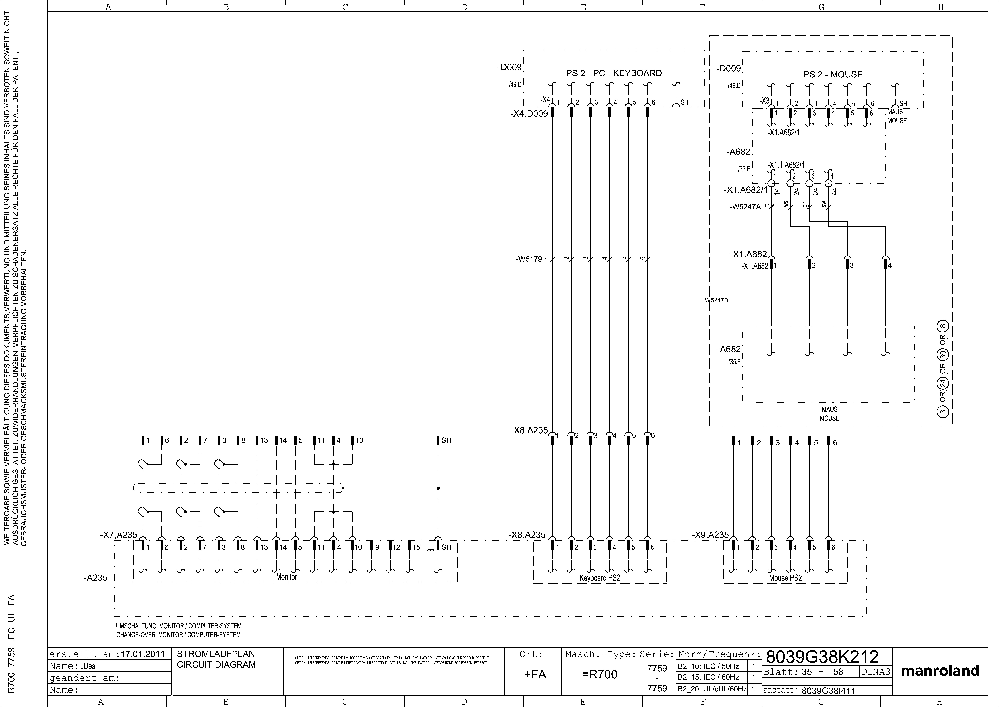

# +FA — Sheet 35 of 58

**OPTION: TELEPRESENCE , PRINTNET PREPARATION: INTEGRATIONPILOTPLUS INCLUSIVE DATACOL.,INTEGRATIONP. FOR PRESSM. PERFECT**

> Part of the manroland **R700** printing press IEC/UL circuit diagrams.
> Drawing class: **Stromlaufplan / Circuit diagram** (DIN A3).
> Document `+FA` covers the **Delivery** machine section.

## At a glance

| Field | Value |
|---|---|
| Document | `+FA`  (8039G38K212) |
| Sheet | **35** of 58 |
| Section (DE) | — |
| Section (EN) | OPTION: TELEPRESENCE , PRINTNET PREPARATION: INTEGRATIONPILOTPLUS INCLUSIVE DATACOL.,INTEGRATIONP. FOR PRESSM. PERFECT |
| Section type | CIRCUIT — Circuit diagram |
| Machine type | `=R700` |
| Series | `7759` |
| Created | 17.01.2011 |
| Replaces | `8039G38I411` |
| Columns used | A, B, C, D, E, F, G, H |
| Path numbers | — |
| Labels on sheet | 136 |
| Cross-refs out | 4 |
| Cross-refs in | 17 |

**Previous:** [+FA sheet 34](SHEET_0034.md) · **Next:** [+FA sheet 36](SHEET_0036.md) · **Document TOC:** [_TOC.md](_TOC.md)  (+FA) · **Master TOC:** [all sheets](../_MASTER_TOC.md)

## Sheet image (300 DPI, exact vector render)



_Rendered directly from the PDF vector layer at 300 DPI (1-bit), no OCR and no resampling. Use it to confirm anything ambiguous in the text below._

## Cross-references on this sheet

Each entry is a wire leaving this sheet. The printed token is `/sheet.column`; the link resolves to that sheet inside the same document.

| Ref | Target sheet | Col | Path | Destination on target | Target section | From col |
|---|---|---|---|---|---|---|
| `/49.D` | [+FA sheet 49](SHEET_0049.md) | D | — | — | REFERENZMODUL | D |
| `/49.D` | [+FA sheet 49](SHEET_0049.md) | D | — | — | REFERENZMODUL | F |
| `/35.F` | [+FA sheet 35](SHEET_0035.md) | F | — | 1 2 3 4 | — | G |
| `/35.F` | [+FA sheet 35](SHEET_0035.md) | F | — | — | — | F |

### Incoming references (sheets that point here)

Every other sheet that sends a wire to this one. `Back-ref` is the token printed on *that* sheet; `Path` is its line number.

| From sheet | Cols | Back-ref | Path | Refs | What continues there |
|---|---|---|---|---|---|
| [+FA#5](SHEET_0005.md) | C | `/5.C` | — | 1 | — |
| [+FA#35](SHEET_0035.md) | F, G | `/35.F`, `/35.G` | — | 2 | 1 2 3 4 |
| [+FA#49](SHEET_0049.md) | D | `/49.D` | — | 2 | — |
| [+FA#54](SHEET_0054.md) | G | `/54.G` | — | 6 | — |
| [+FA#56](SHEET_0056.md) | B | `/56.B` | — | 6 | — |


## Devices on this sheet

| Tag | Class | Class meaning (IEC) | Col | Sub | Terminal | Sign |
|---|---|---|---|---|---|---|
| `A682` | A | Baugruppe / assembly, module, PC board | F | — | — | — |
| `A682` | A | Baugruppe / assembly, module, PC board | F | — | — | — |
| `A235` | A | Baugruppe / assembly, module, PC board | A | — | — | — |
| `D009` | D | Digital / binary element | D | — | — | — |
| `X4` | X | Klemme / terminal, plug connector | E | — | — | — |
| `D009` | D | Digital / binary element | F | — | — | — |
| `X3` | X | Klemme / terminal, plug connector | G | — | — | — |
| `W5179` | W | Kabel / cable, line, bus | E | — | — | — |
| `X1.A682` | — | cross-device reference | F | — | — | — |
| `X8.A235` | — | cross-device reference | E | — | — | — |
| `X9.A235` | — | cross-device reference | F | — | — | — |
| `X8.A235` | — | cross-device reference | E | — | — | — |
| `X4.D009` | — | cross-device reference | E | — | — | — |

## Potentials / nets

_No named potentials on this sheet._

## Wire-end annotations (grouped as printed)

A wire that continues elsewhere is annotated with a small cluster: the destination description, the path/line number `#NN`, and the `/sheet.column` cross reference. Each row below is one such cluster exactly as it is grouped on the drawing.

| Col | Y | Path | Cross-ref | Text on the wire |
|---|---|---|---|---|
| D | 75.4 | — | — | `D009` |
| F | 76.9 | — | — | `D009` |
| E | 82.6 | — | — | `PS 2 PC KEYBOARD` |
| G | 84.0 | — | — | `PS 2 MOUSE` |
| D | 97.7 | — | `/49.D` | — |
| F | 99.2 | — | `/49.D` | — |
| E | 114.9 | — | — | `X4` |
| G | 116.4 | — | — | `X3` |
| E | 118.4 | — | — | `1 2 3 4 5 6` |
| F | 118.9 | — | — | `SH` |
| G | 119.9 | — | — | `1 2 3 4 5 6` |
| H | 120.3 | — | — | `SH` |
| H | 130.3 | — | — | `MAUS MOUSE` |
| E | 130.7 | — | — | `X4.D009` |
| G | 131.2 | — | — | `1 2 3 4 5 6` |
| G | 154.3 | — | — | `X1.A682/1` |
| F | 176.1 | — | — | `A682` |
| G | 192.9 | — | — | `X1.1.A682/1` |
| G | 198.3 | — | `/35.F` | `1 2 3 4` |
| F | 221.4 | — | — | `X1.A682/1` |
| G | 223.7 | — | — | `1/4` |
| G | 223.7 | — | — | `2/4` |
| G | 223.7 | — | — | `3/4` |
| G | 223.7 | — | — | `4/4` |
| G | 238.7 | — | — | `ws` |
| G | 239.2 | — | — | `sw` |
| G | 239.8 | — | — | `gn` |
| F | 242.3 | — | — | `W5247A` |
| G | 243.1 | — | — | `rt` |
| F | 297.9 | — | — | `X1.A682` |
| E | 304.7 | — | — | `W5179` |
| E | 305.6 | — | — | `2` |
| E | 305.7 | — | — | `1` |
| E | 305.7 | — | — | `3` |
| E | 305.7 | — | — | `4` |
| E | 305.7 | — | — | `5` |
| F | 305.7 | — | — | `6` |
| G | 312.1 | — | — | `X1.A682 1 2 3 4` |
| F | 354.4 | — | — | `W5247B` |
| H | 385.9 | — | — | `OR OR OR 3 8 30 24` |
| F | 411.3 | — | — | `A682` |
| F | 427.9 | — | `/35.F` | — |
| G | 484.6 | — | — | `MOUSE MAUS` |
| E | 507.7 | — | — | `X8.A235` |
| D | 514.8 | — | — | `1 6 2 7 3 8 13 14 5 11 4 10 SH 1 2 3 4 5 6 1 2 3 4 5 6` |
| D | 632.4 | — | — | `X7,A235 X8.A235 X9.A235` |
| D | 648.0 | — | — | `1 6 2 7 3 8 13 14 5 11 4 10 9 12 15 1 2 3 4 5 6 1 2 3 4 5 6` |
| D | 648.0 | — | — | `SH` |
| E | 683.4 | — | — | `Monitor Keyboard PS2 Mouse PS2` |
| A | 683.5 | — | — | `A235` |
| B | 742.6 | — | — | `UMSCHALTUNG: MONITOR / COMPUTER SYSTEM` |
| B | 753.2 | — | — | `CHANGE OVER: MONITOR / COMPUTER SYSTEM` |


## Reconstructed tables

This sheet carries tabular content (pin map / terminal assignment / index). The grid below was rebuilt from the drawing's own rule lines, so each row is exactly one physical row of the table.

### Table 1 — 1 data rows × 30 columns (at x=170.1, y=263.6)

| 1 | 6 | 2 | 7 | 3 | 8 | 13 | 14 | 5 | 11 | 4 | 10 | SH | W5179 X8.A235 | 1 | 2 1 | 3 2 | 4 3 | 5 4 | 6 5 | 6 | W5247B | A682 | X1.A682 /35.F 1 | X1.A682 2 | 1 3 | 4 | 2 5 | MAUS MOUSE 6 | 3 |
|---|---|---|---|---|---|---|---|---|---|---|---|---|---|---|---|---|---|---|---|---|---|---|---|---|---|---|---|---|---|
| `1` | `6` | `2` | `7` | `3` | `8` | `13` | `14 Monitor` | `5` | `11` | `4` | `10 9 12 15` | `SH` | `X8.A235` |  | `1` | `2` | `3 Keyboard` | `4 PS2` | `5` | `6` | `X9.A235` |  | `1` | `2` | `3 Mouse` | `4 PS2` | `5` | `6` |  |


## Notes and free text on this sheet

| Text | Col | Y (pt) |
|---|---|---|
| `X1.1.A682/1` | G | 192.89 |
| `X1.A682/1` | G | 154.33 |
| `MAUS` | H | 130.29 |
| `MOUSE` | H | 140.93 |
| `X1.A682 1` | F | 312.14 |
| `MAUS` | G | 484.62 |
| `MOUSE` | G | 495.26 |
| `Monitor` | C | 683.35 |
| `Keyboard PS2` | E | 684.77 |
| `Mouse PS2` | G | 684.74 |
| `SH` | D | 648 |
| `UMSCHALTUNG: MONITOR / COMPUTER SYSTEM` | B | 742.61 |
| `CHANGE OVER: MONITOR / COMPUTER SYSTEM` | B | 753.24 |
| `X7,A235` | A | 632.44 |
| `PS 2 PC KEYBOARD` | E | 82.56 |
| `SH` | F | 118.88 |
| `PS 2 MOUSE` | G | 83.98 |
| `SH` | H | 120.32 |
| `X1.A682/1` | F | 221.42 |
| `OR` | H | 466.3 |
| `W5247B` | F | 354.44 |
| `W5247A` | F | 242.31 |
| `rt` | G | 243.11 |
| `ws` | G | 238.68 |
| `gn` | G | 239.81 |
| `sw` | G | 239.25 |

## Complete label inventory (exact text from the drawing)

Every text object inside the drawing area of this sheet, in DIN reading order (column A→H, then top→bottom). This is the authoritative list: if a string is not here it is not printed on this sheet.

| Col | Y | X | Dir | Type | Text |
|---|---|---|---|---|---|
| A | 520.5 | 173.5 | → | number | `1` |
| A | 520.5 | 196.7 | → | number | `6` |
| A | 632.4 | 119.3 | → | text | `X7,A235` |
| A | 648.0 | 173.8 | → | number | `1` |
| A | 648.0 | 196.0 | → | number | `6` |
| A | 683.5 | 99.8 | → | device tag | `A235` |
| B | 520.5 | 219.4 | → | number | `2` |
| B | 520.5 | 242.1 | → | number | `7` |
| B | 520.5 | 264.8 | → | number | `3` |
| B | 520.5 | 287.4 | → | number | `8` |
| B | 520.5 | 309.5 | → | number | `13` |
| B | 520.5 | 332.2 | → | number | `14` |
| B | 648.0 | 218.8 | → | number | `2` |
| B | 648.0 | 241.4 | → | number | `7` |
| B | 648.0 | 264.0 | → | number | `3` |
| B | 648.0 | 286.7 | → | number | `8` |
| B | 648.0 | 309.5 | → | number | `13` |
| B | 648.0 | 332.2 | → | number | `14` |
| B | 742.6 | 138.0 | → | text | `UMSCHALTUNG: MONITOR / COMPUTER SYSTEM` |
| B | 753.2 | 138.6 | → | text | `CHANGE OVER: MONITOR / COMPUTER SYSTEM` |
| C | 520.5 | 355.5 | → | number | `5` |
| C | 520.5 | 377.6 | → | number | `11` |
| C | 520.5 | 400.8 | → | number | `4` |
| C | 520.5 | 422.9 | → | number | `10` |
| C | 648.0 | 354.8 | → | number | `5` |
| C | 648.0 | 377.6 | → | number | `11` |
| C | 648.0 | 401.5 | → | number | `4` |
| C | 648.0 | 421.5 | → | number | `10` |
| C | 648.0 | 446.9 | → | number | `9` |
| C | 648.0 | 467.0 | → | number | `12` |
| C | 683.3 | 328.6 | → | text | `Monitor` |
| D | 75.4 | 592.4 | → | device tag | `D009` |
| D | 97.7 | 606.1 | → | cross-reference | `/49.D` |
| D | 520.4 | 525.5 | → | text | `SH` |
| D | 648.0 | 491.0 | → | number | `15` |
| D | 648.0 | 525.7 | → | text | `SH` |
| E | 82.6 | 674.1 | → | text | `PS 2 PC KEYBOARD` |
| E | 114.9 | 643.5 | → | device tag | `X4` |
| E | 118.4 | 662.5 | → | number | `1` |
| E | 118.8 | 685.7 | → | number | `2` |
| E | 118.9 | 708.4 | → | number | `3` |
| E | 118.9 | 731.1 | → | number | `4` |
| E | 118.9 | 753.7 | → | number | `5` |
| E | 130.7 | 607.7 | → | device ref | `X4.D009` |
| E | 304.7 | 614.3 | → | device tag | `W5179` |
| E | 305.6 | 671.6 | ↕ | number | `2` |
| E | 305.7 | 648.5 | ↕ | number | `1` |
| E | 305.7 | 694.3 | ↕ | number | `3` |
| E | 305.7 | 717.0 | ↕ | number | `4` |
| E | 305.7 | 739.7 | ↕ | number | `5` |
| E | 507.7 | 608.3 | → | device ref | `X8.A235` |
| E | 514.8 | 661.0 | → | number | `1` |
| E | 514.8 | 684.3 | → | number | `2` |
| E | 514.8 | 707.0 | → | number | `3` |
| E | 514.8 | 729.6 | → | number | `4` |
| E | 514.8 | 752.3 | → | number | `5` |
| E | 632.4 | 605.5 | → | device ref | `X8.A235` |
| E | 648.5 | 661.7 | → | number | `1` |
| E | 648.9 | 684.3 | → | number | `2` |
| E | 649.0 | 706.9 | → | number | `3` |
| E | 649.0 | 729.5 | → | number | `4` |
| E | 649.0 | 752.2 | → | number | `5` |
| E | 684.8 | 690.0 | → | text | `Keyboard PS2` |
| F | 76.9 | 853.3 | → | device tag | `D009` |
| F | 99.2 | 866.9 | → | cross-reference | `/49.D` |
| F | 118.9 | 776.4 | → | number | `6` |
| F | 118.9 | 810.4 | → | text | `SH` |
| F | 176.1 | 865.1 | → | device tag | `A682` |
| F | 198.3 | 878.8 | → | cross-reference | `/35.F` |
| F | 221.4 | 861.7 | → | text | `X1.A682/1` |
| F | 242.3 | 868.8 | → | text | `W5247A` |
| F | 297.9 | 869.1 | → | device ref | `X1.A682` |
| F | 305.7 | 762.4 | ↕ | number | `6` |
| F | 312.1 | 883.1 | → | text | `X1.A682 1` |
| F | 354.4 | 839.1 | → | text | `W5247B` |
| F | 411.3 | 853.8 | → | device tag | `A682` |
| F | 427.9 | 867.5 | → | cross-reference | `/35.F` |
| F | 514.8 | 775.0 | → | number | `6` |
| F | 523.3 | 877.9 | → | number | `1` |
| F | 523.3 | 901.1 | → | number | `2` |
| F | 632.4 | 823.7 | → | device ref | `X9.A235` |
| F | 648.5 | 877.1 | → | number | `1` |
| F | 648.9 | 899.7 | → | number | `2` |
| F | 649.0 | 774.9 | → | number | `6` |
| G | 84.0 | 956.6 | → | text | `PS 2 MOUSE` |
| G | 116.4 | 904.3 | → | device tag | `X3` |
| G | 119.9 | 923.3 | → | number | `1` |
| G | 120.3 | 946.5 | → | number | `2` |
| G | 120.3 | 969.2 | → | number | `3` |
| G | 120.3 | 991.9 | → | number | `4` |
| G | 120.3 | 1014.6 | → | number | `5` |
| G | 120.3 | 1037.2 | → | number | `6` |
| G | 131.2 | 921.8 | → | number | `1` |
| G | 131.6 | 945.1 | → | number | `2` |
| G | 131.6 | 967.7 | → | number | `3` |
| G | 131.6 | 990.4 | → | number | `4` |
| G | 131.6 | 1013.1 | → | number | `5` |
| G | 131.6 | 1035.8 | → | number | `6` |
| G | 154.3 | 914.2 | → | text | `X1.A682/1` |
| G | 192.9 | 913.9 | → | text | `X1.1.A682/1` |
| G | 206.3 | 920.4 | → | number | `1` |
| G | 206.7 | 943.7 | → | number | `2` |
| G | 206.8 | 966.3 | → | number | `3` |
| G | 206.8 | 989.0 | → | number | `4` |
| G | 223.7 | 922.5 | ↕ | pin pair | `1/4` |
| G | 223.7 | 945.2 | ↕ | pin pair | `2/4` |
| G | 223.7 | 967.9 | ↕ | pin pair | `3/4` |
| G | 223.7 | 990.6 | ↕ | pin pair | `4/4` |
| G | 238.7 | 932.5 | ↕ | text | `ws` |
| G | 239.3 | 977.9 | ↕ | text | `sw` |
| G | 239.8 | 955.1 | ↕ | text | `gn` |
| G | 243.1 | 909.7 | ↕ | text | `rt` |
| G | 312.1 | 966.3 | → | number | `2` |
| G | 312.1 | 1011.7 | → | number | `3` |
| G | 484.6 | 978.8 | → | text | `MAUS` |
| G | 495.3 | 976.3 | → | text | `MOUSE` |
| G | 523.3 | 923.8 | → | number | `3` |
| G | 523.3 | 946.5 | → | number | `4` |
| G | 523.3 | 969.2 | → | number | `5` |
| G | 523.3 | 991.8 | → | number | `6` |
| G | 649.0 | 922.3 | → | number | `3` |
| G | 649.0 | 945.0 | → | number | `4` |
| G | 649.0 | 967.7 | → | number | `5` |
| G | 649.0 | 990.3 | → | number | `6` |
| G | 684.7 | 915.8 | → | text | `Mouse PS2` |
| H | 120.3 | 1071.2 | → | text | `SH` |
| H | 130.3 | 1056.8 | → | text | `MAUS` |
| H | 140.9 | 1056.8 | → | text | `MOUSE` |
| H | 312.1 | 1057.0 | → | number | `4` |
| H | 385.9 | 1118.9 | ↕ | number | `8` |
| H | 398.3 | 1118.6 | ↕ | text | `OR` |
| H | 417.5 | 1118.9 | ↕ | number | `30` |
| H | 432.3 | 1118.6 | ↕ | text | `OR` |
| H | 451.6 | 1118.9 | ↕ | number | `24` |
| H | 466.3 | 1118.6 | ↕ | text | `OR` |
| H | 488.0 | 1118.6 | ↕ | number | `3` |

## Reading-order text block

The same content as a plain block, grouped by DIN column — convenient to paste or to match against a visual description.

```text
=== Column A ===
 520.5  173.5  numeric      1
 520.5  196.7  numeric      6
 632.4  119.3  text         X7,A235
 648.0  173.8  numeric      1
 648.0  196.0  numeric      6
 683.5   99.8  devtag       A235
=== Column B ===
 520.5  219.4  numeric      2
 520.5  242.1  numeric      7
 520.5  264.8  numeric      3
 520.5  287.4  numeric      8
 520.5  309.5  numeric      13
 520.5  332.2  numeric      14
 648.0  218.8  numeric      2
 648.0  241.4  numeric      7
 648.0  264.0  numeric      3
 648.0  286.7  numeric      8
 648.0  309.5  numeric      13
 648.0  332.2  numeric      14
 742.6  138.0  text         UMSCHALTUNG: MONITOR / COMPUTER SYSTEM
 753.2  138.6  text         CHANGE OVER: MONITOR / COMPUTER SYSTEM
=== Column C ===
 520.5  355.5  numeric      5
 520.5  377.6  numeric      11
 520.5  400.8  numeric      4
 520.5  422.9  numeric      10
 648.0  354.8  numeric      5
 648.0  377.6  numeric      11
 648.0  401.5  numeric      4
 648.0  421.5  numeric      10
 648.0  446.9  numeric      9
 648.0  467.0  numeric      12
 683.3  328.6  text         Monitor
=== Column D ===
  75.4  592.4  devtag       D009
  97.7  606.1  xref         /49.D
 520.4  525.5  text         SH
 648.0  491.0  numeric      15
 648.0  525.7  text         SH
=== Column E ===
  82.6  674.1  text         PS 2 PC KEYBOARD
 114.9  643.5  devtag       X4
 118.4  662.5  numeric      1
 118.8  685.7  numeric      2
 118.9  708.4  numeric      3
 118.9  731.1  numeric      4
 118.9  753.7  numeric      5
 130.7  607.7  devref       X4.D009
 304.7  614.3  devtag       W5179
 305.6  671.6  numeric      2
 305.7  648.5  numeric      1
 305.7  694.3  numeric      3
 305.7  717.0  numeric      4
 305.7  739.7  numeric      5
 507.7  608.3  devref       X8.A235
 514.8  661.0  numeric      1
 514.8  684.3  numeric      2
 514.8  707.0  numeric      3
 514.8  729.6  numeric      4
 514.8  752.3  numeric      5
 632.4  605.5  devref       X8.A235
 648.5  661.7  numeric      1
 648.9  684.3  numeric      2
 649.0  706.9  numeric      3
 649.0  729.5  numeric      4
 649.0  752.2  numeric      5
 684.8  690.0  text         Keyboard PS2
=== Column F ===
  76.9  853.3  devtag       D009
  99.2  866.9  xref         /49.D
 118.9  776.4  numeric      6
 118.9  810.4  text         SH
 176.1  865.1  devtag       A682
 198.3  878.8  xref         /35.F
 221.4  861.7  text         X1.A682/1
 242.3  868.8  text         W5247A
 297.9  869.1  devref       X1.A682
 305.7  762.4  numeric      6
 312.1  883.1  text         X1.A682 1
 354.4  839.1  text         W5247B
 411.3  853.8  devtag       A682
 427.9  867.5  xref         /35.F
 514.8  775.0  numeric      6
 523.3  877.9  numeric      1
 523.3  901.1  numeric      2
 632.4  823.7  devref       X9.A235
 648.5  877.1  numeric      1
 648.9  899.7  numeric      2
 649.0  774.9  numeric      6
=== Column G ===
  84.0  956.6  text         PS 2 MOUSE
 116.4  904.3  devtag       X3
 119.9  923.3  numeric      1
 120.3  946.5  numeric      2
 120.3  969.2  numeric      3
 120.3  991.9  numeric      4
 120.3 1014.6  numeric      5
 120.3 1037.2  numeric      6
 131.2  921.8  numeric      1
 131.6  945.1  numeric      2
 131.6  967.7  numeric      3
 131.6  990.4  numeric      4
 131.6 1013.1  numeric      5
 131.6 1035.8  numeric      6
 154.3  914.2  text         X1.A682/1
 192.9  913.9  text         X1.1.A682/1
 206.3  920.4  numeric      1
 206.7  943.7  numeric      2
 206.8  966.3  numeric      3
 206.8  989.0  numeric      4
 223.7  922.5  pinpair      1/4
 223.7  945.2  pinpair      2/4
 223.7  967.9  pinpair      3/4
 223.7  990.6  pinpair      4/4
 238.7  932.5  text         ws
 239.3  977.9  text         sw
 239.8  955.1  text         gn
 243.1  909.7  text         rt
 312.1  966.3  numeric      2
 312.1 1011.7  numeric      3
 484.6  978.8  text         MAUS
 495.3  976.3  text         MOUSE
 523.3  923.8  numeric      3
 523.3  946.5  numeric      4
 523.3  969.2  numeric      5
 523.3  991.8  numeric      6
 649.0  922.3  numeric      3
 649.0  945.0  numeric      4
 649.0  967.7  numeric      5
 649.0  990.3  numeric      6
 684.7  915.8  text         Mouse PS2
=== Column H ===
 120.3 1071.2  text         SH
 130.3 1056.8  text         MAUS
 140.9 1056.8  text         MOUSE
 312.1 1057.0  numeric      4
 385.9 1118.9  numeric      8
 398.3 1118.6  text         OR
 417.5 1118.9  numeric      30
 432.3 1118.6  text         OR
 451.6 1118.9  numeric      24
 466.3 1118.6  text         OR
 488.0 1118.6  numeric      3
```

---
_Generated from the PDF vector text layer; no OCR. Source: `R700_7759_IEC_UL_FA`, sheet 35._
