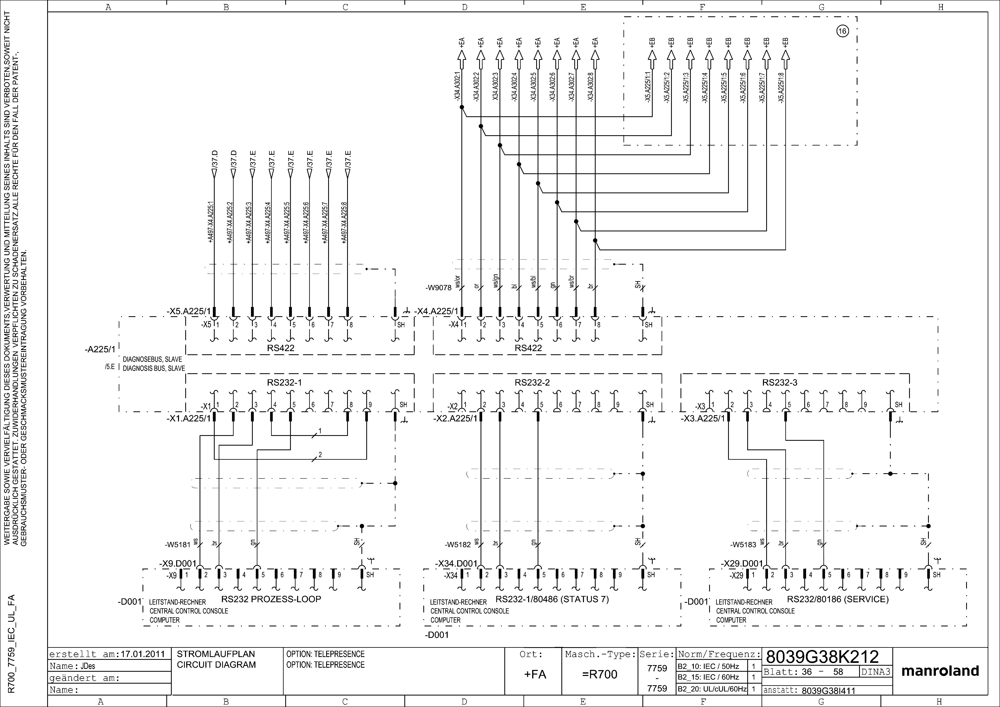

# +FA — Sheet 36 of 58 — OPTION: TELEPRESENCE

**OPTION: TELEPRESENCE**

> Part of the manroland **R700** printing press IEC/UL circuit diagrams.
> Drawing class: **Stromlaufplan / Circuit diagram** (DIN A3).
> Document `+FA` covers the **Delivery** machine section.

## At a glance

| Field | Value |
|---|---|
| Document | `+FA`  (8039G38K212) |
| Sheet | **36** of 58 |
| Section (DE) | OPTION: TELEPRESENCE |
| Section (EN) | OPTION: TELEPRESENCE |
| Section type | CIRCUIT — Circuit diagram |
| Machine type | `=R700` |
| Series | `7759` |
| Created | 17.01.2011 |
| Replaces | `8039G38I411` |
| Columns used | A, B, C, D, E, F, G, H |
| Path numbers | — |
| Labels on sheet | 194 |
| Cross-refs out | 9 |
| Cross-refs in | 40 |

**Previous:** [+FA sheet 35](SHEET_0035.md) · **Next:** [+FA sheet 37](SHEET_0037.md) · **Document TOC:** [_TOC.md](_TOC.md)  (+FA) · **Master TOC:** [all sheets](../_MASTER_TOC.md)

## Sheet image (300 DPI, exact vector render)



_Rendered directly from the PDF vector layer at 300 DPI (1-bit), no OCR and no resampling. Use it to confirm anything ambiguous in the text below._

## Cross-references on this sheet

Each entry is a wire leaving this sheet. The printed token is `/sheet.column`; the link resolves to that sheet inside the same document.

| Ref | Target sheet | Col | Path | Destination on target | Target section | From col |
|---|---|---|---|---|---|---|
| `/37.D` | [+FA sheet 37](SHEET_0037.md) | D | — | +A497 X4.A225:1 | OPTION: TELEPRESENCE | B |
| `/37.D` | [+FA sheet 37](SHEET_0037.md) | D | — | +A497 X4.A225:2 | OPTION: TELEPRESENCE | B |
| `/37.E` | [+FA sheet 37](SHEET_0037.md) | E | — | +A497 X4.A225:3 | OPTION: TELEPRESENCE | B |
| `/37.E` | [+FA sheet 37](SHEET_0037.md) | E | — | +A497 X4.A225:4 | OPTION: TELEPRESENCE | B |
| `/37.E` | [+FA sheet 37](SHEET_0037.md) | E | — | +A497 X4.A225:5 | OPTION: TELEPRESENCE | C |
| `/37.E` | [+FA sheet 37](SHEET_0037.md) | E | — | +A497 X4.A225:6 | OPTION: TELEPRESENCE | C |
| `/37.E` | [+FA sheet 37](SHEET_0037.md) | E | — | +A497 X4.A225:7 | OPTION: TELEPRESENCE | C |
| `/37.E` | [+FA sheet 37](SHEET_0037.md) | E | — | +A497 X4.A225:8 | OPTION: TELEPRESENCE | C |
| `/5.E` | [+FA sheet 5](SHEET_0005.md) | E | — | — | ANORDNUNGSPLAN | A |

### Incoming references (sheets that point here)

Every other sheet that sends a wire to this one. `Back-ref` is the token printed on *that* sheet; `Path` is its line number.

| From sheet | Cols | Back-ref | Path | Refs | What continues there |
|---|---|---|---|---|---|
| [+FA#5](SHEET_0005.md) | E | `/5.E` | — | 1 | — |
| [+FA#37](SHEET_0037.md) | D, E | `/37.D`, `/37.E` | — | 8 | X5.A225/1:1; X5.A225/1:2; X5.A225/1:3; X5.A225/1:4; X5.A225/1:5; X5.A225/1:6; X5.A225/1:7; X5.A225/1:8 |
| [+FA#48](SHEET_0048.md) | B | `/48.B` | — | 3 | — |
| [+FA#51](SHEET_0051.md) | A | `/51.A` | — | 8 | — |
| [+FA#53](SHEET_0053.md) | C, E | `/53.C`, `/53.E` | — | 8 | — |
| [+FA#54](SHEET_0054.md) | A, B | `/54.A`, `/54.B` | — | 8 | — |
| [+FA#57](SHEET_0057.md) | A | `/57.A` | — | 4 | — |


## Devices on this sheet

| Tag | Class | Class meaning (IEC) | Col | Sub | Terminal | Sign |
|---|---|---|---|---|---|---|
| `A225/1` | A | Baugruppe / assembly, module, PC board | A | 1 | — | — |
| `X5` | X | Klemme / terminal, plug connector | B | — | — | — |
| `X1` | X | Klemme / terminal, plug connector | B | — | — | — |
| `X2` | X | Klemme / terminal, plug connector | D | — | — | — |
| `X4` | X | Klemme / terminal, plug connector | D | — | — | — |
| `X3` | X | Klemme / terminal, plug connector | F | — | — | — |
| `RS422` | RS |  | B | — | — | — |
| `RS422` | RS |  | E | — | — | — |
| `D001` | D | Digital / binary element | F | — | — | — |
| `X29` | X | Klemme / terminal, plug connector | F | — | — | — |
| `D001` | D | Digital / binary element | D | — | — | — |
| `X34` | X | Klemme / terminal, plug connector | D | — | — | — |
| `D001` | D | Digital / binary element | A | — | — | — |
| `X9` | X | Klemme / terminal, plug connector | B | — | — | — |
| `W5181` | W | Kabel / cable, line, bus | B | — | — | — |
| `W5182` | W | Kabel / cable, line, bus | D | — | — | — |
| `W5183` | W | Kabel / cable, line, bus | F | — | — | — |
| `W9078` | W | Kabel / cable, line, bus | D | — | — | — |
| `X34.A302:1` | — | cross-device reference | D | — | 1 | — |
| `X34.A302:2` | — | cross-device reference | D | — | 2 | — |
| `X34.A302:3` | — | cross-device reference | D | — | 3 | — |
| `X34.A302:4` | — | cross-device reference | D | — | 4 | — |
| `X34.A302:5` | — | cross-device reference | E | — | 5 | — |
| `X34.A302:6` | — | cross-device reference | E | — | 6 | — |
| `X34.A302:7` | — | cross-device reference | E | — | 7 | — |
| `X34.A302:8` | — | cross-device reference | E | — | 8 | — |
| `X9.D001` | — | cross-device reference | B | — | — | — |
| `X34.D001` | — | cross-device reference | D | — | — | — |
| `X29.D001` | — | cross-device reference | F | — | — | — |

## Potentials / nets

_No named potentials on this sheet._

## Wire-end annotations (grouped as printed)

A wire that continues elsewhere is annotated with a small cluster: the destination description, the path/line number `#NN`, and the `/sheet.column` cross reference. Each row below is one such cluster exactly as it is grouped on the drawing.

| Col | Y | Path | Cross-ref | Text on the wire |
|---|---|---|---|---|
| G | 33.2 | — | — | `16` |
| F | 44.7 | — | — | `X5.A225/1:1 +EB` |
| F | 44.7 | — | — | `X5.A225/1:2 +EB` |
| F | 44.7 | — | — | `X5.A225/1:3 +EB` |
| F | 44.7 | — | — | `X5.A225/1:4 +EB` |
| F | 44.7 | — | — | `X5.A225/1:5 +EB` |
| F | 44.7 | — | — | `X5.A225/1:6 +EB` |
| G | 44.7 | — | — | `X5.A225/1:7 +EB` |
| G | 44.7 | — | — | `X5.A225/1:8 +EB` |
| D | 44.8 | — | — | `X34.A302:1 +EA` |
| D | 44.8 | — | — | `X34.A302:2 +EA` |
| D | 44.8 | — | — | `X34.A302:3 +EA` |
| D | 44.8 | — | — | `X34.A302:4 +EA` |
| E | 44.8 | — | — | `X34.A302:5 +EA` |
| E | 44.8 | — | — | `X34.A302:6 +EA` |
| E | 44.8 | — | — | `X34.A302:7 +EA` |
| E | 44.8 | — | — | `X34.A302:8 +EA` |
| B | 178.9 | — | `/37.D` | `+A497 X4.A225:1` |
| B | 178.9 | — | `/37.D` | `+A497 X4.A225:2` |
| B | 179.2 | — | `/37.E` | `+A497 X4.A225:3` |
| B | 179.2 | — | `/37.E` | `+A497 X4.A225:4` |
| C | 179.2 | — | `/37.E` | `+A497 X4.A225:5` |
| C | 179.2 | — | `/37.E` | `+A497 X4.A225:6` |
| C | 179.2 | — | `/37.E` | `+A497 X4.A225:7` |
| C | 179.2 | — | `/37.E` | `+A497 X4.A225:8` |
| D | 326.3 | — | — | `ws/gn` |
| E | 327.9 | — | — | `ws/br` |
| D | 328.1 | — | — | `ws/or` |
| E | 328.3 | — | — | `ws/bl` |
| E | 334.3 | — | — | `SH` |
| E | 336.2 | — | — | `gn` |
| D | 338.0 | — | — | `or` |
| E | 338.0 | — | — | `br` |
| D | 338.4 | — | — | `bl` |
| D | 338.7 | — | — | `W9078` |
| B | 366.0 | — | — | `X5.A225/1` |
| D | 366.0 | — | — | `X4.A225/1` |
| B | 382.8 | — | — | `X5` |
| D | 382.8 | — | — | `X4` |
| D | 383.5 | — | — | `1 2 3 4 5 6 7 8 SH 1 2 3 4 5 6 7 8` |
| F | 383.9 | — | — | `SH` |
| B | 409.9 | — | — | `RS422` |
| E | 409.9 | — | — | `RS422` |
| A | 411.3 | — | — | `A225/1` |
| A | 425.1 | — | — | `DIAGNOSEBUS, SLAVE DIAGNOSIS BUS, SLAVE` |
| A | 433.6 | — | `/5.E` | — |
| B | 451.0 | — | — | `RS232 1` |
| F | 451.0 | — | — | `RS232 2 RS232 3` |
| E | 478.4 | — | — | `1 2 3 4 5 6 7 8 9 SH 1 2 3 4 5 6 7 8 9 SH X3 1 2 3 4 5 6 7 8 9 SH` |
| C | 480.5 | — | — | `X1 X2` |
| D | 493.5 | — | — | `X1.A225/1 X2.A225/1 X3.A225/1` |
| C | 509.6 | — | — | `1` |
| C | 538.4 | — | — | `2` |
| C | 640.4 | — | — | `SH` |
| E | 640.4 | — | — | `SH` |
| H | 640.4 | — | — | `SH` |
| B | 641.2 | — | — | `ws` |
| D | 641.2 | — | — | `ws` |
| G | 641.2 | — | — | `ws` |
| B | 642.3 | — | — | `gn` |
| E | 642.3 | — | — | `gn` |
| G | 642.3 | — | — | `gn` |
| B | 644.1 | — | — | `br` |
| D | 644.1 | — | — | `br` |
| G | 644.1 | — | — | `br` |
| B | 644.8 | — | — | `W5181` |
| D | 644.8 | — | — | `W5182` |
| F | 644.8 | — | — | `W5183` |
| D | 666.5 | — | — | `X9.D001 X34.D001 X29.D001` |
| B | 681.1 | — | — | `X9 1 2 3 4 5 6 7 8 9 SH` |
| E | 681.1 | — | — | `X34 1 2 3 4 5 6 7 8 9 SH` |
| G | 681.1 | — | — | `X29 1 2 3 4 5 6 7 8 9 SH` |
| B | 709.0 | — | — | `LEITSTAND RECHNER RS232 PROZESS LOOP` |
| D | 709.0 | — | — | `LEITSTAND RECHNER RS232 1/80486 (STATUS 7)` |
| G | 709.0 | — | — | `LEITSTAND RECHNER RS232/80186 (SERVICE)` |
| A | 711.8 | — | — | `D001` |
| F | 711.8 | — | — | `D001` |
| B | 724.9 | — | — | `CENTRAL CONTROL CONSOLE COMPUTER` |
| D | 724.9 | — | — | `CENTRAL CONTROL CONSOLE COMPUTER` |
| F | 724.9 | — | — | `CENTRAL CONTROL CONSOLE COMPUTER` |
| D | 751.5 | — | — | `D001` |


## Reconstructed tables

This sheet carries tabular content (pin map / terminal assignment / index). The grid below was rebuilt from the drawing's own rule lines, so each row is exactly one physical row of the table.

### Table 1 — 4 data rows × 12 columns (at x=221.1, y=138.9)

|  |  | /37.D |  | /37.D | /37.E |  | /37.E | /37.E | /37.E | /37.E | /37.E |
|---|---|---|---|---|---|---|---|---|---|---|---|
|  | `+A497 X4.A225:1` |  | `+A497 X4.A225:2` | `+A497 X4.A225:3` |  | `+A497 X4.A225:4` | `+A497 X4.A225:5` | `+A497 X4.A225:6` | `+A497 X4.A225:7` | `+A497 X4.A225:8` |  |
| `X5.A225/1` | `X5` | `1` |  | `2` | `3` |  | `4 RS422` | `5` | `6` | `7` | `8` |
| `X1.A225/1` | `X1` | `1` |  | `2` | `3` |  | `RS232 1 4` | `5` | `6 1` | `7` | `8` |
|  |  |  |  |  |  |  |  |  | `2` |  |  |


### Table 2 — 0 data rows × 2 columns (at x=436.5, y=138.9) — **SH**

_none_


### Table 3 — 1 data rows × 10 columns (at x=515.9, y=138.9)

| ws/or W9078 X4.A225/1 X4 | or 1 | ws/gn 2 | bl 3 | ws/bl 4 RS422 | gn 5 | ws/br 6 | br 7 | SH 8 | SH |
|---|---|---|---|---|---|---|---|---|---|
| `X2 X2.A225/1` | `1` | `2` | `3` | `RS232 2 4` | `5` | `6` | `7` | `8 9` | `SH` |


## Notes and free text on this sheet

| Text | Col | Y (pt) |
|---|---|---|
| `X4.A225/1` | D | 365.98 |
| `X1.A225/1` | B | 493.54 |
| `X2.A225/1` | D | 493.54 |
| `X3.A225/1` | F | 493.54 |
| `X5.A225/1` | B | 365.98 |
| `+EA` | D | 44.82 |
| `+EA` | E | 44.82 |
| `+EB` | F | 44.74 |
| `X5.A225/1:1` | F | 85.04 |
| `X5.A225/1:2` | F | 86.18 |
| `X5.A225/1:3` | F | 86.46 |
| `X5.A225/1:4` | F | 86.46 |
| `X5.A225/1:5` | F | 86.46 |
| `X5.A225/1:6` | F | 86.46 |
| `+EB` | G | 44.74 |
| `X5.A225/1:7` | G | 86.46 |
| `X5.A225/1:8` | G | 86.46 |
| `+A497 X4.A225:1` | B | 239.24 |
| `+A497 X4.A225:2` | B | 240.38 |
| `+A497 X4.A225:3` | B | 240.66 |
| `+A497 X4.A225:4` | B | 240.66 |
| `+A497 X4.A225:5` | C | 240.66 |
| `+A497 X4.A225:6` | C | 240.66 |
| `+A497 X4.A225:7` | C | 240.66 |
| `+A497 X4.A225:8` | C | 240.66 |
| `SH` | C | 478.88 |
| `SH` | F | 478.88 |
| `SH` | H | 478.88 |
| `DIAGNOSEBUS, SLAVE` | A | 425.09 |
| `DIAGNOSIS BUS, SLAVE` | A | 435.72 |
| `RS232 1` | B | 451.01 |
| `RS232 2` | E | 451.01 |
| `RS232 3` | G | 451.01 |
| `RS232/80186 (SERVICE)` | G | 708.98 |
| `LEITSTAND RECHNER` | F | 714.25 |
| `CENTRAL CONTROL CONSOLE` | F | 724.89 |
| `COMPUTER` | F | 735.53 |
| `RS232 1/80486 (STATUS 7)` | E | 708.97 |
| `LEITSTAND RECHNER` | D | 714.25 |
| `CENTRAL CONTROL CONSOLE` | D | 724.89 |
| `COMPUTER` | D | 735.53 |
| `RS232 PROZESS LOOP` | B | 708.97 |
| `LEITSTAND RECHNER` | B | 714.25 |
| `CENTRAL CONTROL CONSOLE` | B | 724.89 |
| `COMPUTER` | A | 735.53 |
| `ws` | B | 641.2 |
| `br` | B | 644.1 |
| `gn` | B | 642.33 |
| `ws` | D | 641.2 |
| `br` | D | 644.1 |
| `gn` | E | 642.33 |
| `SH` | E | 640.44 |
| `ws` | G | 641.2 |
| `br` | G | 644.1 |
| `gn` | G | 642.33 |
| `ws/or` | D | 328.1 |
| `or` | D | 337.96 |
| `ws/gn` | D | 326.33 |
| `bl` | D | 338.4 |
| `ws/bl` | E | 328.34 |
| `ws/br` | E | 327.9 |
| `br` | E | 337.96 |

## Complete label inventory (exact text from the drawing)

Every text object inside the drawing area of this sheet, in DIN reading order (column A→H, then top→bottom). This is the authoritative list: if a string is not here it is not printed on this sheet.

| Col | Y | X | Dir | Type | Text |
|---|---|---|---|---|---|
| A | 411.3 | 100.9 | → | device tag | `A225/1` |
| A | 425.1 | 146.6 | → | text | `DIAGNOSEBUS, SLAVE` |
| A | 433.5 | 125.2 | → | cross-reference | `/5.E` |
| A | 435.7 | 146.6 | → | text | `DIAGNOSIS BUS, SLAVE` |
| A | 711.8 | 140.3 | → | device tag | `D001` |
| A | 735.5 | 178.3 | → | text | `COMPUTER` |
| B | 178.9 | 251.9 | ↕ | cross-reference | `/37.D` |
| B | 178.9 | 274.5 | ↕ | cross-reference | `/37.D` |
| B | 179.2 | 297.2 | ↕ | cross-reference | `/37.E` |
| B | 179.2 | 319.9 | ↕ | cross-reference | `/37.E` |
| B | 239.2 | 247.9 | ↕ | text | `+A497 X4.A225:1` |
| B | 240.4 | 270.6 | ↕ | text | `+A497 X4.A225:2` |
| B | 240.7 | 293.3 | ↕ | text | `+A497 X4.A225:3` |
| B | 240.7 | 316.0 | ↕ | text | `+A497 X4.A225:4` |
| B | 366.0 | 198.4 | → | text | `X5.A225/1` |
| B | 382.8 | 239.5 | → | device tag | `X5` |
| B | 383.5 | 257.1 | → | number | `1` |
| B | 383.9 | 280.3 | → | number | `2` |
| B | 383.9 | 303.0 | → | number | `3` |
| B | 383.9 | 325.7 | → | number | `4` |
| B | 409.9 | 318.0 | → | device tag | `RS422` |
| B | 451.0 | 318.0 | → | text | `RS232 1` |
| B | 478.4 | 257.1 | → | number | `1` |
| B | 478.8 | 280.3 | → | number | `2` |
| B | 478.9 | 303.0 | → | number | `3` |
| B | 478.9 | 325.7 | → | number | `4` |
| B | 480.5 | 239.1 | → | device tag | `X1` |
| B | 493.5 | 198.4 | → | text | `X1.A225/1` |
| B | 641.2 | 229.5 | ↕ | text | `ws` |
| B | 642.3 | 297.5 | ↕ | text | `gn` |
| B | 644.1 | 252.2 | ↕ | text | `br` |
| B | 644.8 | 196.2 | → | device tag | `W5181` |
| B | 666.5 | 189.6 | → | device ref | `X9.D001` |
| B | 681.1 | 220.3 | → | number | `1` |
| B | 681.5 | 243.5 | → | number | `2` |
| B | 681.6 | 266.2 | → | number | `3` |
| B | 681.6 | 288.9 | → | number | `4` |
| B | 681.6 | 311.5 | → | number | `5` |
| B | 681.6 | 334.2 | → | number | `6` |
| B | 681.9 | 198.4 | → | device tag | `X9` |
| B | 709.0 | 263.5 | → | text | `RS232 PROZESS LOOP` |
| B | 714.3 | 177.7 | → | text | `LEITSTAND RECHNER` |
| B | 724.9 | 178.3 | → | text | `CENTRAL CONTROL CONSOLE` |
| C | 179.2 | 342.5 | ↕ | cross-reference | `/37.E` |
| C | 179.2 | 365.2 | ↕ | cross-reference | `/37.E` |
| C | 179.2 | 387.9 | ↕ | cross-reference | `/37.E` |
| C | 179.2 | 410.6 | ↕ | cross-reference | `/37.E` |
| C | 240.7 | 338.7 | ↕ | text | `+A497 X4.A225:5` |
| C | 240.7 | 361.3 | ↕ | text | `+A497 X4.A225:6` |
| C | 240.7 | 384.0 | ↕ | text | `+A497 X4.A225:7` |
| C | 240.7 | 406.7 | ↕ | text | `+A497 X4.A225:8` |
| C | 383.9 | 348.4 | → | number | `5` |
| C | 383.9 | 371.1 | → | number | `6` |
| C | 383.9 | 393.7 | → | number | `7` |
| C | 383.9 | 416.4 | → | number | `8` |
| C | 383.9 | 473.1 | → | text | `SH` |
| C | 478.9 | 348.4 | → | number | `5` |
| C | 478.9 | 371.1 | → | number | `6` |
| C | 478.9 | 393.7 | → | number | `7` |
| C | 478.9 | 416.4 | → | number | `8` |
| C | 478.9 | 439.1 | → | number | `9` |
| C | 478.9 | 475.9 | → | text | `SH` |
| C | 509.6 | 379.0 | → | number | `1` |
| C | 538.4 | 379.6 | → | number | `2` |
| C | 640.4 | 422.2 | ↕ | text | `SH` |
| C | 681.6 | 356.9 | → | number | `7` |
| C | 681.6 | 379.6 | → | number | `8` |
| C | 681.6 | 402.2 | → | number | `9` |
| C | 681.6 | 436.3 | → | text | `SH` |
| D | 44.8 | 547.0 | ↕ | text | `+EA` |
| D | 44.8 | 569.6 | ↕ | text | `+EA` |
| D | 44.8 | 592.3 | ↕ | text | `+EA` |
| D | 44.8 | 615.0 | ↕ | text | `+EA` |
| D | 85.0 | 541.6 | ↕ | device ref | `X34.A302:1` |
| D | 86.2 | 564.3 | ↕ | device ref | `X34.A302:2` |
| D | 86.5 | 587.0 | ↕ | device ref | `X34.A302:3` |
| D | 86.5 | 609.7 | ↕ | device ref | `X34.A302:4` |
| D | 326.3 | 586.7 | ↕ | text | `ws/gn` |
| D | 328.1 | 541.4 | ↕ | text | `ws/or` |
| D | 338.0 | 564.1 | ↕ | text | `or` |
| D | 338.4 | 609.2 | ↕ | text | `bl` |
| D | 338.7 | 506.6 | → | device tag | `W9078` |
| D | 366.0 | 493.2 | → | text | `X4.A225/1` |
| D | 382.8 | 534.3 | → | device tag | `X4` |
| D | 383.5 | 551.9 | → | number | `1` |
| D | 383.9 | 575.1 | → | number | `2` |
| D | 383.9 | 597.8 | → | number | `3` |
| D | 383.9 | 620.5 | → | number | `4` |
| D | 478.4 | 551.9 | → | number | `1` |
| D | 478.8 | 575.1 | → | number | `2` |
| D | 478.9 | 597.8 | → | number | `3` |
| D | 478.9 | 620.5 | → | number | `4` |
| D | 480.6 | 532.9 | → | device tag | `X2` |
| D | 493.5 | 515.9 | → | text | `X2.A225/1` |
| D | 641.2 | 564.0 | ↕ | text | `ws` |
| D | 644.1 | 586.7 | ↕ | text | `br` |
| D | 644.8 | 529.5 | → | device tag | `W5182` |
| D | 666.4 | 518.2 | → | device ref | `X34.D001` |
| D | 681.1 | 554.7 | → | number | `1` |
| D | 681.5 | 578.0 | → | number | `2` |
| D | 681.6 | 600.7 | → | number | `3` |
| D | 681.9 | 528.7 | → | device tag | `X34` |
| D | 714.3 | 512.2 | → | text | `LEITSTAND RECHNER` |
| D | 724.9 | 512.8 | → | text | `CENTRAL CONTROL CONSOLE` |
| D | 735.5 | 512.8 | → | text | `COMPUTER` |
| D | 751.5 | 506.0 | → | device tag | `D001` |
| E | 44.8 | 637.7 | ↕ | text | `+EA` |
| E | 44.8 | 660.4 | ↕ | text | `+EA` |
| E | 44.8 | 683.0 | ↕ | text | `+EA` |
| E | 44.8 | 705.7 | ↕ | text | `+EA` |
| E | 86.5 | 632.3 | ↕ | device ref | `X34.A302:5` |
| E | 86.5 | 655.0 | ↕ | device ref | `X34.A302:6` |
| E | 86.5 | 677.7 | ↕ | device ref | `X34.A302:7` |
| E | 86.5 | 700.4 | ↕ | device ref | `X34.A302:8` |
| E | 327.9 | 677.4 | ↕ | text | `ws/br` |
| E | 328.3 | 632.0 | ↕ | text | `ws/bl` |
| E | 334.3 | 756.7 | ↕ | text | `SH` |
| E | 336.2 | 654.7 | ↕ | text | `gn` |
| E | 338.0 | 700.1 | ↕ | text | `br` |
| E | 383.9 | 643.2 | → | number | `5` |
| E | 383.9 | 665.9 | → | number | `6` |
| E | 383.9 | 688.5 | → | number | `7` |
| E | 383.9 | 711.2 | → | number | `8` |
| E | 409.9 | 612.9 | → | device tag | `RS422` |
| E | 451.0 | 612.9 | → | text | `RS232 2` |
| E | 478.9 | 643.2 | → | number | `5` |
| E | 478.9 | 665.9 | → | number | `6` |
| E | 478.9 | 688.5 | → | number | `7` |
| E | 478.9 | 711.2 | → | number | `8` |
| E | 478.9 | 733.9 | → | number | `9` |
| E | 640.4 | 756.7 | ↕ | text | `SH` |
| E | 642.3 | 632.0 | ↕ | text | `gn` |
| E | 681.6 | 623.3 | → | number | `4` |
| E | 681.6 | 646.0 | → | number | `5` |
| E | 681.6 | 668.7 | → | number | `6` |
| E | 681.6 | 691.4 | → | number | `7` |
| E | 681.6 | 714.0 | → | number | `8` |
| E | 681.6 | 736.7 | → | number | `9` |
| E | 709.0 | 590.0 | → | text | `RS232 1/80486 (STATUS 7)` |
| F | 44.7 | 773.7 | ↕ | text | `+EB` |
| F | 44.7 | 796.4 | ↕ | text | `+EB` |
| F | 44.7 | 819.1 | ↕ | text | `+EB` |
| F | 44.7 | 841.8 | ↕ | text | `+EB` |
| F | 44.7 | 864.4 | ↕ | text | `+EB` |
| F | 44.7 | 887.1 | ↕ | text | `+EB` |
| F | 85.0 | 768.4 | ↕ | text | `X5.A225/1:1` |
| F | 86.2 | 791.1 | ↕ | text | `X5.A225/1:2` |
| F | 86.5 | 813.7 | ↕ | text | `X5.A225/1:3` |
| F | 86.5 | 836.4 | ↕ | text | `X5.A225/1:4` |
| F | 86.5 | 859.1 | ↕ | text | `X5.A225/1:5` |
| F | 86.5 | 881.8 | ↕ | text | `X5.A225/1:6` |
| F | 383.9 | 767.9 | → | text | `SH` |
| F | 478.4 | 846.7 | → | number | `1` |
| F | 478.8 | 870.0 | → | number | `2` |
| F | 478.9 | 769.3 | → | text | `SH` |
| F | 478.9 | 892.6 | → | number | `3` |
| F | 480.6 | 827.7 | → | device tag | `X3` |
| F | 493.5 | 810.7 | → | text | `X3.A225/1` |
| F | 644.8 | 869.4 | → | device tag | `W5183` |
| F | 666.4 | 858.3 | → | device ref | `X29.D001` |
| F | 681.1 | 894.9 | → | number | `1` |
| F | 681.6 | 770.7 | → | text | `SH` |
| F | 681.9 | 868.8 | → | device tag | `X29` |
| F | 711.8 | 815.0 | → | device tag | `D001` |
| F | 714.3 | 852.4 | → | text | `LEITSTAND RECHNER` |
| F | 724.9 | 852.9 | → | text | `CENTRAL CONTROL CONSOLE` |
| F | 735.5 | 852.9 | → | text | `COMPUTER` |
| G | 33.2 | 998.1 | → | number | `16` |
| G | 44.7 | 909.8 | ↕ | text | `+EB` |
| G | 44.7 | 932.5 | ↕ | text | `+EB` |
| G | 86.5 | 904.5 | ↕ | text | `X5.A225/1:7` |
| G | 86.5 | 927.1 | ↕ | text | `X5.A225/1:8` |
| G | 451.0 | 907.7 | → | text | `RS232 3` |
| G | 478.9 | 915.3 | → | number | `4` |
| G | 478.9 | 938.0 | → | number | `5` |
| G | 478.9 | 960.7 | → | number | `6` |
| G | 478.9 | 983.3 | → | number | `7` |
| G | 478.9 | 1006.0 | → | number | `8` |
| G | 478.9 | 1028.7 | → | number | `9` |
| G | 641.2 | 904.2 | ↕ | text | `ws` |
| G | 642.3 | 972.2 | ↕ | text | `gn` |
| G | 644.1 | 926.8 | ↕ | text | `br` |
| G | 681.5 | 918.1 | → | number | `2` |
| G | 681.6 | 940.8 | → | number | `3` |
| G | 681.6 | 963.5 | → | number | `4` |
| G | 681.6 | 986.2 | → | number | `5` |
| G | 681.6 | 1008.9 | → | number | `6` |
| G | 681.6 | 1031.5 | → | number | `7` |
| G | 709.0 | 937.1 | → | text | `RS232/80186 (SERVICE)` |
| H | 478.9 | 1065.5 | → | text | `SH` |
| H | 640.4 | 1096.8 | ↕ | text | `SH` |
| H | 681.6 | 1054.2 | → | number | `8` |
| H | 681.6 | 1076.9 | → | number | `9` |
| H | 681.6 | 1110.9 | → | text | `SH` |

## Reading-order text block

The same content as a plain block, grouped by DIN column — convenient to paste or to match against a visual description.

```text
=== Column A ===
 411.3  100.9  devtag       A225/1
 425.1  146.6  text         DIAGNOSEBUS, SLAVE
 433.5  125.2  xref         /5.E
 435.7  146.6  text         DIAGNOSIS BUS, SLAVE
 711.8  140.3  devtag       D001
 735.5  178.3  text         COMPUTER
=== Column B ===
 178.9  251.9  xref         /37.D
 178.9  274.5  xref         /37.D
 179.2  297.2  xref         /37.E
 179.2  319.9  xref         /37.E
 239.2  247.9  text         +A497 X4.A225:1
 240.4  270.6  text         +A497 X4.A225:2
 240.7  293.3  text         +A497 X4.A225:3
 240.7  316.0  text         +A497 X4.A225:4
 366.0  198.4  text         X5.A225/1
 382.8  239.5  devtag       X5
 383.5  257.1  numeric      1
 383.9  280.3  numeric      2
 383.9  303.0  numeric      3
 383.9  325.7  numeric      4
 409.9  318.0  devtag       RS422
 451.0  318.0  text         RS232 1
 478.4  257.1  numeric      1
 478.8  280.3  numeric      2
 478.9  303.0  numeric      3
 478.9  325.7  numeric      4
 480.5  239.1  devtag       X1
 493.5  198.4  text         X1.A225/1
 641.2  229.5  text         ws
 642.3  297.5  text         gn
 644.1  252.2  text         br
 644.8  196.2  devtag       W5181
 666.5  189.6  devref       X9.D001
 681.1  220.3  numeric      1
 681.5  243.5  numeric      2
 681.6  266.2  numeric      3
 681.6  288.9  numeric      4
 681.6  311.5  numeric      5
 681.6  334.2  numeric      6
 681.9  198.4  devtag       X9
 709.0  263.5  text         RS232 PROZESS LOOP
 714.3  177.7  text         LEITSTAND RECHNER
 724.9  178.3  text         CENTRAL CONTROL CONSOLE
=== Column C ===
 179.2  342.5  xref         /37.E
 179.2  365.2  xref         /37.E
 179.2  387.9  xref         /37.E
 179.2  410.6  xref         /37.E
 240.7  338.7  text         +A497 X4.A225:5
 240.7  361.3  text         +A497 X4.A225:6
 240.7  384.0  text         +A497 X4.A225:7
 240.7  406.7  text         +A497 X4.A225:8
 383.9  348.4  numeric      5
 383.9  371.1  numeric      6
 383.9  393.7  numeric      7
 383.9  416.4  numeric      8
 383.9  473.1  text         SH
 478.9  348.4  numeric      5
 478.9  371.1  numeric      6
 478.9  393.7  numeric      7
 478.9  416.4  numeric      8
 478.9  439.1  numeric      9
 478.9  475.9  text         SH
 509.6  379.0  numeric      1
 538.4  379.6  numeric      2
 640.4  422.2  text         SH
 681.6  356.9  numeric      7
 681.6  379.6  numeric      8
 681.6  402.2  numeric      9
 681.6  436.3  text         SH
=== Column D ===
  44.8  547.0  text         +EA
  44.8  569.6  text         +EA
  44.8  592.3  text         +EA
  44.8  615.0  text         +EA
  85.0  541.6  devref       X34.A302:1
  86.2  564.3  devref       X34.A302:2
  86.5  587.0  devref       X34.A302:3
  86.5  609.7  devref       X34.A302:4
 326.3  586.7  text         ws/gn
 328.1  541.4  text         ws/or
 338.0  564.1  text         or
 338.4  609.2  text         bl
 338.7  506.6  devtag       W9078
 366.0  493.2  text         X4.A225/1
 382.8  534.3  devtag       X4
 383.5  551.9  numeric      1
 383.9  575.1  numeric      2
 383.9  597.8  numeric      3
 383.9  620.5  numeric      4
 478.4  551.9  numeric      1
 478.8  575.1  numeric      2
 478.9  597.8  numeric      3
 478.9  620.5  numeric      4
 480.6  532.9  devtag       X2
 493.5  515.9  text         X2.A225/1
 641.2  564.0  text         ws
 644.1  586.7  text         br
 644.8  529.5  devtag       W5182
 666.4  518.2  devref       X34.D001
 681.1  554.7  numeric      1
 681.5  578.0  numeric      2
 681.6  600.7  numeric      3
 681.9  528.7  devtag       X34
 714.3  512.2  text         LEITSTAND RECHNER
 724.9  512.8  text         CENTRAL CONTROL CONSOLE
 735.5  512.8  text         COMPUTER
 751.5  506.0  devtag       D001
=== Column E ===
  44.8  637.7  text         +EA
  44.8  660.4  text         +EA
  44.8  683.0  text         +EA
  44.8  705.7  text         +EA
  86.5  632.3  devref       X34.A302:5
  86.5  655.0  devref       X34.A302:6
  86.5  677.7  devref       X34.A302:7
  86.5  700.4  devref       X34.A302:8
 327.9  677.4  text         ws/br
 328.3  632.0  text         ws/bl
 334.3  756.7  text         SH
 336.2  654.7  text         gn
 338.0  700.1  text         br
 383.9  643.2  numeric      5
 383.9  665.9  numeric      6
 383.9  688.5  numeric      7
 383.9  711.2  numeric      8
 409.9  612.9  devtag       RS422
 451.0  612.9  text         RS232 2
 478.9  643.2  numeric      5
 478.9  665.9  numeric      6
 478.9  688.5  numeric      7
 478.9  711.2  numeric      8
 478.9  733.9  numeric      9
 640.4  756.7  text         SH
 642.3  632.0  text         gn
 681.6  623.3  numeric      4
 681.6  646.0  numeric      5
 681.6  668.7  numeric      6
 681.6  691.4  numeric      7
 681.6  714.0  numeric      8
 681.6  736.7  numeric      9
 709.0  590.0  text         RS232 1/80486 (STATUS 7)
=== Column F ===
  44.7  773.7  text         +EB
  44.7  796.4  text         +EB
  44.7  819.1  text         +EB
  44.7  841.8  text         +EB
  44.7  864.4  text         +EB
  44.7  887.1  text         +EB
  85.0  768.4  text         X5.A225/1:1
  86.2  791.1  text         X5.A225/1:2
  86.5  813.7  text         X5.A225/1:3
  86.5  836.4  text         X5.A225/1:4
  86.5  859.1  text         X5.A225/1:5
  86.5  881.8  text         X5.A225/1:6
 383.9  767.9  text         SH
 478.4  846.7  numeric      1
 478.8  870.0  numeric      2
 478.9  769.3  text         SH
 478.9  892.6  numeric      3
 480.6  827.7  devtag       X3
 493.5  810.7  text         X3.A225/1
 644.8  869.4  devtag       W5183
 666.4  858.3  devref       X29.D001
 681.1  894.9  numeric      1
 681.6  770.7  text         SH
 681.9  868.8  devtag       X29
 711.8  815.0  devtag       D001
 714.3  852.4  text         LEITSTAND RECHNER
 724.9  852.9  text         CENTRAL CONTROL CONSOLE
 735.5  852.9  text         COMPUTER
=== Column G ===
  33.2  998.1  numeric      16
  44.7  909.8  text         +EB
  44.7  932.5  text         +EB
  86.5  904.5  text         X5.A225/1:7
  86.5  927.1  text         X5.A225/1:8
 451.0  907.7  text         RS232 3
 478.9  915.3  numeric      4
 478.9  938.0  numeric      5
 478.9  960.7  numeric      6
 478.9  983.3  numeric      7
 478.9 1006.0  numeric      8
 478.9 1028.7  numeric      9
 641.2  904.2  text         ws
 642.3  972.2  text         gn
 644.1  926.8  text         br
 681.5  918.1  numeric      2
 681.6  940.8  numeric      3
 681.6  963.5  numeric      4
 681.6  986.2  numeric      5
 681.6 1008.9  numeric      6
 681.6 1031.5  numeric      7
 709.0  937.1  text         RS232/80186 (SERVICE)
=== Column H ===
 478.9 1065.5  text         SH
 640.4 1096.8  text         SH
 681.6 1054.2  numeric      8
 681.6 1076.9  numeric      9
 681.6 1110.9  text         SH
```

---
_Generated from the PDF vector text layer; no OCR. Source: `R700_7759_IEC_UL_FA`, sheet 36._
