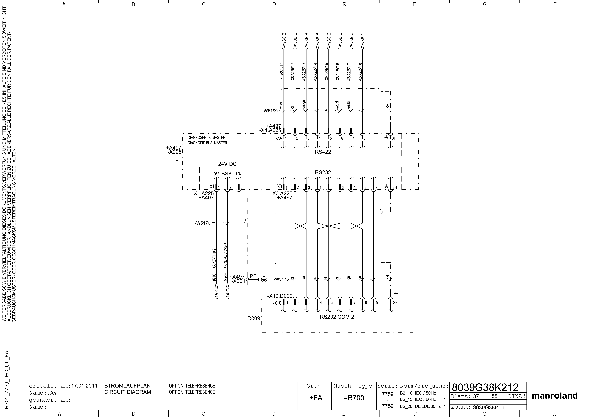

# +FA — Sheet 37 of 58 — OPTION: TELEPRESENCE

**OPTION: TELEPRESENCE**

> Part of the manroland **R700** printing press IEC/UL circuit diagrams.
> Drawing class: **Stromlaufplan / Circuit diagram** (DIN A3).
> Document `+FA` covers the **Delivery** machine section.

## At a glance

| Field | Value |
|---|---|
| Document | `+FA`  (8039G38K212) |
| Sheet | **37** of 58 |
| Section (DE) | OPTION: TELEPRESENCE |
| Section (EN) | OPTION: TELEPRESENCE |
| Section type | CIRCUIT — Circuit diagram |
| Machine type | `=R700` |
| Series | `7759` |
| Created | 17.01.2011 |
| Replaces | `8039G38I411` |
| Columns used | C, D, E, F |
| Path numbers | 216 |
| Labels on sheet | 104 |
| Cross-refs out | 11 |
| Cross-refs in | 31 |

**Previous:** [+FA sheet 36](SHEET_0036.md) · **Next:** [+FA sheet 38](SHEET_0038.md) · **Document TOC:** [_TOC.md](_TOC.md)  (+FA) · **Master TOC:** [all sheets](../_MASTER_TOC.md)

## Sheet image (300 DPI, exact vector render)



_Rendered directly from the PDF vector layer at 300 DPI (1-bit), no OCR and no resampling. Use it to confirm anything ambiguous in the text below._

## Cross-references on this sheet

Each entry is a wire leaving this sheet. The printed token is `/sheet.column`; the link resolves to that sheet inside the same document.

| Ref | Target sheet | Col | Path | Destination on target | Target section | From col |
|---|---|---|---|---|---|---|
| `/36.C` | [+FA sheet 36](SHEET_0036.md) | C | — | X5.A225/1:5 | OPTION: TELEPRESENCE | E |
| `/36.C` | [+FA sheet 36](SHEET_0036.md) | C | — | X5.A225/1:6 | OPTION: TELEPRESENCE | E |
| `/36.C` | [+FA sheet 36](SHEET_0036.md) | C | — | X5.A225/1:7 | OPTION: TELEPRESENCE | E |
| `/36.C` | [+FA sheet 36](SHEET_0036.md) | C | — | X5.A225/1:8 | OPTION: TELEPRESENCE | E |
| `/36.B` | [+FA sheet 36](SHEET_0036.md) | B | — | X5.A225/1:1 | OPTION: TELEPRESENCE | D |
| `/36.B` | [+FA sheet 36](SHEET_0036.md) | B | — | X5.A225/1:2 | OPTION: TELEPRESENCE | D |
| `/36.B` | [+FA sheet 36](SHEET_0036.md) | B | — | X5.A225/1:3 | OPTION: TELEPRESENCE | D |
| `/36.B` | [+FA sheet 36](SHEET_0036.md) | B | — | X5.A225/1:4 | OPTION: TELEPRESENCE | E |
| `/4.F` | [+FA sheet 4](SHEET_0004.md) | F | — | — | ANORDNUNGSPLAN A497 | C |
| `/14.G` | [+FA sheet 14](SHEET_0014.md) | G | — | +A497 X001:M24+ M24+ | SPANNUNGSVERSORGUNG: | C |
| `/15.G` | [+FA sheet 15](SHEET_0015.md) | G | `#216` | +A497 F110:2 | SPANNUNGSVERSORGUNG: | C |

### Incoming references (sheets that point here)

Every other sheet that sends a wire to this one. `Back-ref` is the token printed on *that* sheet; `Path` is its line number.

| From sheet | Cols | Back-ref | Path | Refs | What continues there |
|---|---|---|---|---|---|
| [+FA#4](SHEET_0004.md) | F | `/4.F` | — | 1 | A225 |
| [+FA#14](SHEET_0014.md) | G | `/14.G` | — | 1 | M24+ +A497 X1.A225:2 |
| [+FA#15](SHEET_0015.md) | G | `/15.G` | `#216` | 1 | — |
| [+FA#36](SHEET_0036.md) | B, C | `/36.B`, `/36.C` | — | 8 | +A497 X4.A225:1; +A497 X4.A225:2; +A497 X4.A225:3; +A497 X4.A225:4; +A497 X4.A225:5; +A497 X4.A225:6; +A497 X4.A225:7; +A497 X4.A225:8 |
| [+FA#44](SHEET_0044.md) | B | `/44.B` | — | 1 | — |
| [+FA#49](SHEET_0049.md) | D | `/49.D` | — | 1 | — |
| [+FA#52](SHEET_0052.md) | B | `/52.B` | — | 9 | — |
| [+FA#53](SHEET_0053.md) | G | `/53.G` | — | 9 | — |


## Devices on this sheet

| Tag | Class | Class meaning (IEC) | Col | Sub | Terminal | Sign |
|---|---|---|---|---|---|---|
| `+A497` | A | Baugruppe / assembly, module, PC board | C | — | — | + |
| `+A497` | A | Baugruppe / assembly, module, PC board | D | — | — | + |
| `+A497` | A | Baugruppe / assembly, module, PC board | D | — | — | + |
| `+A497` | A | Baugruppe / assembly, module, PC board | C | — | — | + |
| `A225` | A | Baugruppe / assembly, module, PC board | C | — | — | — |
| `X4` | X | Klemme / terminal, plug connector | D | — | — | — |
| `X1` | X | Klemme / terminal, plug connector | C | — | — | — |
| `X3` | X | Klemme / terminal, plug connector | D | — | — | — |
| `RS422` | RS |  | E | — | — | — |
| `RS232` | RS |  | E | — | — | — |
| `+A497` | A | Baugruppe / assembly, module, PC board | C | — | — | + |
| `X001` | X | Klemme / terminal, plug connector | C | — | — | — |
| `D009` | D | Digital / binary element | D | — | — | — |
| `X10` | X | Klemme / terminal, plug connector | D | — | — | — |
| `W5190` | W | Kabel / cable, line, bus | D | — | — | — |
| `W5175` | W | Kabel / cable, line, bus | D | — | — | — |
| `W5170` | W | Kabel / cable, line, bus | C | — | — | — |
| `X1.A225` | — | cross-device reference | C | — | — | — |
| `X4.A225` | — | cross-device reference | D | — | — | — |
| `X10.D009` | — | cross-device reference | D | — | — | — |
| `X3.A225` | — | cross-device reference | D | — | — | — |

## Potentials / nets

| Potential | Count | Columns | Attached devices | Terminals |
|---|---|---|---|---|
| `24V` | 1 | C | — | — |
| `M24+` | 1 | C | — | — |
| `PE` | 3 | C, D | — | — |


A potential such as `L24+/4` or `M24+` is a named supply/return rail; every place it appears on this sheet is electrically common.

## Wire-end annotations (grouped as printed)

A wire that continues elsewhere is annotated with a small cluster: the destination description, the path/line number `#NN`, and the `/sheet.column` cross reference. Each row below is one such cluster exactly as it is grouped on the drawing.

| Col | Y | Path | Cross-ref | Text on the wire |
|---|---|---|---|---|
| E | 65.5 | — | `/36.C` | `X5.A225/1:5` |
| E | 65.5 | — | `/36.C` | `X5.A225/1:6` |
| E | 65.5 | — | `/36.C` | `X5.A225/1:7` |
| E | 65.5 | — | `/36.C` | `X5.A225/1:8` |
| D | 65.8 | — | `/36.B` | `X5.A225/1:1` |
| D | 65.8 | — | `/36.B` | `X5.A225/1:2` |
| D | 65.8 | — | `/36.B` | `X5.A225/1:3` |
| E | 65.8 | — | `/36.B` | `X5.A225/1:4` |
| D | 202.2 | — | — | `3 ws/gn` |
| E | 203.8 | — | — | `7 ws/br` |
| E | 204.2 | — | — | `5 ws/bl` |
| D | 204.4 | — | — | `1 ws/or` |
| F | 209.6 | — | — | `SH` |
| E | 211.7 | — | — | `6 gn` |
| E | 213.3 | — | — | `8 br` |
| D | 213.5 | — | — | `2 or` |
| E | 213.7 | — | — | `4 bl` |
| D | 219.6 | — | — | `W5190` |
| D | 249.7 | — | — | `X4.A225 +A497` |
| D | 274.9 | — | — | `DIAGNOSEBUS, MASTER DIAGNOSIS BUS, MASTER 1 2 3 4 5 6 7 8` |
| D | 275.1 | — | — | `X4` |
| F | 276.2 | — | — | `SH` |
| C | 293.7 | — | — | `+A497` |
| C | 302.2 | — | — | `A225` |
| E | 302.2 | — | — | `RS422` |
| C | 323.0 | — | `/4.F` | — |
| C | 326.3 | — | — | `24V DC` |
| E | 343.3 | — | — | `RS232` |
| C | 346.1 | — | — | `0V 24V PE` |
| D | 372.8 | — | — | `X1 1 2 3 X3 1 2 3 4 5 6 7 8 9 SH` |
| C | 385.8 | — | — | `X1.A225 +A497` |
| D | 385.8 | — | — | `X3.A225 +A497` |
| D | 442.7 | — | — | `PE` |
| C | 446.4 | — | — | `W5170` |
| C | 447.3 | — | — | `2` |
| C | 447.4 | — | — | `1` |
| C | 489.5 | — | `/14.G` | `M24+ +A497 X001:M24+` |
| C | 502.0 | `#216` | `/15.G` | `+A497 F110:2` |
| D | 553.1 | — | — | `PE` |
| C | 554.5 | — | — | `+A497` |
| F | 555.4 | — | — | `SH` |
| D | 556.2 | — | — | `ws` |
| E | 557.3 | — | — | `gn` |
| E | 557.6 | — | — | `ge` |
| E | 558.9 | — | — | `gr` |
| D | 559.1 | — | — | `br` |
| E | 559.4 | — | — | `rs` |
| E | 559.5 | — | — | `bl` |
| D | 559.8 | — | — | `W5175` |
| E | 560.6 | — | — | `rt` |
| C | 563.0 | — | — | `X001` |
| D | 592.8 | — | — | `X10.D009` |
| E | 607.4 | — | — | `X10 1 2 3 4 5 6 7 8 9 SH` |
| E | 635.3 | — | — | `RS232 COM 2` |
| D | 638.1 | — | — | `D009` |


## Reconstructed tables

This sheet carries tabular content (pin map / terminal assignment / index). The grid below was rebuilt from the drawing's own rule lines, so each row is exactly one physical row of the table.

### Table 1 — 3 data rows × 3 columns (at x=402.5, y=178.6)

| DIAGNOSEBUS, BUS, | MASTER MASTER |  |
|---|---|---|
|  | `24V` | `DC` |
| `0V X1 X1.A225 +A497` | `24V 1` | `PE 2 3` |
| `W5170 1 +A497 F110:2` | `2 +A497 X001:M24+` | `PE` |


### Table 2 — 1 data rows × 11 columns (at x=538.6, y=178.6)

| 1 ws/or W5190 +A497 X4.A225 X4 | 2 or 1 | 3 ws/gn 2 | 6 gn 3 | 4 bl 4 RS422 | 5 ws/bl 5 | 7 ws/br 6 | 8 br 7 | 8 | SH | SH |
|---|---|---|---|---|---|---|---|---|---|---|
| `X3 X3.A225` | `1 +A497` | `2` | `3` | `RS232 4` | `5` | `6` | `7` | `8` | `9` | `SH` |


## Notes and free text on this sheet

| Text | Col | Y (pt) |
|---|---|---|
| `X5.A225/1:1` | D | 125.86 |
| `X5.A225/1:2` | D | 126.99 |
| `X5.A225/1:3` | D | 127.28 |
| `X5.A225/1:4` | E | 127.28 |
| `X5.A225/1:5` | E | 127.28 |
| `X5.A225/1:6` | E | 127.28 |
| `X5.A225/1:7` | E | 127.28 |
| `X5.A225/1:8` | E | 127.28 |
| `+A497 F110:2` | C | 502.01 |
| `+A497 X001:M24+` | C | 489.53 |
| `SH` | F | 375.42 |
| `DIAGNOSEBUS, MASTER` | C | 274.87 |
| `DIAGNOSIS BUS, MASTER` | C | 285.5 |
| `0V 24V` | C | 346.13 |
| `RS232 COM 2` | E | 635.27 |
| `1 ws/or` | D | 204.42 |
| `2 or` | D | 213.47 |
| `3 ws/gn` | D | 202.24 |
| `6 gn` | E | 211.7 |
| `4 bl` | E | 213.71 |
| `5 ws/bl` | E | 204.25 |
| `7 ws/br` | E | 203.81 |
| `8 br` | E | 213.27 |
| `br` | D | 559.06 |
| `gn` | E | 557.29 |
| `ge` | E | 557.57 |
| `gr` | E | 558.86 |
| `rs` | E | 559.38 |
| `bl` | E | 559.5 |
| `rt` | E | 560.59 |
| `ws` | D | 556.16 |

## Complete label inventory (exact text from the drawing)

Every text object inside the drawing area of this sheet, in DIN reading order (column A→H, then top→bottom). This is the authoritative list: if a string is not here it is not printed on this sheet.

| Col | Y | X | Dir | Type | Text |
|---|---|---|---|---|---|
| C | 274.9 | 379.0 | → | text | `DIAGNOSEBUS, MASTER` |
| C | 285.5 | 379.0 | → | text | `DIAGNOSIS BUS, MASTER` |
| C | 293.7 | 335.1 | → | device tag | `+A497` |
| C | 302.2 | 337.9 | → | device tag | `A225` |
| C | 323.0 | 355.0 | → | cross-reference | `/4.F` |
| C | 326.3 | 440.5 | → | potential | `24V DC` |
| C | 346.1 | 431.0 | → | text | `0V 24V` |
| C | 346.1 | 475.8 | → | potential | `PE` |
| C | 372.8 | 420.5 | → | device tag | `X1` |
| C | 375.0 | 439.9 | → | number | `1` |
| C | 375.4 | 463.2 | → | number | `2` |
| C | 385.8 | 387.2 | → | device ref | `X1.A225` |
| C | 394.3 | 400.3 | → | device tag | `+A497` |
| C | 446.4 | 393.2 | → | device tag | `W5170` |
| C | 447.3 | 450.5 | ↕ | number | `2` |
| C | 447.4 | 427.4 | ↕ | number | `1` |
| C | 489.5 | 452.1 | ↕ | text | `+A497 X001:M24+` |
| C | 502.0 | 429.4 | ↕ | text | `+A497 F110:2` |
| C | 551.7 | 452.0 | ↕ | potential | `M24+` |
| C | 553.2 | 429.4 | ↕ | path no. | `#216` |
| C | 554.5 | 462.6 | → | device tag | `+A497` |
| C | 563.0 | 466.9 | → | device tag | `X001` |
| C | 582.0 | 433.3 | ↕ | cross-reference | `/15.G` |
| C | 582.0 | 455.9 | ↕ | cross-reference | `/14.G` |
| D | 65.8 | 569.3 | ↕ | cross-reference | `/36.B` |
| D | 65.8 | 592.0 | ↕ | cross-reference | `/36.B` |
| D | 65.8 | 614.7 | ↕ | cross-reference | `/36.B` |
| D | 125.9 | 565.4 | ↕ | text | `X5.A225/1:1` |
| D | 127.0 | 588.1 | ↕ | text | `X5.A225/1:2` |
| D | 127.3 | 610.8 | ↕ | text | `X5.A225/1:3` |
| D | 202.2 | 609.4 | ↕ | text | `3 ws/gn` |
| D | 204.4 | 564.0 | ↕ | text | `1 ws/or` |
| D | 213.5 | 586.8 | ↕ | text | `2 or` |
| D | 219.6 | 529.2 | → | device tag | `W5190` |
| D | 249.7 | 536.3 | → | device tag | `+A497` |
| D | 258.3 | 523.3 | → | device ref | `X4.A225` |
| D | 275.1 | 557.0 | → | device tag | `X4` |
| D | 275.8 | 574.6 | → | number | `1` |
| D | 276.1 | 597.8 | → | number | `2` |
| D | 276.2 | 620.5 | → | number | `3` |
| D | 372.9 | 557.0 | → | device tag | `X3` |
| D | 375.0 | 576.0 | → | number | `1` |
| D | 375.4 | 485.9 | → | number | `3` |
| D | 375.4 | 599.2 | → | number | `2` |
| D | 375.4 | 621.9 | → | number | `3` |
| D | 385.8 | 546.0 | → | device ref | `X3.A225` |
| D | 394.3 | 559.0 | → | device tag | `+A497` |
| D | 442.7 | 490.1 | ↕ | potential | `PE` |
| D | 553.1 | 503.7 | → | potential | `PE` |
| D | 556.2 | 609.4 | ↕ | text | `ws` |
| D | 559.1 | 586.7 | ↕ | text | `br` |
| D | 559.8 | 551.9 | → | device tag | `W5175` |
| D | 592.7 | 539.4 | → | device ref | `X10.D009` |
| D | 607.4 | 577.4 | → | number | `1` |
| D | 607.8 | 600.7 | → | number | `2` |
| D | 608.2 | 551.3 | → | device tag | `X10` |
| D | 638.1 | 496.1 | → | device tag | `D009` |
| E | 65.5 | 660.0 | ↕ | cross-reference | `/36.C` |
| E | 65.5 | 682.7 | ↕ | cross-reference | `/36.C` |
| E | 65.5 | 705.4 | ↕ | cross-reference | `/36.C` |
| E | 65.5 | 728.1 | ↕ | cross-reference | `/36.C` |
| E | 65.8 | 637.3 | ↕ | cross-reference | `/36.B` |
| E | 127.3 | 633.5 | ↕ | text | `X5.A225/1:4` |
| E | 127.3 | 656.1 | ↕ | text | `X5.A225/1:5` |
| E | 127.3 | 678.8 | ↕ | text | `X5.A225/1:6` |
| E | 127.3 | 701.5 | ↕ | text | `X5.A225/1:7` |
| E | 127.3 | 724.2 | ↕ | text | `X5.A225/1:8` |
| E | 203.8 | 700.1 | ↕ | text | `7 ws/br` |
| E | 204.3 | 677.4 | ↕ | text | `5 ws/bl` |
| E | 211.7 | 632.0 | ↕ | text | `6 gn` |
| E | 213.3 | 722.8 | ↕ | text | `8 br` |
| E | 213.7 | 654.7 | ↕ | text | `4 bl` |
| E | 276.2 | 643.2 | → | number | `4` |
| E | 276.2 | 665.9 | → | number | `5` |
| E | 276.2 | 688.5 | → | number | `6` |
| E | 276.2 | 711.2 | → | number | `7` |
| E | 276.2 | 733.9 | → | number | `8` |
| E | 302.2 | 635.5 | → | device tag | `RS422` |
| E | 343.3 | 635.5 | → | device tag | `RS232` |
| E | 375.4 | 644.6 | → | number | `4` |
| E | 375.4 | 667.3 | → | number | `5` |
| E | 375.4 | 690.0 | → | number | `6` |
| E | 375.4 | 712.6 | → | number | `7` |
| E | 375.4 | 735.3 | → | number | `8` |
| E | 375.4 | 758.0 | → | number | `9` |
| E | 557.3 | 700.0 | ↕ | text | `gn` |
| E | 557.6 | 722.8 | ↕ | text | `ge` |
| E | 558.9 | 677.4 | ↕ | text | `gr` |
| E | 559.4 | 632.0 | ↕ | text | `rs` |
| E | 559.5 | 654.6 | ↕ | text | `bl` |
| E | 560.6 | 745.3 | ↕ | text | `rt` |
| E | 607.9 | 623.3 | → | number | `3` |
| E | 607.9 | 646.0 | → | number | `4` |
| E | 607.9 | 668.7 | → | number | `5` |
| E | 607.9 | 691.4 | → | number | `6` |
| E | 607.9 | 714.0 | → | number | `7` |
| E | 607.9 | 736.7 | → | number | `8` |
| E | 607.9 | 759.4 | → | number | `9` |
| E | 635.3 | 645.7 | → | text | `RS232 COM 2` |
| F | 209.6 | 779.4 | ↕ | text | `SH` |
| F | 276.2 | 790.6 | → | text | `SH` |
| F | 375.4 | 792.0 | → | text | `SH` |
| F | 555.4 | 779.4 | ↕ | text | `SH` |
| F | 607.9 | 793.4 | → | text | `SH` |

## Reading-order text block

The same content as a plain block, grouped by DIN column — convenient to paste or to match against a visual description.

```text
=== Column C ===
 274.9  379.0  text         DIAGNOSEBUS, MASTER
 285.5  379.0  text         DIAGNOSIS BUS, MASTER
 293.7  335.1  devtag       +A497
 302.2  337.9  devtag       A225
 323.0  355.0  xref         /4.F
 326.3  440.5  net          24V DC
 346.1  431.0  text         0V 24V
 346.1  475.8  net          PE
 372.8  420.5  devtag       X1
 375.0  439.9  numeric      1
 375.4  463.2  numeric      2
 385.8  387.2  devref       X1.A225
 394.3  400.3  devtag       +A497
 446.4  393.2  devtag       W5170
 447.3  450.5  numeric      2
 447.4  427.4  numeric      1
 489.5  452.1  text         +A497 X001:M24+
 502.0  429.4  text         +A497 F110:2
 551.7  452.0  net          M24+
 553.2  429.4  path         #216
 554.5  462.6  devtag       +A497
 563.0  466.9  devtag       X001
 582.0  433.3  xref         /15.G
 582.0  455.9  xref         /14.G
=== Column D ===
  65.8  569.3  xref         /36.B
  65.8  592.0  xref         /36.B
  65.8  614.7  xref         /36.B
 125.9  565.4  text         X5.A225/1:1
 127.0  588.1  text         X5.A225/1:2
 127.3  610.8  text         X5.A225/1:3
 202.2  609.4  text         3 ws/gn
 204.4  564.0  text         1 ws/or
 213.5  586.8  text         2 or
 219.6  529.2  devtag       W5190
 249.7  536.3  devtag       +A497
 258.3  523.3  devref       X4.A225
 275.1  557.0  devtag       X4
 275.8  574.6  numeric      1
 276.1  597.8  numeric      2
 276.2  620.5  numeric      3
 372.9  557.0  devtag       X3
 375.0  576.0  numeric      1
 375.4  485.9  numeric      3
 375.4  599.2  numeric      2
 375.4  621.9  numeric      3
 385.8  546.0  devref       X3.A225
 394.3  559.0  devtag       +A497
 442.7  490.1  net          PE
 553.1  503.7  net          PE
 556.2  609.4  text         ws
 559.1  586.7  text         br
 559.8  551.9  devtag       W5175
 592.7  539.4  devref       X10.D009
 607.4  577.4  numeric      1
 607.8  600.7  numeric      2
 608.2  551.3  devtag       X10
 638.1  496.1  devtag       D009
=== Column E ===
  65.5  660.0  xref         /36.C
  65.5  682.7  xref         /36.C
  65.5  705.4  xref         /36.C
  65.5  728.1  xref         /36.C
  65.8  637.3  xref         /36.B
 127.3  633.5  text         X5.A225/1:4
 127.3  656.1  text         X5.A225/1:5
 127.3  678.8  text         X5.A225/1:6
 127.3  701.5  text         X5.A225/1:7
 127.3  724.2  text         X5.A225/1:8
 203.8  700.1  text         7 ws/br
 204.3  677.4  text         5 ws/bl
 211.7  632.0  text         6 gn
 213.3  722.8  text         8 br
 213.7  654.7  text         4 bl
 276.2  643.2  numeric      4
 276.2  665.9  numeric      5
 276.2  688.5  numeric      6
 276.2  711.2  numeric      7
 276.2  733.9  numeric      8
 302.2  635.5  devtag       RS422
 343.3  635.5  devtag       RS232
 375.4  644.6  numeric      4
 375.4  667.3  numeric      5
 375.4  690.0  numeric      6
 375.4  712.6  numeric      7
 375.4  735.3  numeric      8
 375.4  758.0  numeric      9
 557.3  700.0  text         gn
 557.6  722.8  text         ge
 558.9  677.4  text         gr
 559.4  632.0  text         rs
 559.5  654.6  text         bl
 560.6  745.3  text         rt
 607.9  623.3  numeric      3
 607.9  646.0  numeric      4
 607.9  668.7  numeric      5
 607.9  691.4  numeric      6
 607.9  714.0  numeric      7
 607.9  736.7  numeric      8
 607.9  759.4  numeric      9
 635.3  645.7  text         RS232 COM 2
=== Column F ===
 209.6  779.4  text         SH
 276.2  790.6  text         SH
 375.4  792.0  text         SH
 555.4  779.4  text         SH
 607.9  793.4  text         SH
```

---
_Generated from the PDF vector text layer; no OCR. Source: `R700_7759_IEC_UL_FA`, sheet 37._
