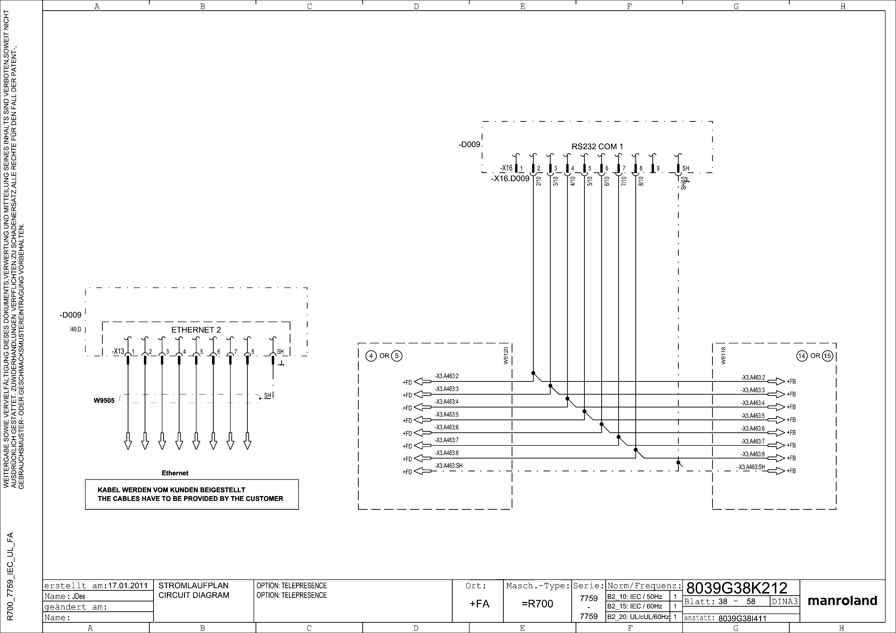

# +FA — Sheet 38 of 58 — OPTION: TELEPRESENCE

**OPTION: TELEPRESENCE**

> Part of the manroland **R700** printing press IEC/UL circuit diagrams.
> Drawing class: **Stromlaufplan / Circuit diagram** (DIN A3).
> Document `+FA` covers the **Delivery** machine section.

## At a glance

| Field | Value |
|---|---|
| Document | `+FA`  (8039G38K212) |
| Sheet | **38** of 58 |
| Section (DE) | OPTION: TELEPRESENCE |
| Section (EN) | OPTION: TELEPRESENCE |
| Section type | CIRCUIT — Circuit diagram |
| Machine type | `=R700` |
| Series | `7759` |
| Created | 17.01.2011 |
| Replaces | `8039G38I411` |
| Columns used | A, B, C, D, E, F, G, H |
| Path numbers | — |
| Labels on sheet | 78 |
| Cross-refs out | 1 |
| Cross-refs in | 19 |

**Previous:** [+FA sheet 37](SHEET_0037.md) · **Next:** [+FA sheet 39](SHEET_0039.md) · **Document TOC:** [_TOC.md](_TOC.md)  (+FA) · **Master TOC:** [all sheets](../_MASTER_TOC.md)

## Sheet image (300 DPI, exact vector render)



_Rendered directly from the PDF vector layer at 300 DPI (1-bit), no OCR and no resampling. Use it to confirm anything ambiguous in the text below._

## Cross-references on this sheet

Each entry is a wire leaving this sheet. The printed token is `/sheet.column`; the link resolves to that sheet inside the same document.

| Ref | Target sheet | Col | Path | Destination on target | Target section | From col |
|---|---|---|---|---|---|---|
| `/49.D` | [+FA sheet 49](SHEET_0049.md) | D | — | ETHERNET 2 | REFERENZMODUL | A |

### Incoming references (sheets that point here)

Every other sheet that sends a wire to this one. `Back-ref` is the token printed on *that* sheet; `Path` is its line number.

| From sheet | Cols | Back-ref | Path | Refs | What continues there |
|---|---|---|---|---|---|
| [+FA#49](SHEET_0049.md) | D | `/49.D` | — | 2 | — |
| [+FA#52](SHEET_0052.md) | A, C | `/52.A`, `/52.C` | — | 17 | — |


## Devices on this sheet

| Tag | Class | Class meaning (IEC) | Col | Sub | Terminal | Sign |
|---|---|---|---|---|---|---|
| `D009` | D | Digital / binary element | A | — | — | — |
| `X13` | X | Klemme / terminal, plug connector | A | — | — | — |
| `D009` | D | Digital / binary element | E | — | — | — |
| `X16` | X | Klemme / terminal, plug connector | E | — | — | — |
| `W9505` | W | Kabel / cable, line, bus | A | — | — | — |
| `W5118` | W | Kabel / cable, line, bus | G | — | — | — |
| `W5120` | W | Kabel / cable, line, bus | E | — | — | — |
| `X3.A463:5` | — | cross-device reference | G | — | 5 | — |
| `X3.A463:2` | — | cross-device reference | G | — | 2 | — |
| `X3.A463:3` | — | cross-device reference | G | — | 3 | — |
| `X3.A463:4` | — | cross-device reference | G | — | 4 | — |
| `X3.A463:5` | — | cross-device reference | D | — | 5 | — |
| `X3.A463:4` | — | cross-device reference | D | — | 4 | — |
| `X3.A463:3` | — | cross-device reference | D | — | 3 | — |
| `X3.A463:2` | — | cross-device reference | D | — | 2 | — |
| `X16.D009` | — | cross-device reference | E | — | — | — |
| `X3.A463:6` | — | cross-device reference | G | — | 6 | — |
| `X3.A463:7` | — | cross-device reference | G | — | 7 | — |
| `X3.A463:8` | — | cross-device reference | G | — | 8 | — |
| `X3.A463:SH` | — | cross-device reference | G | — | SH | — |
| `X3.A463:6` | — | cross-device reference | D | — | 6 | — |
| `X3.A463:7` | — | cross-device reference | D | — | 7 | — |
| `X3.A463:8` | — | cross-device reference | D | — | 8 | — |
| `X3.A463:SH` | — | cross-device reference | D | — | SH | — |

## Potentials / nets

_No named potentials on this sheet._

## Wire-end annotations (grouped as printed)

A wire that continues elsewhere is annotated with a small cluster: the destination description, the path/line number `#NN`, and the `/sheet.column` cross reference. Each row below is one such cluster exactly as it is grouped on the drawing.

| Col | Y | Path | Cross-ref | Text on the wire |
|---|---|---|---|---|
| E | 187.4 | — | — | `D009` |
| F | 190.2 | — | — | `RS232 COM 1` |
| F | 219.8 | — | — | `X16 1 2 3 4 5 6 7 8 9 SH` |
| E | 232.8 | — | — | `X16.D009` |
| E | 235.0 | — | — | `2/10` |
| E | 235.0 | — | — | `3/10` |
| E | 235.0 | — | — | `4/10` |
| F | 235.0 | — | — | `5/10` |
| F | 235.0 | — | — | `6/10` |
| F | 235.0 | — | — | `7/10` |
| F | 235.0 | — | — | `8/10` |
| G | 235.0 | — | — | `SH/10` |
| A | 414.2 | — | — | `D009` |
| A | 434.0 | — | `/49.D` | `ETHERNET 2` |
| E | 461.5 | — | — | `W5120` |
| G | 461.5 | — | — | `W5118` |
| B | 463.6 | — | — | `X13 1 2 3 4 5 6 7 8` |
| C | 464.7 | — | — | `SH` |
| F | 469.4 | — | — | `4 OR 5 14 OR 15` |
| D | 497.4 | — | — | `X3.A463:2` |
| G | 499.1 | — | — | `X3.A463:2 +FB` |
| D | 505.9 | — | — | `+FD X3.A463:3` |
| G | 516.1 | — | — | `X3.A463:3 +FB` |
| C | 522.8 | — | — | `SH` |
| D | 522.9 | — | — | `+FD X3.A463:4` |
| A | 529.0 | — | — | `W9505` |
| G | 533.1 | — | — | `X3.A463:4 +FB` |
| D | 539.9 | — | — | `+FD X3.A463:5` |
| G | 550.1 | — | — | `X3.A463:5 +FB` |
| D | 556.9 | — | — | `+FD` |
| D | 565.4 | — | — | `X3.A463:6` |
| G | 567.1 | — | — | `X3.A463:6 +FB` |
| D | 573.9 | — | — | `+FD` |
| D | 582.4 | — | — | `X3.A463:7` |
| G | 584.1 | — | — | `X3.A463:7 +FB` |
| D | 590.9 | — | — | `+FD` |
| D | 599.5 | — | — | `X3.A463:8` |
| G | 601.1 | — | — | `X3.A463:8 +FB` |
| D | 607.9 | — | — | `+FD` |
| D | 616.4 | — | — | `X3.A463:SH` |
| G | 618.1 | — | — | `X3.A463:SH +FB` |
| D | 625.0 | — | — | `+FD` |
| B | 625.3 | — | — | `Ethernet` |
| B | 648.0 | — | — | `KABEL WERDEN VOM KUNDEN BEIGESTELLT THE CABLES HAVE TO BE PROVIDED BY THE CUSTOMER` |


## Reconstructed tables

This sheet carries tabular content (pin map / terminal assignment / index). The grid below was rebuilt from the drawing's own rule lines, so each row is exactly one physical row of the table.

### Table 1 — 1 data rows × 10 columns (at x=136.1, y=428.0)

| X13 | 1 | 2 | 3 | ETHERNET 4 | 5 | 2 6 | 7 | 8 | SH |
|---|---|---|---|---|---|---|---|---|---|
| `W9505` |  |  |  |  |  |  |  | `SH` |  |


## Notes and free text on this sheet

| Text | Col | Y (pt) |
|---|---|---|
| `SH` | C | 522.82 |
| `+FB` | H | 555.47 |
| `+FD` | D | 556.92 |
| `OR` | D | 469.45 |
| `14 OR 15` | H | 469.45 |
| `SH/10` | G | 234.99 |
| `ETHERNET 2` | B | 434.01 |
| `SH` | G | 220.93 |
| `RS232 COM 1` | F | 190.24 |
| `KABEL WERDEN VOM KUNDEN BEIGESTELLT` | B | 648.01 |
| `THE CABLES HAVE TO BE PROVIDED BY THE CUSTOMER` | B | 659.35 |
| `Ethernet` | B | 625.34 |

## Complete label inventory (exact text from the drawing)

Every text object inside the drawing area of this sheet, in DIN reading order (column A→H, then top→bottom). This is the authoritative list: if a string is not here it is not printed on this sheet.

| Col | Y | X | Dir | Type | Text |
|---|---|---|---|---|---|
| A | 414.2 | 79.4 | → | device tag | `D009` |
| A | 435.0 | 93.0 | → | cross-reference | `/49.D` |
| A | 463.6 | 148.8 | → | device tag | `X13` |
| A | 464.3 | 174.9 | → | number | `1` |
| A | 529.0 | 124.7 | → | device tag | `W9505` |
| B | 434.0 | 227.6 | → | text | `ETHERNET 2` |
| B | 464.7 | 198.1 | → | number | `2` |
| B | 464.7 | 220.8 | → | number | `3` |
| B | 464.7 | 243.5 | → | number | `4` |
| B | 464.7 | 266.2 | → | number | `5` |
| B | 464.7 | 288.9 | → | number | `6` |
| B | 464.7 | 311.5 | → | number | `7` |
| B | 464.7 | 334.2 | → | number | `8` |
| B | 625.3 | 214.9 | → | text | `Ethernet` |
| B | 648.0 | 129.8 | → | text | `KABEL WERDEN VOM KUNDEN BEIGESTELLT` |
| B | 659.4 | 130.1 | → | text | `THE CABLES HAVE TO BE PROVIDED BY THE CUSTOMER` |
| C | 464.7 | 368.2 | → | text | `SH` |
| C | 522.8 | 351.2 | → | text | `SH` |
| D | 469.4 | 504.3 | → | text | `OR` |
| D | 469.5 | 490.8 | → | number | `4` |
| D | 469.5 | 524.8 | → | number | `5` |
| D | 497.4 | 578.0 | → | device ref | `X3.A463:2` |
| D | 505.9 | 535.3 | → | text | `+FD` |
| D | 514.4 | 578.0 | → | device ref | `X3.A463:3` |
| D | 522.9 | 535.3 | → | text | `+FD` |
| D | 531.4 | 578.0 | → | device ref | `X3.A463:4` |
| D | 539.9 | 535.3 | → | text | `+FD` |
| D | 548.4 | 578.0 | → | device ref | `X3.A463:5` |
| D | 556.9 | 535.3 | → | text | `+FD` |
| D | 565.4 | 578.0 | → | device ref | `X3.A463:6` |
| D | 573.9 | 535.3 | → | text | `+FD` |
| D | 582.4 | 578.0 | → | device ref | `X3.A463:7` |
| D | 590.9 | 535.3 | → | text | `+FD` |
| D | 599.4 | 578.0 | → | device ref | `X3.A463:8` |
| D | 607.9 | 535.3 | → | text | `+FD` |
| D | 616.4 | 578.0 | → | device ref | `X3.A463:SH` |
| D | 625.0 | 535.3 | → | text | `+FD` |
| E | 187.4 | 609.4 | → | device tag | `D009` |
| E | 219.8 | 664.7 | → | device tag | `X16` |
| E | 220.5 | 690.8 | → | number | `1` |
| E | 220.9 | 714.0 | → | number | `2` |
| E | 220.9 | 736.7 | → | number | `3` |
| E | 220.9 | 759.4 | → | number | `4` |
| E | 232.7 | 652.8 | → | device ref | `X16.D009` |
| E | 235.0 | 712.8 | ↕ | pin pair | `2/10` |
| E | 235.0 | 735.5 | ↕ | pin pair | `3/10` |
| E | 235.0 | 758.2 | ↕ | pin pair | `4/10` |
| E | 461.5 | 669.1 | ↕ | device tag | `W5120` |
| F | 190.2 | 759.8 | → | text | `RS232 COM 1` |
| F | 220.9 | 782.1 | → | number | `5` |
| F | 220.9 | 804.8 | → | number | `6` |
| F | 220.9 | 827.4 | → | number | `7` |
| F | 220.9 | 850.1 | → | number | `8` |
| F | 220.9 | 872.8 | → | number | `9` |
| F | 235.0 | 780.9 | ↕ | pin pair | `5/10` |
| F | 235.0 | 803.5 | ↕ | pin pair | `6/10` |
| F | 235.0 | 826.2 | ↕ | pin pair | `7/10` |
| F | 235.0 | 848.9 | ↕ | pin pair | `8/10` |
| G | 220.9 | 906.8 | → | text | `SH` |
| G | 235.0 | 905.6 | ↕ | text | `SH/10` |
| G | 461.5 | 958.2 | ↕ | device tag | `W5118` |
| G | 499.1 | 985.1 | → | device ref | `X3.A463:2` |
| G | 516.1 | 984.9 | → | device ref | `X3.A463:3` |
| G | 533.1 | 984.9 | → | device ref | `X3.A463:4` |
| G | 550.1 | 984.9 | → | device ref | `X3.A463:5` |
| G | 567.1 | 984.9 | → | device ref | `X3.A463:6` |
| G | 584.1 | 984.9 | → | device ref | `X3.A463:7` |
| G | 601.1 | 984.9 | → | device ref | `X3.A463:8` |
| G | 618.1 | 980.0 | → | device ref | `X3.A463:SH` |
| H | 469.4 | 1060.4 | → | text | `14 OR 15` |
| H | 504.4 | 1045.7 | → | text | `+FB` |
| H | 521.5 | 1045.7 | → | text | `+FB` |
| H | 538.5 | 1045.7 | → | text | `+FB` |
| H | 555.5 | 1045.7 | → | text | `+FB` |
| H | 572.5 | 1045.7 | → | text | `+FB` |
| H | 589.5 | 1045.7 | → | text | `+FB` |
| H | 606.5 | 1045.7 | → | text | `+FB` |
| H | 623.5 | 1045.7 | → | text | `+FB` |

## Reading-order text block

The same content as a plain block, grouped by DIN column — convenient to paste or to match against a visual description.

```text
=== Column A ===
 414.2   79.4  devtag       D009
 435.0   93.0  xref         /49.D
 463.6  148.8  devtag       X13
 464.3  174.9  numeric      1
 529.0  124.7  devtag       W9505
=== Column B ===
 434.0  227.6  text         ETHERNET 2
 464.7  198.1  numeric      2
 464.7  220.8  numeric      3
 464.7  243.5  numeric      4
 464.7  266.2  numeric      5
 464.7  288.9  numeric      6
 464.7  311.5  numeric      7
 464.7  334.2  numeric      8
 625.3  214.9  text         Ethernet
 648.0  129.8  text         KABEL WERDEN VOM KUNDEN BEIGESTELLT
 659.4  130.1  text         THE CABLES HAVE TO BE PROVIDED BY THE CUSTOMER
=== Column C ===
 464.7  368.2  text         SH
 522.8  351.2  text         SH
=== Column D ===
 469.4  504.3  text         OR
 469.5  490.8  numeric      4
 469.5  524.8  numeric      5
 497.4  578.0  devref       X3.A463:2
 505.9  535.3  text         +FD
 514.4  578.0  devref       X3.A463:3
 522.9  535.3  text         +FD
 531.4  578.0  devref       X3.A463:4
 539.9  535.3  text         +FD
 548.4  578.0  devref       X3.A463:5
 556.9  535.3  text         +FD
 565.4  578.0  devref       X3.A463:6
 573.9  535.3  text         +FD
 582.4  578.0  devref       X3.A463:7
 590.9  535.3  text         +FD
 599.4  578.0  devref       X3.A463:8
 607.9  535.3  text         +FD
 616.4  578.0  devref       X3.A463:SH
 625.0  535.3  text         +FD
=== Column E ===
 187.4  609.4  devtag       D009
 219.8  664.7  devtag       X16
 220.5  690.8  numeric      1
 220.9  714.0  numeric      2
 220.9  736.7  numeric      3
 220.9  759.4  numeric      4
 232.7  652.8  devref       X16.D009
 235.0  712.8  pinpair      2/10
 235.0  735.5  pinpair      3/10
 235.0  758.2  pinpair      4/10
 461.5  669.1  devtag       W5120
=== Column F ===
 190.2  759.8  text         RS232 COM 1
 220.9  782.1  numeric      5
 220.9  804.8  numeric      6
 220.9  827.4  numeric      7
 220.9  850.1  numeric      8
 220.9  872.8  numeric      9
 235.0  780.9  pinpair      5/10
 235.0  803.5  pinpair      6/10
 235.0  826.2  pinpair      7/10
 235.0  848.9  pinpair      8/10
=== Column G ===
 220.9  906.8  text         SH
 235.0  905.6  text         SH/10
 461.5  958.2  devtag       W5118
 499.1  985.1  devref       X3.A463:2
 516.1  984.9  devref       X3.A463:3
 533.1  984.9  devref       X3.A463:4
 550.1  984.9  devref       X3.A463:5
 567.1  984.9  devref       X3.A463:6
 584.1  984.9  devref       X3.A463:7
 601.1  984.9  devref       X3.A463:8
 618.1  980.0  devref       X3.A463:SH
=== Column H ===
 469.4 1060.4  text         14 OR 15
 504.4 1045.7  text         +FB
 521.5 1045.7  text         +FB
 538.5 1045.7  text         +FB
 555.5 1045.7  text         +FB
 572.5 1045.7  text         +FB
 589.5 1045.7  text         +FB
 606.5 1045.7  text         +FB
 623.5 1045.7  text         +FB
```

---
_Generated from the PDF vector text layer; no OCR. Source: `R700_7759_IEC_UL_FA`, sheet 38._
