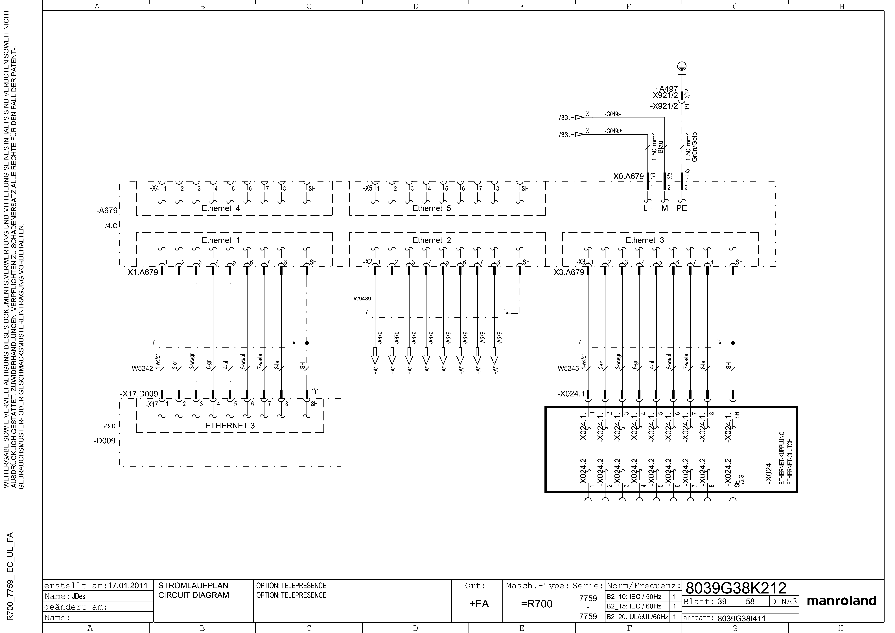

# +FA — Sheet 39 of 58 — OPTION: TELEPRESENCE

**OPTION: TELEPRESENCE**

> Part of the manroland **R700** printing press IEC/UL circuit diagrams.
> Drawing class: **Stromlaufplan / Circuit diagram** (DIN A3).
> Document `+FA` covers the **Delivery** machine section.

## At a glance

| Field | Value |
|---|---|
| Document | `+FA`  (8039G38K212) |
| Sheet | **39** of 58 |
| Section (DE) | OPTION: TELEPRESENCE |
| Section (EN) | OPTION: TELEPRESENCE |
| Section type | CIRCUIT — Circuit diagram |
| Machine type | `=R700` |
| Series | `7759` |
| Created | 17.01.2011 |
| Replaces | `8039G38I411` |
| Columns used | A, B, C, D, E, F, G, H |
| Path numbers | — |
| Labels on sheet | 175 |
| Cross-refs out | 5 |
| Cross-refs in | 55 |

**Previous:** [+FA sheet 38](SHEET_0038.md) · **Next:** [+FA sheet 40](SHEET_0040.md) · **Document TOC:** [_TOC.md](_TOC.md)  (+FA) · **Master TOC:** [all sheets](../_MASTER_TOC.md)

## Sheet image (300 DPI, exact vector render)



_Rendered directly from the PDF vector layer at 300 DPI (1-bit), no OCR and no resampling. Use it to confirm anything ambiguous in the text below._

## Cross-references on this sheet

Each entry is a wire leaving this sheet. The printed token is `/sheet.column`; the link resolves to that sheet inside the same document.

| Ref | Target sheet | Col | Path | Destination on target | Target section | From col |
|---|---|---|---|---|---|---|
| `/33.H` | [+FA sheet 33](SHEET_0033.md) | H | — | X G049: | OPTION: TELEPRESENCE , PRINTNET VORBEREITUNG: INTEGRATIONPILOTPLUS INCLUSIVE DATACOL.,INTEGRATIONP. FÜR PRESSM. PERFECT | F |
| `/33.H` | [+FA sheet 33](SHEET_0033.md) | H | — | X G049:+ | OPTION: TELEPRESENCE , PRINTNET VORBEREITUNG: INTEGRATIONPILOTPLUS INCLUSIVE DATACOL.,INTEGRATIONP. FÜR PRESSM. PERFECT | F |
| `/4.C` | [+FA sheet 4](SHEET_0004.md) | C | — | — | ANORDNUNGSPLAN A497 | A |
| `/49.D` | [+FA sheet 49](SHEET_0049.md) | D | — | ETHERNET 3 | REFERENZMODUL | B |
| `/5.G` | [+FA sheet 5](SHEET_0005.md) | G | — | — | ANORDNUNGSPLAN | G |

### Incoming references (sheets that point here)

Every other sheet that sends a wire to this one. `Back-ref` is the token printed on *that* sheet; `Path` is its line number.

| From sheet | Cols | Back-ref | Path | Refs | What continues there |
|---|---|---|---|---|---|
| [+FA#4](SHEET_0004.md) | C | `/4.C` | — | 1 | — |
| [+FA#5](SHEET_0005.md) | G | `/5.G` | — | 1 | — |
| [+FA#33](SHEET_0033.md) | H | `/33.H` | — | 2 | X X0.A679:2; X0.A679:1 X |
| [+FA#49](SHEET_0049.md) | D | `/49.D` | — | 1 | — |
| [+FA#51](SHEET_0051.md) | A, B, E | `/51.A`, `/51.B`, `/51.E` | — | 21 | — |
| [+FA#52](SHEET_0052.md) | B, C | `/52.B`, `/52.C` | — | 18 | — |
| [+FA#54](SHEET_0054.md) | G | `/54.G` | — | 9 | — |
| [+FA#57](SHEET_0057.md) | C, G | `/57.C`, `/57.G` | — | 2 | — |


## Devices on this sheet

| Tag | Class | Class meaning (IEC) | Col | Sub | Terminal | Sign |
|---|---|---|---|---|---|---|
| `A679` | A | Baugruppe / assembly, module, PC board | A | — | — | — |
| `X4` | X | Klemme / terminal, plug connector | B | — | — | — |
| `X2` | X | Klemme / terminal, plug connector | D | — | — | — |
| `X5` | X | Klemme / terminal, plug connector | D | — | — | — |
| `X3` | X | Klemme / terminal, plug connector | F | — | — | — |
| `A679` | A | Baugruppe / assembly, module, PC board | D | — | — | — |
| `A679` | A | Baugruppe / assembly, module, PC board | D | — | — | — |
| `A679` | A | Baugruppe / assembly, module, PC board | D | — | — | — |
| `A679` | A | Baugruppe / assembly, module, PC board | D | — | — | — |
| `A679` | A | Baugruppe / assembly, module, PC board | D | — | — | — |
| `A679` | A | Baugruppe / assembly, module, PC board | D | — | — | — |
| `A679` | A | Baugruppe / assembly, module, PC board | E | — | — | — |
| `A679` | A | Baugruppe / assembly, module, PC board | E | — | — | — |
| `X024` | X | Klemme / terminal, plug connector | G | — | — | — |
| `D009` | D | Digital / binary element | A | — | — | — |
| `X17` | X | Klemme / terminal, plug connector | B | — | — | — |
| `+A497` | A | Baugruppe / assembly, module, PC board | F | — | — | + |
| `X921/2` | X | Klemme / terminal, plug connector | F | 2 | — | — |
| `X921/2` | X | Klemme / terminal, plug connector | F | 2 | — | — |
| `W9489` | W | Kabel / cable, line, bus | D | — | — | — |
| `W5242` | W | Kabel / cable, line, bus | A | — | — | — |
| `W5245` | W | Kabel / cable, line, bus | E | — | — | — |
| `X1.A679` | — | cross-device reference | A | — | — | — |
| `X17.D009` | — | cross-device reference | A | — | — | — |
| `X024.1.` | — | cross-device reference | F | — | — | — |
| `X024.1.` | — | cross-device reference | F | — | — | — |
| `X024.1.` | — | cross-device reference | F | — | — | — |
| `X024.1.` | — | cross-device reference | F | — | — | — |
| `X024.2` | — | cross-device reference | F | — | — | — |
| `X024.2` | — | cross-device reference | F | — | — | — |
| `X024.2` | — | cross-device reference | F | — | — | — |
| `X024.2` | — | cross-device reference | F | — | — | — |
| `X3.A679` | — | cross-device reference | E | — | — | — |
| `X024.1` | — | cross-device reference | E | — | — | — |
| `X024.1.` | — | cross-device reference | G | — | — | — |
| `X024.1.` | — | cross-device reference | G | — | — | — |
| `X024.1.` | — | cross-device reference | G | — | — | — |
| `X024.1.` | — | cross-device reference | F | — | — | — |
| `X024.1.` | — | cross-device reference | F | — | — | — |
| `X024.2` | — | cross-device reference | F | — | — | — |
| `X024.2` | — | cross-device reference | F | — | — | — |
| `X024.2` | — | cross-device reference | G | — | — | — |
| `X024.2` | — | cross-device reference | G | — | — | — |
| `X024.2` | — | cross-device reference | G | — | — | — |
| `X0.A679` | — | cross-device reference | F | — | — | — |

## Potentials / nets

| Potential | Count | Columns | Attached devices | Terminals |
|---|---|---|---|---|
| `PE` | 2 | F, G | — | — |


A potential such as `L24+/4` or `M24+` is a named supply/return rail; every place it appears on this sheet is electrically common.

## Conductor data

Each label annotates **the wire beside it**, not the sheet. These summaries are inventories of what is printed; they are not a per-wire map. For a specific conductor, read the label that sits on that wire (see the label inventory below, or the sheet image).

**Cross-section labels printed on this sheet:** 1.5 mm² (×2)

**Wire-colour labels printed on this sheet:** BL = blau / blue (×1)

**Cross-section + colour appearing together in one annotation block:**

| Cross-section | Colour (DE) | Colour (EN) | Blocks containing both |
|---|---|---|---|
| 1.5 mm² | blau | blue | 1 |


_This counts annotation blocks that carry both labels. It can be lower than the number of individual labels above, because a block may hold two cross-section labels or two colour labels._

## Wire-end annotations (grouped as printed)

A wire that continues elsewhere is annotated with a small cluster: the destination description, the path/line number `#NN`, and the `/sheet.column` cross reference. Each row below is one such cluster exactly as it is grouped on the drawing.

| Col | Y | Path | Cross-ref | Text on the wire |
|---|---|---|---|---|
| F | 113.7 | — | — | `X921/2 +A497` |
| G | 118.4 | — | — | `2/12` |
| F | 136.4 | — | — | `X921/2` |
| G | 137.2 | — | — | `1/1` |
| F | 148.7 | — | `/33.H` | `X G049:` |
| F | 171.4 | — | `/33.H` | `X G049:+` |
| G | 175.6 | — | — | `1.50 mm² Grün/Gelb` |
| F | 177.0 | — | — | `1.50 mm² Blau` |
| G | 224.9 | — | — | `PE/3` |
| F | 229.6 | — | — | `2/3` |
| F | 229.9 | — | — | `X0.A679` |
| F | 230.0 | — | — | `1/3` |
| D | 246.0 | — | — | `1 2 3 4 5 6 7 8 SH 1 2 3 4 5 6 7 8 SH 1 2 3` |
| B | 246.7 | — | — | `X4` |
| D | 246.7 | — | — | `X5` |
| F | 272.4 | — | — | `L+ M PE` |
| C | 272.5 | — | — | `Ethernet 4 Ethernet 5` |
| A | 275.3 | — | — | `A679` |
| A | 296.5 | — | `/4.C` | — |
| D | 315.0 | — | — | `Ethernet 1 Ethernet 2 Ethernet 3` |
| D | 344.5 | — | — | `1 2 3 4 5 6 7 8 SH 1 2 3 4 5 6 7 8 SH X3 1 2 3 4 5 6 7 8 SH` |
| D | 344.5 | — | — | `X2` |
| A | 357.5 | — | — | `X1.A679` |
| E | 357.5 | — | — | `X3.A679` |
| D | 394.1 | — | — | `W9489` |
| D | 441.1 | — | — | `+A* A679` |
| D | 441.1 | — | — | `+A* A679` |
| D | 441.1 | — | — | `+A* A679` |
| D | 441.1 | — | — | `+A* A679` |
| D | 441.1 | — | — | `+A* A679` |
| D | 441.1 | — | — | `+A* A679` |
| E | 441.1 | — | — | `+A* A679` |
| E | 441.1 | — | — | `+A* A679` |
| B | 468.7 | — | — | `3 ws/gn` |
| F | 468.7 | — | — | `3 ws/gn` |
| C | 470.3 | — | — | `7 ws/br` |
| G | 470.3 | — | — | `7 ws/br` |
| B | 470.7 | — | — | `5 ws/bl` |
| F | 470.7 | — | — | `5 ws/bl` |
| B | 470.9 | — | — | `1 ws/or` |
| F | 470.9 | — | — | `1 ws/or` |
| B | 478.1 | — | — | `6 gn` |
| F | 478.1 | — | — | `6 gn` |
| C | 479.7 | — | — | `8 br` |
| G | 479.7 | — | — | `8 br` |
| B | 479.9 | — | — | `2 or` |
| F | 479.9 | — | — | `2 or` |
| B | 480.2 | — | — | `4 bl` |
| F | 480.2 | — | — | `4 bl` |
| C | 481.7 | — | — | `SH` |
| G | 481.7 | — | — | `SH` |
| A | 486.1 | — | — | `W5242` |
| E | 486.1 | — | — | `W5245` |
| A | 519.0 | — | — | `X17.D009` |
| E | 519.0 | — | — | `X024.1` |
| B | 533.7 | — | — | `X17 1 2 3 4 5 6 7 8` |
| C | 534.2 | — | — | `SH` |
| F | 546.8 | — | — | `X024.1. 1` |
| G | 547.6 | — | — | `X024.1. SH` |
| F | 547.9 | — | — | `X024.1. 2` |
| F | 548.2 | — | — | `X024.1. 3` |
| F | 548.2 | — | — | `X024.1. 4` |
| F | 548.2 | — | — | `X024.1. 5` |
| F | 548.2 | — | — | `X024.1. 6` |
| G | 548.2 | — | — | `X024.1. 7` |
| G | 548.2 | — | — | `X024.1. 8` |
| B | 561.6 | — | `/49.D` | `ETHERNET 3` |
| G | 574.1 | — | — | `ETHERNET KUPPLUNG` |
| A | 581.4 | — | — | `D009` |
| H | 583.2 | — | — | `ETHERNET CLUTCH` |
| F | 609.5 | — | — | `X024.2 1` |
| F | 609.5 | — | — | `X024.2 2` |
| F | 609.5 | — | — | `X024.2 3` |
| F | 609.5 | — | — | `X024.2 4` |
| F | 609.5 | — | — | `X024.2 5` |
| F | 609.5 | — | — | `X024.2 6` |
| G | 609.5 | — | — | `X024.2 7` |
| G | 609.5 | — | — | `X024.2 8` |
| G | 609.5 | — | — | `X024.2 SH` |
| G | 615.4 | — | — | `X024` |
| G | 631.4 | — | `/5.G` | — |


## Reconstructed tables

This sheet carries tabular content (pin map / terminal assignment / index). The grid below was rebuilt from the drawing's own rule lines, so each row is exactly one physical row of the table.

### Table 1 — 3 data rows × 10 columns (at x=181.4, y=155.9)

| X4 | 1 | 2 | 3 | 4 Ethernet | 5 4 | 6 | 7 | 8 | SH |
|---|---|---|---|---|---|---|---|---|---|
| `X1.A679` | `1` | `2` | `3` | `Ethernet 4` | `1 5` | `6` | `7` | `8` | `SH` |
| `1 ws/or W5242 X17.D009 X17` | `2 or 1` | `3 ws/gn 2` | `6 gn 3` | `4 bl 4` | `5 ws/bl 5` | `7 ws/br 6` | `8 br 7` | `SH 8` | `SH` |
|  |  |  |  | `ETHERNET` |  | `3` |  |  |  |


### Table 2 — 3 data rows × 10 columns (at x=464.9, y=155.9)

| X5 | 1 | 2 | 3 | 4 Ethernet | 5 5 | 6 | 7 | 8 | SH |
|---|---|---|---|---|---|---|---|---|---|
| `X2 W9489` | `1` | `2` | `3` | `Ethernet 4` | `2 5` | `6` | `7` | `8` | `SH` |
|  | `A679` | `A679` | `A679` | `A679` | `A679` | `A679` | `A679` | `A679` |  |
|  | `+A*` | `+A*` | `+A*` | `+A*` | `+A*` | `+A*` | `+A*` | `+A*` |  |


### Table 3 — 5 data rows × 14 columns (at x=748.3, y=155.9)

| /33.H X |  | G049:+ |  |  |  |  |  |  |  |  |  |  |  |
|---|---|---|---|---|---|---|---|---|---|---|---|---|---|
| `/33.H` |  |  | `X0.A679` |  | `mm² 1.50 1/3 1 L+` | `Blau` | `2/3 2 M` | `PE` | `mm² 1.50 PE/3 3` | `Grün/Gelb` |  |  |  |
| `X3 X3.A679` | `1` | `2` | `3` | `Ethernet 4` |  | `3 5` |  | `6` |  | `7` | `8` | `SH` |  |
| `1 ws/or W5245 X024.1` | `2 or` | `3 ws/gn` | `6 gn` |  | `4 bl` |  | `5 ws/bl` |  | `7 ws/br` | `8 br` | `SH` |  |  |
| `X024.1.` | `1 X024.1.` | `2 X024.1.` | `3 X024.1.` | `4` | `X024.1.` | `5` | `X024.1.` | `6` | `X024.1.` | `7 X024.1.` | `8 X024.1.` | `SH` |  |
| `X024.2` | `X024.2 1` | `X024.2 2` | `X024.2 3` | `4` | `X024.2` | `5` | `X024.2` | `6` | `X024.2` | `X024.2 7` | `X024.2 8` | `/5.G SH` | `ETHERNET KUPPLUNG ETHERNET CLUTCH X024` |


## Notes and free text on this sheet

| Text | Col | Y (pt) |
|---|---|---|
| `SH` | C | 345.65 |
| `SH` | E | 345.65 |
| `SH` | G | 345.65 |
| `Ethernet 1` | B | 315.02 |
| `Ethernet 2` | D | 315.02 |
| `Ethernet 3` | F | 315.02 |
| `Ethernet 4` | B | 272.5 |
| `Ethernet 5` | D | 272.5 |
| `M` | F | 272.46 |
| `L+` | F | 272.4 |
| `+A*` | D | 487.28 |
| `+A*` | E | 487.28 |
| `ETHERNET KUPPLUNG` | G | 574.07 |
| `ETHERNET CLUTCH` | H | 583.24 |
| `ETHERNET 3` | B | 561.57 |
| `G049:` | F | 148.76 |
| `G049:+` | F | 171.42 |
| `1 ws/or` | B | 470.87 |
| `2 or` | B | 479.93 |
| `3 ws/gn` | B | 468.69 |
| `6 gn` | B | 478.15 |
| `4 bl` | B | 480.17 |
| `5 ws/bl` | B | 470.71 |
| `7 ws/br` | C | 470.27 |
| `8 br` | C | 479.73 |
| `1 ws/or` | F | 470.87 |
| `2 or` | F | 479.93 |
| `3 ws/gn` | F | 468.69 |
| `6 gn` | F | 478.15 |
| `4 bl` | F | 480.17 |
| `5 ws/bl` | F | 470.71 |
| `7 ws/br` | G | 470.27 |
| `8 br` | G | 479.73 |
| `Grün/Gelb` | G | 175.61 |

## Complete label inventory (exact text from the drawing)

Every text object inside the drawing area of this sheet, in DIN reading order (column A→H, then top→bottom). This is the authoritative list: if a string is not here it is not printed on this sheet.

| Col | Y | X | Dir | Type | Text |
|---|---|---|---|---|---|
| A | 275.3 | 128.1 | → | device tag | `A679` |
| A | 296.5 | 140.0 | → | cross-reference | `/4.C` |
| A | 357.5 | 166.1 | → | device ref | `X1.A679` |
| A | 486.1 | 172.3 | → | device tag | `W5242` |
| A | 519.0 | 159.6 | → | device ref | `X17.D009` |
| A | 564.0 | 138.4 | → | cross-reference | `/49.D` |
| A | 581.4 | 124.7 | → | device tag | `D009` |
| B | 246.7 | 199.8 | → | device tag | `X4` |
| B | 247.4 | 217.4 | → | number | `1` |
| B | 247.8 | 240.7 | → | number | `2` |
| B | 247.9 | 263.3 | → | number | `3` |
| B | 247.9 | 286.0 | → | number | `4` |
| B | 247.9 | 308.7 | → | number | `5` |
| B | 247.9 | 331.4 | → | number | `6` |
| B | 272.5 | 268.4 | → | text | `Ethernet 4` |
| B | 315.0 | 268.4 | → | text | `Ethernet 1` |
| B | 345.2 | 218.8 | → | number | `1` |
| B | 345.6 | 242.1 | → | number | `2` |
| B | 345.7 | 264.8 | → | number | `3` |
| B | 345.7 | 287.4 | → | number | `4` |
| B | 345.7 | 310.1 | → | number | `5` |
| B | 345.7 | 332.8 | → | number | `6` |
| B | 468.7 | 252.2 | ↕ | text | `3 ws/gn` |
| B | 470.7 | 320.2 | ↕ | text | `5 ws/bl` |
| B | 470.9 | 206.9 | ↕ | text | `1 ws/or` |
| B | 478.2 | 274.9 | ↕ | text | `6 gn` |
| B | 479.9 | 229.6 | ↕ | text | `2 or` |
| B | 480.2 | 297.5 | ↕ | text | `4 bl` |
| B | 533.7 | 220.3 | → | number | `1` |
| B | 534.1 | 243.5 | → | number | `2` |
| B | 534.2 | 266.2 | → | number | `3` |
| B | 534.2 | 288.9 | → | number | `4` |
| B | 534.2 | 311.5 | → | number | `5` |
| B | 534.2 | 334.2 | → | number | `6` |
| B | 534.5 | 194.2 | → | device tag | `X17` |
| B | 561.6 | 273.0 | → | text | `ETHERNET 3` |
| C | 247.9 | 354.0 | → | number | `7` |
| C | 247.9 | 376.7 | → | number | `8` |
| C | 247.9 | 410.7 | → | text | `SH` |
| C | 345.7 | 355.5 | → | number | `7` |
| C | 345.7 | 378.1 | → | number | `8` |
| C | 345.7 | 412.2 | → | text | `SH` |
| C | 470.3 | 342.9 | ↕ | text | `7 ws/br` |
| C | 479.7 | 365.6 | ↕ | text | `8 br` |
| C | 481.7 | 399.5 | ↕ | text | `SH` |
| C | 534.2 | 356.9 | → | number | `7` |
| C | 534.2 | 379.6 | → | number | `8` |
| C | 534.2 | 413.6 | → | text | `SH` |
| D | 246.7 | 483.3 | → | device tag | `X5` |
| D | 247.4 | 500.9 | → | number | `1` |
| D | 247.8 | 524.1 | → | number | `2` |
| D | 247.9 | 546.8 | → | number | `3` |
| D | 247.9 | 569.5 | → | number | `4` |
| D | 247.9 | 592.2 | → | number | `5` |
| D | 247.9 | 614.8 | → | number | `6` |
| D | 272.5 | 549.1 | → | text | `Ethernet 5` |
| D | 315.0 | 549.1 | → | text | `Ethernet 2` |
| D | 344.5 | 483.3 | → | device tag | `X2` |
| D | 345.2 | 502.3 | → | number | `1` |
| D | 345.6 | 525.5 | → | number | `2` |
| D | 345.7 | 548.2 | → | number | `3` |
| D | 345.7 | 570.9 | → | number | `4` |
| D | 345.7 | 593.6 | → | number | `5` |
| D | 345.7 | 616.3 | → | number | `6` |
| D | 394.1 | 470.6 | → | device tag | `W9489` |
| D | 441.1 | 502.8 | ↕ | device tag | `A679` |
| D | 441.1 | 525.5 | ↕ | device tag | `A679` |
| D | 441.1 | 548.1 | ↕ | device tag | `A679` |
| D | 441.1 | 570.8 | ↕ | device tag | `A679` |
| D | 441.1 | 593.5 | ↕ | device tag | `A679` |
| D | 441.1 | 616.2 | ↕ | device tag | `A679` |
| D | 487.3 | 497.4 | ↕ | text | `+A*` |
| D | 487.3 | 520.0 | ↕ | text | `+A*` |
| D | 487.3 | 542.7 | ↕ | text | `+A*` |
| D | 487.3 | 565.4 | ↕ | text | `+A*` |
| D | 487.3 | 588.1 | ↕ | text | `+A*` |
| D | 487.3 | 610.7 | ↕ | text | `+A*` |
| E | 152.6 | 743.8 | → | cross-reference | `/33.H` |
| E | 175.3 | 743.8 | → | cross-reference | `/33.H` |
| E | 247.9 | 637.5 | → | number | `7` |
| E | 247.9 | 660.2 | → | number | `8` |
| E | 247.9 | 694.2 | → | text | `SH` |
| E | 345.7 | 638.9 | → | number | `7` |
| E | 345.7 | 661.6 | → | number | `8` |
| E | 345.7 | 695.6 | → | text | `SH` |
| E | 357.5 | 733.0 | → | device ref | `X3.A679` |
| E | 441.1 | 638.9 | ↕ | device tag | `A679` |
| E | 441.1 | 661.5 | ↕ | device tag | `A679` |
| E | 486.1 | 739.0 | → | device tag | `W5245` |
| E | 487.3 | 633.4 | ↕ | text | `+A*` |
| E | 487.3 | 656.1 | ↕ | text | `+A*` |
| E | 519.1 | 741.5 | → | device ref | `X024.1` |
| F | 113.7 | 870.8 | → | device tag | `+A497` |
| F | 122.2 | 864.9 | → | device tag | `X921/2` |
| F | 136.4 | 864.9 | → | device tag | `X921/2` |
| F | 148.7 | 779.5 | → | not fitted | `X` |
| F | 148.8 | 804.8 | → | text | `G049:` |
| F | 171.4 | 779.5 | → | not fitted | `X` |
| F | 171.4 | 804.8 | → | text | `G049:+` |
| F | 177.0 | 866.2 | ↕ | cross-section | `1.50 mm²` |
| F | 187.1 | 874.8 | ↕ | wire colour | `Blau` |
| F | 229.6 | 888.5 | ↕ | pin pair | `2/3` |
| F | 229.9 | 812.4 | → | device ref | `X0.A679` |
| F | 230.0 | 865.8 | ↕ | pin pair | `1/3` |
| F | 246.0 | 865.1 | → | number | `1` |
| F | 246.4 | 888.4 | → | number | `2` |
| F | 272.4 | 855.6 | → | text | `L+` |
| F | 272.4 | 899.9 | → | potential | `PE` |
| F | 272.5 | 880.0 | → | text | `M` |
| F | 315.0 | 832.5 | → | text | `Ethernet 3` |
| F | 344.5 | 766.8 | → | device tag | `X3` |
| F | 345.2 | 785.8 | → | number | `1` |
| F | 345.6 | 809.0 | → | number | `2` |
| F | 345.7 | 831.7 | → | number | `3` |
| F | 345.7 | 854.4 | → | number | `4` |
| F | 345.7 | 877.0 | → | number | `5` |
| F | 345.7 | 899.7 | → | number | `6` |
| F | 468.7 | 819.1 | ↕ | text | `3 ws/gn` |
| F | 470.7 | 887.1 | ↕ | text | `5 ws/bl` |
| F | 470.9 | 773.8 | ↕ | text | `1 ws/or` |
| F | 478.2 | 841.8 | ↕ | text | `6 gn` |
| F | 479.9 | 796.6 | ↕ | text | `2 or` |
| F | 480.2 | 864.5 | ↕ | text | `4 bl` |
| F | 546.8 | 784.6 | ↕ | number | `1` |
| F | 547.9 | 807.6 | ↕ | number | `2` |
| F | 548.2 | 830.4 | ↕ | number | `3` |
| F | 548.2 | 853.1 | ↕ | number | `4` |
| F | 548.2 | 875.7 | ↕ | number | `5` |
| F | 548.2 | 898.4 | ↕ | number | `6` |
| F | 548.8 | 771.3 | ↕ | device ref | `X024.1.` |
| F | 548.8 | 794.0 | ↕ | device ref | `X024.1.` |
| F | 548.8 | 816.7 | ↕ | device ref | `X024.1.` |
| F | 548.8 | 839.4 | ↕ | device ref | `X024.1.` |
| F | 548.8 | 862.1 | ↕ | device ref | `X024.1.` |
| F | 548.8 | 884.7 | ↕ | device ref | `X024.1.` |
| F | 609.4 | 771.3 | ↕ | device ref | `X024.2` |
| F | 609.4 | 794.0 | ↕ | device ref | `X024.2` |
| F | 609.4 | 816.7 | ↕ | device ref | `X024.2` |
| F | 609.4 | 839.4 | ↕ | device ref | `X024.2` |
| F | 609.4 | 862.0 | ↕ | device ref | `X024.2` |
| F | 609.4 | 884.7 | ↕ | device ref | `X024.2` |
| F | 644.3 | 807.6 | ↕ | number | `2` |
| F | 644.4 | 784.6 | ↕ | number | `1` |
| F | 644.4 | 830.4 | ↕ | number | `3` |
| F | 644.4 | 853.1 | ↕ | number | `4` |
| F | 644.4 | 875.7 | ↕ | number | `5` |
| F | 644.4 | 898.4 | ↕ | number | `6` |
| G | 118.4 | 911.2 | ↕ | pin pair | `2/12` |
| G | 137.2 | 911.0 | ↕ | pin pair | `1/1` |
| G | 175.6 | 920.2 | ↕ | text | `Grün/Gelb` |
| G | 177.0 | 911.6 | ↕ | cross-section | `1.50 mm²` |
| G | 224.9 | 911.2 | ↕ | potential | `PE/3` |
| G | 246.5 | 911.1 | → | number | `3` |
| G | 345.7 | 922.4 | → | number | `7` |
| G | 345.7 | 945.1 | → | number | `8` |
| G | 345.7 | 979.1 | → | text | `SH` |
| G | 470.3 | 909.9 | ↕ | text | `7 ws/br` |
| G | 479.7 | 932.6 | ↕ | text | `8 br` |
| G | 481.7 | 966.4 | ↕ | text | `SH` |
| G | 547.7 | 977.8 | ↕ | text | `SH` |
| G | 548.2 | 921.1 | ↕ | number | `7` |
| G | 548.2 | 943.8 | ↕ | number | `8` |
| G | 548.8 | 907.4 | ↕ | device ref | `X024.1.` |
| G | 548.8 | 930.1 | ↕ | device ref | `X024.1.` |
| G | 548.8 | 964.1 | ↕ | device ref | `X024.1.` |
| G | 574.1 | 1037.4 | ↕ | text | `ETHERNET KUPPLUNG` |
| G | 609.4 | 907.4 | ↕ | device ref | `X024.2` |
| G | 609.4 | 930.1 | ↕ | device ref | `X024.2` |
| G | 609.4 | 964.1 | ↕ | device ref | `X024.2` |
| G | 615.4 | 1017.9 | ↕ | device tag | `X024` |
| G | 631.4 | 983.5 | ↕ | cross-reference | `/5.G` |
| G | 639.0 | 977.8 | ↕ | text | `SH` |
| G | 644.4 | 921.1 | ↕ | number | `7` |
| G | 644.4 | 943.8 | ↕ | number | `8` |
| H | 583.2 | 1048.0 | ↕ | text | `ETHERNET CLUTCH` |

## Reading-order text block

The same content as a plain block, grouped by DIN column — convenient to paste or to match against a visual description.

```text
=== Column A ===
 275.3  128.1  devtag       A679
 296.5  140.0  xref         /4.C
 357.5  166.1  devref       X1.A679
 486.1  172.3  devtag       W5242
 519.0  159.6  devref       X17.D009
 564.0  138.4  xref         /49.D
 581.4  124.7  devtag       D009
=== Column B ===
 246.7  199.8  devtag       X4
 247.4  217.4  numeric      1
 247.8  240.7  numeric      2
 247.9  263.3  numeric      3
 247.9  286.0  numeric      4
 247.9  308.7  numeric      5
 247.9  331.4  numeric      6
 272.5  268.4  text         Ethernet 4
 315.0  268.4  text         Ethernet 1
 345.2  218.8  numeric      1
 345.6  242.1  numeric      2
 345.7  264.8  numeric      3
 345.7  287.4  numeric      4
 345.7  310.1  numeric      5
 345.7  332.8  numeric      6
 468.7  252.2  text         3 ws/gn
 470.7  320.2  text         5 ws/bl
 470.9  206.9  text         1 ws/or
 478.2  274.9  text         6 gn
 479.9  229.6  text         2 or
 480.2  297.5  text         4 bl
 533.7  220.3  numeric      1
 534.1  243.5  numeric      2
 534.2  266.2  numeric      3
 534.2  288.9  numeric      4
 534.2  311.5  numeric      5
 534.2  334.2  numeric      6
 534.5  194.2  devtag       X17
 561.6  273.0  text         ETHERNET 3
=== Column C ===
 247.9  354.0  numeric      7
 247.9  376.7  numeric      8
 247.9  410.7  text         SH
 345.7  355.5  numeric      7
 345.7  378.1  numeric      8
 345.7  412.2  text         SH
 470.3  342.9  text         7 ws/br
 479.7  365.6  text         8 br
 481.7  399.5  text         SH
 534.2  356.9  numeric      7
 534.2  379.6  numeric      8
 534.2  413.6  text         SH
=== Column D ===
 246.7  483.3  devtag       X5
 247.4  500.9  numeric      1
 247.8  524.1  numeric      2
 247.9  546.8  numeric      3
 247.9  569.5  numeric      4
 247.9  592.2  numeric      5
 247.9  614.8  numeric      6
 272.5  549.1  text         Ethernet 5
 315.0  549.1  text         Ethernet 2
 344.5  483.3  devtag       X2
 345.2  502.3  numeric      1
 345.6  525.5  numeric      2
 345.7  548.2  numeric      3
 345.7  570.9  numeric      4
 345.7  593.6  numeric      5
 345.7  616.3  numeric      6
 394.1  470.6  devtag       W9489
 441.1  502.8  devtag       A679
 441.1  525.5  devtag       A679
 441.1  548.1  devtag       A679
 441.1  570.8  devtag       A679
 441.1  593.5  devtag       A679
 441.1  616.2  devtag       A679
 487.3  497.4  text         +A*
 487.3  520.0  text         +A*
 487.3  542.7  text         +A*
 487.3  565.4  text         +A*
 487.3  588.1  text         +A*
 487.3  610.7  text         +A*
=== Column E ===
 152.6  743.8  xref         /33.H
 175.3  743.8  xref         /33.H
 247.9  637.5  numeric      7
 247.9  660.2  numeric      8
 247.9  694.2  text         SH
 345.7  638.9  numeric      7
 345.7  661.6  numeric      8
 345.7  695.6  text         SH
 357.5  733.0  devref       X3.A679
 441.1  638.9  devtag       A679
 441.1  661.5  devtag       A679
 486.1  739.0  devtag       W5245
 487.3  633.4  text         +A*
 487.3  656.1  text         +A*
 519.1  741.5  devref       X024.1
=== Column F ===
 113.7  870.8  devtag       +A497
 122.2  864.9  devtag       X921/2
 136.4  864.9  devtag       X921/2
 148.7  779.5  placeholder  X
 148.8  804.8  text         G049:
 171.4  779.5  placeholder  X
 171.4  804.8  text         G049:+
 177.0  866.2  xsection     1.50 mm²
 187.1  874.8  colour       Blau
 229.6  888.5  pinpair      2/3
 229.9  812.4  devref       X0.A679
 230.0  865.8  pinpair      1/3
 246.0  865.1  numeric      1
 246.4  888.4  numeric      2
 272.4  855.6  text         L+
 272.4  899.9  net          PE
 272.5  880.0  text         M
 315.0  832.5  text         Ethernet 3
 344.5  766.8  devtag       X3
 345.2  785.8  numeric      1
 345.6  809.0  numeric      2
 345.7  831.7  numeric      3
 345.7  854.4  numeric      4
 345.7  877.0  numeric      5
 345.7  899.7  numeric      6
 468.7  819.1  text         3 ws/gn
 470.7  887.1  text         5 ws/bl
 470.9  773.8  text         1 ws/or
 478.2  841.8  text         6 gn
 479.9  796.6  text         2 or
 480.2  864.5  text         4 bl
 546.8  784.6  numeric      1
 547.9  807.6  numeric      2
 548.2  830.4  numeric      3
 548.2  853.1  numeric      4
 548.2  875.7  numeric      5
 548.2  898.4  numeric      6
 548.8  771.3  devref       X024.1.
 548.8  794.0  devref       X024.1.
 548.8  816.7  devref       X024.1.
 548.8  839.4  devref       X024.1.
 548.8  862.1  devref       X024.1.
 548.8  884.7  devref       X024.1.
 609.4  771.3  devref       X024.2
 609.4  794.0  devref       X024.2
 609.4  816.7  devref       X024.2
 609.4  839.4  devref       X024.2
 609.4  862.0  devref       X024.2
 609.4  884.7  devref       X024.2
 644.3  807.6  numeric      2
 644.4  784.6  numeric      1
 644.4  830.4  numeric      3
 644.4  853.1  numeric      4
 644.4  875.7  numeric      5
 644.4  898.4  numeric      6
=== Column G ===
 118.4  911.2  pinpair      2/12
 137.2  911.0  pinpair      1/1
 175.6  920.2  text         Grün/Gelb
 177.0  911.6  xsection     1.50 mm²
 224.9  911.2  net          PE/3
 246.5  911.1  numeric      3
 345.7  922.4  numeric      7
 345.7  945.1  numeric      8
 345.7  979.1  text         SH
 470.3  909.9  text         7 ws/br
 479.7  932.6  text         8 br
 481.7  966.4  text         SH
 547.7  977.8  text         SH
 548.2  921.1  numeric      7
 548.2  943.8  numeric      8
 548.8  907.4  devref       X024.1.
 548.8  930.1  devref       X024.1.
 548.8  964.1  devref       X024.1.
 574.1 1037.4  text         ETHERNET KUPPLUNG
 609.4  907.4  devref       X024.2
 609.4  930.1  devref       X024.2
 609.4  964.1  devref       X024.2
 615.4 1017.9  devtag       X024
 631.4  983.5  xref         /5.G
 639.0  977.8  text         SH
 644.4  921.1  numeric      7
 644.4  943.8  numeric      8
=== Column H ===
 583.2 1048.0  text         ETHERNET CLUTCH
```

---
_Generated from the PDF vector text layer; no OCR. Source: `R700_7759_IEC_UL_FA`, sheet 39._
