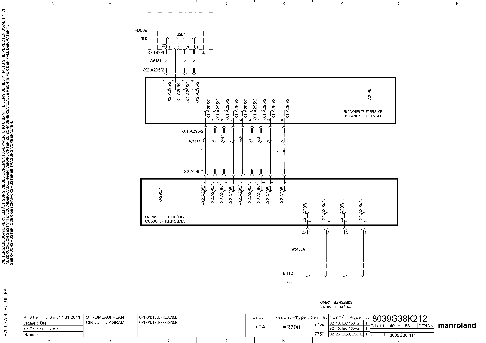

# +FA — Sheet 40 of 58 — OPTION: TELEPRESENCE

**OPTION: TELEPRESENCE**

> Part of the manroland **R700** printing press IEC/UL circuit diagrams.
> Drawing class: **Stromlaufplan / Circuit diagram** (DIN A3).
> Document `+FA` covers the **Delivery** machine section.

## At a glance

| Field | Value |
|---|---|
| Document | `+FA`  (8039G38K212) |
| Sheet | **40** of 58 |
| Section (DE) | OPTION: TELEPRESENCE |
| Section (EN) | OPTION: TELEPRESENCE |
| Section type | CIRCUIT — Circuit diagram |
| Machine type | `=R700` |
| Series | `7759` |
| Created | 17.01.2011 |
| Replaces | `8039G38I411` |
| Columns used | C, D, E, F |
| Path numbers | — |
| Labels on sheet | 90 |
| Cross-refs out | 2 |
| Cross-refs in | 30 |

**Previous:** [+FA sheet 39](SHEET_0039.md) · **Next:** [+FA sheet 41](SHEET_0041.md) · **Document TOC:** [_TOC.md](_TOC.md)  (+FA) · **Master TOC:** [all sheets](../_MASTER_TOC.md)

## Sheet image (300 DPI, exact vector render)



_Rendered directly from the PDF vector layer at 300 DPI (1-bit), no OCR and no resampling. Use it to confirm anything ambiguous in the text below._

## Cross-references on this sheet

Each entry is a wire leaving this sheet. The printed token is `/sheet.column`; the link resolves to that sheet inside the same document.

| Ref | Target sheet | Col | Path | Destination on target | Target section | From col |
|---|---|---|---|---|---|---|
| `/49.D` | [+FA sheet 49](SHEET_0049.md) | D | — | — | REFERENZMODUL | C |
| `/31.F` | [+FA sheet 31](SHEET_0031.md) | F | — | — | BEIPACK | E |

### Incoming references (sheets that point here)

Every other sheet that sends a wire to this one. `Back-ref` is the token printed on *that* sheet; `Path` is its line number.

| From sheet | Cols | Back-ref | Path | Refs | What continues there |
|---|---|---|---|---|---|
| [+FA#31](SHEET_0031.md) | E, F | `/31.E`, `/31.F` | — | 3 | — |
| [+FA#49](SHEET_0049.md) | D | `/49.D` | — | 1 | — |
| [+FA#51](SHEET_0051.md) | B | `/51.B` | — | 9 | — |
| [+FA#53](SHEET_0053.md) | E, F | `/53.E`, `/53.F` | — | 13 | — |
| [+FA#56](SHEET_0056.md) | G | `/56.G` | — | 4 | — |


## Devices on this sheet

| Tag | Class | Class meaning (IEC) | Col | Sub | Terminal | Sign |
|---|---|---|---|---|---|---|
| `A295/2` | A | Baugruppe / assembly, module, PC board | F | 2 | — | — |
| `A295/1` | A | Baugruppe / assembly, module, PC board | C | 1 | — | — |
| `B412` | B | Umformer / transducer, sensor | E | — | — | — |
| `D009` | D | Digital / binary element | C | — | — | — |
| `X7` | X | Klemme / terminal, plug connector | C | — | — | — |
| `W5185` | W | Kabel / cable, line, bus | C | — | — | — |
| `W5184` | W | Kabel / cable, line, bus | C | — | — | — |
| `X7.D009` | — | cross-device reference | C | — | — | — |

## Potentials / nets

_No named potentials on this sheet._

## Wire-end annotations (grouped as printed)

A wire that continues elsewhere is annotated with a small cluster: the destination description, the path/line number `#NN`, and the `/sheet.column` cross reference. Each row below is one such cluster exactly as it is grouped on the drawing.

| Col | Y | Path | Cross-ref | Text on the wire |
|---|---|---|---|---|
| C | 69.8 | — | — | `D009` |
| C | 80.8 | — | — | `USB 1` |
| C | 92.0 | — | `/49.D` | — |
| C | 109.3 | — | — | `X7` |
| C | 112.8 | — | — | `1 2 3 4` |
| C | 124.5 | — | — | `X7.D009` |
| C | 145.4 | — | — | `W5184` |
| C | 167.3 | — | — | `X2.A295/2` |
| C | 195.1 | — | — | `1 X2.A295/2.` |
| C | 196.2 | — | — | `2 X2.A295/2.` |
| C | 196.5 | — | — | `3 X2.A295/2.` |
| C | 196.5 | — | — | `4 X2.A295/2.` |
| F | 211.8 | — | — | `A295/2` |
| D | 239.0 | — | — | `1 X1.A295/2.` |
| D | 239.0 | — | — | `2 X1.A295/2.` |
| D | 239.0 | — | — | `3 X1.A295/2.` |
| D | 239.0 | — | — | `4 X1.A295/2.` |
| D | 239.0 | — | — | `5 X1.A295/2.` |
| D | 239.0 | — | — | `6 X1.A295/2.` |
| E | 239.0 | — | — | `7 X1.A295/2.` |
| E | 239.0 | — | — | `8 X1.A295/2.` |
| E | 239.0 | — | — | `9 X1.A295/2.` |
| F | 271.4 | — | — | `USB ADAPTER: TELEPRESENCE USB ADAPTER: TELEPRESENCE` |
| C | 317.6 | — | — | `X1.A295/2` |
| D | 331.4 | — | — | `ws/gn` |
| E | 333.0 | — | — | `ws/br` |
| D | 333.2 | — | — | `ws/or` |
| D | 333.5 | — | — | `ws/bl` |
| E | 339.8 | — | — | `SH` |
| D | 341.3 | — | — | `gn` |
| D | 343.1 | — | — | `or` |
| E | 343.1 | — | — | `br` |
| D | 343.5 | — | — | `bl` |
| C | 343.8 | — | — | `W5185` |
| C | 416.5 | — | — | `X2.A295/1` |
| D | 444.6 | — | — | `X2.A295/1. 1` |
| D | 445.7 | — | — | `X2.A295/1. 2` |
| D | 446.0 | — | — | `X2.A295/1. 3` |
| D | 446.0 | — | — | `X2.A295/1. 4` |
| D | 446.0 | — | — | `X2.A295/1. 5` |
| D | 446.0 | — | — | `X2.A295/1. 6` |
| E | 446.0 | — | — | `X2.A295/1. 7` |
| E | 446.0 | — | — | `X2.A295/1. 8` |
| E | 446.0 | — | — | `X2.A295/1. 9` |
| C | 459.0 | — | — | `A295/1` |
| E | 488.5 | — | — | `X1.A295/1. 1` |
| F | 488.5 | — | — | `X1.A295/1. 2` |
| F | 488.5 | — | — | `X1.A295/1. 3` |
| F | 488.5 | — | — | `X1.A295/1. 4` |
| C | 529.8 | — | — | `USB ADAPTER: TELEPRESENCE USB ADAPTER: TELEPRESENCE` |
| F | 567.2 | — | — | `X1 1 2 3 4` |
| E | 608.2 | — | — | `W5185A` |
| E | 666.4 | — | — | `B412` |
| E | 691.5 | — | `/31.F` | — |
| F | 739.8 | — | — | `KAMERA: TELEPRESENCE CAMERA: TELEPRESENCE` |


## Reconstructed tables

This sheet carries tabular content (pin map / terminal assignment / index). The grid below was rebuilt from the drawing's own rule lines, so each row is exactly one physical row of the table.

### Table 1 — 4 data rows × 21 columns (at x=345.3, y=76.5)

| /49.D | X7.D009 W5184 X2.A295/2 | X7 | 1 | USB 2 | 1 3 | 4 |  |  |  |  |  |  |  |  |  |  |  |  |  |  |
|---|---|---|---|---|---|---|---|---|---|---|---|---|---|---|---|---|---|---|---|---|
|  |  | `1` | `2 X2.A295/2.` | `3 X2.A295/2.` | `4 X2.A295/2.` | `X2.A295/2.` | `1` | `X1.A295/2. 2` | `X1.A295/2. 3` | `X1.A295/2. 4` | `X1.A295/2. 5` | `X1.A295/2. 6` | `X1.A295/2. 7` | `X1.A295/2. 8` | `X1.A295/2. 9` | `X1.A295/2.` |  | `USB` | `USB ADAPTER: ADAPTER:` | `A295/2 TELEPRESENCE TELEPRESENCE` |
|  |  |  |  |  | `X1.A295/2` | `ws/or W5185` |  | `or` | `ws/gn` | `bl` | `ws/bl` | `gn` | `ws/br` | `br` | `SH` |  |  |  |  |  |
|  |  |  |  |  | `X2.A295/1` |  |  |  |  |  |  |  |  |  |  |  |  |  |  |  |
|  | `USB ADAPTER: USB` | `A295/1 ADAPTER:` | `TELEPRESENCE TELEPRESENCE` |  |  | `X2.A295/1.` |  | `1 X2.A295/1.` | `2 X2.A295/1.` | `3 X2.A295/1.` | `4 X2.A295/1.` | `5 X2.A295/1.` | `6 X2.A295/1.` | `7 X2.A295/1.` | `8 X2.A295/1.` | `9 X1.A295/1.` | `X1.A295/1. 1` | `X1.A295/1. 2` | `X1.A295/1. 3` | `4` |


## Notes and free text on this sheet

| Text | Col | Y (pt) |
|---|---|---|
| `X1.A295/2` | C | 317.59 |
| `X2.A295/1` | C | 416.47 |
| `USB ADAPTER: TELEPRESENCE` | F | 271.45 |
| `X2.A295/2.` | C | 197.09 |
| `X2.A295/2.` | D | 197.09 |
| `X1.A295/2.` | D | 239.04 |
| `X1.A295/2.` | E | 239.04 |
| `X2.A295/2` | C | 167.35 |
| `USB ADAPTER: TELEPRESENCE` | C | 529.78 |
| `X2.A295/1.` | D | 446.54 |
| `X2.A295/1.` | E | 446.54 |
| `X1.A295/1.` | F | 488.49 |
| `X1.A295/1.` | E | 488.49 |
| `X1 1` | E | 567.25 |
| `KAMERA: TELEPRESENCE` | F | 739.75 |
| `CAMERA: TELEPRESENCE` | F | 750.39 |
| `USB 1` | C | 80.84 |
| `W5185A` | E | 608.17 |
| `ws/or` | D | 333.23 |
| `or` | D | 343.09 |
| `ws/gn` | D | 331.45 |
| `bl` | D | 343.53 |
| `ws/bl` | D | 333.47 |
| `gn` | D | 341.32 |
| `ws/br` | E | 333.03 |
| `br` | E | 343.09 |
| `SH` | E | 339.76 |

## Complete label inventory (exact text from the drawing)

Every text object inside the drawing area of this sheet, in DIN reading order (column A→H, then top→bottom). This is the authoritative list: if a string is not here it is not printed on this sheet.

| Col | Y | X | Dir | Type | Text |
|---|---|---|---|---|---|
| C | 69.8 | 331.7 | → | device tag | `D009` |
| C | 80.8 | 432.9 | → | text | `USB 1` |
| C | 92.0 | 345.3 | → | cross-reference | `/49.D` |
| C | 109.3 | 394.0 | → | device tag | `X7` |
| C | 112.8 | 413.0 | → | number | `1` |
| C | 113.2 | 436.3 | → | number | `2` |
| C | 113.2 | 458.9 | → | number | `3` |
| C | 124.5 | 357.4 | → | device ref | `X7.D009` |
| C | 145.4 | 363.9 | → | device tag | `W5184` |
| C | 167.4 | 349.2 | → | text | `X2.A295/2` |
| C | 195.1 | 399.6 | ↕ | number | `1` |
| C | 196.2 | 422.7 | ↕ | number | `2` |
| C | 196.5 | 445.4 | ↕ | number | `3` |
| C | 196.5 | 468.1 | ↕ | number | `4` |
| C | 197.1 | 410.5 | ↕ | text | `X2.A295/2.` |
| C | 197.1 | 433.1 | ↕ | text | `X2.A295/2.` |
| C | 197.1 | 455.8 | ↕ | text | `X2.A295/2.` |
| C | 317.6 | 445.6 | → | text | `X1.A295/2` |
| C | 343.8 | 460.3 | → | device tag | `W5185` |
| C | 416.5 | 447.0 | → | text | `X2.A295/1` |
| C | 459.0 | 388.1 | ↕ | device tag | `A295/1` |
| C | 529.8 | 355.8 | → | text | `USB ADAPTER: TELEPRESENCE` |
| C | 540.4 | 355.8 | → | text | `USB ADAPTER: TELEPRESENCE` |
| D | 113.2 | 481.6 | → | number | `4` |
| D | 197.1 | 478.5 | ↕ | text | `X2.A295/2.` |
| D | 239.0 | 506.8 | ↕ | text | `X1.A295/2.` |
| D | 239.0 | 529.5 | ↕ | text | `X1.A295/2.` |
| D | 239.0 | 552.2 | ↕ | text | `X1.A295/2.` |
| D | 239.0 | 574.9 | ↕ | text | `X1.A295/2.` |
| D | 239.0 | 597.5 | ↕ | text | `X1.A295/2.` |
| D | 292.6 | 519.0 | ↕ | number | `2` |
| D | 292.7 | 496.0 | ↕ | number | `1` |
| D | 292.7 | 541.8 | ↕ | number | `3` |
| D | 292.7 | 564.5 | ↕ | number | `4` |
| D | 292.7 | 587.1 | ↕ | number | `5` |
| D | 292.7 | 609.8 | ↕ | number | `6` |
| D | 331.5 | 540.4 | ↕ | text | `ws/gn` |
| D | 333.2 | 495.2 | ↕ | text | `ws/or` |
| D | 333.5 | 585.8 | ↕ | text | `ws/bl` |
| D | 341.3 | 608.4 | ↕ | text | `gn` |
| D | 343.1 | 517.9 | ↕ | text | `or` |
| D | 343.5 | 563.0 | ↕ | text | `bl` |
| D | 444.6 | 506.3 | ↕ | number | `1` |
| D | 445.7 | 529.3 | ↕ | number | `2` |
| D | 446.0 | 552.1 | ↕ | number | `3` |
| D | 446.0 | 574.8 | ↕ | number | `4` |
| D | 446.0 | 597.4 | ↕ | number | `5` |
| D | 446.5 | 493.0 | ↕ | text | `X2.A295/1.` |
| D | 446.5 | 515.7 | ↕ | text | `X2.A295/1.` |
| D | 446.5 | 538.4 | ↕ | text | `X2.A295/1.` |
| D | 446.5 | 561.1 | ↕ | text | `X2.A295/1.` |
| D | 446.5 | 583.7 | ↕ | text | `X2.A295/1.` |
| D | 446.5 | 606.4 | ↕ | text | `X2.A295/1.` |
| E | 239.0 | 620.2 | ↕ | text | `X1.A295/2.` |
| E | 239.0 | 642.9 | ↕ | text | `X1.A295/2.` |
| E | 239.0 | 665.6 | ↕ | text | `X1.A295/2.` |
| E | 239.0 | 699.6 | ↕ | text | `X1.A295/2.` |
| E | 292.7 | 632.5 | ↕ | number | `7` |
| E | 292.7 | 655.2 | ↕ | number | `8` |
| E | 292.7 | 689.2 | ↕ | number | `9` |
| E | 333.0 | 631.2 | ↕ | text | `ws/br` |
| E | 339.8 | 687.8 | ↕ | text | `SH` |
| E | 343.1 | 653.8 | ↕ | text | `br` |
| E | 446.0 | 620.1 | ↕ | number | `6` |
| E | 446.0 | 642.8 | ↕ | number | `7` |
| E | 446.0 | 665.5 | ↕ | number | `8` |
| E | 446.0 | 699.5 | ↕ | number | `9` |
| E | 446.5 | 629.1 | ↕ | text | `X2.A295/1.` |
| E | 446.5 | 651.8 | ↕ | text | `X2.A295/1.` |
| E | 446.5 | 685.8 | ↕ | text | `X2.A295/1.` |
| E | 488.5 | 742.5 | ↕ | text | `X1.A295/1.` |
| E | 542.2 | 755.7 | ↕ | number | `1` |
| E | 567.3 | 739.4 | → | text | `X1 1` |
| E | 608.2 | 713.8 | → | text | `W5185A` |
| E | 666.4 | 689.4 | → | device tag | `B412` |
| E | 691.6 | 703.1 | → | cross-reference | `/31.F` |
| F | 211.8 | 901.2 | ↕ | device tag | `A295/2` |
| F | 271.4 | 836.9 | → | text | `USB ADAPTER: TELEPRESENCE` |
| F | 282.1 | 837.1 | → | text | `USB ADAPTER: TELEPRESENCE` |
| F | 488.5 | 787.8 | ↕ | text | `X1.A295/1.` |
| F | 488.5 | 833.2 | ↕ | text | `X1.A295/1.` |
| F | 488.5 | 878.6 | ↕ | text | `X1.A295/1.` |
| F | 542.1 | 801.5 | ↕ | number | `2` |
| F | 542.2 | 846.9 | ↕ | number | `3` |
| F | 542.2 | 892.2 | ↕ | number | `4` |
| F | 567.3 | 801.9 | → | number | `2` |
| F | 567.3 | 847.3 | → | number | `3` |
| F | 567.3 | 892.6 | → | number | `4` |
| F | 739.7 | 783.1 | → | text | `KAMERA: TELEPRESENCE` |
| F | 750.4 | 783.3 | → | text | `CAMERA: TELEPRESENCE` |

## Reading-order text block

The same content as a plain block, grouped by DIN column — convenient to paste or to match against a visual description.

```text
=== Column C ===
  69.8  331.7  devtag       D009
  80.8  432.9  text         USB 1
  92.0  345.3  xref         /49.D
 109.3  394.0  devtag       X7
 112.8  413.0  numeric      1
 113.2  436.3  numeric      2
 113.2  458.9  numeric      3
 124.5  357.4  devref       X7.D009
 145.4  363.9  devtag       W5184
 167.4  349.2  text         X2.A295/2
 195.1  399.6  numeric      1
 196.2  422.7  numeric      2
 196.5  445.4  numeric      3
 196.5  468.1  numeric      4
 197.1  410.5  text         X2.A295/2.
 197.1  433.1  text         X2.A295/2.
 197.1  455.8  text         X2.A295/2.
 317.6  445.6  text         X1.A295/2
 343.8  460.3  devtag       W5185
 416.5  447.0  text         X2.A295/1
 459.0  388.1  devtag       A295/1
 529.8  355.8  text         USB ADAPTER: TELEPRESENCE
 540.4  355.8  text         USB ADAPTER: TELEPRESENCE
=== Column D ===
 113.2  481.6  numeric      4
 197.1  478.5  text         X2.A295/2.
 239.0  506.8  text         X1.A295/2.
 239.0  529.5  text         X1.A295/2.
 239.0  552.2  text         X1.A295/2.
 239.0  574.9  text         X1.A295/2.
 239.0  597.5  text         X1.A295/2.
 292.6  519.0  numeric      2
 292.7  496.0  numeric      1
 292.7  541.8  numeric      3
 292.7  564.5  numeric      4
 292.7  587.1  numeric      5
 292.7  609.8  numeric      6
 331.5  540.4  text         ws/gn
 333.2  495.2  text         ws/or
 333.5  585.8  text         ws/bl
 341.3  608.4  text         gn
 343.1  517.9  text         or
 343.5  563.0  text         bl
 444.6  506.3  numeric      1
 445.7  529.3  numeric      2
 446.0  552.1  numeric      3
 446.0  574.8  numeric      4
 446.0  597.4  numeric      5
 446.5  493.0  text         X2.A295/1.
 446.5  515.7  text         X2.A295/1.
 446.5  538.4  text         X2.A295/1.
 446.5  561.1  text         X2.A295/1.
 446.5  583.7  text         X2.A295/1.
 446.5  606.4  text         X2.A295/1.
=== Column E ===
 239.0  620.2  text         X1.A295/2.
 239.0  642.9  text         X1.A295/2.
 239.0  665.6  text         X1.A295/2.
 239.0  699.6  text         X1.A295/2.
 292.7  632.5  numeric      7
 292.7  655.2  numeric      8
 292.7  689.2  numeric      9
 333.0  631.2  text         ws/br
 339.8  687.8  text         SH
 343.1  653.8  text         br
 446.0  620.1  numeric      6
 446.0  642.8  numeric      7
 446.0  665.5  numeric      8
 446.0  699.5  numeric      9
 446.5  629.1  text         X2.A295/1.
 446.5  651.8  text         X2.A295/1.
 446.5  685.8  text         X2.A295/1.
 488.5  742.5  text         X1.A295/1.
 542.2  755.7  numeric      1
 567.3  739.4  text         X1 1
 608.2  713.8  text         W5185A
 666.4  689.4  devtag       B412
 691.6  703.1  xref         /31.F
=== Column F ===
 211.8  901.2  devtag       A295/2
 271.4  836.9  text         USB ADAPTER: TELEPRESENCE
 282.1  837.1  text         USB ADAPTER: TELEPRESENCE
 488.5  787.8  text         X1.A295/1.
 488.5  833.2  text         X1.A295/1.
 488.5  878.6  text         X1.A295/1.
 542.1  801.5  numeric      2
 542.2  846.9  numeric      3
 542.2  892.2  numeric      4
 567.3  801.9  numeric      2
 567.3  847.3  numeric      3
 567.3  892.6  numeric      4
 739.7  783.1  text         KAMERA: TELEPRESENCE
 750.4  783.3  text         CAMERA: TELEPRESENCE
```

---
_Generated from the PDF vector text layer; no OCR. Source: `R700_7759_IEC_UL_FA`, sheet 40._
