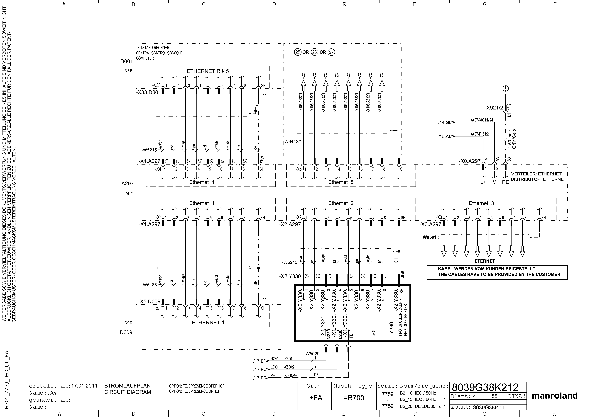

# +FA — Sheet 41 of 58 — OPTION: TELEPRESENCE ODER ICP

**OPTION: TELEPRESENCE OR ICP**

> Part of the manroland **R700** printing press IEC/UL circuit diagrams.
> Drawing class: **Stromlaufplan / Circuit diagram** (DIN A3).
> Document `+FA` covers the **Delivery** machine section.

## At a glance

| Field | Value |
|---|---|
| Document | `+FA`  (8039G38K212) |
| Sheet | **41** of 58 |
| Section (DE) | OPTION: TELEPRESENCE ODER ICP |
| Section (EN) | OPTION: TELEPRESENCE OR ICP |
| Section type | CIRCUIT — Circuit diagram |
| Machine type | `=R700` |
| Series | `7759` |
| Created | 17.01.2011 |
| Replaces | `8039G38I411` |
| Columns used | B, C, D, E, F, G, H |
| Path numbers | — |
| Labels on sheet | 229 |
| Cross-refs out | 9 |
| Cross-refs in | 89 |

**Previous:** [+FA sheet 40](SHEET_0040.md) · **Next:** [+FA sheet 42](SHEET_0042.md) · **Document TOC:** [_TOC.md](_TOC.md)  (+FA) · **Master TOC:** [all sheets](../_MASTER_TOC.md)

## Sheet image (300 DPI, exact vector render)



_Rendered directly from the PDF vector layer at 300 DPI (1-bit), no OCR and no resampling. Use it to confirm anything ambiguous in the text below._

## Cross-references on this sheet

Each entry is a wire leaving this sheet. The printed token is `/sheet.column`; the link resolves to that sheet inside the same document.

| Ref | Target sheet | Col | Path | Destination on target | Target section | From col |
|---|---|---|---|---|---|---|
| `/48.B` | [+FA sheet 48](SHEET_0048.md) | B | — | — | REFERENZMODUL | B |
| `/14.G` | [+FA sheet 14](SHEET_0014.md) | G | — | +A497 X001:M24+ | SPANNUNGSVERSORGUNG: | G |
| `/15.A` | [+FA sheet 15](SHEET_0015.md) | A | — | +A497 F151:2 | SPANNUNGSVERSORGUNG: | G |
| `/4.C` | [+FA sheet 4](SHEET_0004.md) | C | — | — | ANORDNUNGSPLAN A497 | B |
| `/49.D` | [+FA sheet 49](SHEET_0049.md) | D | — | ETHERNET 1 | REFERENZMODUL | C |
| `/5.G` | [+FA sheet 5](SHEET_0005.md) | G | — | — | ANORDNUNGSPLAN | E |
| `/17.E` | [+FA sheet 17](SHEET_0017.md) | E | — | X500:1 N230 L230 X500:2 PE X500:PE | SPANNUNGSVERSORGUNG: | D |
| `/17.E` | [+FA sheet 17](SHEET_0017.md) | E | — | X500:1 N230 L230 X500:2 PE X500:PE | SPANNUNGSVERSORGUNG: | D |
| `/17.E` | [+FA sheet 17](SHEET_0017.md) | E | — | X500:1 N230 L230 X500:2 PE X500:PE | SPANNUNGSVERSORGUNG: | D |

### Incoming references (sheets that point here)

Every other sheet that sends a wire to this one. `Back-ref` is the token printed on *that* sheet; `Path` is its line number.

| From sheet | Cols | Back-ref | Path | Refs | What continues there |
|---|---|---|---|---|---|
| [+FA#4](SHEET_0004.md) | C | `/4.C` | — | 1 | — |
| [+FA#5](SHEET_0005.md) | G | `/5.G` | — | 1 | — |
| [+FA#14](SHEET_0014.md) | G | `/14.G` | — | 1 | X X0.A297:2 |
| [+FA#15](SHEET_0015.md) | A | `/15.A` | — | 1 | X0.A297:1 X |
| [+FA#17](SHEET_0017.md) | E | `/17.E` | — | 3 | L230 X1.Y330:2; N230 X1.Y330:1; PE X1.Y330:PE |
| [+FA#48](SHEET_0048.md) | B | `/48.B` | — | 1 | — |
| [+FA#49](SHEET_0049.md) | D | `/49.D` | — | 1 | — |
| [+FA#51](SHEET_0051.md) | A, B, C | `/51.A`, `/51.B`, `/51.C` | — | 15 | — |
| [+FA#53](SHEET_0053.md) | A, G | `/53.A`, `/53.G` | — | 27 | — |
| [+FA#54](SHEET_0054.md) | A, C, D | `/54.A`, `/54.C`, `/54.D` | — | 27 | — |
| [+FA#55](SHEET_0055.md) | C | `/55.C` | — | 9 | — |
| [+FA#57](SHEET_0057.md) | E, F | `/57.E`, `/57.F` | — | 2 | — |


## Devices on this sheet

| Tag | Class | Class meaning (IEC) | Col | Sub | Terminal | Sign |
|---|---|---|---|---|---|---|
| `X500:PE` | X | Klemme / terminal, plug connector | D | — | PE | — |
| `X500:2` | X | Klemme / terminal, plug connector | D | — | 2 | — |
| `N230` | N | Netzteil / power unit, amplifier | D | — | — | — |
| `X500:1` | X | Klemme / terminal, plug connector | D | — | 1 | — |
| `N230` | N | Netzteil / power unit, amplifier | E | — | — | — |
| `Y330` | Y | Magnetventil / solenoid valve, actuator | F | — | — | — |
| `D001` | D | Digital / binary element | B | — | — | — |
| `X33` | X | Klemme / terminal, plug connector | B | — | — | — |
| `D009` | D | Digital / binary element | B | — | — | — |
| `X5` | X | Klemme / terminal, plug connector | B | — | — | — |
| `A297` | A | Baugruppe / assembly, module, PC board | B | — | — | — |
| `X4` | X | Klemme / terminal, plug connector | B | — | — | — |
| `X1` | X | Klemme / terminal, plug connector | B | — | — | — |
| `X2` | X | Klemme / terminal, plug connector | D | — | — | — |
| `X5` | X | Klemme / terminal, plug connector | D | — | — | — |
| `X3` | X | Klemme / terminal, plug connector | F | — | — | — |
| `X921/2` | X | Klemme / terminal, plug connector | G | 2 | — | — |
| `W9501` | W | Kabel / cable, line, bus | F | — | — | — |
| `W9443/1` | W | Kabel / cable, line, bus | D | 1 | — | — |
| `W5188` | W | Kabel / cable, line, bus | B | — | — | — |
| `W5029` | W | Kabel / cable, line, bus | E | — | — | — |
| `W5243` | W | Kabel / cable, line, bus | D | — | — | — |
| `W5215` | W | Kabel / cable, line, bus | B | — | — | — |
| `X5.D009` | — | cross-device reference | B | — | — | — |
| `X3.A297` | — | cross-device reference | F | — | — | — |
| `X2.A297` | — | cross-device reference | D | — | — | — |
| `X1.A297` | — | cross-device reference | B | — | — | — |
| `X1.Y330.` | — | cross-device reference | E | — | — | — |
| `X1.Y330.` | — | cross-device reference | E | — | — | — |
| `X1.Y330.` | — | cross-device reference | E | — | — | — |
| `X2.Y330.` | — | cross-device reference | F | — | — | — |
| `X2.Y330.` | — | cross-device reference | E | — | — | — |
| `X2.Y330.` | — | cross-device reference | E | — | — | — |
| `X2.Y330.` | — | cross-device reference | E | — | — | — |
| `X2.Y330.` | — | cross-device reference | E | — | — | — |
| `X2.Y330.` | — | cross-device reference | E | — | — | — |
| `X2.Y330.` | — | cross-device reference | E | — | — | — |
| `X2.Y330.` | — | cross-device reference | E | — | — | — |
| `X2.Y330.` | — | cross-device reference | D | — | — | — |
| `X2.Y330` | — | cross-device reference | D | — | — | — |
| `X33.D001` | — | cross-device reference | B | — | — | — |
| `X4.A297` | — | cross-device reference | B | — | — | — |
| `X0.A297` | — | cross-device reference | G | — | — | — |

## Potentials / nets

| Potential | Count | Columns | Attached devices | Terminals |
|---|---|---|---|---|
| `L230` | 2 | D, E | — | — |
| `PE` | 4 | D, E, G | — | — |


A potential such as `L24+/4` or `M24+` is a named supply/return rail; every place it appears on this sheet is electrically common.

## Conductor data

Each label annotates **the wire beside it**, not the sheet. These summaries are inventories of what is printed; they are not a per-wire map. For a specific conductor, read the label that sits on that wire (see the label inventory below, or the sheet image).

**Cross-section labels printed on this sheet:** 1.5 mm² (×1)

## Wire-end annotations (grouped as printed)

A wire that continues elsewhere is annotated with a small cluster: the destination description, the path/line number `#NN`, and the `/sheet.column` cross reference. Each row below is one such cluster exactly as it is grouped on the drawing.

| Col | Y | Path | Cross-ref | Text on the wire |
|---|---|---|---|---|
| B | 93.5 | — | — | `LEITSTAND RECHNER` |
| E | 101.2 | — | — | `25 26 27` |
| E | 101.6 | — | — | `OR OR` |
| B | 104.1 | — | — | `CENTRAL CONTROL CONSOLE COMPUTER` |
| B | 119.4 | — | — | `D001` |
| C | 139.2 | — | — | `ETHERNET RJ45` |
| B | 140.2 | — | `/48.B` | — |
| D | 147.3 | — | — | `X105.A532/1 +ZX` |
| E | 147.3 | — | — | `X105.A532/1 +ZX` |
| E | 147.3 | — | — | `X105.A532/1 +ZX` |
| E | 147.3 | — | — | `X105.A532/1 +ZX` |
| E | 147.3 | — | — | `X105.A532/1 +ZX` |
| E | 147.3 | — | — | `X105.A532/1 +ZX` |
| E | 147.3 | — | — | `X105.A532/1 +ZX` |
| F | 147.3 | — | — | `X105.A532/1 +ZX` |
| C | 168.8 | — | — | `X33 1 2 3 4 5 6 7 8` |
| D | 169.9 | — | — | `SH` |
| B | 181.7 | — | — | `X33.D001` |
| G | 209.5 | — | — | `1/12` |
| G | 212.9 | — | — | `X921/2` |
| G | 227.9 | — | — | `1/1` |
| G | 239.5 | — | `/14.G` | `+A497 X001:M24+` |
| G | 260.6 | — | — | `1.50 mm² Grün/Gelb` |
| G | 267.8 | — | `/15.A` | `+A497 F151:2` |
| C | 281.6 | — | — | `3 ws/gn` |
| D | 281.8 | — | — | `W9443/1` |
| C | 283.2 | — | — | `7 ws/br` |
| C | 283.6 | — | — | `5 ws/bl` |
| B | 283.8 | — | — | `1 ws/or` |
| C | 291.1 | — | — | `6 gn` |
| D | 292.6 | — | — | `8 br` |
| C | 292.8 | — | — | `2 or` |
| C | 293.1 | — | — | `4 bl` |
| D | 294.6 | — | — | `SH` |
| B | 299.0 | — | — | `W5215` |
| D | 315.1 | — | — | `SH/9` |
| G | 317.4 | — | — | `2/3` |
| G | 317.4 | — | — | `3/3` |
| G | 317.9 | — | — | `1/3` |
| C | 320.3 | — | — | `2/9` |
| C | 320.3 | — | — | `3/9` |
| C | 320.3 | — | — | `4/9` |
| C | 320.3 | — | — | `5/9` |
| C | 320.3 | — | — | `6/9` |
| C | 320.3 | — | — | `7/9` |
| D | 320.3 | — | — | `8/9` |
| B | 320.6 | — | — | `X4.A297` |
| G | 320.6 | — | — | `X0.A297` |
| B | 320.7 | — | — | `1/9` |
| E | 336.7 | — | — | `1 2 3 4 5 6 7 8 SH 1 2 3 4 5 6 7 8 SH 1 2 3` |
| B | 337.4 | — | — | `X4` |
| D | 337.4 | — | — | `X5` |
| H | 347.5 | — | — | `DISTRIBUTOR: ETHERNET VERTEILER: ETHERNET` |
| G | 363.1 | — | — | `L+ M PE` |
| D | 363.2 | — | — | `Ethernet 4 Ethernet 5` |
| B | 366.0 | — | — | `A297` |
| B | 387.2 | — | `/4.C` | — |
| E | 405.7 | — | — | `Ethernet 1 Ethernet 2 Ethernet 3` |
| C | 435.1 | — | — | `X1 X2` |
| E | 435.2 | — | — | `1 2 3 4 5 6 7 8 SH 1 2 3 4 5 6 7 8 SH X3 1 2 3 4 5 6 7 8 SH` |
| D | 448.2 | — | — | `X1.A297 X2.A297 X3.A297` |
| F | 475.1 | — | — | `W9501` |
| E | 513.4 | — | — | `ws/gn` |
| E | 515.0 | — | — | `ws/br` |
| D | 515.2 | — | — | `ws/or` |
| E | 515.4 | — | — | `ws/bl` |
| F | 521.4 | — | — | `SH` |
| G | 523.2 | — | — | `ETERNET` |
| E | 523.3 | — | — | `gn` |
| E | 525.0 | — | — | `or` |
| F | 525.0 | — | — | `br` |
| E | 525.5 | — | — | `bl` |
| D | 525.8 | — | — | `W5243` |
| G | 538.9 | — | — | `KABEL WERDEN VOM KUNDEN BEIGESTELLT` |
| F | 547.5 | — | — | `X2.Y330. SH SH/9 PROTOCOL PRINTER` |
| G | 550.2 | — | — | `THE CABLES HAVE TO BE PROVIDED BY THE CUSTOMER` |
| E | 552.7 | — | — | `2/9` |
| E | 552.7 | — | — | `3/9` |
| E | 552.7 | — | — | `4/9` |
| E | 552.7 | — | — | `5/9` |
| E | 552.7 | — | — | `6/9` |
| E | 552.7 | — | — | `7/9` |
| F | 552.7 | — | — | `8/9` |
| D | 553.1 | — | — | `X2.Y330` |
| D | 553.1 | — | — | `1/9` |
| C | 553.7 | — | — | `3 ws/gn` |
| C | 555.3 | — | — | `7 ws/br` |
| C | 555.8 | — | — | `5 ws/bl` |
| B | 555.9 | — | — | `1 ws/or` |
| C | 563.2 | — | — | `6 gn` |
| D | 564.8 | — | — | `8 br` |
| C | 565.0 | — | — | `2 or` |
| C | 565.2 | — | — | `4 bl` |
| D | 566.7 | — | — | `SH` |
| B | 571.1 | — | — | `W5188` |
| D | 582.2 | — | — | `X2.Y330. 1` |
| E | 582.8 | — | — | `X2.Y330. 2 X2.Y330. 3` |
| E | 582.8 | — | — | `X2.Y330. 4` |
| E | 582.8 | — | — | `X2.Y330. 5` |
| E | 582.8 | — | — | `X2.Y330. 6` |
| E | 582.8 | — | — | `X2.Y330. 7` |
| F | 582.8 | — | — | `X2.Y330. 8` |
| B | 604.1 | — | — | `X5.D009` |
| F | 609.4 | — | — | `PROTOKOLLDRUCKER` |
| C | 618.8 | — | — | `X5 1 2 3 4 5 6 7 8` |
| D | 619.2 | — | — | `SH` |
| E | 634.1 | — | — | `X1.Y330.` |
| E | 634.1 | — | — | `X1.Y330.` |
| E | 634.1 | — | — | `X1.Y330. PE` |
| C | 646.6 | — | `/49.D` | `ETHERNET 1` |
| F | 650.0 | — | — | `Y330` |
| E | 664.4 | — | — | `N230` |
| E | 665.4 | — | — | `L230` |
| E | 665.4 | — | `/5.G` | — |
| B | 666.5 | — | — | `D009` |
| E | 710.3 | — | — | `W5029` |
| E | 719.4 | — | — | `1` |
| D | 721.3 | — | `/17.E`, `/17.E`, `/17.E` | `N230 L230 PE X500:1 X500:2 X500:PE` |
| E | 736.8 | — | — | `2` |
| E | 753.8 | — | — | `PE` |


## Reconstructed tables

This sheet carries tabular content (pin map / terminal assignment / index). The grid below was rebuilt from the drawing's own rule lines, so each row is exactly one physical row of the table.

### Table 1 — 7 data rows × 11 columns (at x=294.8, y=133.2)

| X33 X33.D001 | 1 | 2 | 3 | ETHERNET 4 | 5 | RJ45 6 | 7 | 8 | SH |  |
|---|---|---|---|---|---|---|---|---|---|---|
| `1 ws/or W5215 X4.A297 X4` | `2 or 1/9 1` | `3 ws/gn 2/9 2` | `6 gn 3/9 3` | `4 bl 4/9 4 Ethernet` | `5 ws/bl 5/9 5 4` | `7 ws/br 6/9 6` | `8 br 7/9 7` | `SH 8/9 8` | `SH/9 SH` |  |
| `X1 X1.A297` | `1` | `2` | `3` | `Ethernet 4` | `1 5` | `6` | `7` | `8` | `SH` |  |
| `1 ws/or` | `2 or` | `3 ws/gn` | `6 gn` | `4 bl` | `5 ws/bl` | `7 ws/br` | `8 br` | `SH` |  |  |
| `W5188 X5.D009 X5` | `1` | `2` | `3` | `4 ETHERNET` | `5` | `6 1` | `7` | `8` | `SH` |  |
|  |  |  |  |  |  |  |  |  |  | `N230` |
|  |  |  |  |  |  |  |  |  | `/17.E` | `L230` |
|  |  |  |  |  |  |  |  |  | `/17.E` | `PE` |


### Table 2 — 9 data rows × 11 columns (at x=578.3, y=133.2)

|  | X105.A532/1 | X105.A532/1 | X105.A532/1 | X105.A532/1 | X105.A532/1 | X105.A532/1 | X105.A532/1 | X105.A532/1 |  |  |
|---|---|---|---|---|---|---|---|---|---|---|
| `W9443/1` | `X5` | `1` | `2` | `3` | `4 Ethernet` | `5 5` | `6` | `7` | `8` | `SH` |
| `X2.A297` | `X2` | `1` | `2` | `3` | `Ethernet 4` | `2 5` | `6` | `7` | `8` | `SH` |
| `W5243` | `ws/or` | `or` | `ws/gn` | `bl` | `ws/bl` | `gn` | `ws/br` | `br` | `SH` |  |
| `X2.Y330` |  | `1/9` | `2/9` | `3/9` | `4/9` | `5/9` | `6/9` | `7/9` | `8/9` | `SH/9` |
|  | `X2.Y330.` | `1 X2.Y330.` | `X2.Y330. 2 X1.Y330.` | `X2.Y330. 3 X1.Y330.` | `X2.Y330. 4 X1.Y330.` | `X2.Y330. 5` | `X2.Y330. 6` | `X2.Y330. 7` | `X2.Y330. 8` | `SH PROTOKOLLDRUCKER PRINTER` |
|  |  |  |  | `N230` | `L230` | `PE` |  | `/5.G` | `Y330` | `PROTOCOL` |
| `X500:1` |  | `W5029` |  |  |  |  |  |  |  |  |
| `X500:2` |  |  | `2` |  |  |  |  |  |  |  |
| `X500:PE` |  |  | `PE` |  |  |  |  |  |  |  |


### Table 3 — 10 data rows × 13 columns (at x=861.7, y=133.2)

|  |  |  |  |  |  | X921/2 |  |  | 1/12 |  |  |  |
|---|---|---|---|---|---|---|---|---|---|---|---|---|
|  |  |  |  |  |  |  |  |  | `1/1` |  |  |  |
|  |  |  |  | `+A497 X001:M24+` |  |  |  |  |  |  |  |  |
| `/14.G` |  |  |  |  |  |  |  |  |  |  |  |  |
|  |  |  |  | `+A497 F151:2` |  |  |  |  | `mm²` |  |  |  |
| `/15.A` |  |  | `X0.A297` |  | `1/3 1 L+` | `M` | `2/3 2` | `PE` | `1.50 3/3 3` | `Grün/Gelb` | `VERTEILER: DISTRIBUTOR:` | `ETHERNET ETHERNET` |
| `X3 X3.A297` | `1` | `2` | `3` | `Ethernet 4` |  | `3 5` |  | `6` |  | `7` | `8` | `SH` |
| `W9501` |  |  |  |  |  |  |  |  |  |  |  |  |
|  |  |  |  |  | `ETERNET` |  |  |  |  |  |  |  |
|  | `KABEL` | `WERDEN` |  | `VOM` |  |  | `KUNDEN` |  |  | `BEIGESTELLT` |  |  |
| `THE` |  | `CABLES` | `HAVE` |  | `TO` | `BE` |  |  | `PROVIDED` | `BY` | `THE` | `CUSTOMER` |


## Notes and free text on this sheet

| Text | Col | Y (pt) |
|---|---|---|
| `PROTOKOLLDRUCKER` | F | 609.37 |
| `PROTOCOL PRINTER` | F | 614 |
| `SH/9` | F | 547.49 |
| `SH` | F | 583.09 |
| `SH/9` | D | 315.05 |
| `ETHERNET RJ45` | C | 139.2 |
| `LEITSTAND RECHNER` | B | 93.47 |
| `CENTRAL CONTROL CONSOLE` | B | 104.11 |
| `COMPUTER` | B | 114.75 |
| `SH` | D | 169.91 |
| `ETHERNET 1` | C | 646.61 |
| `SH` | H | 436.36 |
| `Ethernet 1` | C | 405.73 |
| `Ethernet 2` | E | 405.73 |
| `Ethernet 3` | G | 405.73 |
| `Ethernet 4` | C | 363.21 |
| `Ethernet 5` | E | 363.21 |
| `VERTEILER: ETHERNET` | H | 347.5 |
| `DISTRIBUTOR: ETHERNET` | H | 358.15 |
| `L+` | G | 363.11 |
| `M` | G | 363.17 |
| `+A497 F151:2` | G | 267.81 |
| `+A497 X001:M24+` | G | 239.47 |
| `+ZX` | D | 147.27 |
| `X105.A532/1` | D | 187.09 |
| `+ZX` | E | 147.27 |
| `X105.A532/1` | E | 187.09 |
| `+ZX` | F | 147.27 |
| `X105.A532/1` | F | 187.09 |
| `KABEL WERDEN VOM KUNDEN BEIGESTELLT` | G | 538.88 |
| `THE CABLES HAVE TO BE PROVIDED BY THE CUSTOMER` | G | 550.22 |
| `ETERNET` | G | 523.21 |
| `OR` | D | 101.59 |
| `OR` | E | 101.59 |
| `8 br` | D | 564.77 |
| `7 ws/br` | C | 555.31 |
| `5 ws/bl` | C | 555.75 |
| `4 bl` | C | 565.21 |
| `6 gn` | C | 563.19 |
| `3 ws/gn` | C | 553.73 |
| `1 ws/or` | B | 555.91 |
| `2 or` | C | 564.97 |
| `br` | F | 525.05 |
| `ws/bl` | E | 515.42 |
| `ws/br` | E | 514.99 |
| `or` | E | 525.05 |
| `bl` | E | 525.49 |
| `ws/or` | D | 515.19 |
| `ws/gn` | E | 513.41 |
| `gn` | E | 523.27 |
| `Grün/Gelb` | G | 260.65 |

## Complete label inventory (exact text from the drawing)

Every text object inside the drawing area of this sheet, in DIN reading order (column A→H, then top→bottom). This is the authoritative list: if a string is not here it is not printed on this sheet.

| Col | Y | X | Dir | Type | Text |
|---|---|---|---|---|---|
| B | 93.5 | 274.1 | → | text | `LEITSTAND RECHNER` |
| B | 104.1 | 274.7 | → | text | `CENTRAL CONTROL CONSOLE` |
| B | 114.7 | 274.7 | → | text | `COMPUTER` |
| B | 119.4 | 239.5 | → | device tag | `D001` |
| B | 140.2 | 252.0 | → | cross-reference | `/48.B` |
| B | 168.8 | 307.6 | → | device tag | `X33` |
| B | 169.5 | 333.6 | → | number | `1` |
| B | 181.7 | 274.4 | → | device ref | `X33.D001` |
| B | 283.8 | 320.3 | ↕ | text | `1 ws/or` |
| B | 299.0 | 285.4 | → | device tag | `W5215` |
| B | 320.6 | 279.5 | → | device ref | `X4.A297` |
| B | 320.7 | 332.9 | ↕ | pin pair | `1/9` |
| B | 337.4 | 313.2 | → | device tag | `X4` |
| B | 338.1 | 330.8 | → | number | `1` |
| B | 366.0 | 241.5 | → | device tag | `A297` |
| B | 387.2 | 253.4 | → | cross-reference | `/4.C` |
| B | 435.1 | 314.2 | → | device tag | `X1` |
| B | 435.9 | 332.2 | → | number | `1` |
| B | 448.2 | 279.5 | → | device ref | `X1.A297` |
| B | 555.9 | 320.3 | ↕ | text | `1 ws/or` |
| B | 571.1 | 285.4 | → | device tag | `W5188` |
| B | 604.1 | 278.9 | → | device ref | `X5.D009` |
| B | 618.8 | 333.6 | → | number | `1` |
| B | 619.5 | 311.8 | → | device tag | `X5` |
| B | 649.1 | 251.8 | → | cross-reference | `/49.D` |
| B | 666.4 | 238.1 | → | device tag | `D009` |
| C | 139.2 | 376.9 | → | text | `ETHERNET RJ45` |
| C | 169.8 | 356.9 | → | number | `2` |
| C | 169.9 | 379.6 | → | number | `3` |
| C | 169.9 | 402.2 | → | number | `4` |
| C | 169.9 | 424.9 | → | number | `5` |
| C | 169.9 | 447.6 | → | number | `6` |
| C | 169.9 | 470.3 | → | number | `7` |
| C | 281.6 | 365.6 | ↕ | text | `3 ws/gn` |
| C | 283.2 | 456.3 | ↕ | text | `7 ws/br` |
| C | 283.6 | 433.6 | ↕ | text | `5 ws/bl` |
| C | 291.1 | 388.3 | ↕ | text | `6 gn` |
| C | 292.8 | 343.0 | ↕ | text | `2 or` |
| C | 293.1 | 410.9 | ↕ | text | `4 bl` |
| C | 320.3 | 355.6 | ↕ | pin pair | `2/9` |
| C | 320.3 | 378.3 | ↕ | pin pair | `3/9` |
| C | 320.3 | 401.0 | ↕ | pin pair | `4/9` |
| C | 320.3 | 423.7 | ↕ | pin pair | `5/9` |
| C | 320.3 | 446.3 | ↕ | pin pair | `6/9` |
| C | 320.3 | 469.0 | ↕ | pin pair | `7/9` |
| C | 338.5 | 354.0 | → | number | `2` |
| C | 338.6 | 376.7 | → | number | `3` |
| C | 338.6 | 399.4 | → | number | `4` |
| C | 338.6 | 422.1 | → | number | `5` |
| C | 338.6 | 444.8 | → | number | `6` |
| C | 338.6 | 467.4 | → | number | `7` |
| C | 363.2 | 381.8 | → | text | `Ethernet 4` |
| C | 405.7 | 381.8 | → | text | `Ethernet 1` |
| C | 436.3 | 355.5 | → | number | `2` |
| C | 436.4 | 378.1 | → | number | `3` |
| C | 436.4 | 400.8 | → | number | `4` |
| C | 436.4 | 423.5 | → | number | `5` |
| C | 436.4 | 446.2 | → | number | `6` |
| C | 436.4 | 468.9 | → | number | `7` |
| C | 553.7 | 365.6 | ↕ | text | `3 ws/gn` |
| C | 555.3 | 456.3 | ↕ | text | `7 ws/br` |
| C | 555.7 | 433.6 | ↕ | text | `5 ws/bl` |
| C | 563.2 | 388.3 | ↕ | text | `6 gn` |
| C | 565.0 | 343.0 | ↕ | text | `2 or` |
| C | 565.2 | 410.9 | ↕ | text | `4 bl` |
| C | 619.1 | 356.9 | → | number | `2` |
| C | 619.2 | 379.6 | → | number | `3` |
| C | 619.2 | 402.2 | → | number | `4` |
| C | 619.2 | 424.9 | → | number | `5` |
| C | 619.2 | 447.6 | → | number | `6` |
| C | 619.2 | 470.3 | → | number | `7` |
| C | 646.6 | 387.1 | → | text | `ETHERNET 1` |
| D | 101.2 | 596.1 | → | number | `25` |
| D | 101.6 | 610.3 | → | text | `OR` |
| D | 147.3 | 609.3 | ↕ | text | `+ZX` |
| D | 169.9 | 492.9 | → | number | `8` |
| D | 169.9 | 527.0 | → | text | `SH` |
| D | 187.1 | 604.0 | ↕ | text | `X105.A532/1` |
| D | 281.8 | 574.0 | → | device tag | `W9443/1` |
| D | 292.6 | 479.0 | ↕ | text | `8 br` |
| D | 294.6 | 512.9 | ↕ | text | `SH` |
| D | 315.1 | 525.7 | ↕ | text | `SH/9` |
| D | 320.3 | 491.7 | ↕ | pin pair | `8/9` |
| D | 337.4 | 596.7 | → | device tag | `X5` |
| D | 338.1 | 614.3 | → | number | `1` |
| D | 338.6 | 490.1 | → | number | `8` |
| D | 338.6 | 524.1 | → | text | `SH` |
| D | 435.2 | 596.7 | → | device tag | `X2` |
| D | 435.9 | 615.7 | → | number | `1` |
| D | 436.4 | 491.5 | → | number | `8` |
| D | 436.4 | 525.5 | → | text | `SH` |
| D | 448.2 | 563.0 | → | device ref | `X2.A297` |
| D | 515.2 | 603.8 | ↕ | text | `ws/or` |
| D | 525.8 | 568.9 | → | device tag | `W5243` |
| D | 553.1 | 563.5 | → | device ref | `X2.Y330` |
| D | 553.1 | 616.4 | ↕ | pin pair | `1/9` |
| D | 564.8 | 479.0 | ↕ | text | `8 br` |
| D | 566.7 | 512.9 | ↕ | text | `SH` |
| D | 582.2 | 614.5 | ↕ | number | `1` |
| D | 582.8 | 601.3 | ↕ | device ref | `X2.Y330.` |
| D | 619.2 | 492.9 | → | number | `8` |
| D | 619.2 | 527.0 | → | text | `SH` |
| D | 721.3 | 546.2 | → | device tag | `N230` |
| D | 721.3 | 572.3 | → | device tag | `X500:1` |
| D | 725.2 | 511.4 | → | cross-reference | `/17.E` |
| D | 738.3 | 546.2 | → | potential | `L230` |
| D | 738.3 | 572.3 | → | device tag | `X500:2` |
| D | 742.2 | 511.4 | → | cross-reference | `/17.E` |
| D | 755.2 | 546.2 | → | potential | `PE` |
| D | 755.3 | 572.3 | → | device tag | `X500:PE` |
| D | 759.2 | 511.4 | → | cross-reference | `/17.E` |
| E | 101.2 | 630.1 | → | number | `26` |
| E | 101.6 | 645.0 | → | text | `OR` |
| E | 101.6 | 663.9 | → | number | `27` |
| E | 147.3 | 632.0 | ↕ | text | `+ZX` |
| E | 147.3 | 654.7 | ↕ | text | `+ZX` |
| E | 147.3 | 677.4 | ↕ | text | `+ZX` |
| E | 147.3 | 700.1 | ↕ | text | `+ZX` |
| E | 147.3 | 722.7 | ↕ | text | `+ZX` |
| E | 147.3 | 745.4 | ↕ | text | `+ZX` |
| E | 187.1 | 626.6 | ↕ | text | `X105.A532/1` |
| E | 187.1 | 649.3 | ↕ | text | `X105.A532/1` |
| E | 187.1 | 672.0 | ↕ | text | `X105.A532/1` |
| E | 187.1 | 694.7 | ↕ | text | `X105.A532/1` |
| E | 187.1 | 717.3 | ↕ | text | `X105.A532/1` |
| E | 187.1 | 740.0 | ↕ | text | `X105.A532/1` |
| E | 338.5 | 637.5 | → | number | `2` |
| E | 338.6 | 660.2 | → | number | `3` |
| E | 338.6 | 682.9 | → | number | `4` |
| E | 338.6 | 705.5 | → | number | `5` |
| E | 338.6 | 728.2 | → | number | `6` |
| E | 338.6 | 750.9 | → | number | `7` |
| E | 363.2 | 662.5 | → | text | `Ethernet 5` |
| E | 405.7 | 662.5 | → | text | `Ethernet 2` |
| E | 436.3 | 638.9 | → | number | `2` |
| E | 436.4 | 661.6 | → | number | `3` |
| E | 436.4 | 684.3 | → | number | `4` |
| E | 436.4 | 707.0 | → | number | `5` |
| E | 436.4 | 729.6 | → | number | `6` |
| E | 436.4 | 752.3 | → | number | `7` |
| E | 513.4 | 649.1 | ↕ | text | `ws/gn` |
| E | 515.0 | 739.8 | ↕ | text | `ws/br` |
| E | 515.4 | 694.4 | ↕ | text | `ws/bl` |
| E | 523.3 | 717.0 | ↕ | text | `gn` |
| E | 525.0 | 626.5 | ↕ | text | `or` |
| E | 525.5 | 671.6 | ↕ | text | `bl` |
| E | 552.7 | 639.1 | ↕ | pin pair | `2/9` |
| E | 552.7 | 661.8 | ↕ | pin pair | `3/9` |
| E | 552.7 | 684.5 | ↕ | pin pair | `4/9` |
| E | 552.7 | 707.1 | ↕ | pin pair | `5/9` |
| E | 552.7 | 729.8 | ↕ | pin pair | `6/9` |
| E | 552.7 | 752.5 | ↕ | pin pair | `7/9` |
| E | 582.8 | 624.0 | ↕ | device ref | `X2.Y330.` |
| E | 582.8 | 646.7 | ↕ | device ref | `X2.Y330.` |
| E | 582.8 | 669.3 | ↕ | device ref | `X2.Y330.` |
| E | 582.8 | 692.0 | ↕ | device ref | `X2.Y330.` |
| E | 582.8 | 714.7 | ↕ | device ref | `X2.Y330.` |
| E | 582.8 | 737.4 | ↕ | device ref | `X2.Y330.` |
| E | 582.8 | 760.1 | ↕ | device ref | `X2.Y330.` |
| E | 583.4 | 637.6 | ↕ | number | `2` |
| E | 583.7 | 660.3 | ↕ | number | `3` |
| E | 583.7 | 683.0 | ↕ | number | `4` |
| E | 583.7 | 705.7 | ↕ | number | `5` |
| E | 583.7 | 728.3 | ↕ | number | `6` |
| E | 583.7 | 751.0 | ↕ | number | `7` |
| E | 634.1 | 646.7 | ↕ | device ref | `X1.Y330.` |
| E | 634.1 | 669.3 | ↕ | device ref | `X1.Y330.` |
| E | 634.1 | 692.0 | ↕ | device ref | `X1.Y330.` |
| E | 664.4 | 660.0 | ↕ | device tag | `N230` |
| E | 665.4 | 683.0 | ↕ | potential | `L230` |
| E | 665.4 | 751.1 | ↕ | cross-reference | `/5.G` |
| E | 673.7 | 705.6 | ↕ | potential | `PE` |
| E | 710.3 | 613.7 | → | device tag | `W5029` |
| E | 719.4 | 634.1 | → | number | `1` |
| E | 736.8 | 634.7 | → | number | `2` |
| E | 753.8 | 634.1 | → | potential | `PE` |
| F | 147.3 | 768.1 | ↕ | text | `+ZX` |
| F | 187.1 | 762.7 | ↕ | text | `X105.A532/1` |
| F | 243.3 | 884.7 | → | cross-reference | `/14.G` |
| F | 271.7 | 885.0 | → | cross-reference | `/15.A` |
| F | 338.6 | 773.6 | → | number | `8` |
| F | 338.6 | 807.6 | → | text | `SH` |
| F | 435.2 | 880.1 | → | device tag | `X3` |
| F | 435.9 | 899.1 | → | number | `1` |
| F | 436.4 | 775.0 | → | number | `8` |
| F | 436.4 | 809.0 | → | text | `SH` |
| F | 448.2 | 846.4 | → | device ref | `X3.A297` |
| F | 475.1 | 853.2 | → | device tag | `W9501` |
| F | 521.4 | 796.4 | ↕ | text | `SH` |
| F | 525.0 | 762.4 | ↕ | text | `br` |
| F | 547.5 | 809.2 | ↕ | text | `SH/9` |
| F | 552.7 | 775.2 | ↕ | pin pair | `8/9` |
| F | 582.8 | 794.1 | ↕ | device ref | `X2.Y330.` |
| F | 583.1 | 807.7 | ↕ | text | `SH` |
| F | 583.7 | 773.7 | ↕ | number | `8` |
| F | 609.4 | 805.0 | ↕ | text | `PROTOKOLLDRUCKER` |
| F | 614.0 | 815.6 | ↕ | text | `PROTOCOL PRINTER` |
| F | 650.0 | 785.6 | ↕ | device tag | `Y330` |
| G | 209.5 | 1024.6 | ↕ | pin pair | `1/12` |
| G | 212.9 | 978.2 | → | device tag | `X921/2` |
| G | 227.9 | 1024.4 | ↕ | pin pair | `1/1` |
| G | 239.5 | 946.5 | → | text | `+A497 X001:M24+` |
| G | 260.6 | 1033.6 | ↕ | text | `Grün/Gelb` |
| G | 262.1 | 1024.9 | ↕ | cross-section | `1.50 mm²` |
| G | 267.8 | 946.5 | → | text | `+A497 F151:2` |
| G | 317.4 | 1001.9 | ↕ | pin pair | `2/3` |
| G | 317.4 | 1024.6 | ↕ | pin pair | `3/3` |
| G | 317.9 | 979.2 | ↕ | pin pair | `1/3` |
| G | 320.6 | 925.8 | → | device ref | `X0.A297` |
| G | 336.7 | 978.5 | → | number | `1` |
| G | 337.1 | 1001.8 | → | number | `2` |
| G | 337.2 | 1024.4 | → | number | `3` |
| G | 363.1 | 969.0 | → | text | `L+` |
| G | 363.1 | 1013.2 | → | potential | `PE` |
| G | 363.2 | 993.4 | → | text | `M` |
| G | 405.7 | 945.9 | → | text | `Ethernet 3` |
| G | 436.3 | 922.4 | → | number | `2` |
| G | 436.4 | 945.1 | → | number | `3` |
| G | 436.4 | 967.7 | → | number | `4` |
| G | 436.4 | 990.4 | → | number | `5` |
| G | 436.4 | 1013.1 | → | number | `6` |
| G | 436.4 | 1035.8 | → | number | `7` |
| G | 523.2 | 957.5 | → | text | `ETERNET` |
| G | 538.9 | 884.1 | → | text | `KABEL WERDEN VOM KUNDEN BEIGESTELLT` |
| G | 550.2 | 884.7 | → | text | `THE CABLES HAVE TO BE PROVIDED BY THE CUSTOMER` |
| H | 347.5 | 1031.8 | → | text | `VERTEILER: ETHERNET` |
| H | 358.1 | 1031.0 | → | text | `DISTRIBUTOR: ETHERNET` |
| H | 436.4 | 1058.5 | → | number | `8` |
| H | 436.4 | 1092.5 | → | text | `SH` |

## Reading-order text block

The same content as a plain block, grouped by DIN column — convenient to paste or to match against a visual description.

```text
=== Column B ===
  93.5  274.1  text         LEITSTAND RECHNER
 104.1  274.7  text         CENTRAL CONTROL CONSOLE
 114.7  274.7  text         COMPUTER
 119.4  239.5  devtag       D001
 140.2  252.0  xref         /48.B
 168.8  307.6  devtag       X33
 169.5  333.6  numeric      1
 181.7  274.4  devref       X33.D001
 283.8  320.3  text         1 ws/or
 299.0  285.4  devtag       W5215
 320.6  279.5  devref       X4.A297
 320.7  332.9  pinpair      1/9
 337.4  313.2  devtag       X4
 338.1  330.8  numeric      1
 366.0  241.5  devtag       A297
 387.2  253.4  xref         /4.C
 435.1  314.2  devtag       X1
 435.9  332.2  numeric      1
 448.2  279.5  devref       X1.A297
 555.9  320.3  text         1 ws/or
 571.1  285.4  devtag       W5188
 604.1  278.9  devref       X5.D009
 618.8  333.6  numeric      1
 619.5  311.8  devtag       X5
 649.1  251.8  xref         /49.D
 666.4  238.1  devtag       D009
=== Column C ===
 139.2  376.9  text         ETHERNET RJ45
 169.8  356.9  numeric      2
 169.9  379.6  numeric      3
 169.9  402.2  numeric      4
 169.9  424.9  numeric      5
 169.9  447.6  numeric      6
 169.9  470.3  numeric      7
 281.6  365.6  text         3 ws/gn
 283.2  456.3  text         7 ws/br
 283.6  433.6  text         5 ws/bl
 291.1  388.3  text         6 gn
 292.8  343.0  text         2 or
 293.1  410.9  text         4 bl
 320.3  355.6  pinpair      2/9
 320.3  378.3  pinpair      3/9
 320.3  401.0  pinpair      4/9
 320.3  423.7  pinpair      5/9
 320.3  446.3  pinpair      6/9
 320.3  469.0  pinpair      7/9
 338.5  354.0  numeric      2
 338.6  376.7  numeric      3
 338.6  399.4  numeric      4
 338.6  422.1  numeric      5
 338.6  444.8  numeric      6
 338.6  467.4  numeric      7
 363.2  381.8  text         Ethernet 4
 405.7  381.8  text         Ethernet 1
 436.3  355.5  numeric      2
 436.4  378.1  numeric      3
 436.4  400.8  numeric      4
 436.4  423.5  numeric      5
 436.4  446.2  numeric      6
 436.4  468.9  numeric      7
 553.7  365.6  text         3 ws/gn
 555.3  456.3  text         7 ws/br
 555.7  433.6  text         5 ws/bl
 563.2  388.3  text         6 gn
 565.0  343.0  text         2 or
 565.2  410.9  text         4 bl
 619.1  356.9  numeric      2
 619.2  379.6  numeric      3
 619.2  402.2  numeric      4
 619.2  424.9  numeric      5
 619.2  447.6  numeric      6
 619.2  470.3  numeric      7
 646.6  387.1  text         ETHERNET 1
=== Column D ===
 101.2  596.1  numeric      25
 101.6  610.3  text         OR
 147.3  609.3  text         +ZX
 169.9  492.9  numeric      8
 169.9  527.0  text         SH
 187.1  604.0  text         X105.A532/1
 281.8  574.0  devtag       W9443/1
 292.6  479.0  text         8 br
 294.6  512.9  text         SH
 315.1  525.7  text         SH/9
 320.3  491.7  pinpair      8/9
 337.4  596.7  devtag       X5
 338.1  614.3  numeric      1
 338.6  490.1  numeric      8
 338.6  524.1  text         SH
 435.2  596.7  devtag       X2
 435.9  615.7  numeric      1
 436.4  491.5  numeric      8
 436.4  525.5  text         SH
 448.2  563.0  devref       X2.A297
 515.2  603.8  text         ws/or
 525.8  568.9  devtag       W5243
 553.1  563.5  devref       X2.Y330
 553.1  616.4  pinpair      1/9
 564.8  479.0  text         8 br
 566.7  512.9  text         SH
 582.2  614.5  numeric      1
 582.8  601.3  devref       X2.Y330.
 619.2  492.9  numeric      8
 619.2  527.0  text         SH
 721.3  546.2  devtag       N230
 721.3  572.3  devtag       X500:1
 725.2  511.4  xref         /17.E
 738.3  546.2  net          L230
 738.3  572.3  devtag       X500:2
 742.2  511.4  xref         /17.E
 755.2  546.2  net          PE
 755.3  572.3  devtag       X500:PE
 759.2  511.4  xref         /17.E
=== Column E ===
 101.2  630.1  numeric      26
 101.6  645.0  text         OR
 101.6  663.9  numeric      27
 147.3  632.0  text         +ZX
 147.3  654.7  text         +ZX
 147.3  677.4  text         +ZX
 147.3  700.1  text         +ZX
 147.3  722.7  text         +ZX
 147.3  745.4  text         +ZX
 187.1  626.6  text         X105.A532/1
 187.1  649.3  text         X105.A532/1
 187.1  672.0  text         X105.A532/1
 187.1  694.7  text         X105.A532/1
 187.1  717.3  text         X105.A532/1
 187.1  740.0  text         X105.A532/1
 338.5  637.5  numeric      2
 338.6  660.2  numeric      3
 338.6  682.9  numeric      4
 338.6  705.5  numeric      5
 338.6  728.2  numeric      6
 338.6  750.9  numeric      7
 363.2  662.5  text         Ethernet 5
 405.7  662.5  text         Ethernet 2
 436.3  638.9  numeric      2
 436.4  661.6  numeric      3
 436.4  684.3  numeric      4
 436.4  707.0  numeric      5
 436.4  729.6  numeric      6
 436.4  752.3  numeric      7
 513.4  649.1  text         ws/gn
 515.0  739.8  text         ws/br
 515.4  694.4  text         ws/bl
 523.3  717.0  text         gn
 525.0  626.5  text         or
 525.5  671.6  text         bl
 552.7  639.1  pinpair      2/9
 552.7  661.8  pinpair      3/9
 552.7  684.5  pinpair      4/9
 552.7  707.1  pinpair      5/9
 552.7  729.8  pinpair      6/9
 552.7  752.5  pinpair      7/9
 582.8  624.0  devref       X2.Y330.
 582.8  646.7  devref       X2.Y330.
 582.8  669.3  devref       X2.Y330.
 582.8  692.0  devref       X2.Y330.
 582.8  714.7  devref       X2.Y330.
 582.8  737.4  devref       X2.Y330.
 582.8  760.1  devref       X2.Y330.
 583.4  637.6  numeric      2
 583.7  660.3  numeric      3
 583.7  683.0  numeric      4
 583.7  705.7  numeric      5
 583.7  728.3  numeric      6
 583.7  751.0  numeric      7
 634.1  646.7  devref       X1.Y330.
 634.1  669.3  devref       X1.Y330.
 634.1  692.0  devref       X1.Y330.
 664.4  660.0  devtag       N230
 665.4  683.0  net          L230
 665.4  751.1  xref         /5.G
 673.7  705.6  net          PE
 710.3  613.7  devtag       W5029
 719.4  634.1  numeric      1
 736.8  634.7  numeric      2
 753.8  634.1  net          PE
=== Column F ===
 147.3  768.1  text         +ZX
 187.1  762.7  text         X105.A532/1
 243.3  884.7  xref         /14.G
 271.7  885.0  xref         /15.A
 338.6  773.6  numeric      8
 338.6  807.6  text         SH
 435.2  880.1  devtag       X3
 435.9  899.1  numeric      1
 436.4  775.0  numeric      8
 436.4  809.0  text         SH
 448.2  846.4  devref       X3.A297
 475.1  853.2  devtag       W9501
 521.4  796.4  text         SH
 525.0  762.4  text         br
 547.5  809.2  text         SH/9
 552.7  775.2  pinpair      8/9
 582.8  794.1  devref       X2.Y330.
 583.1  807.7  text         SH
 583.7  773.7  numeric      8
 609.4  805.0  text         PROTOKOLLDRUCKER
 614.0  815.6  text         PROTOCOL PRINTER
 650.0  785.6  devtag       Y330
=== Column G ===
 209.5 1024.6  pinpair      1/12
 212.9  978.2  devtag       X921/2
 227.9 1024.4  pinpair      1/1
 239.5  946.5  text         +A497 X001:M24+
 260.6 1033.6  text         Grün/Gelb
 262.1 1024.9  xsection     1.50 mm²
 267.8  946.5  text         +A497 F151:2
 317.4 1001.9  pinpair      2/3
 317.4 1024.6  pinpair      3/3
 317.9  979.2  pinpair      1/3
 320.6  925.8  devref       X0.A297
 336.7  978.5  numeric      1
 337.1 1001.8  numeric      2
 337.2 1024.4  numeric      3
 363.1  969.0  text         L+
 363.1 1013.2  net          PE
 363.2  993.4  text         M
 405.7  945.9  text         Ethernet 3
 436.3  922.4  numeric      2
 436.4  945.1  numeric      3
 436.4  967.7  numeric      4
 436.4  990.4  numeric      5
 436.4 1013.1  numeric      6
 436.4 1035.8  numeric      7
 523.2  957.5  text         ETERNET
 538.9  884.1  text         KABEL WERDEN VOM KUNDEN BEIGESTELLT
 550.2  884.7  text         THE CABLES HAVE TO BE PROVIDED BY THE CUSTOMER
=== Column H ===
 347.5 1031.8  text         VERTEILER: ETHERNET
 358.1 1031.0  text         DISTRIBUTOR: ETHERNET
 436.4 1058.5  numeric      8
 436.4 1092.5  text         SH
```

---
_Generated from the PDF vector text layer; no OCR. Source: `R700_7759_IEC_UL_FA`, sheet 41._
