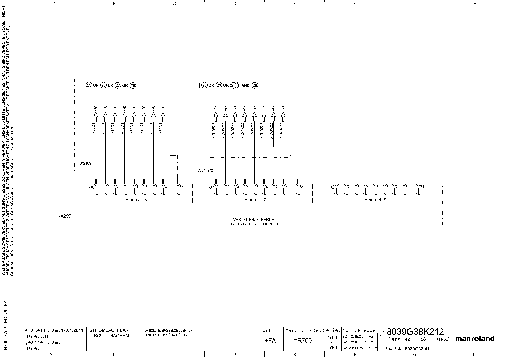

# +FA — Sheet 42 of 58 — OPTION: TELEPRESENCE ODER ICP

**OPTION: TELEPRESENCE OR ICP**

> Part of the manroland **R700** printing press IEC/UL circuit diagrams.
> Drawing class: **Stromlaufplan / Circuit diagram** (DIN A3).
> Document `+FA` covers the **Delivery** machine section.

## At a glance

| Field | Value |
|---|---|
| Document | `+FA`  (8039G38K212) |
| Sheet | **42** of 58 |
| Section (DE) | OPTION: TELEPRESENCE ODER ICP |
| Section (EN) | OPTION: TELEPRESENCE OR ICP |
| Section type | CIRCUIT — Circuit diagram |
| Machine type | `=R700` |
| Series | `7759` |
| Created | 17.01.2011 |
| Replaces | `8039G38I411` |
| Columns used | A, B, C, D, E, F, G |
| Path numbers | — |
| Labels on sheet | 85 |
| Cross-refs out | 0 |
| Cross-refs in | 0 |

**Previous:** [+FA sheet 41](SHEET_0041.md) · **Next:** [+FA sheet 43](SHEET_0043.md) · **Document TOC:** [_TOC.md](_TOC.md)  (+FA) · **Master TOC:** [all sheets](../_MASTER_TOC.md)

## Sheet image (300 DPI, exact vector render)



_Rendered directly from the PDF vector layer at 300 DPI (1-bit), no OCR and no resampling. Use it to confirm anything ambiguous in the text below._

## Cross-references on this sheet

Each entry is a wire leaving this sheet. The printed token is `/sheet.column`; the link resolves to that sheet inside the same document.

_No outgoing cross-references on this sheet._

## Devices on this sheet

| Tag | Class | Class meaning (IEC) | Col | Sub | Terminal | Sign |
|---|---|---|---|---|---|---|
| `A297` | A | Baugruppe / assembly, module, PC board | A | — | — | — |
| `X6` | X | Klemme / terminal, plug connector | B | — | — | — |
| `X7` | X | Klemme / terminal, plug connector | D | — | — | — |
| `X8` | X | Klemme / terminal, plug connector | F | — | — | — |
| `W9443/2` | W | Kabel / cable, line, bus | D | 2 | — | — |
| `W5189` | W | Kabel / cable, line, bus | B | — | — | — |
| `X5.D001` | — | cross-device reference | B | — | — | — |
| `X5.D001` | — | cross-device reference | B | — | — | — |
| `X5.D001` | — | cross-device reference | B | — | — | — |
| `X5.D001` | — | cross-device reference | B | — | — | — |
| `X5.D001` | — | cross-device reference | B | — | — | — |
| `X5.D001` | — | cross-device reference | B | — | — | — |
| `X5.D001` | — | cross-device reference | C | — | — | — |
| `X5.D001` | — | cross-device reference | C | — | — | — |

## Potentials / nets

_No named potentials on this sheet._

## Wire-end annotations (grouped as printed)

A wire that continues elsewhere is annotated with a small cluster: the destination description, the path/line number `#NN`, and the `/sheet.column` cross reference. Each row below is one such cluster exactly as it is grouped on the drawing.

| Col | Y | Path | Cross-ref | Text on the wire |
|---|---|---|---|---|
| C | 193.6 | — | — | `OR OR OR ( OR OR ) AND` |
| C | 197.2 | — | — | `25 26 27 29 25 26 27 28` |
| D | 249.4 | — | — | `X105.A532/2 +ZX` |
| D | 249.4 | — | — | `X105.A532/2 +ZX` |
| D | 249.4 | — | — | `X105.A532/2 +ZX` |
| D | 249.4 | — | — | `X105.A532/2 +ZX` |
| D | 249.4 | — | — | `X105.A532/2 +ZX` |
| D | 249.4 | — | — | `X105.A532/2 +ZX` |
| E | 249.4 | — | — | `X105.A532/2 +ZX` |
| E | 249.4 | — | — | `X105.A532/2 +ZX` |
| B | 249.9 | — | — | `X5.D001 +FC` |
| B | 249.9 | — | — | `X5.D001 +FC` |
| B | 249.9 | — | — | `X5.D001 +FC` |
| B | 249.9 | — | — | `X5.D001 +FC` |
| B | 249.9 | — | — | `X5.D001 +FC` |
| B | 249.9 | — | — | `X5.D001 +FC` |
| C | 249.9 | — | — | `X5.D001 +FC` |
| C | 249.9 | — | — | `X5.D001 +FC` |
| B | 381.5 | — | — | `W5189` |
| D | 398.2 | — | — | `W9443/2` |
| D | 436.4 | — | — | `X6 1 2 3 4 5 6 7 8 SH X7 1 2 3 4 5 6 7 8 SH X8 1 2 3 4 5 6 7 8 SH` |
| D | 466.7 | — | — | `Ethernet 6 Ethernet 7 Ethernet 8` |
| A | 504.9 | — | — | `A297` |
| D | 514.0 | — | — | `DISTRIBUTOR: ETHERNET VERTEILER: ETHERNET` |


## Notes and free text on this sheet

| Text | Col | Y (pt) |
|---|---|---|
| `SH` | C | 437.78 |
| `SH` | E | 437.78 |
| `SH` | G | 436.36 |
| `Ethernet 6` | B | 466.68 |
| `Ethernet 7` | D | 466.68 |
| `Ethernet 8` | F | 466.68 |
| `VERTEILER: ETHERNET` | D | 514.04 |
| `DISTRIBUTOR: ETHERNET` | D | 524.68 |
| `+ZX` | D | 249.44 |
| `X105.A532/2` | D | 290.39 |
| `+ZX` | E | 249.44 |
| `X105.A532/2` | E | 290.39 |
| `+FC` | B | 249.86 |
| `+FC` | C | 249.86 |
| `OR` | B | 197.57 |
| `OR` | D | 197.57 |
| `) AND` | D | 193.57 |

## Complete label inventory (exact text from the drawing)

Every text object inside the drawing area of this sheet, in DIN reading order (column A→H, then top→bottom). This is the authoritative list: if a string is not here it is not printed on this sheet.

| Col | Y | X | Dir | Type | Text |
|---|---|---|---|---|---|
| A | 504.9 | 139.5 | → | device tag | `A297` |
| B | 197.2 | 205.2 | → | number | `25` |
| B | 197.2 | 239.3 | → | number | `26` |
| B | 197.5 | 288.5 | → | text | `OR` |
| B | 197.6 | 219.4 | → | text | `OR` |
| B | 197.6 | 254.1 | → | text | `OR` |
| B | 197.6 | 273.0 | → | number | `27` |
| B | 197.9 | 308.5 | → | number | `29` |
| B | 249.9 | 222.9 | ↕ | text | `+FC` |
| B | 249.9 | 245.6 | ↕ | text | `+FC` |
| B | 249.9 | 268.3 | ↕ | text | `+FC` |
| B | 249.9 | 290.9 | ↕ | text | `+FC` |
| B | 249.9 | 313.6 | ↕ | text | `+FC` |
| B | 249.9 | 336.3 | ↕ | text | `+FC` |
| B | 290.0 | 217.5 | ↕ | device ref | `X5.D001` |
| B | 290.0 | 240.2 | ↕ | device ref | `X5.D001` |
| B | 290.0 | 262.9 | ↕ | device ref | `X5.D001` |
| B | 290.0 | 285.5 | ↕ | device ref | `X5.D001` |
| B | 290.0 | 308.2 | ↕ | device ref | `X5.D001` |
| B | 290.0 | 330.9 | ↕ | device ref | `X5.D001` |
| B | 381.5 | 187.1 | → | device tag | `W5189` |
| B | 437.3 | 230.2 | → | number | `1` |
| B | 437.7 | 253.4 | → | number | `2` |
| B | 437.8 | 276.1 | → | number | `3` |
| B | 437.8 | 298.8 | → | number | `4` |
| B | 437.8 | 321.4 | → | number | `5` |
| B | 438.1 | 209.7 | → | device tag | `X6` |
| B | 466.7 | 295.4 | → | text | `Ethernet 6` |
| C | 194.0 | 468.3 | → | other | `(` |
| C | 249.9 | 359.0 | ↕ | text | `+FC` |
| C | 249.9 | 381.6 | ↕ | text | `+FC` |
| C | 290.0 | 353.6 | ↕ | device ref | `X5.D001` |
| C | 290.0 | 376.2 | ↕ | device ref | `X5.D001` |
| C | 437.8 | 344.1 | → | number | `6` |
| C | 437.8 | 366.8 | → | number | `7` |
| C | 437.8 | 389.5 | → | number | `8` |
| C | 437.8 | 423.5 | → | text | `SH` |
| D | 193.6 | 558.5 | → | text | `) AND` |
| D | 197.2 | 477.4 | → | number | `25` |
| D | 197.2 | 511.4 | → | number | `26` |
| D | 197.6 | 491.6 | → | text | `OR` |
| D | 197.6 | 526.2 | → | text | `OR` |
| D | 197.6 | 545.1 | → | number | `27` |
| D | 197.6 | 596.1 | → | number | `28` |
| D | 249.4 | 506.1 | ↕ | text | `+ZX` |
| D | 249.4 | 528.8 | ↕ | text | `+ZX` |
| D | 249.4 | 551.5 | ↕ | text | `+ZX` |
| D | 249.4 | 574.2 | ↕ | text | `+ZX` |
| D | 249.4 | 596.9 | ↕ | text | `+ZX` |
| D | 249.4 | 619.5 | ↕ | text | `+ZX` |
| D | 290.4 | 500.8 | ↕ | text | `X105.A532/2` |
| D | 290.4 | 523.5 | ↕ | text | `X105.A532/2` |
| D | 290.4 | 546.1 | ↕ | text | `X105.A532/2` |
| D | 290.4 | 568.8 | ↕ | text | `X105.A532/2` |
| D | 290.4 | 591.5 | ↕ | text | `X105.A532/2` |
| D | 290.4 | 614.2 | ↕ | text | `X105.A532/2` |
| D | 398.2 | 466.3 | → | device tag | `W9443/2` |
| D | 437.3 | 513.6 | → | number | `1` |
| D | 437.7 | 536.9 | → | number | `2` |
| D | 437.8 | 559.6 | → | number | `3` |
| D | 437.8 | 582.2 | → | number | `4` |
| D | 437.8 | 604.9 | → | number | `5` |
| D | 438.1 | 493.2 | → | device tag | `X7` |
| D | 466.7 | 576.0 | → | text | `Ethernet 7` |
| D | 514.0 | 550.1 | → | text | `VERTEILER: ETHERNET` |
| D | 524.7 | 544.7 | → | text | `DISTRIBUTOR: ETHERNET` |
| E | 249.4 | 642.2 | ↕ | text | `+ZX` |
| E | 249.4 | 664.9 | ↕ | text | `+ZX` |
| E | 290.4 | 636.9 | ↕ | text | `X105.A532/2` |
| E | 290.4 | 659.5 | ↕ | text | `X105.A532/2` |
| E | 437.8 | 627.6 | → | number | `6` |
| E | 437.8 | 650.3 | → | number | `7` |
| E | 437.8 | 672.9 | → | number | `8` |
| E | 437.8 | 707.0 | → | text | `SH` |
| F | 437.3 | 797.1 | → | number | `1` |
| F | 437.7 | 820.3 | → | number | `2` |
| F | 437.8 | 843.0 | → | number | `3` |
| F | 437.8 | 865.7 | → | number | `4` |
| F | 437.8 | 888.4 | → | number | `5` |
| F | 438.1 | 776.7 | → | device tag | `X8` |
| F | 466.7 | 859.5 | → | text | `Ethernet 8` |
| G | 436.4 | 990.4 | → | text | `SH` |
| G | 437.8 | 911.1 | → | number | `6` |
| G | 437.8 | 933.7 | → | number | `7` |
| G | 437.8 | 956.4 | → | number | `8` |

## Reading-order text block

The same content as a plain block, grouped by DIN column — convenient to paste or to match against a visual description.

```text
=== Column A ===
 504.9  139.5  devtag       A297
=== Column B ===
 197.2  205.2  numeric      25
 197.2  239.3  numeric      26
 197.5  288.5  text         OR
 197.6  219.4  text         OR
 197.6  254.1  text         OR
 197.6  273.0  numeric      27
 197.9  308.5  numeric      29
 249.9  222.9  text         +FC
 249.9  245.6  text         +FC
 249.9  268.3  text         +FC
 249.9  290.9  text         +FC
 249.9  313.6  text         +FC
 249.9  336.3  text         +FC
 290.0  217.5  devref       X5.D001
 290.0  240.2  devref       X5.D001
 290.0  262.9  devref       X5.D001
 290.0  285.5  devref       X5.D001
 290.0  308.2  devref       X5.D001
 290.0  330.9  devref       X5.D001
 381.5  187.1  devtag       W5189
 437.3  230.2  numeric      1
 437.7  253.4  numeric      2
 437.8  276.1  numeric      3
 437.8  298.8  numeric      4
 437.8  321.4  numeric      5
 438.1  209.7  devtag       X6
 466.7  295.4  text         Ethernet 6
=== Column C ===
 194.0  468.3  other        (
 249.9  359.0  text         +FC
 249.9  381.6  text         +FC
 290.0  353.6  devref       X5.D001
 290.0  376.2  devref       X5.D001
 437.8  344.1  numeric      6
 437.8  366.8  numeric      7
 437.8  389.5  numeric      8
 437.8  423.5  text         SH
=== Column D ===
 193.6  558.5  text         ) AND
 197.2  477.4  numeric      25
 197.2  511.4  numeric      26
 197.6  491.6  text         OR
 197.6  526.2  text         OR
 197.6  545.1  numeric      27
 197.6  596.1  numeric      28
 249.4  506.1  text         +ZX
 249.4  528.8  text         +ZX
 249.4  551.5  text         +ZX
 249.4  574.2  text         +ZX
 249.4  596.9  text         +ZX
 249.4  619.5  text         +ZX
 290.4  500.8  text         X105.A532/2
 290.4  523.5  text         X105.A532/2
 290.4  546.1  text         X105.A532/2
 290.4  568.8  text         X105.A532/2
 290.4  591.5  text         X105.A532/2
 290.4  614.2  text         X105.A532/2
 398.2  466.3  devtag       W9443/2
 437.3  513.6  numeric      1
 437.7  536.9  numeric      2
 437.8  559.6  numeric      3
 437.8  582.2  numeric      4
 437.8  604.9  numeric      5
 438.1  493.2  devtag       X7
 466.7  576.0  text         Ethernet 7
 514.0  550.1  text         VERTEILER: ETHERNET
 524.7  544.7  text         DISTRIBUTOR: ETHERNET
=== Column E ===
 249.4  642.2  text         +ZX
 249.4  664.9  text         +ZX
 290.4  636.9  text         X105.A532/2
 290.4  659.5  text         X105.A532/2
 437.8  627.6  numeric      6
 437.8  650.3  numeric      7
 437.8  672.9  numeric      8
 437.8  707.0  text         SH
=== Column F ===
 437.3  797.1  numeric      1
 437.7  820.3  numeric      2
 437.8  843.0  numeric      3
 437.8  865.7  numeric      4
 437.8  888.4  numeric      5
 438.1  776.7  devtag       X8
 466.7  859.5  text         Ethernet 8
=== Column G ===
 436.4  990.4  text         SH
 437.8  911.1  numeric      6
 437.8  933.7  numeric      7
 437.8  956.4  numeric      8
```

---
_Generated from the PDF vector text layer; no OCR. Source: `R700_7759_IEC_UL_FA`, sheet 42._
