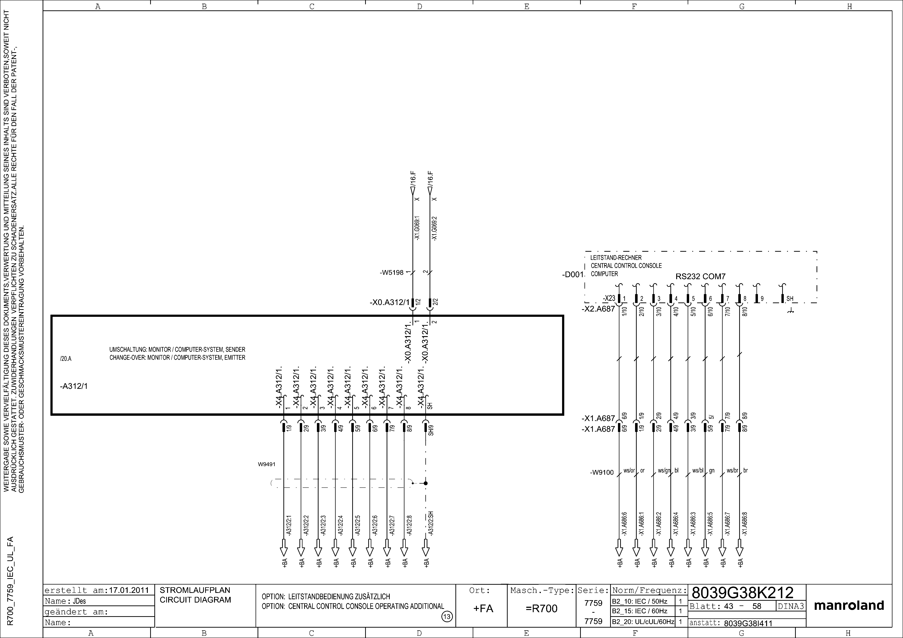

# +FA — Sheet 43 of 58

> Part of the manroland **R700** printing press IEC/UL circuit diagrams.
> Drawing class: **Stromlaufplan / Circuit diagram** (DIN A3).
> Document `+FA` covers the **Delivery** machine section.

## At a glance

| Field | Value |
|---|---|
| Document | `+FA`  (8039G38K212) |
| Sheet | **43** of 58 |
| Section (DE) | — |
| Section (EN) | — |
| Section type | CIRCUIT — Circuit diagram |
| Machine type | `=R700` |
| Series | `7759` |
| Created | 17.01.2011 |
| Replaces | `8039G38I411` |
| Columns used | A, B, C, D, E, F, G |
| Path numbers | — |
| Labels on sheet | 133 |
| Cross-refs out | 3 |
| Cross-refs in | 29 |

**Previous:** [+FA sheet 42](SHEET_0042.md) · **Next:** [+FA sheet 44](SHEET_0044.md) · **Document TOC:** [_TOC.md](_TOC.md)  (+FA) · **Master TOC:** [all sheets](../_MASTER_TOC.md)

## Sheet image (300 DPI, exact vector render)



_Rendered directly from the PDF vector layer at 300 DPI (1-bit), no OCR and no resampling. Use it to confirm anything ambiguous in the text below._

## Cross-references on this sheet

Each entry is a wire leaving this sheet. The printed token is `/sheet.column`; the link resolves to that sheet inside the same document.

| Ref | Target sheet | Col | Path | Destination on target | Target section | From col |
|---|---|---|---|---|---|---|
| `/16.F` | [+FA sheet 16](SHEET_0016.md) | F | — | X X1.G069:1 | SPANNUNGSVERSORGUNG: | D |
| `/16.F` | [+FA sheet 16](SHEET_0016.md) | F | — | X X1.G069:2 | SPANNUNGSVERSORGUNG: | D |
| `/20.A` | [+FA sheet 20](SHEET_0020.md) | A | — | — | LEITSTAND RECHNER | A |

### Incoming references (sheets that point here)

Every other sheet that sends a wire to this one. `Back-ref` is the token printed on *that* sheet; `Path` is its line number.

| From sheet | Cols | Back-ref | Path | Refs | What continues there |
|---|---|---|---|---|---|
| [+FA#16](SHEET_0016.md) | F | `/16.F` | — | 2 | X 5V ( ); X 5V (+) |
| [+FA#20](SHEET_0020.md) | A | `/20.A` | — | 1 | — |
| [+FA#51](SHEET_0051.md) | F | `/51.F` | — | 8 | — |
| [+FA#54](SHEET_0054.md) | E, F | `/54.E`, `/54.F` | — | 18 | — |


## Devices on this sheet

| Tag | Class | Class meaning (IEC) | Col | Sub | Terminal | Sign |
|---|---|---|---|---|---|---|
| `A312/1` | A | Baugruppe / assembly, module, PC board | A | 1 | — | — |
| `A312/2:1` | A | Baugruppe / assembly, module, PC board | C | 2 | 1 | — |
| `A312/2:2` | A | Baugruppe / assembly, module, PC board | C | 2 | 2 | — |
| `A312/2:3` | A | Baugruppe / assembly, module, PC board | C | 2 | 3 | — |
| `A312/2:4` | A | Baugruppe / assembly, module, PC board | C | 2 | 4 | — |
| `A312/2:5` | A | Baugruppe / assembly, module, PC board | C | 2 | 5 | — |
| `A312/2:6` | A | Baugruppe / assembly, module, PC board | D | 2 | 6 | — |
| `A312/2:7` | A | Baugruppe / assembly, module, PC board | D | 2 | 7 | — |
| `A312/2:8` | A | Baugruppe / assembly, module, PC board | D | 2 | 8 | — |
| `A312/2:SH` | A | Baugruppe / assembly, module, PC board | D | 2 | SH | — |
| `D001` | D | Digital / binary element | E | — | — | — |
| `X23` | X | Klemme / terminal, plug connector | F | — | — | — |
| `W9491` | W | Kabel / cable, line, bus | C | — | — | — |
| `W9100` | W | Kabel / cable, line, bus | F | — | — | — |
| `W5198` | W | Kabel / cable, line, bus | D | — | — | — |
| `X1.A687` | — | cross-device reference | F | — | — | — |
| `X1.A686:6` | — | cross-device reference | F | — | 6 | — |
| `X1.A686:1` | — | cross-device reference | F | — | 1 | — |
| `X1.A686:2` | — | cross-device reference | F | — | 2 | — |
| `X1.A686:4` | — | cross-device reference | F | — | 4 | — |
| `X1.A686:3` | — | cross-device reference | G | — | 3 | — |
| `X1.A686:5` | — | cross-device reference | G | — | 5 | — |
| `X1.A686:7` | — | cross-device reference | G | — | 7 | — |
| `X1.A686:8` | — | cross-device reference | G | — | 8 | — |
| `X2.A687` | — | cross-device reference | F | — | — | — |
| `X1.A687` | — | cross-device reference | F | — | — | — |
| `X1.G069:1` | — | cross-device reference | D | — | 1 | — |
| `X1.G069:2` | — | cross-device reference | D | — | 2 | — |

## Potentials / nets

_No named potentials on this sheet._

## Wire-end annotations (grouped as printed)

A wire that continues elsewhere is annotated with a small cluster: the destination description, the path/line number `#NN`, and the `/sheet.column` cross reference. Each row below is one such cluster exactly as it is grouped on the drawing.

| Col | Y | Path | Cross-ref | Text on the wire |
|---|---|---|---|---|
| D | 225.1 | — | `/16.F` | `X X1.G069:1` |
| D | 225.1 | — | `/16.F` | `X X1.G069:2` |
| F | 337.2 | — | — | `LEITSTAND RECHNER` |
| F | 347.9 | — | — | `CENTRAL CONTROL CONSOLE COMPUTER` |
| D | 355.7 | — | — | `W5198` |
| D | 356.6 | — | — | `2` |
| D | 356.7 | — | — | `1` |
| E | 357.5 | — | — | `D001` |
| G | 360.3 | — | — | `RS232 COM7` |
| G | 389.9 | — | — | `X23 1 2 3 4 5 6 7 8 9 SH` |
| D | 393.9 | — | — | `2/2` |
| D | 394.3 | — | — | `X0.A312/1` |
| D | 394.3 | — | — | `1/2` |
| F | 402.8 | — | — | `X2.A687` |
| F | 405.1 | — | — | `1/10` |
| F | 405.1 | — | — | `2/10` |
| F | 405.1 | — | — | `3/10` |
| F | 405.1 | — | — | `4/10` |
| G | 405.1 | — | — | `5/10` |
| G | 405.1 | — | — | `6/10` |
| G | 405.1 | — | — | `7/10` |
| G | 405.1 | — | — | `8/10` |
| D | 422.1 | — | — | `X0.A312/1. 1` |
| D | 423.2 | — | — | `X0.A312/1. 2` |
| B | 458.4 | — | — | `UMSCHALTUNG: MONITOR / COMPUTER SYSTEM, SENDER CHANGE OVER: MONITOR / COMPUTER SYSTEM, EMITTER` |
| A | 470.5 | — | `/20.A` | — |
| C | 483.0 | — | — | `X4.A312/1. 1` |
| C | 483.0 | — | — | `X4.A312/1. 2` |
| C | 483.0 | — | — | `X4.A312/1. 3` |
| C | 483.0 | — | — | `X4.A312/1. 4` |
| C | 483.0 | — | — | `X4.A312/1. 5` |
| D | 483.0 | — | — | `X4.A312/1. 6` |
| D | 483.0 | — | — | `X4.A312/1. 7` |
| D | 483.0 | — | — | `X4.A312/1. 8` |
| D | 483.0 | — | — | `X4.A312/1. SH` |
| A | 504.9 | — | — | `A312/1` |
| F | 544.2 | — | — | `6/9` |
| F | 544.2 | — | — | `2/9` |
| F | 544.2 | — | — | `4/9` |
| G | 544.2 | — | — | `3/9` |
| G | 544.2 | — | — | `7/9` |
| G | 544.2 | — | — | `8/9` |
| F | 544.6 | — | — | `1/9` |
| F | 547.4 | — | — | `X1.A687` |
| G | 547.6 | — | — | `5/` |
| C | 561.0 | — | — | `1/9` |
| C | 561.0 | — | — | `2/9` |
| C | 561.0 | — | — | `3/9` |
| C | 561.0 | — | — | `4/9` |
| C | 561.0 | — | — | `5/9` |
| D | 561.0 | — | — | `6/9` |
| D | 561.0 | — | — | `7/9` |
| D | 561.0 | — | — | `8/9` |
| D | 561.0 | — | — | `SH/9` |
| F | 561.0 | — | — | `6/9` |
| F | 561.0 | — | — | `1/9` |
| F | 561.0 | — | — | `2/9` |
| F | 561.0 | — | — | `4/9` |
| G | 561.0 | — | — | `3/9` |
| G | 561.0 | — | — | `5/9` |
| G | 561.0 | — | — | `7/9` |
| G | 561.0 | — | — | `8/9` |
| F | 561.6 | — | — | `X1.A687` |
| C | 609.5 | — | — | `W9491` |
| F | 617.7 | — | — | `W9100 ws/or or ws/gn bl ws/bl gn ws/br br` |
| D | 674.7 | — | — | `+BA A312/2:SH` |
| F | 675.5 | — | — | `+BA X1.A686:1` |
| F | 675.8 | — | — | `+BA X1.A686:2` |
| F | 675.9 | — | — | `+BA X1.A686:6` |
| F | 675.9 | — | — | `+BA X1.A686:4` |
| G | 675.9 | — | — | `+BA X1.A686:3` |
| G | 675.9 | — | — | `+BA X1.A686:5` |
| G | 675.9 | — | — | `+BA X1.A686:7` |
| G | 675.9 | — | — | `+BA X1.A686:8` |
| C | 679.7 | — | — | `+BA A312/2:1` |
| C | 680.0 | — | — | `+BA A312/2:2` |
| C | 680.1 | — | — | `+BA A312/2:3` |
| C | 680.1 | — | — | `+BA A312/2:4` |
| C | 680.1 | — | — | `+BA A312/2:5` |
| D | 680.1 | — | — | `+BA A312/2:6` |
| D | 680.1 | — | — | `+BA A312/2:7` |
| D | 680.1 | — | — | `+BA A312/2:8` |


## Reconstructed tables

This sheet carries tabular content (pin map / terminal assignment / index). The grid below was rebuilt from the drawing's own rule lines, so each row is exactly one physical row of the table.

### Table 1 — 1 data rows × 9 columns (at x=374.2, y=416.7)

| X4.A312/1. 1 | X4.A312/1. 2 | X4.A312/1. 3 | X4.A312/1. 4 | X4.A312/1. 5 | X4.A312/1. 6 | X4.A312/1. 7 | X0.A312/1. 8 | 1 X0.A312/1. X4.A312/1. |
|---|---|---|---|---|---|---|---|---|
| `1/9` | `2/9` | `3/9` | `4/9` | `5/9` | `6/9` | `7/9` | `8/9` |  |


## Notes and free text on this sheet

| Text | Col | Y (pt) |
|---|---|---|
| `UMSCHALTUNG: MONITOR / COMPUTER SYSTEM, SENDER` | B | 458.44 |
| `CHANGE OVER: MONITOR / COMPUTER SYSTEM, EMITTER` | B | 469.07 |
| `X4.A312/1.` | C | 483.03 |
| `X4.A312/1.` | D | 483.03 |
| `SH` | D | 531.3 |
| `SH/9` | D | 560.98 |
| `+BA` | C | 737.01 |
| `+BA` | D | 737.01 |
| `SH` | G | 391.01 |
| `RS232 COM7` | G | 360.31 |
| `LEITSTAND RECHNER` | F | 337.25 |
| `CENTRAL CONTROL CONSOLE` | F | 347.89 |
| `COMPUTER` | F | 358.53 |
| `+BA` | F | 737.01 |
| `+BA` | G | 737.01 |
| `X0.A312/1` | D | 394.33 |
| `X0.A312/1.` | D | 424.06 |
| `ws/or` | F | 617.94 |
| `or` | F | 618.01 |
| `ws/gn bl` | F | 617.71 |
| `ws/bl` | G | 617.85 |
| `gn` | G | 617.82 |
| `ws/br` | G | 617.9 |
| `br` | G | 617.86 |

## Complete label inventory (exact text from the drawing)

Every text object inside the drawing area of this sheet, in DIN reading order (column A→H, then top→bottom). This is the authoritative list: if a string is not here it is not printed on this sheet.

| Col | Y | X | Dir | Type | Text |
|---|---|---|---|---|---|
| A | 470.5 | 79.4 | → | cross-reference | `/20.A` |
| A | 504.9 | 79.1 | → | device tag | `A312/1` |
| B | 458.4 | 144.4 | → | text | `UMSCHALTUNG: MONITOR / COMPUTER SYSTEM, SENDER` |
| B | 469.1 | 144.5 | → | text | `CHANGE OVER: MONITOR / COMPUTER SYSTEM, EMITTER` |
| C | 483.0 | 363.2 | ↕ | text | `X4.A312/1.` |
| C | 483.0 | 385.8 | ↕ | text | `X4.A312/1.` |
| C | 483.0 | 408.5 | ↕ | text | `X4.A312/1.` |
| C | 483.0 | 431.2 | ↕ | text | `X4.A312/1.` |
| C | 483.0 | 453.9 | ↕ | text | `X4.A312/1.` |
| C | 483.0 | 476.5 | ↕ | text | `X4.A312/1.` |
| C | 536.6 | 399.5 | ↕ | number | `2` |
| C | 536.7 | 376.4 | ↕ | number | `1` |
| C | 536.7 | 422.2 | ↕ | number | `3` |
| C | 536.7 | 444.9 | ↕ | number | `4` |
| C | 536.7 | 467.6 | ↕ | number | `5` |
| C | 561.0 | 378.3 | ↕ | pin pair | `1/9` |
| C | 561.0 | 401.0 | ↕ | pin pair | `2/9` |
| C | 561.0 | 423.7 | ↕ | pin pair | `3/9` |
| C | 561.0 | 446.3 | ↕ | pin pair | `4/9` |
| C | 561.0 | 469.0 | ↕ | pin pair | `5/9` |
| C | 609.6 | 340.2 | → | device tag | `W9491` |
| C | 679.7 | 378.0 | ↕ | device tag | `A312/2:1` |
| C | 680.0 | 400.7 | ↕ | device tag | `A312/2:2` |
| C | 680.1 | 423.4 | ↕ | device tag | `A312/2:3` |
| C | 680.1 | 446.1 | ↕ | device tag | `A312/2:4` |
| C | 680.1 | 468.8 | ↕ | device tag | `A312/2:5` |
| C | 737.0 | 372.6 | ↕ | text | `+BA` |
| C | 737.0 | 395.3 | ↕ | text | `+BA` |
| C | 737.0 | 418.0 | ↕ | text | `+BA` |
| C | 737.0 | 440.7 | ↕ | text | `+BA` |
| C | 737.0 | 463.4 | ↕ | text | `+BA` |
| D | 225.1 | 541.0 | ↕ | cross-reference | `/16.F` |
| D | 225.1 | 563.6 | ↕ | cross-reference | `/16.F` |
| D | 260.8 | 547.0 | ↕ | not fitted | `X` |
| D | 260.8 | 569.7 | ↕ | not fitted | `X` |
| D | 284.6 | 547.0 | ↕ | device ref | `X1.G069:1` |
| D | 285.7 | 569.7 | ↕ | device ref | `X1.G069:2` |
| D | 355.7 | 500.9 | → | device tag | `W5198` |
| D | 356.6 | 558.2 | ↕ | number | `2` |
| D | 356.7 | 535.1 | ↕ | number | `1` |
| D | 393.9 | 571.0 | ↕ | pin pair | `2/2` |
| D | 394.3 | 487.6 | → | text | `X0.A312/1` |
| D | 394.3 | 548.3 | ↕ | pin pair | `1/2` |
| D | 422.1 | 546.5 | ↕ | number | `1` |
| D | 423.2 | 569.5 | ↕ | number | `2` |
| D | 424.1 | 533.2 | ↕ | text | `X0.A312/1.` |
| D | 424.1 | 555.9 | ↕ | text | `X0.A312/1.` |
| D | 483.0 | 499.2 | ↕ | text | `X4.A312/1.` |
| D | 483.0 | 521.9 | ↕ | text | `X4.A312/1.` |
| D | 483.0 | 550.2 | ↕ | text | `X4.A312/1.` |
| D | 531.3 | 563.9 | ↕ | text | `SH` |
| D | 536.7 | 490.2 | ↕ | number | `6` |
| D | 536.7 | 512.9 | ↕ | number | `7` |
| D | 536.7 | 535.6 | ↕ | number | `8` |
| D | 561.0 | 491.7 | ↕ | pin pair | `6/9` |
| D | 561.0 | 514.4 | ↕ | pin pair | `7/9` |
| D | 561.0 | 537.0 | ↕ | pin pair | `8/9` |
| D | 561.0 | 565.4 | ↕ | text | `SH/9` |
| D | 674.7 | 565.1 | ↕ | device tag | `A312/2:SH` |
| D | 680.1 | 491.5 | ↕ | device tag | `A312/2:6` |
| D | 680.1 | 514.1 | ↕ | device tag | `A312/2:7` |
| D | 680.1 | 536.8 | ↕ | device tag | `A312/2:8` |
| D | 737.0 | 486.0 | ↕ | text | `+BA` |
| D | 737.0 | 508.7 | ↕ | text | `+BA` |
| D | 737.0 | 531.4 | ↕ | text | `+BA` |
| D | 737.0 | 559.7 | ↕ | text | `+BA` |
| E | 357.5 | 741.3 | → | device tag | `D001` |
| F | 337.3 | 778.7 | → | text | `LEITSTAND RECHNER` |
| F | 347.9 | 779.2 | → | text | `CENTRAL CONTROL CONSOLE` |
| F | 358.5 | 779.2 | → | text | `COMPUTER` |
| F | 389.9 | 795.1 | → | device tag | `X23` |
| F | 390.6 | 821.2 | → | number | `1` |
| F | 391.0 | 844.4 | → | number | `2` |
| F | 391.0 | 867.1 | → | number | `3` |
| F | 391.0 | 889.8 | → | number | `4` |
| F | 402.8 | 767.1 | → | device ref | `X2.A687` |
| F | 405.1 | 820.5 | ↕ | pin pair | `1/10` |
| F | 405.1 | 843.2 | ↕ | pin pair | `2/10` |
| F | 405.1 | 865.9 | ↕ | pin pair | `3/10` |
| F | 405.1 | 888.6 | ↕ | pin pair | `4/10` |
| F | 544.2 | 820.5 | ↕ | pin pair | `6/9` |
| F | 544.2 | 865.9 | ↕ | pin pair | `2/9` |
| F | 544.2 | 888.5 | ↕ | pin pair | `4/9` |
| F | 544.6 | 843.1 | ↕ | pin pair | `1/9` |
| F | 547.4 | 767.1 | → | device ref | `X1.A687` |
| F | 561.0 | 820.5 | ↕ | pin pair | `6/9` |
| F | 561.0 | 843.1 | ↕ | pin pair | `1/9` |
| F | 561.0 | 865.9 | ↕ | pin pair | `2/9` |
| F | 561.0 | 888.5 | ↕ | pin pair | `4/9` |
| F | 561.6 | 767.1 | → | device ref | `X1.A687` |
| F | 617.7 | 867.7 | → | text | `ws/gn bl` |
| F | 617.9 | 822.3 | → | text | `ws/or` |
| F | 618.0 | 844.4 | → | text | `or` |
| F | 619.6 | 778.1 | → | device tag | `W9100` |
| F | 675.5 | 842.9 | ↕ | device ref | `X1.A686:1` |
| F | 675.8 | 865.6 | ↕ | device ref | `X1.A686:2` |
| F | 675.9 | 820.3 | ↕ | device ref | `X1.A686:6` |
| F | 675.9 | 888.3 | ↕ | device ref | `X1.A686:4` |
| F | 737.0 | 814.8 | ↕ | text | `+BA` |
| F | 737.0 | 837.5 | ↕ | text | `+BA` |
| F | 737.0 | 860.2 | ↕ | text | `+BA` |
| F | 737.0 | 882.9 | ↕ | text | `+BA` |
| G | 360.3 | 890.9 | → | text | `RS232 COM7` |
| G | 391.0 | 912.5 | → | number | `5` |
| G | 391.0 | 935.1 | → | number | `6` |
| G | 391.0 | 957.8 | → | number | `7` |
| G | 391.0 | 980.5 | → | number | `8` |
| G | 391.0 | 1003.2 | → | number | `9` |
| G | 391.0 | 1037.2 | → | text | `SH` |
| G | 405.1 | 911.2 | ↕ | pin pair | `5/10` |
| G | 405.1 | 933.9 | ↕ | pin pair | `6/10` |
| G | 405.1 | 956.6 | ↕ | pin pair | `7/10` |
| G | 405.1 | 979.3 | ↕ | pin pair | `8/10` |
| G | 544.2 | 911.2 | ↕ | pin pair | `3/9` |
| G | 544.2 | 956.6 | ↕ | pin pair | `7/9` |
| G | 544.2 | 979.3 | ↕ | pin pair | `8/9` |
| G | 547.6 | 935.3 | ↕ | number | `5/` |
| G | 561.0 | 911.2 | ↕ | pin pair | `3/9` |
| G | 561.0 | 933.9 | ↕ | pin pair | `5/9` |
| G | 561.0 | 956.6 | ↕ | pin pair | `7/9` |
| G | 561.0 | 979.3 | ↕ | pin pair | `8/9` |
| G | 617.8 | 935.1 | → | text | `gn` |
| G | 617.9 | 913.0 | → | text | `ws/bl` |
| G | 617.9 | 958.4 | → | text | `ws/br` |
| G | 617.9 | 980.2 | → | text | `br` |
| G | 675.9 | 911.0 | ↕ | device ref | `X1.A686:3` |
| G | 675.9 | 933.7 | ↕ | device ref | `X1.A686:5` |
| G | 675.9 | 956.3 | ↕ | device ref | `X1.A686:7` |
| G | 675.9 | 979.0 | ↕ | device ref | `X1.A686:8` |
| G | 737.0 | 905.6 | ↕ | text | `+BA` |
| G | 737.0 | 928.2 | ↕ | text | `+BA` |
| G | 737.0 | 950.9 | ↕ | text | `+BA` |
| G | 737.0 | 973.6 | ↕ | text | `+BA` |

## Reading-order text block

The same content as a plain block, grouped by DIN column — convenient to paste or to match against a visual description.

```text
=== Column A ===
 470.5   79.4  xref         /20.A
 504.9   79.1  devtag       A312/1
=== Column B ===
 458.4  144.4  text         UMSCHALTUNG: MONITOR / COMPUTER SYSTEM, SENDER
 469.1  144.5  text         CHANGE OVER: MONITOR / COMPUTER SYSTEM, EMITTER
=== Column C ===
 483.0  363.2  text         X4.A312/1.
 483.0  385.8  text         X4.A312/1.
 483.0  408.5  text         X4.A312/1.
 483.0  431.2  text         X4.A312/1.
 483.0  453.9  text         X4.A312/1.
 483.0  476.5  text         X4.A312/1.
 536.6  399.5  numeric      2
 536.7  376.4  numeric      1
 536.7  422.2  numeric      3
 536.7  444.9  numeric      4
 536.7  467.6  numeric      5
 561.0  378.3  pinpair      1/9
 561.0  401.0  pinpair      2/9
 561.0  423.7  pinpair      3/9
 561.0  446.3  pinpair      4/9
 561.0  469.0  pinpair      5/9
 609.6  340.2  devtag       W9491
 679.7  378.0  devtag       A312/2:1
 680.0  400.7  devtag       A312/2:2
 680.1  423.4  devtag       A312/2:3
 680.1  446.1  devtag       A312/2:4
 680.1  468.8  devtag       A312/2:5
 737.0  372.6  text         +BA
 737.0  395.3  text         +BA
 737.0  418.0  text         +BA
 737.0  440.7  text         +BA
 737.0  463.4  text         +BA
=== Column D ===
 225.1  541.0  xref         /16.F
 225.1  563.6  xref         /16.F
 260.8  547.0  placeholder  X
 260.8  569.7  placeholder  X
 284.6  547.0  devref       X1.G069:1
 285.7  569.7  devref       X1.G069:2
 355.7  500.9  devtag       W5198
 356.6  558.2  numeric      2
 356.7  535.1  numeric      1
 393.9  571.0  pinpair      2/2
 394.3  487.6  text         X0.A312/1
 394.3  548.3  pinpair      1/2
 422.1  546.5  numeric      1
 423.2  569.5  numeric      2
 424.1  533.2  text         X0.A312/1.
 424.1  555.9  text         X0.A312/1.
 483.0  499.2  text         X4.A312/1.
 483.0  521.9  text         X4.A312/1.
 483.0  550.2  text         X4.A312/1.
 531.3  563.9  text         SH
 536.7  490.2  numeric      6
 536.7  512.9  numeric      7
 536.7  535.6  numeric      8
 561.0  491.7  pinpair      6/9
 561.0  514.4  pinpair      7/9
 561.0  537.0  pinpair      8/9
 561.0  565.4  text         SH/9
 674.7  565.1  devtag       A312/2:SH
 680.1  491.5  devtag       A312/2:6
 680.1  514.1  devtag       A312/2:7
 680.1  536.8  devtag       A312/2:8
 737.0  486.0  text         +BA
 737.0  508.7  text         +BA
 737.0  531.4  text         +BA
 737.0  559.7  text         +BA
=== Column E ===
 357.5  741.3  devtag       D001
=== Column F ===
 337.3  778.7  text         LEITSTAND RECHNER
 347.9  779.2  text         CENTRAL CONTROL CONSOLE
 358.5  779.2  text         COMPUTER
 389.9  795.1  devtag       X23
 390.6  821.2  numeric      1
 391.0  844.4  numeric      2
 391.0  867.1  numeric      3
 391.0  889.8  numeric      4
 402.8  767.1  devref       X2.A687
 405.1  820.5  pinpair      1/10
 405.1  843.2  pinpair      2/10
 405.1  865.9  pinpair      3/10
 405.1  888.6  pinpair      4/10
 544.2  820.5  pinpair      6/9
 544.2  865.9  pinpair      2/9
 544.2  888.5  pinpair      4/9
 544.6  843.1  pinpair      1/9
 547.4  767.1  devref       X1.A687
 561.0  820.5  pinpair      6/9
 561.0  843.1  pinpair      1/9
 561.0  865.9  pinpair      2/9
 561.0  888.5  pinpair      4/9
 561.6  767.1  devref       X1.A687
 617.7  867.7  text         ws/gn bl
 617.9  822.3  text         ws/or
 618.0  844.4  text         or
 619.6  778.1  devtag       W9100
 675.5  842.9  devref       X1.A686:1
 675.8  865.6  devref       X1.A686:2
 675.9  820.3  devref       X1.A686:6
 675.9  888.3  devref       X1.A686:4
 737.0  814.8  text         +BA
 737.0  837.5  text         +BA
 737.0  860.2  text         +BA
 737.0  882.9  text         +BA
=== Column G ===
 360.3  890.9  text         RS232 COM7
 391.0  912.5  numeric      5
 391.0  935.1  numeric      6
 391.0  957.8  numeric      7
 391.0  980.5  numeric      8
 391.0 1003.2  numeric      9
 391.0 1037.2  text         SH
 405.1  911.2  pinpair      5/10
 405.1  933.9  pinpair      6/10
 405.1  956.6  pinpair      7/10
 405.1  979.3  pinpair      8/10
 544.2  911.2  pinpair      3/9
 544.2  956.6  pinpair      7/9
 544.2  979.3  pinpair      8/9
 547.6  935.3  numeric      5/
 561.0  911.2  pinpair      3/9
 561.0  933.9  pinpair      5/9
 561.0  956.6  pinpair      7/9
 561.0  979.3  pinpair      8/9
 617.8  935.1  text         gn
 617.9  913.0  text         ws/bl
 617.9  958.4  text         ws/br
 617.9  980.2  text         br
 675.9  911.0  devref       X1.A686:3
 675.9  933.7  devref       X1.A686:5
 675.9  956.3  devref       X1.A686:7
 675.9  979.0  devref       X1.A686:8
 737.0  905.6  text         +BA
 737.0  928.2  text         +BA
 737.0  950.9  text         +BA
 737.0  973.6  text         +BA
```

---
_Generated from the PDF vector text layer; no OCR. Source: `R700_7759_IEC_UL_FA`, sheet 43._
