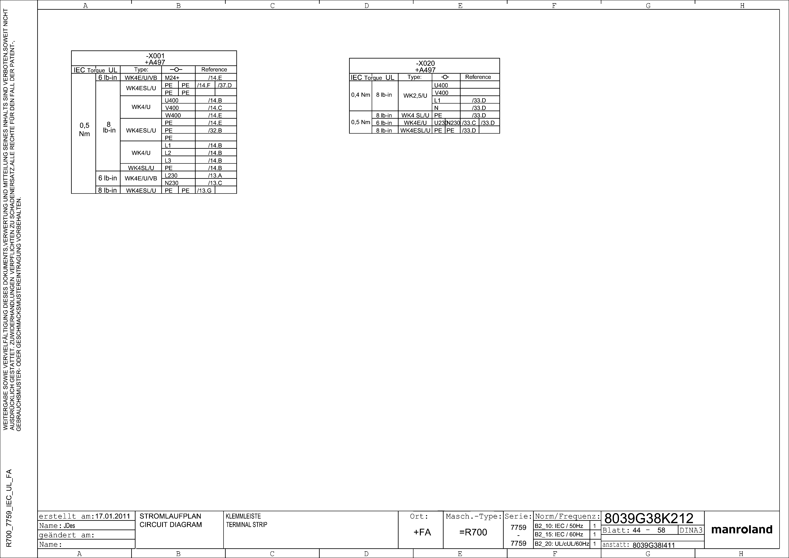

# +FA — Sheet 44 of 58 — KLEMMLEISTE

**TERMINAL STRIP**

> Part of the manroland **R700** printing press IEC/UL circuit diagrams.
> Drawing class: **Stromlaufplan / Circuit diagram** (DIN A3).
> Document `+FA` covers the **Delivery** machine section.

## At a glance

| Field | Value |
|---|---|
| Document | `+FA`  (8039G38K212) |
| Sheet | **44** of 58 |
| Section (DE) | KLEMMLEISTE |
| Section (EN) | TERMINAL STRIP |
| Section type | TERMINALS — Terminal strip |
| Machine type | `=R700` |
| Series | `7759` |
| Created | 17.01.2011 |
| Replaces | `8039G38I411` |
| Columns used | A, B, D, E |
| Path numbers | — |
| Labels on sheet | 86 |
| Cross-refs out | 21 |
| Cross-refs in | 6 |

**Previous:** [+FA sheet 43](SHEET_0043.md) · **Next:** [+FA sheet 45](SHEET_0045.md) · **Document TOC:** [_TOC.md](_TOC.md)  (+FA) · **Master TOC:** [all sheets](../_MASTER_TOC.md)

## Sheet image (300 DPI, exact vector render)



_Rendered directly from the PDF vector layer at 300 DPI (1-bit), no OCR and no resampling. Use it to confirm anything ambiguous in the text below._

## Cross-references on this sheet

Each entry is a wire leaving this sheet. The printed token is `/sheet.column`; the link resolves to that sheet inside the same document.

| Ref | Target sheet | Col | Path | Destination on target | Target section | From col |
|---|---|---|---|---|---|---|
| `/14.E` | [+FA sheet 14](SHEET_0014.md) | E | — | — | SPANNUNGSVERSORGUNG: | B |
| `/14.F` | [+FA sheet 14](SHEET_0014.md) | F | — | — | SPANNUNGSVERSORGUNG: | B |
| `/37.D` | [+FA sheet 37](SHEET_0037.md) | D | — | — | OPTION: TELEPRESENCE | B |
| `/14.B` | [+FA sheet 14](SHEET_0014.md) | B | — | — | SPANNUNGSVERSORGUNG: | B |
| `/14.C` | [+FA sheet 14](SHEET_0014.md) | C | — | — | SPANNUNGSVERSORGUNG: | B |
| `/14.E` | [+FA sheet 14](SHEET_0014.md) | E | — | — | SPANNUNGSVERSORGUNG: | B |
| `/14.E` | [+FA sheet 14](SHEET_0014.md) | E | — | — | SPANNUNGSVERSORGUNG: | B |
| `/32.B` | [+FA sheet 32](SHEET_0032.md) | B | — | — | OPTION: COLORPILOT, COLORPILOTPLUS | B |
| `/33.D` | [+FA sheet 33](SHEET_0033.md) | D | — | — | OPTION: TELEPRESENCE , PRINTNET VORBEREITUNG: INTEGRATIONPILOTPLUS INCLUSIVE DATACOL.,INTEGRATIONP. FÜR PRESSM. PERFECT | E |
| `/33.D` | [+FA sheet 33](SHEET_0033.md) | D | — | — | OPTION: TELEPRESENCE , PRINTNET VORBEREITUNG: INTEGRATIONPILOTPLUS INCLUSIVE DATACOL.,INTEGRATIONP. FÜR PRESSM. PERFECT | E |
| `/33.D` | [+FA sheet 33](SHEET_0033.md) | D | — | — | OPTION: TELEPRESENCE , PRINTNET VORBEREITUNG: INTEGRATIONPILOTPLUS INCLUSIVE DATACOL.,INTEGRATIONP. FÜR PRESSM. PERFECT | E |
| `/33.C` | [+FA sheet 33](SHEET_0033.md) | C | — | — | OPTION: TELEPRESENCE , PRINTNET VORBEREITUNG: INTEGRATIONPILOTPLUS INCLUSIVE DATACOL.,INTEGRATIONP. FÜR PRESSM. PERFECT | E |
| `/33.D` | [+FA sheet 33](SHEET_0033.md) | D | — | — | OPTION: TELEPRESENCE , PRINTNET VORBEREITUNG: INTEGRATIONPILOTPLUS INCLUSIVE DATACOL.,INTEGRATIONP. FÜR PRESSM. PERFECT | E |
| `/33.D` | [+FA sheet 33](SHEET_0033.md) | D | — | — | OPTION: TELEPRESENCE , PRINTNET VORBEREITUNG: INTEGRATIONPILOTPLUS INCLUSIVE DATACOL.,INTEGRATIONP. FÜR PRESSM. PERFECT | E |
| `/14.B` | [+FA sheet 14](SHEET_0014.md) | B | — | — | SPANNUNGSVERSORGUNG: | B |
| `/14.B` | [+FA sheet 14](SHEET_0014.md) | B | — | — | SPANNUNGSVERSORGUNG: | B |
| `/14.B` | [+FA sheet 14](SHEET_0014.md) | B | — | — | SPANNUNGSVERSORGUNG: | B |
| `/14.B` | [+FA sheet 14](SHEET_0014.md) | B | — | — | SPANNUNGSVERSORGUNG: | B |
| `/13.A` | [+FA sheet 13](SHEET_0013.md) | A | — | — | SPANNUNGSVERSORGUNG: | B |
| `/13.C` | [+FA sheet 13](SHEET_0013.md) | C | — | — | SPANNUNGSVERSORGUNG: | B |
| `/13.G` | [+FA sheet 13](SHEET_0013.md) | G | — | — | SPANNUNGSVERSORGUNG: | B |

### Incoming references (sheets that point here)

Every other sheet that sends a wire to this one. `Back-ref` is the token printed on *that* sheet; `Path` is its line number.

| From sheet | Cols | Back-ref | Path | Refs | What continues there |
|---|---|---|---|---|---|
| [+FA#4](SHEET_0004.md) | B, F | `/4.B`, `/4.F` | — | 2 | X001 |
| [+FA#7](SHEET_0007.md) | F, G | `/7.F`, `/7.G` | — | 2 | +A497 X001; +A497 X020 WK4E/U |
| [+FA#33](SHEET_0033.md) | C, D | `/33.C`, `/33.D` | — | 2 | — |


## Devices on this sheet

| Tag | Class | Class meaning (IEC) | Col | Sub | Terminal | Sign |
|---|---|---|---|---|---|---|
| `+A497` | A | Baugruppe / assembly, module, PC board | B | — | — | + |
| `X001` | X | Klemme / terminal, plug connector | B | — | — | — |
| `U400` | U | Umrichter / frequency converter | B | — | — | — |
| `V400` | V | Diode / semiconductor valve | B | — | — | — |
| `W400` | W | Kabel / cable, line, bus | B | — | — | — |
| `N230` | N | Netzteil / power unit, amplifier | B | — | — | — |
| `+A497` | A | Baugruppe / assembly, module, PC board | E | — | — | + |
| `X020` | X | Klemme / terminal, plug connector | E | — | — | — |
| `U400` | U | Umrichter / frequency converter | E | — | — | — |
| `V400` | V | Diode / semiconductor valve | E | — | — | — |

## Potentials / nets

| Potential | Count | Columns | Attached devices | Terminals |
|---|---|---|---|---|
| `L1` | 2 | B, E | — | — |
| `L2` | 1 | B | — | — |
| `L230` | 1 | B | — | — |
| `L3` | 1 | B | — | — |
| `M24+` | 1 | B | — | — |
| `N` | 1 | E | — | — |
| `PE` | 11 | B, E | — | — |


A potential such as `L24+/4` or `M24+` is a named supply/return rail; every place it appears on this sheet is electrically common.

## Wire-end annotations (grouped as printed)

A wire that continues elsewhere is annotated with a small cluster: the destination description, the path/line number `#NN`, and the `/sheet.column` cross reference. Each row below is one such cluster exactly as it is grouped on the drawing.

| Col | Y | Path | Cross-ref | Text on the wire |
|---|---|---|---|---|
| B | 79.7 | — | — | `X001` |
| B | 89.6 | — | — | `+A497` |
| E | 91.0 | — | — | `X020` |
| B | 100.9 | — | — | `IEC Torque UL Type: Reference` |
| E | 100.9 | — | — | `+A497` |
| D | 112.3 | — | — | `IEC Torque UL` |
| E | 112.3 | — | — | `Type:` |
| A | 112.4 | — | — | `6 lb in` |
| E | 112.4 | — | — | `Reference` |
| B | 113.6 | — | — | `WK4E/U/VB` |
| B | 113.6 | — | `/14.E`, `/14.F`, `/37.D` | — |
| B | 113.7 | — | — | `PE PE U400 M24+ PE PE` |
| E | 125.0 | — | — | `U400` |
| B | 129.2 | — | — | `WK4ESL/U` |
| E | 136.4 | — | — | `L1 N PE U230N230 PE PE V400` |
| D | 139.1 | — | — | `0,4 Nm 8 lb in` |
| E | 140.5 | — | — | `WK2,5/U` |
| B | 147.7 | — | `/14.B`, `/14.C`, `/14.E`, `/14.E`, `/32.B` | — |
| E | 147.7 | — | `/33.D`, `/33.D`, `/33.D`, `/33.C`, `/33.D`, `/33.D` | — |
| B | 157.5 | — | — | `WK4/U` |
| B | 159.0 | — | — | `PE PE PE L1 L2 L3 PE L230 N230 PE V400 W400 PE` |
| D | 170.3 | — | — | `0,5 Nm 8 lb in WK4 SL/U WK4E/U` |
| D | 181.7 | — | — | `6 lb in 8 lb in` |
| A | 183.1 | — | — | `8` |
| A | 184.6 | — | — | `Nm 0,5 WK4ESL/U` |
| A | 191.8 | — | — | `lb in` |
| E | 193.0 | — | — | `WK4ESL/U` |
| B | 215.7 | — | `/14.B`, `/14.B`, `/14.B`, `/14.B`, `/13.A`, `/13.C`, `/13.G` | — |
| B | 226.9 | — | — | `WK4/U` |
| B | 249.7 | — | — | `WK4SL/U` |
| A | 264.1 | — | — | `6 lb in` |
| B | 265.2 | — | — | `WK4E/U/VB` |
| A | 282.5 | — | — | `8 lb in` |
| B | 283.7 | — | — | `WK4ESL/U` |


## Reconstructed tables

This sheet carries tabular content (pin map / terminal assignment / index). The grid below was rebuilt from the drawing's own rule lines, so each row is exactly one physical row of the table.

### Table 1 — 15 data rows × 5 columns (at x=144.6, y=99.2)

| UL Torque | Type: |  |  | Reference |
|---|---|---|---|---|
| `6 lb in` | `WK4E/U/VB` | `M24+` |  |  |
|  |  | `PE` | `PE` | `/14.F` |
|  | `WK4ESL/U` | `PE` | `PE` |  |
|  |  | `U400` |  |  |
|  | `WK4/U` | `V400` |  |  |
|  |  | `W400` |  |  |
| `8` |  | `PE` |  |  |
| `lb in` | `WK4ESL/U` | `PE` |  |  |
|  |  | `PE` |  |  |
|  |  | `L1` |  |  |
|  | `WK4/U` | `L2` |  |  |
|  |  | `L3` |  |  |
|  | `WK4SL/U` | `PE` |  |  |
| `6 lb in` |  | `L230` |  | `/13.A` |
|  | `WK4E/U/VB` | `N230` |  |  |


### Table 2 — 6 data rows × 5 columns (at x=561.3, y=110.6)

| UL Torque | Type: |  |  | Reference |
|---|---|---|---|---|
|  |  | `U400` |  |  |
| `8 lb in` |  | `V400` |  |  |
|  | `WK2,5/U` | `L1` |  |  |
|  |  | `N` |  |  |
| `8 lb in` | `WK4 SL/U` | `PE` |  |  |
| `6 lb in` | `WK4E/U` |  | `U230N230` | `/33.C` |


## Notes and free text on this sheet

| Text | Col | Y (pt) |
|---|---|---|
| `Reference` | B | 101.05 |
| `Torque` | A | 102.44 |
| `IEC` | A | 101.03 |
| `UL` | A | 100.92 |
| `Type:` | B | 100.98 |
| `WK4ESL/U` | B | 192.96 |
| `Nm` | A | 197.26 |
| `WK4SL/U` | B | 249.65 |
| `WK4/U` | B | 157.5 |
| `lb in` | A | 191.8 |
| `6 lb in` | A | 112.39 |
| `WK4E/U/VB` | B | 265.23 |
| `8 lb in` | A | 282.47 |
| `Reference` | E | 112.39 |
| `8 lb in` | D | 139.19 |
| `0,4 Nm` | D | 139.14 |
| `Type:` | E | 112.31 |
| `WK2,5/U` | E | 140.51 |
| `WK4ESL/U` | E | 192.96 |
| `Torque` | D | 113.78 |
| `IEC` | D | 112.37 |
| `UL` | D | 112.26 |
| `WK4E/U` | E | 181.61 |
| `WK4 SL/U` | E | 170.28 |
| `0,5 Nm` | D | 180.24 |
| `6 lb in` | D | 181.71 |
| `U230N230` | E | 181.75 |
| `PE PE` | E | 192.98 |

## Complete label inventory (exact text from the drawing)

Every text object inside the drawing area of this sheet, in DIN reading order (column A→H, then top→bottom). This is the authoritative list: if a string is not here it is not printed on this sheet.

| Col | Y | X | Dir | Type | Text |
|---|---|---|---|---|---|
| A | 100.9 | 163.6 | → | text | `UL` |
| A | 101.0 | 111.1 | → | text | `IEC` |
| A | 102.4 | 131.5 | → | text | `Torque` |
| A | 112.4 | 148.5 | → | text | `6 lb in` |
| A | 183.1 | 161.0 | → | number | `8` |
| A | 184.6 | 120.2 | → | number | `0,5` |
| A | 191.8 | 155.3 | → | text | `lb in` |
| A | 197.3 | 119.3 | → | text | `Nm` |
| A | 264.0 | 148.5 | → | text | `6 lb in` |
| A | 282.5 | 148.3 | → | text | `8 lb in` |
| B | 79.7 | 220.5 | → | device tag | `X001` |
| B | 89.6 | 218.3 | → | device tag | `+A497` |
| B | 101.0 | 202.4 | → | text | `Type:` |
| B | 101.1 | 303.9 | → | text | `Reference` |
| B | 113.6 | 188.2 | → | text | `WK4E/U/VB` |
| B | 113.6 | 314.5 | → | cross-reference | `/14.E` |
| B | 113.7 | 248.9 | → | potential | `M24+` |
| B | 124.9 | 248.6 | → | potential | `PE` |
| B | 124.9 | 274.1 | → | potential | `PE` |
| B | 125.0 | 297.6 | → | cross-reference | `/14.F` |
| B | 125.0 | 328.8 | → | cross-reference | `/37.D` |
| B | 129.2 | 190.3 | → | text | `WK4ESL/U` |
| B | 136.3 | 248.6 | → | potential | `PE` |
| B | 136.3 | 274.1 | → | potential | `PE` |
| B | 147.7 | 248.6 | → | device tag | `U400` |
| B | 147.7 | 314.4 | → | cross-reference | `/14.B` |
| B | 157.5 | 198.7 | → | text | `WK4/U` |
| B | 159.0 | 249.4 | → | device tag | `V400` |
| B | 159.0 | 314.2 | → | cross-reference | `/14.C` |
| B | 170.3 | 249.4 | → | device tag | `W400` |
| B | 170.3 | 314.5 | → | cross-reference | `/14.E` |
| B | 181.6 | 248.6 | → | potential | `PE` |
| B | 181.7 | 314.5 | → | cross-reference | `/14.E` |
| B | 193.0 | 190.3 | → | text | `WK4ESL/U` |
| B | 193.0 | 248.6 | → | potential | `PE` |
| B | 193.0 | 314.4 | → | cross-reference | `/32.B` |
| B | 204.3 | 248.6 | → | potential | `PE` |
| B | 215.7 | 314.4 | → | cross-reference | `/14.B` |
| B | 215.8 | 248.6 | → | potential | `L1` |
| B | 227.0 | 198.7 | → | text | `WK4/U` |
| B | 227.0 | 314.4 | → | cross-reference | `/14.B` |
| B | 227.1 | 248.6 | → | potential | `L2` |
| B | 238.4 | 248.6 | → | potential | `L3` |
| B | 238.4 | 314.4 | → | cross-reference | `/14.B` |
| B | 249.7 | 193.3 | → | text | `WK4SL/U` |
| B | 249.7 | 248.6 | → | potential | `PE` |
| B | 249.7 | 314.4 | → | cross-reference | `/14.B` |
| B | 261.0 | 314.2 | → | cross-reference | `/13.A` |
| B | 261.1 | 248.6 | → | potential | `L230` |
| B | 265.2 | 188.2 | → | text | `WK4E/U/VB` |
| B | 272.4 | 314.2 | → | cross-reference | `/13.C` |
| B | 272.5 | 248.6 | → | device tag | `N230` |
| B | 283.7 | 190.3 | → | text | `WK4ESL/U` |
| B | 283.7 | 248.6 | → | potential | `PE` |
| B | 283.7 | 274.1 | → | potential | `PE` |
| B | 283.7 | 297.6 | → | cross-reference | `/13.G` |
| D | 112.3 | 581.7 | → | text | `UL` |
| D | 112.4 | 529.2 | → | text | `IEC` |
| D | 113.8 | 549.6 | → | text | `Torque` |
| D | 139.1 | 530.1 | → | text | `0,4 Nm` |
| D | 139.2 | 567.8 | → | text | `8 lb in` |
| D | 170.4 | 567.8 | → | text | `8 lb in` |
| D | 180.2 | 530.1 | → | text | `0,5 Nm` |
| D | 181.7 | 567.8 | → | text | `6 lb in` |
| D | 193.1 | 567.8 | → | text | `8 lb in` |
| E | 91.0 | 628.0 | → | device tag | `X020` |
| E | 100.9 | 626.5 | → | device tag | `+A497` |
| E | 112.3 | 614.8 | → | text | `Type:` |
| E | 112.4 | 702.1 | → | text | `Reference` |
| E | 125.1 | 655.4 | → | device tag | `U400` |
| E | 136.4 | 656.2 | → | device tag | `V400` |
| E | 140.5 | 608.9 | → | text | `WK2,5/U` |
| E | 147.7 | 655.4 | → | potential | `L1` |
| E | 147.7 | 712.5 | → | cross-reference | `/33.D` |
| E | 159.0 | 712.5 | → | cross-reference | `/33.D` |
| E | 159.1 | 655.4 | → | potential | `N` |
| E | 170.3 | 605.9 | → | text | `WK4 SL/U` |
| E | 170.3 | 655.4 | → | potential | `PE` |
| E | 170.4 | 712.5 | → | cross-reference | `/33.D` |
| E | 181.6 | 609.6 | → | text | `WK4E/U` |
| E | 181.7 | 655.4 | → | text | `U230N230` |
| E | 181.7 | 697.3 | → | cross-reference | `/33.C` |
| E | 181.7 | 725.7 | → | cross-reference | `/33.D` |
| E | 193.0 | 604.2 | → | text | `WK4ESL/U` |
| E | 193.0 | 655.4 | → | text | `PE PE` |
| E | 193.0 | 697.3 | → | cross-reference | `/33.D` |

## Reading-order text block

The same content as a plain block, grouped by DIN column — convenient to paste or to match against a visual description.

```text
=== Column A ===
 100.9  163.6  text         UL
 101.0  111.1  text         IEC
 102.4  131.5  text         Torque
 112.4  148.5  text         6 lb in
 183.1  161.0  numeric      8
 184.6  120.2  numeric      0,5
 191.8  155.3  text         lb in
 197.3  119.3  text         Nm
 264.0  148.5  text         6 lb in
 282.5  148.3  text         8 lb in
=== Column B ===
  79.7  220.5  devtag       X001
  89.6  218.3  devtag       +A497
 101.0  202.4  text         Type:
 101.1  303.9  text         Reference
 113.6  188.2  text         WK4E/U/VB
 113.6  314.5  xref         /14.E
 113.7  248.9  net          M24+
 124.9  248.6  net          PE
 124.9  274.1  net          PE
 125.0  297.6  xref         /14.F
 125.0  328.8  xref         /37.D
 129.2  190.3  text         WK4ESL/U
 136.3  248.6  net          PE
 136.3  274.1  net          PE
 147.7  248.6  devtag       U400
 147.7  314.4  xref         /14.B
 157.5  198.7  text         WK4/U
 159.0  249.4  devtag       V400
 159.0  314.2  xref         /14.C
 170.3  249.4  devtag       W400
 170.3  314.5  xref         /14.E
 181.6  248.6  net          PE
 181.7  314.5  xref         /14.E
 193.0  190.3  text         WK4ESL/U
 193.0  248.6  net          PE
 193.0  314.4  xref         /32.B
 204.3  248.6  net          PE
 215.7  314.4  xref         /14.B
 215.8  248.6  net          L1
 227.0  198.7  text         WK4/U
 227.0  314.4  xref         /14.B
 227.1  248.6  net          L2
 238.4  248.6  net          L3
 238.4  314.4  xref         /14.B
 249.7  193.3  text         WK4SL/U
 249.7  248.6  net          PE
 249.7  314.4  xref         /14.B
 261.0  314.2  xref         /13.A
 261.1  248.6  net          L230
 265.2  188.2  text         WK4E/U/VB
 272.4  314.2  xref         /13.C
 272.5  248.6  devtag       N230
 283.7  190.3  text         WK4ESL/U
 283.7  248.6  net          PE
 283.7  274.1  net          PE
 283.7  297.6  xref         /13.G
=== Column D ===
 112.3  581.7  text         UL
 112.4  529.2  text         IEC
 113.8  549.6  text         Torque
 139.1  530.1  text         0,4 Nm
 139.2  567.8  text         8 lb in
 170.4  567.8  text         8 lb in
 180.2  530.1  text         0,5 Nm
 181.7  567.8  text         6 lb in
 193.1  567.8  text         8 lb in
=== Column E ===
  91.0  628.0  devtag       X020
 100.9  626.5  devtag       +A497
 112.3  614.8  text         Type:
 112.4  702.1  text         Reference
 125.1  655.4  devtag       U400
 136.4  656.2  devtag       V400
 140.5  608.9  text         WK2,5/U
 147.7  655.4  net          L1
 147.7  712.5  xref         /33.D
 159.0  712.5  xref         /33.D
 159.1  655.4  net          N
 170.3  605.9  text         WK4 SL/U
 170.3  655.4  net          PE
 170.4  712.5  xref         /33.D
 181.6  609.6  text         WK4E/U
 181.7  655.4  text         U230N230
 181.7  697.3  xref         /33.C
 181.7  725.7  xref         /33.D
 193.0  604.2  text         WK4ESL/U
 193.0  655.4  text         PE PE
 193.0  697.3  xref         /33.D
```

---
_Generated from the PDF vector text layer; no OCR. Source: `R700_7759_IEC_UL_FA`, sheet 44._
