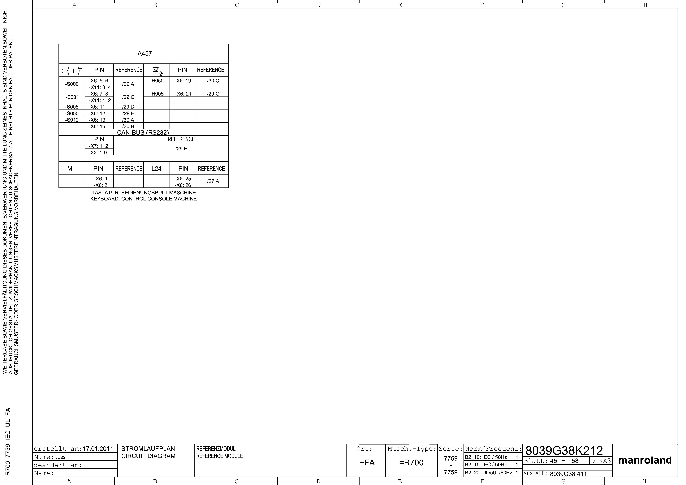

# +FA — Sheet 45 of 58 — REFERENZMODUL

**REFERENCE MODULE**

> Part of the manroland **R700** printing press IEC/UL circuit diagrams.
> Drawing class: **Stromlaufplan / Circuit diagram** (DIN A3).
> Document `+FA` covers the **Delivery** machine section.

## At a glance

| Field | Value |
|---|---|
| Document | `+FA`  (8039G38K212) |
| Sheet | **45** of 58 |
| Section (DE) | REFERENZMODUL |
| Section (EN) | REFERENCE MODULE |
| Section type | REFERENCE_MODULE — Reference module |
| Machine type | `=R700` |
| Series | `7759` |
| Created | 17.01.2011 |
| Replaces | `8039G38I411` |
| Columns used | A, B, C |
| Path numbers | — |
| Labels on sheet | 49 |
| Cross-refs out | 10 |
| Cross-refs in | 13 |

**Previous:** [+FA sheet 44](SHEET_0044.md) · **Next:** [+FA sheet 46](SHEET_0046.md) · **Document TOC:** [_TOC.md](_TOC.md)  (+FA) · **Master TOC:** [all sheets](../_MASTER_TOC.md)

## Sheet image (300 DPI, exact vector render)



_Rendered directly from the PDF vector layer at 300 DPI (1-bit), no OCR and no resampling. Use it to confirm anything ambiguous in the text below._

## Cross-references on this sheet

Each entry is a wire leaving this sheet. The printed token is `/sheet.column`; the link resolves to that sheet inside the same document.

| Ref | Target sheet | Col | Path | Destination on target | Target section | From col |
|---|---|---|---|---|---|---|
| `/30.C` | [+FA sheet 30](SHEET_0030.md) | C | — | — | TASTATUR: MASCHINENSTEUERUNG | C |
| `/29.A` | [+FA sheet 29](SHEET_0029.md) | A | — | — | TASTATUR: MASCHINENSTEUERUNG | B |
| `/29.G` | [+FA sheet 29](SHEET_0029.md) | G | — | — | TASTATUR: MASCHINENSTEUERUNG | C |
| `/29.C` | [+FA sheet 29](SHEET_0029.md) | C | — | — | TASTATUR: MASCHINENSTEUERUNG | B |
| `/29.D` | [+FA sheet 29](SHEET_0029.md) | D | — | — | TASTATUR: MASCHINENSTEUERUNG | B |
| `/29.F` | [+FA sheet 29](SHEET_0029.md) | F | — | — | TASTATUR: MASCHINENSTEUERUNG | B |
| `/30.A` | [+FA sheet 30](SHEET_0030.md) | A | — | — | TASTATUR: MASCHINENSTEUERUNG | B |
| `/30.B` | [+FA sheet 30](SHEET_0030.md) | B | — | — | TASTATUR: MASCHINENSTEUERUNG | B |
| `/29.E` | [+FA sheet 29](SHEET_0029.md) | E | — | — | TASTATUR: MASCHINENSTEUERUNG | B |
| `/27.A` | [+FA sheet 27](SHEET_0027.md) | A | — | — | TASTATUR: BEDIENUNGSPULT MASCHINE | C |

### Incoming references (sheets that point here)

Every other sheet that sends a wire to this one. `Back-ref` is the token printed on *that* sheet; `Path` is its line number.

| From sheet | Cols | Back-ref | Path | Refs | What continues there |
|---|---|---|---|---|---|
| [+FA#5](SHEET_0005.md) | G | `/5.G` | — | 1 | A457 |
| [+FA#27](SHEET_0027.md) | A | `/27.A` | — | 1 | — |
| [+FA#29](SHEET_0029.md) | A, C, D, E, F, G | `/29.A`, `/29.C`, `/29.D`, `/29.E`, `/29.F`, `/29.G` | — | 6 | — |
| [+FA#30](SHEET_0030.md) | A, B, C, F, G | `/30.A`, `/30.B`, `/30.C`, `/30.F`, `/30.G` | — | 5 | — |


## Devices on this sheet

| Tag | Class | Class meaning (IEC) | Col | Sub | Terminal | Sign |
|---|---|---|---|---|---|---|
| `A457` | A | Baugruppe / assembly, module, PC board | B | — | — | — |
| `S000` | S | Schalter / switch | A | — | — | — |
| `S001` | S | Schalter / switch | A | — | — | — |
| `S005` | S | Schalter / switch | A | — | — | — |
| `S050` | S | Schalter / switch | A | — | — | — |
| `S012` | S | Schalter / switch | A | — | — | — |

## Potentials / nets

| Potential | Count | Columns | Attached devices | Terminals |
|---|---|---|---|---|
| `H005` | 1 | B | — | — |
| `H050` | 1 | B | — | — |
| `L24` | 1 | B | — | — |


A potential such as `L24+/4` or `M24+` is a named supply/return rail; every place it appears on this sheet is electrically common.

## Wire-end annotations (grouped as printed)

A wire that continues elsewhere is annotated with a small cluster: the destination description, the path/line number `#NN`, and the `/sheet.column` cross reference. Each row below is one such cluster exactly as it is grouped on the drawing.

| Col | Y | Path | Cross-ref | Text on the wire |
|---|---|---|---|---|
| B | 88.2 | — | — | `A457` |
| B | 116.6 | — | — | `PIN REFERENCE PIN REFERENCE` |
| A | 136.3 | — | — | `X6: 5, 6 X11: 3, 4` |
| B | 136.3 | — | — | `X6: 19` |
| C | 136.3 | — | `/30.C` | — |
| B | 136.4 | — | — | `H050` |
| A | 142.0 | — | — | `S000` |
| B | 142.0 | — | `/29.A` | — |
| A | 159.0 | — | — | `X6: 7, 8 X11: 1, 2` |
| B | 159.0 | — | — | `X6: 21` |
| C | 159.0 | — | `/29.G` | — |
| B | 159.1 | — | — | `H005` |
| A | 164.7 | — | — | `S001` |
| B | 164.7 | — | `/29.C` | — |
| A | 181.7 | — | — | `S005 S050 S012` |
| A | 181.7 | — | — | `X6: 11` |
| B | 181.7 | — | `/29.D`, `/29.F`, `/30.A`, `/30.B` | — |
| A | 193.0 | — | — | `X6: 12 X6: 13 X6: 15` |
| B | 225.7 | — | — | `CAN BUS (RS232)` |
| B | 237.1 | — | — | `X7: 1, 2 PIN REFERENCE` |
| B | 253.9 | — | `/29.E` | — |
| A | 261.1 | — | — | `X2: 1 9` |
| B | 288.0 | — | — | `M L24` |
| B | 288.1 | — | — | `PIN REFERENCE PIN REFERENCE` |
| B | 306.4 | — | — | `X6: 2 X6: 1 X6: 25` |
| C | 310.6 | — | `/27.A` | — |
| B | 317.8 | — | — | `X6: 26` |
| B | 330.5 | — | — | `KEYBOARD: CONTROL CONSOLE MACHINE TASTATUR: BEDIENUNGSPULT MASCHINE` |


## Reconstructed tables

This sheet carries tabular content (pin map / terminal assignment / index). The grid below was rebuilt from the drawing's own rule lines, so each row is exactly one physical row of the table.

### Table 1 — 14 data rows × 2 columns (at x=147.4, y=99.2)

| PIN | REFERENCE |
|---|---|
| `X6: 5, 6` |  |
| `X11: 3, 4` | `/29.A` |
| `X6: 7, 8` |  |
| `X11: 1, 2` | `/29.C` |
| `X6: 11` | `/29.D` |
| `X6: 12` | `/29.F` |
| `X6: 13` | `/30.A` |
| `X6: 15` | `/30.B` |
|  | `CAN BUS` |
| `PIN` |  |
| `X7: 1, 2` |  |
| `X2: 1 9` |  |
| `PIN` | `REFERENCE` |
| `X6: 1` |  |


### Table 2 — 6 data rows × 2 columns (at x=270.6, y=99.2) — **PIN**

| H050 | X6: 19 |
|---|---|
| `H005` | `X6: 21` |
| `(RS232)` |  |
|  | `REFERENCE` |
|  | `/29.E` |
| `L24` | `PIN` |
|  | `X6: 25` |


## Notes and free text on this sheet

| Text | Col | Y (pt) |
|---|---|---|
| `X6: 19` | B | 136.34 |
| `X6: 21` | B | 159.02 |
| `X6: 11` | A | 181.69 |
| `X6: 5, 6` | A | 136.32 |
| `X11: 3, 4` | A | 147.66 |
| `X2: 1 9` | A | 261.07 |
| `PIN` | A | 288.12 |
| `REFERENCE` | B | 289.28 |
| `PIN` | B | 288.12 |
| `REFERENCE` | C | 289.28 |
| `X6: 25` | B | 306.42 |
| `X6: 1` | A | 306.41 |
| `X6: 2` | A | 317.75 |
| `M` | A | 288.05 |
| `X6: 7, 8` | A | 158.99 |
| `X11: 1, 2` | A | 170.34 |
| `X6: 12` | A | 193.03 |
| `X6: 13` | A | 204.37 |
| `X6: 15` | A | 215.71 |
| `CAN BUS (RS232)` | B | 225.68 |
| `X6: 26` | B | 317.76 |
| `X7: 1, 2` | A | 249.7 |
| `TASTATUR: BEDIENUNGSPULT MASCHINE` | B | 330.51 |
| `KEYBOARD: CONTROL CONSOLE MACHINE` | B | 341.15 |

## Complete label inventory (exact text from the drawing)

Every text object inside the drawing area of this sheet, in DIN reading order (column A→H, then top→bottom). This is the authoritative list: if a string is not here it is not printed on this sheet.

| Col | Y | X | Dir | Type | Text |
|---|---|---|---|---|---|
| A | 116.6 | 163.6 | → | text | `PIN` |
| A | 136.3 | 154.2 | → | text | `X6: 5, 6` |
| A | 142.0 | 113.1 | → | device tag | `S000` |
| A | 147.7 | 154.2 | → | text | `X11: 3, 4` |
| A | 159.0 | 154.2 | → | text | `X6: 7, 8` |
| A | 164.7 | 113.8 | → | device tag | `S001` |
| A | 170.3 | 154.2 | → | text | `X11: 1, 2` |
| A | 181.7 | 113.1 | → | device tag | `S005` |
| A | 181.7 | 154.2 | → | text | `X6: 11` |
| A | 193.0 | 154.2 | → | text | `X6: 12` |
| A | 193.1 | 113.1 | → | device tag | `S050` |
| A | 204.4 | 113.2 | → | device tag | `S012` |
| A | 204.4 | 154.2 | → | text | `X6: 13` |
| A | 215.7 | 154.2 | → | text | `X6: 15` |
| A | 237.1 | 163.6 | → | text | `PIN` |
| A | 249.7 | 154.2 | → | text | `X7: 1, 2` |
| A | 261.1 | 154.2 | → | text | `X2: 1 9` |
| A | 288.0 | 116.8 | → | text | `M` |
| A | 288.1 | 162.1 | → | text | `PIN` |
| A | 306.4 | 163.3 | → | text | `X6: 1` |
| A | 317.7 | 162.7 | → | text | `X6: 2` |
| B | 88.2 | 235.4 | → | device tag | `A457` |
| B | 116.6 | 308.1 | → | text | `PIN` |
| B | 117.8 | 200.4 | → | text | `REFERENCE` |
| B | 136.3 | 303.3 | → | text | `X6: 19` |
| B | 136.4 | 260.4 | → | potential | `H050` |
| B | 142.0 | 212.2 | → | cross-reference | `/29.A` |
| B | 159.0 | 304.0 | → | text | `X6: 21` |
| B | 159.1 | 260.4 | → | potential | `H005` |
| B | 164.7 | 212.2 | → | cross-reference | `/29.C` |
| B | 181.7 | 212.2 | → | cross-reference | `/29.D` |
| B | 193.0 | 212.6 | → | cross-reference | `/29.F` |
| B | 204.3 | 212.2 | → | cross-reference | `/30.A` |
| B | 215.7 | 212.3 | → | cross-reference | `/30.B` |
| B | 225.7 | 203.1 | → | text | `CAN BUS (RS232)` |
| B | 238.3 | 291.1 | → | text | `REFERENCE` |
| B | 253.9 | 304.6 | → | cross-reference | `/29.E` |
| B | 288.0 | 262.8 | → | potential | `L24` |
| B | 288.1 | 309.5 | → | text | `PIN` |
| B | 289.3 | 200.4 | → | text | `REFERENCE` |
| B | 306.4 | 303.3 | → | text | `X6: 25` |
| B | 317.8 | 303.3 | → | text | `X6: 26` |
| B | 330.5 | 159.2 | → | text | `TASTATUR: BEDIENUNGSPULT MASCHINE` |
| B | 341.2 | 156.9 | → | text | `KEYBOARD: CONTROL CONSOLE MACHINE` |
| C | 117.8 | 342.1 | → | text | `REFERENCE` |
| C | 136.3 | 359.6 | → | cross-reference | `/30.C` |
| C | 159.0 | 359.4 | → | cross-reference | `/29.G` |
| C | 289.3 | 343.6 | → | text | `REFERENCE` |
| C | 310.6 | 359.6 | → | cross-reference | `/27.A` |

## Reading-order text block

The same content as a plain block, grouped by DIN column — convenient to paste or to match against a visual description.

```text
=== Column A ===
 116.6  163.6  text         PIN
 136.3  154.2  text         X6: 5, 6
 142.0  113.1  devtag       S000
 147.7  154.2  text         X11: 3, 4
 159.0  154.2  text         X6: 7, 8
 164.7  113.8  devtag       S001
 170.3  154.2  text         X11: 1, 2
 181.7  113.1  devtag       S005
 181.7  154.2  text         X6: 11
 193.0  154.2  text         X6: 12
 193.1  113.1  devtag       S050
 204.4  113.2  devtag       S012
 204.4  154.2  text         X6: 13
 215.7  154.2  text         X6: 15
 237.1  163.6  text         PIN
 249.7  154.2  text         X7: 1, 2
 261.1  154.2  text         X2: 1 9
 288.0  116.8  text         M
 288.1  162.1  text         PIN
 306.4  163.3  text         X6: 1
 317.7  162.7  text         X6: 2
=== Column B ===
  88.2  235.4  devtag       A457
 116.6  308.1  text         PIN
 117.8  200.4  text         REFERENCE
 136.3  303.3  text         X6: 19
 136.4  260.4  net          H050
 142.0  212.2  xref         /29.A
 159.0  304.0  text         X6: 21
 159.1  260.4  net          H005
 164.7  212.2  xref         /29.C
 181.7  212.2  xref         /29.D
 193.0  212.6  xref         /29.F
 204.3  212.2  xref         /30.A
 215.7  212.3  xref         /30.B
 225.7  203.1  text         CAN BUS (RS232)
 238.3  291.1  text         REFERENCE
 253.9  304.6  xref         /29.E
 288.0  262.8  net          L24
 288.1  309.5  text         PIN
 289.3  200.4  text         REFERENCE
 306.4  303.3  text         X6: 25
 317.8  303.3  text         X6: 26
 330.5  159.2  text         TASTATUR: BEDIENUNGSPULT MASCHINE
 341.2  156.9  text         KEYBOARD: CONTROL CONSOLE MACHINE
=== Column C ===
 117.8  342.1  text         REFERENCE
 136.3  359.6  xref         /30.C
 159.0  359.4  xref         /29.G
 289.3  343.6  text         REFERENCE
 310.6  359.6  xref         /27.A
```

---
_Generated from the PDF vector text layer; no OCR. Source: `R700_7759_IEC_UL_FA`, sheet 45._
