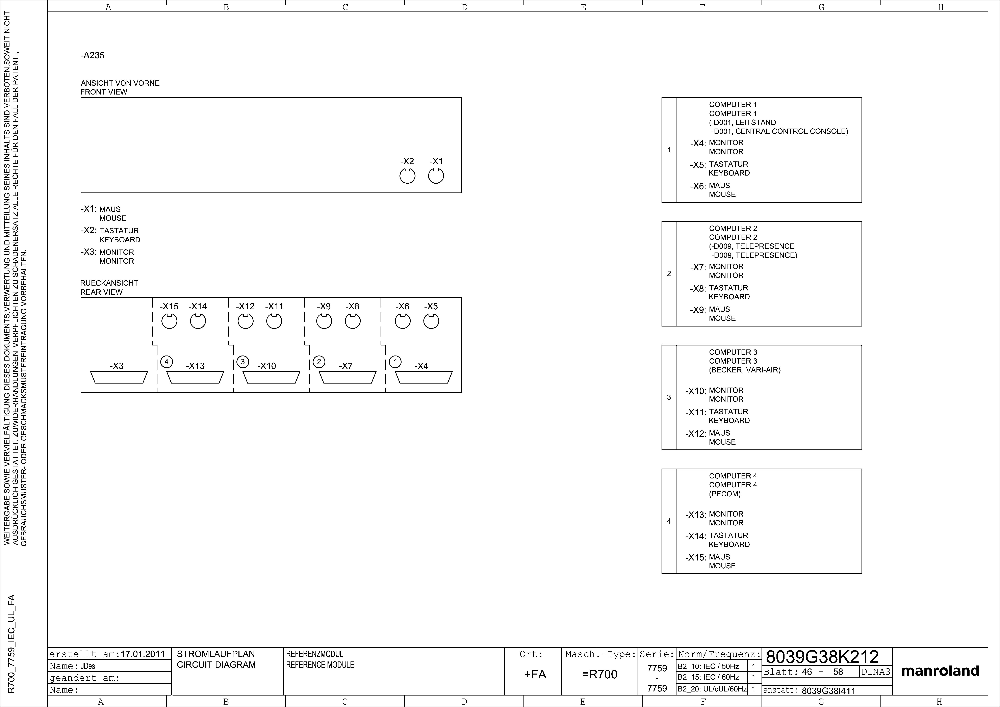

# +FA — Sheet 46 of 58 — REFERENZMODUL

**REFERENCE MODULE**

> Part of the manroland **R700** printing press IEC/UL circuit diagrams.
> Drawing class: **Stromlaufplan / Circuit diagram** (DIN A3).
> Document `+FA` covers the **Delivery** machine section.

## At a glance

| Field | Value |
|---|---|
| Document | `+FA`  (8039G38K212) |
| Sheet | **46** of 58 |
| Section (DE) | REFERENZMODUL |
| Section (EN) | REFERENCE MODULE |
| Section type | REFERENCE_MODULE — Reference module |
| Machine type | `=R700` |
| Series | `7759` |
| Created | 17.01.2011 |
| Replaces | `8039G38I411` |
| Columns used | A, B, C, D, F, G |
| Path numbers | — |
| Labels on sheet | 87 |
| Cross-refs out | 0 |
| Cross-refs in | 0 |

**Previous:** [+FA sheet 45](SHEET_0045.md) · **Next:** [+FA sheet 47](SHEET_0047.md) · **Document TOC:** [_TOC.md](_TOC.md)  (+FA) · **Master TOC:** [all sheets](../_MASTER_TOC.md)

## Sheet image (300 DPI, exact vector render)



_Rendered directly from the PDF vector layer at 300 DPI (1-bit), no OCR and no resampling. Use it to confirm anything ambiguous in the text below._

## Cross-references on this sheet

Each entry is a wire leaving this sheet. The printed token is `/sheet.column`; the link resolves to that sheet inside the same document.

_No outgoing cross-references on this sheet._

## Devices on this sheet

| Tag | Class | Class meaning (IEC) | Col | Sub | Terminal | Sign |
|---|---|---|---|---|---|---|
| `X7` | X | Klemme / terminal, plug connector | C | — | — | — |
| `X6` | X | Klemme / terminal, plug connector | C | — | — | — |
| `X5` | X | Klemme / terminal, plug connector | D | — | — | — |
| `X4` | X | Klemme / terminal, plug connector | D | — | — | — |
| `X12` | X | Klemme / terminal, plug connector | B | — | — | — |
| `X11` | X | Klemme / terminal, plug connector | B | — | — | — |
| `X10` | X | Klemme / terminal, plug connector | B | — | — | — |
| `X15` | X | Klemme / terminal, plug connector | B | — | — | — |
| `X14` | X | Klemme / terminal, plug connector | B | — | — | — |
| `X13` | X | Klemme / terminal, plug connector | B | — | — | — |
| `X3` | X | Klemme / terminal, plug connector | A | — | — | — |
| `X9` | X | Klemme / terminal, plug connector | C | — | — | — |
| `X8` | X | Klemme / terminal, plug connector | C | — | — | — |
| `X2` | X | Klemme / terminal, plug connector | D | — | — | — |
| `X1` | X | Klemme / terminal, plug connector | D | — | — | — |
| `A235` | A | Baugruppe / assembly, module, PC board | A | — | — | — |

## Potentials / nets

_No named potentials on this sheet._

## Wire-end annotations (grouped as printed)

A wire that continues elsewhere is annotated with a small cluster: the destination description, the path/line number `#NN`, and the `/sheet.column` cross reference. Each row below is one such cluster exactly as it is grouped on the drawing.

| Col | Y | Path | Cross-ref | Text on the wire |
|---|---|---|---|---|
| A | 61.2 | — | — | `A235` |
| A | 95.2 | — | — | `FRONT VIEW ANSICHT VON VORNE` |
| F | 120.8 | — | — | `( D001, LEITSTAND COMPUTER 1 COMPUTER 1` |
| G | 152.7 | — | — | `D001, CENTRAL CONTROL CONSOLE)` |
| F | 166.1 | — | — | `1 MONITOR MONITOR` |
| F | 166.2 | — | — | `X4:` |
| D | 187.4 | — | — | `X2 X1` |
| F | 191.6 | — | — | `KEYBOARD TASTATUR` |
| F | 191.7 | — | — | `X5:` |
| F | 217.2 | — | — | `X6:` |
| F | 217.2 | — | — | `MAUS MOUSE` |
| A | 244.1 | — | — | `X1:` |
| A | 245.5 | — | — | `MAUS MOUSE` |
| F | 268.2 | — | — | `( D009, TELEPRESENCE COMPUTER 2 COMPUTER 2` |
| A | 269.6 | — | — | `X2:` |
| A | 271.0 | — | — | `KEYBOARD TASTATUR` |
| A | 295.1 | — | — | `X3:` |
| A | 296.5 | — | — | `MONITOR MONITOR` |
| F | 300.1 | — | — | `D009, TELEPRESENCE)` |
| F | 313.5 | — | — | `2 MONITOR MONITOR` |
| F | 313.6 | — | — | `X7:` |
| A | 333.4 | — | — | `RUECKANSICHT REAR VIEW` |
| F | 339.0 | — | — | `KEYBOARD TASTATUR` |
| F | 339.1 | — | — | `X8:` |
| B | 360.3 | — | — | `X15 X14` |
| B | 360.3 | — | — | `X12 X11` |
| C | 360.3 | — | — | `X9 X8` |
| D | 360.3 | — | — | `X6 X5` |
| F | 364.6 | — | — | `X9:` |
| F | 364.6 | — | — | `MAUS MOUSE` |
| F | 415.6 | — | — | `(BECKER, VARI AIR) COMPUTER 3 COMPUTER 3` |
| B | 426.9 | — | — | `4 3 2 X7 1` |
| A | 431.2 | — | — | `X3 X13` |
| B | 431.2 | — | — | `X10` |
| D | 431.2 | — | — | `X4` |
| F | 460.9 | — | — | `3 MONITOR MONITOR` |
| F | 461.0 | — | — | `X10:` |
| F | 486.4 | — | — | `KEYBOARD TASTATUR` |
| F | 486.5 | — | — | `X11:` |
| F | 511.9 | — | — | `MAUS MOUSE` |
| F | 512.0 | — | — | `X12:` |
| F | 563.0 | — | — | `(PECOM) COMPUTER 4 COMPUTER 4` |
| F | 608.3 | — | — | `4 MONITOR MONITOR` |
| F | 608.4 | — | — | `X13:` |
| F | 633.8 | — | — | `KEYBOARD TASTATUR` |
| F | 633.9 | — | — | `X14:` |
| F | 659.4 | — | — | `X15:` |
| F | 659.4 | — | — | `MAUS MOUSE` |


## Notes and free text on this sheet

| Text | Col | Y (pt) |
|---|---|---|
| `ANSICHT VON VORNE` | A | 95.24 |
| `FRONT VIEW` | A | 105.81 |
| `RUECKANSICHT` | A | 333.36 |
| `REAR VIEW` | A | 343.9 |
| `X1:` | A | 244.13 |
| `X2:` | A | 269.64 |
| `X3:` | A | 295.15 |
| `X4:` | F | 166.17 |
| `X5:` | F | 191.69 |
| `X6:` | F | 217.2 |
| `COMPUTER 1` | F | 120.77 |
| `( D001, LEITSTAND` | F | 142.02 |
| `D001, CENTRAL CONTROL CONSOLE)` | G | 152.66 |
| `X7:` | F | 313.57 |
| `X8:` | F | 339.09 |
| `X9:` | F | 364.6 |
| `COMPUTER 2` | F | 268.17 |
| `( D009, TELEPRESENCE` | F | 289.42 |
| `D009, TELEPRESENCE)` | F | 300.05 |
| `X10:` | F | 460.96 |
| `X11:` | F | 486.47 |
| `X12:` | F | 511.98 |
| `COMPUTER 3` | F | 415.57 |
| `(BECKER, VARI AIR)` | F | 436.8 |
| `X13:` | F | 608.36 |
| `X14:` | F | 633.87 |
| `X15:` | F | 659.38 |
| `COMPUTER 4` | F | 562.98 |
| `(PECOM)` | F | 584.25 |
| `MAUS` | A | 245.5 |
| `MOUSE` | A | 256.13 |
| `TASTATUR` | A | 270.98 |
| `KEYBOARD` | A | 281.6 |
| `MONITOR` | A | 296.53 |
| `MAUS` | F | 217.15 |
| `MOUSE` | F | 227.78 |
| `TASTATUR` | F | 191.61 |
| `KEYBOARD` | F | 202.23 |
| `MONITOR` | F | 166.14 |

## Complete label inventory (exact text from the drawing)

Every text object inside the drawing area of this sheet, in DIN reading order (column A→H, then top→bottom). This is the authoritative list: if a string is not here it is not printed on this sheet.

| Col | Y | X | Dir | Type | Text |
|---|---|---|---|---|---|
| A | 61.2 | 96.1 | → | device tag | `A235` |
| A | 95.2 | 96.4 | → | text | `ANSICHT VON VORNE` |
| A | 105.8 | 95.5 | → | text | `FRONT VIEW` |
| A | 244.1 | 96.1 | → | text | `X1:` |
| A | 245.5 | 118.5 | → | text | `MAUS` |
| A | 256.1 | 118.5 | → | text | `MOUSE` |
| A | 269.6 | 96.1 | → | text | `X2:` |
| A | 271.0 | 118.8 | → | text | `TASTATUR` |
| A | 281.6 | 118.2 | → | text | `KEYBOARD` |
| A | 295.1 | 96.1 | → | text | `X3:` |
| A | 296.5 | 118.5 | → | text | `MONITOR` |
| A | 307.2 | 118.5 | → | text | `MONITOR` |
| A | 333.4 | 95.5 | → | text | `RUECKANSICHT` |
| A | 343.9 | 95.5 | → | text | `REAR VIEW` |
| A | 426.9 | 196.0 | → | number | `4` |
| A | 431.2 | 130.8 | → | device tag | `X3` |
| B | 360.3 | 190.2 | → | device tag | `X15` |
| B | 360.3 | 224.2 | → | device tag | `X14` |
| B | 360.3 | 280.9 | → | device tag | `X12` |
| B | 360.3 | 315.6 | → | device tag | `X11` |
| B | 426.9 | 286.7 | → | number | `3` |
| B | 431.2 | 221.4 | → | device tag | `X13` |
| B | 431.2 | 306.4 | → | device tag | `X10` |
| C | 360.3 | 377.4 | → | device tag | `X9` |
| C | 360.3 | 411.4 | → | device tag | `X8` |
| C | 360.3 | 471.0 | → | device tag | `X6` |
| C | 426.9 | 377.6 | → | number | `2` |
| C | 426.9 | 468.6 | → | number | `1` |
| C | 431.2 | 403.7 | → | device tag | `X7` |
| D | 187.4 | 476.6 | → | device tag | `X2` |
| D | 187.4 | 511.4 | → | device tag | `X1` |
| D | 360.3 | 505.0 | → | device tag | `X5` |
| D | 431.2 | 493.7 | → | device tag | `X4` |
| F | 120.8 | 844.4 | → | text | `COMPUTER 1` |
| F | 131.4 | 844.4 | → | text | `COMPUTER 1` |
| F | 142.0 | 844.2 | → | text | `( D001, LEITSTAND` |
| F | 166.1 | 844.2 | → | text | `MONITOR` |
| F | 166.2 | 821.8 | → | text | `X4:` |
| F | 174.7 | 794.6 | → | number | `1` |
| F | 176.8 | 844.2 | → | text | `MONITOR` |
| F | 191.6 | 844.4 | → | text | `TASTATUR` |
| F | 191.7 | 821.8 | → | text | `X5:` |
| F | 202.2 | 843.9 | → | text | `KEYBOARD` |
| F | 217.1 | 844.2 | → | text | `MAUS` |
| F | 217.2 | 821.8 | → | text | `X6:` |
| F | 227.8 | 844.2 | → | text | `MOUSE` |
| F | 268.2 | 844.4 | → | text | `COMPUTER 2` |
| F | 278.8 | 844.4 | → | text | `COMPUTER 2` |
| F | 289.4 | 844.2 | → | text | `( D009, TELEPRESENCE` |
| F | 300.0 | 844.7 | → | text | `D009, TELEPRESENCE)` |
| F | 313.5 | 844.2 | → | text | `MONITOR` |
| F | 313.6 | 821.8 | → | text | `X7:` |
| F | 322.1 | 794.3 | → | number | `2` |
| F | 324.2 | 844.2 | → | text | `MONITOR` |
| F | 339.0 | 844.4 | → | text | `TASTATUR` |
| F | 339.1 | 821.8 | → | text | `X8:` |
| F | 349.6 | 843.9 | → | text | `KEYBOARD` |
| F | 364.6 | 821.8 | → | text | `X9:` |
| F | 364.6 | 844.2 | → | text | `MAUS` |
| F | 375.2 | 844.2 | → | text | `MOUSE` |
| F | 415.6 | 844.4 | → | text | `COMPUTER 3` |
| F | 426.2 | 844.4 | → | text | `COMPUTER 3` |
| F | 436.8 | 844.2 | → | text | `(BECKER, VARI AIR)` |
| F | 460.9 | 844.2 | → | text | `MONITOR` |
| F | 461.0 | 816.1 | → | text | `X10:` |
| F | 469.5 | 794.1 | → | number | `3` |
| F | 471.6 | 844.2 | → | text | `MONITOR` |
| F | 486.4 | 844.4 | → | text | `TASTATUR` |
| F | 486.5 | 816.1 | → | text | `X11:` |
| F | 497.0 | 843.9 | → | text | `KEYBOARD` |
| F | 512.0 | 816.1 | → | text | `X12:` |
| F | 512.0 | 844.2 | → | text | `MAUS` |
| F | 522.6 | 844.2 | → | text | `MOUSE` |
| F | 563.0 | 844.4 | → | text | `COMPUTER 4` |
| F | 573.6 | 844.4 | → | text | `COMPUTER 4` |
| F | 584.3 | 844.2 | → | text | `(PECOM)` |
| F | 608.3 | 844.2 | → | text | `MONITOR` |
| F | 608.4 | 816.1 | → | text | `X13:` |
| F | 616.9 | 794.1 | → | number | `4` |
| F | 619.0 | 844.2 | → | text | `MONITOR` |
| F | 633.8 | 844.4 | → | text | `TASTATUR` |
| F | 633.9 | 816.1 | → | text | `X14:` |
| F | 644.4 | 843.9 | → | text | `KEYBOARD` |
| F | 659.4 | 816.1 | → | text | `X15:` |
| F | 659.4 | 844.2 | → | text | `MAUS` |
| F | 670.0 | 844.2 | → | text | `MOUSE` |
| G | 152.7 | 844.7 | → | text | `D001, CENTRAL CONTROL CONSOLE)` |

## Reading-order text block

The same content as a plain block, grouped by DIN column — convenient to paste or to match against a visual description.

```text
=== Column A ===
  61.2   96.1  devtag       A235
  95.2   96.4  text         ANSICHT VON VORNE
 105.8   95.5  text         FRONT VIEW
 244.1   96.1  text         X1:
 245.5  118.5  text         MAUS
 256.1  118.5  text         MOUSE
 269.6   96.1  text         X2:
 271.0  118.8  text         TASTATUR
 281.6  118.2  text         KEYBOARD
 295.1   96.1  text         X3:
 296.5  118.5  text         MONITOR
 307.2  118.5  text         MONITOR
 333.4   95.5  text         RUECKANSICHT
 343.9   95.5  text         REAR VIEW
 426.9  196.0  numeric      4
 431.2  130.8  devtag       X3
=== Column B ===
 360.3  190.2  devtag       X15
 360.3  224.2  devtag       X14
 360.3  280.9  devtag       X12
 360.3  315.6  devtag       X11
 426.9  286.7  numeric      3
 431.2  221.4  devtag       X13
 431.2  306.4  devtag       X10
=== Column C ===
 360.3  377.4  devtag       X9
 360.3  411.4  devtag       X8
 360.3  471.0  devtag       X6
 426.9  377.6  numeric      2
 426.9  468.6  numeric      1
 431.2  403.7  devtag       X7
=== Column D ===
 187.4  476.6  devtag       X2
 187.4  511.4  devtag       X1
 360.3  505.0  devtag       X5
 431.2  493.7  devtag       X4
=== Column F ===
 120.8  844.4  text         COMPUTER 1
 131.4  844.4  text         COMPUTER 1
 142.0  844.2  text         ( D001, LEITSTAND
 166.1  844.2  text         MONITOR
 166.2  821.8  text         X4:
 174.7  794.6  numeric      1
 176.8  844.2  text         MONITOR
 191.6  844.4  text         TASTATUR
 191.7  821.8  text         X5:
 202.2  843.9  text         KEYBOARD
 217.1  844.2  text         MAUS
 217.2  821.8  text         X6:
 227.8  844.2  text         MOUSE
 268.2  844.4  text         COMPUTER 2
 278.8  844.4  text         COMPUTER 2
 289.4  844.2  text         ( D009, TELEPRESENCE
 300.0  844.7  text         D009, TELEPRESENCE)
 313.5  844.2  text         MONITOR
 313.6  821.8  text         X7:
 322.1  794.3  numeric      2
 324.2  844.2  text         MONITOR
 339.0  844.4  text         TASTATUR
 339.1  821.8  text         X8:
 349.6  843.9  text         KEYBOARD
 364.6  821.8  text         X9:
 364.6  844.2  text         MAUS
 375.2  844.2  text         MOUSE
 415.6  844.4  text         COMPUTER 3
 426.2  844.4  text         COMPUTER 3
 436.8  844.2  text         (BECKER, VARI AIR)
 460.9  844.2  text         MONITOR
 461.0  816.1  text         X10:
 469.5  794.1  numeric      3
 471.6  844.2  text         MONITOR
 486.4  844.4  text         TASTATUR
 486.5  816.1  text         X11:
 497.0  843.9  text         KEYBOARD
 512.0  816.1  text         X12:
 512.0  844.2  text         MAUS
 522.6  844.2  text         MOUSE
 563.0  844.4  text         COMPUTER 4
 573.6  844.4  text         COMPUTER 4
 584.3  844.2  text         (PECOM)
 608.3  844.2  text         MONITOR
 608.4  816.1  text         X13:
 616.9  794.1  numeric      4
 619.0  844.2  text         MONITOR
 633.8  844.4  text         TASTATUR
 633.9  816.1  text         X14:
 644.4  843.9  text         KEYBOARD
 659.4  816.1  text         X15:
 659.4  844.2  text         MAUS
 670.0  844.2  text         MOUSE
=== Column G ===
 152.7  844.7  text         D001, CENTRAL CONTROL CONSOLE)
```

---
_Generated from the PDF vector text layer; no OCR. Source: `R700_7759_IEC_UL_FA`, sheet 46._
