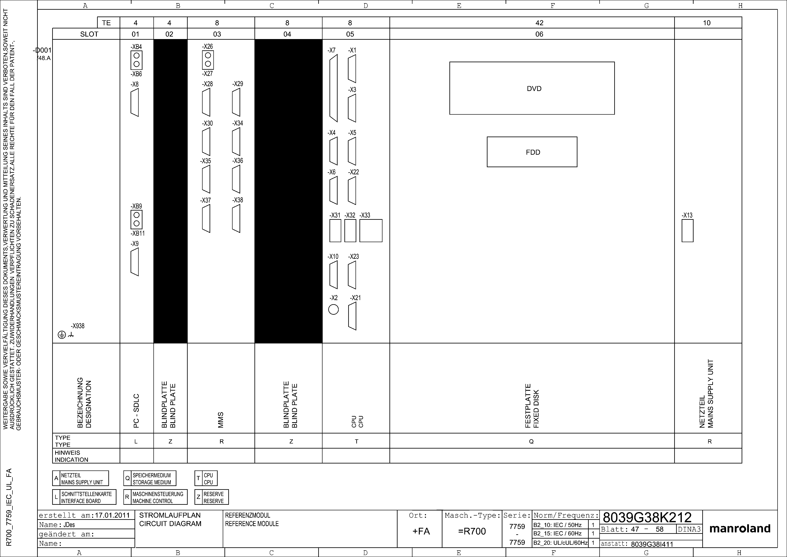

# +FA — Sheet 47 of 58 — REFERENZMODUL

**REFERENCE MODULE**

> Part of the manroland **R700** printing press IEC/UL circuit diagrams.
> Drawing class: **Stromlaufplan / Circuit diagram** (DIN A3).
> Document `+FA` covers the **Delivery** machine section.

## At a glance

| Field | Value |
|---|---|
| Document | `+FA`  (8039G38K212) |
| Sheet | **47** of 58 |
| Section (DE) | REFERENZMODUL |
| Section (EN) | REFERENCE MODULE |
| Section type | REFERENCE_MODULE — Reference module |
| Machine type | `=R700` |
| Series | `7759` |
| Created | 17.01.2011 |
| Replaces | `8039G38I411` |
| Columns used | A, B, C, D, F, G, H |
| Path numbers | — |
| Labels on sheet | 93 |
| Cross-refs out | 1 |
| Cross-refs in | 0 |

**Previous:** [+FA sheet 46](SHEET_0046.md) · **Next:** [+FA sheet 48](SHEET_0048.md) · **Document TOC:** [_TOC.md](_TOC.md)  (+FA) · **Master TOC:** [all sheets](../_MASTER_TOC.md)

## Sheet image (300 DPI, exact vector render)



_Rendered directly from the PDF vector layer at 300 DPI (1-bit), no OCR and no resampling. Use it to confirm anything ambiguous in the text below._

## Cross-references on this sheet

Each entry is a wire leaving this sheet. The printed token is `/sheet.column`; the link resolves to that sheet inside the same document.

| Ref | Target sheet | Col | Path | Destination on target | Target section | From col |
|---|---|---|---|---|---|---|
| `/48.A` | [+FA sheet 48](SHEET_0048.md) | A | — | — | REFERENZMODUL | A |

## Devices on this sheet

| Tag | Class | Class meaning (IEC) | Col | Sub | Terminal | Sign |
|---|---|---|---|---|---|---|
| `X7` | X | Klemme / terminal, plug connector | D | — | — | — |
| `X10` | X | Klemme / terminal, plug connector | D | — | — | — |
| `X2` | X | Klemme / terminal, plug connector | D | — | — | — |
| `X33` | X | Klemme / terminal, plug connector | D | — | — | — |
| `X23` | X | Klemme / terminal, plug connector | D | — | — | — |
| `X21` | X | Klemme / terminal, plug connector | D | — | — | — |
| `X6` | X | Klemme / terminal, plug connector | D | — | — | — |
| `X22` | X | Klemme / terminal, plug connector | D | — | — | — |
| `X4` | X | Klemme / terminal, plug connector | D | — | — | — |
| `X5` | X | Klemme / terminal, plug connector | D | — | — | — |
| `X3` | X | Klemme / terminal, plug connector | D | — | — | — |
| `X1` | X | Klemme / terminal, plug connector | D | — | — | — |
| `X37` | X | Klemme / terminal, plug connector | B | — | — | — |
| `X38` | X | Klemme / terminal, plug connector | C | — | — | — |
| `X35` | X | Klemme / terminal, plug connector | B | — | — | — |
| `X36` | X | Klemme / terminal, plug connector | C | — | — | — |
| `X30` | X | Klemme / terminal, plug connector | B | — | — | — |
| `X34` | X | Klemme / terminal, plug connector | C | — | — | — |
| `X28` | X | Klemme / terminal, plug connector | B | — | — | — |
| `X29` | X | Klemme / terminal, plug connector | C | — | — | — |
| `X26` | X | Klemme / terminal, plug connector | B | — | — | — |
| `X27` | X | Klemme / terminal, plug connector | B | — | — | — |
| `X9` | X | Klemme / terminal, plug connector | B | — | — | — |
| `XB9` | XB |  | B | — | — | — |
| `XB11` | XB |  | B | — | — | — |
| `X8` | X | Klemme / terminal, plug connector | B | — | — | — |
| `XB4` | XB |  | B | — | — | — |
| `XB6` | XB |  | B | — | — | — |
| `X938` | X | Klemme / terminal, plug connector | A | — | — | — |
| `X13` | X | Klemme / terminal, plug connector | G | — | — | — |
| `D001` | D | Digital / binary element | A | — | — | — |

## Potentials / nets

_No named potentials on this sheet._

## Wire-end annotations (grouped as printed)

A wire that continues elsewhere is annotated with a small cluster: the destination description, the path/line number `#NN`, and the `/sheet.column` cross reference. Each row below is one such cluster exactly as it is grouped on the drawing.

| Col | Y | Path | Cross-ref | Text on the wire |
|---|---|---|---|---|
| D | 30.0 | — | — | `TE 4 4 8 8 8 42 10` |
| C | 47.0 | — | — | `SLOT 01 02 03 04 05 06` |
| B | 66.7 | — | — | `X26` |
| B | 67.1 | — | — | `XB4` |
| A | 71.2 | — | — | `D001` |
| D | 72.3 | — | — | `X1` |
| D | 72.4 | — | — | `X7` |
| A | 83.9 | — | `/48.A` | — |
| B | 107.8 | — | — | `X27` |
| B | 108.2 | — | — | `XB6` |
| B | 123.1 | — | — | `X28 X29` |
| B | 123.8 | — | — | `X8` |
| F | 129.3 | — | — | `DVD` |
| D | 131.9 | — | — | `X3` |
| B | 182.6 | — | — | `X30 X34` |
| D | 197.1 | — | — | `X4 X5` |
| F | 225.7 | — | — | `FDD` |
| B | 239.3 | — | — | `X35 X36` |
| D | 256.7 | — | — | `X6 X22` |
| B | 298.8 | — | — | `X37 X38` |
| B | 308.1 | — | — | `XB9` |
| D | 321.8 | — | — | `X31 X32` |
| D | 321.9 | — | — | `X33` |
| G | 321.9 | — | — | `X13` |
| B | 349.1 | — | — | `XB11` |
| B | 364.7 | — | — | `X9` |
| D | 384.2 | — | — | `X10` |
| D | 384.2 | — | — | `X23` |
| D | 446.5 | — | — | `X21` |
| D | 446.6 | — | — | `X2` |
| A | 489.1 | — | — | `X938` |
| H | 542.5 | — | — | `MAINS SUPPLY UNIT` |
| A | 570.3 | — | — | `BEZEICHNUNG` |
| A | 574.9 | — | — | `DESIGNATION` |
| B | 576.0 | — | — | `BLINDPLATTE` |
| C | 576.0 | — | — | `BLINDPLATTE` |
| B | 579.7 | — | — | `BLIND PLATE` |
| C | 579.7 | — | — | `BLIND PLATE` |
| F | 579.7 | — | — | `FESTPLATTE` |
| F | 589.0 | — | — | `FIXED DISK` |
| B | 595.0 | — | — | `PC SDLC` |
| H | 597.3 | — | — | `NETZTEIL` |
| B | 622.5 | — | — | `MMS` |
| D | 628.2 | — | — | `CPU` |
| D | 628.2 | — | — | `CPU` |
| A | 657.9 | — | — | `HINWEIS INDICATION TYPE TYPE` |
| E | 663.6 | — | — | `L Z R Z T Q R` |
| A | 715.6 | — | — | `NETZTEIL MAINS SUPPLY UNIT` |
| B | 715.6 | — | — | `CPU CPU` |
| B | 715.7 | — | — | `SPEICHERMEDIUM STORAGE MEDIUM` |
| A | 718.8 | — | — | `A` |
| A | 718.9 | — | — | `Q` |
| B | 718.9 | — | — | `T` |
| A | 744.0 | — | — | `INTERFACE BOARD SCHNITTSTELLENKARTE` |
| B | 744.0 | — | — | `MASCHINENSTEUERUNG MACHINE CONTROL` |
| B | 744.0 | — | — | `RESERVE RESERVE` |
| A | 747.2 | — | — | `L` |
| B | 747.2 | — | — | `Z` |
| A | 747.3 | — | — | `R` |


## Reconstructed tables

This sheet carries tabular content (pin map / terminal assignment / index). The grid below was rebuilt from the drawing's own rule lines, so each row is exactly one physical row of the table.

### Table 1 — 2 data rows × 1 columns (at x=90.7, y=42.5)

| C1 |
|---|
| `SLOT` |
| `X938` |


### Table 2 — 1 data rows × 2 columns (at x=198.4, y=42.5)

| 01 | 02 |
|---|---|
| `XB4 XB6 X8 XB9 XB11 X9` |  |


### Table 3 — 1 data rows × 3 columns (at x=306.1, y=42.5)

| 03 | 04 | 05 |
|---|---|---|
| `X26 X27 X29 X28 X34 X30 X36 X35 X38 X37` |  | `X1 X7 X3 X4 X5 X6 X22 X31 X32 X33 X10 X23 X21 X2` |


## Notes and free text on this sheet

| Text | Col | Y (pt) |
|---|---|---|
| `X31 X32` | D | 321.77 |
| `TE` | A | 30.06 |
| `SLOT` | A | 47.07 |
| `TYPE` | A | 657.87 |
| `HINWEIS` | A | 680.51 |
| `INDICATION` | A | 691.23 |
| `L` | B | 663.63 |
| `Z` | B | 663.57 |
| `R` | B | 663.64 |
| `Z` | C | 663.57 |
| `T` | D | 663.57 |
| `Q` | F | 663.6 |
| `R` | H | 663.64 |
| `NETZTEIL` | A | 715.64 |
| `MAINS SUPPLY UNIT` | A | 726.29 |
| `SCHNITTSTELLENKARTE` | A | 744.01 |
| `INTERFACE BOARD` | A | 754.64 |
| `SPEICHERMEDIUM` | B | 715.68 |
| `STORAGE MEDIUM` | B | 726.31 |
| `MASCHINENSTEUERUNG` | B | 744.03 |
| `MACHINE CONTROL` | B | 754.67 |
| `CPU` | B | 715.63 |
| `RESERVE` | B | 743.97 |
| `BEZEICHNUNG` | A | 570.33 |
| `DESIGNATION` | A | 574.87 |
| `PC SDLC` | B | 594.99 |
| `BLINDPLATTE` | B | 576 |
| `BLIND PLATE` | B | 579.69 |
| `BLINDPLATTE` | C | 576 |
| `BLIND PLATE` | C | 579.69 |
| `CPU` | D | 628.16 |
| `NETZTEIL` | H | 597.26 |
| `MAINS SUPPLY UNIT` | H | 542.55 |
| `FESTPLATTE` | F | 579.69 |
| `FIXED DISK` | F | 589.04 |
| `MMS` | B | 622.49 |
| `FDD` | F | 225.66 |
| `DVD` | F | 129.28 |
| `A` | A | 718.81 |
| `L` | A | 747.25 |
| `Q` | A | 718.88 |
| `R` | A | 747.27 |
| `T` | B | 718.85 |

## Complete label inventory (exact text from the drawing)

Every text object inside the drawing area of this sheet, in DIN reading order (column A→H, then top→bottom). This is the authoritative list: if a string is not here it is not printed on this sheet.

| Col | Y | X | Dir | Type | Text |
|---|---|---|---|---|---|
| A | 30.1 | 154.2 | → | text | `TE` |
| A | 47.1 | 121.3 | → | text | `SLOT` |
| A | 71.2 | 49.6 | → | device tag | `D001` |
| A | 83.9 | 55.8 | → | cross-reference | `/48.A` |
| A | 489.1 | 107.4 | → | device tag | `X938` |
| A | 570.3 | 116.5 | ↕ | text | `BEZEICHNUNG` |
| A | 574.9 | 129.3 | ↕ | text | `DESIGNATION` |
| A | 657.9 | 83.3 | → | text | `TYPE` |
| A | 668.5 | 83.3 | → | text | `TYPE` |
| A | 680.5 | 82.8 | → | text | `HINWEIS` |
| A | 691.2 | 82.8 | → | text | `INDICATION` |
| A | 715.6 | 92.7 | → | text | `NETZTEIL` |
| A | 718.8 | 82.2 | → | text | `A` |
| A | 718.9 | 189.6 | → | text | `Q` |
| A | 726.3 | 93.0 | → | text | `MAINS SUPPLY UNIT` |
| A | 744.0 | 93.3 | → | text | `SCHNITTSTELLENKARTE` |
| A | 747.3 | 82.8 | → | text | `L` |
| A | 747.3 | 189.1 | → | text | `R` |
| A | 754.6 | 92.7 | → | text | `INTERFACE BOARD` |
| B | 30.0 | 202.4 | → | number | `4` |
| B | 30.0 | 253.4 | → | number | `4` |
| B | 30.0 | 325.4 | → | number | `8` |
| B | 47.0 | 199.3 | → | number | `01` |
| B | 47.0 | 250.3 | → | number | `02` |
| B | 47.0 | 322.6 | → | number | `03` |
| B | 66.7 | 305.9 | → | device tag | `X26` |
| B | 67.1 | 197.8 | → | device tag | `XB4` |
| B | 107.8 | 305.9 | → | device tag | `X27` |
| B | 108.2 | 197.8 | → | device tag | `XB6` |
| B | 123.4 | 305.9 | → | device tag | `X28` |
| B | 123.8 | 197.8 | → | device tag | `X8` |
| B | 183.0 | 305.9 | → | device tag | `X30` |
| B | 239.7 | 303.0 | → | device tag | `X35` |
| B | 299.2 | 303.0 | → | device tag | `X37` |
| B | 308.1 | 197.8 | → | device tag | `XB9` |
| B | 349.1 | 197.8 | → | device tag | `XB11` |
| B | 364.7 | 197.8 | → | device tag | `X9` |
| B | 576.0 | 244.1 | ↕ | text | `BLINDPLATTE` |
| B | 579.7 | 256.8 | ↕ | text | `BLIND PLATE` |
| B | 595.0 | 201.6 | ↕ | text | `PC SDLC` |
| B | 622.5 | 329.1 | ↕ | text | `MMS` |
| B | 663.6 | 203.2 | → | text | `L` |
| B | 663.6 | 255.1 | → | text | `Z` |
| B | 663.6 | 332.2 | → | text | `R` |
| B | 715.6 | 308.7 | → | text | `CPU` |
| B | 715.7 | 201.0 | → | text | `SPEICHERMEDIUM` |
| B | 718.8 | 297.4 | → | text | `T` |
| B | 726.3 | 201.0 | → | text | `STORAGE MEDIUM` |
| B | 726.3 | 308.7 | → | text | `CPU` |
| B | 744.0 | 200.7 | → | text | `MASCHINENSTEUERUNG` |
| B | 744.0 | 308.1 | → | text | `RESERVE` |
| B | 747.2 | 297.6 | → | text | `Z` |
| B | 754.6 | 308.1 | → | text | `RESERVE` |
| B | 754.7 | 200.7 | → | text | `MACHINE CONTROL` |
| C | 30.0 | 431.7 | → | number | `8` |
| C | 47.0 | 428.9 | → | number | `04` |
| C | 123.1 | 351.6 | → | device tag | `X29` |
| C | 182.6 | 351.6 | → | device tag | `X34` |
| C | 239.3 | 351.6 | → | device tag | `X36` |
| C | 298.8 | 351.6 | → | device tag | `X38` |
| C | 576.0 | 428.4 | ↕ | text | `BLINDPLATTE` |
| C | 579.7 | 441.1 | ↕ | text | `BLIND PLATE` |
| C | 663.6 | 438.0 | → | text | `Z` |
| D | 30.0 | 526.7 | → | number | `8` |
| D | 47.0 | 523.8 | → | number | `05` |
| D | 72.3 | 527.0 | → | device tag | `X1` |
| D | 72.4 | 495.8 | → | device tag | `X7` |
| D | 131.9 | 527.0 | → | device tag | `X3` |
| D | 197.1 | 495.8 | → | device tag | `X4` |
| D | 197.1 | 527.0 | → | device tag | `X5` |
| D | 256.7 | 495.8 | → | device tag | `X6` |
| D | 256.7 | 527.0 | → | device tag | `X22` |
| D | 321.8 | 498.6 | → | text | `X31 X32` |
| D | 321.9 | 544.0 | → | device tag | `X33` |
| D | 384.2 | 495.8 | → | device tag | `X10` |
| D | 384.2 | 527.0 | → | device tag | `X23` |
| D | 446.5 | 529.7 | → | device tag | `X21` |
| D | 446.6 | 498.9 | → | device tag | `X2` |
| D | 628.2 | 531.8 | ↕ | text | `CPU` |
| D | 628.2 | 542.4 | ↕ | text | `CPU` |
| D | 663.6 | 536.9 | → | text | `T` |
| F | 30.0 | 810.4 | → | number | `42` |
| F | 47.0 | 810.1 | → | number | `06` |
| F | 129.3 | 797.1 | → | text | `DVD` |
| F | 225.7 | 795.7 | → | text | `FDD` |
| F | 579.7 | 794.0 | ↕ | text | `FESTPLATTE` |
| F | 589.0 | 806.8 | ↕ | text | `FIXED DISK` |
| F | 663.6 | 800.5 | → | text | `Q` |
| G | 321.9 | 1031.5 | → | device tag | `X13` |
| H | 30.0 | 1063.3 | → | number | `10` |
| H | 542.6 | 1070.4 | ↕ | text | `MAINS SUPPLY UNIT` |
| H | 597.3 | 1057.6 | ↕ | text | `NETZTEIL` |
| H | 663.6 | 1070.6 | → | text | `R` |

## Reading-order text block

The same content as a plain block, grouped by DIN column — convenient to paste or to match against a visual description.

```text
=== Column A ===
  30.1  154.2  text         TE
  47.1  121.3  text         SLOT
  71.2   49.6  devtag       D001
  83.9   55.8  xref         /48.A
 489.1  107.4  devtag       X938
 570.3  116.5  text         BEZEICHNUNG
 574.9  129.3  text         DESIGNATION
 657.9   83.3  text         TYPE
 668.5   83.3  text         TYPE
 680.5   82.8  text         HINWEIS
 691.2   82.8  text         INDICATION
 715.6   92.7  text         NETZTEIL
 718.8   82.2  text         A
 718.9  189.6  text         Q
 726.3   93.0  text         MAINS SUPPLY UNIT
 744.0   93.3  text         SCHNITTSTELLENKARTE
 747.3   82.8  text         L
 747.3  189.1  text         R
 754.6   92.7  text         INTERFACE BOARD
=== Column B ===
  30.0  202.4  numeric      4
  30.0  253.4  numeric      4
  30.0  325.4  numeric      8
  47.0  199.3  numeric      01
  47.0  250.3  numeric      02
  47.0  322.6  numeric      03
  66.7  305.9  devtag       X26
  67.1  197.8  devtag       XB4
 107.8  305.9  devtag       X27
 108.2  197.8  devtag       XB6
 123.4  305.9  devtag       X28
 123.8  197.8  devtag       X8
 183.0  305.9  devtag       X30
 239.7  303.0  devtag       X35
 299.2  303.0  devtag       X37
 308.1  197.8  devtag       XB9
 349.1  197.8  devtag       XB11
 364.7  197.8  devtag       X9
 576.0  244.1  text         BLINDPLATTE
 579.7  256.8  text         BLIND PLATE
 595.0  201.6  text         PC SDLC
 622.5  329.1  text         MMS
 663.6  203.2  text         L
 663.6  255.1  text         Z
 663.6  332.2  text         R
 715.6  308.7  text         CPU
 715.7  201.0  text         SPEICHERMEDIUM
 718.8  297.4  text         T
 726.3  201.0  text         STORAGE MEDIUM
 726.3  308.7  text         CPU
 744.0  200.7  text         MASCHINENSTEUERUNG
 744.0  308.1  text         RESERVE
 747.2  297.6  text         Z
 754.6  308.1  text         RESERVE
 754.7  200.7  text         MACHINE CONTROL
=== Column C ===
  30.0  431.7  numeric      8
  47.0  428.9  numeric      04
 123.1  351.6  devtag       X29
 182.6  351.6  devtag       X34
 239.3  351.6  devtag       X36
 298.8  351.6  devtag       X38
 576.0  428.4  text         BLINDPLATTE
 579.7  441.1  text         BLIND PLATE
 663.6  438.0  text         Z
=== Column D ===
  30.0  526.7  numeric      8
  47.0  523.8  numeric      05
  72.3  527.0  devtag       X1
  72.4  495.8  devtag       X7
 131.9  527.0  devtag       X3
 197.1  495.8  devtag       X4
 197.1  527.0  devtag       X5
 256.7  495.8  devtag       X6
 256.7  527.0  devtag       X22
 321.8  498.6  text         X31 X32
 321.9  544.0  devtag       X33
 384.2  495.8  devtag       X10
 384.2  527.0  devtag       X23
 446.5  529.7  devtag       X21
 446.6  498.9  devtag       X2
 628.2  531.8  text         CPU
 628.2  542.4  text         CPU
 663.6  536.9  text         T
=== Column F ===
  30.0  810.4  numeric      42
  47.0  810.1  numeric      06
 129.3  797.1  text         DVD
 225.7  795.7  text         FDD
 579.7  794.0  text         FESTPLATTE
 589.0  806.8  text         FIXED DISK
 663.6  800.5  text         Q
=== Column G ===
 321.9 1031.5  devtag       X13
=== Column H ===
  30.0 1063.3  numeric      10
 542.6 1070.4  text         MAINS SUPPLY UNIT
 597.3 1057.6  text         NETZTEIL
 663.6 1070.6  text         R
```

---
_Generated from the PDF vector text layer; no OCR. Source: `R700_7759_IEC_UL_FA`, sheet 47._
