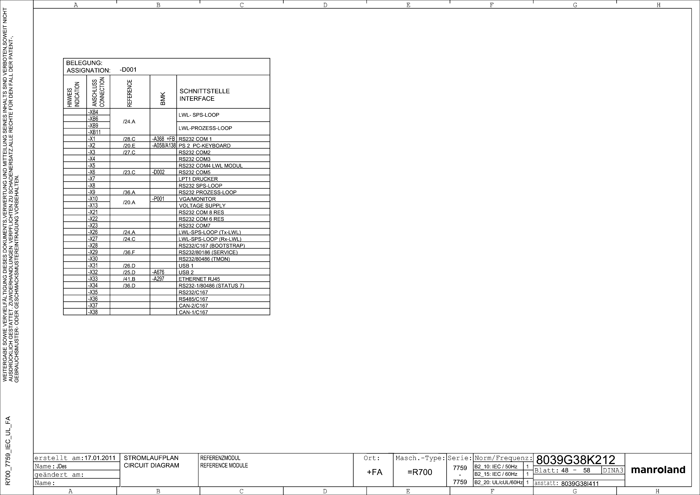

# +FA — Sheet 48 of 58 — REFERENZMODUL

**REFERENCE MODULE**

> Part of the manroland **R700** printing press IEC/UL circuit diagrams.
> Drawing class: **Stromlaufplan / Circuit diagram** (DIN A3).
> Document `+FA` covers the **Delivery** machine section.

## At a glance

| Field | Value |
|---|---|
| Document | `+FA`  (8039G38K212) |
| Sheet | **48** of 58 |
| Section (DE) | REFERENZMODUL |
| Section (EN) | REFERENCE MODULE |
| Section type | REFERENCE_MODULE — Reference module |
| Machine type | `=R700` |
| Series | `7759` |
| Created | 17.01.2011 |
| Replaces | `8039G38I411` |
| Columns used | A, B, C |
| Path numbers | — |
| Labels on sheet | 91 |
| Cross-refs out | 14 |
| Cross-refs in | 9 |

**Previous:** [+FA sheet 47](SHEET_0047.md) · **Next:** [+FA sheet 49](SHEET_0049.md) · **Document TOC:** [_TOC.md](_TOC.md)  (+FA) · **Master TOC:** [all sheets](../_MASTER_TOC.md)

## Sheet image (300 DPI, exact vector render)



_Rendered directly from the PDF vector layer at 300 DPI (1-bit), no OCR and no resampling. Use it to confirm anything ambiguous in the text below._

## Cross-references on this sheet

Each entry is a wire leaving this sheet. The printed token is `/sheet.column`; the link resolves to that sheet inside the same document.

| Ref | Target sheet | Col | Path | Destination on target | Target section | From col |
|---|---|---|---|---|---|---|
| `/24.A` | [+FA sheet 24](SHEET_0024.md) | A | — | — | LICHTWELLENLEITER | B |
| `/28.C` | [+FA sheet 28](SHEET_0028.md) | C | — | — | BEDIENUNGSEINHEIT: ABSTIMMPULT | B |
| `/20.E` | [+FA sheet 20](SHEET_0020.md) | E | — | — | LEITSTAND RECHNER | B |
| `/27.C` | [+FA sheet 27](SHEET_0027.md) | C | — | — | TASTATUR: BEDIENUNGSPULT MASCHINE | B |
| `/23.C` | [+FA sheet 23](SHEET_0023.md) | C | — | — | JOBCARD READER | B |
| `/36.A` | [+FA sheet 36](SHEET_0036.md) | A | — | — | OPTION: TELEPRESENCE | B |
| `/20.A` | [+FA sheet 20](SHEET_0020.md) | A | — | — | LEITSTAND RECHNER | B |
| `/24.A` | [+FA sheet 24](SHEET_0024.md) | A | — | — | LICHTWELLENLEITER | B |
| `/24.C` | [+FA sheet 24](SHEET_0024.md) | C | — | — | LICHTWELLENLEITER | B |
| `/36.F` | [+FA sheet 36](SHEET_0036.md) | F | — | — | OPTION: TELEPRESENCE | B |
| `/26.D` | [+FA sheet 26](SHEET_0026.md) | D | — | — | USB ANSCHLUSS | B |
| `/25.D` | [+FA sheet 25](SHEET_0025.md) | D | — | — | USB ANSCHLUSS | B |
| `/41.B` | [+FA sheet 41](SHEET_0041.md) | B | — | — | OPTION: TELEPRESENCE ODER ICP | B |
| `/36.D` | [+FA sheet 36](SHEET_0036.md) | D | — | — | OPTION: TELEPRESENCE | B |

### Incoming references (sheets that point here)

Every other sheet that sends a wire to this one. `Back-ref` is the token printed on *that* sheet; `Path` is its line number.

| From sheet | Cols | Back-ref | Path | Refs | What continues there |
|---|---|---|---|---|---|
| [+FA#5](SHEET_0005.md) | F | `/5.F` | — | 1 | D001 |
| [+FA#20](SHEET_0020.md) | E | `/20.E` | — | 1 | — |
| [+FA#24](SHEET_0024.md) | A, C | `/24.A`, `/24.C` | — | 3 | — |
| [+FA#25](SHEET_0025.md) | D | `/25.D` | — | 1 | — |
| [+FA#26](SHEET_0026.md) | D | `/26.D` | — | 1 | — |
| [+FA#41](SHEET_0041.md) | B | `/41.B` | — | 1 | — |
| [+FA#47](SHEET_0047.md) | A | `/47.A` | — | 1 | — |


## Devices on this sheet

| Tag | Class | Class meaning (IEC) | Col | Sub | Terminal | Sign |
|---|---|---|---|---|---|---|
| `XB4` | XB |  | A | — | — | — |
| `XB6` | XB |  | A | — | — | — |
| `XB9` | XB |  | A | — | — | — |
| `XB11` | XB |  | A | — | — | — |
| `X1` | X | Klemme / terminal, plug connector | A | — | — | — |
| `X2` | X | Klemme / terminal, plug connector | A | — | — | — |
| `X3` | X | Klemme / terminal, plug connector | A | — | — | — |
| `X4` | X | Klemme / terminal, plug connector | A | — | — | — |
| `X5` | X | Klemme / terminal, plug connector | A | — | — | — |
| `X6` | X | Klemme / terminal, plug connector | A | — | — | — |
| `X7` | X | Klemme / terminal, plug connector | A | — | — | — |
| `X8` | X | Klemme / terminal, plug connector | A | — | — | — |
| `X9` | X | Klemme / terminal, plug connector | A | — | — | — |
| `X10` | X | Klemme / terminal, plug connector | A | — | — | — |
| `X13` | X | Klemme / terminal, plug connector | A | — | — | — |
| `D002` | D | Digital / binary element | B | — | — | — |
| `P001` | P | Messgeraet / measuring instrument, meter | B | — | — | — |
| `X21` | X | Klemme / terminal, plug connector | A | — | — | — |
| `X22` | X | Klemme / terminal, plug connector | A | — | — | — |
| `X23` | X | Klemme / terminal, plug connector | A | — | — | — |
| `X26` | X | Klemme / terminal, plug connector | A | — | — | — |
| `X27` | X | Klemme / terminal, plug connector | A | — | — | — |
| `X28` | X | Klemme / terminal, plug connector | A | — | — | — |
| `X29` | X | Klemme / terminal, plug connector | A | — | — | — |
| `X30` | X | Klemme / terminal, plug connector | A | — | — | — |
| `X31` | X | Klemme / terminal, plug connector | A | — | — | — |
| `X32` | X | Klemme / terminal, plug connector | A | — | — | — |
| `X33` | X | Klemme / terminal, plug connector | A | — | — | — |
| `X34` | X | Klemme / terminal, plug connector | A | — | — | — |
| `X35` | X | Klemme / terminal, plug connector | A | — | — | — |
| `X36` | X | Klemme / terminal, plug connector | A | — | — | — |
| `X37` | X | Klemme / terminal, plug connector | A | — | — | — |
| `X38` | X | Klemme / terminal, plug connector | A | — | — | — |
| `A676` | A | Baugruppe / assembly, module, PC board | B | — | — | — |
| `A297` | A | Baugruppe / assembly, module, PC board | B | — | — | — |
| `D001` | D | Digital / binary element | B | — | — | — |

## Potentials / nets

_No named potentials on this sheet._

## Wire-end annotations (grouped as printed)

A wire that continues elsewhere is annotated with a small cluster: the destination description, the path/line number `#NN`, and the `/sheet.column` cross reference. Each row below is one such cluster exactly as it is grouped on the drawing.

| Col | Y | Path | Cross-ref | Text on the wire |
|---|---|---|---|---|
| A | 102.4 | — | — | `BELEGUNG:` |
| B | 113.7 | — | — | `D001` |
| A | 115.1 | — | — | `ASSIGNATION:` |
| A | 131.3 | — | — | `CONNECTION` |
| A | 135.0 | — | — | `ANSCHLUSS` |
| B | 135.4 | — | — | `REFERENCE` |
| A | 139.1 | — | — | `INDICATION` |
| A | 149.7 | — | — | `HINWEIS` |
| C | 150.6 | — | — | `INTERFACE SCHNITTSTELLE` |
| B | 156.5 | — | — | `BMK` |
| A | 187.2 | — | — | `XB4 XB6 XB9 XB11 X1 X2 X3 X4 X5 X6 X7 X8 X9 X10 X13` |
| B | 191.6 | — | — | `LWL SPS LOOP` |
| B | 202.9 | — | `/24.A` | — |
| C | 214.3 | — | — | `LWL PROZESS LOOP` |
| B | 232.6 | — | — | `A368 +FB A058/A138` |
| B | 232.7 | — | `/28.C`, `/20.E`, `/27.C` | — |
| C | 232.7 | — | — | `RS232 COM 1 PS 2 PC KEYBOARD RS232 COM2 RS232 COM3 RS232 COM4 LWL MODUL RS232 COM5 LPT1 DRUCKER RS232 SPS LOOP RS232 PROZESS LOOP` |
| B | 289.3 | — | — | `D002` |
| B | 289.4 | — | `/23.C` | — |
| B | 323.4 | — | `/36.A` | — |
| B | 334.6 | — | — | `P001` |
| C | 334.8 | — | — | `RS232 COM 8 RES RS232 COM 6 RES RS232 COM7 LWL SPS LOOP (Tx LWL) LWL SPS LOOP (Rx LWL) RS232/C167 (BOOTSTRAP) RS232/80186 (SERVICE) RS232/80486 (TMON) USB 1 USB 2 ETHERNET RJ45 RS232 1/80486 (STATUS 7) RS232/C167 RS485/C167 VGA/MONITOR VOLTAGE SUPPLY` |
| B | 340.4 | — | `/20.A` | — |
| A | 357.2 | — | — | `X21 X22 X23 X26 X27 X28 X29 X30 X31 X32 X33 X34 X35 X36 X37 X38` |
| B | 391.4 | — | `/24.A`, `/24.C` | — |
| B | 425.5 | — | `/36.F` | — |
| B | 448.2 | — | `/26.D`, `/25.D`, `/41.B`, `/36.D` | — |
| B | 459.4 | — | — | `A676 A297` |
| B | 516.2 | — | — | `CAN 2/C167 CAN 1/C167` |


## Reconstructed tables

This sheet carries tabular content (pin map / terminal assignment / index). The grid below was rebuilt from the drawing's own rule lines, so each row is exactly one physical row of the table.

### Table 1 — 30 data rows × 3 columns (at x=147.4, y=127.6)

| CONNECTION ANSCHLUSS | REFERENCE | BMK |
|---|---|---|
| `XB4` |  |  |
| `XB6` |  |  |
| `XB9` | `/24.A` |  |
| `XB11` |  |  |
| `X1` | `/28.C` | `A368 +FB` |
| `X2` | `/20.E` | `A058/A138` |
| `X3` | `/27.C` |  |
| `X4` |  |  |
| `X5` |  |  |
| `X6` | `/23.C` | `D002` |
| `X7` |  |  |
| `X8` |  |  |
| `X9` | `/36.A` |  |
| `X10` |  | `P001` |
| `X13` | `/20.A` |  |
| `X21` |  |  |
| `X22` |  |  |
| `X23` |  |  |
| `X26` | `/24.A` |  |
| `X27` | `/24.C` |  |
| `X28` |  |  |
| `X29` | `/36.F` |  |
| `X30` |  |  |
| `X31` | `/26.D` |  |
| `X32` | `/25.D` | `A676` |
| `X33` | `/41.B` | `A297` |
| `X34` | `/36.D` |  |
| `X35` |  |  |
| `X36` |  |  |
| `X37` |  |  |


## Notes and free text on this sheet

| Text | Col | Y (pt) |
|---|---|---|
| `HINWEIS` | A | 149.66 |
| `INDICATION` | A | 139.11 |
| `REFERENCE` | B | 135.37 |
| `BELEGUNG:` | A | 102.36 |
| `ASSIGNATION:` | A | 115.1 |
| `ANSCHLUSS` | A | 134.96 |
| `CONNECTION` | A | 131.26 |
| `BMK` | B | 156.47 |
| `A368 +FB` | B | 232.61 |
| `A058/A138` | B | 243.93 |
| `SCHNITTSTELLE` | C | 150.55 |
| `INTERFACE` | B | 163.26 |
| `LWL SPS LOOP` | B | 191.58 |
| `LWL PROZESS LOOP` | C | 214.27 |
| `RS232 COM 1` | B | 232.74 |
| `PS 2 PC KEYBOARD` | C | 244.04 |
| `RS232 COM2` | B | 255.43 |
| `RS232 COM3` | B | 266.77 |
| `RS232 COM4 LWL MODUL` | C | 278.08 |
| `RS232 COM5` | B | 289.45 |
| `LPT1 DRUCKER` | B | 300.76 |
| `RS232 SPS LOOP` | C | 312.09 |
| `RS232 PROZESS LOOP` | C | 323.43 |
| `VGA/MONITOR` | B | 334.77 |
| `VOLTAGE SUPPLY` | C | 346.08 |
| `RS232 COM 8 RES` | C | 357.45 |
| `RS232 COM 6 RES` | C | 368.79 |
| `RS232 COM7` | B | 380.15 |
| `LWL SPS LOOP (Tx LWL)` | C | 391.43 |
| `LWL SPS LOOP (Rx LWL)` | C | 402.78 |
| `RS232/C167 (BOOTSTRAP)` | C | 414.14 |
| `RS232/80186 (SERVICE)` | C | 425.48 |
| `RS232/80486 (TMON)` | C | 436.85 |
| `USB 1` | B | 448.14 |
| `USB 2` | B | 459.47 |
| `ETHERNET RJ45` | B | 470.83 |
| `RS232 1/80486 (STATUS 7)` | C | 482.18 |
| `RS232/C167` | B | 493.53 |
| `RS485/C167` | B | 504.87 |
| `CAN 2/C167` | B | 516.22 |
| `CAN 1/C167` | B | 527.55 |

## Complete label inventory (exact text from the drawing)

Every text object inside the drawing area of this sheet, in DIN reading order (column A→H, then top→bottom). This is the authoritative list: if a string is not here it is not printed on this sheet.

| Col | Y | X | Dir | Type | Text |
|---|---|---|---|---|---|
| A | 102.4 | 112.5 | → | text | `BELEGUNG:` |
| A | 115.1 | 113.7 | → | text | `ASSIGNATION:` |
| A | 131.3 | 170.2 | ↕ | text | `CONNECTION` |
| A | 135.0 | 157.5 | ↕ | text | `ANSCHLUSS` |
| A | 139.1 | 127.7 | ↕ | text | `INDICATION` |
| A | 149.7 | 114.9 | ↕ | text | `HINWEIS` |
| A | 187.2 | 150.0 | → | device tag | `XB4` |
| A | 198.6 | 150.0 | → | device tag | `XB6` |
| A | 209.9 | 150.0 | → | device tag | `XB9` |
| A | 221.2 | 150.0 | → | device tag | `XB11` |
| A | 232.4 | 150.0 | → | device tag | `X1` |
| A | 243.9 | 150.0 | → | device tag | `X2` |
| A | 255.2 | 150.0 | → | device tag | `X3` |
| A | 266.6 | 150.0 | → | device tag | `X4` |
| A | 277.9 | 150.0 | → | device tag | `X5` |
| A | 289.3 | 150.0 | → | device tag | `X6` |
| A | 300.6 | 150.0 | → | device tag | `X7` |
| A | 311.9 | 150.0 | → | device tag | `X8` |
| A | 323.3 | 150.0 | → | device tag | `X9` |
| A | 334.6 | 150.0 | → | device tag | `X10` |
| A | 346.0 | 150.0 | → | device tag | `X13` |
| A | 357.2 | 150.0 | → | device tag | `X21` |
| A | 368.6 | 150.0 | → | device tag | `X22` |
| A | 380.0 | 150.0 | → | device tag | `X23` |
| A | 391.3 | 150.0 | → | device tag | `X26` |
| A | 402.6 | 150.0 | → | device tag | `X27` |
| A | 414.0 | 150.0 | → | device tag | `X28` |
| A | 425.3 | 150.0 | → | device tag | `X29` |
| A | 436.7 | 150.0 | → | device tag | `X30` |
| A | 447.9 | 150.0 | → | device tag | `X31` |
| A | 459.3 | 150.0 | → | device tag | `X32` |
| A | 470.7 | 150.0 | → | device tag | `X33` |
| A | 482.0 | 150.0 | → | device tag | `X34` |
| A | 493.4 | 150.0 | → | device tag | `X35` |
| A | 504.7 | 150.0 | → | device tag | `X36` |
| A | 516.0 | 150.0 | → | device tag | `X37` |
| A | 527.4 | 150.0 | → | device tag | `X38` |
| B | 113.7 | 203.8 | → | device tag | `D001` |
| B | 135.4 | 217.0 | ↕ | text | `REFERENCE` |
| B | 156.5 | 272.4 | ↕ | text | `BMK` |
| B | 163.3 | 305.3 | → | text | `INTERFACE` |
| B | 191.6 | 303.9 | → | text | `LWL SPS LOOP` |
| B | 202.9 | 209.3 | → | cross-reference | `/24.A` |
| B | 232.6 | 259.1 | → | text | `A368 +FB` |
| B | 232.7 | 209.3 | → | cross-reference | `/28.C` |
| B | 232.7 | 303.9 | → | text | `RS232 COM 1` |
| B | 243.9 | 259.1 | → | text | `A058/A138` |
| B | 244.0 | 209.6 | → | cross-reference | `/20.E` |
| B | 255.4 | 209.3 | → | cross-reference | `/27.C` |
| B | 255.4 | 303.9 | → | text | `RS232 COM2` |
| B | 266.8 | 303.9 | → | text | `RS232 COM3` |
| B | 289.3 | 259.1 | → | device tag | `D002` |
| B | 289.4 | 209.3 | → | cross-reference | `/23.C` |
| B | 289.4 | 303.9 | → | text | `RS232 COM5` |
| B | 300.8 | 303.9 | → | text | `LPT1 DRUCKER` |
| B | 323.4 | 209.3 | → | cross-reference | `/36.A` |
| B | 334.6 | 259.1 | → | device tag | `P001` |
| B | 334.8 | 304.7 | → | text | `VGA/MONITOR` |
| B | 340.4 | 209.3 | → | cross-reference | `/20.A` |
| B | 380.2 | 303.9 | → | text | `RS232 COM7` |
| B | 391.4 | 209.3 | → | cross-reference | `/24.A` |
| B | 402.8 | 209.3 | → | cross-reference | `/24.C` |
| B | 425.5 | 209.8 | → | cross-reference | `/36.F` |
| B | 448.1 | 303.9 | → | text | `USB 1` |
| B | 448.2 | 209.3 | → | cross-reference | `/26.D` |
| B | 459.3 | 259.1 | → | device tag | `A676` |
| B | 459.5 | 209.3 | → | cross-reference | `/25.D` |
| B | 459.5 | 303.9 | → | text | `USB 2` |
| B | 470.7 | 259.1 | → | device tag | `A297` |
| B | 470.8 | 209.5 | → | cross-reference | `/41.B` |
| B | 470.8 | 303.9 | → | text | `ETHERNET RJ45` |
| B | 482.2 | 209.3 | → | cross-reference | `/36.D` |
| B | 493.5 | 303.9 | → | text | `RS232/C167` |
| B | 504.9 | 303.9 | → | text | `RS485/C167` |
| B | 516.2 | 304.4 | → | text | `CAN 2/C167` |
| B | 527.6 | 304.4 | → | text | `CAN 1/C167` |
| C | 150.6 | 305.6 | → | text | `SCHNITTSTELLE` |
| C | 214.3 | 303.9 | → | text | `LWL PROZESS LOOP` |
| C | 244.0 | 303.9 | → | text | `PS 2 PC KEYBOARD` |
| C | 278.1 | 303.9 | → | text | `RS232 COM4 LWL MODUL` |
| C | 312.1 | 303.9 | → | text | `RS232 SPS LOOP` |
| C | 323.4 | 303.9 | → | text | `RS232 PROZESS LOOP` |
| C | 346.1 | 304.7 | → | text | `VOLTAGE SUPPLY` |
| C | 357.5 | 303.9 | → | text | `RS232 COM 8 RES` |
| C | 368.8 | 303.9 | → | text | `RS232 COM 6 RES` |
| C | 391.4 | 303.9 | → | text | `LWL SPS LOOP (Tx LWL)` |
| C | 402.8 | 303.9 | → | text | `LWL SPS LOOP (Rx LWL)` |
| C | 414.1 | 303.9 | → | text | `RS232/C167 (BOOTSTRAP)` |
| C | 425.5 | 303.9 | → | text | `RS232/80186 (SERVICE)` |
| C | 436.8 | 303.9 | → | text | `RS232/80486 (TMON)` |
| C | 482.2 | 303.9 | → | text | `RS232 1/80486 (STATUS 7)` |

## Reading-order text block

The same content as a plain block, grouped by DIN column — convenient to paste or to match against a visual description.

```text
=== Column A ===
 102.4  112.5  text         BELEGUNG:
 115.1  113.7  text         ASSIGNATION:
 131.3  170.2  text         CONNECTION
 135.0  157.5  text         ANSCHLUSS
 139.1  127.7  text         INDICATION
 149.7  114.9  text         HINWEIS
 187.2  150.0  devtag       XB4
 198.6  150.0  devtag       XB6
 209.9  150.0  devtag       XB9
 221.2  150.0  devtag       XB11
 232.4  150.0  devtag       X1
 243.9  150.0  devtag       X2
 255.2  150.0  devtag       X3
 266.6  150.0  devtag       X4
 277.9  150.0  devtag       X5
 289.3  150.0  devtag       X6
 300.6  150.0  devtag       X7
 311.9  150.0  devtag       X8
 323.3  150.0  devtag       X9
 334.6  150.0  devtag       X10
 346.0  150.0  devtag       X13
 357.2  150.0  devtag       X21
 368.6  150.0  devtag       X22
 380.0  150.0  devtag       X23
 391.3  150.0  devtag       X26
 402.6  150.0  devtag       X27
 414.0  150.0  devtag       X28
 425.3  150.0  devtag       X29
 436.7  150.0  devtag       X30
 447.9  150.0  devtag       X31
 459.3  150.0  devtag       X32
 470.7  150.0  devtag       X33
 482.0  150.0  devtag       X34
 493.4  150.0  devtag       X35
 504.7  150.0  devtag       X36
 516.0  150.0  devtag       X37
 527.4  150.0  devtag       X38
=== Column B ===
 113.7  203.8  devtag       D001
 135.4  217.0  text         REFERENCE
 156.5  272.4  text         BMK
 163.3  305.3  text         INTERFACE
 191.6  303.9  text         LWL SPS LOOP
 202.9  209.3  xref         /24.A
 232.6  259.1  text         A368 +FB
 232.7  209.3  xref         /28.C
 232.7  303.9  text         RS232 COM 1
 243.9  259.1  text         A058/A138
 244.0  209.6  xref         /20.E
 255.4  209.3  xref         /27.C
 255.4  303.9  text         RS232 COM2
 266.8  303.9  text         RS232 COM3
 289.3  259.1  devtag       D002
 289.4  209.3  xref         /23.C
 289.4  303.9  text         RS232 COM5
 300.8  303.9  text         LPT1 DRUCKER
 323.4  209.3  xref         /36.A
 334.6  259.1  devtag       P001
 334.8  304.7  text         VGA/MONITOR
 340.4  209.3  xref         /20.A
 380.2  303.9  text         RS232 COM7
 391.4  209.3  xref         /24.A
 402.8  209.3  xref         /24.C
 425.5  209.8  xref         /36.F
 448.1  303.9  text         USB 1
 448.2  209.3  xref         /26.D
 459.3  259.1  devtag       A676
 459.5  209.3  xref         /25.D
 459.5  303.9  text         USB 2
 470.7  259.1  devtag       A297
 470.8  209.5  xref         /41.B
 470.8  303.9  text         ETHERNET RJ45
 482.2  209.3  xref         /36.D
 493.5  303.9  text         RS232/C167
 504.9  303.9  text         RS485/C167
 516.2  304.4  text         CAN 2/C167
 527.6  304.4  text         CAN 1/C167
=== Column C ===
 150.6  305.6  text         SCHNITTSTELLE
 214.3  303.9  text         LWL PROZESS LOOP
 244.0  303.9  text         PS 2 PC KEYBOARD
 278.1  303.9  text         RS232 COM4 LWL MODUL
 312.1  303.9  text         RS232 SPS LOOP
 323.4  303.9  text         RS232 PROZESS LOOP
 346.1  304.7  text         VOLTAGE SUPPLY
 357.5  303.9  text         RS232 COM 8 RES
 368.8  303.9  text         RS232 COM 6 RES
 391.4  303.9  text         LWL SPS LOOP (Tx LWL)
 402.8  303.9  text         LWL SPS LOOP (Rx LWL)
 414.1  303.9  text         RS232/C167 (BOOTSTRAP)
 425.5  303.9  text         RS232/80186 (SERVICE)
 436.8  303.9  text         RS232/80486 (TMON)
 482.2  303.9  text         RS232 1/80486 (STATUS 7)
```

---
_Generated from the PDF vector text layer; no OCR. Source: `R700_7759_IEC_UL_FA`, sheet 48._
