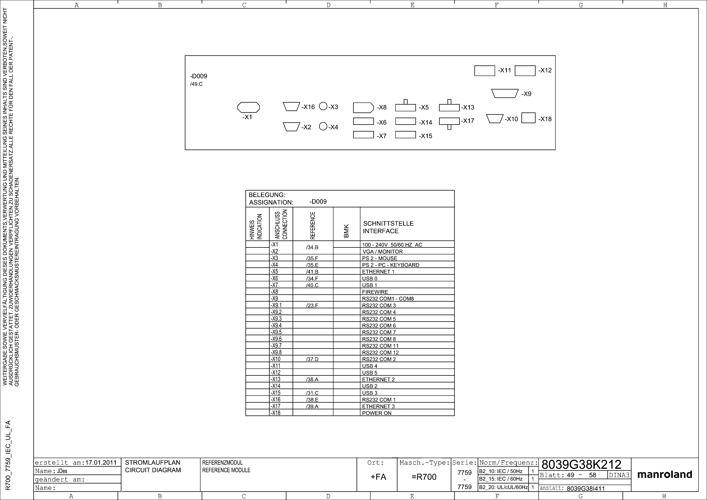

# +FA — Sheet 49 of 58 — REFERENZMODUL

**REFERENCE MODULE**

> Part of the manroland **R700** printing press IEC/UL circuit diagrams.
> Drawing class: **Stromlaufplan / Circuit diagram** (DIN A3).
> Document `+FA` covers the **Delivery** machine section.

## At a glance

| Field | Value |
|---|---|
| Document | `+FA`  (8039G38K212) |
| Sheet | **49** of 58 |
| Section (DE) | REFERENZMODUL |
| Section (EN) | REFERENCE MODULE |
| Section type | REFERENCE_MODULE — Reference module |
| Machine type | `=R700` |
| Series | `7759` |
| Created | 17.01.2011 |
| Replaces | `8039G38I411` |
| Columns used | B, C, D, E, F, G |
| Path numbers | — |
| Labels on sheet | 95 |
| Cross-refs out | 13 |
| Cross-refs in | 10 |

**Previous:** [+FA sheet 48](SHEET_0048.md) · **Next:** [+FA sheet 50](SHEET_0050.md) · **Document TOC:** [_TOC.md](_TOC.md)  (+FA) · **Master TOC:** [all sheets](../_MASTER_TOC.md)

## Sheet image (300 DPI, exact vector render)



_Rendered directly from the PDF vector layer at 300 DPI (1-bit), no OCR and no resampling. Use it to confirm anything ambiguous in the text below._

## Cross-references on this sheet

Each entry is a wire leaving this sheet. The printed token is `/sheet.column`; the link resolves to that sheet inside the same document.

| Ref | Target sheet | Col | Path | Destination on target | Target section | From col |
|---|---|---|---|---|---|---|
| `/49.C` | [+FA sheet 49](SHEET_0049.md) | C | — | D009 | REFERENZMODUL | B |
| `/34.B` | [+FA sheet 34](SHEET_0034.md) | B | — | — | OPTION: TELEPRESENCE , PRINTNET VORBEREITUNG: INTEGRATIONPILOTPLUS INCLUSIVE DATACOL.,INTEGRATIONP. FÜR PRESSM. PERFECT | D |
| `/35.F` | [+FA sheet 35](SHEET_0035.md) | F | — | — | — | D |
| `/35.E` | [+FA sheet 35](SHEET_0035.md) | E | — | — | — | D |
| `/41.B` | [+FA sheet 41](SHEET_0041.md) | B | — | — | OPTION: TELEPRESENCE ODER ICP | D |
| `/34.F` | [+FA sheet 34](SHEET_0034.md) | F | — | — | OPTION: TELEPRESENCE , PRINTNET VORBEREITUNG: INTEGRATIONPILOTPLUS INCLUSIVE DATACOL.,INTEGRATIONP. FÜR PRESSM. PERFECT | D |
| `/40.C` | [+FA sheet 40](SHEET_0040.md) | C | — | — | OPTION: TELEPRESENCE | D |
| `/23.F` | [+FA sheet 23](SHEET_0023.md) | F | — | — | JOBCARD READER | D |
| `/37.D` | [+FA sheet 37](SHEET_0037.md) | D | — | — | OPTION: TELEPRESENCE | D |
| `/38.A` | [+FA sheet 38](SHEET_0038.md) | A | — | — | OPTION: TELEPRESENCE | D |
| `/31.C` | [+FA sheet 31](SHEET_0031.md) | C | — | — | BEIPACK | D |
| `/38.E` | [+FA sheet 38](SHEET_0038.md) | E | — | — | OPTION: TELEPRESENCE | D |
| `/39.A` | [+FA sheet 39](SHEET_0039.md) | A | — | — | OPTION: TELEPRESENCE | D |

### Incoming references (sheets that point here)

Every other sheet that sends a wire to this one. `Back-ref` is the token printed on *that* sheet; `Path` is its line number.

| From sheet | Cols | Back-ref | Path | Refs | What continues there |
|---|---|---|---|---|---|
| [+FA#5](SHEET_0005.md) | E | `/5.E` | — | 1 | D009 |
| [+FA#31](SHEET_0031.md) | C | `/31.C` | — | 1 | — |
| [+FA#34](SHEET_0034.md) | F | `/34.F` | — | 1 | — |
| [+FA#35](SHEET_0035.md) | D, F | `/35.D`, `/35.F` | — | 2 | — |
| [+FA#38](SHEET_0038.md) | A | `/38.A` | — | 1 | ETHERNET 2 |
| [+FA#39](SHEET_0039.md) | B | `/39.B` | — | 1 | ETHERNET 3 |
| [+FA#40](SHEET_0040.md) | C | `/40.C` | — | 1 | — |
| [+FA#41](SHEET_0041.md) | C | `/41.C` | — | 1 | ETHERNET 1 |
| [+FA#49](SHEET_0049.md) | B | `/49.B` | — | 1 | D009 |


## Devices on this sheet

| Tag | Class | Class meaning (IEC) | Col | Sub | Terminal | Sign |
|---|---|---|---|---|---|---|
| `X5` | X | Klemme / terminal, plug connector | E | — | — | — |
| `X13` | X | Klemme / terminal, plug connector | F | — | — | — |
| `X17` | X | Klemme / terminal, plug connector | F | — | — | — |
| `X18` | X | Klemme / terminal, plug connector | G | — | — | — |
| `X2` | X | Klemme / terminal, plug connector | D | — | — | — |
| `X16` | X | Klemme / terminal, plug connector | D | — | — | — |
| `X9` | X | Klemme / terminal, plug connector | F | — | — | — |
| `X8` | X | Klemme / terminal, plug connector | E | — | — | — |
| `X4` | X | Klemme / terminal, plug connector | D | — | — | — |
| `X3` | X | Klemme / terminal, plug connector | D | — | — | — |
| `X1` | X | Klemme / terminal, plug connector | C | — | — | — |
| `X11` | X | Klemme / terminal, plug connector | F | — | — | — |
| `X12` | X | Klemme / terminal, plug connector | G | — | — | — |
| `X10` | X | Klemme / terminal, plug connector | F | — | — | — |
| `X14` | X | Klemme / terminal, plug connector | E | — | — | — |
| `X15` | X | Klemme / terminal, plug connector | E | — | — | — |
| `X6` | X | Klemme / terminal, plug connector | E | — | — | — |
| `X7` | X | Klemme / terminal, plug connector | E | — | — | — |
| `D009` | D | Digital / binary element | B | — | — | — |
| `X1` | X | Klemme / terminal, plug connector | C | — | — | — |
| `X2` | X | Klemme / terminal, plug connector | C | — | — | — |
| `X3` | X | Klemme / terminal, plug connector | C | — | — | — |
| `X4` | X | Klemme / terminal, plug connector | C | — | — | — |
| `X5` | X | Klemme / terminal, plug connector | C | — | — | — |
| `X6` | X | Klemme / terminal, plug connector | C | — | — | — |
| `X7` | X | Klemme / terminal, plug connector | C | — | — | — |
| `X8` | X | Klemme / terminal, plug connector | C | — | — | — |
| `X9` | X | Klemme / terminal, plug connector | C | — | — | — |
| `X10` | X | Klemme / terminal, plug connector | C | — | — | — |
| `X11` | X | Klemme / terminal, plug connector | C | — | — | — |
| `X12` | X | Klemme / terminal, plug connector | C | — | — | — |
| `X13` | X | Klemme / terminal, plug connector | C | — | — | — |
| `X14` | X | Klemme / terminal, plug connector | C | — | — | — |
| `X15` | X | Klemme / terminal, plug connector | C | — | — | — |
| `X16` | X | Klemme / terminal, plug connector | C | — | — | — |
| `X17` | X | Klemme / terminal, plug connector | C | — | — | — |
| `X18` | X | Klemme / terminal, plug connector | C | — | — | — |
| `D009` | D | Digital / binary element | D | — | — | — |
| `X9.1` | — | cross-device reference | C | — | — | — |
| `X9.2` | — | cross-device reference | C | — | — | — |
| `X9.3` | — | cross-device reference | C | — | — | — |
| `X9.4` | — | cross-device reference | C | — | — | — |
| `X9.5` | — | cross-device reference | C | — | — | — |
| `X9.6` | — | cross-device reference | C | — | — | — |
| `X9.7` | — | cross-device reference | C | — | — | — |
| `X9.8` | — | cross-device reference | C | — | — | — |

## Potentials / nets

_No named potentials on this sheet._

## Wire-end annotations (grouped as printed)

A wire that continues elsewhere is annotated with a small cluster: the destination description, the path/line number `#NN`, and the `/sheet.column` cross reference. Each row below is one such cluster exactly as it is grouped on the drawing.

| Col | Y | Path | Cross-ref | Text on the wire |
|---|---|---|---|---|
| F | 113.7 | — | — | `X11 X12` |
| B | 123.6 | — | `/49.C` | `D009` |
| F | 153.4 | — | — | `X9` |
| D | 175.4 | — | — | `X16` |
| D | 175.5 | — | — | `X3` |
| E | 176.1 | — | — | `X8` |
| E | 176.1 | — | — | `X5 X13` |
| C | 192.5 | — | — | `X1` |
| E | 195.9 | — | — | `X2 X17 X18` |
| F | 195.9 | — | — | `X14 X10` |
| E | 201.6 | — | — | `X6` |
| D | 209.5 | — | — | `X4` |
| E | 224.2 | — | — | `X15` |
| E | 224.3 | — | — | `X7` |
| C | 323.5 | — | — | `BELEGUNG:` |
| D | 334.8 | — | — | `D009` |
| C | 336.2 | — | — | `ASSIGNATION:` |
| C | 352.4 | — | — | `CONNECTION` |
| C | 356.1 | — | — | `ANSCHLUSS` |
| D | 356.5 | — | — | `REFERENCE` |
| C | 360.2 | — | — | `INDICATION` |
| C | 370.8 | — | — | `HINWEIS` |
| E | 371.6 | — | — | `INTERFACE SCHNITTSTELLE` |
| D | 377.6 | — | — | `BMK` |
| C | 408.2 | — | — | `X1 X2 X3 X4 X5 X6 X7 X8 X9 X9.1 X9.2 X9.3 X9.4` |
| E | 408.5 | — | — | `100 240V 50/60 HZ AC` |
| D | 412.7 | — | `/34.B` | — |
| E | 419.8 | — | — | `PS 2 MOUSE PS 2 PC KEYBOARD ETHERNET 1 USB 0 USB 1 FIREWIRE VGA / MONITOR` |
| D | 431.1 | — | `/35.F`, `/35.E`, `/41.B`, `/34.F`, `/40.C` | — |
| E | 499.2 | — | — | `RS232 COM1 COM8` |
| D | 510.5 | — | `/23.F` | — |
| E | 510.5 | — | — | `RS232 COM 3 RS232 COM 4 RS232 COM 5 RS232 COM 6 RS232 COM 7 RS232 COM 8 RS232 COM 11 RS232 COM 12 RS232 COM 2 USB 4 USB 5 ETHERNET 2 USB 2 USB 3 RS232 COM 1 ETHERNET 3 POWER ON` |
| C | 555.7 | — | — | `X9.5 X9.6 X9.7 X9.8 X10 X11 X12 X13 X14 X15 X16 X17 X18` |
| D | 601.2 | — | `/37.D` | — |
| D | 635.2 | — | `/38.A` | — |
| D | 657.9 | — | `/31.C`, `/38.E`, `/39.A` | — |


## Reconstructed tables

This sheet carries tabular content (pin map / terminal assignment / index). The grid below was rebuilt from the drawing's own rule lines, so each row is exactly one physical row of the table.

### Table 1 — 25 data rows × 3 columns (at x=453.5, y=348.7)

| CONNECTION ANSCHLUSS | REFERENCE | BMK |
|---|---|---|
| `X1` |  |  |
| `X2` | `/34.B` |  |
| `X3` | `/35.F` |  |
| `X4` | `/35.E` |  |
| `X5` | `/41.B` |  |
| `X6` | `/34.F` |  |
| `X7` | `/40.C` |  |
| `X8` |  |  |
| `X9` |  |  |
| `X9.1` | `/23.F` |  |
| `X9.2` |  |  |
| `X9.3` |  |  |
| `X9.4` |  |  |
| `X9.5` |  |  |
| `X9.6` |  |  |
| `X9.7` |  |  |
| `X9.8` |  |  |
| `X10` | `/37.D` |  |
| `X11` |  |  |
| `X12` |  |  |
| `X13` | `/38.A` |  |
| `X14` |  |  |
| `X15` | `/31.C` |  |
| `X16` | `/38.E` |  |
| `X17` | `/39.A` |  |


## Notes and free text on this sheet

| Text | Col | Y (pt) |
|---|---|---|
| `HINWEIS` | C | 370.76 |
| `INDICATION` | C | 360.21 |
| `REFERENCE` | D | 356.47 |
| `BELEGUNG:` | C | 323.46 |
| `ASSIGNATION:` | C | 336.2 |
| `ANSCHLUSS` | C | 356.07 |
| `CONNECTION` | C | 352.36 |
| `BMK` | D | 377.58 |
| `SCHNITTSTELLE` | E | 371.65 |
| `INTERFACE` | E | 384.36 |
| `VGA / MONITOR` | E | 419.8 |
| `PS 2 MOUSE` | E | 431.13 |
| `PS 2 PC KEYBOARD` | E | 442.46 |
| `ETHERNET 1` | E | 453.82 |
| `USB 0` | D | 465.14 |
| `USB 1` | D | 476.48 |
| `FIREWIRE` | E | 487.76 |
| `RS232 COM 3` | E | 510.54 |
| `RS232 COM 4` | E | 521.88 |
| `RS232 COM 5` | E | 533.22 |
| `RS232 COM 6` | E | 544.56 |
| `RS232 COM 7` | E | 555.89 |
| `RS232 COM 8` | E | 567.23 |
| `RS232 COM 11` | E | 578.57 |
| `RS232 COM 12` | E | 589.91 |
| `RS232 COM 2` | E | 601.25 |
| `USB 4` | D | 612.55 |
| `USB 5` | D | 623.88 |
| `ETHERNET 2` | E | 635.24 |
| `USB 2` | D | 646.56 |
| `USB 3` | D | 657.9 |
| `RS232 COM 1` | E | 669.28 |
| `ETHERNET 3` | E | 680.59 |
| `POWER ON` | E | 691.88 |
| `100 240V 50/60 HZ AC` | E | 408.46 |
| `RS232 COM1 COM8` | E | 499.21 |

## Complete label inventory (exact text from the drawing)

Every text object inside the drawing area of this sheet, in DIN reading order (column A→H, then top→bottom). This is the authoritative list: if a string is not here it is not printed on this sheet.

| Col | Y | X | Dir | Type | Text |
|---|---|---|---|---|---|
| B | 123.6 | 320.0 | → | device tag | `D009` |
| B | 137.8 | 320.3 | → | cross-reference | `/49.C` |
| C | 192.5 | 408.5 | → | device tag | `X1` |
| C | 323.5 | 418.7 | → | text | `BELEGUNG:` |
| C | 336.2 | 419.8 | → | text | `ASSIGNATION:` |
| C | 352.4 | 476.3 | ↕ | text | `CONNECTION` |
| C | 356.1 | 463.6 | ↕ | text | `ANSCHLUSS` |
| C | 360.2 | 433.8 | ↕ | text | `INDICATION` |
| C | 370.8 | 421.1 | ↕ | text | `HINWEIS` |
| C | 408.2 | 456.1 | → | device tag | `X1` |
| C | 419.6 | 456.1 | → | device tag | `X2` |
| C | 431.0 | 456.1 | → | device tag | `X3` |
| C | 442.3 | 456.1 | → | device tag | `X4` |
| C | 453.7 | 456.1 | → | device tag | `X5` |
| C | 465.0 | 456.1 | → | device tag | `X6` |
| C | 476.3 | 456.1 | → | device tag | `X7` |
| C | 487.7 | 456.1 | → | device tag | `X8` |
| C | 499.0 | 456.1 | → | device tag | `X9` |
| C | 510.3 | 456.1 | → | device ref | `X9.1` |
| C | 521.7 | 456.1 | → | device ref | `X9.2` |
| C | 533.1 | 456.1 | → | device ref | `X9.3` |
| C | 544.4 | 456.1 | → | device ref | `X9.4` |
| C | 555.7 | 456.1 | → | device ref | `X9.5` |
| C | 567.1 | 456.1 | → | device ref | `X9.6` |
| C | 578.4 | 456.1 | → | device ref | `X9.7` |
| C | 589.8 | 456.1 | → | device ref | `X9.8` |
| C | 601.1 | 456.1 | → | device tag | `X10` |
| C | 612.3 | 456.1 | → | device tag | `X11` |
| C | 623.8 | 456.1 | → | device tag | `X12` |
| C | 635.1 | 456.1 | → | device tag | `X13` |
| C | 646.4 | 456.1 | → | device tag | `X14` |
| C | 657.8 | 456.1 | → | device tag | `X15` |
| C | 669.1 | 456.1 | → | device tag | `X16` |
| C | 680.4 | 456.1 | → | device tag | `X17` |
| C | 691.8 | 456.1 | → | device tag | `X18` |
| D | 175.5 | 507.7 | → | device tag | `X16` |
| D | 175.5 | 553.1 | → | device tag | `X3` |
| D | 209.5 | 507.7 | → | device tag | `X2` |
| D | 209.5 | 553.1 | → | device tag | `X4` |
| D | 334.8 | 521.3 | → | device tag | `D009` |
| D | 356.5 | 523.1 | ↕ | text | `REFERENCE` |
| D | 377.6 | 578.6 | ↕ | text | `BMK` |
| D | 412.7 | 515.6 | → | cross-reference | `/34.B` |
| D | 431.1 | 515.9 | → | cross-reference | `/35.F` |
| D | 442.5 | 515.8 | → | cross-reference | `/35.E` |
| D | 453.8 | 515.6 | → | cross-reference | `/41.B` |
| D | 465.1 | 515.9 | → | cross-reference | `/34.F` |
| D | 465.1 | 610.0 | → | text | `USB 0` |
| D | 476.5 | 515.5 | → | cross-reference | `/40.C` |
| D | 476.5 | 610.0 | → | text | `USB 1` |
| D | 510.5 | 515.9 | → | cross-reference | `/23.F` |
| D | 601.2 | 515.5 | → | cross-reference | `/37.D` |
| D | 612.5 | 610.0 | → | text | `USB 4` |
| D | 623.9 | 610.0 | → | text | `USB 5` |
| D | 635.2 | 515.5 | → | cross-reference | `/38.A` |
| D | 646.6 | 610.0 | → | text | `USB 2` |
| D | 657.9 | 515.5 | → | cross-reference | `/31.C` |
| D | 657.9 | 610.0 | → | text | `USB 3` |
| D | 669.2 | 515.8 | → | cross-reference | `/38.E` |
| D | 680.6 | 515.5 | → | cross-reference | `/39.A` |
| E | 176.1 | 634.7 | → | device tag | `X8` |
| E | 176.1 | 705.5 | → | device tag | `X5` |
| E | 201.6 | 634.7 | → | device tag | `X6` |
| E | 201.6 | 705.5 | → | device tag | `X14` |
| E | 224.2 | 705.5 | → | device tag | `X15` |
| E | 224.3 | 634.7 | → | device tag | `X7` |
| E | 371.7 | 611.7 | → | text | `SCHNITTSTELLE` |
| E | 384.4 | 611.4 | → | text | `INTERFACE` |
| E | 408.5 | 610.0 | → | text | `100 240V 50/60 HZ AC` |
| E | 419.8 | 610.9 | → | text | `VGA / MONITOR` |
| E | 431.1 | 610.0 | → | text | `PS 2 MOUSE` |
| E | 442.5 | 610.0 | → | text | `PS 2 PC KEYBOARD` |
| E | 453.8 | 610.0 | → | text | `ETHERNET 1` |
| E | 487.8 | 610.0 | → | text | `FIREWIRE` |
| E | 499.2 | 610.0 | → | text | `RS232 COM1 COM8` |
| E | 510.5 | 610.0 | → | text | `RS232 COM 3` |
| E | 521.9 | 610.0 | → | text | `RS232 COM 4` |
| E | 533.2 | 610.0 | → | text | `RS232 COM 5` |
| E | 544.6 | 610.0 | → | text | `RS232 COM 6` |
| E | 555.9 | 610.0 | → | text | `RS232 COM 7` |
| E | 567.2 | 610.0 | → | text | `RS232 COM 8` |
| E | 578.6 | 610.0 | → | text | `RS232 COM 11` |
| E | 589.9 | 610.0 | → | text | `RS232 COM 12` |
| E | 601.2 | 610.0 | → | text | `RS232 COM 2` |
| E | 635.2 | 610.0 | → | text | `ETHERNET 2` |
| E | 669.3 | 610.0 | → | text | `RS232 COM 1` |
| E | 680.6 | 610.0 | → | text | `ETHERNET 3` |
| E | 691.9 | 610.0 | → | text | `POWER ON` |
| F | 113.7 | 838.8 | → | device tag | `X11` |
| F | 153.4 | 878.5 | → | device tag | `X9` |
| F | 176.1 | 776.4 | → | device tag | `X13` |
| F | 195.9 | 850.1 | → | device tag | `X10` |
| F | 198.7 | 776.4 | → | device tag | `X17` |
| G | 113.7 | 906.8 | → | device tag | `X12` |
| G | 195.9 | 906.8 | → | device tag | `X18` |

## Reading-order text block

The same content as a plain block, grouped by DIN column — convenient to paste or to match against a visual description.

```text
=== Column B ===
 123.6  320.0  devtag       D009
 137.8  320.3  xref         /49.C
=== Column C ===
 192.5  408.5  devtag       X1
 323.5  418.7  text         BELEGUNG:
 336.2  419.8  text         ASSIGNATION:
 352.4  476.3  text         CONNECTION
 356.1  463.6  text         ANSCHLUSS
 360.2  433.8  text         INDICATION
 370.8  421.1  text         HINWEIS
 408.2  456.1  devtag       X1
 419.6  456.1  devtag       X2
 431.0  456.1  devtag       X3
 442.3  456.1  devtag       X4
 453.7  456.1  devtag       X5
 465.0  456.1  devtag       X6
 476.3  456.1  devtag       X7
 487.7  456.1  devtag       X8
 499.0  456.1  devtag       X9
 510.3  456.1  devref       X9.1
 521.7  456.1  devref       X9.2
 533.1  456.1  devref       X9.3
 544.4  456.1  devref       X9.4
 555.7  456.1  devref       X9.5
 567.1  456.1  devref       X9.6
 578.4  456.1  devref       X9.7
 589.8  456.1  devref       X9.8
 601.1  456.1  devtag       X10
 612.3  456.1  devtag       X11
 623.8  456.1  devtag       X12
 635.1  456.1  devtag       X13
 646.4  456.1  devtag       X14
 657.8  456.1  devtag       X15
 669.1  456.1  devtag       X16
 680.4  456.1  devtag       X17
 691.8  456.1  devtag       X18
=== Column D ===
 175.5  507.7  devtag       X16
 175.5  553.1  devtag       X3
 209.5  507.7  devtag       X2
 209.5  553.1  devtag       X4
 334.8  521.3  devtag       D009
 356.5  523.1  text         REFERENCE
 377.6  578.6  text         BMK
 412.7  515.6  xref         /34.B
 431.1  515.9  xref         /35.F
 442.5  515.8  xref         /35.E
 453.8  515.6  xref         /41.B
 465.1  515.9  xref         /34.F
 465.1  610.0  text         USB 0
 476.5  515.5  xref         /40.C
 476.5  610.0  text         USB 1
 510.5  515.9  xref         /23.F
 601.2  515.5  xref         /37.D
 612.5  610.0  text         USB 4
 623.9  610.0  text         USB 5
 635.2  515.5  xref         /38.A
 646.6  610.0  text         USB 2
 657.9  515.5  xref         /31.C
 657.9  610.0  text         USB 3
 669.2  515.8  xref         /38.E
 680.6  515.5  xref         /39.A
=== Column E ===
 176.1  634.7  devtag       X8
 176.1  705.5  devtag       X5
 201.6  634.7  devtag       X6
 201.6  705.5  devtag       X14
 224.2  705.5  devtag       X15
 224.3  634.7  devtag       X7
 371.7  611.7  text         SCHNITTSTELLE
 384.4  611.4  text         INTERFACE
 408.5  610.0  text         100 240V 50/60 HZ AC
 419.8  610.9  text         VGA / MONITOR
 431.1  610.0  text         PS 2 MOUSE
 442.5  610.0  text         PS 2 PC KEYBOARD
 453.8  610.0  text         ETHERNET 1
 487.8  610.0  text         FIREWIRE
 499.2  610.0  text         RS232 COM1 COM8
 510.5  610.0  text         RS232 COM 3
 521.9  610.0  text         RS232 COM 4
 533.2  610.0  text         RS232 COM 5
 544.6  610.0  text         RS232 COM 6
 555.9  610.0  text         RS232 COM 7
 567.2  610.0  text         RS232 COM 8
 578.6  610.0  text         RS232 COM 11
 589.9  610.0  text         RS232 COM 12
 601.2  610.0  text         RS232 COM 2
 635.2  610.0  text         ETHERNET 2
 669.3  610.0  text         RS232 COM 1
 680.6  610.0  text         ETHERNET 3
 691.9  610.0  text         POWER ON
=== Column F ===
 113.7  838.8  devtag       X11
 153.4  878.5  devtag       X9
 176.1  776.4  devtag       X13
 195.9  850.1  devtag       X10
 198.7  776.4  devtag       X17
=== Column G ===
 113.7  906.8  devtag       X12
 195.9  906.8  devtag       X18
```

---
_Generated from the PDF vector text layer; no OCR. Source: `R700_7759_IEC_UL_FA`, sheet 49._
